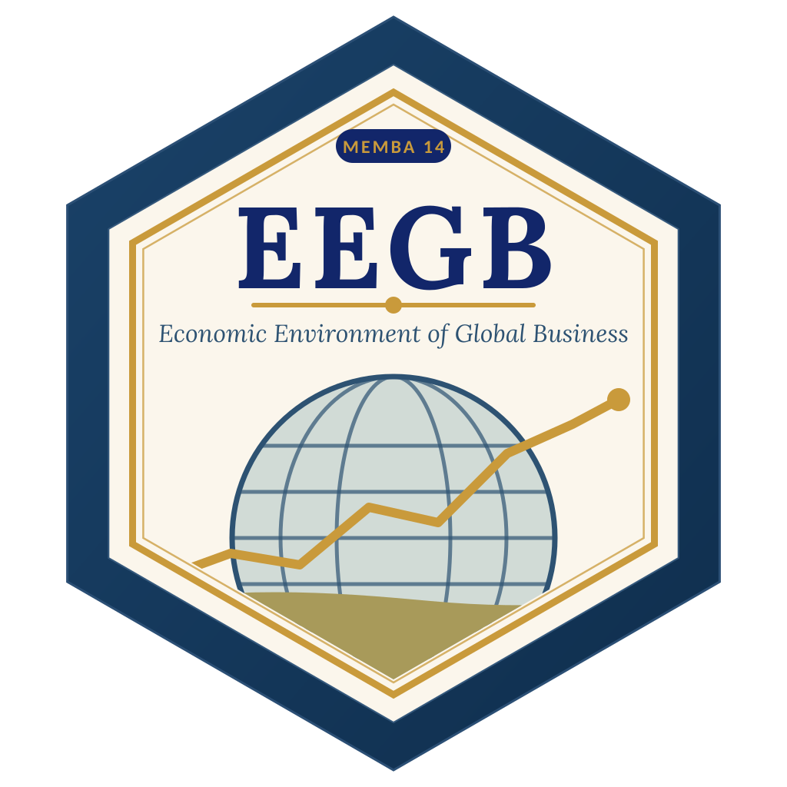
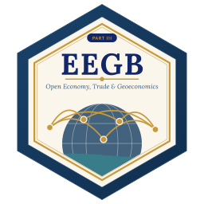
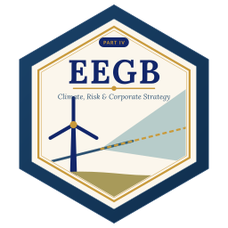

::: {.hero}
::: {.hero-text}
# How the economy shapes your strategy, risk and profits {.hero-title}

Sixteen sessions that take managers from the economic way of thinking to inflation, interest rates, the naira, trade, climate and country risk — every idea tied to a decision a Nigerian business has to make.

Every chart in every deck can be **regenerated in R or Python** from the scripts on this site. Download the slides, run the labs, and reuse the code on official data.

[Get set up](setup.qmd){.btn .btn-primary .btn-lg} [Start with the pre-module](pre-module.qmd){.btn .btn-outline-primary .btn-lg}
:::
{.hero-hex fig-alt="EEGB hex logo"}
:::

## How the course works

::: {.grid}
::: {.g-col-12 .g-col-md-3 .obj-card}
**16 on-campus sessions**

Four parts — micro, macro, open economy, strategy — plus a pre-module and an online intra-module session.
:::
::: {.g-col-12 .g-col-md-3 .obj-card}
**Slides to download**

Every session has a teaching deck (.pptx and PDF) in Lagos Business School format.
:::
::: {.g-col-12 .g-col-md-3 .obj-card}
**R and Python**

Every chart and lab exists in both languages, runnable in RStudio. Pick a tab; the site remembers.
:::
::: {.g-col-12 .g-col-md-3 .obj-card}
**Assessment**

Participation 30%, quizzes 10%, practice assignment 20%, closed-book final 40%. [Details](assessment.qmd).
:::
:::

## Before the module

- [**Pre-module**](pre-module.qmd) · Introductory video, global macro outlook webinar, readings and preparatory questions
- [**Intra-module online sessions**](intra-module.qmd) · Discussion forum and a topical webinar on macro-financial issues

## Part I: Microeconomics & the Market System

::: {.module-block}
{.module-hex}

::: {.module-list}
- [**Session 1** · Course Overview & Data Literacy for Managers](sessions/s01/index.qmd)
- [**Session 2** · Demand, Supply & Elasticity with Behavioural Insights](sessions/s02/index.qmd)
- [**Session 3** · Demand Forecasting & Market Sizing](sessions/s03/index.qmd)
- [**Session 4** · Market Structure, Platforms & Competition Policy](sessions/s04/index.qmd)
- [**Session 5** · Market Failures & Government Intervention](sessions/s05/index.qmd)
:::
:::

## Part II: Macroeconomics, Policy & Risk

::: {.module-block}
{.module-hex}

::: {.module-list}
- [**Session 6** · AD-AS in a Shock-Prone World](sessions/s06/index.qmd)
- [**Session 7** · National Accounts, Productivity & Welfare](sessions/s07/index.qmd)
- [**Session 8** · Monetary Policy from QE to QT](sessions/s08/index.qmd)
- [**Session 9** · Fiscal Policy, Debt & Sovereign Risk](sessions/s09/index.qmd)
- [**Session 10** · Financial Stability & Corporate Finance Conditions](sessions/s10/index.qmd)
:::
:::

## Part III: Open-Economy Macro, Trade & Geoeconomics

::: {.module-block}
{.module-hex}

::: {.module-list}
- [**Session 11** · Exchange Rates, Capital Flows & the Impossible Trinity](sessions/s11/index.qmd)
- [**Session 12** · Trade, Supply Chains & Industrial Policy](sessions/s12/index.qmd)
:::
:::

## Part IV: Strategic Frontiers: Climate, Risk & Corporate Macro Strategy

::: {.module-block}
{.module-hex}

::: {.module-list}
- [**Session 13** · Climate & Energy-Transition Economics](sessions/s13/index.qmd)
- [**Session 14** · Country Risk & Scenario Planning](sessions/s14/index.qmd)
- [**Session 15** · Corporate Macro Strategy: Hedging & Resilience](sessions/s15/index.qmd)
- [**Session 16** · Capstone & Integrative Review](sessions/s16/index.qmd) capstone
:::
:::

::: {.callout-note appearance="simple"}
Facilitators: Prof. Bongo Adi, Kelechi Nnamdi, Elvis Ozegbe, and Sumendra Dash (guest). All materials are open on [GitHub](https://github.com/adibongo/eegb). The datasets are **stylised teaching data** shaped like the Nigerian economy — not official statistics. See [Datasets](datasets.qmd) for how to download the real series.
:::
