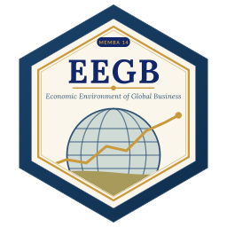

::: {.session-banner}
{.banner-hex width="96"}

**Between the on-campus sessions** · One online session (webinar) and an asynchronous discussion forum.
:::

## 1 · Discussion forum: microeconomics for the digital age

Post one contribution (about 200 words) and reply to two classmates. Choose **one** prompt:

- **Elasticity.** Pick a product your company sells. How price-sensitive are your customers, and how do you know? What happened the last time you raised prices? (Links to [Session 2](sessions/s02/index.qmd).)
- **Pricing power.** Which firms in your industry can raise prices without losing customers — and why? Brand, switching costs, regulation, scale?
- **Network effects.** Name a platform you use at work (payments, logistics, marketplaces). Does it get more valuable as more people join? Is that good or bad for competition? (Links to [Session 4](sessions/s04/index.qmd).)
- **Reflection.** Look back at your pre-module answers. What would you now say differently?

::: {.callout-tip appearance="simple"}
**What a good post looks like:** one clear claim, one piece of evidence (a number, a price, a market share), and one question for your classmates.
:::

## 2 · Topical webinar: macro-financial issues in real time

A case-based discussion of what is moving markets now. Typical topics:

- **Inflation persistence and the path of interest rates** — is disinflation real, and when might the CBN cut? (Sessions [6](sessions/s06/index.qmd) and [8](sessions/s08/index.qmd).)
- **FX market reforms** — what the naira's unification changed for importers, exporters and investors. ([Session 11](sessions/s11/index.qmd).)
- **Global supply-chain reconfiguration** — de-risking, friend-shoring and AfCFTA. ([Session 12](sessions/s12/index.qmd).)

Before the webinar, check the latest inflation release, the most recent Monetary Policy Committee communiqué and the current exchange rate. Bring one question.

::: {.session-nav}
[← Home](index.qmd)
[Assessment →](assessment.qmd){.next}
:::
