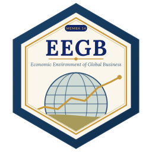

::: {.session-banner}
{.banner-hex width="96"}

**Before the on-campus module** · One online touchpoint: a short video, a live webinar, and a reading assignment with four preparatory questions.
:::

## Why this matters

Most managers already feel the economy every day: the exchange rate on an import invoice, inflation in the wage bill, interest rates on the overdraft. The pre-module gives you the words and mental models to **explain** those forces, so the on-campus sessions can go straight to decisions.

## 1 · Introductory video: what "macro for managers" means in the 2020s

The video sets out the big shifts that make this course different from a textbook economics class:

- **A new inflation regime.** After years of low global inflation, prices surged worldwide from 2021. In Nigeria, the 2023 reforms pushed inflation above 30%.
- **AI and productivity.** New technology may raise output per worker — or concentrate gains in a few platforms.
- **Geo-economics.** Trade is increasingly shaped by security and politics: sanctions, export controls, "friend-shoring".
- **Climate.** Carbon pricing and climate risk are reaching company balance sheets.
- **Financial stability.** Rapid rate rises exposed weak banks (Silicon Valley Bank in 2023).
- **A Nigeria focus.** Fuel-subsidy removal, exchange-rate unification and monetary tightening reshaped the business environment from 2023.

## 2 · Live webinar: global macro outlook and the Africa / Nigeria pulse

A live session on what the global and Nigerian outlook means for **prices, interest rates, the exchange rate, supply chains and policy**. Come with one question about your own industry.

## 3 · Readings and short assignment

Read, in this order:

1. **Note on Microeconomics for Managers** (updated) — demand, supply, elasticity, costs, market structure.
2. **Note on Macroeconomics for Managers** — output, inflation, money, interest rates, the exchange rate.
3. **IMF World Economic Outlook** — the executive summary of the latest edition.
4. **World Bank Nigeria Development Update** — the latest edition's overview.

::: {.callout-tip appearance="simple"}
**Reading tip.** Don't try to remember every number. For each reading, write down **three ideas** and **one number** that surprised you.
:::

## Preparatory questions

Bring short written answers (a paragraph each) to Session 1. They feed the class discussion and count towards participation.

1. How do **micro** forces (in your firm and market) and **macro** forces (economy-wide) jointly shape your pricing, output and risk?
2. Which **three macro indicators** matter most to your industry over the next 12 months — and why?
3. Identify **one market failure** relevant to your firm (for example data externalities, emissions or information asymmetry) and one feasible policy or market-design fix.
4. What is the **most material macro risk** facing Nigeria today? Justify your answer with data.

::: {.callout-note appearance="simple"}
**Using data for Question 4.** Open the [Datasets](datasets.qmd) page or run the [Session 1 lab](sessions/s01/index.qmd). For official numbers, use the CBN and NBS websites or `tools/fetch_official_data.py`.
:::

::: {.session-nav}
[← Home](index.qmd)
[Session 1: Data Literacy for Managers →](sessions/s01/index.qmd){.next}
:::
