::: {.session-banner}
{.banner-hex width="96"}

**Session 1 of 16** · Facilitator: Bongo Adi<br>*The question:* FY2024: a Lagos FMCG firm reports naira revenue of ₦52bn, up from ₦40bn. Did the business grow?

:::

## The slides {.unnumbered}

::: {.download-row}
[<i class="bi bi-file-earmark-slides"></i> Teaching slides (.pptx)](../../sessions/s01/slides/EEGB_S01_Course_Overview_Data_Literacy_for_Managers.pptx){.btn .btn-primary download=""}
[<i class="bi bi-file-earmark-pdf"></i> Slides (PDF)](../../sessions/s01/slides/EEGB_S01_Course_Overview_Data_Literacy_for_Managers.pdf){.btn .btn-outline-primary download=""}
[<i class="bi bi-github"></i> Session folder on GitHub](https://github.com/adibongo/eegb/tree/main/sessions/s01){.btn .btn-outline-secondary}
:::

```{=html}
<div class="deck-viewer"><object data="../../sessions/s01/slides/EEGB_S01_Course_Overview_Data_Literacy_for_Managers.pdf#view=FitH" type="application/pdf" width="100%" height="620"><p>Your browser cannot show the slides here. <a href="../../sessions/s01/slides/EEGB_S01_Course_Overview_Data_Literacy_for_Managers.pdf">Open the PDF</a>.</p></object></div>
```

## This session

**Opening** (10 min) → **1 · Think like an economist** (22 min) → **2 · Read the numbers** (25 min) → **3 · Nowcast and dashboard** (18 min)

::: {.grid}
::: {.g-col-12 .g-col-md-4 .obj-card}
**Frame decisions like an economist**

Use **opportunity cost, the margin and incentives** on a real decision, and apply Mankiw's ten principles.
:::
::: {.g-col-12 .g-col-md-4 .obj-card}
**Read official data correctly**

Convert **nominal to real**; handle **rebasing, revisions** and percentage points; tell **correlation from causation**.
:::
::: {.g-col-12 .g-col-md-4 .obj-card}
**Build a board macro page**

Pick six indicators, read them with **fast signals**, and write a **'so what'** for your business.
:::
:::

## Read first {.unnumbered}

- **Mankiw, Principles of Economics — ch. 1–3** (core) — Ten principles; economists as scientists and advisers; the circular flow; comparative advantage.
- **Mankiw — ch. 22 & 23 (course copy)** (core) — Measuring income (GDP, real vs nominal, the deflator) and the cost of living (CPI and its biases). In the 7th–9th editions these are ch. 23–24.
- **Ferguson, The Ascent of Money — Intro & ch. 2** — Money, inflation as a transfer, bonds, and Argentina's long decline.
- **Piketty, Capital in the 21st Century — Introduction** — 'A Debate without Data?' and the Kuznets curve: how data and periods shape big conclusions.
- **LBS case: The Business Environment of Nigeria (IB-90)** — Oil dependence, macro volatility and the 2000s reforms (excess crude account; reserves \$7.5bn → \$60.8bn).
- **Note on Microeconomics for Managers** — Demand, supply and elasticity — the reading for Session 2.

## “Sales Are Up 30%. The Board Is Delighted.”

::: {.hook-quote}
FY2024: a Lagos FMCG firm reports naira revenue of ₦52bn, up from ₦40bn. Did the business grow?
:::

Before anyone celebrates, an economist runs three checks. By the end of today you will run all three:

::: {.grid}
::: {.g-col-12 .g-col-md-4 .obj-card}
**1 · Real or nominal?**

Consumer prices rose about 33% on average in 2024. If prices rose faster than sales, volume fell.
:::
::: {.g-col-12 .g-col-md-4 .obj-card}
**2 · In which currency?**

The naira averaged about ₦645/\$ in 2023 and ₦1,479/\$ in 2024. Imported inputs are priced in dollars.
:::
::: {.g-col-12 .g-col-md-4 .obj-card}
**3 · Compared with whom?**

If the category grew faster than 30% in naira, we lost market share.
:::
:::

::: {.callout-note collapse="true" appearance="minimal" icon=false}
## Sources and data notes

Sources: World Bank WDI — inflation, consumer prices, Nigeria 2024 = 33.24% (FP.CPI.TOTL.ZG); official exchange rate, period average, 2023 = ₦645.19, 2024 = ₦1,478.97 (PA.NUS.FCRF), last updated Oct 2026. The firm itself is illustrative.
:::

### The Macro-to-P&L Map: Where the Economy Hits Your Numbers

<span class="slide-kicker">THE MENTAL MODEL FOR THIS COURSE</span>

| When this moves… it hits… | Revenue (volume × price) | Cost of sales | Operating costs | Finance costs | FX gains & balance sheet |
|---|---|---|---|---|---|
| **Naira weakens** | Imported rivals dearer; exports more competitive | **Imported inputs and packaging cost more** | Diesel, spares, software licences | Dollar loans cost more in naira | **Revaluation losses on dollar liabilities** |
| **Inflation rises** | **Real incomes fall; customers trade down** | Local inputs and freight rise | Wage pressure, rent reviews | Rates rise to fight it | Inventory gains; idle cash loses value |
| **Interest rates rise** | Less consumer and distributor credit | Supplier credit dearer | — | **Overdrafts and loans reprice** | Naira assets attract inflows; FX steadier |
| **Growth and incomes rise** | **Volumes up; premium mix sells** | Tighter input markets | Competition for skilled staff | Banks lend on better terms | — |
| **Policy shifts (subsidy, tax, tariffs)** | Tariffs shield or expose you | Duties, fuel price | Transport, levies | Government borrowing crowds out credit | Tax treatment of FX gains |

*Bold = largest effect for an import-dependent FMCG firm.*

::: {.callout-tip appearance="simple"}
We will fill in this map session by session. **Every economic idea in EEGB ends with the question: which cell does it move — and by how much?**
:::

### Assessment — and How Today Prepares You

<span class="slide-kicker">HOW YOU WILL BE ASSESSED</span>

| Component | Weight | What it involves | Today's link |
|---|---|---|---|
| Class participation (in-person + online) | 30% | Cold calls, in-class problem-solving, polls and short reaction notes | Every check slide is a cold-call rehearsal |
| Short quizzes / polls | 10% | Pre-class checks on the readings | Mankiw ch. 1, 2, 22, 23 underpin today |
| Practice-based assignment | 20% | Data labs (FRED / IMF / CBN / NBS / World Bank), case brief, macro policy memo | Today's lab is Data Lab 1 |
| Final exam | 40% | On-site, closed-book examination | Expect: real growth, CPI, real rates, pp vs % |

::: {.callout-tip appearance="simple"}
Participation is a third of the grade. Read before class, bring one number from your own business, and be ready to defend a recommendation. The course roadmap is in the appendix.
:::

## Part 1 · Think Like an Economist

::: {.part-question}
**The question this part answers:** How should a manager frame a decision before reaching for the numbers?
:::

### Ten Principles — Translated for a Lagos Boardroom

<span class="slide-kicker">THE TOOLKIT · MANKIW CH. 1</span>

| # | Principle | In a Nigerian boardroom | Where |
|---|---|---|---|
| 1 | People face trade-offs | More FX for raw materials means less for debt service. | Today |
| 2 | The cost of something is what you give up to get it | Idle cash costs what it could have earned — and what inflation eats. | Today |
| 3 | Rational people think at the margin | Run the night shift only if its **extra** revenue beats its **extra** cost. | Today · S4 |
| 4 | People respond to incentives | A cheap subsidised price invites smuggling; an FX gap invites round-tripping. | Today · S5 |
| 5 | Trade can make everyone better off | Gains come from comparative advantage, not from being best at everything. | Today · S12 |
| 6 | Markets are usually a good way to organise activity | Prices carry information; rationing replaces them with queues. | Today · S2 |
| 7 | Governments can sometimes improve market outcomes | Property rights, externalities, market power — if the state has capacity. | S4 · S5 |
| 8 | Living standards depend on productivity | Real output per person has fallen about 10% since 2014. | Today · S7 |
| 9 | Prices rise when the government prints too much money | Ways & Means financing preceded the 2023–24 inflation surge. | S8 · S9 |
| 10 | Short-run trade-off between inflation and unemployment | Rate hikes cool prices but squeeze sales and jobs first. | S6 |

::: {.callout-note collapse="true" appearance="minimal" icon=false}
## Sources and data notes

Mankiw groups the principles: 1–4 how people make decisions; 5–7 how people interact; 8–10 how the economy as a whole works. Today we work through 2, 3, 4, 5, 6–7 and 8 with examples; 9 and 10 are previewed here and in the appendix, and taught fully in Sessions 6, 8 and 9.

Principle 8 figure: World Bank NY.GDP.PCAP.KD, Nigeria 2014 = \$2,584, 2024 = \$2,325 (constant 2015 US\$), −10.0%. Ways & Means: CBN overdrafts to the FGN of about ₦22.7trn were securitised in May 2023.
:::

### What Did ₦1bn of Idle Cash Really Cost in 2024?

<span class="slide-kicker">PRINCIPLE 2 · OPPORTUNITY COST</span>

| ₦1bn, end-2023 → end-2024 | Naira, end-2024 | Real (Dec-23 ₦) |
|---|---|---|
| Leave it in a current account (0%) | ₦1.00bn | ₦0.74bn |
| 364-day T-bill, Jan 2024 (11.5%) | ₦1.12bn | ₦0.83bn |
| Pre-buy \$-priced inputs at ₦899/\$ | worth ≈ ₦1.71bn | ≈ ₦1.27bn |

**Step by step**

1. Inflation in the year to Dec 2024 was **34.8%**: ₦1 at end-2024 bought what ₦0.74 bought a year earlier (1 ÷ 1.348).
2. Idle cash therefore **lost about ₦258m** of purchasing power — a real cost that no invoice ever shows.
3. A one-year T-bill bought in **January 2024** yielded about **11.5%**; yields near 20% came only after the February–March hikes. Real return: 1.115 ÷ 1.348 − 1 ≈ **−17%**.
4. Pre-buying hedged the naira's fall from **₦899 to ₦1,535/\$** (+71%) — but tied up cash and warehouse space, and stock can spoil. That is **its** opportunity cost.

::: {.callout-note appearance="simple" icon=false}
## So what for your treasury

In 2024 the 'safe' choice — idle naira — was the most expensive one, and even T-bills lost in real terms. Only the **dollar-linked** option kept its value. With the real policy rate now about **+7%** (Part 2), that ranking has reversed.
:::

::: {.result-box}
The cost of a decision is the **best alternative given up** — measured in real terms, not just in naira.
:::

::: {.callout-note collapse="true" appearance="minimal" icon=false}
## Sources and data notes

Sources: NBS CPI Dec 2024 = 34.80% y/y (CBN statistics). 364-day NTB auction yields: 8.40% (10 Jan 2024), 11.54% (24 Jan 2024) — Nairametrics, 26 Jan 2024; 19% (late Feb) and 21.49% (6 Mar 2024) — Nairametrics/ThisDay. CBN official central rate: ₦899.39/\$ (29 Dec 2023), ₦1,535.32/\$ (31 Dec 2024) → ×1.707; real 1.707 ÷ 1.348 = 1.27.
:::

### Should the Factory Run a Third (Night) Shift? <span class='tag tag-illus'>illustrative</span>

<span class="slide-kicker">PRINCIPLE 3 · THINK AT THE MARGIN</span>

| Per night of the third shift | ₦ million |
|---|---|
| Extra output: 6,000 cartons × ₦4,500 net price | +27.0 |
| Materials: 6,000 × ₦3,000 | −18.0 |
| Night-shift labour and supervision | −3.2 |
| Diesel — the grid is unreliable at night | −6.5 |
| **Marginal profit per night** | **−0.7** |

**Step by step**

1. Finance says: 'average cost per carton falls from ₦5,000 to ₦4,900 because fixed costs are spread' — **true but irrelevant**.
2. Fixed costs (rent, depreciation, head office) are paid whether or not the shift runs. They are **not marginal**.
3. Ask only: does the **extra** revenue exceed the **extra** cost? Here it falls short by ₦0.7m a night.
4. The decision flips if diesel falls, the grid improves or the price rises — so those are the numbers to watch.

::: {.callout-note appearance="simple" icon=false}
## Try it

Find the break-even. At what diesel cost does the shift pay? (₦5.8m a night.) At what net price per carton? (₦4,617.) Good managers know the **two or three numbers that flip the decision**.
:::

::: {.result-box}
Decide at the **margin**: compare extra benefit with extra cost. Averages and sunk costs mislead.
:::

### People Respond to Incentives — Often Unexpectedly

<span class="slide-kicker">PRINCIPLE 4 · INCENTIVES</span>

::: {.grid}
::: {.g-col-12 .g-col-md-4 .obj-card}
**Petrol subsidy**

Pump price held near **₦185/litre** until May 2023 while neighbours paid far more. Result: cross-border smuggling and a subsidy bill above **₦4trn** in 2022.

*Incentives change behaviour at the margin.*
:::
::: {.g-col-12 .g-col-md-4 .obj-card}
**Multiple exchange rates**

In May 2016 the street rate was **71% above** the official rate. Anyone with official access could buy cheap and sell dear; **round-tripping** grew while genuine importers queued.

*A price gap is an incentive.*
:::
::: {.g-col-12 .g-col-md-4 .obj-card}
**FX restrictions on imports**

Barring 41 items from the official FX window (2015) aimed to boost local production. It also **raised prices and rewarded smuggling** through porous borders.

*Watch what people do, not what the rule says.*
:::
:::

::: {.callout-tip appearance="simple"}
Before backing a policy — or a sales commission scheme — ask: **who gains, who loses, and how will each change behaviour?**
:::

::: {.callout-note collapse="true" appearance="minimal" icon=false}
## Sources and data notes

Sources: NNPC 'under-recovery' (petrol subsidy) ≈ ₦4.39trn in 2022; pump price ₦185/l before 29 May 2023. FX premium: CBN monthly averages, May 2016 — BDC vs official (see the exchange-rate chart in Part 2). CBN circular of June 2015 excluded 41 items from the official FX market. Company example to ask for: a commission plan that paid on volume and destroyed margin.
:::

### Comparative Advantage: Why the 'Better' Producer Still Gains <span class='tag tag-illus'>illustrative</span>

<span class="slide-kicker">PRINCIPLE 5 · TRADE CAN MAKE EVERYONE BETTER OFF</span>

| 120 hours of labour each | Hours per tonne of cement | Hours per bag of cocoa | Cost of 1 bag of cocoa |
|---|---|---|---|
| Nigeria | 2 | 4 | 2 t of cement |
| Ghana | 6 | 6 | 1 t of cement |
| No trade (split time evenly) | N 30 + G 10 = 40 t | N 15 + G 10 = 25 |  |
| Specialise by comparative advantage | N 50 + G 0 = 50 t | N 5 + G 20 = 25 | +10 t of cement |

**Step by step**

1. Nigeria is faster at **both** goods: it has the **absolute advantage** in each.
2. But a bag of cocoa costs Nigeria **2 tonnes** of cement forgone, and Ghana only **1 tonne**. Ghana has the **comparative advantage** in cocoa; Nigeria has it in cement.
3. If each leans towards what it gives up least to make, total output rises: the same 25 bags of cocoa plus **10 extra tonnes** of cement.
4. Trade at 1.5 t per bag: Ghana swaps 10 bags for 15 t and ends with **10 bags + 15 t** (was 10 + 10); Nigeria ends with **35 t + 15 bags** (was 30 + 15). **Both gain.**

::: {.result-box}
Gains from trade come from **comparative** advantage — differences in opportunity cost — not from being best at everything.
:::

::: {.callout-note collapse="true" appearance="minimal" icon=false}
## Sources and data notes

Mankiw ch. 3 ('Interdependence and the Gains from Trade') uses a farmer and a rancher; the logic is identical. Numbers are illustrative, not real productivities. Firm-level version: should your best salesperson also do the invoicing because she is faster at it? No — her opportunity cost is lost sales. Who loses from trade (import-competing workers and firms) is part of Session 12.
:::

### Markets Usually Work — Governments Can Sometimes Help

<span class="slide-kicker">PRINCIPLES 6 & 7 · MARKETS AND GOVERNMENT</span>

::: {.grid}
::: {.g-col-12 .g-col-md-6 .obj-card}
**6 · Markets usually work well**

*Prices carry information and incentives*

- A price summarises scarcity: when it rises, buyers economise and sellers supply more — with no one coordinating them.
- When the official naira rate was held below the market, dollars **were rationed**: queues and a parallel market replaced the price signal.
- Price controls create shortages, queues or black markets — the price is still paid, just in another form.
- Adam Smith's 'invisible hand': self-interest, guided by prices, can serve the common good.
:::
::: {.g-col-12 .g-col-md-6 .obj-card}
**7 · Governments can sometimes help**

*When markets fail — and when the state has capacity*

- **Property rights and contracts**: markets work only if courts enforce them.
- **Externalities**: pollution, gas flaring and congestion impose costs that prices ignore (Session 5).
- **Market power**: a dominant firm or platform can price above the efficient level (Session 4).
- 'Sometimes' is the key word: policy can also fail — through poor design, weak capacity or capture.
:::
:::

::: {.callout-tip appearance="simple"}
The manager's question is never 'market or state?' but **'what is failing here, and will the proposed fix work better than the failure?'**
:::

::: {.callout-note collapse="true" appearance="minimal" icon=false}
## Sources and data notes

Mankiw ch. 1, principles 6–7 and the invisible-hand passage. Use FX rationing (2015–2023) as the bridge: the control did not remove the cost of dollars; it moved it into queues, premiums and lost production.
:::

### Living Standards Depend on What a Country Produces

<span class="slide-kicker">PRINCIPLE 8 · PRODUCTIVITY</span>

::: {.panel-tabset group="lang"}
## Python
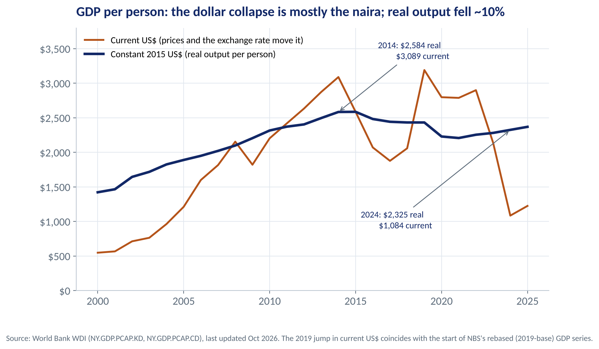{.fig-img fig-alt="S01-F05 (Python)"}

## R
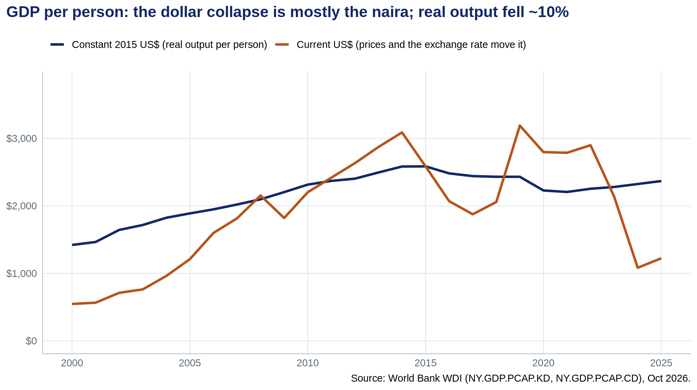{.fig-img fig-alt="S01-F05 (R)"}

:::

- **Real** output per person (constant 2015 US\$) was **\$2,584 in 2014**, near its 2015 peak, and **\$2,325 in 2024**: about **10% lower**.
- Population grew about **2–2.6% a year**; output barely kept up — echoing **1992–2002**, when the LBS case IB-90 reports GDP growth of 2.25% against population growth of 2.8% (older data).
- The **current-dollar** line falls by two-thirds — mostly the **naira's collapse**, not lost production. It also jumps in 2019 where the rebased GDP series begins.
- Wages rise sustainably only with **output per worker**: power, skills, technology, institutions (Session 7).

<span class="fig-id">S01-F05 · replicate with s01_figures.py / .R</span>

::: {.callout-note collapse="true" appearance="minimal" icon=false}
## Sources and data notes

Sources: World Bank WDI NY.GDP.PCAP.KD and NY.GDP.PCAP.CD (updated Oct 2026): 2014 \$2,583.6 real (2015 peak \$2,585.7) / \$3,088.7 current; 2024 \$2,324.6 / \$1,084.2. SP.POP.GROW: 2.6% (2014) to 2.1% (2024). 'The Business Environment of Nigeria' (IB-90), p. 6, for 1992–2002.
:::

### Money, Prices and the Short-Run Trade-Off

<span class="slide-kicker">PRINCIPLES 9 & 10 · THE ECONOMY AS A WHOLE — PREVIEW</span>

::: {.lead-box}
**What Sessions 6, 8 and 9 will build.** **9.** Prices rise when the government finances itself by creating money.

**10.** In the short run, lowering inflation usually costs output and jobs.
:::

- **Inflation is a transfer (Ferguson).** _The Ascent of Money_ shows inflation moving wealth from savers and bondholders to debtors. Argentina pegged, slashed inflation — and still defaulted in 2001 because **fiscal** discipline never followed.
- **Nigeria: money financing, then the bill.** CBN 'Ways & Means' lending to the government reached about **₦22.7trn** before being securitised in 2023. Inflation peaked at **34.8%** in December 2024.
- **The trade-off in practice.** The CBN raised its policy rate from **18.75% to 27.5%** during 2024, began cutting only in **September 2025** as inflation fell, and is now at **23%** (September 2026). Volumes and jobs feel tightening **before** prices do.
- **Manager's use.** When the MPC tightens, plan for **slower demand and tighter working capital** over the next year; when it eases, the reverse.

*Full treatment and Nigerian data in the appendix and in Part II.*

::: {.callout-note collapse="true" appearance="minimal" icon=false}
## Sources and data notes

Sources: Ferguson, The Ascent of Money (2008), Introduction and ch. 2. Ways & Means: Senate approved securitisation of ₦22.7trn on 3–4 May 2023 (ThisDay); a further ₦7.3trn was securitised later, taking the total near ₦30trn. MPR path: CBN money-market indicators (18.75% Dec 2023; 27.50% Nov 2024; 27.0% from 23 Sep 2025; 26.5% from Feb 2026; 23.00% from 22 Sep 2026). Inflation: CBN/NBS CPI. Unemployment-measurement caveat (33.3% → 4.1% after NBS's 2023 methodology change) is in the appendix.
:::

### Check your understanding

**Your CFO wants to run the night shift because 'it lowers our average cost per carton'. Which reply best applies today's principles?**

- **A.** Agree — a lower average cost means each carton is now more profitable
- **B.** Reject it — fixed costs make night shifts unprofitable in Nigeria
- **C.** Ask whether the shift's extra revenue covers its extra cost, ignoring fixed costs we pay anyway
- **D.** Postpone until next quarter's GDP data show whether demand is growing

::: {.callout-tip collapse="true" appearance="simple"}
## Show answer
C. Marginal thinking: only costs that change with the decision matter. A lower average cost can coexist with a loss on the extra output (−₦0.7m a night in our example). A confuses average with marginal; B blames the fixed costs, which are irrelevant to the decision; D waits for slow data on a question your own numbers answer.
:::

## Part 2 · Read the Numbers

::: {.part-question}
**The question this part answers:** Did our firm actually grow — and what is the economy really doing?
:::

### From Concept to Headline: Where Errors Creep In

<span class="slide-kicker">EVERY STATISTIC HAS A SUPPLY CHAIN</span>

1. **Concept** — What do we want to know? e.g. the cost of living.
2. **Definition** — Which basket, households, prices, base year?
3. **Collection** — Surveys, admin and tax records. Is the informal sector covered?
4. **Aggregation** — Weights and index formulas turn thousands of prices into one number.
5. **Release** — Headline first, detail later. Lags matter.
6. **Revision** — Rebasing and new data change history — even recent history.

::: {.callout-tip appearance="simple"}
Piketty's warning applies to every board paper: without precise sources, methods and concepts, **you can see everything and its opposite.**
:::

::: {.callout-note collapse="true" appearance="minimal" icon=false}
## Sources and data notes

Piketty, Capital in the Twenty-First Century (2014), Introduction, 'A Debate without Data?'. Each link maps onto a trap in this part: definition (rebasing), coverage (share of what?), aggregation (CPI weights), revision (the 2025 inflation revision).
:::

### How the CPI Is Built — a Five-Step Worked Example <span class='tag tag-illus'>illustrative</span>

<span class="slide-kicker">MEASURING PRICES · MANKIW CH. 23</span>

| Monthly basket | Qty | 2024 price | 2025 price | 2024 cost | 2025 cost |
|---|---|---|---|---|---|
| Rice (50 kg bag) | 1 | ₦80,000 | ₦72,000 | ₦80,000 | ₦72,000 |
| Garri (bucket) | 4 | ₦4,000 | ₦4,800 | ₦16,000 | ₦19,200 |
| Petrol (litres) | 60 | ₦700 | ₦900 | ₦42,000 | ₦54,000 |
| Transport (trips) | 40 | ₦500 | ₦600 | ₦20,000 | ₦24,000 |
| Rent (monthly) | 1 | ₦100,000 | ₦120,000 | ₦100,000 | ₦120,000 |
| **Cost of basket** |  |  |  | **₦258,000** | **₦289,200** |

**Step by step**

1. **Fix the basket**: what a typical household buys (quantities held constant).
2. **Collect prices** for each item in each period.
3. **Cost the basket** each year at that year's prices.
4. **Pick a base year** and index: 289,200 ÷ 258,000 × 100 = **112.1**.
5. **Inflation** = 112.1 ÷ 100 − 1 = **12.1%**, even though rice got cheaper.

::: {.result-box}
The CPI tracks a **fixed basket**. Your firm's own input basket may inflate much faster or slower.
:::

::: {.callout-note collapse="true" appearance="minimal" icon=false}
## Sources and data notes

Mankiw ch. 23 uses hot dogs and hamburgers; this is a Lagos basket with illustrative prices. Ask: what is your company's 'basket' of inputs and how did its cost change? That is your firm's own inflation rate. Biases of the CPI (substitution, new goods, quality) are in the appendix.
:::

### Inflation: Food Led, Core Followed — Then the Yardstick Changed

<span class="slide-kicker">TRAP 1 · REBASING AND REVISIONS</span>

::: {.panel-tabset group="lang"}
## Python
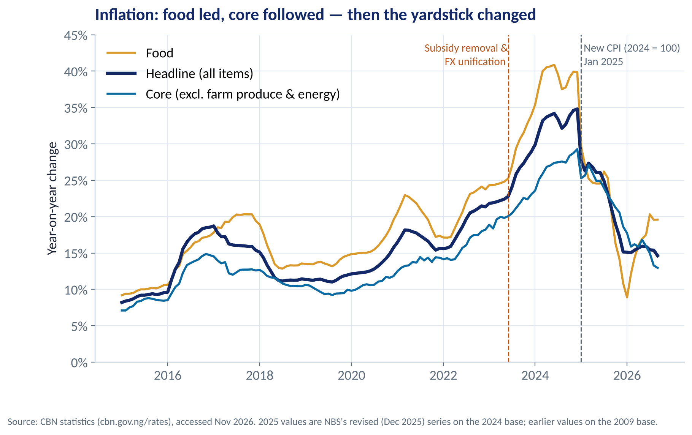{.fig-img fig-alt="S01-F01 (Python)"}

## R
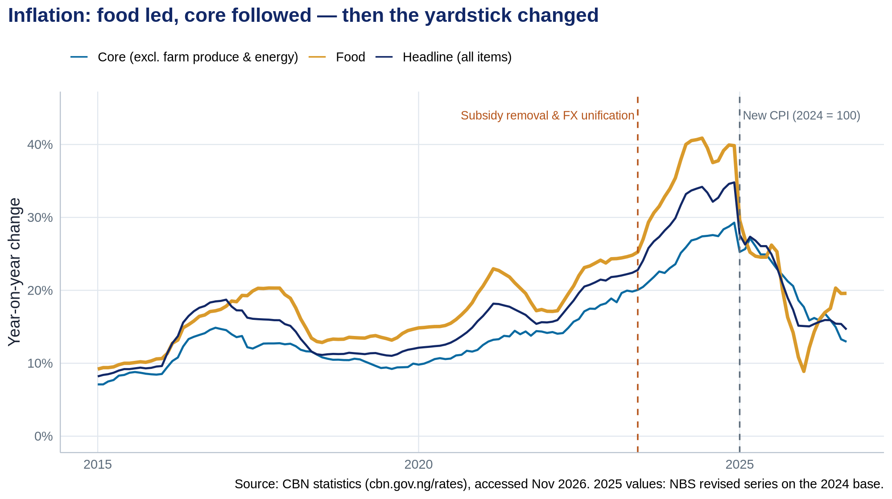{.fig-img fig-alt="S01-F01 (R)"}

:::

- Dec 2024: **34.8%** on the old CPI (2009 base, food **51.8%** of the basket).
- Jan 2025: new CPI (**2024 = 100**, food weight **40%**). First published as **24.48%**…
- …then **revised to 27.61%** when NBS reviewed its method in Dec 2025. Even 'latest data' changes.
- Sep 2026: headline **14.6%**, food 19.6%, core 13.0% — a genuine fall, on the new yardstick.
- **Never compare across a rebasing** without the statistics office's linked series.

<span class="fig-id">S01-F01 · replicate with s01_figures.py / .R</span>

::: {.callout-note collapse="true" appearance="minimal" icon=false}
## Sources and data notes

Sources: CBN statistics (inflation API) reproducing NBS CPI; NBS rebasing (Feb 2025: base 2009 → 2024, food weight 51.8% → 40%, The Guardian); NBS methodology review, Dec 2025 (Jan 2025 revised 24.48% → 27.61%, Nairametrics, 16 Jan 2026). Ask: what would you tell a union negotiating wages off 'inflation has halved'?
:::

### The Day Nigeria's Economy 'Grew' 35%

<span class="slide-kicker">TRAP 2 · REBASING GDP</span>

::: {.grid}
::: {.g-col-12 .g-col-md-4 .stat-card}
[₦372.8trn]{.stat-value}

**2024 nominal GDP, rebased**

New base year **2019** (was 2010), published by NBS in July 2025.
:::
::: {.g-col-12 .g-col-md-4 .stat-card}
[+35.4%]{.stat-value}

**vs the old estimate**

Same economy, better measurement: fintech, creative industries, telecoms and more informal activity captured.
:::
::: {.g-col-12 .g-col-md-4 .stat-card}
[0]{.stat-value}

**Extra naira in anyone's pocket**

Rebasing changes the **level**. Ratios drop overnight: debt-to-GDP, tax-to-GDP, credit-to-GDP.
:::
:::

::: {.callout-tip appearance="simple"}
Before comparing GDP ratios across years or countries, ask: **which base year?** A covenant of 'debt below 40% of GDP' can be met overnight by a rebasing.
:::

::: {.callout-note collapse="true" appearance="minimal" icon=false}
## Sources and data notes

Source: NBS rebased GDP release, July 2025 (2024 nominal GDP ₦372.8trn; +35.4% vs old series) — TechEconomy factsheet. Nigeria's previous rebasing (April 2014, base 1990 → 2010) raised 2013 GDP by about 89%.
:::

### Oil Is 4% of GDP — and Still Most of Nigeria's Exports

<span class="slide-kicker">TRAP 3 · 'SHARE OF WHAT?'</span>

|  | % |
|---|---|
| Oil's share of real GDP | 4.2% |
| Crude oil's share of export value | 47.8% |
| Oil and gas share of export value | 86.2% |

*Q2 2026. Sources: NBS GDP report; NBS Foreign Trade in Goods (crude ₦12.91trn, other ₦14.11trn incl. non-oil ₦3.72trn, of ₦27.0trn).*

- Oil adds little **value added** in real GDP — it is capital-intensive and measured at constant prices.
- But oil earns most of the **dollars**: crude alone was about 48% of exports; oil and gas about 86%.
- So the oil price still drives the **naira, reserves and government revenue**.
- Always ask: share of **GDP, exports, revenue or FX supply**?

::: {.callout-note collapse="true" appearance="minimal" icon=false}
## Sources and data notes

Sources: NBS GDP Q2 2026 (oil 4.16% of real GDP); NBS Foreign Trade in Goods Q2 2026 via Intelpoint (crude ₦12.91trn; non-crude ₦14.11trn; non-oil ₦3.72trn = 13.8% of total). Oil and gas share = (27.02 − 3.72) / 27.02 = 86.2%. In the 2000s oil supplied about 95% of FX earnings (LBS case IB-90).
:::

### Small Words, Big Mistakes

<span class="slide-kicker">TRAP 4 · PERCENT VS PERCENTAGE POINTS</span>

| Change | Percentage points | Percent |
|---|---|---|
| Inflation 34.8% → 14.6% | −20.2 pp | −58% |
| MPR 26.5% → 23.0% | −3.5 pp (350 bp) | −13.2% |
| CPI food weight 51.8% → 40% | −11.8 pp | −22.8% |

**Step by step**

1. A **percentage point (pp)** is the simple difference between two rates.
2. A **percent change** is the change relative to the starting level.
3. Markets speak in **basis points**: 1 pp = 100 bp. The September 2026 MPC cut was **350 bp**.
4. 'Food weight cut by over 22 per cent' (Feb 2025 headline) is right as a percent — the weight fell **11.8 points**.

::: {.callout-note appearance="simple" icon=false}
## Worked example

A loan priced at 'MPR + 4%' fell from 30.5% to 27.0% after the September 2026 cut: a **3.5 pp** fall in the rate, which cuts the interest bill by **11.5%**. Both numbers are right; they answer different questions.
:::

::: {.result-box}
Say **pp** for changes in rates. Mixing the two misstates a change by a factor of two to four.
:::

::: {.callout-note collapse="true" appearance="minimal" icon=false}
## Sources and data notes

Sources: CBN/NBS CPI (Dec 2024 34.80%, Sep 2026 14.63%); CBN MPC (MPR 26.5% → 23%, Sep 2026); The Guardian, Feb 2025, 'NBS unveils new inflation template, reduces food weight to 40%' (guardian.ng/news/nbs-unveils-new-inflation-template-reduces-food-weight-to-40/). Year-on-year vs month-on-month and base effects are in the appendix.
:::

### Real vs Nominal: One Revenue Figure, Three Answers

<span class="slide-kicker">BACK TO THE 30% QUESTION</span>

::: {.panel-tabset group="lang"}
## Python
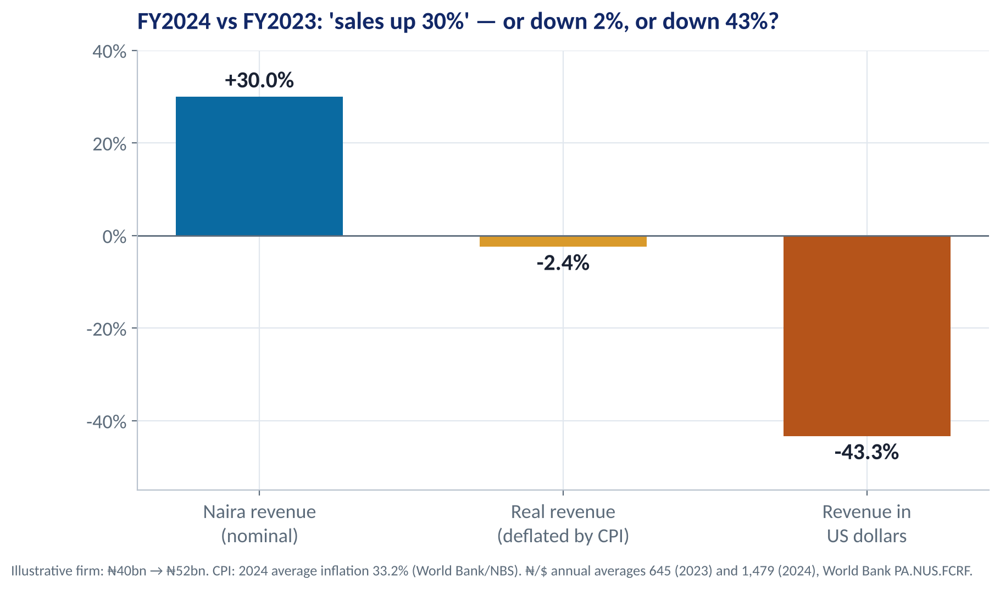{.fig-img fig-alt="S01-F07 (Python)"}

## R
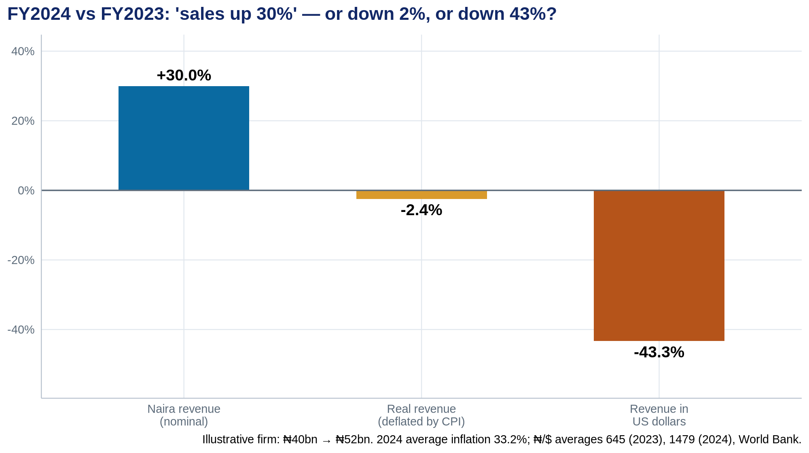{.fig-img fig-alt="S01-F07 (R)"}

:::

- **Real growth**: (1 + nominal) ÷ (1 + inflation) − 1 = 1.30 ÷ 1.332 − 1 ≈ **−2.4%**. Volume fell.
- The shortcut 'nominal − inflation' gives −3.2%: fine for small rates, off at Nigerian rates.
- **In dollars**: ₦40bn ÷ 645 = **\$62.0m** → ₦52bn ÷ 1,479 = **\$35.2m**: down **43%**.
- The board was celebrating a business that shrank. Report **real, naira and dollar** figures side by side.
- Targets and bonuses set in nominal naira **reward inflation, not performance**.

<span class="fig-id">S01-F07 · replicate with s01_figures.py / .R</span>

::: {.callout-note collapse="true" appearance="minimal" icon=false}
## Sources and data notes

Uses 2024 average inflation (33.24%) and annual-average exchange rates (₦645.19, ₦1,478.97), World Bank WDI. Which deflator? The firm's own price index gives volume growth; the CPI gives the customers' purchasing-power view. Ask participants to redo this for their own firm before Session 2.
:::

### Naira per Dollar: Rationing, Then a Reset

<span class="slide-kicker">THE EXCHANGE RATE</span>

::: {.panel-tabset group="lang"}
## Python
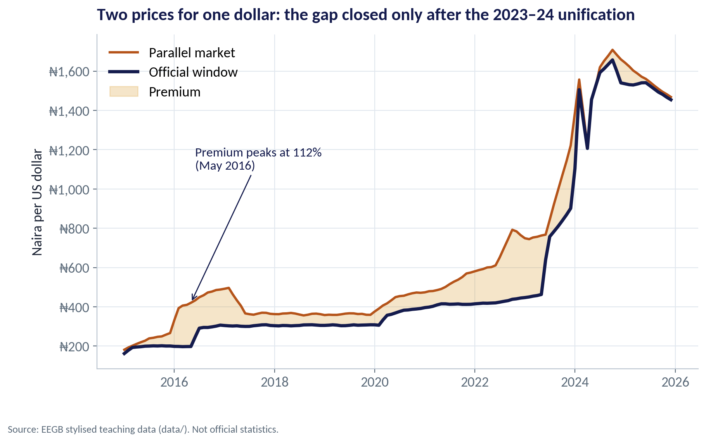{.fig-img fig-alt="S01-F02 (Python)"}

## R
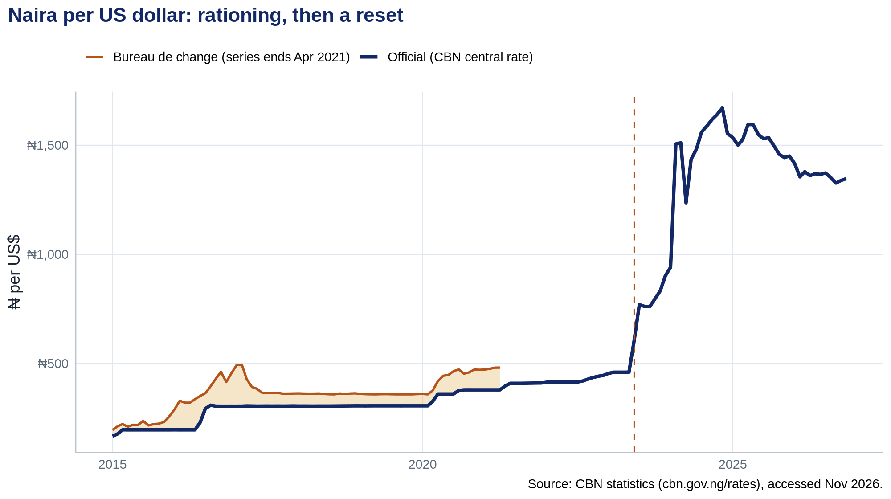{.fig-img fig-alt="S01-F02 (R)"}

:::

- Until 2023 the CBN held an official rate; the **bureau-de-change** rate shows the market's price. The gap peaked at **71% (May 2016)**.
- A premium signals **rationing** — Principle 6 at work — and an incentive to arbitrage (Principle 4).
- June 2023 unification: the naira moved from about **₦460 to ₦750/\$** within weeks, then past **₦1,500**.
- Today: **₦1,347/\$** (CBN, 4 Nov 2026). **Use the rate you actually transact at.**

<span class="fig-id">S01-F02 · replicate with s01_figures.py / .R</span>

::: {.callout-note collapse="true" appearance="minimal" icon=false}
## Sources and data notes

Source: CBN statistics — official central rate (daily, averaged monthly) and BDC monthly average (CBN series ends April 2021). Latest: CBN central rate ₦1,347.30/\$, 4 Nov 2026. Session 11 covers regimes, unification and the trilemma.
:::

### Did Savers Beat Inflation? The Real Policy Rate

<span class="slide-kicker">REAL INTEREST RATES</span>

::: {.panel-tabset group="lang"}
## Python
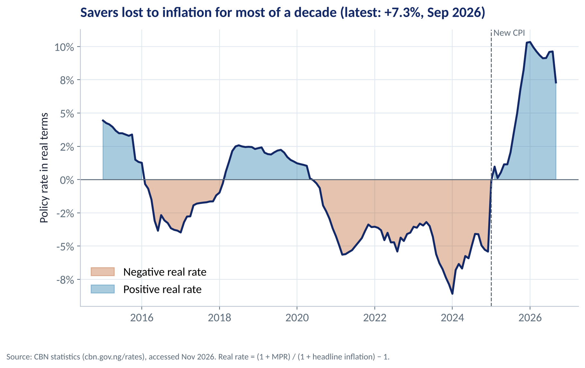{.fig-img fig-alt="S01-F03 (Python)"}

## R
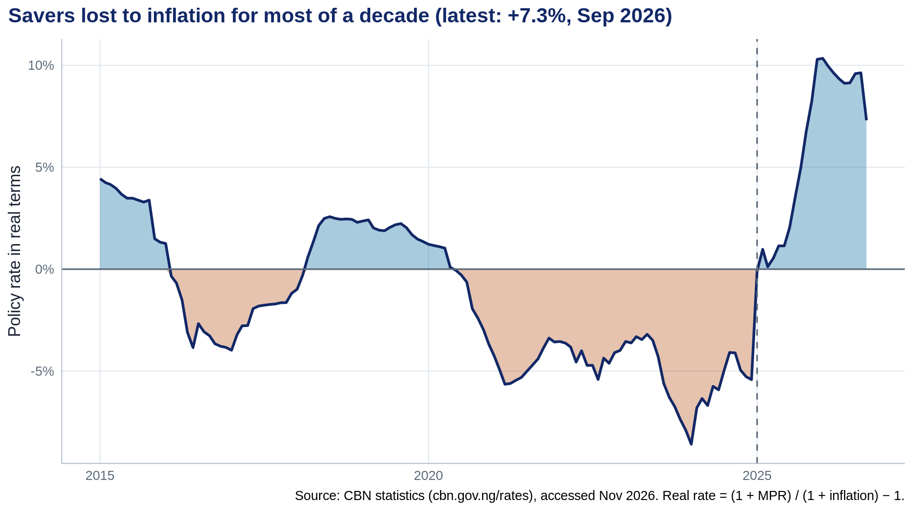{.fig-img fig-alt="S01-F03 (R)"}

:::

- Real rate = (1 + policy rate) ÷ (1 + inflation) − 1 — the same arithmetic as real revenue.
- For most of 2016–2024 it was **negative**, falling below **−8%** in 2024: naira savings lost value, pushing savers into dollars, land and stock.
- Today: MPR **23%**, inflation **14.6%** → real rate **+7.3%**. Holding naira now **pays**.
- Part of the jump in January 2025 is the **new CPI** — measurement, not just policy.

<span class="fig-id">S01-F03 · replicate with s01_figures.py / .R</span>

::: {.callout-note collapse="true" appearance="minimal" icon=false}
## Sources and data notes

Source: CBN statistics (MPR and headline CPI, monthly). Exact Fisher formula. Sep 2026: 1.23 / 1.1463 − 1 = 7.3%. Ask: which cash and inventory habits did your firm learn when real rates were negative — and which should change now?
:::

### Four Reasons Two Series Move Together

<span class="slide-kicker">TRAP 5 · CORRELATION IS NOT CAUSATION</span>

::: {.lead-box}
**The rule.** Correlation tells you that two series **move together**. It does not tell you **why** — or which way the arrow points.
:::

- **A third factor drives both.** Bank credit and inflation both jumped after the 2023 devaluation: the weaker naira **revalued dollar loans** and **raised import prices**.
- **Reverse causality.** Branches that spend more on marketing sell more — partly because budgets are **set as a share of last year's sales**.
- **Time lags.** Policy and price shocks work with lags. A same-month correlation can show **no link, or the wrong sign**.
- **Coincidence and small samples.** Two trending series always look related. Short windows and data-mining produce **spurious** patterns — the Kuznets curve story in the appendix is the classic.

*Before acting on 'X drives Y', rule out all four.*

### Oil Earns Nigeria's Dollars — Yet Reserves Don't Simply Track It

<span class="slide-kicker">SEE IT IN THE DATA</span>

::: {.panel-tabset group="lang"}
## Python
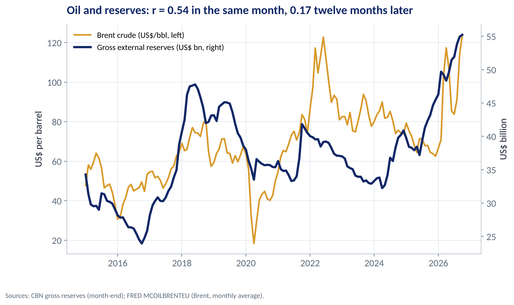{.fig-img fig-alt="S01-F04 (Python)"}

## R
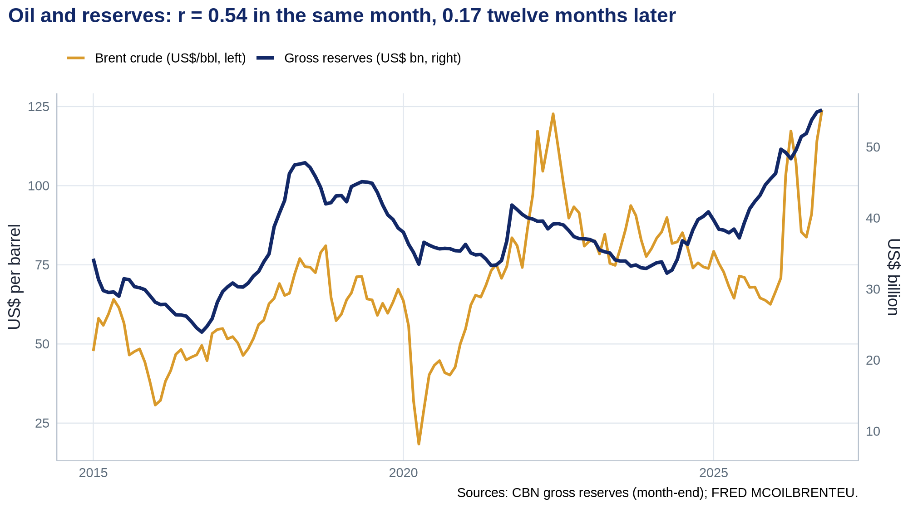{.fig-img fig-alt="S01-F04 (R)"}

:::

- The causal channel is clear: oil and gas earn most of the FX (Trap 3).
- Yet the correlation is only **0.54** in the same month — and **0.17** a year later.
- Why? Oil-backed loans and forward sales, CBN intervention, Eurobond and loan inflows, and **2026's reserve build despite** a volatile oil price.
- A causal link can hide inside a weak correlation, and a strong correlation can hide no link at all.

<span class="fig-id">S01-F04 · replicate with s01_figures.py / .R</span>

::: {.callout-note collapse="true" appearance="minimal" icon=false}
## Sources and data notes

Sources: CBN gross external reserves (month-end), FRED MCOILBRENTEU; correlations computed in s01_figures.py over Jan 2015 – Oct 2026. Brent averaged \$123.9 in Oct 2026 (FRED) — a live issue for the dashboard in Part 3.
:::

### Did Our Price Rise Cut Volumes? Use a Comparison Group <span class='tag tag-illus'>illustrative</span>

<span class="slide-kicker">FROM CORRELATION TO CAUSE</span>

| Volume change, Feb → Mar | Lagos (price +10%) | Abuja (no change) |
|---|---|---|
| Cartons sold | −8% | −5% |
| What else happened | Fuel-price rise | Fuel-price rise |
| **Effect of the price rise** | **−8% − (−5%) = −3%** |  |

**Step by step**

1. **Naïve reading**: volumes fell 8% after a 10% price rise, so elasticity ≈ −0.8. Cut the price back?
2. But a fuel-price shock hit **both** cities. Abuja, with **no** price change, fell 5% anyway.
3. **Difference-in-differences**: the price rise explains only −8% − (−5%) = **−3%** → elasticity ≈ **−0.3**. Demand is fairly inelastic; keep the price.
4. Stronger designs: **randomised tests** (price a random half of outlets), and **natural experiments** (a policy that hits some regions or products and not others).

::: {.callout-note appearance="simple" icon=false}
## The one question

Ask of any 'X caused Y' claim: **compared with what?** Without a comparison group that faced the same shocks, you are measuring the shock, not your decision.
:::

::: {.result-box}
Cause needs a **counterfactual**: what would have happened without the decision?
:::

### Check your understanding

**A director says: 'Inflation fell from 34.8% in December 2024 to 24.5% in January 2025 — down 10% in a month. We can cut prices.' What is the best response?**

- **A.** The fall partly reflects the new CPI base and basket; January has since been revised to 27.6%, and it is a 10-point fall, not 10% — compare like with like before repricing
- **B.** He is right: a 10-point fall in one month is strong evidence that price pressures have ended
- **C.** He is right on the direction but wrong on size: it fell about 30%, so cut prices even more
- **D.** Ignore inflation data altogether; watch only the exchange rate

::: {.callout-tip collapse="true" appearance="simple"}
## Show answer
A. Three corrections in one: a rebasing break, a later revision, and points vs percent. B ignores the measurement break; C computes the percent change correctly (−30%) but draws the wrong conclusion from a broken comparison; D throws away useful information.
:::

## Part 3 · Nowcast and Build the Board's Page

::: {.part-question}
**The question this part answers:** Which six numbers should the directors see every month, and what do they mean for us?
:::

### Seeing the Economy Before GDP Is Published

<span class="slide-kicker">NOWCASTING</span>

GDP for a quarter arrives about **two months after** it ends. **Nowcasting** estimates what is happening **now** from faster signals: business surveys (PMI), payments, fuel and power use, port traffic — and your own orders.

::: {.formula}
PMI > 50 expanding · < 50 contracting
:::

*A diffusion index: the balance of firms reporting improvement, centred on 50*

**Example.** The Stanbic IBTC PMI was **55.7 in October 2026** (56.4 in September): a ninth month of growth, but input prices hit a four-month high on fuel costs — an early warning for margins.

::: {.callout-tip appearance="minimal"}
**Why a manager cares.** Your own data are nowcasting signals: **daily sales, distributor orders, collections and stock levels** often tell you about the economy weeks before NBS does. Combine them with the PMI and the price data on one page.
:::

::: {.callout-note collapse="true" appearance="minimal" icon=false}
## Sources and data notes

Source: S&P Global / Stanbic IBTC Bank Nigeria PMI, October 2026 release. NBS publishes quarterly GDP roughly eight weeks after quarter-end (Q2 2026 GDP was released in late August/September 2026).
:::

### The Board's Macro Page — November 2026

<span class="slide-kicker">NIGERIA NOW · LATEST OFFICIAL DATA</span>

| Indicator | Latest (date) | Direction | So what for an import-dependent FMCG firm |
|---|---|---|---|
| Headline / core inflation | 14.6% / 13.0% (Sep 26) | Falling | Real incomes recovering; core still double-digit — price rises must stay selective |
| Monetary policy rate | 23.0% (Sep 26) | Cut 350 bp | Working-capital costs easing; real rate ≈ +7% makes hoarding stock expensive |
| Naira (CBN official) | ₦1,347/\$ (4 Nov 26) | Stable | Imported-input costs steady; review hedges and dollar pricing assumptions |
| Gross reserves | \$55.1bn (3 Nov 26) | Rising | Better FX liquidity; lower risk of a disorderly devaluation |
| Brent crude | \$123.9 (Oct 26 avg) | Up sharply | More FX and revenue for Nigeria — but costlier diesel, freight and petrochemical inputs |
| Real GDP / PMI | 4.43% (Q2 26) / 55.7 (Oct 26) | Growing | Volume growth possible; PMI flags rising input prices — protect margins |

::: {.callout-tip appearance="simple"}
Each row = **latest value with its date + direction + one 'so what'**. Same layout every month; the chart version is in the appendix.
:::

::: {.callout-note collapse="true" appearance="minimal" icon=false}
## Sources and data notes

Sources: CBN statistics (CPI Sep 2026; MPR Sep 2026; official central rate 4 Nov 2026 ₦1,347.30; gross reserves 3 Nov 2026 \$55.15bn); FRED MCOILBRENTEU (Oct 2026 \$123.93); NBS GDP Q2 2026 (4.43%); S&P Global/Stanbic IBTC PMI Oct 2026 (55.7). Refresh with tools/fetch_official_data.py before each delivery.
:::

### Check your understanding

**Which pair of signals would best tell an FMCG board, **this month**, that demand is weakening?**

- **A.** Last quarter's GDP release and the IMF's annual forecast
- **B.** The CPI base year and the GDP base year
- **C.** The 10-year bond yield and the oil price
- **D.** The PMI new-orders index and the firm's own distributor orders and collections

::: {.callout-tip collapse="true" appearance="simple"}
## Show answer
D. Fast, demand-side signals: the PMI arrives within days and the firm's own orders and collections are real-time. A is slow; B is about measurement, not demand; C matters for financing and FX, not this month's demand.
:::

## Lab 1: Build the Board's Macro Page

*Time:* 15 minutes · *Data:* [`data/official/ng_official_monthly.csv`](../../data/official/ng_official_monthly.csv)

1. Load the official data and **look at the latest three months** — note the date of each series.
2. Build a table of **six indicators**: latest value, value a year ago, change (in **pp** for rates).
3. Add two derived numbers: the **real policy rate** (exact formula) and your firm's **real revenue growth**.
4. Mark the **January 2025 CPI break** and say how you would compare inflation across it.
5. Write one **'so what'** for your company under each number, using the macro-to-P&L map.

::: {.callout-important appearance="simple"}
**Deliverable:** a one-page dashboard: six dated numbers, two derived indicators, six 'so what' lines.
:::

## The code (R | Python)

Pick your language once; every tab on the site follows your choice. Download a script, or copy it into RStudio and run it line by line.

### Replicate every chart

::: {.panel-tabset group="lang"}
## Python
[<i class="bi bi-download"></i> s01_figures.py](../../sessions/s01/python/s01_figures.py){download=""}

::: {.callout-note collapse="true" appearance="simple" icon=false}
## Show the full script (124 lines)

```{.python filename="sessions/s01/python/s01_figures.py"}
# =============================================================================
# EEGB · Session 1 · Course Overview & Data Literacy for Managers
# Replication script — regenerates every chart in the Session 1 deck (Python)
# Data (official):
#   data/official/ng_official_monthly.csv  — CBN statistics API (inflation, MPR, T-bill,
#        official N/$ central rate, BDC rate to Apr 2021, gross reserves) + FRED Brent (MCOILBRENTEU)
#   data/official/ng_worldbank_annual.csv  — World Bank WDI (GDP per capita, growth, population)
# Refresh both files with:  python tools/fetch_official_data.py
# Run from the project root:  python sessions/s01/python/s01_figures.py
# =============================================================================
import sys; sys.path.insert(0, "python")
import numpy as np, pandas as pd
import matplotlib.pyplot as plt
from matplotlib.ticker import FuncFormatter
from eegb_style import *

set_style()
m = pd.read_csv("data/official/ng_official_monthly.csv", parse_dates=["date"]).set_index("date")
a = pd.read_csv("data/official/ng_worldbank_annual.csv").set_index("year")
m = m.loc["2015-01-01":]
CBN = "Source: CBN statistics (cbn.gov.ng/rates), accessed Nov 2026."

def vline(ax, date, text, y, color=SLATE, ha="left"):
    ax.axvline(pd.Timestamp(date), color=color, ls="--", lw=1.1)
    ax.text(pd.Timestamp(date), y, (" " + text) if ha == "left" else (text + " "), color=color, fontsize=10.5, va="top", ha=ha)

# --- F01 · Headline, food and core inflation with the two measurement breaks ----------
fig, ax = plt.subplots()
ax.plot(m.index, m.cpi_food_yoy, color=GOLD, lw=2, label="Food")
ax.plot(m.index, m.cpi_headline_yoy, color=NAVY, lw=3, label="Headline (all items)")
ax.plot(m.index, m.cpi_core_yoy, color=TEAL, lw=2, label="Core (excl. farm produce & energy)")
vline(ax, "2023-06-01", "Subsidy removal &\n FX unification", 44, RUST, ha="right")
vline(ax, "2025-01-01", "New CPI (2024 = 100)\n Jan 2025", 44)
ax.yaxis.set_major_formatter(FuncFormatter(pct)); ax.set_ylim(0, 45); ax.legend(loc="upper left")
ax.set(title="Inflation: food led, core followed — then the yardstick changed", ylabel="Year-on-year change")
note(fig, CBN + " 2025 values are NBS's revised (Dec 2025) series on the 2024 base; earlier values on the 2009 base.")
save(fig, "s01", "f01")

# --- F02 · The naira: official rate and the parallel (BDC) premium ------------------------
fig, ax = plt.subplots()
ax.plot(m.index, m.usd_official_avg, color=NAVY, lw=3, label="Official (CBN central rate, monthly average)")
ax.plot(m.index, m.usd_bdc_avg, color=RUST, lw=2, label="Bureau de change (CBN series ends Apr 2021)")
both = m[["usd_official_avg", "usd_bdc_avg"]].dropna()
ax.fill_between(both.index, both.usd_official_avg, both.usd_bdc_avg, color=GOLD, alpha=.25)
prem = (both.usd_bdc_avg / both.usd_official_avg - 1) * 100; i = prem.idxmax()
ax.annotate(f"Premium {prem[i]:.0f}% ({i:%b %Y})", xy=(i, both.usd_bdc_avg[i]), xytext=(pd.Timestamp("2015-03-01"), 900),
            arrowprops=dict(arrowstyle="->", color=NAVY), fontsize=11.5, color=NAVY)
vline(ax, "2023-06-01", "Unification\n Jun 2023", 1700, RUST)
ax.yaxis.set_major_formatter(FuncFormatter(lambda x, p: f"₦{x:,.0f}")); ax.legend(loc="upper left", fontsize=11)
ax.set(title="Naira per US dollar: rationing, then a reset", ylabel="₦ per US$")
note(fig, CBN); save(fig, "s01", "f02")

# --- F03 · Real policy rate (exact Fisher: (1+i)/(1+pi) - 1) -------------------------------
r = ((1 + m.policy_rate / 100) / (1 + m.cpi_headline_yoy / 100) - 1) * 100
r = r.dropna()
fig, ax = plt.subplots()
ax.fill_between(r.index, 0, r, where=r < 0, color=RUST, alpha=.35, label="Negative real rate")
ax.fill_between(r.index, 0, r, where=r >= 0, color=TEAL, alpha=.35, label="Positive real rate")
ax.plot(r.index, r, color=NAVY, lw=2.2); ax.axhline(0, color=SLATE, lw=1)
vline(ax, "2025-01-01", "New CPI", r.max() + 1)
ax.yaxis.set_major_formatter(FuncFormatter(lambda x, p: f"{x:.0f}%")); ax.legend(loc="lower left")
ax.set(title=f"Savers lost to inflation for most of a decade (latest: {r.iloc[-1]:+.1f}%, {r.index[-1]:%b %Y})",
       ylabel="Policy rate in real terms")
note(fig, CBN + " Real rate = (1 + MPR) / (1 + headline inflation) − 1."); save(fig, "s01", "f03")

# --- F04 · Oil price and reserves: same month vs 12 months later ---------------------------
d = m[["brent", "reserves_gross_usdbn"]].dropna()
same = d.brent.corr(d.reserves_gross_usdbn)
lag = d.brent.corr(d.reserves_gross_usdbn.shift(-12))
fig, ax = plt.subplots(); ax2 = ax.twinx()
ax.plot(d.index, d.brent, color=GOLD, lw=2.2, label="Brent crude (US$/bbl, left)")
ax2.plot(d.index, d.reserves_gross_usdbn, color=NAVY, lw=3, label="Gross external reserves (US$ bn, right)")
ax.set_ylabel("US$ per barrel"); ax2.set_ylabel("US$ billion"); ax2.grid(False)
ax2.spines["right"].set_visible(True)
h1, l1 = ax.get_legend_handles_labels(); h2, l2 = ax2.get_legend_handles_labels(); ax.legend(h1 + h2, l1 + l2, loc="upper left", fontsize=11)
ax.set(title=f"Oil and reserves: r = {same:.2f} in the same month, {lag:.2f} twelve months later")
note(fig, "Sources: CBN gross reserves (month-end); FRED MCOILBRENTEU (Brent, monthly average)."); save(fig, "s01", "f04")
print(f"F04 correlations: same month {same:.3f}; reserves 12 months later {lag:.3f}")

# --- F05 · GDP per person: constant vs current dollars -------------------------------------
y = a.loc[2000:]
fig, ax = plt.subplots()
ax.plot(y.index, y.gdp_pc_current_usd, color=RUST, lw=2.2, label="Current US$ (prices and the exchange rate move it)")
ax.plot(y.index, y.gdp_pc_const2015_usd, color=NAVY, lw=3, label="Constant 2015 US$ (real output per person)")
for yr in (2014, 2024):
    ax.annotate(f"{yr}: ${y.gdp_pc_const2015_usd[yr]:,.0f} real\n         ${y.gdp_pc_current_usd[yr]:,.0f} current",
                xy=(yr, y.gdp_pc_const2015_usd[yr]), xytext=(2016.3 if yr == 2014 else 2015.3, 3350 if yr == 2014 else 900),
                fontsize=10.5, color=NAVY, arrowprops=dict(arrowstyle="->", color=SLATE))
ax.yaxis.set_major_formatter(FuncFormatter(lambda x, p: f"${x:,.0f}")); ax.set_ylim(0, 3800); ax.legend(loc="upper left", fontsize=11)
ax.set(title="GDP per person: the dollar collapse is mostly the naira; real output fell ~10%")
note(fig, "Source: World Bank WDI (NY.GDP.PCAP.KD, NY.GDP.PCAP.CD), last updated Oct 2026. The 2019 jump in current US$ coincides with the start of NBS's rebased (2019-base) GDP series."); save(fig, "s01", "f05")

# --- F06 · The board's macro page: six official series ----------------------------------------
last3 = m.loc["2023-10-01":]
panels = [("cpi_headline_yoy", "Headline inflation (%)", NAVY), ("cpi_core_yoy", "Core inflation (%)", TEAL),
          ("policy_rate", "Monetary policy rate (%)", TEAL2), ("usd_official_avg", "₦ per US$ (official)", RUST),
          ("reserves_gross_usdbn", "Gross reserves (US$ bn)", NAVY), ("brent", "Brent crude (US$/bbl)", GOLD)]
fig, axes = plt.subplots(2, 3, figsize=(13, 6.4))
for ax, (col, lab, c) in zip(axes.flat, panels):
    s = last3[col].dropna(); ax.plot(s.index, s, color=c, lw=2.4); ax.plot(s.index[-1], s.iloc[-1], "o", color=c)
    yago = s.loc[: s.index[-1] - pd.DateOffset(months=12)].iloc[-1]
    ch = s.iloc[-1] - yago
    unit = " pp" if "%" in lab else ""
    ax.set_title(f"{lab}\n{s.iloc[-1]:,.1f}  ({ch:+,.1f}{unit} vs a year ago, {s.index[-1]:%b %y})", fontsize=11.5, loc="left")
    ax.tick_params(labelsize=9.5); ax.xaxis.set_major_locator(plt.matplotlib.dates.MonthLocator(bymonth=[1, 7]))
    ax.xaxis.set_major_formatter(plt.matplotlib.dates.DateFormatter("%b %y"))
fig.suptitle("The board's macro page — latest value, three-year trend, change on a year ago", x=0.01, ha="left",
             fontsize=15, fontweight="bold", color=NAVY)
fig.tight_layout(); note(fig, "Sources: CBN statistics; FRED (Brent). Inflation series switches to the 2024 CPI base in Jan 2025.")
save(fig, "s01", "f06")

# --- F07 · The 30% question: one revenue figure, three answers (illustrative firm) -------------
nom = 52 / 40 - 1; infl = 0.3324; real = (1 + nom) / (1 + infl) - 1
usd0, usd1 = 40e9 / a.ngn_usd_avg[2023] / 1e6, 52e9 / a.ngn_usd_avg[2024] / 1e6; dusd = usd1 / usd0 - 1
fig, ax = plt.subplots(figsize=(10, 5.2))
vals = [nom * 100, real * 100, dusd * 100]; labs = ["Naira revenue\n(nominal)", "Real revenue\n(deflated by CPI)", "Revenue in\nUS dollars"]
bars = ax.bar(labs, vals, color=[TEAL, GOLD, RUST], width=.55); ax.axhline(0, color=SLATE, lw=1)
for b, v in zip(bars, vals): ax.text(b.get_x() + b.get_width() / 2, v + (2 if v > 0 else -5), f"{v:+.1f}%", ha="center", fontsize=15, fontweight="bold", color=INK)
ax.yaxis.set_major_formatter(FuncFormatter(lambda x, p: f"{x:.0f}%")); ax.set_ylim(-55, 40)
ax.set(title="FY2024 vs FY2023: 'sales up 30%' — or down 2%, or down 43%?")
note(fig, f"Illustrative firm: ₦40bn → ₦52bn. CPI: 2024 average inflation {infl*100:.1f}% (World Bank/NBS). "
          f"₦/$ annual averages {a.ngn_usd_avg[2023]:,.0f} (2023) and {a.ngn_usd_avg[2024]:,.0f} (2024), World Bank PA.NUS.FCRF.")
save(fig, "s01", "f07")
print(f"F07: nominal {nom:.4f} real {real:.4f}  usd {usd0:.1f}m -> {usd1:.1f}m ({dusd:.4f})")
```
:::

## R
[<i class="bi bi-download"></i> s01_figures.R](../../sessions/s01/R/s01_figures.R){download=""}

::: {.callout-note collapse="true" appearance="simple" icon=false}
## Show the full script (105 lines)

```{.r filename="sessions/s01/R/s01_figures.R"}
# =============================================================================
# EEGB · Session 1 · Course Overview & Data Literacy for Managers
# Replication script — regenerates every chart in the Session 1 deck (R)
# Data (official): data/official/ng_official_monthly.csv (CBN statistics + FRED Brent)
#                  data/official/ng_worldbank_annual.csv  (World Bank WDI)
# Refresh with:  python tools/fetch_official_data.py
# Run from the project root (open eegb.Rproj):  source("sessions/s01/R/s01_figures.R")
# =============================================================================
source("R/theme_eegb.R")
suppressPackageStartupMessages({ library(dplyr); library(readr); library(tidyr); library(patchwork) })

m <- read_csv("data/official/ng_official_monthly.csv", show_col_types = FALSE) |> filter(date >= as.Date("2015-01-01"))
a <- read_csv("data/official/ng_worldbank_annual.csv", show_col_types = FALSE)
cbn_src <- "Source: CBN statistics (cbn.gov.ng/rates), accessed Nov 2026."
newcpi <- as.Date("2025-01-01"); unif <- as.Date("2023-06-01")

# --- F01 · Headline, food and core inflation -------------------------------------------
p1 <- m |> select(date, Food = cpi_food_yoy, `Headline (all items)` = cpi_headline_yoy,
                  `Core (excl. farm produce & energy)` = cpi_core_yoy) |>
  pivot_longer(-date, names_to = "series", values_to = "v") |> filter(!is.na(v)) |>
  ggplot(aes(date, v, colour = series, linewidth = series)) + geom_line() +
  geom_vline(xintercept = c(unif, newcpi), linetype = "dashed", colour = eegb[c("rust", "slate")]) +
  annotate("text", x = unif, y = 44, label = "Subsidy removal & FX unification ", hjust = 1, size = 3.4, colour = eegb[["rust"]]) +
  annotate("text", x = newcpi, y = 44, label = " New CPI (2024 = 100)", hjust = 0, size = 3.4, colour = eegb[["slate"]]) +
  scale_colour_manual(values = c(Food = eegb[["gold"]], `Headline (all items)` = eegb[["navy"]], `Core (excl. farm produce & energy)` = eegb[["teal"]]), name = NULL) +
  scale_linewidth_manual(values = c(0.8, 1.3, 0.8), guide = "none") +
  scale_y_continuous(labels = pct, limits = c(0, 45)) +
  labs(title = "Inflation: food led, core followed — then the yardstick changed", x = NULL, y = "Year-on-year change",
       caption = paste(cbn_src, "2025 values: NBS revised series on the 2024 base.")) + theme_eegb()
save_fig(p1, "s01", "f01")

# --- F02 · Naira per US dollar: official and bureau de change ---------------------------
p2 <- ggplot(m, aes(date)) +
  geom_ribbon(data = filter(m, !is.na(usd_bdc_avg)), aes(ymin = usd_official_avg, ymax = usd_bdc_avg), fill = eegb[["gold"]], alpha = .25) +
  geom_line(aes(y = usd_official_avg, colour = "Official (CBN central rate)"), linewidth = 1.3) +
  geom_line(aes(y = usd_bdc_avg, colour = "Bureau de change (series ends Apr 2021)"), linewidth = 0.9, na.rm = TRUE) +
  geom_vline(xintercept = unif, linetype = "dashed", colour = eegb[["rust"]]) +
  scale_colour_manual(values = c(eegb[["rust"]], eegb[["navy"]]), name = NULL) +
  scale_y_continuous(labels = scales::label_comma(prefix = "₦")) +
  labs(title = "Naira per US dollar: rationing, then a reset", x = NULL, y = "₦ per US$", caption = cbn_src) + theme_eegb()
save_fig(p2, "s01", "f02")

# --- F03 · Real policy rate (exact Fisher) ----------------------------------------------
r <- m |> transmute(date, real = ((1 + policy_rate / 100) / (1 + cpi_headline_yoy / 100) - 1) * 100) |> filter(!is.na(real))
p3 <- ggplot(r, aes(date, real)) +
  geom_area(aes(y = pmin(real, 0)), fill = eegb[["rust"]], alpha = .35) +
  geom_area(aes(y = pmax(real, 0)), fill = eegb[["teal"]], alpha = .35) +
  geom_line(colour = eegb[["navy"]], linewidth = 1) + geom_hline(yintercept = 0, colour = eegb[["slate"]]) +
  geom_vline(xintercept = newcpi, linetype = "dashed", colour = eegb[["slate"]]) +
  scale_y_continuous(labels = function(x) paste0(x, "%")) +
  labs(title = sprintf("Savers lost to inflation for most of a decade (latest: %+.1f%%, %s)", tail(r$real, 1), format(tail(r$date, 1), "%b %Y")),
       x = NULL, y = "Policy rate in real terms", caption = paste(cbn_src, "Real rate = (1 + MPR) / (1 + inflation) − 1.")) + theme_eegb()
save_fig(p3, "s01", "f03")

# --- F04 · Oil and reserves ---------------------------------------------------------------
d <- m |> select(date, brent, reserves_gross_usdbn) |> filter(!is.na(brent), !is.na(reserves_gross_usdbn))
same <- cor(d$brent, d$reserves_gross_usdbn)
lag12 <- cor(d$brent, dplyr::lead(d$reserves_gross_usdbn, 12), use = "complete.obs")
k <- max(d$brent) / max(d$reserves_gross_usdbn)
p4 <- ggplot(d, aes(date)) +
  geom_line(aes(y = brent, colour = "Brent crude (US$/bbl, left)"), linewidth = 1) +
  geom_line(aes(y = reserves_gross_usdbn * k, colour = "Gross reserves (US$ bn, right)"), linewidth = 1.3) +
  scale_y_continuous(name = "US$ per barrel", sec.axis = sec_axis(~ . / k, name = "US$ billion")) +
  scale_colour_manual(values = c(eegb[["gold"]], eegb[["navy"]]), name = NULL) +
  labs(title = sprintf("Oil and reserves: r = %.2f in the same month, %.2f twelve months later", same, lag12), x = NULL,
       caption = "Sources: CBN gross reserves (month-end); FRED MCOILBRENTEU.") + theme_eegb()
save_fig(p4, "s01", "f04")
message(sprintf("F04 correlations: same month %.3f; 12 months later %.3f", same, lag12))

# --- F05 · GDP per person: constant vs current dollars -----------------------------------
p5 <- a |> filter(year >= 2000) |> select(year, `Constant 2015 US$ (real output per person)` = gdp_pc_const2015_usd,
                                          `Current US$ (prices and the exchange rate move it)` = gdp_pc_current_usd) |>
  pivot_longer(-year) |> ggplot(aes(year, value, colour = name)) + geom_line(linewidth = 1.2) +
  scale_colour_manual(values = c(eegb[["navy"]], eegb[["rust"]]), name = NULL) +
  scale_y_continuous(labels = scales::label_dollar(), limits = c(0, 3800)) +
  labs(title = "GDP per person: the dollar collapse is mostly the naira; real output fell ~10%", x = NULL, y = NULL,
       caption = "Source: World Bank WDI (NY.GDP.PCAP.KD, NY.GDP.PCAP.CD), Oct 2026.") + theme_eegb()
save_fig(p5, "s01", "f05")

# --- F06 · The board's macro page -----------------------------------------------------------
panel <- function(col, lab, colour) {
  s <- m |> filter(date >= as.Date("2023-10-01"), !is.na(.data[[col]])) |> select(date, v = all_of(col))
  last <- tail(s, 1); ago <- tail(filter(s, date <= seq(last$date, by = "-12 months", length.out = 2)[2]), 1)
  ggplot(s, aes(date, v)) + geom_line(colour = colour, linewidth = 1.1) + geom_point(data = last, colour = colour, size = 2) +
    labs(title = sprintf("%s\n%.1f (%+.1f vs a year ago, %s)", lab, last$v, last$v - ago$v, format(last$date, "%b %y")), x = NULL, y = NULL) +
    theme_eegb(10) + theme(plot.title = element_text(size = 10))
}
p6 <- (panel("cpi_headline_yoy", "Headline inflation (%)", eegb[["navy"]]) | panel("cpi_core_yoy", "Core inflation (%)", eegb[["teal"]]) |
       panel("policy_rate", "Monetary policy rate (%)", eegb[["teal2"]])) /
      (panel("usd_official_avg", "₦ per US$ (official)", eegb[["rust"]]) | panel("reserves_gross_usdbn", "Gross reserves (US$ bn)", eegb[["navy"]]) |
       panel("brent", "Brent crude (US$/bbl)", eegb[["gold"]])) +
  plot_annotation(title = "The board's macro page — latest value, three-year trend, change on a year ago",
                  caption = "Sources: CBN statistics; FRED (Brent).", theme = theme_eegb())
save_fig(p6, "s01", "f06", width = 13, height = 6.4)

# --- F07 · The 30% question (illustrative firm) ----------------------------------------------
fx23 <- a$ngn_usd_avg[a$year == 2023]; fx24 <- a$ngn_usd_avg[a$year == 2024]; infl <- 0.3324
vals <- c(52 / 40 - 1, (52 / 40) / (1 + infl) - 1, (52e9 / fx24) / (40e9 / fx23) - 1) * 100
p7 <- tibble(what = factor(c("Naira revenue\n(nominal)", "Real revenue\n(deflated by CPI)", "Revenue in\nUS dollars"), levels = c("Naira revenue\n(nominal)", "Real revenue\n(deflated by CPI)", "Revenue in\nUS dollars")), v = vals) |>
  ggplot(aes(what, v, fill = what)) + geom_col(width = .55, show.legend = FALSE) + geom_hline(yintercept = 0, colour = eegb[["slate"]]) +
  geom_text(aes(label = sprintf("%+.1f%%", v), vjust = ifelse(v > 0, -0.5, 1.5)), size = 5, fontface = "bold") +
  scale_fill_manual(values = unname(eegb[c("teal", "gold", "rust")])) + scale_y_continuous(labels = function(x) paste0(x, "%"), limits = c(-55, 40)) +
  labs(title = "FY2024 vs FY2023: 'sales up 30%' — or down 2%, or down 43%?", x = NULL, y = NULL,
       caption = sprintf("Illustrative firm: ₦40bn → ₦52bn. 2024 average inflation 33.2%%; ₦/$ averages %.0f (2023), %.0f (2024), World Bank.", fx23, fx24)) + theme_eegb()
save_fig(p7, "s01", "f07")
```
:::

:::

### Lab

::: {.panel-tabset group="lang"}
## Python
[<i class="bi bi-download"></i> s01_lab.py](../../sessions/s01/python/s01_lab.py){download=""}

::: {.callout-note collapse="true" appearance="simple" icon=false}
## Show the full script (51 lines)

```{.python filename="sessions/s01/python/s01_lab.py"}
# =============================================================================
# EEGB · Session 1 LAB · Build the board's macro page (Python)
# Data: data/official/ng_official_monthly.csv — OFFICIAL CBN series (CPI, MPR, T-bill, N/$, reserves)
#       plus FRED Brent. Refresh with:  python tools/fetch_official_data.py
# Run from the project root, line by line (Ctrl/Cmd + Enter in RStudio or VS Code)
# =============================================================================
import pandas as pd

m = pd.read_csv("data/official/ng_official_monthly.csv", parse_dates=["date"]).set_index("date")

# ---- STEP 1 · Look before you calculate --------------------------------------------------
print(m.columns.tolist())                       # what is measured?
print(m.tail(3))                                # the latest rows — note the gaps (NaN)
print(m.apply(lambda s: s.last_valid_index()))  # each series has its OWN latest date

# ---- STEP 2 · Latest value, value a year ago, change ---------------------------------------
cols = {"cpi_headline_yoy": "pp", "cpi_core_yoy": "pp", "policy_rate": "pp",
        "usd_official_avg": "₦", "reserves_gross_usdbn": "$bn", "brent": "$"}
rows = []
for c, unit in cols.items():
    s = m[c].dropna()
    last = s.index[-1]; ago = s.loc[: last - pd.DateOffset(months=12)]
    rows.append({"indicator": c, "date": f"{last:%b %Y}", "latest": s.iloc[-1],
                 "a_year_ago": ago.iloc[-1], "change": s.iloc[-1] - ago.iloc[-1], "unit_of_change": unit})
board = pd.DataFrame(rows).set_index("indicator").round(2)
print(board)

# ---- STEP 3 · Two derived numbers ---------------------------------------------------------------
# (a) Real policy rate — EXACT Fisher formula, not the "minus" shortcut
m["real_policy_rate"] = ((1 + m.policy_rate / 100) / (1 + m.cpi_headline_yoy / 100) - 1) * 100
print(m["real_policy_rate"].dropna().tail(6).round(1))
# (b) Your firm's real revenue growth — replace with your own numbers
nominal_growth, inflation = 0.30, 0.3324          # FY2024: naira sales +30%; 2024 average CPI inflation
print(f"Real revenue growth: {(1 + nominal_growth) / (1 + inflation) - 1:.1%}")

# ---- STEP 4 · Beware breaks in a series -------------------------------------------------------------
# NBS moved to a new CPI (2024 = 100) in January 2025 and revised the 2025 figures in December 2025.
# Year-on-year rates either side of January 2025 are NOT like-for-like.
seg = m["cpi_headline_yoy"].dropna()
print(pd.DataFrame({"old CPI (to Dec 2024)": seg[:"2024-12"].tail(3), "new CPI (from Jan 2025)": seg["2025-01":].head(3)}))

# ---- STEP 5 · Correlation is not causation ------------------------------------------------------------
d = m[["brent", "reserves_gross_usdbn"]].loc["2015":].dropna()
print("Oil vs reserves, same month:", round(d.brent.corr(d.reserves_gross_usdbn), 2))
print("Oil vs reserves 12 months later:", round(d.brent.corr(d.reserves_gross_usdbn.shift(-12)), 2))

# ---- YOUR TURN ------------------------------------------------------------------------------------------
# (a) Which six numbers should YOUR board watch? Drop two of the above if needed and say what you would add.
# (b) Under each number write one 'so what' line, using the macro-to-P&L map from the slides.
# (c) Oil earns most of Nigeria's dollars, yet the correlation with reserves is modest. Give two reasons.
# (d) Redo Step 3(b) with your own company's revenue — in naira, in real terms and in dollars.
```
:::

## R
[<i class="bi bi-download"></i> s01_lab.R](../../sessions/s01/R/s01_lab.R){download=""}

::: {.callout-note collapse="true" appearance="simple" icon=false}
## Show the full script (50 lines)

```{.r filename="sessions/s01/R/s01_lab.R"}
# =============================================================================
# EEGB · Session 1 LAB · Build the board's macro page (R)
# Data: data/official/ng_official_monthly.csv — OFFICIAL CBN series (CPI, MPR, T-bill, N/$, reserves)
#       plus FRED Brent. Refresh with:  python tools/fetch_official_data.py
# Run from the project root, line by line (Ctrl/Cmd + Enter in RStudio)
# =============================================================================
suppressPackageStartupMessages({ library(dplyr); library(readr); library(tidyr) })
m <- read_csv("data/official/ng_official_monthly.csv", show_col_types = FALSE)

# ---- STEP 1 · Look before you calculate --------------------------------------------------
names(m)                                    # what is measured?
tail(m, 3)                                  # the latest rows — note the gaps (NA)
sapply(m[-1], function(s) format(max(m$date[!is.na(s)])))   # each series has its OWN latest date

# ---- STEP 2 · Latest value, value a year ago, change ---------------------------------------
cols <- c(cpi_headline_yoy = "pp", cpi_core_yoy = "pp", policy_rate = "pp",
          usd_official_avg = "₦", reserves_gross_usdbn = "$bn", brent = "$")
board <- bind_rows(lapply(names(cols), function(c) {
  s <- m |> filter(!is.na(.data[[c]])) |> select(date, v = all_of(c))
  last <- tail(s, 1); ago <- tail(filter(s, date <= seq(last$date, by = "-12 months", length.out = 2)[2]), 1)
  tibble(indicator = c, date = format(last$date, "%b %Y"), latest = last$v, a_year_ago = ago$v,
         change = last$v - ago$v, unit_of_change = cols[[c]])
}))
print(board, width = Inf)

# ---- STEP 3 · Two derived numbers ---------------------------------------------------------------
# (a) Real policy rate — EXACT Fisher formula, not the "minus" shortcut
m <- m |> mutate(real_policy_rate = ((1 + policy_rate / 100) / (1 + cpi_headline_yoy / 100) - 1) * 100)
m |> filter(!is.na(real_policy_rate)) |> select(date, real_policy_rate) |> tail(6)
# (b) Your firm's real revenue growth — replace with your own numbers
nominal_growth <- 0.30; inflation <- 0.3324     # FY2024: naira sales +30%; 2024 average CPI inflation
sprintf("Real revenue growth: %.1f%%", ((1 + nominal_growth) / (1 + inflation) - 1) * 100)

# ---- STEP 4 · Beware breaks in a series -------------------------------------------------------------
# NBS moved to a new CPI (2024 = 100) in January 2025 and revised the 2025 figures in December 2025.
# Year-on-year rates either side of January 2025 are NOT like-for-like.
m |> filter(date >= as.Date("2024-10-01"), date <= as.Date("2025-03-01")) |>
  mutate(basis = ifelse(date < as.Date("2025-01-01"), "old CPI (2009 base)", "new CPI (2024 = 100)")) |>
  select(date, basis, cpi_headline_yoy)

# ---- STEP 5 · Correlation is not causation ------------------------------------------------------------
d <- m |> filter(date >= as.Date("2015-01-01"), !is.na(brent), !is.na(reserves_gross_usdbn))
cat("Oil vs reserves, same month:", round(cor(d$brent, d$reserves_gross_usdbn), 2), "\n")
cat("Oil vs reserves 12 months later:", round(cor(d$brent, lead(d$reserves_gross_usdbn, 12), use = "complete.obs"), 2), "\n")

# ---- YOUR TURN ------------------------------------------------------------------------------------------
# (a) Which six numbers should YOUR board watch? Drop two of the above if needed and say what you would add.
# (b) Under each number write one 'so what' line, using the macro-to-P&L map from the slides.
# (c) Oil earns most of Nigeria's dollars, yet the correlation with reserves is modest. Give two reasons.
# (d) Redo Step 3(b) with your own company's revenue — in naira, in real terms and in dollars.
```
:::

:::

## Key takeaways

1. Economics is a **management tool**: trade-offs, opportunity cost, the margin and incentives frame every decision.
2. Use the **macro-to-P&L map**: every economic force lands in a specific line of your accounts.
3. Every statistic has a supply chain: check **base year, basket, coverage and revisions**.
4. Report **real, naira and dollar** values side by side — '30% growth' was a 2% real fall and a 43% dollar fall.
5. Correlation is not cause — ask **'compared with what?'** — and show the board **one page** of fast, dated signals.

::: {.callout-note appearance="simple"}
**Before next session:** Read Mankiw ch. 4–5 and the Note on Microeconomics for Managers (demand, supply, elasticity). Bring one price your company changed in the last year and what happened to volumes — and a comparison group.
:::

## Self-study: going deeper

Read these before the quiz. They are not presented in class.

### Economics Is the Study of Choice Under Scarcity

<span class="slide-kicker">WHAT ECONOMICS IS · MANKIW CH. 1</span>

::: {.lead-box}
**Definition.** **Scarcity**: society has limited resources and cannot produce everything people want. **Economics** studies how society manages those scarce resources.
:::

- **Every decision is an allocation.** Scarce dollars to raw materials or to a dollar loan? More 50 cl or 1 litre packs? Economic questions before they are finance questions.
- **Everyone chooses.** Customers trade off food against transport; competitors trade off price against margin; government trades off subsidies against capital spending.
- **Two zoom levels.** **Microeconomics**: households and firms in markets (Sessions 2–5). **Macroeconomics**: economy-wide inflation, growth, interest and exchange rates (Sessions 6–12).

*A firm is a small society: limited cash, capacity, FX, management attention.*

### The Circular-Flow Diagram: The Simplest Model of the Economy

<span class="slide-kicker">ECONOMISTS USE MODELS · MANKIW CH. 2</span>

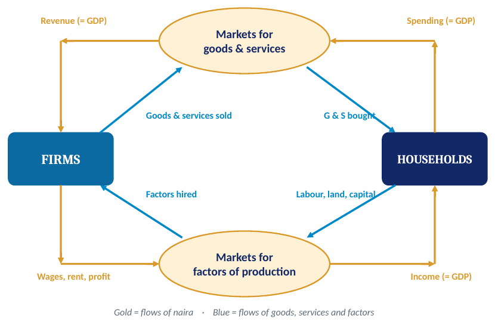{.fig-img fig-alt="The Circular-Flow Diagram: The Simplest Model of the Economy"}

- A **model** is a simplified map: it leaves out detail on purpose so we can see how parts connect.
- **Households** own labour, land and capital; **firms** hire them to produce goods and services.
- Every naira one person spends is a naira of **income** for someone else: total spending = total income = **GDP**.
- Left out on purpose: government, banks and the rest of the world (Sessions 7–11).
- When households' real incomes fall, the flow into your goods market shrinks.

### Positive vs Normative: Scientist or Policy Adviser?

<span class="slide-kicker">TWO KINDS OF STATEMENT · MANKIW CH. 2</span>

::: {.grid}
::: {.g-col-12 .g-col-md-6 .obj-card}
**Positive statements**

*Describe how the world is — testable*

- 'Removing the petrol subsidy raised transport fares.'
- 'A 10% depreciation raises the CPI by x% within a year.'
- Settled with **evidence**.
:::
::: {.g-col-12 .g-col-md-6 .obj-card}
**Normative statements**

*Prescribe how it should be — values*

- 'The CBN should cut rates to help manufacturers.'
- 'Nigeria ought to ban textile imports.'
- Involve **values and priorities**, not only facts.
:::
:::

::: {.callout-tip appearance="simple"}
Why economists disagree: different **scientific judgements**, different **values** — and less often than headlines suggest.
:::

### Classify Each Statement

<span class="slide-kicker">TRY IT · POSITIVE OR NORMATIVE?</span>

1. Inflation fell from 34.8% in December 2024 to 14.6% in September 2026.
2. Inflation of 15% is still far too high for Nigeria.
3. Higher minimum wages reduce formal-sector hiring of young workers.
4. The government should use oil windfalls to pay down debt rather than raise salaries.
5. Banks that raised capital in the recapitalisation have grown lending faster.
6. A strong naira is good for the country.

*Tip: **should, ought, too high, good, fair** usually signal a normative claim. A positive claim can be **false** and still be positive.*

::: {.callout-tip collapse="true" appearance="simple"}
## Show answers
1 positive (true, but note the CPI break). 2 normative. 3 positive (testable; evidence is mixed). 4 normative. 5 positive (testable). 6 normative — good for whom? Importers and consumers gain; exporters and naira oil revenue lose.
:::

### GDP: What Is Counted, and What Is Not

<span class="slide-kicker">MEASURING OUTPUT · MANKIW CH. 22</span>

::: {.lead-box}
**Y = C + I + G + NX.** GDP is the **market value** of all **final** goods and services **produced in a country** in a period.

**C** consumption · **I** investment · **G** government purchases (not transfers) · **NX** exports − imports
:::

- **'Market value'.** Valued at market prices so we can add rice and phone calls. Unpriced work — home care, subsistence — is largely left out.
- **'Final' goods only.** Count the loaf, not the flour in it, or you double-count.
- **'Produced in a country'.** GDP counts output inside Nigeria, whoever owns the factory; GNI counts income of Nigerians wherever earned.
- **Nominal vs real GDP.** Q2 2026: nominal GDP **+18.4%**, real **+4.4%**. The gap (≈13.4%) is price change — the **GDP deflator**.

*Because spending = income, GDP also measures total income.*

::: {.callout-note collapse="true" appearance="minimal" icon=false}
## Sources and data notes

NBS GDP Q2 2026: nominal ₦119.29trn (basic prices), +18.43%; real +4.43%. Implied deflator 1.1843 / 1.0443 − 1 = 13.4%.
:::

### Three Biases Every Price Index Carries

<span class="slide-kicker">WHY THE CPI IS IMPERFECT · MANKIW CH. 23</span>

::: {.grid}
::: {.g-col-12 .g-col-md-4 .obj-card}
**Substitution bias**

When rice gets dearer, families switch to garri or yam. A fixed basket ignores the switch, so it **overstates** the rise in the cost of living.
:::
::: {.g-col-12 .g-col-md-4 .obj-card}
**New goods**

Mobile money and ride-hailing widened choice and cut costs. A basket fixed in an old base year **misses them** until it is rebased.
:::
::: {.g-col-12 .g-col-md-4 .obj-card}
**Unmeasured quality**

If a phone costs 20% more but does twice as much, part of the 'price rise' is really **more quality**.
:::
:::

::: {.callout-tip appearance="simple"}
These biases are why statistics offices **rebase**. Rebasing reduces the bias — but breaks the series.
:::

### Which Change Are You Looking At?

<span class="slide-kicker">READING RATES · YEAR-ON-YEAR VS MONTH-ON-MONTH</span>

| September 2026 | Year on year | Month on month | m/m annualised |
|---|---|---|---|
| Headline | 14.63% | 0.06% | ≈ 0.7% |
| Food | 19.59% | −1.55% | ≈ −17% |
| Core | 12.95% | 1.11% | ≈ 14.2% |

**Step by step**

1. **Year on year** compares with the same month last year: smooth, but it carries **twelve months of history**.
2. **Month on month** shows the latest momentum — noisy and seasonal (harvests, festive demand).
3. **Annualise** a monthly rate: (1 + m)¹² − 1. Core: 1.0111¹² − 1 ≈ **14.2%**.
4. Reading: headline momentum looks near zero because **food fell after the harvest**; underlying (core) pressure still runs at about 14% a year.

::: {.callout-note appearance="simple" icon=false}
## Watch for base effects

**Base effects**: if prices jumped in a month last year, the y/y rate falls mechanically when that month drops out — even if nothing improves today. The mid-2023 petrol-price jump did exactly this to mid-2024 readings.
:::

::: {.result-box}
Ask: **compared with when? seasonally adjusted? headline or core?**
:::

::: {.callout-note collapse="true" appearance="minimal" icon=false}
## Sources and data notes

Source: NBS CPI September 2026 (headline 14.63% y/y, 0.06% m/m; food 19.59%, −1.55%; core 12.95%, 1.11%), as reported by the Gazette, 16 Oct 2026.
:::

### The Kuznets Curve: A Big Theory Built on a Special Period

<span class="slide-kicker">A CAUTIONARY TALE · PIKETTY</span>

::: {.lead-box}
**Capital in the 21st Century, Introduction.** In 1955 Simon Kuznets suggested inequality **naturally falls** as economies develop. The idea spread worldwide.
:::

- **Careful data.** Kuznets built the first US income-distribution series from tax returns, **1913–1948**, and documented every method.
- **One country, 35 years, two shocks.** The fall in US inequality came largely from the **Great Depression and World War II**, not an automatic law.
- **The pattern reversed.** Longer, wider data show inequality **rising again** in many countries from the 1980s.
- **Manager's lesson.** A trend from a short or unusual window — say 2016–2020, or the post-2023 reform period — is a **hypothesis**, not a law.

*Kuznets himself warned the data were special; the warning was forgotten.*

::: {.callout-note collapse="true" appearance="minimal" icon=false}
## Sources and data notes

Piketty (2014), Introduction: 'A Debate without Data?' and 'The Kuznets Curve: Good News in the Midst of the Cold War'.
:::

### Nigeria's Unemployment Rate: 33% to 4% — by Definition

<span class="slide-kicker">PRINCIPLE 10 · A DATA TRAP</span>

::: {.lead-box}
**NBS methodology change, 2023.** The headline unemployment rate went from **33.3% (Q4 2020)** to **4.1% (Q1 2023)**. Most of the fall is a **change of definition**, not of jobs.
:::

- **What changed.** Under the new method, anyone who worked **at least one hour** for pay or profit in the past week counts as employed (the ILO standard).
- **Watch underemployment.** Time-related underemployment — working under 40 hours and wanting more — was **12.2%** in Q1 2023.
- **Why it matters for the trade-off.** With most jobs informal, tightening shows up first in **hours, incomes and informal sales**, not in the headline rate.
- **Manager's use.** Track your own **footfall, basket size and distributor orders** as the real-time labour-income signal.

*The two numbers are not comparable.*

::: {.callout-note collapse="true" appearance="minimal" icon=false}
## Sources and data notes

Source: NBS Labour Force Survey, new methodology (Q1 2023, 4.1%; underemployment 12.2%); old-methodology Q4 2020 rate 33.3% — TheCable, Aug 2023.
:::

### Six Official Series on One Page

<span class="slide-kicker">THE DASHBOARD · CHART VERSION</span>

::: {.panel-tabset group="lang"}
## Python
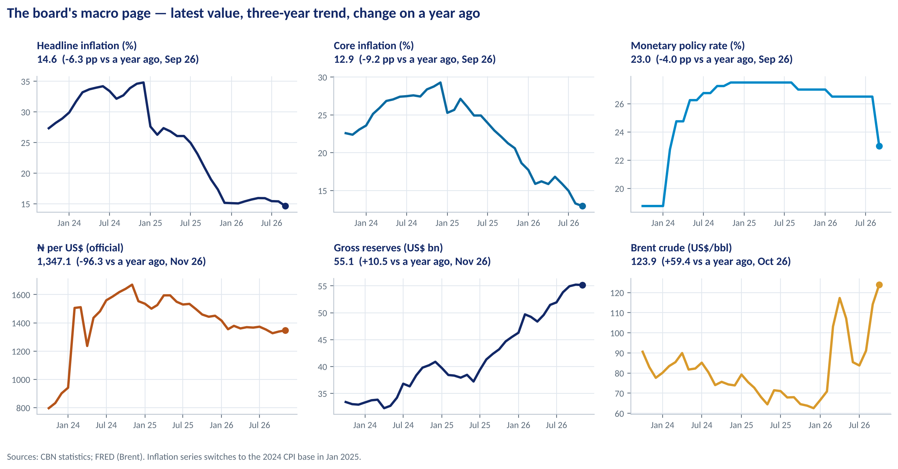{.fig-img fig-alt="S01-F06 (Python)"}

## R
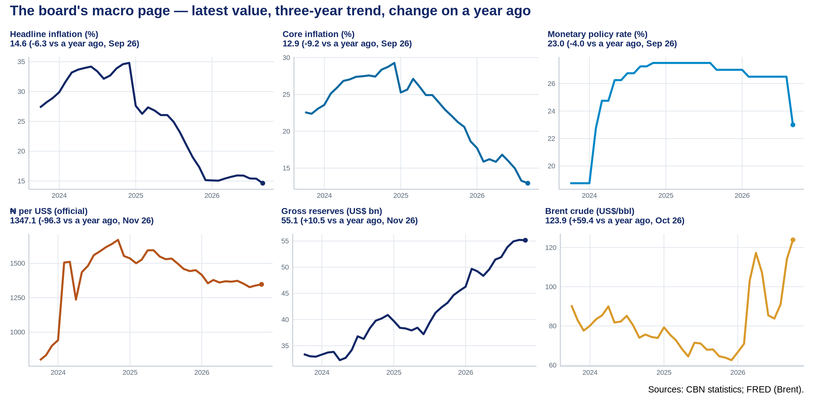{.fig-img fig-alt="S01-F06 (R)"}

:::

- Each panel: **latest value and date**, a three-year trend and the **change on a year ago**.
- Covers prices, money, the currency, external buffers and the oil price.
- Same layout every month, so directors see change at a glance.
- Inflation panels cross the **January 2025 CPI break** — label it.

<span class="fig-id">S01-F06 · replicate with s01_figures.py / .R</span>

::: {.callout-note collapse="true" appearance="minimal" icon=false}
## Sources and data notes

Generated from official CBN data and FRED by s01_figures.py. The lab rebuilds it.
:::

### The Sources Every Nigerian Manager Should Bookmark

<span class="slide-kicker">WHERE TO LOOK</span>

| Source | What you get | How often | Watch out for |
|---|---|---|---|
| NBS (nigerianstat.gov.ng) | CPI, GDP, labour force, foreign trade | Monthly / quarterly | Rebasing (CPI 2025, GDP 2025); revisions |
| CBN (cbn.gov.ng/rates) | MPR, exchange rates, reserves, money and credit; downloadable series | Daily to monthly | Series start/stop; BDC data end 2021 |
| DMO · NUPRC · FMDQ | Public debt; oil output; FX and bond prices | Monthly / daily | Different coverage of 'debt' and 'output' |
| S&P Global – Stanbic IBTC PMI | Private-sector survey: output, orders, prices, jobs | Monthly (days 1–3) | >50 = more firms improving |
| IMF (WEO, data.imf.org) | Comparable cross-country data and forecasts | April / October | Forecasts revised often |
| World Bank WDI · FRED | Long annual series; global prices (Brent) | Annual / monthly | Lags; current vs constant dollars |

::: {.callout-note collapse="true" appearance="minimal" icon=false}
## Sources and data notes

tools/fetch_official_data.py downloads the CBN, World Bank and FRED series used in this deck.
:::

### The Traps — and the Habit That Beats Each One

| The trap | The better habit |
|---|---|
| Comparing inflation or GDP across a **rebasing** or before a **revision**. | Check the **base year and vintage**; use the linked series. |
| 'Oil is only 4% of GDP, so the oil price doesn't matter to us.' | Ask **share of what** — exports, revenue, FX supply. |
| 'Rates fell 3.5 percent.' | Say **3.5 percentage points** (350 bp). |
| Reading only year-on-year rates. | Add **m/m annualised** and core to see momentum; watch base effects. |
| Celebrating nominal naira growth. | Report **real, naira and dollar** values side by side. |
| 'Sales fell after the price rise, so the price rise caused it.' | Ask **compared with what?** — use a comparison group. |

## Vocabulary

| Term | Meaning |
|---|---|
| **Opportunity cost** | The value of the best alternative given up. |
| **Marginal** | The extra benefit or cost of one more unit or decision. |
| **Comparative advantage** | Producing at a lower opportunity cost than others. |
| **Positive / normative** | Claims about what is (testable) vs what should be (values). |
| **GDP / GDP deflator** | Market value of final output; nominal ÷ real GDP. |
| **CPI** | Cost of a fixed basket relative to a base period. |
| **Rebasing / revision** | New base and weights / corrected past figures; both break comparisons. |
| **Real vs nominal** | Adjusted for price changes vs in current naira. |
| **Percentage point** | Simple difference between two rates (1 pp = 100 bp). |
| **Difference-in-differences** | Effect = change in treated group − change in comparison group. |

::: {.callout-note appearance="simple"}
**About the data.** Charts use real data (CBN, NBS, NCC, NIBSS, World Bank, FRED), with the source printed under each chart. Series from official APIs refresh with `tools/fetch_official_data.py`; hand-compiled files in `data/official/` give the source on every row. Items tagged *illustrative* use stylised teaching data or invented numbers built to teach a method.
:::

::: {.session-nav}
[← Pre-module](../../pre-module.qmd)
[Session 2: Demand, Supply & Elasticity →](../../sessions/s02/index.qmd){.next}
:::
