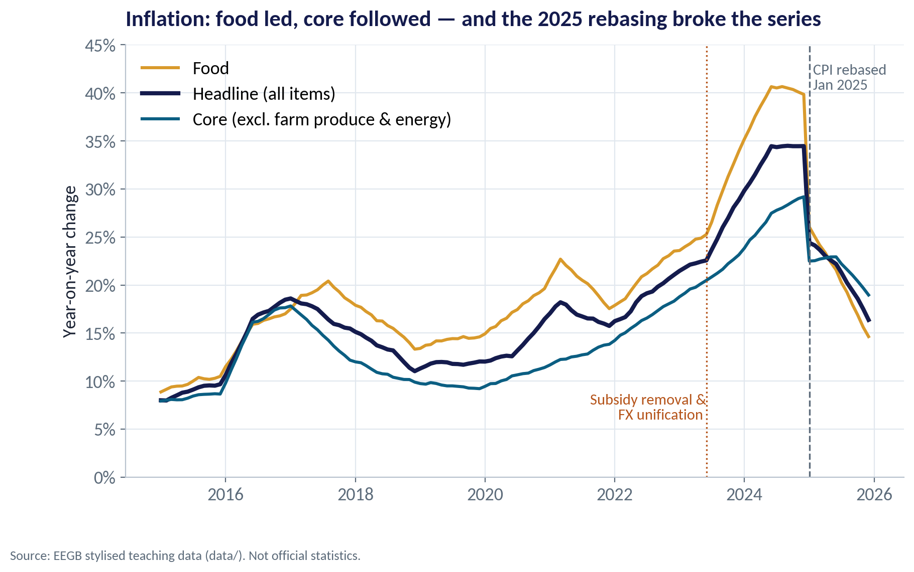
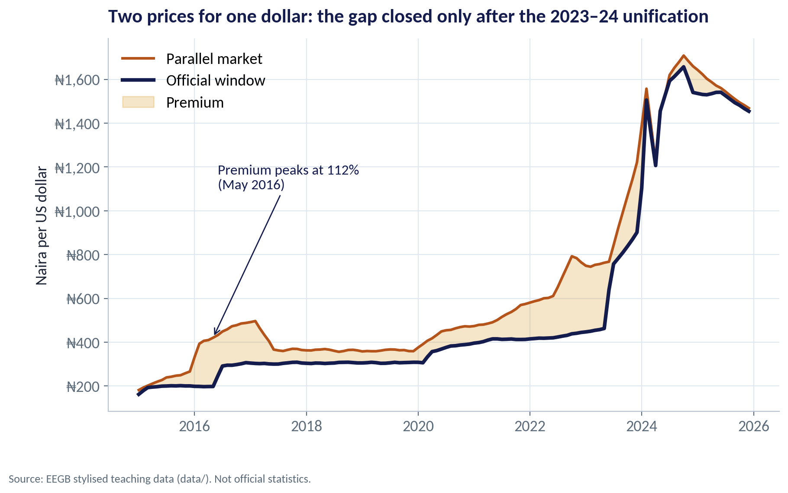
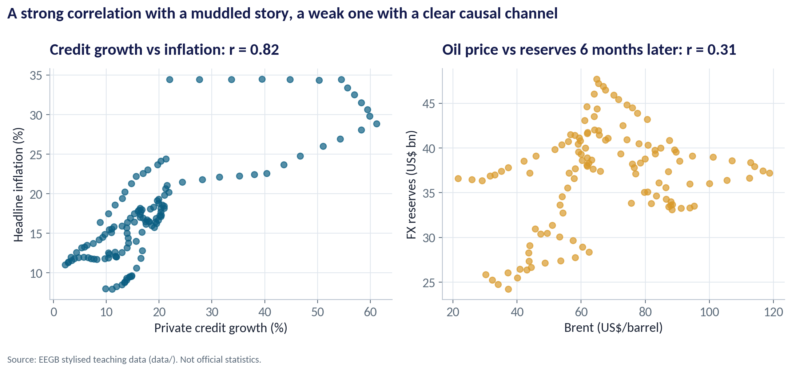
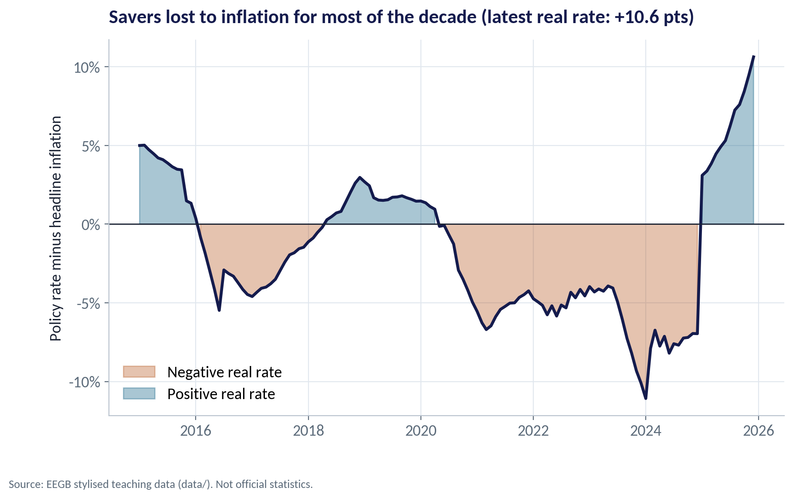
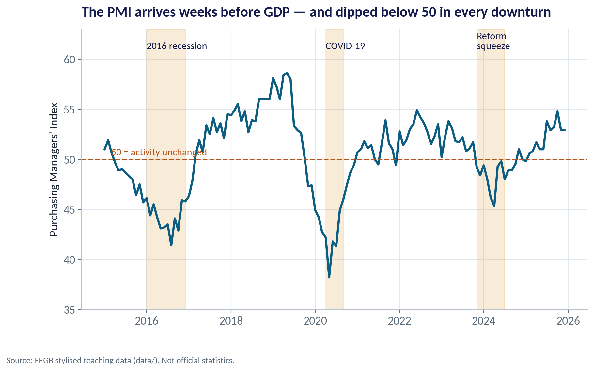
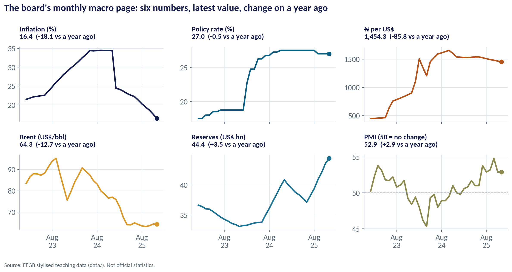

::: {.session-banner}
{.banner-hex width="96"}

**Session 1 of 16** · Facilitator: Bongo Adi<br>*Case:* Building a one-page macro dashboard for a Lagos FMCG board: which five numbers should the directors watch every month?

:::

## Downloads {.unnumbered}

::: {.download-row}
[<i class="bi bi-file-earmark-slides"></i> Teaching slides (.pptx)](../../sessions/s01/slides/EEGB_S01_Course_Overview_Data_Literacy_for_Managers.pptx){.btn .btn-primary download=""}
[<i class="bi bi-file-earmark-pdf"></i> Slides (PDF)](../../sessions/s01/slides/EEGB_S01_Course_Overview_Data_Literacy_for_Managers.pdf){.btn .btn-outline-primary download=""}
[<i class="bi bi-github"></i> Session folder on GitHub](https://github.com/adibongo/eegb/tree/main/sessions/s01){.btn .btn-outline-secondary}
:::

## Read first {.unnumbered}

- **Note on Microeconomics for Managers** — Course note (updated)

## Learning objectives

::: {.grid}
::: {.g-col-12 .g-col-md-4 .obj-card}
**Think Like an Economist**

Use incentives, opportunity cost and marginal thinking to frame a business decision.
:::
::: {.g-col-12 .g-col-md-4 .obj-card}
**Read Official Data**

Find, read and question CBN, NBS, IMF and FRED data — levels, rates of change, breaks and revisions.
:::
::: {.g-col-12 .g-col-md-4 .obj-card}
**Build a Macro Dashboard**

Choose the few numbers your board should watch and present them clearly every month.
:::
:::

## The business case

::: {.callout-note appearance="simple" icon=false}
## The Board's Macro Page

**Situation.** A Lagos FMCG company imports a third of its inputs and sells only in naira. Its board meets monthly and receives forty pages of numbers.

**Question.** Which five or six macro numbers should the directors see every month — and how should they be shown?

**Data.** ng_macro_monthly.csv — 132 months (2015–2025) of inflation, policy rate, exchange rates, oil price, reserves, money, credit and PMI. *Stylised teaching data.*

**A good answer.** A one-page dashboard: each number with its latest value, change on a year ago and a one-line 'so what' for the business.
:::

## Key ideas in plain English

### Taking Inflation Out of the Numbers

A nominal number is measured in today's naira. A real number strips out inflation so you can see whether volumes or purchasing power really changed.

::: {.formula}
real growth ≈ nominal growth − inflation
:::

*Example.* Sales up 30% while prices rose 28% → real growth of roughly 2%. The business barely grew.

::: {.callout-tip appearance="minimal"}
**Why a manager cares.** Bonuses, targets and investment cases set in nominal naira reward inflation, not performance. Always ask for the real number.
:::

### Seeing the Economy Before GDP Is Published

GDP arrives months late. Nowcasting uses faster signals — surveys, payments, fuel sales, electricity use — to estimate what is happening now.

::: {.formula}
PMI > 50 → activity expanding;  PMI < 50 → contracting
:::

*Example.* The PMI fell below 50 in 2016, during COVID-19 and again in the 2024 reform squeeze — each time before GDP data confirmed the slowdown.

::: {.callout-tip appearance="minimal"}
**Why a manager cares.** Your own data are nowcasting signals too: daily sales, distributor orders and collections often tell you about the economy weeks before the statistics office does.
:::

## Charts and how to replicate them

Every chart below is regenerated by the session's figure script — `sessions/s01/R/s01_figures.R` or `sessions/s01/python/s01_figures.py`. Run it from the project root.

### Headline, Food and Core Inflation

::: {.panel-tabset group="lang"}
## Python
{.fig-img fig-alt="S01-F01 (Python)"}

:::

- Headline inflation covers everything in the basket; food is about half of a Nigerian household budget.
- Core removes volatile farm produce and energy — a better guide to underlying pressure.
- Inflation climbed from about 22% to 34% after the mid-2023 reforms.
- In January 2025 the CPI was rebased: the sudden drop is partly a change of yardstick, not only a change in prices.

<span class="fig-id">S01-F01</span>

### Two Prices for One Dollar

::: {.panel-tabset group="lang"}
## Python
{.fig-img fig-alt="S01-F02 (Python)"}

:::

- For years the official rate and the parallel market rate differed — at times by more than 100%.
- A big premium is a signal of rationing: dollars are scarce at the official price.
- Firms that could not access official dollars paid the parallel price — and priced their goods off it.
- After the 2023–24 unification the gap almost closed, at a much weaker naira.

<span class="fig-id">S01-F02</span>

### Strong Correlations Can Mislead

::: {.panel-tabset group="lang"}
## Python
{.fig-img fig-alt="S01-F03 (Python)"}

:::

- Credit growth and inflation move closely together (r = 0.82) — but both jumped after the 2023 devaluation, which revalued dollar loans and raised prices.
- The oil price and reserves have a weak correlation (r = 0.31), yet the causal channel is clear: oil earnings supply most of Nigeria's dollars.
- Correlation strength tells you how tightly two series move, not whether one causes the other.
- Ask: is there a third factor, a time lag, or reverse causation?

<span class="fig-id">S01-F03</span>

### Did Savers Beat Inflation?

::: {.panel-tabset group="lang"}
## Python
{.fig-img fig-alt="S01-F05 (Python)"}

:::

- Real rate = policy rate − inflation.
- For most of 2015–2024 it was negative: money in the bank lost purchasing power.
- Negative real rates push savers into dollars, property and stocks — and weaken the naira.
- In 2025 the real rate turned clearly positive, helped by rate hikes — and by the CPI rebasing.

<span class="fig-id">S01-F05</span>

### The PMI as a Nowcast

::: {.panel-tabset group="lang"}
## Python
{.fig-img fig-alt="S01-F06 (Python)"}

:::

- The Purchasing Managers' Index asks firms whether output, orders and employment are up or down.
- It is published within days of the month's end.
- Shaded periods: the PMI dropped below 50 in every downturn.
- Use it alongside your own sales data, not instead of it.

<span class="fig-id">S01-F06</span>

### Six Numbers on One Page

::: {.panel-tabset group="lang"}
## Python
{.fig-img fig-alt="S01-F04 (Python)"}

:::

- Each panel: latest value, the trend over three years and the change on a year ago.
- Inflation, policy rate, exchange rate, oil price, reserves and PMI cover prices, money, the currency and activity.
- Same layout every month, so directors see change at a glance.
- Add one line of 'so what' under each number for your business.

<span class="fig-id">S01-F04</span>

## Lab: Build the Board's Macro Page

*Time:* 15 minutes · *Data:* [`data/ng_macro_monthly.csv`](../../data/ng_macro_monthly.csv)

1. Load the data and look at the latest three months before calculating anything.
2. Build a table of six indicators: latest value, value a year ago, and the change.
3. Add two derived numbers: the real policy rate and the FX premium.
4. Compare inflation before and after the CPI rebasing.
5. Write one 'so what' line for your own company under each number.

::: {.callout-important appearance="simple"}
**Deliverable:** a one-page dashboard with six numbers and six 'so what' lines for your board.
:::

## The code (R | Python)

Pick your language once; every tab on the site follows your choice. Download a script, or copy it into RStudio and run it line by line.

### Replicate every chart

::: {.panel-tabset group="lang"}
## Python
[<i class="bi bi-download"></i> s01_figures.py](../../sessions/s01/python/s01_figures.py){download=""}

::: {.callout-note collapse="true" appearance="simple" icon=false}
## Show the full script (103 lines)

```{.python filename="sessions/s01/python/s01_figures.py"}
# =============================================================================
# EEGB · Session 1 · Course Overview & Data Literacy for Managers
# Replication script — regenerates every chart in the Session 1 deck (Python)
# Data: data/ng_macro_monthly.csv (stylised Nigerian macro series, 2015–2025)
# Run from the project root:  python sessions/s01/python/s01_figures.py
# =============================================================================
import sys; sys.path.insert(0, "python")
import numpy as np, pandas as pd
import matplotlib.pyplot as plt
import matplotlib.dates as mdates
from matplotlib.ticker import FuncFormatter
from eegb_style import *

set_style()
m = pd.read_csv("data/ng_macro_monthly.csv", parse_dates=["date"])
rebase = pd.Timestamp("2025-01-01")

# --- F01 · Three ways to measure inflation ------------------------------------------
fig, ax = plt.subplots()
ax.plot(m.date, m.food_inflation, color=GOLD, lw=2.2, label="Food")
ax.plot(m.date, m.headline_inflation, color=NAVY, lw=3, label="Headline (all items)")
ax.plot(m.date, m.core_inflation, color=TEAL, lw=2.2, label="Core (excl. farm produce & energy)")
ax.axvline(rebase, color=SLATE, ls="--", lw=1.2)
ax.text(rebase, 43, " CPI rebased\n Jan 2025", color=SLATE, fontsize=11, va="top")
ax.axvline(pd.Timestamp("2023-06-01"), color=RUST, ls=":", lw=1.2)
ax.text(pd.Timestamp("2023-06-01"), 6, "Subsidy removal &\nFX unification ", color=RUST, fontsize=11, ha="right")
ax.yaxis.set_major_formatter(FuncFormatter(pct)); ax.set_ylim(0, 45); ax.legend(loc="upper left")
ax.set(title="Inflation: food led, core followed — and the 2025 rebasing broke the series",
       ylabel="Year-on-year change")
note(fig); save(fig, "s01", "f01")

# --- F02 · Official vs parallel exchange rate -----------------------------------------
fig, ax = plt.subplots()
ax.plot(m.date, m.parallel_fx_ngn_usd, color=RUST, lw=2.2, label="Parallel market")
ax.plot(m.date, m.official_fx_ngn_usd, color=NAVY, lw=3, label="Official window")
ax.fill_between(m.date, m.official_fx_ngn_usd, m.parallel_fx_ngn_usd, color=GOLD, alpha=.25, label="Premium")
prem = (m.parallel_fx_ngn_usd / m.official_fx_ngn_usd - 1) * 100
i = prem.idxmax()
ax.annotate(f"Premium peaks at {prem[i]:.0f}%\n({m.date[i]:%b %Y})", xy=(m.date[i], m.parallel_fx_ngn_usd[i]),
            xytext=(pd.Timestamp("2016-06-01"), 1100), arrowprops=dict(arrowstyle="->", color=NAVY), fontsize=12, color=NAVY)
ax.yaxis.set_major_formatter(FuncFormatter(lambda v, p: f"₦{v:,.0f}")); ax.legend(loc="upper left")
ax.set(title="Two prices for one dollar: the gap closed only after the 2023–24 unification",
       ylabel="Naira per US dollar")
note(fig); save(fig, "s01", "f02")

# --- F03 · Correlation is not causation -------------------------------------------------
fig, axes = plt.subplots(1, 2, figsize=(11, 4.8))
r_lv = np.corrcoef(m.private_credit_growth_yoy, m.headline_inflation)[0, 1]
axes[0].scatter(m.private_credit_growth_yoy, m.headline_inflation, color=TEAL, alpha=.7)
axes[0].set(title=f"Credit growth vs inflation: r = {r_lv:.2f}", xlabel="Private credit growth (%)", ylabel="Headline inflation (%)")
axes[0].title.set_fontsize(13)
d = m.set_index("date")[["brent_usd", "fx_reserves_usd_bn"]]
lag = d.fx_reserves_usd_bn.shift(-6)
ok = lag.notna()
r_oil = np.corrcoef(d.brent_usd[ok], lag[ok])[0, 1]
axes[1].scatter(d.brent_usd[ok], lag[ok], color=GOLD, alpha=.7)
axes[1].set(title=f"Oil price vs reserves 6 months later: r = {r_oil:.2f}", xlabel="Brent (US$/barrel)", ylabel="FX reserves (US$ bn)")
axes[1].title.set_fontsize(13)
fig.suptitle("A strong correlation with a muddled story, a weak one with a clear causal channel", x=0.01, ha="left",
             fontsize=16, fontweight="bold", color=NAVY)
fig.tight_layout(); note(fig); save(fig, "s01", "f03")

# --- F04 · A five-number board dashboard (last 36 months) ---------------------------------
last = m[m.date >= m.date.max() - pd.DateOffset(months=35)]
panels = [("headline_inflation", "Inflation (%)", NAVY), ("mpr", "Policy rate (%)", TEAL),
          ("official_fx_ngn_usd", "₦ per US$", RUST), ("brent_usd", "Brent (US$/bbl)", GOLD),
          ("fx_reserves_usd_bn", "Reserves (US$ bn)", TEAL2), ("pmi", "PMI (50 = no change)", OLIVE)]
fig, axes = plt.subplots(2, 3, figsize=(12, 6), sharex=True)
for ax, (col, lab, c) in zip(axes.flat, panels):
    ax.plot(last.date, last[col], color=c, lw=2.4)
    ax.scatter(last.date.iloc[-1], last[col].iloc[-1], color=c, s=45, zorder=3)
    chg = last[col].iloc[-1] - last[col].iloc[-13]
    ax.set_title(f"{lab}\n{last[col].iloc[-1]:,.1f}  ({'+' if chg >= 0 else ''}{chg:,.1f} vs a year ago)", fontsize=12, loc="left")
    if col == "pmi": ax.axhline(50, color=SLATE, ls="--", lw=1)
    ax.xaxis.set_major_formatter(mdates.DateFormatter("%b\n%y")); ax.xaxis.set_major_locator(mdates.MonthLocator(interval=12))
fig.suptitle("The board's monthly macro page: six numbers, latest value, change on a year ago", x=0.01, ha="left",
             fontsize=16, fontweight="bold", color=NAVY)
fig.tight_layout(); note(fig); save(fig, "s01", "f04")

# --- F05 · Real interest rate: policy rate minus inflation ----------------------------------
real = m.mpr - m.headline_inflation
fig, ax = plt.subplots()
ax.fill_between(m.date, real, 0, where=real < 0, color=RUST, alpha=.35, label="Negative real rate")
ax.fill_between(m.date, real, 0, where=real >= 0, color=TEAL, alpha=.35, label="Positive real rate")
ax.plot(m.date, real, color=NAVY, lw=2.4)
ax.axhline(0, color=INK, lw=1)
ax.yaxis.set_major_formatter(FuncFormatter(pct)); ax.legend(loc="lower left")
ax.set(title=f"Savers lost to inflation for most of the decade (latest real rate: {real.iloc[-1]:+.1f} pts)",
       ylabel="Policy rate minus headline inflation")
note(fig); save(fig, "s01", "f05")

# --- F06 · Nowcasting with a survey: PMI as an early signal -----------------------------------
fig, ax = plt.subplots()
ax.plot(m.date, m.pmi, color=TEAL, lw=2.4)
ax.axhline(50, color=RUST, ls="--", lw=1.4); ax.text(m.date.iloc[2], 50.4, "50 = activity unchanged", color=RUST, fontsize=11)
for start, end, lab in [("2016-01-01", "2016-12-01", "2016 recession"), ("2020-04-01", "2020-09-01", "COVID-19"),
                        ("2023-11-01", "2024-07-01", "Reform\nsqueeze")]:
    ax.axvspan(pd.Timestamp(start), pd.Timestamp(end), color=GOLD, alpha=.18)
    ax.text(pd.Timestamp(start), 61, lab, fontsize=11, color=NAVY)
ax.set_ylim(35, 63)
ax.set(title="The PMI arrives weeks before GDP — and dipped below 50 in every downturn",
       ylabel="Purchasing Managers' Index")
note(fig); save(fig, "s01", "f06")
```
:::

## R
[<i class="bi bi-download"></i> s01_figures.R](../../sessions/s01/R/s01_figures.R){download=""}

::: {.callout-note collapse="true" appearance="simple" icon=false}
## Show the full script (75 lines)

```{.r filename="sessions/s01/R/s01_figures.R"}
# =============================================================================
# EEGB · Session 1 · Course Overview & Data Literacy for Managers
# Replication script — regenerates every chart in the Session 1 deck (R)
# Data: data/ng_macro_monthly.csv (stylised Nigerian macro series, 2015–2025)
# =============================================================================
source("R/theme_eegb.R")
suppressPackageStartupMessages({ library(dplyr); library(readr); library(tidyr) })
m <- read_csv("data/ng_macro_monthly.csv", show_col_types = FALSE) |> mutate(date = as.Date(date))
rebase <- as.Date("2025-01-01")

# --- F01 · Three ways to measure inflation ------------------------------------------
inf <- m |> select(date, Food = food_inflation, `Headline (all items)` = headline_inflation,
                   `Core (excl. farm produce & energy)` = core_inflation) |>
  pivot_longer(-date, names_to = "measure", values_to = "rate")
p1 <- ggplot(inf, aes(date, rate, colour = measure)) + geom_line(linewidth = 1.1) +
  geom_vline(xintercept = rebase, linetype = "dashed", colour = eegb[["slate"]]) +
  annotate("text", x = rebase, y = 43, label = " CPI rebased\n Jan 2025", hjust = 0, vjust = 1, colour = eegb[["slate"]]) +
  scale_colour_manual(values = c(Food = eegb[["gold"]], `Headline (all items)` = eegb[["navy"]],
                                 `Core (excl. farm produce & energy)` = eegb[["teal"]]), name = NULL) +
  scale_y_continuous(labels = pct, limits = c(0, 45)) +
  labs(title = "Inflation: food led, core followed — and the 2025 rebasing broke the series",
       x = NULL, y = "Year-on-year change", caption = eegb_caption) + theme_eegb()
save_fig(p1, "s01", "f01")

# --- F02 · Official vs parallel exchange rate -----------------------------------------
p2 <- ggplot(m, aes(date)) +
  geom_ribbon(aes(ymin = official_fx_ngn_usd, ymax = parallel_fx_ngn_usd), fill = eegb[["gold"]], alpha = .25) +
  geom_line(aes(y = parallel_fx_ngn_usd, colour = "Parallel market"), linewidth = 1) +
  geom_line(aes(y = official_fx_ngn_usd, colour = "Official window"), linewidth = 1.3) +
  scale_colour_manual(values = c(`Parallel market` = eegb[["rust"]], `Official window` = eegb[["navy"]]), name = NULL) +
  scale_y_continuous(labels = function(v) paste0("₦", format(v, big.mark = ","))) +
  labs(title = "Two prices for one dollar: the gap closed only after the 2023–24 unification",
       x = NULL, y = "Naira per US dollar", caption = eegb_caption) + theme_eegb()
save_fig(p2, "s01", "f02")

# --- F03 · Correlation is not causation -------------------------------------------------
r1 <- cor(m$private_credit_growth_yoy, m$headline_inflation)
p3 <- ggplot(m, aes(private_credit_growth_yoy, headline_inflation)) + geom_point(colour = eegb[["teal"]], alpha = .7, size = 2.5) +
  labs(title = sprintf("Credit growth vs inflation: r = %.2f — strong, but which causes which?", r1),
       subtitle = "Both rose after the 2023 devaluation: a third factor can drive two series at once",
       x = "Private credit growth (%)", y = "Headline inflation (%)", caption = eegb_caption) + theme_eegb()
save_fig(p3, "s01", "f03")

# --- F04 · A six-number board dashboard (last 36 months) ---------------------------------
last <- m |> filter(date >= max(date) - 365 * 3 + 20) |>
  select(date, `Inflation (%)` = headline_inflation, `Policy rate (%)` = mpr, `₦ per US$` = official_fx_ngn_usd,
         `Brent (US$/bbl)` = brent_usd, `Reserves (US$ bn)` = fx_reserves_usd_bn, `PMI (50 = no change)` = pmi) |>
  pivot_longer(-date, names_to = "indicator", values_to = "value")
p4 <- ggplot(last, aes(date, value)) + geom_line(colour = eegb[["teal"]], linewidth = 1.1) +
  geom_point(data = last |> group_by(indicator) |> slice_max(date), colour = eegb[["navy"]], size = 2.5) +
  facet_wrap(~indicator, scales = "free_y", ncol = 3) +
  labs(title = "The board's monthly macro page: six numbers, latest value, trend",
       x = NULL, y = NULL, caption = eegb_caption) + theme_eegb()
save_fig(p4, "s01", "f04", width = 12, height = 6)

# --- F05 · Real interest rate ----------------------------------------------------------
m <- m |> mutate(real = mpr - headline_inflation)
p5 <- ggplot(m, aes(date, real)) +
  geom_area(aes(fill = real < 0), alpha = .35, show.legend = FALSE) +
  geom_line(colour = eegb[["navy"]], linewidth = 1.1) + geom_hline(yintercept = 0) +
  scale_fill_manual(values = c(`TRUE` = eegb[["rust"]], `FALSE` = eegb[["teal"]])) +
  scale_y_continuous(labels = pct) +
  labs(title = sprintf("Savers lost to inflation for most of the decade (latest real rate: %+.1f pts)", tail(m$real, 1)),
       x = NULL, y = "Policy rate minus headline inflation", caption = eegb_caption) + theme_eegb()
save_fig(p5, "s01", "f05")

# --- F06 · PMI as an early signal ---------------------------------------------------------
p6 <- ggplot(m, aes(date, pmi)) + geom_line(colour = eegb[["teal"]], linewidth = 1.1) +
  geom_hline(yintercept = 50, linetype = "dashed", colour = eegb[["rust"]]) +
  annotate("rect", xmin = as.Date(c("2016-01-01", "2020-04-01", "2023-11-01")),
           xmax = as.Date(c("2016-12-01", "2020-09-01", "2024-07-01")), ymin = -Inf, ymax = Inf,
           fill = eegb[["gold"]], alpha = .18) +
  labs(title = "The PMI arrives weeks before GDP — and dipped below 50 in every downturn",
       x = NULL, y = "Purchasing Managers' Index", caption = eegb_caption) + theme_eegb()
save_fig(p6, "s01", "f06")
```
:::

:::

### Lab

::: {.panel-tabset group="lang"}
## Python
[<i class="bi bi-download"></i> s01_lab.py](../../sessions/s01/python/s01_lab.py){download=""}

::: {.callout-note collapse="true" appearance="simple" icon=false}
## Show the full script (39 lines)

```{.python filename="sessions/s01/python/s01_lab.py"}
# =============================================================================
# EEGB · Session 1 LAB · Build a simple macro dashboard (Python)
# Data: data/ng_macro_monthly.csv — stylised Nigerian macro series, Jan 2015 – Dec 2025
# Run from the project root, line by line (Ctrl/Cmd + Enter in RStudio or VS Code)
# =============================================================================
import pandas as pd

m = pd.read_csv("data/ng_macro_monthly.csv", parse_dates=["date"])

# ---- STEP 1 · Look before you calculate ------------------------------------------
print(m.shape)            # how many months and columns?
print(m.columns.tolist()) # what is measured?
print(m.tail(3))          # the latest readings

# ---- STEP 2 · The latest value and the change on a year ago --------------------------
cols = ["headline_inflation", "mpr", "official_fx_ngn_usd", "brent_usd", "fx_reserves_usd_bn", "pmi"]
latest, year_ago = m.iloc[-1], m.iloc[-13]
board = pd.DataFrame({"latest": latest[cols], "a_year_ago": year_ago[cols]})
board["change"] = board.latest - board.a_year_ago
print(board)

# ---- STEP 3 · Two derived numbers managers actually use --------------------------------
m["real_policy_rate"] = m.mpr - m.headline_inflation                       # positive = savers beat inflation
m["fx_premium_pct"] = 100 * (m.parallel_fx_ngn_usd / m.official_fx_ngn_usd - 1)
print(m[["date", "real_policy_rate", "fx_premium_pct"]].tail(6))

# ---- STEP 4 · Beware breaks in a series ----------------------------------------------------
# The CPI was rebased in January 2025. Year-on-year rates before and after are NOT like-for-like.
print(m.groupby("cpi_base_note").headline_inflation.agg(["min", "max", "mean"]))

# ---- STEP 5 · Correlation vs causation -----------------------------------------------------
print(m[["headline_inflation", "private_credit_growth_yoy", "m2_growth_yoy", "brent_usd"]].corr().round(2))

# ---- YOUR TURN ---------------------------------------------------------------------------------
# (a) Pick the five numbers YOUR board should watch. Which two above would you drop, and what would you add?
# (b) Inflation fell from about 34% to 16% in 2025. How much of that fall is real, and how much is the rebasing?
# (c) Credit growth and inflation are highly correlated. Write one sentence on why that does NOT prove
#     that bank lending caused the inflation. Name one third factor that could drive both.
# (d) Optional: download the real series with tools/fetch_official_data.py and repeat Steps 2–3.
```
:::

## R
[<i class="bi bi-download"></i> s01_lab.R](../../sessions/s01/R/s01_lab.R){download=""}

::: {.callout-note collapse="true" appearance="simple" icon=false}
## Show the full script (38 lines)

```{.r filename="sessions/s01/R/s01_lab.R"}
# =============================================================================
# EEGB · Session 1 LAB · Build a simple macro dashboard (R)
# Data: data/ng_macro_monthly.csv — stylised Nigerian macro series, Jan 2015 – Dec 2025
# Open eegb.Rproj first, then run line by line (Ctrl/Cmd + Enter)
# =============================================================================
library(dplyr); library(readr)
m <- read_csv("data/ng_macro_monthly.csv", show_col_types = FALSE)

# ---- STEP 1 · Look before you calculate ------------------------------------------
dim(m); names(m); tail(m, 3)

# ---- STEP 2 · The latest value and the change on a year ago --------------------------
cols <- c("headline_inflation", "mpr", "official_fx_ngn_usd", "brent_usd", "fx_reserves_usd_bn", "pmi")
n <- nrow(m)
board <- tibble(indicator = cols,
                latest = unlist(m[n, cols]),
                a_year_ago = unlist(m[n - 12, cols])) |>
  mutate(change = latest - a_year_ago)
board

# ---- STEP 3 · Two derived numbers managers actually use --------------------------------
m <- m |> mutate(real_policy_rate = mpr - headline_inflation,
                 fx_premium_pct = 100 * (parallel_fx_ngn_usd / official_fx_ngn_usd - 1))
tail(select(m, date, real_policy_rate, fx_premium_pct), 6)

# ---- STEP 4 · Beware breaks in a series ----------------------------------------------------
# The CPI was rebased in January 2025: year-on-year rates before and after are NOT like-for-like.
m |> group_by(cpi_base_note) |> summarise(min = min(headline_inflation), max = max(headline_inflation),
                                          mean = mean(headline_inflation))

# ---- STEP 5 · Correlation vs causation -----------------------------------------------------
round(cor(select(m, headline_inflation, private_credit_growth_yoy, m2_growth_yoy, brent_usd)), 2)

# ---- YOUR TURN ---------------------------------------------------------------------------------
# (a) Pick the five numbers YOUR board should watch. Which two above would you drop, and what would you add?
# (b) Inflation fell from about 34% to 16% in 2025. How much of that fall is real, and how much is the rebasing?
# (c) Credit growth and inflation are highly correlated. Why does that NOT prove lending caused inflation?
# (d) Optional: download the real series with tools/fetch_official_data.R and repeat Steps 2–3.
```
:::

:::

## Check your understanding

**Q1.** Your division's naira revenue grew 30% last year while inflation averaged 28% and the naira lost half its dollar value. What is the best summary?

- **A.** Strong growth — 30% beats most competitors
- **B.** Revenue roughly flat in real terms, and down sharply in dollars
- **C.** Revenue fell 28% in real terms
- **D.** We cannot say anything without profit data

::: {.callout-tip collapse="true" appearance="simple"}
## Show answer
**B.** B. Real growth ≈ 30% − 28% ≈ 2%, so volumes barely moved. In dollars, 1.30 × 0.5 = 0.65, a 35% fall. A ignores inflation; C misapplies the formula; D is too cautious — revenue alone tells us a lot.
:::

**Q2.** Inflation on the dashboard fell from 34.5% to 16.4% in a year, but the CPI was rebased in January 2025. What should the CFO tell the board?

- **A.** Inflation has halved — we can cut prices
- **B.** Part of the fall reflects the new base and basket, so we should watch month-on-month changes and core inflation before acting
- **C.** The rebasing makes all inflation data useless
- **D.** Ignore inflation and watch the exchange rate only

::: {.callout-tip collapse="true" appearance="simple"}
## Show answer
**B.** B. A change of base year and basket changes the measured rate. Month-on-month changes and core inflation on the new basis give a cleaner read. A over-reacts; C and D throw away useful information.
:::

## Vocabulary

| Term | Meaning |
|---|---|
| **Opportunity cost** | The value of the best alternative you give up. |
| **Marginal** | The extra benefit or cost of one more unit. |
| **Nominal** | Measured in current prices, including inflation. |
| **Real** | Adjusted for inflation; shows volume or purchasing power. |
| **Headline inflation** | Year-on-year change in the full consumer price index. |
| **Core inflation** | Inflation excluding volatile items such as farm produce and energy. |
| **Rebasing** | Updating the base year and basket of an index; breaks comparisons. |
| **FX premium** | Gap between the parallel and official exchange rates. |
| **Real interest rate** | Nominal interest rate minus inflation. |
| **Nowcasting** | Estimating current activity from fast, timely signals. |

## Key takeaways

1. Economics is a management tool: incentives, opportunity cost and marginal thinking frame every decision.
2. Always separate nominal from real and naira from dollars.
3. Know your sources, and check for rebasing, revisions and multiple rates.
4. Correlation is not causation: look for third factors, lags and reverse causation.
5. A good board dashboard is short, consistent and tied to a 'so what'.

::: {.callout-note appearance="simple"}
**Before next session:** Re-read the Note on Microeconomics for Managers, sections on demand, supply and elasticity. Bring one price your company changed in the last year and what happened to volumes.
:::

::: {.session-nav}
[← Pre-module](../../pre-module.qmd)
[Session 2: Demand, Supply & Elasticity →](../../sessions/s02/index.qmd){.next}
:::
