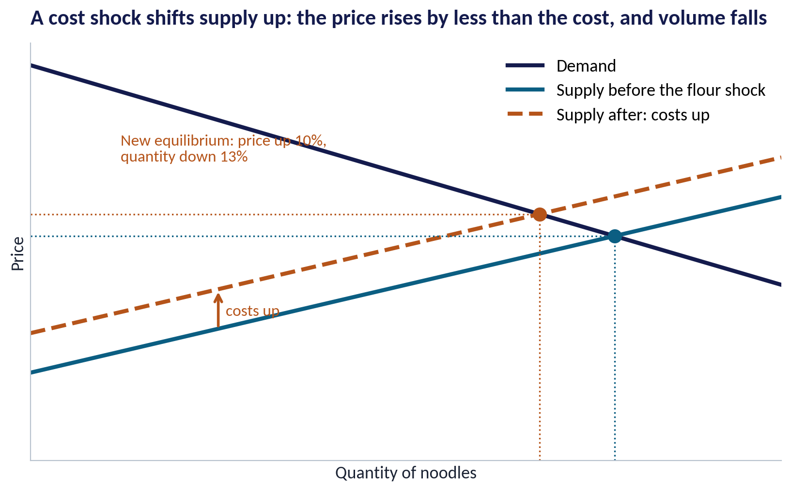
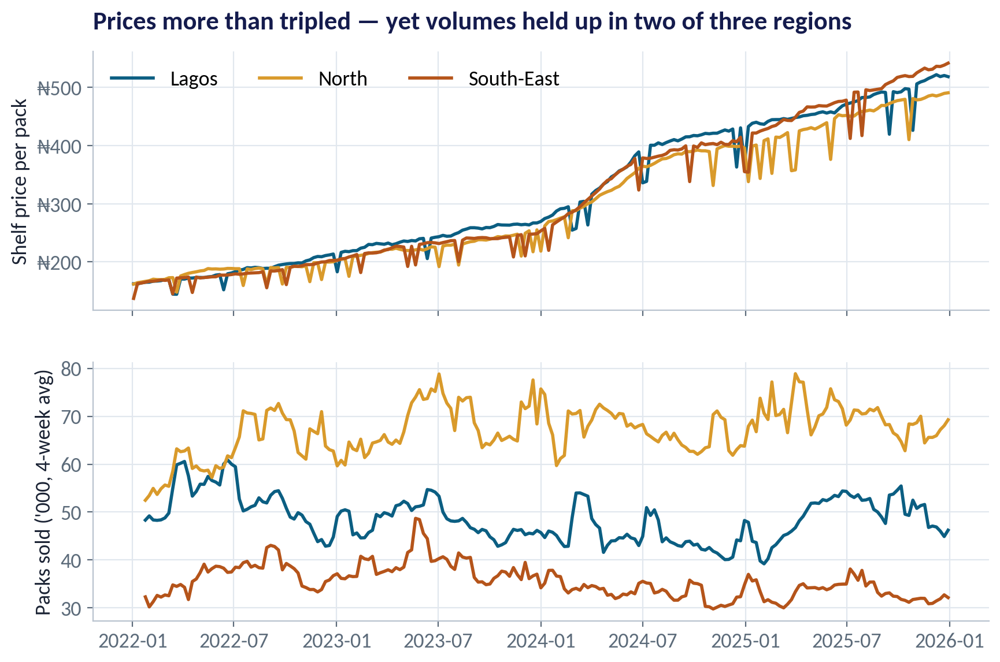
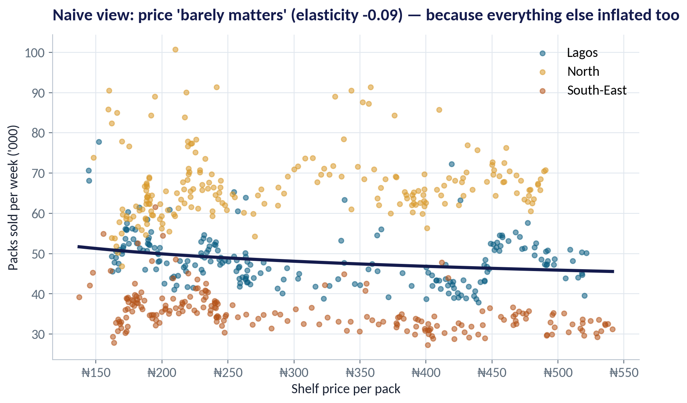
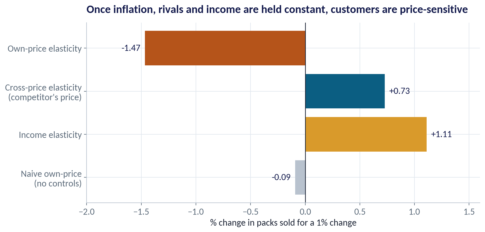
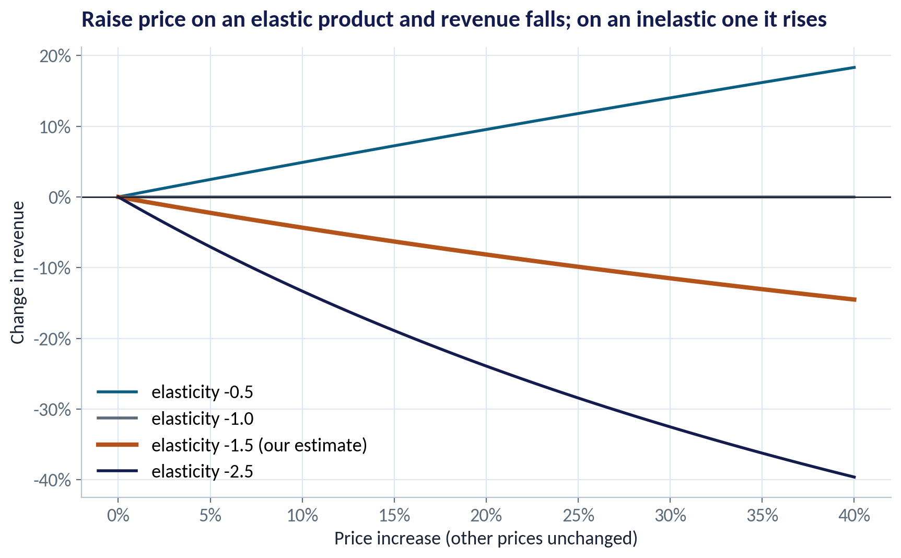
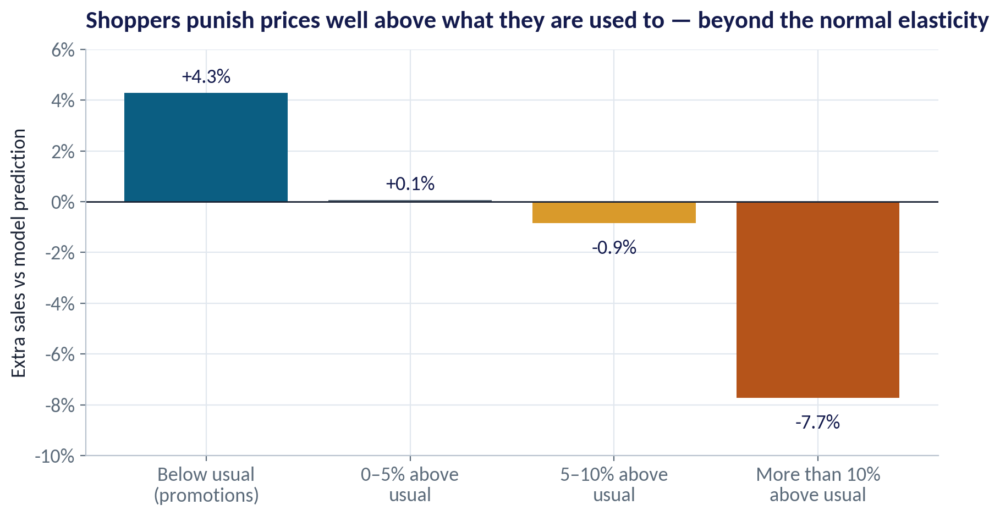
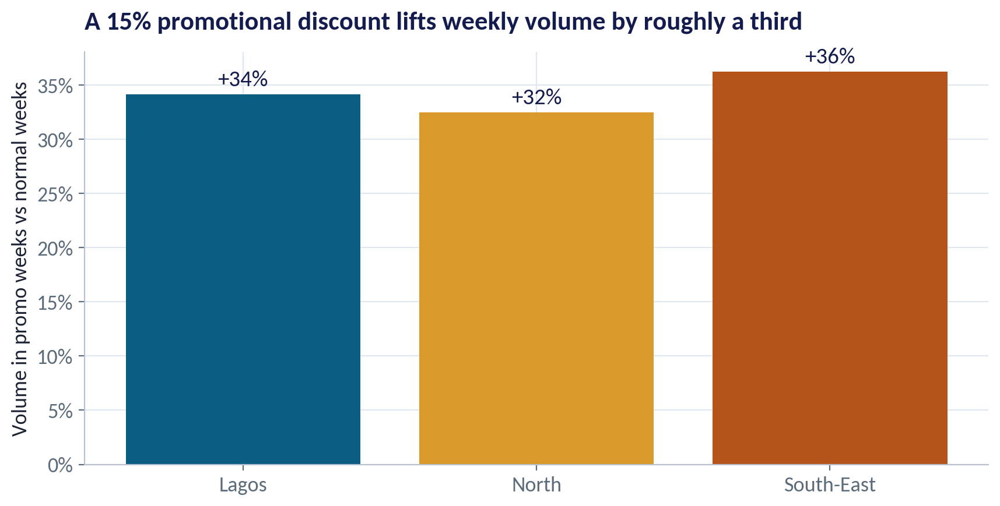
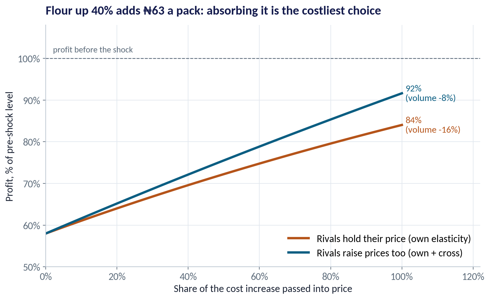

::: {.session-banner}
{.banner-hex width="96"}

**Session 2 of 16** · Facilitator: Bongo Adi<br>*Case:* A noodles maker facing a 40% rise in flour costs: how much of the cost can be passed on before volumes collapse?

:::

## Downloads {.unnumbered}

::: {.download-row}
[<i class="bi bi-file-earmark-slides"></i> Teaching slides (.pptx)](../../sessions/s02/slides/EEGB_S02_Demand_Supply_Elasticity_with_Behavioural_Insights.pptx){.btn .btn-primary download=""}
[<i class="bi bi-file-earmark-pdf"></i> Slides (PDF)](../../sessions/s02/slides/EEGB_S02_Demand_Supply_Elasticity_with_Behavioural_Insights.pdf){.btn .btn-outline-primary download=""}
[<i class="bi bi-github"></i> Session folder on GitHub](https://github.com/adibongo/eegb/tree/main/sessions/s02){.btn .btn-outline-secondary}
:::

## Read first {.unnumbered}

- **Note on Microeconomics for Managers** — Course note (updated)

## Learning objectives

::: {.grid}
::: {.g-col-12 .g-col-md-4 .obj-card}
**Read a Market**

Use demand and supply to explain why a price moved, and predict who bears a cost increase.
:::
::: {.g-col-12 .g-col-md-4 .obj-card}
**Measure Elasticity**

Estimate own-price, cross-price and income elasticities from sales data — holding other things constant.
:::
::: {.g-col-12 .g-col-md-4 .obj-card}
**Price Under Uncertainty**

Decide how much of a cost shock to pass on, using elasticity, rivals' behaviour and customers' reference prices.
:::
:::

## The business case

::: {.callout-note appearance="simple" icon=false}
## Pricing Noodles Through a Flour Shock

**Situation.** A Nigerian noodles maker sells a single-serve pack in three regions — Lagos, the North and the South-East. Shelf prices have more than tripled since 2022 as costs and the exchange rate moved.

**Question.** Flour, about 45% of unit cost, has just risen 40%. How much of the extra cost should be passed into price, and how fast?

**Data.** fmcg_price_volume.csv — 209 weeks × 3 regions: shelf price, competitor price, promotion weeks, an income index and packs sold. *Stylised teaching data.*

**A good answer.** A pricing recommendation that uses measured elasticities, a view on rivals' response and the risk of breaking customers' reference price.
:::

## Key ideas in plain English

### Own-Price Elasticity of Demand

Elasticity tells you by what percentage volume changes when price changes by 1%. If the number is bigger than 1 (ignoring the minus sign), demand is elastic: customers react strongly. Smaller than 1 is inelastic.

::: {.formula}
elasticity = % change in quantity ÷ % change in price
:::

*Example.* Our noodles: elasticity ≈ −1.47. A 10% price rise loses about 13% of volume when rivals hold their prices.

::: {.callout-tip appearance="minimal"}
**Why a manager cares.** Elastic demand means a price rise reduces revenue; inelastic demand means it raises revenue. Knowing which one you face is the start of every pricing decision.
:::

### Reference Prices and Loss Aversion

Shoppers judge a price against the price they are used to — their reference price. Paying more than usual feels like a loss, and people weigh losses about twice as heavily as equal gains.

::: {.formula}
pain of a ₦50 rise  >  pleasure of a ₦50 cut
:::

*Example.* Weeks priced more than 10% above the usual price sold about 7.7% fewer packs than the elasticity alone predicts.

::: {.callout-tip appearance="minimal"}
**Why a manager cares.** Several small, explained increases usually cost less volume than one big jump. Pack-size changes ('shrinkflation'), clear communication and timing all manage the reference price.
:::

### Dynamic Pricing — Power and Limits

Dynamic pricing changes prices often, using data on demand, stock, time and competitors. Ride-hailing surge pricing and airline fares are examples. AI makes it cheap to estimate elasticities by product, store and hour.

::: {.formula}
price ↑ when demand is high or capacity is scarce
:::

*Example.* A ride-hailing app raises fares in Lagos rush hour and during heavy rain, when many riders compete for few drivers.

::: {.callout-tip appearance="minimal"}
**Why a manager cares.** It can raise revenue and balance supply and demand, but it can also feel unfair and invite regulators. Rules of thumb: be transparent, cap surges on essentials, and never personalise prices in ways customers would object to.
:::

## Charts and how to replicate them

Every chart below is regenerated by the session's figure script — `sessions/s02/R/s02_figures.R` or `sessions/s02/python/s02_figures.py`. Run it from the project root.

### Who Pays When Flour Gets Dearer?

::: {.panel-tabset group="lang"}
## Python
{.fig-img fig-alt="S02-F01 (Python)"}

:::

- Higher flour costs shift the supply curve up: firms need a higher price to supply the same quantity.
- The new equilibrium has a higher price (+10%) and a lower quantity (−13%) in this example.
- The price rises by less than the cost: part of the shock is paid by customers, part by producers.
- How it splits depends on elasticity: the less sensitive the buyers, the more they pay.

<span class="fig-id">S02-F01</span>

### Prices Tripled — Volumes Did Not Collapse

::: {.panel-tabset group="lang"}
## Python
{.fig-img fig-alt="S02-F02 (Python)"}

:::

- Lagos shelf price went from about ₦162 to ₦518 a pack between 2022 and 2025.
- Volumes rose in the North and Lagos, and fell in the South-East.
- Looks like customers do not care about price. Do not believe it yet.
- Incomes, competitors' prices and the general price level all moved at the same time.

<span class="fig-id">S02-F02</span>

### Inflation Hides the Elasticity

::: {.panel-tabset group="lang"}
## Python
{.fig-img fig-alt="S02-F03 (Python)"}

:::

- Plotting units against shelf price gives an elasticity of just −0.09 — 'price barely matters'.
- But every price was rising: competitors' prices, wages, the whole price level.
- What matters to a shopper is our price relative to the alternatives and to their income.
- To see the true response we must hold the other drivers constant.

<span class="fig-id">S02-F03</span>

### What Customers Really Respond To

::: {.panel-tabset group="lang"}
## Python
{.fig-img fig-alt="S02-F04 (Python)"}

:::

- Own price −1.47: a 1% rise in our price, all else equal, cuts volume by about 1.5%.
- Cross price +0.73: when a rival raises its price by 1%, we gain about 0.7% volume — they are close substitutes.
- Income +1.11: as customers' incomes rise, they buy more.
- Method: one regression of log(units) on log(own price), log(rival price), log(income), a time trend and region.

<span class="fig-id">S02-F04</span>

### When Does a Price Rise Pay?

::: {.panel-tabset group="lang"}
## Python
{.fig-img fig-alt="S02-F05 (Python)"}

:::

- With elasticity −0.5, a 20% price rise raises revenue.
- At our estimate (−1.47), a 20% rise cuts revenue by about 8%.
- But revenue is not profit: if the price rise covers higher costs, it can still protect margin.
- Elasticity is lower when all firms raise prices together — the market is less elastic than a single brand.

<span class="fig-id">S02-F05</span>

### Big Jumps Hurt More Than the Arithmetic Says

::: {.panel-tabset group="lang"}
## Python
{.fig-img fig-alt="S02-F06 (Python)"}

:::

- We compared actual sales with what the elasticity model predicts.
- Promotion weeks (price below usual) sold about 4% more than predicted.
- Prices up to 5% above usual: no extra penalty. More than 10% above: −7.7%.
- The penalty fades as the new price becomes the new 'normal' — reference prices adapt over weeks.

<span class="fig-id">S02-F06</span>

### What a 15% Discount Buys

::: {.panel-tabset group="lang"}
## Python
{.fig-img fig-alt="S02-F07 (Python)"}

:::

- Promotion weeks (15% off) sold 32–36% more packs than normal weeks.
- Part of that is genuinely new demand; part is pantry loading — customers buying earlier, not more.
- Measure the weeks after a promotion too: a dip means you borrowed sales from the future.
- Promotions also reset reference prices downward if they run too often.

<span class="fig-id">S02-F07</span>

### How Much of the Flour Shock to Pass On?

::: {.panel-tabset group="lang"}
## Python
{.fig-img fig-alt="S02-F08 (Python)"}

:::

- The shock adds ₦63 to a pack that sells for ₦500 and costs ₦350 to make.
- Absorb it all: volume holds, but profit falls to 58% of what it was.
- Pass it all on, rivals holding: volume −16%, profit back to 84%. If rivals follow: volume −8%, profit 92%.
- Since all millers face the same flour price, rivals are likely to follow — so passing on most of it, in steps, is the stronger option.

<span class="fig-id">S02-F08</span>

## Lab: How Price-Sensitive Are Our Customers?

*Time:* 20 minutes · *Data:* [`data/fmcg_price_volume.csv`](../../data/fmcg_price_volume.csv)

1. Look at prices and volumes by region from 2022 to 2025.
2. Estimate the naive elasticity (units on price only) and explain why it misleads.
3. Estimate own-price, cross-price and income elasticities holding other things constant.
4. Compute the volume and revenue effect of 5%, 10% and 20% price rises.
5. Test pass-through of 0%, 50% and 100% of the flour shock — with rivals holding and following.

::: {.callout-important appearance="simple"}
**Deliverable:** a 3-sentence pricing recommendation to the MD: how much to pass on, how fast, and what to watch.
:::

## The code (R | Python)

Pick your language once; every tab on the site follows your choice. Download a script, or copy it into RStudio and run it line by line.

### Replicate every chart

::: {.panel-tabset group="lang"}
## Python
[<i class="bi bi-download"></i> s02_figures.py](../../sessions/s02/python/s02_figures.py){download=""}

::: {.callout-note collapse="true" appearance="simple" icon=false}
## Show the full script (144 lines)

```{.python filename="sessions/s02/python/s02_figures.py"}
# =============================================================================
# EEGB · Session 2 · Demand, Supply & Elasticity with Behavioural Insights
# Replication script — regenerates every chart in the Session 2 deck (Python)
# Data: data/fmcg_price_volume.csv (stylised weekly noodles sales, 3 regions, 2022–2025)
# Run from the project root:  python sessions/s02/python/s02_figures.py
# =============================================================================
import sys; sys.path.insert(0, "python")
import numpy as np, pandas as pd
import matplotlib.pyplot as plt
from matplotlib.ticker import FuncFormatter
from eegb_style import *

set_style()
d = pd.read_csv("data/fmcg_price_volume.csv", parse_dates=["week"])
d["t"] = d.groupby("region").cumcount()                       # weeks since start (soaks up general inflation)
REG = {"Lagos": TEAL, "North": GOLD, "South-East": RUST}

# The demand model: log(units) on log(own price), log(competitor price), log(income), trend, region
def design(df):
    return np.column_stack([np.ones(len(df)), np.log(df.price_naira), np.log(df.competitor_price_naira),
                            np.log(df.income_index), df.t] + [(df.region == r).astype(float) for r in ["North", "South-East"]])
b = np.linalg.lstsq(design(d), np.log(d.units), rcond=None)[0]
own, cross, inc = b[1], b[2], b[3]
naive = np.polyfit(np.log(d.price_naira), np.log(d.units), 1)[0]
print(f"naive elasticity {naive:.2f} | own {own:.2f} cross {cross:.2f} income {inc:.2f}")

# --- F01 · A cost shock shifts supply ---------------------------------------------------
q = np.linspace(0, 10, 200)
dem = 900 - 50 * q
s0, s1 = 200 + 40 * q, 290 + 40 * q
q0, q1 = 700 / 90, 610 / 90
p0, p1 = 900 - 50 * q0, 900 - 50 * q1
fig, ax = plt.subplots()
ax.plot(q, dem, color=NAVY, lw=3, label="Demand")
ax.plot(q, s0, color=TEAL, lw=3, label="Supply before the flour shock")
ax.plot(q, s1, color=RUST, lw=3, ls="--", label="Supply after: costs up")
for qq, pp, c in [(q0, p0, TEAL), (q1, p1, RUST)]:
    ax.scatter(qq, pp, s=90, color=c, zorder=4)
    ax.plot([qq, qq], [0, pp], color=c, ls=":", lw=1.2); ax.plot([0, qq], [pp, pp], color=c, ls=":", lw=1.2)
ax.annotate("", xy=(2.5, 390), xytext=(2.5, 300), arrowprops=dict(arrowstyle="->", color=RUST, lw=2))
ax.text(2.6, 330, "costs up", color=RUST, fontsize=12)
ax.text(1.2, p1 + 120, f"New equilibrium: price up {100*(p1/p0-1):.0f}%,\nquantity down {100*(1-q1/q0):.0f}%", color=RUST, fontsize=12)
ax.set_xlim(0, 10); ax.set_ylim(0, 950); ax.set_xticks([]); ax.set_yticks([]); ax.legend(loc="upper right")
ax.set(title="A cost shock shifts supply up: the price rises by less than the cost, and volume falls",
       xlabel="Quantity of noodles", ylabel="Price")
save(fig, "s02", "f01")

# --- F02 · Three years of prices and volumes ----------------------------------------------
fig, axes = plt.subplots(2, 1, figsize=(10, 6.4), sharex=True)
for r, c in REG.items():
    g = d[d.region == r]
    axes[0].plot(g.week, g.price_naira, color=c, lw=2, label=r)
    axes[1].plot(g.week, g.units.rolling(4).mean() / 1000, color=c, lw=2, label=r)
axes[0].yaxis.set_major_formatter(FuncFormatter(lambda v, p: f"₦{v:,.0f}"))
axes[0].set_ylabel("Shelf price per pack"); axes[1].set_ylabel("Packs sold ('000, 4-week avg)")
axes[0].legend(ncol=3, loc="upper left"); axes[0].set_title("Prices more than tripled — yet volumes held up in two of three regions", loc="left")
save(fig, "s02", "f02")

# --- F03 · The naive picture: inflation hides the elasticity --------------------------------
fig, ax = plt.subplots()
for r, c in REG.items():
    g = d[d.region == r]; ax.scatter(g.price_naira, g.units / 1000, color=c, alpha=.55, s=22, label=r)
xs = np.linspace(d.price_naira.min(), d.price_naira.max(), 50)
a0 = np.polyfit(np.log(d.price_naira), np.log(d.units), 1)
ax.plot(xs, np.exp(np.polyval(a0, np.log(xs))) / 1000, color=NAVY, lw=3)
ax.xaxis.set_major_formatter(FuncFormatter(lambda v, p: f"₦{v:,.0f}")); ax.legend()
ax.set(title=f"Naive view: price 'barely matters' (elasticity {naive:.2f}) — because everything else inflated too",
       xlabel="Shelf price per pack", ylabel="Packs sold per week ('000)")
ax.title.set_fontsize(14)
save(fig, "s02", "f03")

# --- F04 · The controlled estimates -----------------------------------------------------------
fig, ax = plt.subplots(figsize=(10, 4.6))
labs = ["Own-price elasticity", "Cross-price elasticity\n(competitor's price)", "Income elasticity", "Naive own-price\n(no controls)"]
vals = [own, cross, inc, naive]
cols = [RUST, TEAL, GOLD, "#B8C2CE"]
ax.barh(labs[::-1], vals[::-1], color=cols[::-1])
for i, v in enumerate(vals[::-1]):
    ax.text(v + (0.04 if v >= 0 else -0.04), i, f"{v:+.2f}", va="center", ha="left" if v >= 0 else "right", fontsize=13, color=NAVY)
ax.axvline(0, color=INK, lw=1); ax.set_xlim(-2, 1.6)
ax.set(title="Once inflation, rivals and income are held constant, customers are price-sensitive", xlabel="% change in packs sold for a 1% change")
save(fig, "s02", "f04")

# --- F05 · What a price rise does to revenue, by elasticity ------------------------------------
rise = np.linspace(0, 40, 81)
fig, ax = plt.subplots()
for e, c in [(-0.5, TEAL), (-1.0, SLATE), (own, RUST), (-2.5, NAVY)]:
    rev = ((1 + rise / 100) * (1 + rise / 100) ** e - 1) * 100
    ax.plot(rise, rev, color=c, lw=3 if c == RUST else 2, label=f"elasticity {e:.1f}" + (" (our estimate)" if c == RUST else ""))
ax.axhline(0, color=INK, lw=1)
ax.yaxis.set_major_formatter(FuncFormatter(pct)); ax.xaxis.set_major_formatter(FuncFormatter(pct)); ax.legend(loc="lower left")
ax.set(title="Raise price on an elastic product and revenue falls; on an inelastic one it rises",
       xlabel="Price increase (other prices unchanged)", ylabel="Change in revenue")
save(fig, "s02", "f05")
r20 = ((1.2) * 1.2 ** own - 1) * 100
print(f"revenue change for +20% price at own elasticity: {r20:.1f}%")

# --- F06 · Reference prices: rises above 'normal' hurt extra -------------------------------------
d["res"] = np.log(d.units) - design(d) @ b
d["ref"] = d.groupby("region").price_naira.transform(lambda s: s.shift(1).ewm(alpha=0.2, adjust=False).mean())
d["gap"] = np.log(d.price_naira / d.ref)
bins = [-1, 0, 0.05, 0.10, 1]; names = ["Below usual\n(promotions)", "0–5% above\nusual", "5–10% above\nusual", "More than 10%\nabove usual"]
dd = d.dropna(subset=["gap"]).copy(); dd["bin"] = pd.cut(dd.gap, bins, labels=names)
rb = dd.groupby("bin", observed=False).res.mean() * 100
fig, ax = plt.subplots(figsize=(10, 4.8))
ax.bar(rb.index.astype(str), rb.values, color=[TEAL, SLATE, GOLD, RUST])
for i, v in enumerate(rb.values): ax.text(i, v + (0.4 if v >= 0 else -1.2), f"{v:+.1f}%", ha="center", fontsize=13, color=NAVY)
ax.axhline(0, color=INK, lw=1); ax.yaxis.set_major_formatter(FuncFormatter(pct)); ax.set_ylim(-10, 6)
ax.set(title="Shoppers punish prices well above what they are used to — beyond the normal elasticity",
       ylabel="Extra sales vs model prediction")
ax.title.set_fontsize(14)
save(fig, "s02", "f06")
print("reference-price residuals (%):", rb.round(1).to_dict())

# --- F07 · Promotions: the volume lift by region --------------------------------------------------
lift = d.groupby(["region", "promo"]).units.mean().unstack()
lift = (lift[1] / lift[0] - 1) * 100
fig, ax = plt.subplots(figsize=(10, 4.6))
ax.bar(lift.index, lift.values, color=[REG[r] for r in lift.index])
for i, v in enumerate(lift.values): ax.text(i, v + 0.8, f"+{v:.0f}%", ha="center", fontsize=14, color=NAVY)
ax.yaxis.set_major_formatter(FuncFormatter(pct))
ax.set(title="A 15% promotional discount lifts weekly volume by roughly a third", ylabel="Volume in promo weeks vs normal weeks")
save(fig, "s02", "f07")
print("promo lift %:", lift.round(1).to_dict())

# --- F08 · How much of a 40% flour-cost rise to pass on? ---------------------------------------------
P0, C0, flour_share = 500.0, 350.0, 0.45            # stylised: ₦500 pack, ₦350 unit cost, flour = 45% of cost
dc = C0 * flour_share * 0.40                          # extra cost per pack from a 40% flour rise
pt = np.linspace(0, 1, 51)                            # pass-through: 0 = absorb all, 1 = pass on fully
fig, ax = plt.subplots()
for e, lab, c in [(own, "Rivals hold their price (own elasticity)", RUST), (own + cross, "Rivals raise prices too (own + cross)", TEAL)]:
    P = P0 + pt * dc
    Q = (P / P0) ** e
    profit = (P - (C0 + dc)) * Q / (P0 - C0) * 100
    vol = (Q[-1] - 1) * 100
    ax.plot(pt * 100, profit, color=c, lw=3, label=lab)
    ax.text(101, profit[-1], f"{profit[-1]:.0f}%\n(volume {vol:+.0f}%)", color=c, fontsize=12, va="center")
    print(f"{lab}: absorb -> {profit[0]:.0f}%, full pass-through -> {profit[-1]:.0f}% of pre-shock profit, volume {vol:+.1f}%")
ax.axhline(100, color=SLATE, ls="--", lw=1); ax.text(2, 101.5, "profit before the shock", color=SLATE, fontsize=11)
ax.set_xlim(0, 122); ax.set_ylim(50, 108)
ax.xaxis.set_major_formatter(FuncFormatter(pct)); ax.yaxis.set_major_formatter(FuncFormatter(pct)); ax.legend(loc="lower right")
ax.set(title=f"Flour up 40% adds ₦{dc:.0f} a pack: absorbing it is the costliest choice",
       xlabel="Share of the cost increase passed into price", ylabel="Profit, % of pre-shock level")
save(fig, "s02", "f08")
```
:::

## R
[<i class="bi bi-download"></i> s02_figures.R](../../sessions/s02/R/s02_figures.R){download=""}

::: {.callout-note collapse="true" appearance="simple" icon=false}
## Show the full script (104 lines)

```{.r filename="sessions/s02/R/s02_figures.R"}
# =============================================================================
# EEGB · Session 2 · Demand, Supply & Elasticity with Behavioural Insights
# Replication script — regenerates every chart in the Session 2 deck (R)
# Data: data/fmcg_price_volume.csv (stylised weekly noodles sales, 3 regions, 2022–2025)
# =============================================================================
source("R/theme_eegb.R")
suppressPackageStartupMessages({ library(dplyr); library(readr); library(tidyr) })
d <- read_csv("data/fmcg_price_volume.csv", show_col_types = FALSE) |>
  group_by(region) |> mutate(t = row_number() - 1) |> ungroup()
reg_cols <- c(Lagos = eegb[["teal"]], North = eegb[["gold"]], `South-East` = eegb[["rust"]])

fit <- lm(log(units) ~ log(price_naira) + log(competitor_price_naira) + log(income_index) + t + region, data = d)
own <- coef(fit)[["log(price_naira)"]]; cross <- coef(fit)[["log(competitor_price_naira)"]]
inc <- coef(fit)[["log(income_index)"]]
naive <- coef(lm(log(units) ~ log(price_naira), data = d))[[2]]

# --- F01 · A cost shock shifts supply ---------------------------------------------------
q <- seq(0, 10, length.out = 200)
cur <- bind_rows(tibble(q, p = 900 - 50 * q, curve = "Demand"),
                 tibble(q, p = 200 + 40 * q, curve = "Supply before the flour shock"),
                 tibble(q, p = 290 + 40 * q, curve = "Supply after: costs up"))
eq <- tibble(q = c(700, 610) / 90) |> mutate(p = 900 - 50 * q)
p1 <- ggplot(cur, aes(q, p, colour = curve, linetype = curve)) + geom_line(linewidth = 1.3) +
  geom_point(data = eq, aes(q, p), inherit.aes = FALSE, size = 3.5, colour = c(eegb[["teal"]], eegb[["rust"]])) +
  scale_colour_manual(values = c(Demand = eegb[["navy"]], `Supply before the flour shock` = eegb[["teal"]],
                                 `Supply after: costs up` = eegb[["rust"]]), name = NULL) +
  scale_linetype_manual(values = c(Demand = "solid", `Supply before the flour shock` = "solid", `Supply after: costs up` = "dashed"), name = NULL) +
  coord_cartesian(ylim = c(0, 950)) +
  labs(title = "A cost shock shifts supply up: the price rises by less than the cost, and volume falls",
       x = "Quantity of noodles", y = "Price") + theme_eegb() + theme(axis.text = element_blank())
save_fig(p1, "s02", "f01")

# --- F02 · Prices and volumes ----------------------------------------------------------------
long <- d |> group_by(region) |> mutate(units_k = as.numeric(stats::filter(units, rep(1 / 4, 4), sides = 1)) / 1000) |> ungroup() |>
  select(week, region, `Shelf price per pack (₦)` = price_naira, `Packs sold ('000, 4-week avg)` = units_k) |>
  pivot_longer(-c(week, region))
p2 <- ggplot(long, aes(week, value, colour = region)) + geom_line(linewidth = 1) +
  facet_wrap(~name, ncol = 1, scales = "free_y") + scale_colour_manual(values = reg_cols, name = NULL) +
  labs(title = "Prices more than tripled — yet volumes held up in two of three regions", x = NULL, y = NULL) + theme_eegb()
save_fig(p2, "s02", "f02", height = 6.4)

# --- F03 · The naive picture ------------------------------------------------------------------
p3 <- ggplot(d, aes(price_naira, units / 1000)) + geom_point(aes(colour = region), alpha = .55) +
  geom_smooth(method = "lm", formula = y ~ log(x), se = FALSE, colour = eegb[["navy"]]) +
  scale_colour_manual(values = reg_cols, name = NULL) +
  labs(title = sprintf("Naive view: price 'barely matters' (elasticity %.2f) — because everything else inflated too", naive),
       x = "Shelf price per pack (₦)", y = "Packs sold per week ('000)") + theme_eegb(12)
save_fig(p3, "s02", "f03")

# --- F04 · Controlled estimates -----------------------------------------------------------------
est <- tibble(term = factor(c("Own-price elasticity", "Cross-price elasticity", "Income elasticity", "Naive own-price (no controls)"),
                            levels = rev(c("Own-price elasticity", "Cross-price elasticity", "Income elasticity", "Naive own-price (no controls)"))),
              value = c(own, cross, inc, naive))
p4 <- ggplot(est, aes(value, term)) + geom_col(fill = c(eegb[["rust"]], eegb[["teal"]], eegb[["gold"]], "#B8C2CE")) +
  geom_text(aes(label = sprintf("%+.2f", value), hjust = ifelse(value >= 0, -0.2, 1.2))) + geom_vline(xintercept = 0) +
  xlim(-2, 1.6) + labs(title = "Once inflation, rivals and income are held constant, customers are price-sensitive",
                       x = "% change in packs sold for a 1% change", y = NULL) + theme_eegb()
save_fig(p4, "s02", "f04", height = 4.6)

# --- F05 · Revenue response by elasticity --------------------------------------------------------
rev <- expand_grid(rise = seq(0, 40, by = .5), e = c(-0.5, -1, round(own, 1), -2.5)) |>
  mutate(revenue = ((1 + rise / 100)^(1 + e) - 1) * 100, e = factor(paste("elasticity", e)))
p5 <- ggplot(rev, aes(rise, revenue, colour = e)) + geom_line(linewidth = 1.2) + geom_hline(yintercept = 0) +
  scale_colour_manual(values = unname(eegb[c("teal", "slate", "rust", "navy")]), name = NULL) +
  scale_x_continuous(labels = pct) + scale_y_continuous(labels = pct) +
  labs(title = "Raise price on an elastic product and revenue falls; on an inelastic one it rises",
       x = "Price increase (other prices unchanged)", y = "Change in revenue") + theme_eegb()
save_fig(p5, "s02", "f05")

# --- F06 · Reference prices ------------------------------------------------------------------------
d$res <- residuals(fit)
d <- d |> group_by(region) |>
  mutate(ref = { r <- numeric(n()); r[1] <- NA; m <- price_naira[1]
                 for (i in seq_len(n())[-1]) { r[i] <- m; m <- 0.8 * m + 0.2 * price_naira[i] }; r }) |> ungroup() |>
  mutate(gap = log(price_naira / ref),
         bin = cut(gap, c(-1, 0, .05, .10, 1), labels = c("Below usual (promotions)", "0–5% above usual", "5–10% above usual", "More than 10% above usual")))
rb <- d |> filter(!is.na(bin)) |> group_by(bin) |> summarise(res = 100 * mean(res))
p6 <- ggplot(rb, aes(bin, res, fill = bin)) + geom_col(show.legend = FALSE) + geom_hline(yintercept = 0) +
  geom_text(aes(label = sprintf("%+.1f%%", res), vjust = ifelse(res >= 0, -0.4, 1.4))) +
  scale_fill_manual(values = unname(eegb[c("teal", "slate", "gold", "rust")])) + scale_y_continuous(labels = pct) +
  labs(title = "Shoppers punish prices well above what they are used to", x = NULL, y = "Extra sales vs model prediction") + theme_eegb()
save_fig(p6, "s02", "f06", height = 4.8)

# --- F07 · Promotion lift ----------------------------------------------------------------------------
lift <- d |> group_by(region, promo) |> summarise(u = mean(units), .groups = "drop") |>
  pivot_wider(names_from = promo, values_from = u) |> mutate(lift = 100 * (`1` / `0` - 1))
p7 <- ggplot(lift, aes(region, lift, fill = region)) + geom_col(show.legend = FALSE) +
  geom_text(aes(label = sprintf("+%.0f%%", lift)), vjust = -0.4) + scale_fill_manual(values = reg_cols) +
  scale_y_continuous(labels = pct) +
  labs(title = "A 15% promotional discount lifts weekly volume by roughly a third", x = NULL, y = "Volume in promo weeks vs normal weeks") + theme_eegb()
save_fig(p7, "s02", "f07", height = 4.6)

# --- F08 · Cost pass-through ---------------------------------------------------------------------------
P0 <- 500; C0 <- 350; dc <- C0 * 0.45 * 0.40
pt <- expand_grid(share = seq(0, 1, by = .02), scen = c("Rivals hold their price (own elasticity)", "Rivals raise prices too (own + cross)")) |>
  mutate(e = ifelse(grepl("hold", scen), own, own + cross), P = P0 + share * dc, Q = (P / P0)^e,
         profit = 100 * (P - C0 - dc) * Q / (P0 - C0))
p8 <- ggplot(pt, aes(100 * share, profit, colour = scen)) + geom_line(linewidth = 1.3) +
  geom_hline(yintercept = 100, linetype = "dashed", colour = eegb[["slate"]]) +
  scale_colour_manual(values = unname(eegb[c("rust", "teal")]), name = NULL) +
  scale_x_continuous(labels = pct) + scale_y_continuous(labels = pct, limits = c(50, 105)) +
  labs(title = sprintf("Flour up 40%% adds ₦%.0f a pack: absorbing it is the costliest choice", dc),
       x = "Share of the cost increase passed into price", y = "Profit, % of pre-shock level") + theme_eegb()
save_fig(p8, "s02", "f08")
```
:::

:::

### Lab

::: {.panel-tabset group="lang"}
## Python
[<i class="bi bi-download"></i> s02_lab.py](../../sessions/s02/python/s02_lab.py){download=""}

::: {.callout-note collapse="true" appearance="simple" icon=false}
## Show the full script (54 lines)

```{.python filename="sessions/s02/python/s02_lab.py"}
# =============================================================================
# EEGB · Session 2 LAB · How price-sensitive are our customers? (Python)
# Data: data/fmcg_price_volume.csv — stylised weekly noodles sales, 3 regions, 2022–2025
# Run from the project root, line by line (Ctrl/Cmd + Enter)
# =============================================================================
import numpy as np, pandas as pd

d = pd.read_csv("data/fmcg_price_volume.csv", parse_dates=["week"])

# ---- STEP 1 · Look at the data -------------------------------------------------------
print(d.head())
print(d.groupby("region")[["price_naira", "units"]].agg(["first", "last"]))

# ---- STEP 2 · The naive elasticity: units on price, nothing else -----------------------
# In a log-log line, the slope IS the elasticity: % change in units for a 1% change in price.
naive = np.polyfit(np.log(d.price_naira), np.log(d.units), 1)[0]
print(f"Naive elasticity: {naive:.2f}")   # close to zero — does price really not matter?

# ---- STEP 3 · Hold other things constant (multiple regression with numpy) ------------------
d["t"] = d.groupby("region").cumcount()          # time trend: soaks up general inflation
X = np.column_stack([np.ones(len(d)),
                     np.log(d.price_naira),            # own price
                     np.log(d.competitor_price_naira), # rival's price
                     np.log(d.income_index),           # customers' income
                     d.t,
                     (d.region == "North").astype(float), (d.region == "South-East").astype(float)])
b, *_ = np.linalg.lstsq(X, np.log(d.units), rcond=None)
print(f"Own-price elasticity:   {b[1]:.2f}")
print(f"Cross-price elasticity: {b[2]:.2f}")
print(f"Income elasticity:      {b[3]:.2f}")

# ---- STEP 4 · What a price rise does to revenue -----------------------------------------------
for rise in (0.05, 0.10, 0.20):
    q_change = (1 + rise) ** b[1] - 1
    r_change = (1 + rise) * (1 + q_change) - 1
    print(f"Price +{rise:.0%}: volume {q_change:+.1%}, revenue {r_change:+.1%}")

# ---- STEP 5 · Promotions -----------------------------------------------------------------------
lift = d.groupby(["region", "promo"]).units.mean().unstack()
print((lift[1] / lift[0] - 1).round(3))

# ---- STEP 6 · Cost pass-through: flour up 40% ----------------------------------------------------
P0, C0 = 500.0, 350.0
dc = C0 * 0.45 * 0.40                       # flour is 45% of unit cost
for share in (0, 0.5, 1.0):
    P = P0 + share * dc
    Q = (P / P0) ** b[1]                     # rivals hold their price
    print(f"Pass on {share:.0%}: price ₦{P:.0f}, volume {Q - 1:+.1%}, profit {(P - C0 - dc) * Q / (P0 - C0):.0%} of before")

# ---- YOUR TURN -----------------------------------------------------------------------------------
# (a) Why is the naive elasticity so close to zero? What changed at the same time as prices?
# (b) Re-run Step 6 assuming rivals follow you (use b[1] + b[2] as the elasticity). What changes?
# (c) Write a 3-sentence pricing recommendation to the MD: how much of the flour shock to pass on,
#     how fast, and what you would watch in the first four weeks.
```
:::

## R
[<i class="bi bi-download"></i> s02_lab.R](../../sessions/s02/R/s02_lab.R){download=""}

::: {.callout-note collapse="true" appearance="simple" icon=false}
## Show the full script (45 lines)

```{.r filename="sessions/s02/R/s02_lab.R"}
# =============================================================================
# EEGB · Session 2 LAB · How price-sensitive are our customers? (R)
# Data: data/fmcg_price_volume.csv — stylised weekly noodles sales, 3 regions, 2022–2025
# Open eegb.Rproj first, then run line by line (Ctrl/Cmd + Enter)
# =============================================================================
library(dplyr); library(readr)
d <- read_csv("data/fmcg_price_volume.csv", show_col_types = FALSE)

# ---- STEP 1 · Look at the data -------------------------------------------------------
head(d)
d |> group_by(region) |> summarise(first_price = first(price_naira), last_price = last(price_naira),
                                   first_units = first(units), last_units = last(units))

# ---- STEP 2 · The naive elasticity -------------------------------------------------------
naive <- lm(log(units) ~ log(price_naira), data = d)
coef(naive)        # slope close to zero — does price really not matter?

# ---- STEP 3 · Hold other things constant ------------------------------------------------------
d <- d |> group_by(region) |> mutate(t = row_number() - 1) |> ungroup()
fit <- lm(log(units) ~ log(price_naira) + log(competitor_price_naira) + log(income_index) + t + region, data = d)
summary(fit)
own <- coef(fit)[["log(price_naira)"]]; cross <- coef(fit)[["log(competitor_price_naira)"]]

# ---- STEP 4 · What a price rise does to revenue -----------------------------------------------
for (rise in c(.05, .10, .20)) {
  q_change <- (1 + rise)^own - 1
  cat(sprintf("Price +%.0f%%: volume %+.1f%%, revenue %+.1f%%\n", 100 * rise, 100 * q_change, 100 * ((1 + rise) * (1 + q_change) - 1)))
}

# ---- STEP 5 · Promotions -----------------------------------------------------------------------
d |> group_by(region, promo) |> summarise(units = mean(units), .groups = "drop") |>
  tidyr::pivot_wider(names_from = promo, values_from = units) |> mutate(lift = `1` / `0` - 1)

# ---- STEP 6 · Cost pass-through: flour up 40% ----------------------------------------------------
P0 <- 500; C0 <- 350; dc <- C0 * 0.45 * 0.40
for (share in c(0, .5, 1)) {
  P <- P0 + share * dc; Q <- (P / P0)^own
  cat(sprintf("Pass on %.0f%%: price N%.0f, volume %+.1f%%, profit %.0f%% of before\n",
              100 * share, P, 100 * (Q - 1), 100 * (P - C0 - dc) * Q / (P0 - C0)))
}

# ---- YOUR TURN -----------------------------------------------------------------------------------
# (a) Why is the naive elasticity so close to zero? What changed at the same time as prices?
# (b) Re-run Step 6 assuming rivals follow you (use own + cross as the elasticity). What changes?
# (c) Write a 3-sentence pricing recommendation to the MD: how much to pass on, how fast, and what to watch.
```
:::

:::

## Check your understanding

**Q1.** A competitor cuts its noodle price by 10%. Our cross-price elasticity is +0.73. Holding our price, what happens to our volume?

- **A.** Rises about 7%
- **B.** Falls about 7%
- **C.** Falls about 15%
- **D.** No change — cross-price only matters for complements

::: {.callout-tip collapse="true" appearance="simple"}
## Show answer
**B.** B. Cross-price elasticity +0.73 means a 1% change in the rival's price moves our volume 0.73% in the **same** direction. A 10% cut by them → about 7% fewer packs for us. C uses the own-price elasticity; D has substitutes and complements the wrong way round.
:::

**Q2.** Flour costs rise 40% for every noodles maker in Nigeria. Which statement is most accurate?

- **A.** We should absorb the cost; any price rise loses customers to rivals
- **B.** Rivals face the same shock, so the relevant elasticity is closer to the market's (less elastic) — passing on most of the cost in steps is likely to protect profit
- **C.** Pass on exactly 40% because flour rose 40%
- **D.** Price does not matter; the naive elasticity is close to zero

::: {.callout-tip collapse="true" appearance="simple"}
## Show answer
**B.** B. When all firms face the same cost, they tend to move together and the volume loss is smaller (own + cross ≈ −0.74). A ignores rivals' costs; C confuses the flour rise with the unit-cost rise (only 45% of cost is flour); D is the inflation trap.
:::

## Vocabulary

| Term | Meaning |
|---|---|
| **Demand curve** | How much buyers want at each price, all else equal. |
| **Supply curve** | How much sellers offer at each price, all else equal. |
| **Equilibrium** | The price at which quantity demanded equals quantity supplied. |
| **Shift vs move** | Price changes move along a curve; other drivers shift it. |
| **Own-price elasticity** | % change in quantity for a 1% change in own price. |
| **Cross-price elasticity** | % change in our quantity for a 1% change in a rival's price. |
| **Income elasticity** | % change in quantity for a 1% change in income. |
| **Reference price** | The price a shopper expects, based on recent experience. |
| **Loss aversion** | Losses feel worse than equal-sized gains feel good. |
| **Pass-through** | Share of a cost change that ends up in the selling price. |

## Key takeaways

1. Prices come from demand and supply; a cost shock shifts supply and is shared between buyers and sellers.
2. Separate a move along a curve from a shift of the curve.
3. Measure elasticity holding other things constant — inflation hides it.
4. Own, cross and income elasticities tell you how volume reacts to you, rivals and the economy.
5. Customers judge prices against a reference price: stagger, explain and time increases.

::: {.callout-note appearance="simple"}
**Before next session:** Read Sahay, Time Series Analysis and Forecasting (BEP8370), the chapters on trend and seasonality. Bring one demand number your company forecasts every year and how far off last year's forecast was.
:::

::: {.session-nav}
[← Session 1: Data Literacy for Managers](../../sessions/s01/index.qmd)
[Session 3: Forecasting & Market Sizing →](../../sessions/s03/index.qmd){.next}
:::
