::: {.session-banner}
{.banner-hex width="96"}

**Session 2 of 16** · Facilitator: Bongo Adi<br>*The question:* “Our flour bill has jumped 40%. Just add it to the price — everybody eats noodles.”

:::

## The slides {.unnumbered}

::: {.download-row}
[<i class="bi bi-file-earmark-slides"></i> Teaching slides (.pptx)](../../sessions/s02/slides/EEGB_S02_Demand_Supply_Elasticity_with_Behavioural_Insights.pptx){.btn .btn-primary download=""}
[<i class="bi bi-file-earmark-pdf"></i> Slides (PDF)](../../sessions/s02/slides/EEGB_S02_Demand_Supply_Elasticity_with_Behavioural_Insights.pdf){.btn .btn-outline-primary download=""}
[<i class="bi bi-github"></i> Session folder on GitHub](https://github.com/adibongo/eegb/tree/main/sessions/s02){.btn .btn-outline-secondary}
:::

```{=html}
<div class="deck-viewer"><object data="../../sessions/s02/slides/EEGB_S02_Demand_Supply_Elasticity_with_Behavioural_Insights.pdf#view=FitH" type="application/pdf" width="100%" height="620"><p>Your browser cannot show the slides here. <a href="../../sessions/s02/slides/EEGB_S02_Demand_Supply_Elasticity_with_Behavioural_Insights.pdf">Open the PDF</a>.</p></object></div>
```

## This session

**Opening** (10 min) → **1 · Who bears a cost shock** (20 min) → **2 · Elasticity** (25 min) → **3 · Behaviour and the decision** (20 min)

::: {.grid}
::: {.g-col-12 .g-col-md-4 .obj-card}
**Read a market**

Use demand and supply to explain a price change and predict **who bears a cost or tax** — buyers or sellers.
:::
::: {.g-col-12 .g-col-md-4 .obj-card}
**Measure and use elasticity**

Compute own, cross and income elasticities, **hold other things constant**, and link elasticity to revenue and margin.
:::
::: {.g-col-12 .g-col-md-4 .obj-card}
**Price like a behavioural economist**

Use reference prices, loss aversion and fairness to decide **how much, how fast and how** to pass on a cost shock.
:::
:::

## Read first {.unnumbered}

- **Note on Microeconomics for Managers** (core) — The course note for Sessions 1–2: demand, supply, elasticity.
- **Mankiw, Principles of Economics — ch. 4–6** (core) — Market forces of supply and demand; elasticity; supply, demand and government policies (price controls, tax incidence).
- **Kahneman & Tversky (1979), 'Prospect Theory'** — Reference points and loss aversion — the foundation of behavioural pricing.
- **Kahneman, Knetsch & Thaler (1986), 'Fairness as a Constraint on Profit Seeking'** — Why cost-based price rises are accepted and demand-based ones resented.
- **Thaler, Misbehaving (2015)** — Readable account of behavioural economics, including the fairness studies.
- **Baye & Prince, Managerial Economics and Business Strategy** — Elasticity, markup rules and pricing strategy for managers (course reading list).

## The business case <span class='tag tag-illus'>illustrative</span>

::: {.callout-note appearance="simple" icon=false}
## Pricing Noodles Through a Flour Shock

**Situation.** A Nigerian noodles maker sells a single-serve pack in three regions — Lagos, the North and the South-East. Shelf prices have more than tripled since 2022 as costs and the exchange rate moved.

**Question.** Flour, about **45% of unit cost**, has just risen **40%**. How much of the extra cost should be **passed into price**, and how fast?

**Data.** fmcg_price_volume.csv — 209 weeks × 3 regions: shelf price, competitor price, promotion weeks, an income index and packs sold. *Stylised teaching data.*

**A good answer.** A pricing recommendation built on **measured elasticities**, a view on **rivals' response** and the risk of breaking customers' **reference price**.
:::

## Flour Is Up 40%. What Do We Charge?

::: {.hook-quote}
“Our flour bill has jumped 40%. Just add it to the price — everybody eats noodles.”
:::

Before signing the new price list, a good manager asks three questions — the three parts of today:

::: {.grid}
::: {.g-col-12 .g-col-md-4 .obj-card}
**1 · Who bears the cost?**

A cost shock is shared between buyers and sellers. The split depends on how each side responds.
:::
::: {.g-col-12 .g-col-md-4 .obj-card}
**2 · How sensitive are buyers?**

If a 10% price rise loses 15% of volume, 'just pass it on' shrinks revenue.
:::
::: {.g-col-12 .g-col-md-4 .obj-card}
**3 · What price feels fair?**

Shoppers compare with the price they are used to. Big jumps hurt more than the arithmetic says.
:::
:::

### What a Tonne of Imported Wheat Costs in Naira

<span class="slide-kicker">THE SHOCK IS REAL</span>

::: {.panel-tabset group="lang"}
## Python
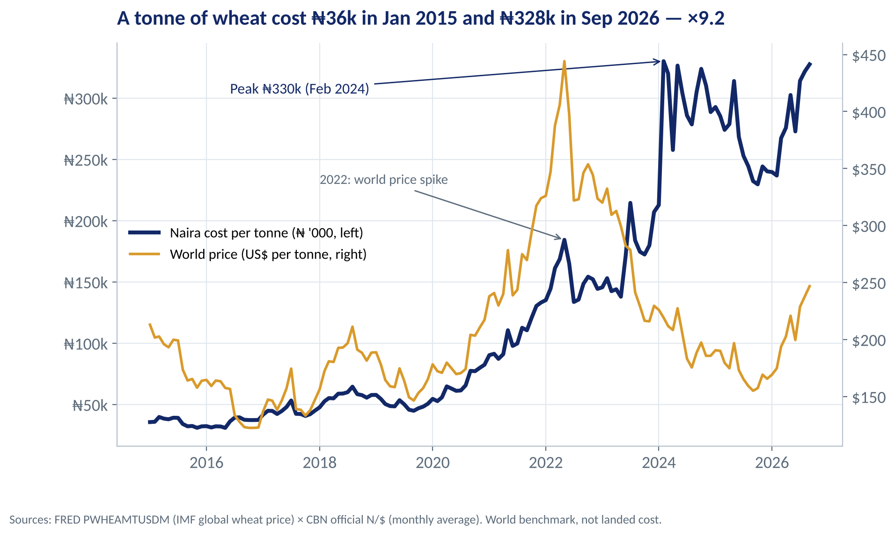{.fig-img fig-alt="S02-F09 (Python)"}

## R
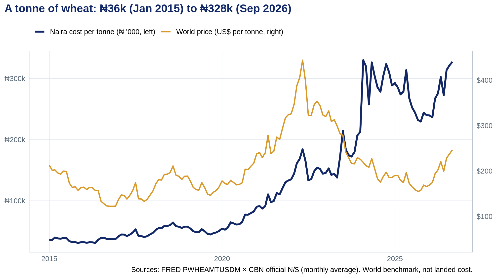{.fig-img fig-alt="S02-F09 (R)"}

:::

- Nigeria imports almost all its milling wheat: USDA puts imports at about **6.7 million tonnes** in 2025/26 and forecasts **7.2 mt** for 2026/27; under **1%** of major millers' flour uses local grain.
- So the naira cost of wheat = **world price × exchange rate**. Either can move it.
- 2022: the **world price** spiked (Russia–Ukraine). 2023–24: the **naira** did the damage. 2026: the world price is up about **46%** since January — naira cost is back near its Feb 2024 peak.
- Every flour-based business — bread, noodles, pasta, biscuits — faced this same shock.

<span class="fig-id">S02-F09 · replicate with s02_figures.py / .R</span>

::: {.callout-note collapse="true" appearance="minimal" icon=false}
## Sources and data notes

Sources: FRED PWHEAMTUSDM (IMF global price of wheat, US\$/tonne, monthly) × CBN official central rate (monthly average); computed in s02_figures.py: ₦35.7k/t (Jan 2015) → ₦330.1k (Feb 2024 peak) → ₦327.5k (Sep 2026); world price \$169/t (Jan 2026) → \$247/t (Sep 2026). USDA FAS via Milling Middle East & Africa, 29 Sep 2025 (2025/26 imports 6.7 mt, up from 6.25 mt; less than one percent of major millers' flour contains domestic wheat) and 6 Mar 2026 (USDA Grain & Feed Annual: 2026/27 imports forecast at 7.2 mt). This is a world benchmark price, not the landed cost in Lagos (add freight, insurance, duties and port charges).
:::

## Part 1 · Who Bears a Cost Shock?

::: {.part-question}
**The question this part answers:** When costs rise, how much ends up in the price — and how much in our margin?
:::

### What Moves Demand, and What Moves Supply

<span class="slide-kicker">THE TWO SIDES OF A MARKET · MANKIW CH. 4</span>

::: {.grid}
::: {.g-col-12 .g-col-md-6 .obj-card}
**Demand: willingness to buy**

*Slopes down — higher price, fewer packs*

- Own price: a move **along** the curve
- Income, prices of substitutes and complements
- Tastes, population, expectations of future prices
- These **shift** the whole curve
:::
::: {.g-col-12 .g-col-md-6 .obj-card}
**Supply: willingness to sell**

*Slopes up — higher price, more packs*

- Own price: a move **along** the curve
- Input costs: wheat, diesel, packaging, the naira
- Technology, number of sellers, taxes and levies
- These **shift** the whole curve
:::
:::

::: {.callout-tip appearance="simple"}
A change in **price** moves you **along** a curve. A change in **anything else** **shifts** the curve. Most pricing mistakes come from mixing the two.
:::

### Solve the Market Before and After the Shock <span class='tag tag-illus'>illustrative</span>

<span class="slide-kicker">EQUILIBRIUM, WORKED</span>

|  | Demand | Supply | Price | Quantity |
|---|---|---|---|---|
| Before | Q = 1,000 − 2P | Q = −200 + 2P | ₦300 | 400 |
| Cost +₦60 per unit | unchanged | Q = −200 + 2(P − 60) | ₦330 | 340 |
| **Change** |  |  | **+₦30** | **−60 (−15%)** |

**Step by step**

1. **Equilibrium**: set demand = supply. 1,000 − 2P = −200 + 2P → P = **₦300**, Q = **400**.
2. A ₦60 cost rise means firms need ₦60 more to supply each quantity: supply shifts **up by ₦60**.
3. New equilibrium: 1,000 − 2P = −320 + 2P → P = **₦330**, Q = **340**.
4. Buyers pay **₦30** of the ₦60; sellers' net price falls by the other **₦30** (from ₦300 to ₦270). Lost volume is an extra cost on top.

::: {.callout-note appearance="simple" icon=false}
## The general rule

**Pass-through rule** for straight-line curves: share passed to price = supply responsiveness ÷ (supply + demand responsiveness) = 2 ÷ (2 + 2) = **50%**. The **less** price-sensitive the buyers, the **more** they pay.
:::

::: {.result-box}
A cost shock is **shared**. Who pays more depends on who can **walk away** more easily.
:::

::: {.callout-note collapse="true" appearance="minimal" icon=false}
## Sources and data notes

Mankiw ch. 4 (equilibrium) and ch. 6 (tax incidence) use the same logic: a per-unit cost or tax is split by relative elasticities, not by who writes the cheque. With demand Q = 1,000 − 2P the slope term is 2 for both curves, hence 50%.
:::

### A Cost Shock Shifts Supply Up — the Price Rises by Less <span class='tag tag-illus'>illustrative</span>

<span class="slide-kicker">THE PICTURE</span>

::: {.panel-tabset group="lang"}
## Python
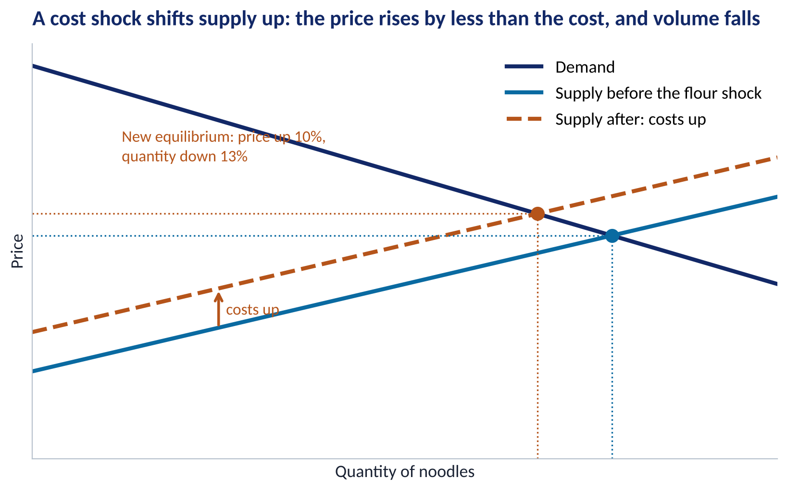{.fig-img fig-alt="S02-F01 (Python)"}

## R
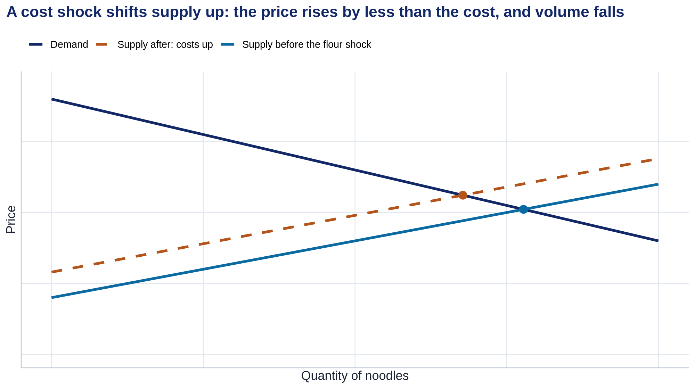{.fig-img fig-alt="S02-F01 (R)"}

:::

- Higher flour costs shift supply **up**: firms need more to supply the same quantity.
- New equilibrium: price **+10%**, quantity **−13%** in this example.
- The price rises by **less than the cost**: customers pay part, producers absorb part.
- Steeper (less elastic) demand → more of the shock lands on customers.

<span class="fig-id">S02-F01 · replicate with s02_figures.py / .R</span>

### Nigerian Shocks, Read as Demand and Supply

<span class="slide-kicker">SHIFTS YOU HAVE LIVED THROUGH</span>

::: {.grid}
::: {.g-col-12 .g-col-md-6 .obj-card}
**Petrol subsidy removal (2023)**

A supply shock to everything that moves. NBS: average intra-city bus fare rose from **₦650 to ₦1,285** — **+98% in one month** (May → June 2023).
:::
::: {.g-col-12 .g-col-md-6 .obj-card}
**Naira depreciation (2023–24)**

Imported wheat, packaging and machinery cost more naira: supply shifts **up** across manufacturing — see the wheat chart.
:::
::: {.g-col-12 .g-col-md-6 .obj-card}
**Falling real incomes**

When wages lag inflation, demand for non-essentials shifts **down**; shoppers **trade down** to smaller packs and cheaper brands.
:::
::: {.g-col-12 .g-col-md-6 .obj-card}
**New sellers online**

Social-media and e-commerce sellers add supply and make prices easier to compare: each seller's demand becomes **more elastic**.
:::
:::

::: {.callout-note collapse="true" appearance="minimal" icon=false}
## Sources and data notes

Source: NBS Transport Fare Watch, June 2023 (intra-city bus fare per drop ₦649.59 → ₦1,285.41, +97.88% m/m; inter-city ₦4,002.16 → ₦5,686.49, +42.09%), reported by Nairametrics, 14 Aug 2023. Inference for discussion (not measured by NBS): fares could nearly double because commuters had few short-run alternatives — inelastic demand allows high pass-through.
:::

### Taxes, Ceilings and Floors: Who Really Pays?

<span class="slide-kicker">GOVERNMENT IN THE MARKET · MANKIW CH. 6</span>

::: {.lead-box}
**The incidence rule.** The burden of a tax or a cost falls on whichever side **can least escape it** — regardless of who hands the money to the government.
:::

- **VAT and the 2026 food zero-rating.** Nigeria kept VAT at **7.5%** in the 2025 reforms. From **1 January 2026** basic food moved from **exempt** to **zero-rated**: sellers can now reclaim the VAT on their inputs. Shoppers gain only if that cost saving is passed on — likelier where competition is strong.
- **Price ceilings create shortages.** Holding petrol at about **₦185–₦199/litre** (NNPC pump prices) until end-May 2023 and the naira below its market rate produced **queues, rationing and parallel markets** — the price was paid another way.
- **Price floors create surpluses.** A minimum price above equilibrium leaves sellers with **unsold supply** — the logic behind debates on minimum wages and guaranteed farm prices.
- **Manager's use.** When a tax, levy or subsidy changes, estimate **your** share using elasticities — not the headline rate.

*Policy names the payer; elasticity decides the bearer.*

::: {.callout-note collapse="true" appearance="minimal" icon=false}
## Sources and data notes

Sources: Forvis Mazars, 'VAT & Nigeria 2025 Tax Reforms' (7.5% retained; basic food zero-rated; effective 1 January 2026). Basic food was already VAT-exempt under the old VAT Act, so the change is about input VAT, not a 7.5% cut at the till; check whether a product such as noodles counts as basic food. Mankiw ch. 6 ('Supply, Demand and Government Policies'). Zero-rating, unlike exemption, lets suppliers reclaim input VAT. Petrol: NNPC pump prices were about ₦184–₦199 by region before 31 May 2023, raised to ₦488–₦557 (ThisDay, 31 May 2023).
:::

## Part 2 · Elasticity: How Much Do Customers React?

::: {.part-question}
**The question this part answers:** If we raise the price, how many customers do we lose — and does revenue rise or fall?
:::

### Own-Price Elasticity of Demand

<span class="slide-kicker">THE KEY NUMBER · MANKIW CH. 5</span>

Elasticity is the **% change in quantity for a 1% change in price**. Bigger than 1 (ignoring the sign) = **elastic**: customers react strongly. Smaller than 1 = **inelastic**.

::: {.formula}
elasticity = % change in quantity ÷ % change in price
:::

**Example.** Our noodles (stylised data): **−1.47**. A 10% price rise, rivals holding, loses about **13%** of volume.

::: {.callout-tip appearance="minimal"}
**Why a manager cares.** Elastic demand: a price rise **cuts revenue**. Inelastic demand: a price rise **raises revenue**. Knowing which you face is the start of every pricing decision.
:::

### Elasticity and the Revenue Test, Step by Step <span class='tag tag-illus'>illustrative</span>

<span class="slide-kicker">COMPUTING IT</span>

|  | Before | After | Change | Midpoint % |
|---|---|---|---|---|
| Price per pack | ₦500 | ₦550 | +₦50 | +9.5% |
| Packs per week | 100,000 | 87,000 | −13,000 | −13.9% |
| Revenue per week | ₦50.0m | ₦47.85m | −₦2.15m | −4.4% |

**Step by step**

1. Use the **midpoint** method so the answer is the same up or down: %ΔP = 50 ÷ 525 = **9.5%**; %ΔQ = −13,000 ÷ 93,500 = **−13.9%**.
2. Elasticity = −13.9 ÷ 9.5 = **−1.46**: elastic.
3. **Revenue test**: price up, revenue down (₦50.0m → ₦47.85m) — the signature of elastic demand.
4. But **profit** is a different question: with a ₦350 unit cost, margin per week goes from ₦15.0m to **₦17.4m**. Fewer packs, more profit.

::: {.result-box}
Elasticity tells you what happens to **revenue**; add costs to see what happens to **profit**.
:::

### Why Some Customers Shrug and Others Walk Away

<span class="slide-kicker">WHAT DRIVES ELASTICITY</span>

::: {.lead-box}
**The determinants.** Demand is more elastic when customers have **close substitutes**, the item is a **luxury** or a **big share of the budget**, and they have **time** to adjust.
:::

- **Substitutes.** One noodle brand among many → elastic. All noodles together → much less so.
- **Necessity vs luxury.** Commuters in June 2023 still had to get to work: intra-city fares nearly **doubled** in a month, yet transport operators could make them stick.
- **Share of budget.** A ₦50 rise on a ₦500 pack matters more to a low-income family spending most of its income on food.
- **Time horizon.** Short run: few options. Long run: households switch fuel, car-pool, buy in bulk, change brands — elasticity **rises**.

*And the narrower the market you define, the more elastic it is.*

::: {.callout-note collapse="true" appearance="minimal" icon=false}
## Sources and data notes

Mankiw ch. 5. The brand-versus-market distinction drives the pass-through decision at the end of the session.
:::

### Prices Tripled — Volumes Did Not Collapse <span class='tag tag-illus'>illustrative</span>

<span class="slide-kicker">THE DATA</span>

::: {.panel-tabset group="lang"}
## Python
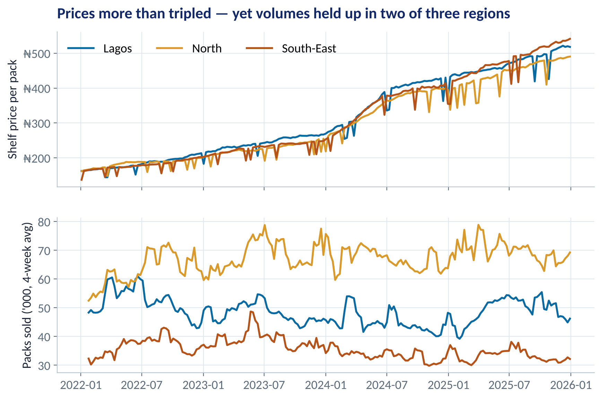{.fig-img fig-alt="S02-F02 (Python)"}

## R
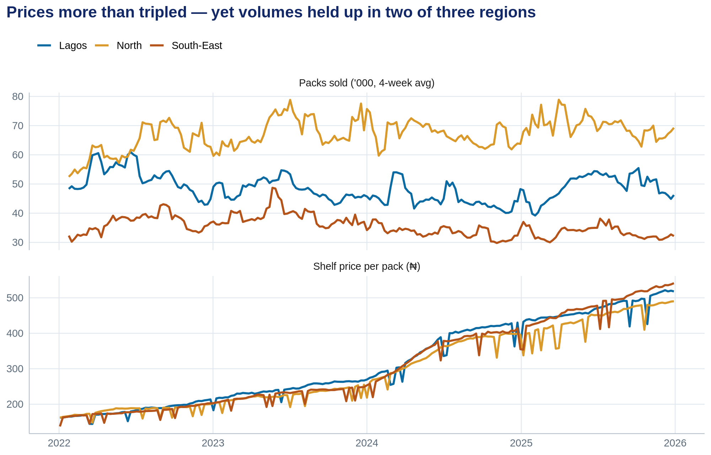{.fig-img fig-alt="S02-F02 (R)"}

:::

- Lagos shelf price went from about **₦162 to ₦518** a pack between 2022 and 2025.
- Average weekly volumes 2022 → 2025: North **+12%**, Lagos **−5%**, South-East **−9%** — far smaller moves than prices.
- Looks like customers do not care about price. **Do not believe it yet.**
- Incomes, rivals' prices and the general price level all moved at the same time.

<span class="fig-id">S02-F02 · replicate with s02_figures.py / .R</span>

### Inflation Hides the Elasticity <span class='tag tag-illus'>illustrative</span>

<span class="slide-kicker">THE TRAP</span>

::: {.panel-tabset group="lang"}
## Python
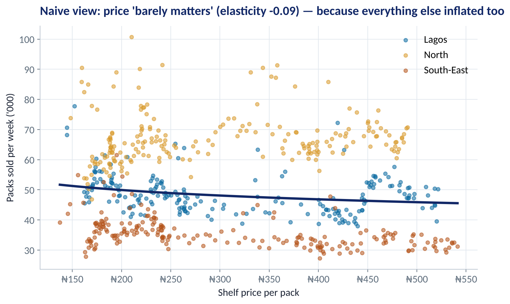{.fig-img fig-alt="S02-F03 (Python)"}

## R
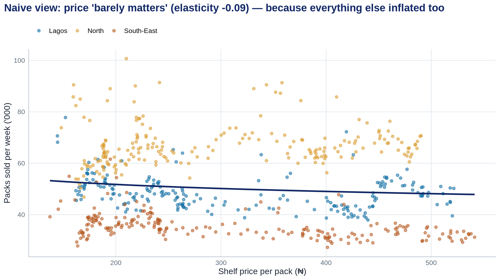{.fig-img fig-alt="S02-F03 (R)"}

:::

- Units against shelf price gives an elasticity of just **−0.09** — 'price barely matters'.
- But **every** price was rising: rivals' prices, wages, the whole price level.
- Shoppers respond to our price **relative** to alternatives and to their income.
- To see the true response, **hold the other drivers constant** — the Session 1 lesson on correlation.

<span class="fig-id">S02-F03 · replicate with s02_figures.py / .R</span>

### What Customers Really Respond To <span class='tag tag-illus'>illustrative</span>

<span class="slide-kicker">HOLDING OTHER THINGS CONSTANT</span>

::: {.panel-tabset group="lang"}
## Python
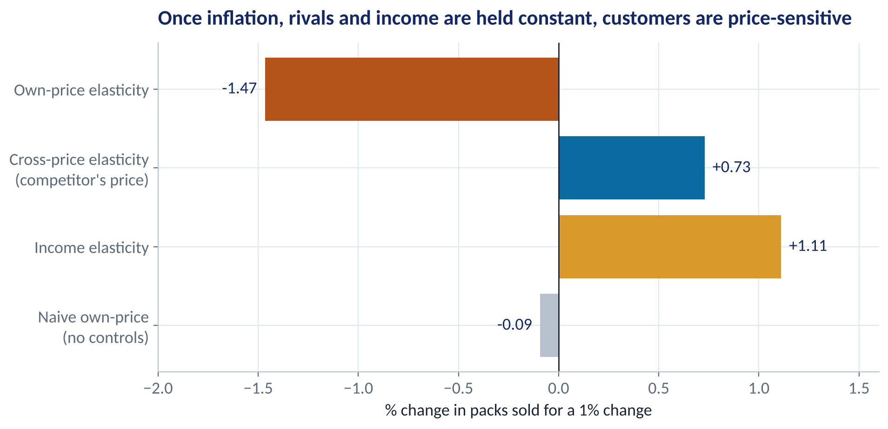{.fig-img fig-alt="S02-F04 (Python)"}

## R
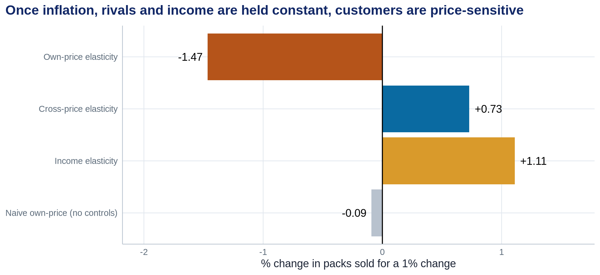{.fig-img fig-alt="S02-F04 (R)"}

:::

- **Own price −1.47**: a 1% rise in our price, all else equal, cuts volume by about 1.5%.
- **Cross price +0.73**: a 1% rise in a rival's price lifts our volume by about 0.7% — close substitutes.
- **Income +1.11**: as incomes rise, customers buy more.
- Method: regress log(units) on log(own price), log(rival price), log(real income), a trend and region.

<span class="fig-id">S02-F04 · replicate with s02_figures.py / .R</span>

### Three Elasticities Every Manager Should Know

<span class="slide-kicker">THE ELASTICITY FAMILY</span>

| Elasticity | Question it answers | Our estimate | Business use |
|---|---|---|---|
| Own-price | If we raise our price 1%, what happens to our volume? | −1.47 | Price setting, revenue forecasts |
| Cross-price | If a rival raises its price 1%, what happens to our volume? | +0.73 | Is the rival a close substitute? Will they follow? |
| Income | If customers' real income rises 1%, what happens to our volume? | +1.11 | Planning through recessions; trading down |
| Price elasticity of supply | If the market price rises 1%, how much more will sellers offer? | — | Who bears a cost shock; capacity planning |

::: {.callout-tip appearance="simple"}
Cross-price **positive** = substitutes (rival noodles). **Negative** = complements (noodles and seasoning). Income elasticity **negative** = an inferior good that people buy less of as they get richer.
:::

### When Does a Price Rise Raise Revenue? <span class='tag tag-illus'>illustrative</span>

<span class="slide-kicker">PRICE, VOLUME AND REVENUE</span>

::: {.panel-tabset group="lang"}
## Python
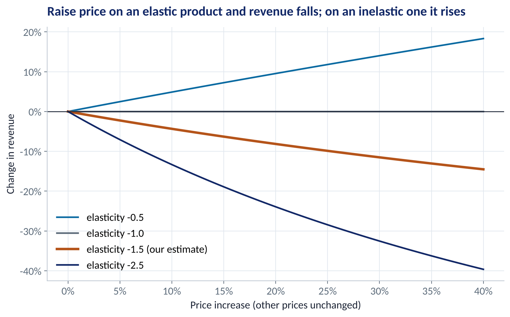{.fig-img fig-alt="S02-F05 (Python)"}

## R
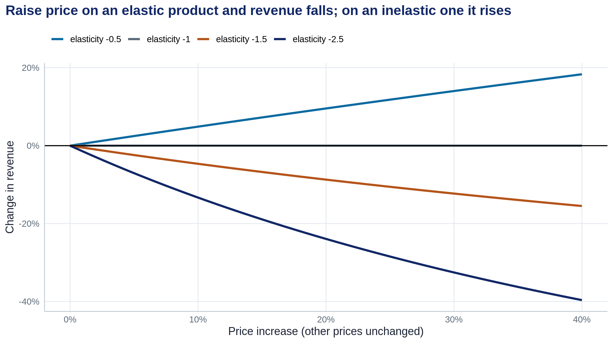{.fig-img fig-alt="S02-F05 (R)"}

:::

- Elasticity −0.5: a 20% price rise **raises** revenue.
- At our −1.47, a 20% rise **cuts** revenue by about **8%**.
- Revenue is not profit: a rise that covers higher costs can still protect margin.
- When **all** firms raise prices together, the relevant elasticity is smaller than one brand's.

<span class="fig-id">S02-F05 · replicate with s02_figures.py / .R</span>

### Your Gross Margin Reveals the Elasticity You Assume <span class='tag tag-illus'>illustrative</span>

<span class="slide-kicker">ELASTICITY AND MARGIN</span>

| Elasticity (\|e\|) | Profit-maximising margin = 1 ÷ \|e\| | Price if unit cost = ₦350 |
|---|---|---|
| 1.5 | 67% | ₦1,050 |
| 2.0 | 50% | ₦700 |
| 3.0 | 33% | ₦525 |
| 3.3 | 30% | ₦500 — our price today |
| 5.0 | 20% | ₦438 |

**Step by step**

1. The **markup rule** (Lerner): at the profit-maximising price, (price − marginal cost) ÷ price = 1 ÷ |elasticity|.
2. Our margin is (500 − 350) ÷ 500 = **30%**, which is optimal only if |e| ≈ **3.3**.
3. Our measured short-run brand elasticity is **1.47**. Either we are **under-pricing**, or the true long-run elasticity is higher (rivals react, entry, trading down).
4. Useful test before any repricing: **which elasticity are we implicitly assuming?**

::: {.result-box}
Margins and elasticities must be **consistent**. If they are not, one of them is wrong.
:::

### Check your understanding

**A competitor cuts its noodle price by 10%. Our cross-price elasticity is +0.73. Holding our price, what happens to our volume?**

- **A.** Rises about 7% — their cut expands the whole market
- **B.** Falls about 15% — use the own-price elasticity
- **C.** Falls about 7% — some of our customers switch to them
- **D.** No change — cross-price elasticity applies only to complements

::: {.callout-tip collapse="true" appearance="simple"}
## Show answer
C. A cross-price elasticity of +0.73 means our volume moves 0.73% in the **same** direction as the rival's price. A 10% cut by them → about 7% fewer packs for us. A gets the sign wrong; B uses the wrong elasticity; D has substitutes and complements reversed.
:::

## Part 3 · Behaviour, Promotions and the Decision

::: {.part-question}
**The question this part answers:** How much of the flour shock should we pass on — how fast, and in what form?
:::

### Reference Prices and Loss Aversion

<span class="slide-kicker">BEHAVIOURAL ECONOMICS</span>

Shoppers judge a price against the price they are **used to** — their **reference price**. Paying more than usual feels like a **loss**, and people weigh losses about **twice** as heavily as equal gains (Kahneman & Tversky).

::: {.formula}
pain of a ₦50 rise  >  pleasure of a ₦50 cut
:::

**Example.** In our data, weeks priced **more than 10% above** the usual price sold about **7.7%** fewer packs than the elasticity alone predicts.

::: {.callout-tip appearance="minimal"}
**Why a manager cares.** Several small, explained increases usually cost less volume than one big jump. Pack-size changes, clear communication and timing all manage the reference price.
:::

::: {.callout-note collapse="true" appearance="minimal" icon=false}
## Sources and data notes

Kahneman & Tversky, 'Prospect Theory' (Econometrica, 1979); Tversky & Kahneman (1992) estimate a loss-aversion coefficient of about 2.25. The 7.7% penalty is from the stylised dataset.
:::

### Big Jumps Hurt More Than the Arithmetic Says <span class='tag tag-illus'>illustrative</span>

<span class="slide-kicker">THE EVIDENCE</span>

::: {.panel-tabset group="lang"}
## Python
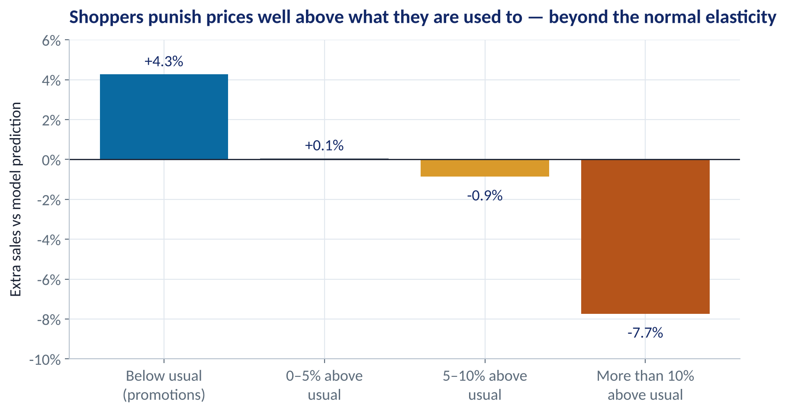{.fig-img fig-alt="S02-F06 (Python)"}

## R
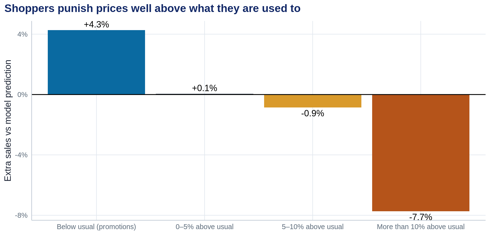{.fig-img fig-alt="S02-F06 (R)"}

:::

- Actual sales compared with the elasticity model's prediction.
- Promotion weeks (price **below** usual) sold about **4%** more than predicted.
- Up to 5% above usual: no extra penalty. **More than about 10% above: −7.7%** (13 weeks — a small sample).
- The penalty fades as the new price becomes the new normal.

<span class="fig-id">S02-F06 · replicate with s02_figures.py / .R</span>

### Customers Punish Prices That Feel Unfair

<span class="slide-kicker">FAIRNESS AND DYNAMIC PRICING</span>

::: {.lead-box}
**Kahneman, Knetsch & Thaler (1986).** A hardware store raises the price of snow shovels from **\$15 to \$20** the morning after a snowstorm. **82%** of respondents called it **unfair**.
:::

- **Cost-based increases are 'fair'.** Explaining a rise by a visible cost (wheat, diesel, the naira) protects goodwill. That is today's case.
- **Demand-based increases are 'gouging'.** Surge pricing on ride-hailing apps in rain or rush hour balances riders and drivers — but customers resent it.
- **AI makes dynamic pricing cheap.** Algorithms can price by product, store, hour and customer. Personalised prices that customers would object to invite **backlash and regulators**.
- **Rules of thumb.** Be transparent about costs; cap surges on essentials; never personalise in ways you could not defend in public.

*Raising prices because **costs** rose is accepted far more readily than raising them because **demand** rose.*

::: {.callout-note collapse="true" appearance="minimal" icon=false}
## Sources and data notes

Kahneman, Knetsch & Thaler, 'Fairness as a Constraint on Profit Seeking: Entitlements in the Market', American Economic Review 76(4), 1986. Thaler's 'Misbehaving' (2015) retells the study. Session 4 returns to data, platforms and pricing power.
:::

### What a 15% Discount Buys <span class='tag tag-illus'>illustrative</span>

<span class="slide-kicker">PROMOTIONS</span>

::: {.panel-tabset group="lang"}
## Python
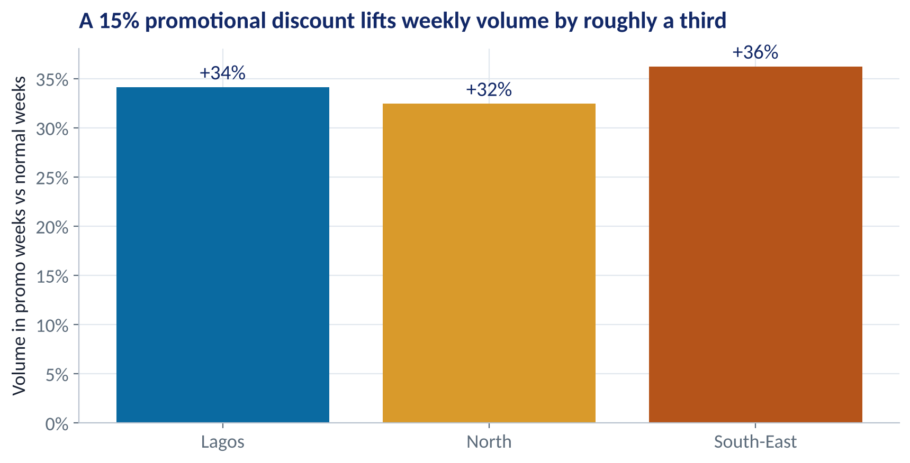{.fig-img fig-alt="S02-F07 (Python)"}

## R
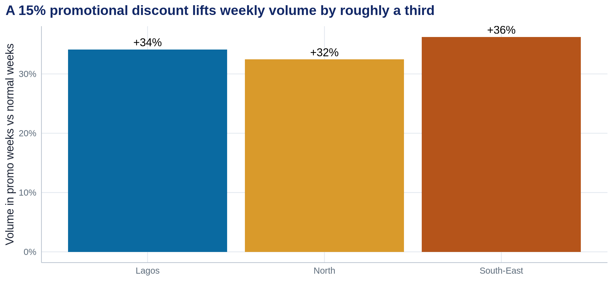{.fig-img fig-alt="S02-F07 (R)"}

:::

- Promotion weeks (15% off) sold **32–36%** more packs than normal weeks.
- Part is new demand; part is **pantry loading** — buying earlier, not more.
- Measure the weeks **after** a promotion: a dip means you borrowed from the future.
- Frequent promotions reset reference prices **downward**.

<span class="fig-id">S02-F07 · replicate with s02_figures.py / .R</span>

### A 15% Discount Needs Volume to Double — We Got +34% <span class='tag tag-illus'>illustrative</span>

<span class="slide-kicker">PROMOTION ARITHMETIC</span>

| Per week | Normal week | Promotion week |
|---|---|---|
| Price per pack | ₦500 | ₦425 |
| Margin per pack (cost ₦350) | ₦150 | ₦75 |
| Packs sold | 100,000 | 134,000 |
| **Gross margin** | **₦15.0m** | **₦10.1m (−33%)** |

**Step by step**

1. A 15% discount (₦75) **halves** the margin per pack, from ₦150 to ₦75.
2. To earn the same margin, volume must rise by 150 ÷ 75 − 1 = **100%**.
3. Our promotions lifted volume by about **34%**, so each promotion week cost about **₦5m** of margin.
4. A promotion pays only if it wins **lasting new customers** or clears stock that would otherwise be lost — measure that, not the week's volume.

::: {.result-box}
Required uplift = margin ÷ (margin − discount) − 1. With thin margins, small discounts need **huge** volume gains.
:::

### How Much of the Flour Shock to Pass On? <span class='tag tag-illus'>illustrative</span>

<span class="slide-kicker">THE DECISION</span>

::: {.panel-tabset group="lang"}
## Python
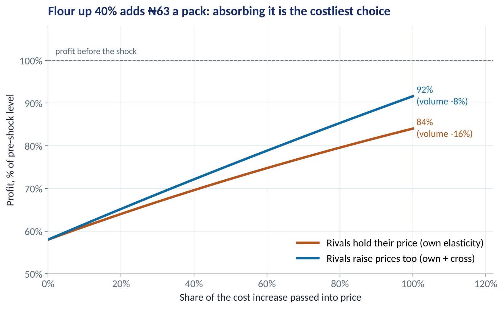{.fig-img fig-alt="S02-F08 (Python)"}

## R
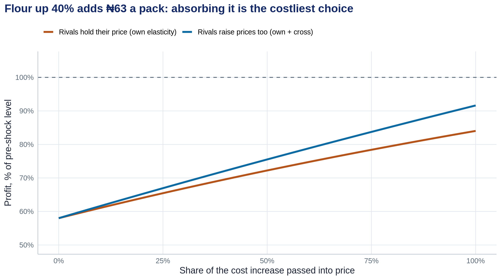{.fig-img fig-alt="S02-F08 (R)"}

:::

- The shock adds **₦63** to a pack that sells for ₦500 and costs ₦350.
- **Absorb it all**: volume holds; profit falls to **58%** of its old level.
- **Pass it all on**, rivals holding: volume −16%, profit **84%**. If rivals follow: volume −8%, profit **92%**.
- Every miller pays the same world price × naira — rivals are **likely to follow**.

<span class="fig-id">S02-F08 · replicate with s02_figures.py / .R</span>

### How to Pass On a Cost Shock Without Breaking the Brand

<span class="slide-kicker">THE PLAYBOOK</span>

::: {.grid}
::: {.g-col-12 .g-col-md-4 .obj-card}
**Stagger and signal**

Two or three steps rather than one jump; announce the **cost reason** (wheat, naira) — the fairness effect works for you.
:::
::: {.g-col-12 .g-col-md-4 .obj-card}
**Resize and re-mix**

Smaller packs at familiar price points protect the **reference price**; premium variants carry more of the increase.
:::
::: {.g-col-12 .g-col-md-4 .obj-card}
**Take cost out**

Recipe, packaging, logistics and procurement savings reduce the share you need to pass on at all.
:::
:::

::: {.callout-tip appearance="simple"}
Watch three numbers weekly after a price change: **volume vs forecast, rivals' prices and distributor stock** — and be ready to adjust the next step.
:::

### Check your understanding

**Flour costs rise 40% for every noodles maker in Nigeria. Which recommendation is best supported by today's analysis?**

- **A.** Rivals face the same shock and will likely follow, so pass on most of the cost — in steps, explained by the cost reason
- **B.** Absorb the cost: any price rise hands customers to rivals
- **C.** Raise prices by exactly 40%, since flour rose 40%
- **D.** Price barely matters — our data show an elasticity near zero

::: {.callout-tip collapse="true" appearance="simple"}
## Show answer
A. When all firms face the same cost they tend to move together, so the volume loss is smaller (own + cross ≈ −0.74), and cost-based increases are judged fair. B ignores rivals' costs; C confuses the flour rise with the unit-cost rise (flour is 45% of cost); D is the inflation trap.
:::

## Lab 2: How Price-Sensitive Are Our Customers?

*Time:* 20 minutes · *Data:* [`data/fmcg_price_volume.csv`](../../data/fmcg_price_volume.csv)

1. Plot prices and volumes by region, 2022–2025.
2. Estimate the **naive elasticity** (units on price only) and explain why it misleads.
3. Estimate own-price, cross-price and income elasticities **holding other things constant**.
4. Check the **Lerner rule**: which elasticity does today's margin imply?
5. Test pass-through of 0%, 50% and 100% of the flour shock — with rivals holding and following.

::: {.callout-important appearance="simple"}
**Deliverable:** a three-sentence pricing recommendation to the MD: how much to pass on, how fast, and what to watch.
:::

## The code (R | Python)

Pick your language once; every tab on the site follows your choice. Download a script, or copy it into RStudio and run it line by line.

### Replicate every chart

::: {.panel-tabset group="lang"}
## Python
[<i class="bi bi-download"></i> s02_figures.py](../../sessions/s02/python/s02_figures.py){download=""}

::: {.callout-note collapse="true" appearance="simple" icon=false}
## Show the full script (167 lines)

```{.python filename="sessions/s02/python/s02_figures.py"}
# =============================================================================
# EEGB · Session 2 · Demand, Supply & Elasticity with Behavioural Insights
# Replication script — regenerates every chart in the Session 2 deck (Python)
# Data: data/fmcg_price_volume.csv (stylised weekly noodles sales, 3 regions, 2022–2025)
# Run from the project root:  python sessions/s02/python/s02_figures.py
# =============================================================================
import sys; sys.path.insert(0, "python")
import numpy as np, pandas as pd
import matplotlib.pyplot as plt
from matplotlib.ticker import FuncFormatter
from eegb_style import *

set_style()
d = pd.read_csv("data/fmcg_price_volume.csv", parse_dates=["week"])
d["t"] = d.groupby("region").cumcount()                       # weeks since start (soaks up general inflation)
REG = {"Lagos": TEAL, "North": GOLD, "South-East": RUST}

# The demand model: log(units) on log(own price), log(competitor price), log(real income), trend, region.
# No separate promotion dummy: in these data promotions work through the price cut itself, so a dummy would
# soak up the price variation and bias the elasticity towards zero (try it: it gives about -1.15).
def design(df):
    return np.column_stack([np.ones(len(df)), np.log(df.price_naira), np.log(df.competitor_price_naira),
                            np.log(df.income_index), df.t] + [(df.region == r).astype(float) for r in ["North", "South-East"]])
b = np.linalg.lstsq(design(d), np.log(d.units), rcond=None)[0]
own, cross, inc = b[1], b[2], b[3]
naive = np.polyfit(np.log(d.price_naira), np.log(d.units), 1)[0]
print(f"naive elasticity {naive:.2f} | own {own:.2f} cross {cross:.2f} income {inc:.2f}")

# --- F01 · A cost shock shifts supply ---------------------------------------------------
q = np.linspace(0, 10, 200)
dem = 900 - 50 * q
s0, s1 = 200 + 40 * q, 290 + 40 * q
q0, q1 = 700 / 90, 610 / 90
p0, p1 = 900 - 50 * q0, 900 - 50 * q1
fig, ax = plt.subplots()
ax.plot(q, dem, color=NAVY, lw=3, label="Demand")
ax.plot(q, s0, color=TEAL, lw=3, label="Supply before the flour shock")
ax.plot(q, s1, color=RUST, lw=3, ls="--", label="Supply after: costs up")
for qq, pp, c in [(q0, p0, TEAL), (q1, p1, RUST)]:
    ax.scatter(qq, pp, s=90, color=c, zorder=4)
    ax.plot([qq, qq], [0, pp], color=c, ls=":", lw=1.2); ax.plot([0, qq], [pp, pp], color=c, ls=":", lw=1.2)
ax.annotate("", xy=(2.5, 390), xytext=(2.5, 300), arrowprops=dict(arrowstyle="->", color=RUST, lw=2))
ax.text(2.6, 330, "costs up", color=RUST, fontsize=12)
ax.text(1.2, p1 + 120, f"New equilibrium: price up {100*(p1/p0-1):.0f}%,\nquantity down {100*(1-q1/q0):.0f}%", color=RUST, fontsize=12)
ax.set_xlim(0, 10); ax.set_ylim(0, 950); ax.set_xticks([]); ax.set_yticks([]); ax.legend(loc="upper right")
ax.set(title="A cost shock shifts supply up: the price rises by less than the cost, and volume falls",
       xlabel="Quantity of noodles", ylabel="Price")
save(fig, "s02", "f01")

# --- F02 · Three years of prices and volumes ----------------------------------------------
fig, axes = plt.subplots(2, 1, figsize=(10, 6.4), sharex=True)
for r, c in REG.items():
    g = d[d.region == r]
    axes[0].plot(g.week, g.price_naira, color=c, lw=2, label=r)
    axes[1].plot(g.week, g.units.rolling(4).mean() / 1000, color=c, lw=2, label=r)
axes[0].yaxis.set_major_formatter(FuncFormatter(lambda v, p: f"₦{v:,.0f}"))
axes[0].set_ylabel("Shelf price per pack"); axes[1].set_ylabel("Packs sold ('000, 4-week avg)")
axes[0].legend(ncol=3, loc="upper left"); axes[0].set_title("Prices more than tripled — yet volumes held up in two of three regions", loc="left")
save(fig, "s02", "f02")

# --- F03 · The naive picture: inflation hides the elasticity --------------------------------
fig, ax = plt.subplots()
for r, c in REG.items():
    g = d[d.region == r]; ax.scatter(g.price_naira, g.units / 1000, color=c, alpha=.55, s=22, label=r)
xs = np.linspace(d.price_naira.min(), d.price_naira.max(), 50)
a0 = np.polyfit(np.log(d.price_naira), np.log(d.units), 1)
ax.plot(xs, np.exp(np.polyval(a0, np.log(xs))) / 1000, color=NAVY, lw=3)
ax.xaxis.set_major_formatter(FuncFormatter(lambda v, p: f"₦{v:,.0f}")); ax.legend()
ax.set(title=f"Naive view: price 'barely matters' (elasticity {naive:.2f}) — because everything else inflated too",
       xlabel="Shelf price per pack", ylabel="Packs sold per week ('000)")
ax.title.set_fontsize(14)
save(fig, "s02", "f03")

# --- F04 · The controlled estimates -----------------------------------------------------------
fig, ax = plt.subplots(figsize=(10, 4.6))
labs = ["Own-price elasticity", "Cross-price elasticity\n(competitor's price)", "Income elasticity", "Naive own-price\n(no controls)"]
vals = [own, cross, inc, naive]
cols = [RUST, TEAL, GOLD, "#B8C2CE"]
ax.barh(labs[::-1], vals[::-1], color=cols[::-1])
for i, v in enumerate(vals[::-1]):
    ax.text(v + (0.04 if v >= 0 else -0.04), i, f"{v:+.2f}", va="center", ha="left" if v >= 0 else "right", fontsize=13, color=NAVY)
ax.axvline(0, color=INK, lw=1); ax.set_xlim(-2, 1.6)
ax.set(title="Once inflation, rivals and income are held constant, customers are price-sensitive", xlabel="% change in packs sold for a 1% change")
save(fig, "s02", "f04")

# --- F05 · What a price rise does to revenue, by elasticity ------------------------------------
rise = np.linspace(0, 40, 81)
fig, ax = plt.subplots()
for e, c in [(-0.5, TEAL), (-1.0, SLATE), (own, RUST), (-2.5, NAVY)]:
    rev = ((1 + rise / 100) * (1 + rise / 100) ** e - 1) * 100
    ax.plot(rise, rev, color=c, lw=3 if c == RUST else 2, label=f"elasticity {e:.1f}" + (" (our estimate)" if c == RUST else ""))
ax.axhline(0, color=INK, lw=1)
ax.yaxis.set_major_formatter(FuncFormatter(pct)); ax.xaxis.set_major_formatter(FuncFormatter(pct)); ax.legend(loc="lower left")
ax.set(title="Raise price on an elastic product and revenue falls; on an inelastic one it rises",
       xlabel="Price increase (other prices unchanged)", ylabel="Change in revenue")
save(fig, "s02", "f05")
r20 = ((1.2) * 1.2 ** own - 1) * 100
print(f"revenue change for +20% price at own elasticity: {r20:.1f}%")

# --- F06 · Reference prices: rises above 'normal' hurt extra -------------------------------------
d["res"] = np.log(d.units) - design(d) @ b
d["ref"] = d.groupby("region").price_naira.transform(lambda s: s.shift(1).ewm(alpha=0.2, adjust=False).mean())
d["gap"] = np.log(d.price_naira / d.ref)
bins = [-1, 0, 0.05, 0.10, 1]; names = ["Below usual\n(promotions)", "0–5% above\nusual", "5–10% above\nusual", "More than 10%\nabove usual"]
dd = d.dropna(subset=["gap"]).copy(); dd["bin"] = pd.cut(dd.gap, bins, labels=names)
rb = dd.groupby("bin", observed=False).res.mean() * 100
fig, ax = plt.subplots(figsize=(10, 4.8))
ax.bar(rb.index.astype(str), rb.values, color=[TEAL, SLATE, GOLD, RUST])
for i, v in enumerate(rb.values): ax.text(i, v + (0.4 if v >= 0 else -1.2), f"{v:+.1f}%", ha="center", fontsize=13, color=NAVY)
ax.axhline(0, color=INK, lw=1); ax.yaxis.set_major_formatter(FuncFormatter(pct)); ax.set_ylim(-10, 6)
ax.set(title="Shoppers punish prices well above what they are used to — beyond the normal elasticity",
       ylabel="Extra sales vs model prediction")
ax.title.set_fontsize(14)
save(fig, "s02", "f06")
print("reference-price residuals (%):", rb.round(1).to_dict())

# --- F07 · Promotions: the volume lift by region --------------------------------------------------
lift = d.groupby(["region", "promo"]).units.mean().unstack()
lift = (lift[1] / lift[0] - 1) * 100
fig, ax = plt.subplots(figsize=(10, 4.6))
ax.bar(lift.index, lift.values, color=[REG[r] for r in lift.index])
for i, v in enumerate(lift.values): ax.text(i, v + 0.8, f"+{v:.0f}%", ha="center", fontsize=14, color=NAVY)
ax.yaxis.set_major_formatter(FuncFormatter(pct))
ax.set(title="A 15% promotional discount lifts weekly volume by roughly a third", ylabel="Volume in promo weeks vs normal weeks")
save(fig, "s02", "f07")
print("promo lift %:", lift.round(1).to_dict())

# --- F08 · How much of a 40% flour-cost rise to pass on? ---------------------------------------------
P0, C0, flour_share = 500.0, 350.0, 0.45            # stylised: ₦500 pack, ₦350 unit cost, flour = 45% of cost
dc = C0 * flour_share * 0.40                          # extra cost per pack from a 40% flour rise
pt = np.linspace(0, 1, 51)                            # pass-through: 0 = absorb all, 1 = pass on fully
fig, ax = plt.subplots()
for e, lab, c in [(own, "Rivals hold their price (own elasticity)", RUST), (own + cross, "Rivals raise prices too (own + cross)", TEAL)]:
    P = P0 + pt * dc
    Q = (P / P0) ** e
    profit = (P - (C0 + dc)) * Q / (P0 - C0) * 100
    vol = (Q[-1] - 1) * 100
    ax.plot(pt * 100, profit, color=c, lw=3, label=lab)
    ax.text(101, profit[-1], f"{profit[-1]:.0f}%\n(volume {vol:+.0f}%)", color=c, fontsize=12, va="center")
    print(f"{lab}: absorb -> {profit[0]:.0f}%, full pass-through -> {profit[-1]:.0f}% of pre-shock profit, volume {vol:+.1f}%")
ax.axhline(100, color=SLATE, ls="--", lw=1); ax.text(2, 101.5, "profit before the shock", color=SLATE, fontsize=11)
ax.set_xlim(0, 122); ax.set_ylim(50, 108)
ax.xaxis.set_major_formatter(FuncFormatter(pct)); ax.yaxis.set_major_formatter(FuncFormatter(pct)); ax.legend(loc="lower right")
ax.set(title=f"Flour up 40% adds ₦{dc:.0f} a pack: absorbing it is the costliest choice",
       xlabel="Share of the cost increase passed into price", ylabel="Profit, % of pre-shock level")
save(fig, "s02", "f08")

# --- F09 · The real shock: naira cost of a tonne of imported wheat (official data) -------------------
o = pd.read_csv("data/official/ng_official_monthly.csv", parse_dates=["date"]).set_index("date").loc["2015-01-01":]
w = o[["wheat_usd_t", "usd_official_avg"]].dropna()
w["ngn_t"] = w.wheat_usd_t * w.usd_official_avg / 1000          # ₦ thousand per tonne
fig, ax = plt.subplots(); ax2 = ax.twinx()
ax.plot(w.index, w.ngn_t, color=NAVY, lw=3, label="Naira cost per tonne (₦ '000, left)")
ax2.plot(w.index, w.wheat_usd_t, color=GOLD, lw=2, label="World price (US$ per tonne, right)")
ax2.grid(False); ax2.spines["right"].set_visible(True)
pk = w.ngn_t.idxmax()
ax.annotate(f"Peak ₦{w.ngn_t[pk]:,.0f}k ({pk:%b %Y})", xy=(pk, w.ngn_t[pk]), xytext=(pd.Timestamp("2016-06-01"), w.ngn_t[pk] * 0.92),
            arrowprops=dict(arrowstyle="->", color=NAVY), fontsize=11.5, color=NAVY)
ax.annotate("2022: world price spike", xy=(pd.Timestamp("2022-05-01"), w.ngn_t["2022-05-01"]), xytext=(pd.Timestamp("2018-01-01"), 230),
            arrowprops=dict(arrowstyle="->", color=SLATE), fontsize=10.5, color=SLATE)
ax.yaxis.set_major_formatter(FuncFormatter(lambda x, p: f"₦{x:,.0f}k")); ax2.yaxis.set_major_formatter(FuncFormatter(lambda x, p: f"${x:,.0f}"))
h1, l1 = ax.get_legend_handles_labels(); h2, l2 = ax2.get_legend_handles_labels(); ax.legend(h1 + h2, l1 + l2, loc="center left", fontsize=11)
first, last = w.ngn_t.iloc[0], w.ngn_t.iloc[-1]
ax.set(title=f"A tonne of wheat cost ₦{first:,.0f}k in {w.index[0]:%b %Y} and ₦{last:,.0f}k in {w.index[-1]:%b %Y} — ×{last/first:.1f}")
note(fig, "Sources: FRED PWHEAMTUSDM (IMF global wheat price) × CBN official N/$ (monthly average). World benchmark, not landed cost.")
save(fig, "s02", "f09")
print(f"F09: {w.index[0]:%b %Y} {first:.1f}k -> {w.index[-1]:%b %Y} {last:.1f}k (x{last/first:.2f}); peak {pk:%b %Y} {w.ngn_t[pk]:.1f}k; usd {w.wheat_usd_t.iloc[0]:.0f}->{w.wheat_usd_t.iloc[-1]:.0f}")
```
:::

## R
[<i class="bi bi-download"></i> s02_figures.R](../../sessions/s02/R/s02_figures.R){download=""}

::: {.callout-note collapse="true" appearance="simple" icon=false}
## Show the full script (119 lines)

```{.r filename="sessions/s02/R/s02_figures.R"}
# =============================================================================
# EEGB · Session 2 · Demand, Supply & Elasticity with Behavioural Insights
# Replication script — regenerates every chart in the Session 2 deck (R)
# Data: data/fmcg_price_volume.csv (stylised weekly noodles sales, 3 regions, 2022–2025)
# =============================================================================
source("R/theme_eegb.R")
suppressPackageStartupMessages({ library(dplyr); library(readr); library(tidyr) })
d <- read_csv("data/fmcg_price_volume.csv", show_col_types = FALSE) |>
  group_by(region) |> mutate(t = row_number() - 1) |> ungroup()
reg_cols <- c(Lagos = eegb[["teal"]], North = eegb[["gold"]], `South-East` = eegb[["rust"]])

fit <- lm(log(units) ~ log(price_naira) + log(competitor_price_naira) + log(income_index) + t + region, data = d)
own <- coef(fit)[["log(price_naira)"]]; cross <- coef(fit)[["log(competitor_price_naira)"]]
inc <- coef(fit)[["log(income_index)"]]
naive <- coef(lm(log(units) ~ log(price_naira), data = d))[[2]]

# --- F01 · A cost shock shifts supply ---------------------------------------------------
q <- seq(0, 10, length.out = 200)
cur <- bind_rows(tibble(q, p = 900 - 50 * q, curve = "Demand"),
                 tibble(q, p = 200 + 40 * q, curve = "Supply before the flour shock"),
                 tibble(q, p = 290 + 40 * q, curve = "Supply after: costs up"))
eq <- tibble(q = c(700, 610) / 90) |> mutate(p = 900 - 50 * q)
p1 <- ggplot(cur, aes(q, p, colour = curve, linetype = curve)) + geom_line(linewidth = 1.3) +
  geom_point(data = eq, aes(q, p), inherit.aes = FALSE, size = 3.5, colour = c(eegb[["teal"]], eegb[["rust"]])) +
  scale_colour_manual(values = c(Demand = eegb[["navy"]], `Supply before the flour shock` = eegb[["teal"]],
                                 `Supply after: costs up` = eegb[["rust"]]), name = NULL) +
  scale_linetype_manual(values = c(Demand = "solid", `Supply before the flour shock` = "solid", `Supply after: costs up` = "dashed"), name = NULL) +
  coord_cartesian(ylim = c(0, 950)) +
  labs(title = "A cost shock shifts supply up: the price rises by less than the cost, and volume falls",
       x = "Quantity of noodles", y = "Price") + theme_eegb() + theme(axis.text = element_blank())
save_fig(p1, "s02", "f01")

# --- F02 · Prices and volumes ----------------------------------------------------------------
long <- d |> group_by(region) |> mutate(units_k = as.numeric(stats::filter(units, rep(1 / 4, 4), sides = 1)) / 1000) |> ungroup() |>
  select(week, region, `Shelf price per pack (₦)` = price_naira, `Packs sold ('000, 4-week avg)` = units_k) |>
  pivot_longer(-c(week, region))
p2 <- ggplot(long, aes(week, value, colour = region)) + geom_line(linewidth = 1) +
  facet_wrap(~name, ncol = 1, scales = "free_y") + scale_colour_manual(values = reg_cols, name = NULL) +
  labs(title = "Prices more than tripled — yet volumes held up in two of three regions", x = NULL, y = NULL) + theme_eegb()
save_fig(p2, "s02", "f02", height = 6.4)

# --- F03 · The naive picture ------------------------------------------------------------------
p3 <- ggplot(d, aes(price_naira, units / 1000)) + geom_point(aes(colour = region), alpha = .55) +
  geom_smooth(method = "lm", formula = y ~ log(x), se = FALSE, colour = eegb[["navy"]]) +
  scale_colour_manual(values = reg_cols, name = NULL) +
  labs(title = sprintf("Naive view: price 'barely matters' (elasticity %.2f) — because everything else inflated too", naive),
       x = "Shelf price per pack (₦)", y = "Packs sold per week ('000)") + theme_eegb(12)
save_fig(p3, "s02", "f03")

# --- F04 · Controlled estimates -----------------------------------------------------------------
est <- tibble(term = factor(c("Own-price elasticity", "Cross-price elasticity", "Income elasticity", "Naive own-price (no controls)"),
                            levels = rev(c("Own-price elasticity", "Cross-price elasticity", "Income elasticity", "Naive own-price (no controls)"))),
              value = c(own, cross, inc, naive))
p4 <- ggplot(est, aes(value, term)) + geom_col(fill = c(eegb[["rust"]], eegb[["teal"]], eegb[["gold"]], "#B8C2CE")) +
  geom_text(aes(label = sprintf("%+.2f", value), hjust = ifelse(value >= 0, -0.2, 1.2))) + geom_vline(xintercept = 0) +
  xlim(-2, 1.6) + labs(title = "Once inflation, rivals and income are held constant, customers are price-sensitive",
                       x = "% change in packs sold for a 1% change", y = NULL) + theme_eegb()
save_fig(p4, "s02", "f04", height = 4.6)

# --- F05 · Revenue response by elasticity --------------------------------------------------------
rev <- expand_grid(rise = seq(0, 40, by = .5), e = c(-0.5, -1, round(own, 1), -2.5)) |>
  mutate(revenue = ((1 + rise / 100)^(1 + e) - 1) * 100, e = factor(paste("elasticity", e)))
p5 <- ggplot(rev, aes(rise, revenue, colour = e)) + geom_line(linewidth = 1.2) + geom_hline(yintercept = 0) +
  scale_colour_manual(values = unname(eegb[c("teal", "slate", "rust", "navy")]), name = NULL) +
  scale_x_continuous(labels = pct) + scale_y_continuous(labels = pct) +
  labs(title = "Raise price on an elastic product and revenue falls; on an inelastic one it rises",
       x = "Price increase (other prices unchanged)", y = "Change in revenue") + theme_eegb()
save_fig(p5, "s02", "f05")

# --- F06 · Reference prices ------------------------------------------------------------------------
d$res <- residuals(fit)
d <- d |> group_by(region) |>
  mutate(ref = { r <- numeric(n()); r[1] <- NA; m <- price_naira[1]
                 for (i in seq_len(n())[-1]) { r[i] <- m; m <- 0.8 * m + 0.2 * price_naira[i] }; r }) |> ungroup() |>
  mutate(gap = log(price_naira / ref),
         bin = cut(gap, c(-1, 0, .05, .10, 1), labels = c("Below usual (promotions)", "0–5% above usual", "5–10% above usual", "More than 10% above usual")))
rb <- d |> filter(!is.na(bin)) |> group_by(bin) |> summarise(res = 100 * mean(res))
p6 <- ggplot(rb, aes(bin, res, fill = bin)) + geom_col(show.legend = FALSE) + geom_hline(yintercept = 0) +
  geom_text(aes(label = sprintf("%+.1f%%", res), vjust = ifelse(res >= 0, -0.4, 1.4))) +
  scale_fill_manual(values = unname(eegb[c("teal", "slate", "gold", "rust")])) + scale_y_continuous(labels = pct) +
  labs(title = "Shoppers punish prices well above what they are used to", x = NULL, y = "Extra sales vs model prediction") + theme_eegb()
save_fig(p6, "s02", "f06", height = 4.8)

# --- F07 · Promotion lift ----------------------------------------------------------------------------
lift <- d |> group_by(region, promo) |> summarise(u = mean(units), .groups = "drop") |>
  pivot_wider(names_from = promo, values_from = u) |> mutate(lift = 100 * (`1` / `0` - 1))
p7 <- ggplot(lift, aes(region, lift, fill = region)) + geom_col(show.legend = FALSE) +
  geom_text(aes(label = sprintf("+%.0f%%", lift)), vjust = -0.4) + scale_fill_manual(values = reg_cols) +
  scale_y_continuous(labels = pct) +
  labs(title = "A 15% promotional discount lifts weekly volume by roughly a third", x = NULL, y = "Volume in promo weeks vs normal weeks") + theme_eegb()
save_fig(p7, "s02", "f07", height = 4.6)

# --- F08 · Cost pass-through ---------------------------------------------------------------------------
P0 <- 500; C0 <- 350; dc <- C0 * 0.45 * 0.40
pt <- expand_grid(share = seq(0, 1, by = .02), scen = c("Rivals hold their price (own elasticity)", "Rivals raise prices too (own + cross)")) |>
  mutate(e = ifelse(grepl("hold", scen), own, own + cross), P = P0 + share * dc, Q = (P / P0)^e,
         profit = 100 * (P - C0 - dc) * Q / (P0 - C0))
p8 <- ggplot(pt, aes(100 * share, profit, colour = scen)) + geom_line(linewidth = 1.3) +
  geom_hline(yintercept = 100, linetype = "dashed", colour = eegb[["slate"]]) +
  scale_colour_manual(values = unname(eegb[c("rust", "teal")]), name = NULL) +
  scale_x_continuous(labels = pct) + scale_y_continuous(labels = pct, limits = c(50, 105)) +
  labs(title = sprintf("Flour up 40%% adds ₦%.0f a pack: absorbing it is the costliest choice", dc),
       x = "Share of the cost increase passed into price", y = "Profit, % of pre-shock level") + theme_eegb()
save_fig(p8, "s02", "f08")

# --- F09 · The real shock: naira cost of a tonne of imported wheat (official data) -------------------
o <- readr::read_csv("data/official/ng_official_monthly.csv", show_col_types = FALSE) |>
  dplyr::filter(date >= as.Date("2015-01-01"), !is.na(wheat_usd_t), !is.na(usd_official_avg)) |>
  dplyr::mutate(ngn_t = wheat_usd_t * usd_official_avg / 1000)
k9 <- max(o$ngn_t) / max(o$wheat_usd_t)
p9 <- ggplot(o, aes(date)) +
  geom_line(aes(y = ngn_t, colour = "Naira cost per tonne (₦ '000, left)"), linewidth = 1.3) +
  geom_line(aes(y = wheat_usd_t * k9, colour = "World price (US$ per tonne, right)"), linewidth = 0.9) +
  scale_y_continuous(labels = function(x) paste0("₦", x, "k"), sec.axis = sec_axis(~ . / k9, labels = function(x) paste0("$", x))) +
  scale_colour_manual(values = c(eegb[["navy"]], eegb[["gold"]]), name = NULL) +
  labs(title = sprintf("A tonne of wheat: ₦%.0fk (%s) to ₦%.0fk (%s)", o$ngn_t[1], format(o$date[1], "%b %Y"),
                       tail(o$ngn_t, 1), format(tail(o$date, 1), "%b %Y")), x = NULL, y = NULL,
       caption = "Sources: FRED PWHEAMTUSDM × CBN official N/$ (monthly average). World benchmark, not landed cost.") + theme_eegb()
save_fig(p9, "s02", "f09")
```
:::

:::

### Lab

::: {.panel-tabset group="lang"}
## Python
[<i class="bi bi-download"></i> s02_lab.py](../../sessions/s02/python/s02_lab.py){download=""}

::: {.callout-note collapse="true" appearance="simple" icon=false}
## Show the full script (63 lines)

```{.python filename="sessions/s02/python/s02_lab.py"}
# =============================================================================
# EEGB · Session 2 LAB · How price-sensitive are our customers? (Python)
# Data: data/fmcg_price_volume.csv — stylised weekly noodles sales, 3 regions, 2022–2025
# Run from the project root, line by line (Ctrl/Cmd + Enter)
# =============================================================================
import numpy as np, pandas as pd

d = pd.read_csv("data/fmcg_price_volume.csv", parse_dates=["week"])

# ---- STEP 1 · Look at the data -------------------------------------------------------
print(d.head())
print(d.groupby("region")[["price_naira", "units"]].agg(["first", "last"]))

# ---- STEP 2 · The naive elasticity: units on price, nothing else -----------------------
# In a log-log line, the slope IS the elasticity: % change in units for a 1% change in price.
naive = np.polyfit(np.log(d.price_naira), np.log(d.units), 1)[0]
print(f"Naive elasticity: {naive:.2f}")   # close to zero — does price really not matter?

# ---- STEP 3 · Hold other things constant (multiple regression with numpy) ------------------
d["t"] = d.groupby("region").cumcount()          # time trend: soaks up general inflation
X = np.column_stack([np.ones(len(d)),
                     np.log(d.price_naira),            # own price
                     np.log(d.competitor_price_naira), # rival's price
                     np.log(d.income_index),           # customers' income
                     d.t,
                     (d.region == "North").astype(float), (d.region == "South-East").astype(float)])
b, *_ = np.linalg.lstsq(X, np.log(d.units), rcond=None)
print(f"Own-price elasticity:   {b[1]:.2f}")
print(f"Cross-price elasticity: {b[2]:.2f}")
print(f"Income elasticity:      {b[3]:.2f}")

# Discussion: should we add a promotion-week dummy? Try it. In these data promotions work through the price
# cut itself, so the dummy soaks up price variation and pulls the own-price elasticity towards zero.

# ---- STEP 4 · What a price rise does to revenue -----------------------------------------------
for rise in (0.05, 0.10, 0.20):
    q_change = (1 + rise) ** b[1] - 1
    r_change = (1 + rise) * (1 + q_change) - 1
    print(f"Price +{rise:.0%}: volume {q_change:+.1%}, revenue {r_change:+.1%}")

# ---- STEP 4b · The Lerner check: which elasticity does today's margin imply? ----------------------
price, unit_cost = 500, 350                       # stylised case figures
margin = (price - unit_cost) / price
print(f"Gross margin {margin:.0%} is profit-maximising only if |elasticity| = {1/margin:.1f}")
print(f"Measured own-price elasticity {b[1]:.2f} implies an optimal margin of {1/abs(b[1]):.0%} — which do you believe, and why?")

# ---- STEP 5 · Promotions -----------------------------------------------------------------------
lift = d.groupby(["region", "promo"]).units.mean().unstack()
print((lift[1] / lift[0] - 1).round(3))

# ---- STEP 6 · Cost pass-through: flour up 40% ----------------------------------------------------
P0, C0 = 500.0, 350.0
dc = C0 * 0.45 * 0.40                       # flour is 45% of unit cost
for share in (0, 0.5, 1.0):
    P = P0 + share * dc
    Q = (P / P0) ** b[1]                     # rivals hold their price
    print(f"Pass on {share:.0%}: price ₦{P:.0f}, volume {Q - 1:+.1%}, profit {(P - C0 - dc) * Q / (P0 - C0):.0%} of before")

# ---- YOUR TURN -----------------------------------------------------------------------------------
# (a) Why is the naive elasticity so close to zero? What changed at the same time as prices?
# (b) Re-run Step 6 assuming rivals follow you (use b[1] + b[2] as the elasticity). What changes?
# (c) Write a 3-sentence pricing recommendation to the MD: how much of the flour shock to pass on,
#     how fast, and what you would watch in the first four weeks.
```
:::

## R
[<i class="bi bi-download"></i> s02_lab.R](../../sessions/s02/R/s02_lab.R){download=""}

::: {.callout-note collapse="true" appearance="simple" icon=false}
## Show the full script (51 lines)

```{.r filename="sessions/s02/R/s02_lab.R"}
# =============================================================================
# EEGB · Session 2 LAB · How price-sensitive are our customers? (R)
# Data: data/fmcg_price_volume.csv — stylised weekly noodles sales, 3 regions, 2022–2025
# Open eegb.Rproj first, then run line by line (Ctrl/Cmd + Enter)
# =============================================================================
library(dplyr); library(readr)
d <- read_csv("data/fmcg_price_volume.csv", show_col_types = FALSE)

# ---- STEP 1 · Look at the data -------------------------------------------------------
head(d)
d |> group_by(region) |> summarise(first_price = first(price_naira), last_price = last(price_naira),
                                   first_units = first(units), last_units = last(units))

# ---- STEP 2 · The naive elasticity -------------------------------------------------------
naive <- lm(log(units) ~ log(price_naira), data = d)
coef(naive)        # slope close to zero — does price really not matter?

# ---- STEP 3 · Hold other things constant ------------------------------------------------------
d <- d |> group_by(region) |> mutate(t = row_number() - 1) |> ungroup()
fit <- lm(log(units) ~ log(price_naira) + log(competitor_price_naira) + log(income_index) + t + region, data = d)
summary(fit)
own <- coef(fit)[["log(price_naira)"]]; cross <- coef(fit)[["log(competitor_price_naira)"]]

# ---- STEP 4 · What a price rise does to revenue -----------------------------------------------
for (rise in c(.05, .10, .20)) {
  q_change <- (1 + rise)^own - 1
  cat(sprintf("Price +%.0f%%: volume %+.1f%%, revenue %+.1f%%\n", 100 * rise, 100 * q_change, 100 * ((1 + rise) * (1 + q_change) - 1)))
}

# ---- STEP 4b · The Lerner check: which elasticity does today's margin imply? ----------------------
price <- 500; unit_cost <- 350                    # stylised case figures
margin <- (price - unit_cost) / price
cat(sprintf("Gross margin %.0f%% is profit-maximising only if |elasticity| = %.1f\n", margin * 100, 1 / margin))
cat(sprintf("Measured own-price elasticity %.2f implies an optimal margin of %.0f%% — which do you believe, and why?\n", own, 100 / abs(own)))

# ---- STEP 5 · Promotions -----------------------------------------------------------------------
d |> group_by(region, promo) |> summarise(units = mean(units), .groups = "drop") |>
  tidyr::pivot_wider(names_from = promo, values_from = units) |> mutate(lift = `1` / `0` - 1)

# ---- STEP 6 · Cost pass-through: flour up 40% ----------------------------------------------------
P0 <- 500; C0 <- 350; dc <- C0 * 0.45 * 0.40
for (share in c(0, .5, 1)) {
  P <- P0 + share * dc; Q <- (P / P0)^own
  cat(sprintf("Pass on %.0f%%: price N%.0f, volume %+.1f%%, profit %.0f%% of before\n",
              100 * share, P, 100 * (Q - 1), 100 * (P - C0 - dc) * Q / (P0 - C0)))
}

# ---- YOUR TURN -----------------------------------------------------------------------------------
# (a) Why is the naive elasticity so close to zero? What changed at the same time as prices?
# (b) Re-run Step 6 assuming rivals follow you (use own + cross as the elasticity). What changes?
# (c) Write a 3-sentence pricing recommendation to the MD: how much to pass on, how fast, and what to watch.
```
:::

:::

## Key takeaways

1. A cost shock is **shared**: the side that can least escape it bears more.
2. Separate a **move along** a curve from a **shift** of it — inflation hides the true elasticity.
3. **Own, cross and income** elasticities tell you how volume reacts to you, rivals and the economy.
4. Check **revenue, profit and margin** together; your margin implies an elasticity.
5. Customers judge prices against a **reference price** and by **fairness**: stagger, explain, resize.

::: {.callout-note appearance="simple"}
**Before next session:** Read Sahay, Time Series Analysis and Forecasting (BEP8370), chapters on trend and seasonality. Bring one demand number your company forecasts every year and how far off last year's forecast was.
:::

## Self-study: going deeper

Read these before the quiz. They are not presented in class.

### Why Sellers Respond Slowly — and Why It Matters

<span class="slide-kicker">SUPPLY ELASTICITY</span>

::: {.lead-box}
**Price elasticity of supply.** Supply elasticity = % change in quantity supplied for a 1% change in price. It is **low in the short run** (fixed capacity, contracts, imports in transit) and **higher in the long run**.
:::

- **Farm output.** Planting decisions are made a season ahead: food prices spike when a harvest disappoints, then ease.
- **Imported inputs.** FX shortages make supply of imported goods **very inelastic** — prices jump when demand rises.
- **Capacity and pass-through.** When rivals are at full capacity, they cannot steal your customers — you can pass on more.

*Inelastic supply + a demand surge = a price spike.*

### Four Effects Every Pricing Manager Meets

<span class="slide-kicker">MORE BEHAVIOURAL PRICING</span>

::: {.grid}
::: {.g-col-12 .g-col-md-6 .obj-card}
**Anchoring**

The first number seen shapes what feels reasonable: show the premium pack first, and the standard pack feels cheap.
:::
::: {.g-col-12 .g-col-md-6 .obj-card}
**Charm and round prices**

₦499 reads as 'four hundred and something'; round prices signal quality. Test both.
:::
::: {.g-col-12 .g-col-md-6 .obj-card}
**The decoy**

Adding an obviously inferior option makes a target option look better value.
:::
::: {.g-col-12 .g-col-md-6 .obj-card}
**Pain of paying**

Mobile money and cards reduce the felt cost of paying; cash makes spending more painful.
:::
:::

### Common Pricing Mistakes

| The trap | The better habit |
|---|---|
| “Volumes rose while prices rose, so demand is not price-sensitive.” | Hold **inflation, rivals' prices and income** constant first. |
| Using one elasticity for every situation. | Distinguish **our brand alone** (more elastic) from **the whole market** (less elastic). |
| Judging a price rise by revenue. | Judge it by **profit** and market position. |
| Passing on a big cost increase in one jump. | Stagger, explain the cost reason, manage the **reference price**. |
| Judging a promotion by the weeks it ran. | Count the **dip afterwards** and the margin given away. |
| Assuming whoever pays a tax bears it. | Incidence follows **elasticities**, not the law. |

## Vocabulary

| Term | Meaning |
|---|---|
| **Equilibrium** | The price at which quantity demanded equals quantity supplied. |
| **Shift vs move** | Price changes move along a curve; other drivers shift it. |
| **Incidence** | Who actually bears a tax or cost, regardless of who pays it. |
| **Own-price elasticity** | % change in quantity for a 1% change in own price. |
| **Cross-price elasticity** | % change in our quantity for a 1% change in a rival's price. |
| **Income elasticity** | % change in quantity for a 1% change in income. |
| **Lerner rule** | Optimal margin = 1 ÷ \|elasticity\|. |
| **Reference price** | The price a shopper expects, based on recent experience. |
| **Loss aversion** | Losses feel worse than equal-sized gains feel good. |
| **Pass-through** | Share of a cost change that ends up in the selling price. |

::: {.callout-note appearance="simple"}
**About the data.** Charts use real data (CBN, NBS, NCC, NIBSS, World Bank, FRED), with the source printed under each chart. Series from official APIs refresh with `tools/fetch_official_data.py`; hand-compiled files in `data/official/` give the source on every row. Items tagged *illustrative* use stylised teaching data or invented numbers built to teach a method.
:::

::: {.session-nav}
[← Session 1: Data Literacy for Managers](../../sessions/s01/index.qmd)
[Session 3: Forecasting & Market Sizing →](../../sessions/s03/index.qmd){.next}
:::
