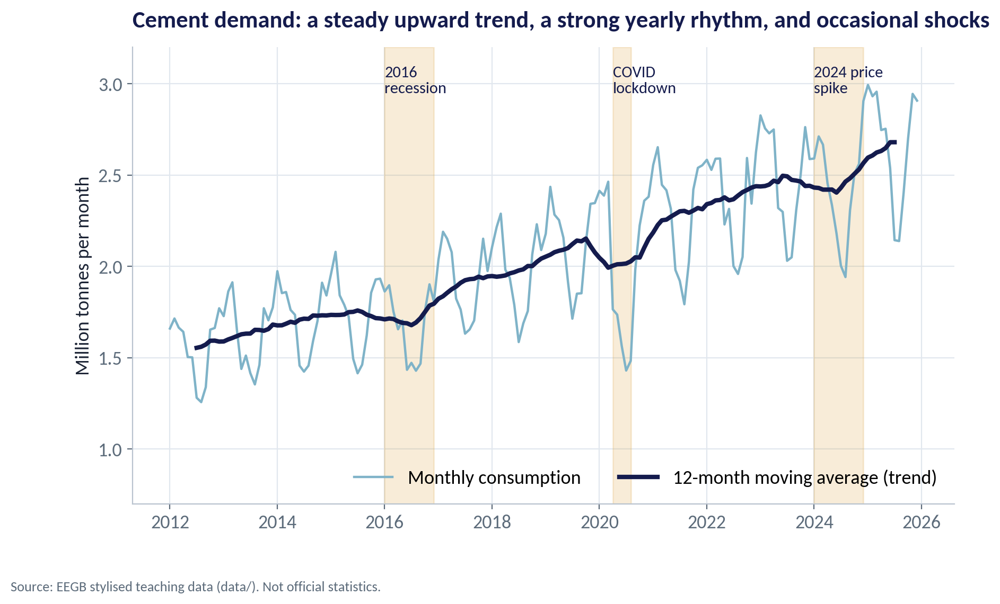
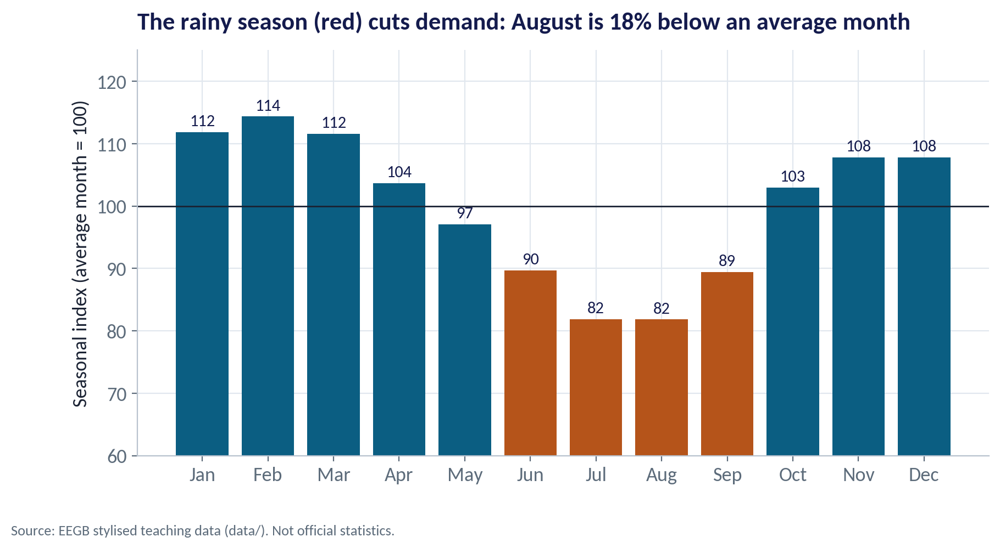
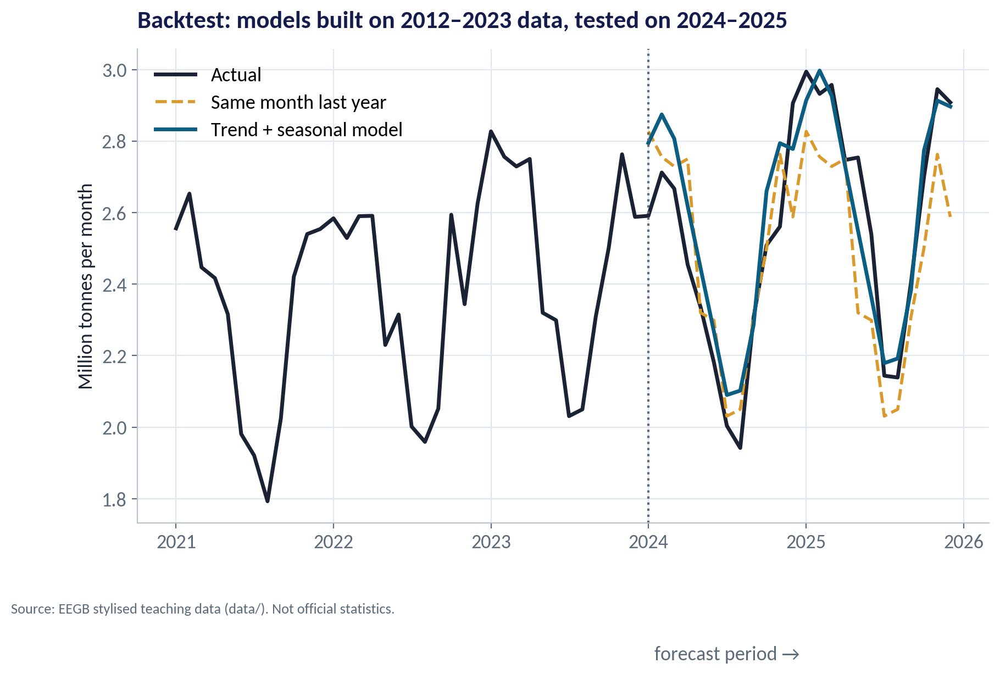
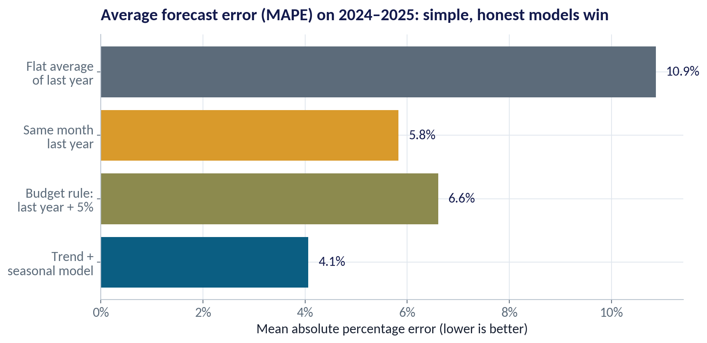
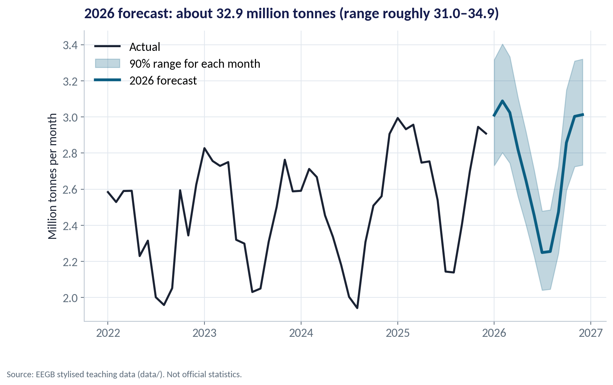
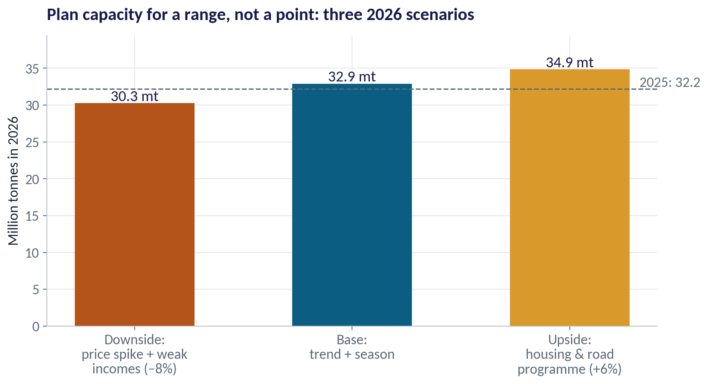
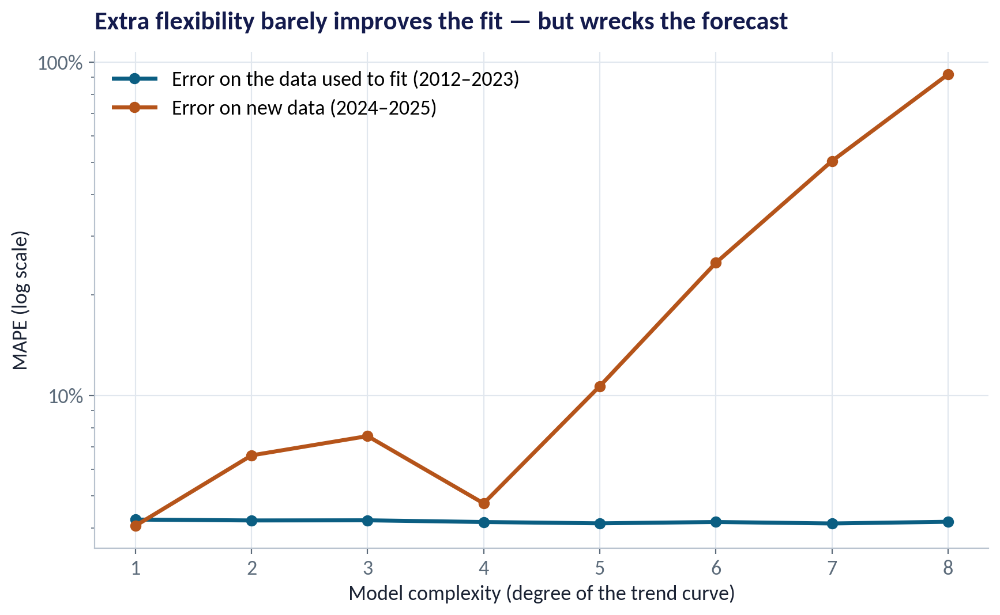
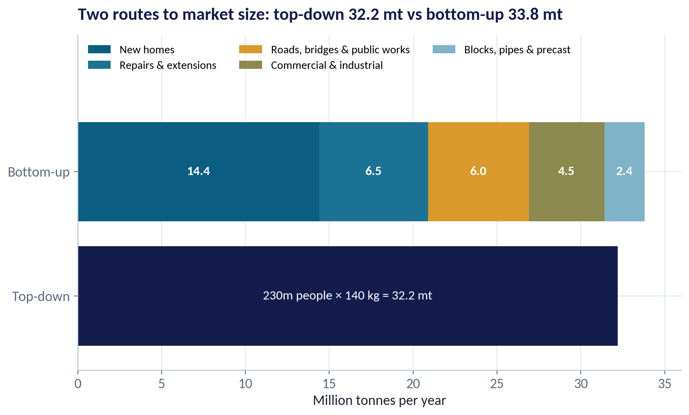

::: {.session-banner}
{.banner-hex width="96"}

**Session 3 of 16** · Facilitator: Kelechi Nnamdi<br>*Case:* A cement company planning 2026 capacity: how much will Nigeria buy, and how sure can we be?

:::

## Downloads {.unnumbered}

::: {.download-row}
[<i class="bi bi-file-earmark-slides"></i> Teaching slides (.pptx)](../../sessions/s03/slides/EEGB_S03_Demand_Forecasting_Market_Sizing.pptx){.btn .btn-primary download=""}
[<i class="bi bi-file-earmark-pdf"></i> Slides (PDF)](../../sessions/s03/slides/EEGB_S03_Demand_Forecasting_Market_Sizing.pdf){.btn .btn-outline-primary download=""}
[<i class="bi bi-github"></i> Session folder on GitHub](https://github.com/adibongo/eegb/tree/main/sessions/s03){.btn .btn-outline-secondary}
:::

## Read first {.unnumbered}

- **Amar Sahay — Time Series Analysis and Forecasting** — Reference no. BEP8370
- **Damodar Gujarati — Basic Econometrics** — Textbook
- **Amar Sahay — Business Analytics at a Glance** — Reference no. BEP8363

## Learning objectives

::: {.grid}
::: {.g-col-12 .g-col-md-4 .obj-card}
**Read a Demand Series**

Separate trend, seasonality and one-off shocks in monthly sales data.
:::
::: {.g-col-12 .g-col-md-4 .obj-card}
**Forecast and Test**

Build a simple trend-plus-season forecast, backtest it against rules of thumb, and express it as a range.
:::
::: {.g-col-12 .g-col-md-4 .obj-card}
**Size a Market**

Estimate a Nigerian market top-down and bottom-up, and reconcile the two.
:::
:::

## The business case

::: {.callout-note appearance="simple" icon=false}
## How Much Cement Will Nigeria Buy?

**Situation.** A Nigerian cement company is deciding whether to add a new production line for 2026. Demand has grown for a decade, but it dipped in the 2016 recession, during COVID-19 and in the 2024 price spike.

**Question.** How many tonnes of cement will Nigeria consume in 2026 — and how confident can we be?

**Data.** cement_demand_monthly.csv — 168 months (2012–2025) of national cement consumption, price per bag, a rainy-season flag and a building-permits index. *Stylised teaching data.*

**A good answer.** A 2026 forecast with a range and scenarios, checked against an independent market-sizing estimate.
:::

## Key ideas in plain English

### Trend × Season: A Forecast in One Line

Our forecast says: next month's demand = the trend level for that month × the seasonal index for that calendar month. We fit both from history with one regression.

::: {.formula}
forecast = trend(t) × season(month)
:::

*Example.* Trend level for August 2026 ≈ 2.76 mt; August index ≈ 0.82 → forecast ≈ 2.26 mt.

::: {.callout-tip appearance="minimal"}
**Why a manager cares.** Simple models are transparent: a manager can see and challenge every assumption. That matters more than an extra decimal of accuracy.
:::

### Start From the Whole Economy

Top-down sizing starts from a big, known number — population, GDP, households — and multiplies by a rate of use per person or per naira.

::: {.formula}
market = population × use per person
:::

*Example.* 230 million people × about 140 kg of cement each per year ≈ 32.2 million tonnes.

::: {.callout-tip appearance="minimal"}
**Why a manager cares.** Quick and easy to sanity-check against other countries. But the 'use per person' assumption carries all the weight — and it differs widely between countries at similar income levels.
:::

### Add Up the Uses

Bottom-up sizing builds the market from its parts: how many homes, roads, factories and repairs, times the cement each one needs.

::: {.formula}
market = Σ (units of activity × cement per unit)
:::

*Example.* About 450,000 new homes × ~32 tonnes = 14.4 mt, plus repairs (6.5), public works (6.0), commercial (4.5), precast (2.4) = 33.8 mt.

::: {.callout-tip appearance="minimal"}
**Why a manager cares.** Slower, but it shows which segments drive demand — and which ones a new government programme or a price shock would hit.
:::

## Charts and how to replicate them

Every chart below is regenerated by the session's figure script — `sessions/s03/R/s03_figures.R` or `sessions/s03/python/s03_figures.py`. Run it from the project root.

### Ten Years of Cement Demand

::: {.panel-tabset group="lang"}
## Python
{.fig-img fig-alt="S03-F01 (Python)"}

:::

- National consumption grew from 18.7 million tonnes in 2012 to 32.2 million in 2025 — about 4.3% a year.
- The 12-month moving average smooths out the seasons and shows the trend.
- Three shocks: the 2016 recession, the 2020 lockdown and the 2024 price spike.
- Each time, demand recovered to the trend within about a year.

<span class="fig-id">S03-F01</span>

### The Rainy Season Rhythm

::: {.panel-tabset group="lang"}
## Python
{.fig-img fig-alt="S03-F02 (Python)"}

:::

- February is about 14% above an average month; July and August about 18% below.
- Rain stops site work, so demand dips from June to September.
- Plan capacity, stock and cash for the peak months, not the annual average.
- Schedule maintenance shutdowns for the rainy season, when demand is lowest.

<span class="fig-id">S03-F02</span>

### Pretend It Is January 2024

::: {.panel-tabset group="lang"}
## Python
{.fig-img fig-alt="S03-F03 (Python)"}

:::

- We fitted each method on 2012–2023 only and asked it to forecast 2024–2025.
- Then we compared the forecasts with what actually happened.
- This is a backtest: the only honest way to judge a forecasting method.
- The model followed both the season and the trend; 'same month last year' missed the growth.

<span class="fig-id">S03-F03</span>

### Which Method Forecast Best?

::: {.panel-tabset group="lang"}
## Python
{.fig-img fig-alt="S03-F04 (Python)"}

:::

- Trend + seasonal model: 4.1% average error — the best.
- 'Same month last year': 5.8%. The common budget rule 'last year + 5%': 6.6%.
- A flat average ignores the seasons: 10.9% error.
- MAPE = mean absolute percentage error: on average, how far off were we?

<span class="fig-id">S03-F04</span>

### 2026: A Number and a Range

::: {.panel-tabset group="lang"}
## Python
{.fig-img fig-alt="S03-F05 (Python)"}

:::

- Base forecast for 2026: about 32.9 million tonnes.
- Monthly bands show where each month will probably fall (90% range).
- For the year: roughly 31.0–34.9 million tonnes, based on how far past years strayed from the model.
- Say it as a range: 'about 33, very likely between 31 and 35'.

<span class="fig-id">S03-F05</span>

### Plan for More Than One Future

::: {.panel-tabset group="lang"}
## Python
{.fig-img fig-alt="S03-F06 (Python)"}

:::

- Downside (−8%): another cement price spike and weak real incomes → 30.3 mt.
- Base: trend and season continue → 32.9 mt.
- Upside (+6%): a large housing and road programme → 34.9 mt.
- Ask: what capacity is safe in the downside and expandable in the upside?

<span class="fig-id">S03-F06</span>

### More Complex Is Not More Accurate

::: {.panel-tabset group="lang"}
## Python
{.fig-img fig-alt="S03-F08 (Python)"}

:::

- We made the trend curve more and more flexible.
- Fit to the past barely changed (about 4% error).
- Forecasts of the future got much worse: from 4% to over 90% error at the most flexible.
- This is overfitting: the model memorises the past instead of learning its pattern.

<span class="fig-id">S03-F08</span>

### Do the Two Routes Agree?

::: {.panel-tabset group="lang"}
## Python
{.fig-img fig-alt="S03-F07 (Python)"}

:::

- Top-down: 32.2 mt. Bottom-up: 33.8 mt. Within about 5% — reassuring.
- If they disagree badly, one of the assumptions is wrong. Find it before you build.
- New homes are the biggest segment: watch mortgage rates, real incomes and land policy.
- Both estimates sit close to the time-series forecast — three independent views pointing the same way.

<span class="fig-id">S03-F07</span>

## Lab: Cement Demand in 2026

*Time:* 20 minutes · *Data:* [`data/cement_demand_monthly.csv`](../../data/cement_demand_monthly.csv)

1. Compute annual totals and the average growth rate since 2012.
2. Compute the seasonal index: each month versus its year's average.
3. Fit a trend + seasonal model on 2012–2023.
4. Backtest it on 2024–2025 against 'same month last year' and 'last year + 5%'.
5. Forecast 2026, and compare with the top-down and bottom-up market sizes.

::: {.callout-important appearance="simple"}
**Deliverable:** a two-sentence 2026 capacity recommendation: how many tonnes, and what flexibility you keep.
:::

## The code (R | Python)

Pick your language once; every tab on the site follows your choice. Download a script, or copy it into RStudio and run it line by line.

### Replicate every chart

::: {.panel-tabset group="lang"}
## Python
[<i class="bi bi-download"></i> s03_figures.py](../../sessions/s03/python/s03_figures.py){download=""}

::: {.callout-note collapse="true" appearance="simple" icon=false}
## Show the full script (150 lines)

```{.python filename="sessions/s03/python/s03_figures.py"}
# =============================================================================
# EEGB · Session 3 · Demand Forecasting & Market Sizing
# Replication script — regenerates every chart in the Session 3 deck (Python)
# Data: data/cement_demand_monthly.csv (stylised Nigerian cement consumption, 2012–2025)
# Run from the project root:  python sessions/s03/python/s03_figures.py
# =============================================================================
import sys; sys.path.insert(0, "python")
import numpy as np, pandas as pd
import matplotlib.pyplot as plt
from matplotlib.ticker import FuncFormatter
from eegb_style import *

set_style()
c = pd.read_csv("data/cement_demand_monthly.csv", parse_dates=["month"])
c["t"] = np.arange(len(c)); c["m"] = c.month.dt.month; c["year"] = c.month.dt.year
MON = ["Jan", "Feb", "Mar", "Apr", "May", "Jun", "Jul", "Aug", "Sep", "Oct", "Nov", "Dec"]

def X_ts(df, trend_deg=1):
    """Trend (polynomial in t, scaled) + 11 month dummies."""
    tt = df.t.values / 100
    cols = [np.ones(len(df))] + [tt ** k for k in range(1, trend_deg + 1)]
    cols += [(df.m == k).astype(float).values for k in range(2, 13)]
    return np.column_stack(cols)

def fit_predict(train, test, deg=1):
    b = np.linalg.lstsq(X_ts(train, deg), np.log(train.cement_mt), rcond=None)[0]
    return np.exp(X_ts(train, deg) @ b), np.exp(X_ts(test, deg) @ b), b

mape = lambda a, f: np.mean(np.abs(a - f) / a) * 100

# --- F01 · The raw series and its trend -----------------------------------------------------------
fig, ax = plt.subplots()
ax.plot(c.month, c.cement_mt, color=SKY, lw=1.6, label="Monthly consumption")
ax.plot(c.month, c.cement_mt.rolling(12, center=True).mean(), color=NAVY, lw=3, label="12-month moving average (trend)")
for s, e, lab in [("2016-01-01", "2016-12-01", "2016\nrecession"), ("2020-04-01", "2020-08-01", "COVID\nlockdown"), ("2024-01-01", "2024-12-01", "2024 price\nspike")]:
    ax.axvspan(pd.Timestamp(s), pd.Timestamp(e), color=GOLD, alpha=.18); ax.text(pd.Timestamp(s), 2.95, lab, fontsize=11, color=NAVY)
ax.set_ylim(0.7, 3.2); ax.legend(loc="lower right", ncol=2)
ax.set(title="Cement demand: a steady upward trend, a strong yearly rhythm, and occasional shocks", ylabel="Million tonnes per month")
note(fig); save(fig, "s03", "f01")
ann = c.groupby("year").cement_mt.sum()
cagr = (ann[2025] / ann[2012]) ** (1 / 13) - 1
print(f"annual 2012 {ann[2012]:.1f} mt, 2025 {ann[2025]:.1f} mt, CAGR {cagr*100:.1f}%")

# --- F02 · Seasonality --------------------------------------------------------------------------------
_, _, b_all = fit_predict(c, c)
seas = np.exp(np.r_[0, b_all[2:]]); seas = seas / seas.mean() * 100
fig, ax = plt.subplots(figsize=(10, 4.8))
cols = [RUST if k in (6, 7, 8, 9) else TEAL for k in range(1, 13)]
ax.bar(MON, seas, color=cols); ax.axhline(100, color=INK, lw=1)
for i, v in enumerate(seas): ax.text(i, v + 1, f"{v:.0f}", ha="center", fontsize=11, color=NAVY)
ax.set_ylim(60, 125)
ax.set(title=f"The rainy season (red) cuts demand: August is {100-seas[7]:.0f}% below an average month",
       ylabel="Seasonal index (average month = 100)")
note(fig); save(fig, "s03", "f02")
print("seasonal index:", dict(zip(MON, seas.round(0))))

# --- F03 · Backtest: train to 2023, forecast 2024–2025 ------------------------------------------------
train, test = c[c.year <= 2023].copy(), c[c.year >= 2024].copy()
_, f_reg, _ = fit_predict(train, test)
f_snaive = train.cement_mt.values[-12:]; f_snaive = np.r_[f_snaive, f_snaive]              # same month last year
f_avg = np.full(len(test), train.cement_mt.values[-12:].mean())                             # flat average of last year
# judgemental: last year's same month + 5% growth (a typical budget rule)
f_judge = train.cement_mt.values[-12:] * 1.05; f_judge = np.r_[f_judge, f_judge * 1.05]
scores = {"Flat average\nof last year": mape(test.cement_mt, f_avg), "Same month\nlast year": mape(test.cement_mt, f_snaive),
          "Budget rule:\nlast year + 5%": mape(test.cement_mt, f_judge), "Trend +\nseasonal model": mape(test.cement_mt, f_reg)}
fig, ax = plt.subplots()
ax.plot(c.month[c.year >= 2021], c.cement_mt[c.year >= 2021], color=INK, lw=2.5, label="Actual")
ax.plot(test.month, f_snaive, color=GOLD, lw=2, ls="--", label="Same month last year")
ax.plot(test.month, f_reg, color=TEAL, lw=2.5, label="Trend + seasonal model")
ax.axvline(pd.Timestamp("2024-01-01"), color=SLATE, ls=":"); ax.text(pd.Timestamp("2024-01-15"), 1.35, "forecast period →", color=SLATE)
ax.legend(loc="upper left")
ax.set(title="Backtest: models built on 2012–2023 data, tested on 2024–2025", ylabel="Million tonnes per month")
note(fig); save(fig, "s03", "f03")
print("backtest MAPE:", {k.replace(chr(10), ' '): round(v, 1) for k, v in scores.items()})

# --- F04 · Forecast accuracy scoreboard ------------------------------------------------------------------
fig, ax = plt.subplots(figsize=(10, 4.6))
ks, vs = list(scores), list(scores.values())
ax.barh(ks, vs, color=[SLATE, GOLD, OLIVE, TEAL])
for i, v in enumerate(vs): ax.text(v + .2, i, f"{v:.1f}%", va="center", fontsize=13, color=NAVY)
ax.invert_yaxis(); ax.xaxis.set_major_formatter(FuncFormatter(pct))
ax.set(title="Average forecast error (MAPE) on 2024–2025: simple, honest models win", xlabel="Mean absolute percentage error (lower is better)")
save(fig, "s03", "f04")

# --- F05 · Forecast for 2026 with an uncertainty band ------------------------------------------------------
fut = pd.DataFrame({"month": pd.date_range("2026-01-01", periods=12, freq="MS")})
fut["t"] = np.arange(len(c), len(c) + 12); fut["m"] = fut.month.dt.month
fit_in, f26, b = fit_predict(c, fut)
resid_sd = np.std(np.log(c.cement_mt) - np.log(fit_in), ddof=len(b))
lo, hi = f26 * np.exp(-1.645 * resid_sd), f26 * np.exp(1.645 * resid_sd)
# annual uncertainty: how far each past year's total sat from the model's fitted total
ann_dev = np.log(c.assign(fit=fit_in).groupby("year")[["cement_mt", "fit"]].sum().pipe(lambda g: g.cement_mt / g.fit))
sd_a = ann_dev.std(ddof=1)
tot = f26.sum(); tot_lo, tot_hi = tot * np.exp(-1.645 * sd_a), tot * np.exp(1.645 * sd_a)
fig, ax = plt.subplots()
h = c[c.year >= 2022]
ax.plot(h.month, h.cement_mt, color=INK, lw=2.2, label="Actual")
ax.fill_between(fut.month, lo, hi, color=TEAL, alpha=.25, label="90% range for each month")
ax.plot(fut.month, f26, color=TEAL, lw=3, label="2026 forecast")
ax.legend(loc="upper left")
ax.set(title=f"2026 forecast: about {tot:.1f} million tonnes (range roughly {tot_lo:.1f}–{tot_hi:.1f})", ylabel="Million tonnes per month")
note(fig); save(fig, "s03", "f05")
print(f"2026 forecast {tot:.2f} mt, range {tot_lo:.1f}-{tot_hi:.1f}; monthly resid sd {resid_sd:.3f}, annual sd {sd_a:.3f}")

# --- F06 · Scenarios for 2026 -----------------------------------------------------------------------------------
base = tot
scen = {"Downside:\nprice spike + weak\nincomes (−8%)": base * 0.92, "Base:\ntrend + season": base,
        "Upside:\nhousing & road\nprogramme (+6%)": base * 1.06}
fig, ax = plt.subplots(figsize=(10, 4.8))
ax.bar(list(scen), list(scen.values()), color=[RUST, TEAL, GOLD], width=.55)
for i, v in enumerate(scen.values()): ax.text(i, v + .3, f"{v:.1f} mt", ha="center", fontsize=14, color=NAVY)
ax.axhline(ann[2025], color=SLATE, ls="--", lw=1.2); ax.text(2.32, ann[2025] + .3, f"2025: {ann[2025]:.1f}", color=SLATE)
ax.set_ylim(0, base * 1.2)
ax.set(title="Plan capacity for a range, not a point: three 2026 scenarios", ylabel="Million tonnes in 2026")
save(fig, "s03", "f06")
print("scenarios:", {k.split(':')[0]: round(v, 1) for k, v in scen.items()})

# --- F07 · Market sizing: top-down vs bottom-up -------------------------------------------------------------------
pop, kg_pc = 230, 140                                    # million people; kg per person per year (stylised)
top_down = pop * kg_pc / 1000                             # million tonnes
houses, t_house = 0.45, 32                                # million new homes a year; tonnes each (stylised)
parts = {"New homes": houses * t_house, "Repairs &\nextensions": 6.5, "Roads, bridges\n& public works": 6.0,
         "Commercial &\nindustrial": 4.5, "Blocks, pipes\n& precast": 2.4}
bottom_up = sum(parts.values())
fig, ax = plt.subplots()
left = 0
for (k, v), col in zip(parts.items(), [TEAL, TEAL2, GOLD, OLIVE, SKY]):
    ax.barh(1, v, left=left, color=col, label=k.replace("\n", " ")); ax.text(left + v / 2, 1, f"{v:.1f}", ha="center", va="center", fontsize=12, color="white", fontweight="bold")
    left += v
ax.barh(0, top_down, color=NAVY); ax.text(top_down / 2, 0, f"{pop}m people × {kg_pc} kg = {top_down:.1f} mt", ha="center", va="center", color="white", fontsize=12)
ax.set_yticks([0, 1], ["Top-down", "Bottom-up"]); ax.set_xlim(0, 36); ax.set_ylim(-.6, 2.1)
ax.legend(ncol=3, loc="upper left", fontsize=10.5)
ax.set(title=f"Two routes to market size: top-down {top_down:.1f} mt vs bottom-up {bottom_up:.1f} mt", xlabel="Million tonnes per year")
save(fig, "s03", "f07")
print(f"top-down {top_down:.1f}, bottom-up {bottom_up:.1f}, new homes {houses*t_house:.1f}")

# --- F08 · More complex is not more accurate (overfitting) ------------------------------------------------------------
degs = range(1, 9); tr_err, te_err = [], []
for k in degs:
    fi, fo, _ = fit_predict(train, test, k)
    tr_err.append(mape(train.cement_mt, fi)); te_err.append(mape(test.cement_mt, fo))
fig, ax = plt.subplots()
ax.plot(list(degs), tr_err, "o-", color=TEAL, lw=2.5, label="Error on the data used to fit (2012–2023)")
ax.plot(list(degs), te_err, "o-", color=RUST, lw=2.5, label="Error on new data (2024–2025)")
ax.set_yscale("log"); ax.yaxis.set_major_formatter(FuncFormatter(lambda v, p: f"{v:g}%"))
ax.legend(loc="upper left")
ax.set(title="Extra flexibility barely improves the fit — but wrecks the forecast",
       xlabel="Model complexity (degree of the trend curve)", ylabel="MAPE (log scale)")
save(fig, "s03", "f08")
print("overfit train:", np.round(tr_err, 1), "test:", np.round(te_err, 1))
```
:::

## R
[<i class="bi bi-download"></i> s03_figures.R](../../sessions/s03/R/s03_figures.R){download=""}

::: {.callout-note collapse="true" appearance="simple" icon=false}
## Show the full script (107 lines)

```{.r filename="sessions/s03/R/s03_figures.R"}
# =============================================================================
# EEGB · Session 3 · Demand Forecasting & Market Sizing
# Replication script — regenerates every chart in the Session 3 deck (R)
# Data: data/cement_demand_monthly.csv (stylised Nigerian cement consumption, 2012–2025)
# =============================================================================
source("R/theme_eegb.R")
suppressPackageStartupMessages({ library(dplyr); library(readr); library(tidyr) })
c <- read_csv("data/cement_demand_monthly.csv", show_col_types = FALSE) |>
  mutate(month = as.Date(month), t = row_number() - 1, m = as.integer(format(month, "%m")),
         year = as.integer(format(month, "%Y")))
mape <- function(a, f) 100 * mean(abs(a - f) / a)
fit_ts <- function(df, deg = 1) lm(log(cement_mt) ~ poly(I(t / 100), deg, raw = TRUE) + factor(m), data = df)

# --- F01 · Raw series and trend ------------------------------------------------------------
c$ma12 <- as.numeric(stats::filter(c$cement_mt, rep(1 / 12, 12), sides = 2))
shocks <- tibble(s = as.Date(c("2016-01-01", "2020-04-01", "2024-01-01")), e = as.Date(c("2016-12-01", "2020-08-01", "2024-12-01")),
                 lab = c("2016 recession", "COVID lockdown", "2024 price spike"))
p1 <- ggplot(c, aes(month)) +
  geom_rect(data = shocks, aes(xmin = s, xmax = e, ymin = -Inf, ymax = Inf), inherit.aes = FALSE, fill = eegb[["gold"]], alpha = .18) +
  geom_text(data = shocks, aes(x = s, y = 3.1, label = lab), inherit.aes = FALSE, hjust = 0, size = 3.3, colour = eegb[["navy"]]) +
  geom_line(aes(y = cement_mt, colour = "Monthly consumption"), linewidth = .7) +
  geom_line(aes(y = ma12, colour = "12-month moving average (trend)"), linewidth = 1.4, na.rm = TRUE) +
  scale_colour_manual(values = c(`Monthly consumption` = eegb[["sky"]], `12-month moving average (trend)` = eegb[["navy"]]), name = NULL) +
  labs(title = "Cement demand: a steady upward trend, a strong yearly rhythm, and occasional shocks",
       x = NULL, y = "Million tonnes per month", caption = eegb_caption) + theme_eegb()
save_fig(p1, "s03", "f01")

# --- F02 · Seasonal index ------------------------------------------------------------------------
fa <- fit_ts(c); b <- coef(fa)
seas <- exp(c(0, b[grep("factor", names(b))])); seas <- 100 * seas / mean(seas)
si <- tibble(m = factor(month.abb, levels = month.abb), idx = seas, rainy = 1:12 %in% 6:9)
p2 <- ggplot(si, aes(m, idx, fill = rainy)) + geom_col(show.legend = FALSE) + geom_hline(yintercept = 100) +
  geom_text(aes(label = round(idx)), vjust = -0.4) + coord_cartesian(ylim = c(60, 125)) +
  scale_fill_manual(values = c(`TRUE` = eegb[["rust"]], `FALSE` = eegb[["teal"]])) +
  labs(title = sprintf("The rainy season (red) cuts demand: August is %.0f%% below an average month", 100 - seas[8]),
       x = NULL, y = "Seasonal index (average month = 100)", caption = eegb_caption) + theme_eegb()
save_fig(p2, "s03", "f02", height = 4.8)

# --- F03 & F04 · Backtest -------------------------------------------------------------------------
train <- filter(c, year <= 2023); test <- filter(c, year >= 2024)
f_reg <- exp(predict(fit_ts(train), newdata = test))
last12 <- tail(train$cement_mt, 12)
f_sn <- c(last12, last12); f_avg <- rep(mean(last12), 24); f_j <- c(last12 * 1.05, last12 * 1.05^2)
bt <- bind_rows(tibble(month = test$month, value = f_sn, series = "Same month last year"),
                tibble(month = test$month, value = f_reg, series = "Trend + seasonal model"),
                filter(c, year >= 2021) |> transmute(month, value = cement_mt, series = "Actual"))
p3 <- ggplot(bt, aes(month, value, colour = series, linetype = series)) + geom_line(linewidth = 1.1) +
  geom_vline(xintercept = as.Date("2024-01-01"), linetype = "dotted") +
  scale_colour_manual(values = c(Actual = eegb[["ink"]], `Same month last year` = eegb[["gold"]], `Trend + seasonal model` = eegb[["teal"]]), name = NULL) +
  scale_linetype_manual(values = c(Actual = "solid", `Same month last year` = "dashed", `Trend + seasonal model` = "solid"), name = NULL) +
  labs(title = "Backtest: models built on 2012–2023 data, tested on 2024–2025", x = NULL, y = "Million tonnes per month",
       caption = eegb_caption) + theme_eegb()
save_fig(p3, "s03", "f03")
sc <- tibble(method = c("Flat average of last year", "Same month last year", "Budget rule: last year + 5%", "Trend + seasonal model"),
             mape = c(mape(test$cement_mt, f_avg), mape(test$cement_mt, f_sn), mape(test$cement_mt, f_j), mape(test$cement_mt, f_reg))) |>
  mutate(method = factor(method, levels = rev(method)))
p4 <- ggplot(sc, aes(mape, method)) + geom_col(fill = rev(unname(eegb[c("slate", "gold", "olive", "teal")]))) +
  geom_text(aes(label = sprintf("%.1f%%", mape)), hjust = -0.2) + scale_x_continuous(labels = pct, expand = expansion(mult = c(0, .15))) +
  labs(title = "Average forecast error (MAPE) on 2024–2025: simple, honest models win",
       x = "Mean absolute percentage error (lower is better)", y = NULL) + theme_eegb()
save_fig(p4, "s03", "f04", height = 4.6)

# --- F05 · 2026 forecast with an uncertainty band ---------------------------------------------------
fut <- tibble(month = seq(as.Date("2026-01-01"), by = "month", length.out = 12), t = nrow(c) + 0:11, m = 1:12)
fut$f <- exp(predict(fa, newdata = fut)); rsd <- summary(fa)$sigma
fut <- fut |> mutate(lo = f * exp(-1.645 * rsd), hi = f * exp(1.645 * rsd))
ann_dev <- c |> mutate(fit = exp(fitted(fa))) |> group_by(year) |> summarise(d = log(sum(cement_mt) / sum(fit)))
sd_a <- sd(ann_dev$d); tot <- sum(fut$f)
p5 <- ggplot() + geom_line(data = filter(c, year >= 2022), aes(month, cement_mt), colour = eegb[["ink"]], linewidth = 1) +
  geom_ribbon(data = fut, aes(month, ymin = lo, ymax = hi), fill = eegb[["teal"]], alpha = .25) +
  geom_line(data = fut, aes(month, f), colour = eegb[["teal"]], linewidth = 1.4) +
  labs(title = sprintf("2026 forecast: about %.1f million tonnes (range roughly %.1f–%.1f)", tot, tot * exp(-1.645 * sd_a), tot * exp(1.645 * sd_a)),
       x = NULL, y = "Million tonnes per month", caption = eegb_caption) + theme_eegb()
save_fig(p5, "s03", "f05")

# --- F06 · Scenarios -----------------------------------------------------------------------------------
scen <- tibble(s = factor(c("Downside: price spike + weak incomes (−8%)", "Base: trend + season", "Upside: housing & road programme (+6%)"),
                          levels = c("Downside: price spike + weak incomes (−8%)", "Base: trend + season", "Upside: housing & road programme (+6%)")),
               v = tot * c(.92, 1, 1.06))
p6 <- ggplot(scen, aes(s, v, fill = s)) + geom_col(width = .55, show.legend = FALSE) +
  geom_text(aes(label = sprintf("%.1f mt", v)), vjust = -0.4) +
  scale_fill_manual(values = unname(eegb[c("rust", "teal", "gold")])) + scale_x_discrete(labels = function(x) gsub(": ", ":\n", x)) +
  labs(title = "Plan capacity for a range, not a point: three 2026 scenarios", x = NULL, y = "Million tonnes in 2026") + theme_eegb()
save_fig(p6, "s03", "f06", height = 4.8)

# --- F07 · Market sizing ----------------------------------------------------------------------------------
parts <- tibble(route = "Bottom-up", part = c("New homes", "Repairs & extensions", "Roads, bridges & public works", "Commercial & industrial", "Blocks, pipes & precast"),
                v = c(0.45 * 32, 6.5, 6.0, 4.5, 2.4))
td <- tibble(route = "Top-down", part = "230m people × 140 kg", v = 230 * 140 / 1000)
p7 <- ggplot(bind_rows(parts, td), aes(v, route, fill = part)) + geom_col(width = .6) +
  geom_text(aes(label = sprintf("%.1f", v)), position = position_stack(vjust = .5), colour = "white", fontface = "bold") +
  scale_fill_manual(values = c(`New homes` = eegb[["teal"]], `Repairs & extensions` = eegb[["teal2"]], `Roads, bridges & public works` = eegb[["gold"]],
                               `Commercial & industrial` = eegb[["olive"]], `Blocks, pipes & precast` = eegb[["sky"]], `230m people × 140 kg` = eegb[["navy"]]), name = NULL) +
  labs(title = sprintf("Two routes to market size: top-down %.1f mt vs bottom-up %.1f mt", td$v, sum(parts$v)),
       x = "Million tonnes per year", y = NULL) + theme_eegb()
save_fig(p7, "s03", "f07")

# --- F08 · Overfitting --------------------------------------------------------------------------------------
of <- bind_rows(lapply(1:8, function(k) { f <- fit_ts(train, k)
  tibble(deg = k, `Error on the data used to fit (2012–2023)` = mape(train$cement_mt, exp(fitted(f))),
         `Error on new data (2024–2025)` = mape(test$cement_mt, exp(predict(f, newdata = test)))) })) |>
  pivot_longer(-deg)
p8 <- ggplot(of, aes(deg, value, colour = name)) + geom_line(linewidth = 1.2) + geom_point(size = 2.5) +
  scale_y_log10(labels = function(v) paste0(v, "%")) + scale_colour_manual(values = unname(eegb[c("rust", "teal")]), name = NULL) +
  labs(title = "Extra flexibility barely improves the fit — but wrecks the forecast",
       x = "Model complexity (degree of the trend curve)", y = "MAPE (log scale)") + theme_eegb()
save_fig(p8, "s03", "f08")
```
:::

:::

### Lab

::: {.panel-tabset group="lang"}
## Python
[<i class="bi bi-download"></i> s03_lab.py](../../sessions/s03/python/s03_lab.py){download=""}

::: {.callout-note collapse="true" appearance="simple" icon=false}
## Show the full script (52 lines)

```{.python filename="sessions/s03/python/s03_lab.py"}
# =============================================================================
# EEGB · Session 3 LAB · How much cement will Nigeria buy in 2026? (Python)
# Data: data/cement_demand_monthly.csv — stylised monthly cement consumption, 2012–2025
# Run from the project root, line by line (Ctrl/Cmd + Enter)
# =============================================================================
import numpy as np, pandas as pd

c = pd.read_csv("data/cement_demand_monthly.csv", parse_dates=["month"])
c["t"] = np.arange(len(c)); c["m"] = c.month.dt.month; c["year"] = c.month.dt.year

# ---- STEP 1 · Trend: annual totals and the average growth rate ----------------------------
annual = c.groupby("year").cement_mt.sum()
print(annual.round(1))
cagr = (annual.iloc[-1] / annual.iloc[0]) ** (1 / (len(annual) - 1)) - 1
print(f"Average growth per year (CAGR): {cagr:.1%}")

# ---- STEP 2 · Seasonality: how each month compares with the year's average ---------------------
c["vs_year_avg"] = c.cement_mt / c.groupby("year").cement_mt.transform("mean")
print((c.groupby("m").vs_year_avg.mean() * 100).round(0))

# ---- STEP 3 · A trend + seasonal model (one regression) --------------------------------------------
def X(df):
    return np.column_stack([np.ones(len(df)), df.t] + [(df.m == k).astype(float) for k in range(2, 13)])

train, test = c[c.year <= 2023], c[c.year >= 2024]
b, *_ = np.linalg.lstsq(X(train), np.log(train.cement_mt), rcond=None)
f_model = np.exp(X(test) @ b)
print(f"Model growth per month: {np.exp(b[1]) - 1:.2%}  (≈ {np.exp(12 * b[1]) - 1:.1%} a year)")

# ---- STEP 4 · Backtest against simple rules ------------------------------------------------------------
last12 = train.cement_mt.values[-12:]
rules = {"same month last year": np.r_[last12, last12],
         "last year + 5%": np.r_[last12 * 1.05, last12 * 1.05 ** 2],
         "trend + seasonal model": f_model}
for name, f in rules.items():
    print(f"{name:25s} MAPE = {np.mean(np.abs(test.cement_mt - f) / test.cement_mt):.1%}")

# ---- STEP 5 · Forecast 2026 with the model fitted on all the data ------------------------------------------
b_all, *_ = np.linalg.lstsq(X(c), np.log(c.cement_mt), rcond=None)
fut = pd.DataFrame({"t": np.arange(len(c), len(c) + 12), "m": range(1, 13)})
f26 = np.exp(X(fut) @ b_all)
print(f"2026 forecast: {f26.sum():.1f} million tonnes")

# ---- STEP 6 · Size the market two ways -------------------------------------------------------------------------
print("Top-down: 230m people × 140 kg =", 230 * 140 / 1000, "million tonnes")
print("Bottom-up: homes 14.4 + repairs 6.5 + public works 6.0 + commercial 4.5 + precast 2.4 =",
      14.4 + 6.5 + 6.0 + 4.5 + 2.4, "million tonnes")

# ---- YOUR TURN -------------------------------------------------------------------------------------------------
# (a) Build a downside and upside scenario for 2026. What would have to happen for each?
# (b) Which assumption in the bottom-up sizing are you least sure of? How would you check it?
# (c) Recommend a 2026 capacity plan in two sentences: how many tonnes, and what flexibility you keep.
```
:::

## R
[<i class="bi bi-download"></i> s03_lab.R](../../sessions/s03/R/s03_lab.R){download=""}

::: {.callout-note collapse="true" appearance="simple" icon=false}
## Show the full script (41 lines)

```{.r filename="sessions/s03/R/s03_lab.R"}
# =============================================================================
# EEGB · Session 3 LAB · How much cement will Nigeria buy in 2026? (R)
# Data: data/cement_demand_monthly.csv — stylised monthly cement consumption, 2012–2025
# Open eegb.Rproj first, then run line by line (Ctrl/Cmd + Enter)
# =============================================================================
library(dplyr); library(readr)
c <- read_csv("data/cement_demand_monthly.csv", show_col_types = FALSE) |>
  mutate(t = row_number() - 1, m = as.integer(format(month, "%m")), year = as.integer(format(month, "%Y")))

# ---- STEP 1 · Trend: annual totals and the average growth rate ----------------------------
annual <- c |> group_by(year) |> summarise(mt = sum(cement_mt)); annual
cagr <- (last(annual$mt) / first(annual$mt))^(1 / (nrow(annual) - 1)) - 1; cagr

# ---- STEP 2 · Seasonality ---------------------------------------------------------------------
c |> group_by(year) |> mutate(vs_year_avg = cement_mt / mean(cement_mt)) |>
  group_by(m) |> summarise(index = round(100 * mean(vs_year_avg)))

# ---- STEP 3 · A trend + seasonal model --------------------------------------------------------------
train <- filter(c, year <= 2023); test <- filter(c, year >= 2024)
fit <- lm(log(cement_mt) ~ t + factor(m), data = train)
f_model <- exp(predict(fit, newdata = test))

# ---- STEP 4 · Backtest against simple rules -----------------------------------------------------------
last12 <- tail(train$cement_mt, 12)
rules <- list(`same month last year` = c(last12, last12), `last year + 5%` = c(last12 * 1.05, last12 * 1.05^2),
              `trend + seasonal model` = f_model)
sapply(rules, function(f) round(100 * mean(abs(test$cement_mt - f) / test$cement_mt), 1))

# ---- STEP 5 · Forecast 2026 -----------------------------------------------------------------------------
fit_all <- lm(log(cement_mt) ~ t + factor(m), data = c)
fut <- tibble(t = nrow(c) + 0:11, m = 1:12)
sum(exp(predict(fit_all, newdata = fut)))   # million tonnes in 2026

# ---- STEP 6 · Size the market two ways ---------------------------------------------------------------------
230 * 140 / 1000                     # top-down
14.4 + 6.5 + 6.0 + 4.5 + 2.4         # bottom-up

# ---- YOUR TURN -------------------------------------------------------------------------------------------------
# (a) Build a downside and upside scenario for 2026. What would have to happen for each?
# (b) Which assumption in the bottom-up sizing are you least sure of? How would you check it?
# (c) Recommend a 2026 capacity plan in two sentences.
```
:::

:::

## Check your understanding

**Q1.** Your sales team forecasts next year as 'this year + 10%'. A trend-plus-seasonal model forecasts +4%, with a range of −2% to +10%. What should you do?

- **A.** Use +10% — the sales team knows the market
- **B.** Use +4% and ignore the sales team
- **C.** Start from the model's +4% and ask the sales team for named, specific reasons for any upward adjustment; plan capacity for the range
- **D.** Average the two: +7%

::: {.callout-tip collapse="true" appearance="simple"}
## Show answer
**C.** C. The model is the disciplined baseline; judgement should adjust it only for specific, recorded reasons (a new contract, a new region). D splits the difference without evidence. And capacity should be planned against the range, not a point.
:::

**Q2.** Top-down sizing gives 32 million tonnes; bottom-up gives 45 million tonnes. What is the best next step?

- **A.** Average them: 38.5 mt
- **B.** Trust the bottom-up figure because it is more detailed
- **C.** Find which assumption explains the gap (e.g. tonnes per house or homes built) and check it against independent data
- **D.** Use whichever supports the investment case

::: {.callout-tip collapse="true" appearance="simple"}
## Show answer
**C.** C. A large gap is information: one of the inputs is wrong. Detail does not make bottom-up right — 13 extra million tonnes usually means an inflated activity count or usage rate. D is how bad investments get approved.
:::

## Vocabulary

| Term | Meaning |
|---|---|
| **Trend** | The long-run direction of a series. |
| **Seasonality** | A pattern that repeats at the same time every year. |
| **Seasonal index** | A month's typical level relative to an average month (100). |
| **Moving average** | An average of the last N periods; smooths out noise and seasons. |
| **Backtest** | Testing a forecasting method on past data it was not built on. |
| **MAPE** | Mean absolute percentage error: the average size of forecast misses. |
| **Forecast range** | The band within which the outcome will probably fall. |
| **Scenario** | A coherent story of the future with its own numbers. |
| **Overfitting** | A model that memorises past noise and forecasts badly. |
| **Top-down / bottom-up** | Sizing from the whole economy vs adding up the uses. |

## Key takeaways

1. Demand = trend × season × shocks; read each part separately.
2. A transparent trend-plus-season model beats most budget rules — backtest to prove it.
3. Always give a range and scenarios, not a single number.
4. More complex is not more accurate: judge models on unseen data.
5. Size markets top-down and bottom-up, and reconcile the two.

::: {.callout-note appearance="simple"}
**Before next session:** Read the Ant Financial case (917-0029-1). Come ready to say: is Ant a bank, a technology company or a marketplace — and why does the answer matter for regulators?
:::

::: {.session-nav}
[← Session 2: Demand, Supply & Elasticity](../../sessions/s02/index.qmd)
[Session 4: Market Structure & Platforms →](../../sessions/s04/index.qmd){.next}
:::
