::: {.session-banner}
{.banner-hex width="96"}

**Session 3 of 16** · Facilitator: Kelechi Nnamdi<br>*The question:* “Demand grows 5% every year. Build the new line — we'll sell everything we make.”

:::

## The slides {.unnumbered}

::: {.download-row}
[<i class="bi bi-file-earmark-slides"></i> Teaching slides (.pptx)](../../sessions/s03/slides/EEGB_S03_Demand_Forecasting_Market_Sizing.pptx){.btn .btn-primary download=""}
[<i class="bi bi-file-earmark-pdf"></i> Slides (PDF)](../../sessions/s03/slides/EEGB_S03_Demand_Forecasting_Market_Sizing.pdf){.btn .btn-outline-primary download=""}
[<i class="bi bi-github"></i> Session folder on GitHub](https://github.com/adibongo/eegb/tree/main/sessions/s03){.btn .btn-outline-secondary}
:::

```{=html}
<div class="deck-viewer"><object data="../../sessions/s03/slides/EEGB_S03_Demand_Forecasting_Market_Sizing.pdf#view=FitH" type="application/pdf" width="100%" height="620"><p>Your browser cannot show the slides here. <a href="../../sessions/s03/slides/EEGB_S03_Demand_Forecasting_Market_Sizing.pdf">Open the PDF</a>.</p></object></div>
```

## This session

**Opening** (10 min) → **1 · Read the pattern** (20 min) → **2 · Forecast honestly** (25 min) → **3 · Size the market and decide** (20 min)

::: {.grid}
::: {.g-col-12 .g-col-md-4 .obj-card}
**Read a demand series**

Separate **trend, seasonality and shocks**; seasonally adjust a month before judging it.
:::
::: {.g-col-12 .g-col-md-4 .obj-card}
**Forecast and test**

Build a **trend × season** forecast, **backtest** it against rules of thumb, and express it as a **range**.
:::
::: {.g-col-12 .g-col-md-4 .obj-card}
**Size a market and decide**

Size a Nigerian market **top-down and bottom-up**, and set capacity using the **cost of being wrong**.
:::
:::

## Read first {.unnumbered}

- **Sahay, Time Series Analysis and Forecasting (BEP8370)** (core) — Trend, seasonality, smoothing and evaluation — the core reading.
- **Sahay, Business Analytics at a Glance (BEP8363)** (core) — Where forecasting sits in the analytics toolkit.
- **Gujarati, Basic Econometrics** — Regression foundations behind the trend × season and driver models.
- **Makridakis et al. (2018), 'The M4 Competition', IJF** — Large-scale evidence on which forecasting methods work.
- **Tetlock & Gardner, Superforecasting (2015)** — Calibration, base rates and how to get better at judgement.
- **Flyvbjerg (2006), reference-class forecasting** — Correcting the planning fallacy with the track record of similar projects.

## The business case <span class='tag tag-illus'>illustrative</span>

::: {.callout-note appearance="simple" icon=false}
## How Much Cement Will Nigeria Buy in 2026?

**Situation.** A Nigerian cement company is deciding whether to add a new production line. Demand has grown for a decade but dipped in the 2016 recession, the 2020 lockdown and the 2024 price spike. The industry already has far more capacity than demand.

**Question.** How many tonnes will Nigeria consume in **2026** — and how much capacity should we plan for?

**Data.** cement_demand_monthly.csv — 168 months (2012–2025): consumption, price per bag, rainy-season flag, building-permits index. *Stylised teaching data, sized to the real market.*

**A good answer.** A **2026 forecast with a range and scenarios**, cross-checked against **market sizing**, and a capacity choice that weighs the cost of too much against too little.
:::

::: {.callout-note collapse="true" appearance="minimal" icon=false}
## Sources and data notes

Real anchor: Global Cement Report (16th ed.) puts Nigerian consumption at about 33.9 Mt, up 8.5% (CemNet, 30 Apr 2026); CemNet estimates installed capacity at about 70 Mt a year. The stylised series reaches 32.2 Mt in 2025 — the same order of magnitude.
:::

## A ₦100 Billion Bet on One Number

::: {.hook-quote}
“Demand grows 5% every year. Build the new line — we'll sell everything we make.”
:::

A capacity decision is a forecast in disguise. Before approving it, ask the three questions of today:

::: {.grid}
::: {.g-col-12 .g-col-md-4 .obj-card}
**1 · What is the pattern?**

What has demand actually done over ten years — trend, seasons and shocks?
:::
::: {.g-col-12 .g-col-md-4 .obj-card}
**2 · How wrong could we be?**

Which method has forecast best in the past — and what range should we plan for?
:::
::: {.g-col-12 .g-col-md-4 .obj-card}
**3 · Does the market add up?**

Do population, uses and capacity tell the same story as the time series?
:::
:::

### Nigeria's 2024 Budget: The Forecast vs What Happened

<span class="slide-kicker">EVEN GOVERNMENTS MISS</span>

| Assumption | 2024 budget | 2024 outturn | Miss | Why |
|---|---|---|---|---|
| Exchange rate (₦ per US\$) | ₦800 | ₦1,478 (average) | +85% | FX unification and the naira's fall in early 2024 |
| Inflation | 21.4% | 33.2% (average) | +11.8 pp | Pass-through from the naira, fuel and food |
| Oil price (Brent, US\$/bbl) | \$78 | \$80.5 (average) | +3% | A world price: hard to beat the market's own forecast |
| Oil output (million barrels/day) | 1.78 | ≈ 1.55 (incl. condensate) | −13% | Theft, pipeline outages, under-investment |
| Real GDP growth | 3.76% | 3.4% | −0.4 pp | Close — growth is slow-moving |

::: {.callout-tip appearance="simple"}
The **slow-moving** variable (growth) and the **market-priced** one (oil) were close. The **policy-driven** ones (naira, inflation) missed by most. Your forecasts will have the same pattern.
:::

::: {.callout-note collapse="true" appearance="minimal" icon=false}
## Sources and data notes

Sources: the signed 2024 Appropriation Act used ₦800/\$, \$77.96 oil and 1.78 mbpd (Arise, 31 Dec 2023; Budget Minister Bagudu, Legit.ng, 12 Jan 2024). The exchange rate moved ₦700 (MTEF) → ₦750 (executive proposal) → ₦800 (Act). Inflation 21.4% and GDP growth 3.76% are the proposal's figures (Nairametrics, 18 Dec 2023). Outturn: CBN official rate 2024 average ₦1,478 and NBS headline inflation 2024 average 33.2% (CBN statistics; old 2009 CPI base); Brent 2024 average \$80.5 (FRED); NUPRC 2024 crude plus condensate 566.8m barrels ≈ 1.55 mbpd (Nairametrics, 14 Jan 2025); NBS 2024 real GDP growth 3.4% (Arise, Feb 2025). Crude alone averaged about 1.4 mbpd; it is not confirmed that the 1.78 benchmark includes condensate.
:::

## Part 1 · Read the Pattern

::: {.part-question}
**The question this part answers:** What has demand actually done — and what part of it repeats?
:::

### Every Demand Series Has Three Parts

<span class="slide-kicker">THREE COMPONENTS</span>

::: {.grid}
::: {.g-col-12 .g-col-md-4 .obj-card}
**Trend**

The long-run direction: population, urbanisation, incomes. Cement: about **4.3%** a year since 2012 in our series.
:::
::: {.g-col-12 .g-col-md-4 .obj-card}
**Seasonality**

The pattern that repeats every year: the rainy season slows building from June to September.
:::
::: {.g-col-12 .g-col-md-4 .obj-card}
**Shocks and noise**

Recessions, lockdowns, price spikes — and random month-to-month wobble no model can predict.
:::
:::

::: {.callout-tip appearance="simple"}
Forecasting = project the **trend**, apply the **season**, and put a **range** around it for the shocks.
:::

### Fourteen Years of Cement Demand <span class='tag tag-illus'>illustrative</span>

<span class="slide-kicker">THE DATA</span>

::: {.panel-tabset group="lang"}
## Python
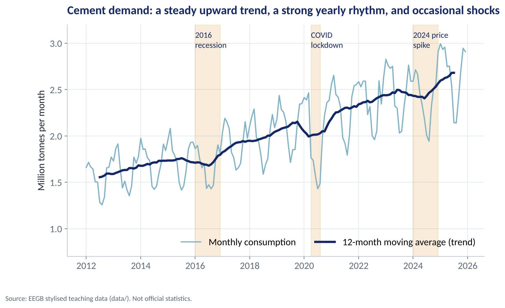{.fig-img fig-alt="S03-F01 (Python)"}

## R
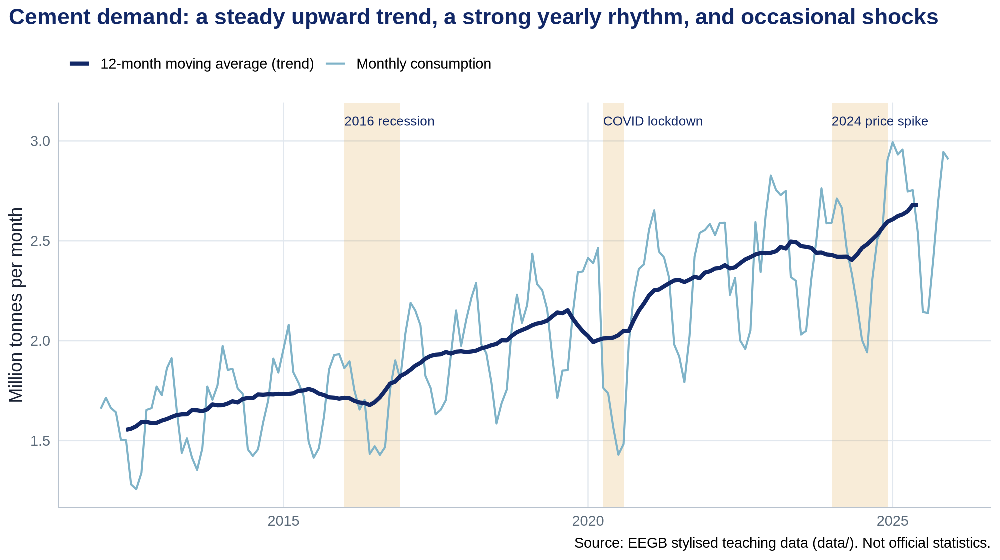{.fig-img fig-alt="S03-F01 (R)"}

:::

- Consumption grew from **18.7 Mt** in 2012 to **32.2 Mt** in 2025 — about **4.3% a year**.
- The 12-month moving average strips out the seasons and shows the **trend**.
- Three shocks: the 2016 recession, the 2020 lockdown and the 2024 price spike.
- Each time, demand returned to trend within about a year.

<span class="fig-id">S03-F01 · replicate with s03_figures.py / .R</span>

### The Rainy-Season Rhythm <span class='tag tag-illus'>illustrative</span>

<span class="slide-kicker">SEASONALITY</span>

::: {.panel-tabset group="lang"}
## Python
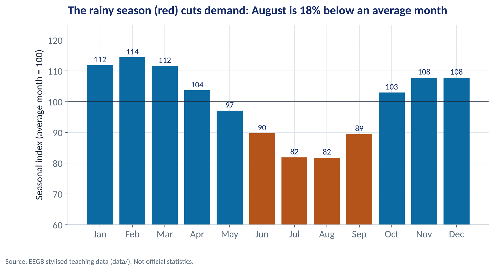{.fig-img fig-alt="S03-F02 (Python)"}

## R
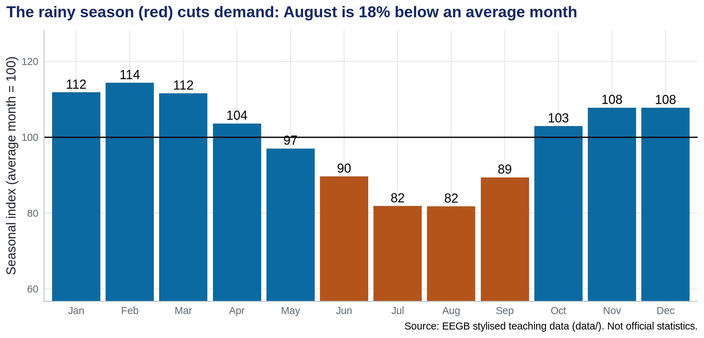{.fig-img fig-alt="S03-F02 (R)"}

:::

- February is about **14% above** an average month; July and August about **18% below**.
- Rain stops site work, so demand dips from June to September.
- Plan **capacity, stock and cash** for the peak months, not the annual average.
- Schedule maintenance for the **rainy season**, when demand is lowest.

<span class="fig-id">S03-F02 · replicate with s03_figures.py / .R</span>

### Was August 2025 a Collapse? <span class='tag tag-illus'>illustrative</span>

<span class="slide-kicker">SEASONAL ADJUSTMENT, WORKED</span>

| 2025 | Actual (Mt) | Seasonal index | Seasonally adjusted (Mt) | × 12 = annual rate |
|---|---|---|---|---|
| February | 2.932 | 1.14 | 2.572 | 30.9 Mt |
| August | 2.139 | 0.82 | 2.609 | 31.3 Mt |
| **Change Feb → Aug** | **−27%** |  | **+1.4%** | **steady** |

**Step by step**

1. Raw numbers say August sales were **27% below** February. The sales director wants to cut production.
2. Divide each month by its **seasonal index** (how far that calendar month normally sits from average).
3. Seasonally adjusted, August was **1.4% above** February: the business is steady; only the weather changed.
4. Multiply by 12 to read any month as an **annual rate** — comparable with the full-year forecast.

::: {.result-box}
Never judge a month against the previous month without **seasonal adjustment**.
:::

::: {.callout-note collapse="true" appearance="minimal" icon=false}
## Sources and data notes

Seasonal index = the month effects from the trend × season regression, rescaled so the 12 months average 1.00 (s03_figures.py). The lab uses a simpler version — each month divided by its calendar-year average — which gives almost the same numbers (Feb 1.13, Aug 0.82). Official statistics do the same: compare NBS releases that are 'seasonally adjusted' with those that are not.
:::

### Trend × Season: A Forecast in One Line

<span class="slide-kicker">THE MODEL</span>

Next month's demand = the **trend level** for that month × the **seasonal index** for that calendar month. Both are fitted from history in one regression.

::: {.formula}
forecast = trend(t) × season(month)
:::

**Example.** Trend level for August 2026 ≈ 2.76 Mt; August index ≈ 0.82 → forecast ≈ **2.26 Mt**.

::: {.callout-tip appearance="minimal"}
**Why a manager cares.** Simple models are **transparent**: a manager can see and challenge every assumption. That matters more than an extra decimal of accuracy.
:::

## Part 2 · Forecast Honestly

::: {.part-question}
**The question this part answers:** Which method should we trust — and how wrong could it be?
:::

### Pretend It Is January 2024 <span class='tag tag-illus'>illustrative</span>

<span class="slide-kicker">THE BACKTEST</span>

::: {.panel-tabset group="lang"}
## Python
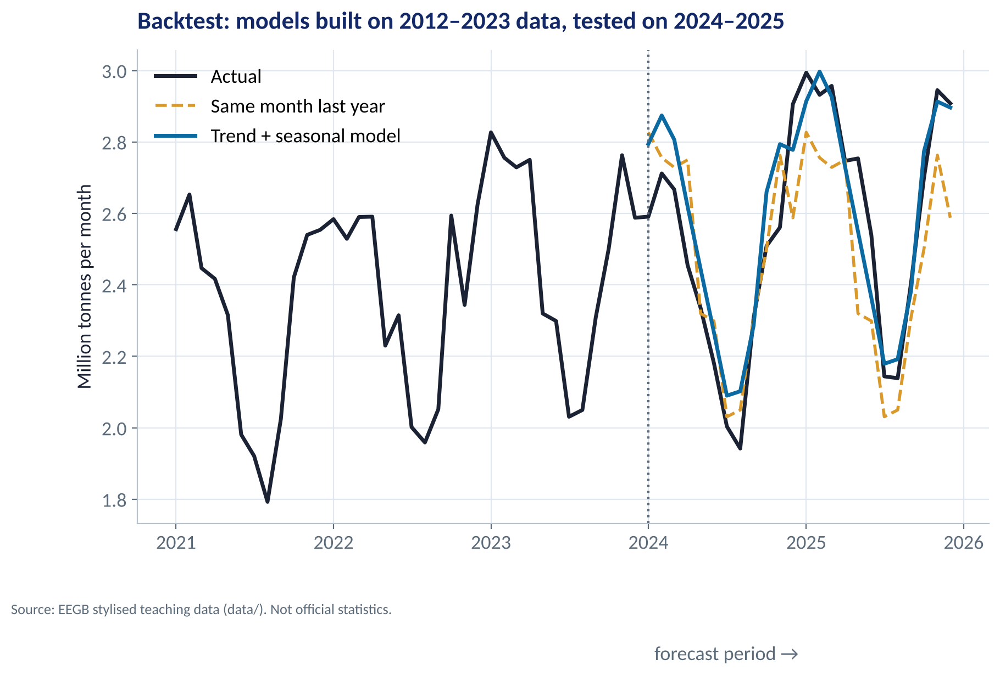{.fig-img fig-alt="S03-F03 (Python)"}

## R
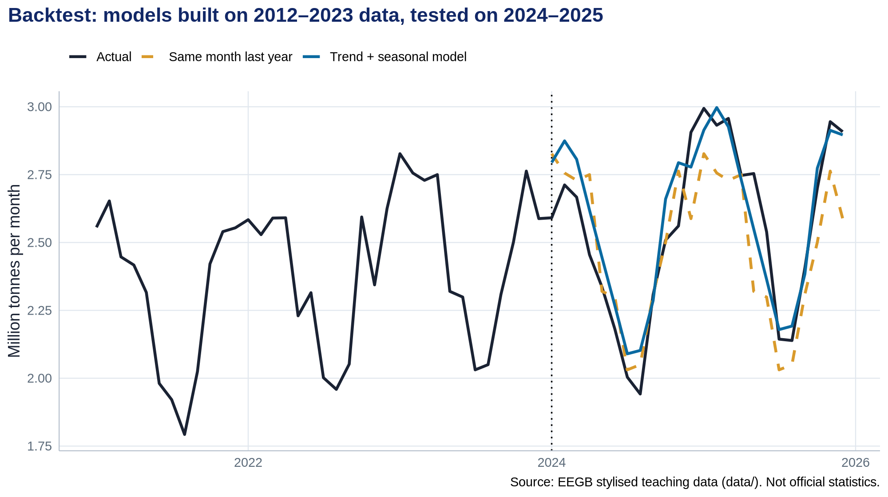{.fig-img fig-alt="S03-F03 (R)"}

:::

- Fit each method on **2012–2023 only** and forecast 2024–2025.
- Then compare with what actually happened.
- This **backtest** is the only honest way to judge a forecasting method.
- The model followed both season and trend; 'same month last year' missed the growth.

<span class="fig-id">S03-F03 · replicate with s03_figures.py / .R</span>

### MAPE: How Far Off Were We, on Average? <span class='tag tag-illus'>illustrative</span>

<span class="slide-kicker">MEASURING ACCURACY</span>

| Month | Actual (Mt) | Forecast (Mt) | Error | \|Error\| ÷ actual |
|---|---|---|---|---|
| Jan | 2.60 | 2.50 | −0.10 | 3.8% |
| Feb | 2.40 | 2.50 | +0.10 | 4.2% |
| Mar | 2.00 | 2.20 | +0.20 | 10.0% |
| **Mean absolute % error (MAPE)** |  |  |  | **6.0%** |

**Step by step**

1. **Error** = forecast − actual. Over- and under-forecasts would cancel out, so take the **absolute** value.
2. Divide by the actual to compare months of different size, then average: **MAPE = 6.0%**.
3. Also check **% bias**: the average signed percentage error. A forecast that is always high is a planning problem even if MAPE looks fine.
4. Compare every method's MAPE on the **same backtest period**.

::: {.result-box}
MAPE answers 'how far off, on average?'; bias answers 'which way do we lean?' — track both.
:::

### Which Method Forecast Best? <span class='tag tag-illus'>illustrative</span>

<span class="slide-kicker">THE SCOREBOARD</span>

::: {.panel-tabset group="lang"}
## Python
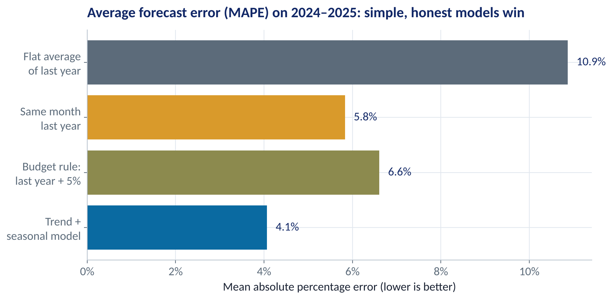{.fig-img fig-alt="S03-F04 (Python)"}

## R
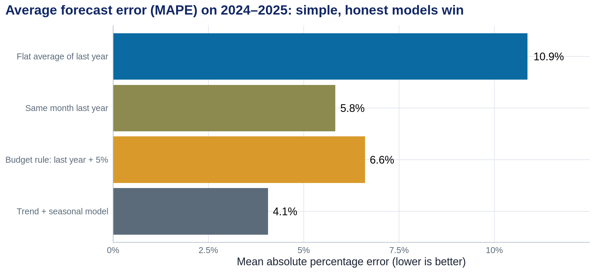{.fig-img fig-alt="S03-F04 (R)"}

:::

- **Trend + seasonal model: 4.1%** average error — the best.
- 'Same month last year': **5.8%**. The budget rule 'last year + 5%': **6.6%**.
- A flat average ignores the seasons: **10.9%**.
- The 2024 price spike hurt every method — no method saw it coming. Hence ranges and scenarios.

<span class="fig-id">S03-F04 · replicate with s03_figures.py / .R</span>

### Simple, Combined and Humble Forecasts Win

<span class="slide-kicker">WHAT THE EVIDENCE SAYS</span>

::: {.lead-box}
**Forecasting research.** In large forecasting competitions, **simple methods and combinations** of methods beat most complex ones — and people are reliably **over-confident**.
:::

- **The M4 competition (2018).** 100,000 real time series. **12 of the 17** most accurate methods were **combinations**; the winner was a statistics–ML **hybrid**; all six **pure** machine-learning entries did **worse** than a simple combination benchmark.
- **The planning fallacy.** Kahneman and Tversky: people build forecasts from the inside view of their own plan and ignore how similar plans turned out — so they are **systematically optimistic**.
- **Reference-class forecasting.** Flyvbjerg's fix: start from the **track record of similar projects** (cost overruns, demand shortfalls) and adjust from there.
- **Manager's use.** Ask of every forecast: **what is the base rate?** How did the last five capacity expansions in this industry actually fill?

*Build the habit: backtest, combine, give a range.*

::: {.callout-note collapse="true" appearance="minimal" icon=false}
## Sources and data notes

Makridakis, Spiliotis & Assimakopoulos, 'The M4 Competition: Results, findings, conclusion and way forward', International Journal of Forecasting 34(4):802–808, 2018 (winner: Smyl's hybrid exponential-smoothing/RNN). The term 'inside view' comes from Kahneman & Lovallo (1993). Kahneman & Tversky (1979) on the planning fallacy; Flyvbjerg (2006), 'From Nobel Prize to project management: getting risks right', Project Management Journal. Tetlock & Gardner, 'Superforecasting' (2015), on calibration.
:::

### Judgement vs Models — Use Both

<span class="slide-kicker">TWO WAYS TO FORECAST</span>

::: {.grid}
::: {.g-col-12 .g-col-md-6 .obj-card}
**Judgemental forecasts**

*Sales teams, experts, management*

- Know about new projects, policy changes, competitor moves
- Fast, cheap, easy to explain
- Prone to optimism and anchoring on last year
- Best for one-offs and turning points
:::
::: {.g-col-12 .g-col-md-6 .obj-card}
**Model-based forecasts**

*Statistics from historical data*

- Consistent, repeatable, easy to backtest
- Capture trend and season well
- Blind to events not in the data
- Best for stable, repeating patterns
:::
:::

::: {.callout-tip appearance="simple"}
Start from the **model**, let judgement **adjust it for named, specific reasons** — and record each adjustment so you can check it later.
:::

### 2026: A Number and a Range <span class='tag tag-illus'>illustrative</span>

<span class="slide-kicker">THE FORECAST</span>

::: {.panel-tabset group="lang"}
## Python
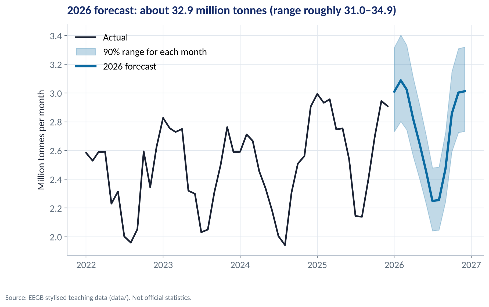{.fig-img fig-alt="S03-F05 (Python)"}

## R
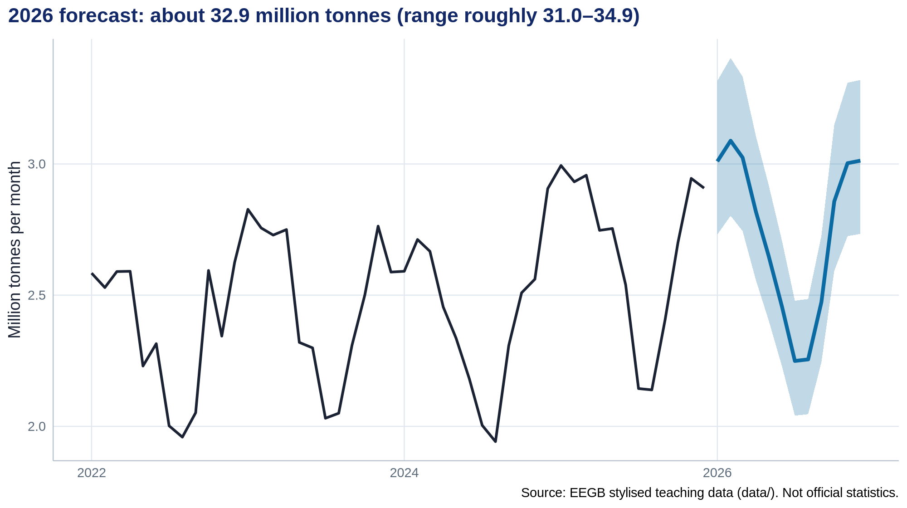{.fig-img fig-alt="S03-F05 (R)"}

:::

- Base forecast for 2026: about **32.9 Mt**.
- Monthly bands show where each month will probably fall (90% range).
- For the year: roughly **31.0–34.9 Mt**, based on how far past years strayed from the model.
- Say it as a range: 'about 33, very likely between 31 and 35'.

<span class="fig-id">S03-F05 · replicate with s03_figures.py / .R</span>

### Plan for More Than One Future <span class='tag tag-illus'>illustrative</span>

<span class="slide-kicker">SCENARIOS</span>

::: {.panel-tabset group="lang"}
## Python
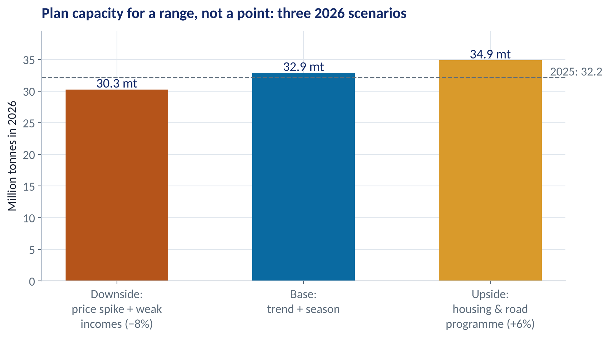{.fig-img fig-alt="S03-F06 (Python)"}

## R
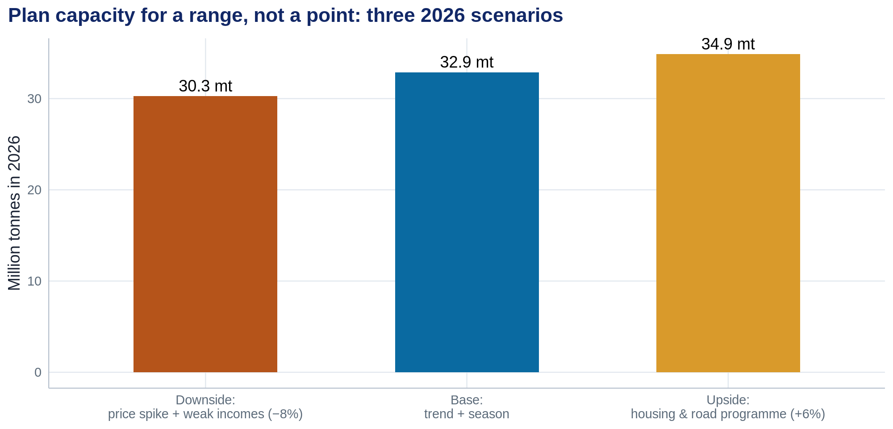{.fig-img fig-alt="S03-F06 (R)"}

:::

- **Downside (−8%)**: another price spike and weak real incomes → **30.3 Mt**.
- **Base**: trend and season continue → **32.9 Mt**.
- **Upside (+6%)**: a large housing and road programme → **34.9 Mt**.
- Name a **signpost** for each: cement price, mortgage rates, capital budget releases.

<span class="fig-id">S03-F06 · replicate with s03_figures.py / .R</span>

### More Complex Is Not More Accurate <span class='tag tag-illus'>illustrative</span>

<span class="slide-kicker">MACHINE LEARNING, RESPONSIBLY</span>

::: {.panel-tabset group="lang"}
## Python
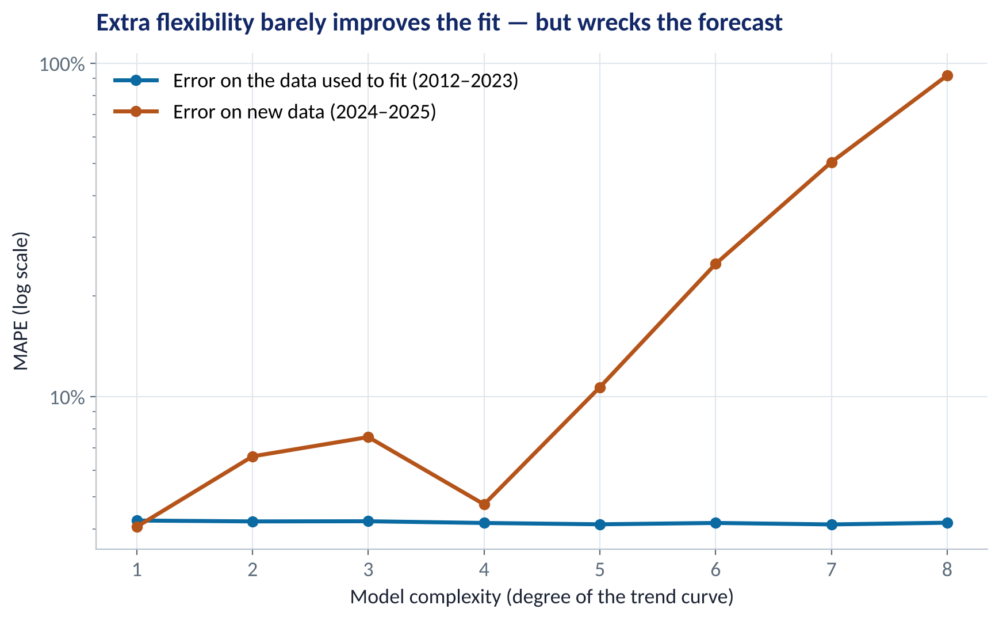{.fig-img fig-alt="S03-F08 (Python)"}

## R
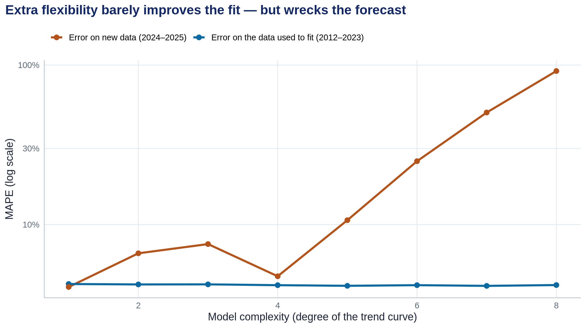{.fig-img fig-alt="S03-F08 (R)"}

:::

- We made the trend curve more and more flexible.
- Fit to the **past** barely changed (about **4%** error).
- Forecasts of the **future** got much worse: from 4% to over **90%** error.
- **Overfitting**: the model memorises the past instead of learning its pattern. ML earns its place with many series and many drivers — and only after a backtest.

<span class="fig-id">S03-F08 · replicate with s03_figures.py / .R</span>

### Check your understanding

**Your sales team forecasts next year at 'this year + 10%'. A backtested trend-plus-seasonal model says +4%, with a range of −2% to +10%. What should you do?**

- **A.** Average the two and use +7%
- **B.** Start from +4%, ask for named, specific reasons for any upward adjustment, and plan capacity against the range
- **C.** Use +10% — the sales team knows the market
- **D.** Ignore the sales team; use +4% exactly

::: {.callout-tip collapse="true" appearance="simple"}
## Show answer
B. The backtested model is the disciplined baseline; judgement adjusts it only for specific, recorded reasons (a new contract, a new region), and plans cover the range. A splits the difference without evidence; C ignores the planning fallacy; D throws away information the model cannot see.
:::

## Part 3 · Size the Market and Decide

::: {.part-question}
**The question this part answers:** Does the market add up — and how much capacity should we plan for?
:::

### Start From the Whole Economy

<span class="slide-kicker">TOP-DOWN SIZING</span>

| Step | Value | Source |
|---|---|---|
| Population, 2025 | 237.5 million | World Bank |
| Cement use per person | ≈ 129 kg a year | CemNet estimate |
| Market = population × use | ≈ 30.6 Mt | calculation |
| Industry report (GCR 16) | ≈ 33.9 Mt | Global Cement Report |

**Step by step**

1. Top-down sizing starts from a **big, known number** and multiplies by a **rate of use**.
2. 237.5m people × 0.129 t = **30.6 Mt**, about 10% below the industry's **33.9 Mt**. Yet 33.9 Mt ÷ 237.5m = **143 kg** — the source's own two numbers disagree.
3. Benchmark the rate: the world average is about **550 kg** a person. Nigeria uses a quarter of that — room to grow, or a sign of high prices and low incomes?
4. The **rate of use** carries all the weight — test it against peers at similar incomes.

::: {.result-box}
Top-down is fast; its weak point is the **use-per-person** rate — and even published sources can disagree with themselves.
:::

::: {.callout-note collapse="true" appearance="minimal" icon=false}
## Sources and data notes

Sources: World Bank SP.POP.TOTL (Nigeria 2025: 237,527,782). CemNet, 'Nigeria is in the middle of a new cement capacity frenzy' (30 Apr 2026): consumption about 33.9 Mt (+8.5%, citing Global Cement Report 16); 129 kg per capita and world average about 550 kg are CemNet's estimates. CemNet uses the same population, so its 129 kg and 33.9 Mt are mutually inconsistent (33.9 Mt implies 143 kg): probably different reference years. A good classroom exercise: spot the inconsistency before trusting either number.
:::

### Add Up the Uses

<span class="slide-kicker">BOTTOM-UP SIZING</span>

**Bottom-up** sizing builds the market from its parts: homes, roads, factories and repairs, times the cement each needs.

::: {.formula}
market = Σ (units of activity × cement per unit)
:::

**Example.** About 450,000 new homes × ~32 t = **14.4 Mt**, plus repairs (6.5), public works (6.0), commercial (4.5), precast (2.4) = **33.8 Mt**.

::: {.callout-tip appearance="minimal"}
**Why a manager cares.** Slower, but it shows **which segments drive demand** — and which ones a housing programme, a capital-budget release or a price shock would hit.
:::

::: {.callout-note collapse="true" appearance="minimal" icon=false}
## Sources and data notes

Segment assumptions are stylised teaching numbers. Real sizing would use NBS housing data, the federal capital budget, company reports and project pipelines.
:::

### Do the Routes Agree? <span class='tag tag-illus'>illustrative</span>

<span class="slide-kicker">RECONCILE</span>

::: {.panel-tabset group="lang"}
## Python
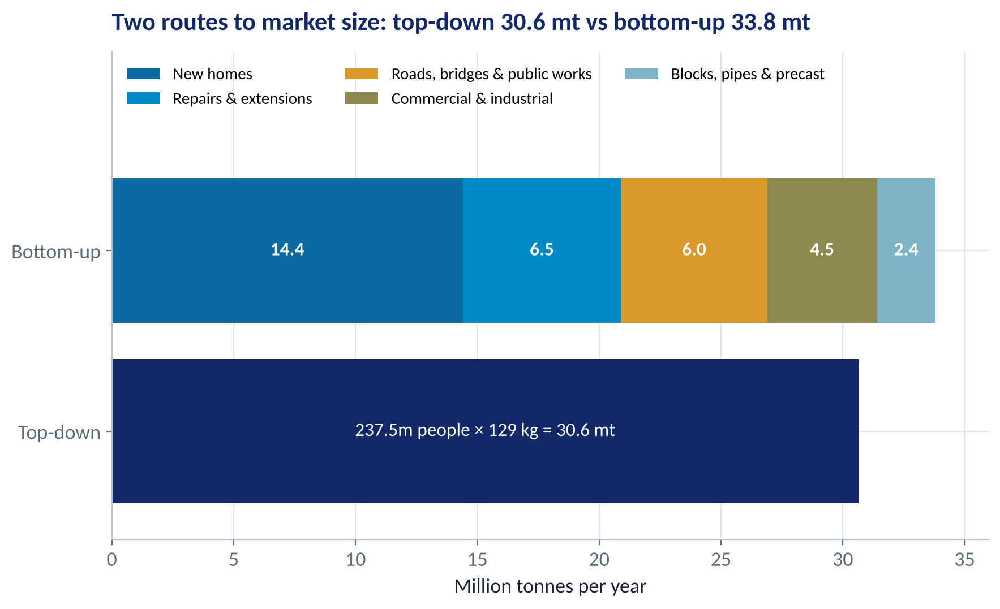{.fig-img fig-alt="S03-F07 (Python)"}

## R
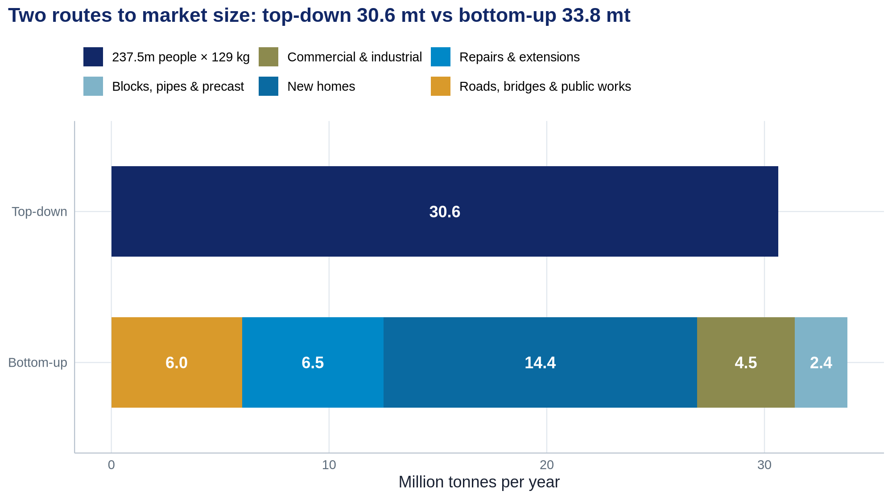{.fig-img fig-alt="S03-F07 (R)"}

:::

- Top-down **30.6 Mt**, bottom-up **33.8 Mt** (stylised), industry report **33.9 Mt**: within about 10%.
- If they disagree badly, one assumption is wrong. Find it before you build.
- New homes are the biggest segment: watch **mortgage rates, real incomes and land policy**.
- Three views pointing the same way — and an explanation for the gap — is what a board should see.

<span class="fig-id">S03-F07 · replicate with s03_figures.py / .R</span>

### How Much to Build? Weigh the Cost of Being Wrong <span class='tag tag-illus'>illustrative</span>

<span class="slide-kicker">THE CAPACITY DECISION</span>

| Per tonne of demand | ₦ thousand |
|---|---|
| Too little capacity: margin lost on a sale we cannot make | 20 |
| Too much capacity: cost of an idle tonne of capacity | 8 |
| Critical ratio = 20 ÷ (20 + 8) | 0.71 |
| **Plan for the 71st percentile of demand** | **≈ 33.6 Mt** |

**Step by step**

1. A forecast is a **distribution**, not a number. Here: centre **32.9 Mt**, typical annual error about **3.5%**.
2. Ask what each error **costs**. Missing a sale loses ₦20k of margin; an idle tonne of capacity costs ₦8k.
3. When shortfalls cost more than surpluses, plan **above** the central forecast — at the **71st percentile**: about **33.6 Mt**.
4. If idle capacity were the dearer mistake, you would plan **below** the centre. The forecast is the same; the **decision** differs.

::: {.result-box}
Capacity = the demand level where the **cost of too little** balances the **cost of too much**.
:::

### Check your understanding

**Top-down sizing gives 32 Mt and bottom-up gives 45 Mt. What is the best next step?**

- **A.** Average them: 38.5 Mt
- **B.** Trust bottom-up because it is more detailed
- **C.** Use whichever supports the investment case
- **D.** Find which assumption explains the gap (e.g. tonnes per house or homes built) and check it against independent data

::: {.callout-tip collapse="true" appearance="simple"}
## Show answer
D. A 40% gap means at least one assumption is badly wrong; averaging hides it. Detail is not accuracy, and choosing the convenient number is motivated reasoning.
:::

## Lab 3: Cement Demand in 2026

*Time:* 20 minutes · *Data:* [`data/cement_demand_monthly.csv`](../../data/cement_demand_monthly.csv)

1. Plot the series and a 12-month moving average; mark the three shocks.
2. Estimate the **seasonal index**; seasonally adjust the latest month.
3. Backtest **four methods** on 2024–2025 and compare MAPE and bias.
4. Forecast 2026 with a **90% range** and three scenarios.
5. Size the market top-down and bottom-up; set capacity with the **critical ratio**.

::: {.callout-important appearance="simple"}
**Deliverable:** a one-page memo: 2026 demand (base, range, scenarios), market-sizing check, and a capacity recommendation with the cost logic.
:::

## The code (R | Python)

Pick your language once; every tab on the site follows your choice. Download a script, or copy it into RStudio and run it line by line.

### Replicate every chart

::: {.panel-tabset group="lang"}
## Python
[<i class="bi bi-download"></i> s03_figures.py](../../sessions/s03/python/s03_figures.py){download=""}

::: {.callout-note collapse="true" appearance="simple" icon=false}
## Show the full script (150 lines)

```{.python filename="sessions/s03/python/s03_figures.py"}
# =============================================================================
# EEGB · Session 3 · Demand Forecasting & Market Sizing
# Replication script — regenerates every chart in the Session 3 deck (Python)
# Data: data/cement_demand_monthly.csv (stylised Nigerian cement consumption, 2012–2025)
# Run from the project root:  python sessions/s03/python/s03_figures.py
# =============================================================================
import sys; sys.path.insert(0, "python")
import numpy as np, pandas as pd
import matplotlib.pyplot as plt
from matplotlib.ticker import FuncFormatter
from eegb_style import *

set_style()
c = pd.read_csv("data/cement_demand_monthly.csv", parse_dates=["month"])
c["t"] = np.arange(len(c)); c["m"] = c.month.dt.month; c["year"] = c.month.dt.year
MON = ["Jan", "Feb", "Mar", "Apr", "May", "Jun", "Jul", "Aug", "Sep", "Oct", "Nov", "Dec"]

def X_ts(df, trend_deg=1):
    """Trend (polynomial in t, scaled) + 11 month dummies."""
    tt = df.t.values / 100
    cols = [np.ones(len(df))] + [tt ** k for k in range(1, trend_deg + 1)]
    cols += [(df.m == k).astype(float).values for k in range(2, 13)]
    return np.column_stack(cols)

def fit_predict(train, test, deg=1):
    b = np.linalg.lstsq(X_ts(train, deg), np.log(train.cement_mt), rcond=None)[0]
    return np.exp(X_ts(train, deg) @ b), np.exp(X_ts(test, deg) @ b), b

mape = lambda a, f: np.mean(np.abs(a - f) / a) * 100

# --- F01 · The raw series and its trend -----------------------------------------------------------
fig, ax = plt.subplots()
ax.plot(c.month, c.cement_mt, color=SKY, lw=1.6, label="Monthly consumption")
ax.plot(c.month, c.cement_mt.rolling(12, center=True).mean(), color=NAVY, lw=3, label="12-month moving average (trend)")
for s, e, lab in [("2016-01-01", "2016-12-01", "2016\nrecession"), ("2020-04-01", "2020-08-01", "COVID\nlockdown"), ("2024-01-01", "2024-12-01", "2024 price\nspike")]:
    ax.axvspan(pd.Timestamp(s), pd.Timestamp(e), color=GOLD, alpha=.18); ax.text(pd.Timestamp(s), 2.95, lab, fontsize=11, color=NAVY)
ax.set_ylim(0.7, 3.2); ax.legend(loc="lower right", ncol=2)
ax.set(title="Cement demand: a steady upward trend, a strong yearly rhythm, and occasional shocks", ylabel="Million tonnes per month")
note(fig); save(fig, "s03", "f01")
ann = c.groupby("year").cement_mt.sum()
cagr = (ann[2025] / ann[2012]) ** (1 / 13) - 1
print(f"annual 2012 {ann[2012]:.1f} mt, 2025 {ann[2025]:.1f} mt, CAGR {cagr*100:.1f}%")

# --- F02 · Seasonality --------------------------------------------------------------------------------
_, _, b_all = fit_predict(c, c)
seas = np.exp(np.r_[0, b_all[2:]]); seas = seas / seas.mean() * 100
fig, ax = plt.subplots(figsize=(10, 4.8))
cols = [RUST if k in (6, 7, 8, 9) else TEAL for k in range(1, 13)]
ax.bar(MON, seas, color=cols); ax.axhline(100, color=INK, lw=1)
for i, v in enumerate(seas): ax.text(i, v + 1, f"{v:.0f}", ha="center", fontsize=11, color=NAVY)
ax.set_ylim(60, 125)
ax.set(title=f"The rainy season (red) cuts demand: August is {100-seas[7]:.0f}% below an average month",
       ylabel="Seasonal index (average month = 100)")
note(fig); save(fig, "s03", "f02")
print("seasonal index:", dict(zip(MON, seas.round(0))))

# --- F03 · Backtest: train to 2023, forecast 2024–2025 ------------------------------------------------
train, test = c[c.year <= 2023].copy(), c[c.year >= 2024].copy()
_, f_reg, _ = fit_predict(train, test)
f_snaive = train.cement_mt.values[-12:]; f_snaive = np.r_[f_snaive, f_snaive]              # same month last year
f_avg = np.full(len(test), train.cement_mt.values[-12:].mean())                             # flat average of last year
# judgemental: last year's same month + 5% growth (a typical budget rule)
f_judge = train.cement_mt.values[-12:] * 1.05; f_judge = np.r_[f_judge, f_judge * 1.05]
scores = {"Flat average\nof last year": mape(test.cement_mt, f_avg), "Same month\nlast year": mape(test.cement_mt, f_snaive),
          "Budget rule:\nlast year + 5%": mape(test.cement_mt, f_judge), "Trend +\nseasonal model": mape(test.cement_mt, f_reg)}
fig, ax = plt.subplots()
ax.plot(c.month[c.year >= 2021], c.cement_mt[c.year >= 2021], color=INK, lw=2.5, label="Actual")
ax.plot(test.month, f_snaive, color=GOLD, lw=2, ls="--", label="Same month last year")
ax.plot(test.month, f_reg, color=TEAL, lw=2.5, label="Trend + seasonal model")
ax.axvline(pd.Timestamp("2024-01-01"), color=SLATE, ls=":"); ax.text(pd.Timestamp("2024-01-15"), 1.35, "forecast period →", color=SLATE)
ax.legend(loc="upper left")
ax.set(title="Backtest: models built on 2012–2023 data, tested on 2024–2025", ylabel="Million tonnes per month")
note(fig); save(fig, "s03", "f03")
print("backtest MAPE:", {k.replace(chr(10), ' '): round(v, 1) for k, v in scores.items()})

# --- F04 · Forecast accuracy scoreboard ------------------------------------------------------------------
fig, ax = plt.subplots(figsize=(10, 4.6))
ks, vs = list(scores), list(scores.values())
ax.barh(ks, vs, color=[SLATE, GOLD, OLIVE, TEAL])
for i, v in enumerate(vs): ax.text(v + .2, i, f"{v:.1f}%", va="center", fontsize=13, color=NAVY)
ax.invert_yaxis(); ax.xaxis.set_major_formatter(FuncFormatter(pct))
ax.set(title="Average forecast error (MAPE) on 2024–2025: simple, honest models win", xlabel="Mean absolute percentage error (lower is better)")
save(fig, "s03", "f04")

# --- F05 · Forecast for 2026 with an uncertainty band ------------------------------------------------------
fut = pd.DataFrame({"month": pd.date_range("2026-01-01", periods=12, freq="MS")})
fut["t"] = np.arange(len(c), len(c) + 12); fut["m"] = fut.month.dt.month
fit_in, f26, b = fit_predict(c, fut)
resid_sd = np.std(np.log(c.cement_mt) - np.log(fit_in), ddof=len(b))
lo, hi = f26 * np.exp(-1.645 * resid_sd), f26 * np.exp(1.645 * resid_sd)
# annual uncertainty: how far each past year's total sat from the model's fitted total
ann_dev = np.log(c.assign(fit=fit_in).groupby("year")[["cement_mt", "fit"]].sum().pipe(lambda g: g.cement_mt / g.fit))
sd_a = ann_dev.std(ddof=1)
tot = f26.sum(); tot_lo, tot_hi = tot * np.exp(-1.645 * sd_a), tot * np.exp(1.645 * sd_a)
fig, ax = plt.subplots()
h = c[c.year >= 2022]
ax.plot(h.month, h.cement_mt, color=INK, lw=2.2, label="Actual")
ax.fill_between(fut.month, lo, hi, color=TEAL, alpha=.25, label="90% range for each month")
ax.plot(fut.month, f26, color=TEAL, lw=3, label="2026 forecast")
ax.legend(loc="upper left")
ax.set(title=f"2026 forecast: about {tot:.1f} million tonnes (range roughly {tot_lo:.1f}–{tot_hi:.1f})", ylabel="Million tonnes per month")
note(fig); save(fig, "s03", "f05")
print(f"2026 forecast {tot:.2f} mt, range {tot_lo:.1f}-{tot_hi:.1f}; monthly resid sd {resid_sd:.3f}, annual sd {sd_a:.3f}")

# --- F06 · Scenarios for 2026 -----------------------------------------------------------------------------------
base = tot
scen = {"Downside:\nprice spike + weak\nincomes (−8%)": base * 0.92, "Base:\ntrend + season": base,
        "Upside:\nhousing & road\nprogramme (+6%)": base * 1.06}
fig, ax = plt.subplots(figsize=(10, 4.8))
ax.bar(list(scen), list(scen.values()), color=[RUST, TEAL, GOLD], width=.55)
for i, v in enumerate(scen.values()): ax.text(i, v + .3, f"{v:.1f} mt", ha="center", fontsize=14, color=NAVY)
ax.axhline(ann[2025], color=SLATE, ls="--", lw=1.2); ax.text(2.32, ann[2025] + .3, f"2025: {ann[2025]:.1f}", color=SLATE)
ax.set_ylim(0, base * 1.2)
ax.set(title="Plan capacity for a range, not a point: three 2026 scenarios", ylabel="Million tonnes in 2026")
save(fig, "s03", "f06")
print("scenarios:", {k.split(':')[0]: round(v, 1) for k, v in scen.items()})

# --- F07 · Market sizing: top-down vs bottom-up -------------------------------------------------------------------
pop, kg_pc = 237.5, 129                                  # million people (World Bank 2025); kg per person (CemNet estimate)
top_down = pop * kg_pc / 1000                             # million tonnes
houses, t_house = 0.45, 32                                # million new homes a year; tonnes each (stylised)
parts = {"New homes": houses * t_house, "Repairs &\nextensions": 6.5, "Roads, bridges\n& public works": 6.0,
         "Commercial &\nindustrial": 4.5, "Blocks, pipes\n& precast": 2.4}
bottom_up = sum(parts.values())
fig, ax = plt.subplots()
left = 0
for (k, v), col in zip(parts.items(), [TEAL, TEAL2, GOLD, OLIVE, SKY]):
    ax.barh(1, v, left=left, color=col, label=k.replace("\n", " ")); ax.text(left + v / 2, 1, f"{v:.1f}", ha="center", va="center", fontsize=12, color="white", fontweight="bold")
    left += v
ax.barh(0, top_down, color=NAVY); ax.text(top_down / 2, 0, f"{pop}m people × {kg_pc} kg = {top_down:.1f} mt", ha="center", va="center", color="white", fontsize=12)
ax.set_yticks([0, 1], ["Top-down", "Bottom-up"]); ax.set_xlim(0, 36); ax.set_ylim(-.6, 2.1)
ax.legend(ncol=3, loc="upper left", fontsize=10.5)
ax.set(title=f"Two routes to market size: top-down {top_down:.1f} mt vs bottom-up {bottom_up:.1f} mt", xlabel="Million tonnes per year")
save(fig, "s03", "f07")
print(f"top-down {top_down:.1f}, bottom-up {bottom_up:.1f}, new homes {houses*t_house:.1f}")

# --- F08 · More complex is not more accurate (overfitting) ------------------------------------------------------------
degs = range(1, 9); tr_err, te_err = [], []
for k in degs:
    fi, fo, _ = fit_predict(train, test, k)
    tr_err.append(mape(train.cement_mt, fi)); te_err.append(mape(test.cement_mt, fo))
fig, ax = plt.subplots()
ax.plot(list(degs), tr_err, "o-", color=TEAL, lw=2.5, label="Error on the data used to fit (2012–2023)")
ax.plot(list(degs), te_err, "o-", color=RUST, lw=2.5, label="Error on new data (2024–2025)")
ax.set_yscale("log"); ax.yaxis.set_major_formatter(FuncFormatter(lambda v, p: f"{v:g}%"))
ax.legend(loc="upper left")
ax.set(title="Extra flexibility barely improves the fit — but wrecks the forecast",
       xlabel="Model complexity (degree of the trend curve)", ylabel="MAPE (log scale)")
save(fig, "s03", "f08")
print("overfit train:", np.round(tr_err, 1), "test:", np.round(te_err, 1))
```
:::

## R
[<i class="bi bi-download"></i> s03_figures.R](../../sessions/s03/R/s03_figures.R){download=""}

::: {.callout-note collapse="true" appearance="simple" icon=false}
## Show the full script (107 lines)

```{.r filename="sessions/s03/R/s03_figures.R"}
# =============================================================================
# EEGB · Session 3 · Demand Forecasting & Market Sizing
# Replication script — regenerates every chart in the Session 3 deck (R)
# Data: data/cement_demand_monthly.csv (stylised Nigerian cement consumption, 2012–2025)
# =============================================================================
source("R/theme_eegb.R")
suppressPackageStartupMessages({ library(dplyr); library(readr); library(tidyr) })
c <- read_csv("data/cement_demand_monthly.csv", show_col_types = FALSE) |>
  mutate(month = as.Date(month), t = row_number() - 1, m = as.integer(format(month, "%m")),
         year = as.integer(format(month, "%Y")))
mape <- function(a, f) 100 * mean(abs(a - f) / a)
fit_ts <- function(df, deg = 1) lm(log(cement_mt) ~ poly(I(t / 100), deg, raw = TRUE) + factor(m), data = df)

# --- F01 · Raw series and trend ------------------------------------------------------------
c$ma12 <- as.numeric(stats::filter(c$cement_mt, rep(1 / 12, 12), sides = 2))
shocks <- tibble(s = as.Date(c("2016-01-01", "2020-04-01", "2024-01-01")), e = as.Date(c("2016-12-01", "2020-08-01", "2024-12-01")),
                 lab = c("2016 recession", "COVID lockdown", "2024 price spike"))
p1 <- ggplot(c, aes(month)) +
  geom_rect(data = shocks, aes(xmin = s, xmax = e, ymin = -Inf, ymax = Inf), inherit.aes = FALSE, fill = eegb[["gold"]], alpha = .18) +
  geom_text(data = shocks, aes(x = s, y = 3.1, label = lab), inherit.aes = FALSE, hjust = 0, size = 3.3, colour = eegb[["navy"]]) +
  geom_line(aes(y = cement_mt, colour = "Monthly consumption"), linewidth = .7) +
  geom_line(aes(y = ma12, colour = "12-month moving average (trend)"), linewidth = 1.4, na.rm = TRUE) +
  scale_colour_manual(values = c(`Monthly consumption` = eegb[["sky"]], `12-month moving average (trend)` = eegb[["navy"]]), name = NULL) +
  labs(title = "Cement demand: a steady upward trend, a strong yearly rhythm, and occasional shocks",
       x = NULL, y = "Million tonnes per month", caption = eegb_caption) + theme_eegb()
save_fig(p1, "s03", "f01")

# --- F02 · Seasonal index ------------------------------------------------------------------------
fa <- fit_ts(c); b <- coef(fa)
seas <- exp(c(0, b[grep("factor", names(b))])); seas <- 100 * seas / mean(seas)
si <- tibble(m = factor(month.abb, levels = month.abb), idx = seas, rainy = 1:12 %in% 6:9)
p2 <- ggplot(si, aes(m, idx, fill = rainy)) + geom_col(show.legend = FALSE) + geom_hline(yintercept = 100) +
  geom_text(aes(label = round(idx)), vjust = -0.4) + coord_cartesian(ylim = c(60, 125)) +
  scale_fill_manual(values = c(`TRUE` = eegb[["rust"]], `FALSE` = eegb[["teal"]])) +
  labs(title = sprintf("The rainy season (red) cuts demand: August is %.0f%% below an average month", 100 - seas[8]),
       x = NULL, y = "Seasonal index (average month = 100)", caption = eegb_caption) + theme_eegb()
save_fig(p2, "s03", "f02", height = 4.8)

# --- F03 & F04 · Backtest -------------------------------------------------------------------------
train <- filter(c, year <= 2023); test <- filter(c, year >= 2024)
f_reg <- exp(predict(fit_ts(train), newdata = test))
last12 <- tail(train$cement_mt, 12)
f_sn <- c(last12, last12); f_avg <- rep(mean(last12), 24); f_j <- c(last12 * 1.05, last12 * 1.05^2)
bt <- bind_rows(tibble(month = test$month, value = f_sn, series = "Same month last year"),
                tibble(month = test$month, value = f_reg, series = "Trend + seasonal model"),
                filter(c, year >= 2021) |> transmute(month, value = cement_mt, series = "Actual"))
p3 <- ggplot(bt, aes(month, value, colour = series, linetype = series)) + geom_line(linewidth = 1.1) +
  geom_vline(xintercept = as.Date("2024-01-01"), linetype = "dotted") +
  scale_colour_manual(values = c(Actual = eegb[["ink"]], `Same month last year` = eegb[["gold"]], `Trend + seasonal model` = eegb[["teal"]]), name = NULL) +
  scale_linetype_manual(values = c(Actual = "solid", `Same month last year` = "dashed", `Trend + seasonal model` = "solid"), name = NULL) +
  labs(title = "Backtest: models built on 2012–2023 data, tested on 2024–2025", x = NULL, y = "Million tonnes per month",
       caption = eegb_caption) + theme_eegb()
save_fig(p3, "s03", "f03")
sc <- tibble(method = c("Flat average of last year", "Same month last year", "Budget rule: last year + 5%", "Trend + seasonal model"),
             mape = c(mape(test$cement_mt, f_avg), mape(test$cement_mt, f_sn), mape(test$cement_mt, f_j), mape(test$cement_mt, f_reg))) |>
  mutate(method = factor(method, levels = rev(method)))
p4 <- ggplot(sc, aes(mape, method)) + geom_col(fill = rev(unname(eegb[c("slate", "gold", "olive", "teal")]))) +
  geom_text(aes(label = sprintf("%.1f%%", mape)), hjust = -0.2) + scale_x_continuous(labels = pct, expand = expansion(mult = c(0, .15))) +
  labs(title = "Average forecast error (MAPE) on 2024–2025: simple, honest models win",
       x = "Mean absolute percentage error (lower is better)", y = NULL) + theme_eegb()
save_fig(p4, "s03", "f04", height = 4.6)

# --- F05 · 2026 forecast with an uncertainty band ---------------------------------------------------
fut <- tibble(month = seq(as.Date("2026-01-01"), by = "month", length.out = 12), t = nrow(c) + 0:11, m = 1:12)
fut$f <- exp(predict(fa, newdata = fut)); rsd <- summary(fa)$sigma
fut <- fut |> mutate(lo = f * exp(-1.645 * rsd), hi = f * exp(1.645 * rsd))
ann_dev <- c |> mutate(fit = exp(fitted(fa))) |> group_by(year) |> summarise(d = log(sum(cement_mt) / sum(fit)))
sd_a <- sd(ann_dev$d); tot <- sum(fut$f)
p5 <- ggplot() + geom_line(data = filter(c, year >= 2022), aes(month, cement_mt), colour = eegb[["ink"]], linewidth = 1) +
  geom_ribbon(data = fut, aes(month, ymin = lo, ymax = hi), fill = eegb[["teal"]], alpha = .25) +
  geom_line(data = fut, aes(month, f), colour = eegb[["teal"]], linewidth = 1.4) +
  labs(title = sprintf("2026 forecast: about %.1f million tonnes (range roughly %.1f–%.1f)", tot, tot * exp(-1.645 * sd_a), tot * exp(1.645 * sd_a)),
       x = NULL, y = "Million tonnes per month", caption = eegb_caption) + theme_eegb()
save_fig(p5, "s03", "f05")

# --- F06 · Scenarios -----------------------------------------------------------------------------------
scen <- tibble(s = factor(c("Downside: price spike + weak incomes (−8%)", "Base: trend + season", "Upside: housing & road programme (+6%)"),
                          levels = c("Downside: price spike + weak incomes (−8%)", "Base: trend + season", "Upside: housing & road programme (+6%)")),
               v = tot * c(.92, 1, 1.06))
p6 <- ggplot(scen, aes(s, v, fill = s)) + geom_col(width = .55, show.legend = FALSE) +
  geom_text(aes(label = sprintf("%.1f mt", v)), vjust = -0.4) +
  scale_fill_manual(values = unname(eegb[c("rust", "teal", "gold")])) + scale_x_discrete(labels = function(x) gsub(": ", ":\n", x)) +
  labs(title = "Plan capacity for a range, not a point: three 2026 scenarios", x = NULL, y = "Million tonnes in 2026") + theme_eegb()
save_fig(p6, "s03", "f06", height = 4.8)

# --- F07 · Market sizing ----------------------------------------------------------------------------------
parts <- tibble(route = "Bottom-up", part = c("New homes", "Repairs & extensions", "Roads, bridges & public works", "Commercial & industrial", "Blocks, pipes & precast"),
                v = c(0.45 * 32, 6.5, 6.0, 4.5, 2.4))
td <- tibble(route = "Top-down", part = "237.5m people × 129 kg", v = 237.5 * 129 / 1000)
p7 <- ggplot(bind_rows(parts, td), aes(v, route, fill = part)) + geom_col(width = .6) +
  geom_text(aes(label = sprintf("%.1f", v)), position = position_stack(vjust = .5), colour = "white", fontface = "bold") +
  scale_fill_manual(values = c(`New homes` = eegb[["teal"]], `Repairs & extensions` = eegb[["teal2"]], `Roads, bridges & public works` = eegb[["gold"]],
                               `Commercial & industrial` = eegb[["olive"]], `Blocks, pipes & precast` = eegb[["sky"]], `237.5m people × 129 kg` = eegb[["navy"]]), name = NULL) +
  labs(title = sprintf("Two routes to market size: top-down %.1f mt vs bottom-up %.1f mt", td$v, sum(parts$v)),
       x = "Million tonnes per year", y = NULL) + theme_eegb()
save_fig(p7, "s03", "f07")

# --- F08 · Overfitting --------------------------------------------------------------------------------------
of <- bind_rows(lapply(1:8, function(k) { f <- fit_ts(train, k)
  tibble(deg = k, `Error on the data used to fit (2012–2023)` = mape(train$cement_mt, exp(fitted(f))),
         `Error on new data (2024–2025)` = mape(test$cement_mt, exp(predict(f, newdata = test)))) })) |>
  pivot_longer(-deg)
p8 <- ggplot(of, aes(deg, value, colour = name)) + geom_line(linewidth = 1.2) + geom_point(size = 2.5) +
  scale_y_log10(labels = function(v) paste0(v, "%")) + scale_colour_manual(values = unname(eegb[c("rust", "teal")]), name = NULL) +
  labs(title = "Extra flexibility barely improves the fit — but wrecks the forecast",
       x = "Model complexity (degree of the trend curve)", y = "MAPE (log scale)") + theme_eegb()
save_fig(p8, "s03", "f08")
```
:::

:::

### Lab

::: {.panel-tabset group="lang"}
## Python
[<i class="bi bi-download"></i> s03_lab.py](../../sessions/s03/python/s03_lab.py){download=""}

::: {.callout-note collapse="true" appearance="simple" icon=false}
## Show the full script (71 lines)

```{.python filename="sessions/s03/python/s03_lab.py"}
# =============================================================================
# EEGB · Session 3 LAB · How much cement will Nigeria buy in 2026? (Python)
# Data: data/cement_demand_monthly.csv — stylised monthly cement consumption, 2012–2025
# Run from the project root, line by line (Ctrl/Cmd + Enter)
# =============================================================================
import numpy as np, pandas as pd

c = pd.read_csv("data/cement_demand_monthly.csv", parse_dates=["month"])
c["t"] = np.arange(len(c)); c["m"] = c.month.dt.month; c["year"] = c.month.dt.year

# ---- STEP 1 · Trend: annual totals and the average growth rate ----------------------------
annual = c.groupby("year").cement_mt.sum()
print(annual.round(1))
cagr = (annual.iloc[-1] / annual.iloc[0]) ** (1 / (len(annual) - 1)) - 1
print(f"Average growth per year (CAGR): {cagr:.1%}")

# ---- STEP 2 · Seasonality: how each month compares with the year's average ---------------------
c["vs_year_avg"] = c.cement_mt / c.groupby("year").cement_mt.transform("mean")
idx = c.groupby("m").vs_year_avg.mean()
print((idx * 100).round(0))
# Seasonally adjust the latest month and read it as an annual rate
last = c.iloc[-1]
print(f"{last.month:%b %Y}: actual {last.cement_mt:.2f} Mt; seasonally adjusted x12 = {last.cement_mt / idx[last.m] * 12:.1f} Mt a year")

# ---- STEP 3 · A trend + seasonal model (one regression) --------------------------------------------
def X(df):
    return np.column_stack([np.ones(len(df)), df.t] + [(df.m == k).astype(float) for k in range(2, 13)])

train, test = c[c.year <= 2023], c[c.year >= 2024]
b, *_ = np.linalg.lstsq(X(train), np.log(train.cement_mt), rcond=None)
f_model = np.exp(X(test) @ b)
print(f"Model growth per month: {np.exp(b[1]) - 1:.2%}  (≈ {np.exp(12 * b[1]) - 1:.1%} a year)")

# ---- STEP 4 · Backtest against simple rules ------------------------------------------------------------
last12 = train.cement_mt.values[-12:]
rules = {"same month last year": np.r_[last12, last12],
         "last year + 5%": np.r_[last12 * 1.05, last12 * 1.05 ** 2],
         "trend + seasonal model": f_model}
for name, f in rules.items():
    err = f - test.cement_mt.values
    print(f"{name:25s} MAPE = {np.mean(np.abs(err) / test.cement_mt):.1%}   bias = {np.mean(err / test.cement_mt):+.1%}")

# ---- STEP 5 · Forecast 2026 with the model fitted on all the data ------------------------------------------
b_all, *_ = np.linalg.lstsq(X(c), np.log(c.cement_mt), rcond=None)
fut = pd.DataFrame({"t": np.arange(len(c), len(c) + 12), "m": range(1, 13)})
f26 = np.exp(X(fut) @ b_all)
print(f"2026 forecast: {f26.sum():.1f} million tonnes")
# 90% range from the spread of past annual misses: how far each year's total sat from the model's fitted total
fit_all = np.exp(X(c) @ b_all)
ann = c.assign(fit=fit_all).groupby("year")[["cement_mt", "fit"]].sum()
annual_sd = np.log(ann.cement_mt / ann.fit).std(ddof=1)
print(f"Typical annual miss: {annual_sd:.1%}")
print(f"90% range: {f26.sum() * np.exp(-1.645 * annual_sd):.1f} - {f26.sum() * np.exp(1.645 * annual_sd):.1f} Mt")

# ---- STEP 5b · The capacity decision: critical ratio -----------------------------------------------------------
from statistics import NormalDist
cost_short, cost_idle = 20, 8                       # ₦ thousand per tonne (illustrative)
cr = cost_short / (cost_short + cost_idle)
z = NormalDist().inv_cdf(cr)
print(f"Critical ratio {cr:.2f} -> plan capacity for {f26.sum() * np.exp(z * annual_sd):.1f} Mt")

# ---- STEP 6 · Size the market two ways -------------------------------------------------------------------------
print("Top-down: 237.5m people (World Bank 2025) × 129 kg =", round(237.5 * 0.129, 1), "Mt; industry report: 33.9 Mt")
print("Implied kg per person in the industry figure:", round(33.9e9 / 237.5e6), "kg — the source's own numbers disagree. Why might that be?")
print("Bottom-up: homes 14.4 + repairs 6.5 + public works 6.0 + commercial 4.5 + precast 2.4 =",
      14.4 + 6.5 + 6.0 + 4.5 + 2.4, "million tonnes")

# ---- YOUR TURN -------------------------------------------------------------------------------------------------
# (a) Build a downside and upside scenario for 2026. What would have to happen for each?
# (b) Which assumption in the bottom-up sizing are you least sure of? How would you check it?
# (c) Recommend a 2026 capacity plan in two sentences: how many tonnes, and what flexibility you keep.
```
:::

## R
[<i class="bi bi-download"></i> s03_lab.R](../../sessions/s03/R/s03_lab.R){download=""}

::: {.callout-note collapse="true" appearance="simple" icon=false}
## Show the full script (55 lines)

```{.r filename="sessions/s03/R/s03_lab.R"}
# =============================================================================
# EEGB · Session 3 LAB · How much cement will Nigeria buy in 2026? (R)
# Data: data/cement_demand_monthly.csv — stylised monthly cement consumption, 2012–2025
# Open eegb.Rproj first, then run line by line (Ctrl/Cmd + Enter)
# =============================================================================
library(dplyr); library(readr)
c <- read_csv("data/cement_demand_monthly.csv", show_col_types = FALSE) |>
  mutate(t = row_number() - 1, m = as.integer(format(month, "%m")), year = as.integer(format(month, "%Y")))

# ---- STEP 1 · Trend: annual totals and the average growth rate ----------------------------
annual <- c |> group_by(year) |> summarise(mt = sum(cement_mt)); annual
cagr <- (last(annual$mt) / first(annual$mt))^(1 / (nrow(annual) - 1)) - 1; cagr

# ---- STEP 2 · Seasonality ---------------------------------------------------------------------
idx <- c |> group_by(year) |> mutate(vs_year_avg = cement_mt / mean(cement_mt)) |>
  group_by(m) |> summarise(index = mean(vs_year_avg))
idx |> mutate(index = round(100 * index))
# Seasonally adjust the latest month and read it as an annual rate
last <- tail(c, 1)
cat(sprintf("Latest month seasonally adjusted x12 = %.1f Mt a year\n", last$cement_mt / idx$index[idx$m == last$m] * 12))

# ---- STEP 3 · A trend + seasonal model --------------------------------------------------------------
train <- filter(c, year <= 2023); test <- filter(c, year >= 2024)
fit <- lm(log(cement_mt) ~ t + factor(m), data = train)
f_model <- exp(predict(fit, newdata = test))

# ---- STEP 4 · Backtest against simple rules -----------------------------------------------------------
last12 <- tail(train$cement_mt, 12)
rules <- list(`same month last year` = c(last12, last12), `last year + 5%` = c(last12 * 1.05, last12 * 1.05^2),
              `trend + seasonal model` = f_model)
sapply(rules, function(f) c(MAPE = round(100 * mean(abs(test$cement_mt - f) / test$cement_mt), 1),
                             bias = round(100 * mean((f - test$cement_mt) / test$cement_mt), 1)))

# ---- STEP 5 · Forecast 2026 -----------------------------------------------------------------------------
fit_all <- lm(log(cement_mt) ~ t + factor(m), data = c)
fut <- tibble(t = nrow(c) + 0:11, m = 1:12)
f26 <- sum(exp(predict(fit_all, newdata = fut)))   # million tonnes in 2026
ann <- c |> mutate(fit = exp(fitted(fit_all))) |> group_by(year) |> summarise(a = sum(cement_mt), f = sum(fit))
annual_sd <- sd(log(ann$a / ann$f))                 # typical annual miss
c(base = f26, low90 = f26 * exp(-1.645 * annual_sd), high90 = f26 * exp(1.645 * annual_sd))

# ---- STEP 5b · The capacity decision: critical ratio --------------------------------------------------------
cost_short <- 20; cost_idle <- 8                    # ₦ thousand per tonne (illustrative)
cr <- cost_short / (cost_short + cost_idle)
c(critical_ratio = cr, plan_capacity_Mt = f26 * exp(qnorm(cr) * annual_sd))

# ---- STEP 6 · Size the market two ways ---------------------------------------------------------------------
237.5 * 0.129                        # top-down: World Bank population 2025 × CemNet kg per person
33.9e9 / 237.5e6                     # kg per person implied by the 33.9 Mt industry figure — why the gap?
14.4 + 6.5 + 6.0 + 4.5 + 2.4         # bottom-up

# ---- YOUR TURN -------------------------------------------------------------------------------------------------
# (a) Build a downside and upside scenario for 2026. What would have to happen for each?
# (b) Which assumption in the bottom-up sizing are you least sure of? How would you check it?
# (c) Recommend a 2026 capacity plan in two sentences.
```
:::

:::

## Key takeaways

1. Every series = **trend × season × shock**: seasonally adjust before judging a month.
2. **Backtest** every method; keep the one that wins on data it has not seen.
3. Give a **number, a range and scenarios** — and watch for the planning fallacy.
4. Size markets **two ways** and reconcile; check the per-person assumption against peers.
5. Set capacity with the **cost of being wrong**, not the central forecast.

::: {.callout-note appearance="simple"}
**Before next session:** Read the case 'Fintech and Finance Transformation: The Rise of Ant Financial Services' (917-0029-1). Think: what makes a platform market different from a market for cement?
:::

## Self-study: going deeper

Read these before the quiz. They are not presented in class.

### Forecasting in Nigeria When the Data Are Thin

<span class="slide-kicker">FORECASTING WITHOUT GOOD DATA</span>

::: {.lead-box}
**Use proxies and triangulate.** Official series are often **late, revised or missing**. Good forecasters build from **proxies** and check them against each other.
:::

- **Company and industry data.** Listed producers' quarterly volumes, distributor orders, trade-association figures.
- **Activity proxies.** Building permits, the PMI's construction and new-orders components, diesel and electricity use, port arrivals of inputs.
- **Big-picture anchors.** Population, urbanisation, real income growth and peer-country use per person.
- **Revisions and breaks.** Session 1's lesson: check base years and vintages before fitting any model.

*Three imperfect signals that agree beat one 'perfect' number.*

### A Forecasting Toolkit for Managers

<span class="slide-kicker">WHICH METHOD WHEN</span>

| Method | Best for | Watch out for |
|---|---|---|
| Naïve (same as last period / last year) | A benchmark every method must beat | Misses trend or season |
| Moving averages, exponential smoothing | Stable series; many SKUs | Lags at turning points |
| Trend × season regression | Clear trend and seasons; explainable | Breaks when the trend changes |
| Driver (causal) models | When you know what moves demand (prices, income) | You must forecast the drivers too |
| Machine learning (boosting, neural nets) | Many series, many drivers, lots of data | Overfitting; leakage; poor at breaks |
| Judgement and scenarios | One-offs, turning points, policy shocks | Optimism; anchoring; record the reasons |

### Common Forecasting Mistakes

| The trap | The better habit |
|---|---|
| Presenting a single number as 'the forecast'. | Give a **base, a range and scenarios** with signposts. |
| 'Last year + X%' because that is how budgets are done. | **Backtest** against simple rules; keep the winner. |
| Comparing a month with the previous month. | **Seasonally adjust** first, or compare with the same month last year. |
| Choosing the model that fits history best. | Judge models on **data they have not seen**. |
| Sizing only top-down. | Cross-check **bottom-up**; reconcile the two. |
| Planning capacity on the central forecast. | Use the **cost of too little vs too much**. |

## Vocabulary

| Term | Meaning |
|---|---|
| **Trend** | The long-run direction of a series. |
| **Seasonal index** | How far a calendar month typically sits from an average month. |
| **Seasonally adjusted** | A figure with the normal seasonal pattern removed. |
| **Backtest** | Forecasting a past period using only data available before it. |
| **MAPE** | Mean absolute percentage error: average size of forecast misses. |
| **Bias** | Average signed error: does the forecast lean high or low? |
| **Overfitting** | A model that memorises the past and forecasts the future badly. |
| **Planning fallacy** | The tendency to under-estimate costs and over-estimate benefits. |
| **Top-down / bottom-up** | Sizing from a big total down, or from parts up. |
| **Critical ratio** | Cost of too little ÷ (cost of too little + cost of too much). |

::: {.callout-note appearance="simple"}
**About the data.** Charts use real data (CBN, NBS, NCC, NIBSS, World Bank, FRED), with the source printed under each chart. Series from official APIs refresh with `tools/fetch_official_data.py`; hand-compiled files in `data/official/` give the source on every row. Items tagged *illustrative* use stylised teaching data or invented numbers built to teach a method.
:::

::: {.session-nav}
[← Session 2: Demand, Supply & Elasticity](../../sessions/s02/index.qmd)
[Session 4: Market Structure & Platforms →](../../sessions/s04/index.qmd){.next}
:::
