::: {.session-banner}
{.banner-hex width="96"}

**Session 4 of 16** · Facilitator: Kelechi Nnamdi<br>*The question:* “Today, eight out of 10 in-person payments in Nigeria are made with Moniepoint.”

:::

## The slides {.unnumbered}

::: {.download-row}
[<i class="bi bi-file-earmark-slides"></i> Teaching slides (.pptx)](../../sessions/s04/slides/EEGB_S04_Market_Structure_Platforms_Competition_Policy.pptx){.btn .btn-primary download=""}
[<i class="bi bi-file-earmark-pdf"></i> Slides (PDF)](../../sessions/s04/slides/EEGB_S04_Market_Structure_Platforms_Competition_Policy.pdf){.btn .btn-outline-primary download=""}
[<i class="bi bi-github"></i> Session folder on GitHub](https://github.com/adibongo/eegb/tree/main/sessions/s04){.btn .btn-outline-secondary}
:::

```{=html}
<div class="deck-viewer"><object data="../../sessions/s04/slides/EEGB_S04_Market_Structure_Platforms_Competition_Policy.pdf#view=FitH" type="application/pdf" width="100%" height="620"><p>Your browser cannot show the slides here. <a href="../../sessions/s04/slides/EEGB_S04_Market_Structure_Platforms_Competition_Policy.pdf">Open the PDF</a>.</p></object></div>
```

## This session

**Opening** (10 min) → **1 · Who sets the price?** (20 min) → **2 · Platforms** (25 min) → **3 · Policy and strategy** (20 min)

::: {.grid}
::: {.g-col-12 .g-col-md-4 .obj-card}
**Classify and measure**

Place a market on the spectrum from **competition to monopoly**; measure power with the **markup** and the **HHI**.
:::
::: {.g-col-12 .g-col-md-4 .obj-card}
**Explain platforms**

Use **two-sided pricing, network effects, switching costs and data** to explain why platform markets tip.
:::
::: {.g-col-12 .g-col-md-4 .obj-card}
**Think like a regulator — and a strategist**

Judge **dominance, abuse and mergers**; choose how to compete **with, against or as** a platform.
:::
:::

## Read first {.unnumbered}

- **Fintech and Finance Transformation: The Rise of Ant Financial Services (917-0029-1)** (core) — The case: how a payments app became a financial platform, and why regulators stepped in.
- **Mankiw, Principles of Economics, chs. 15–17** (core) — Monopoly, oligopoly and monopolistic competition: pricing, deadweight loss and game theory.
- **Rochet & Tirole (2003), 'Platform Competition in Two-Sided Markets', JEEA** — The economics of pricing both sides of a platform.
- **Shapiro & Varian (1999), Information Rules** — Network effects, lock-in and switching costs, written for managers.
- **Khan (2017), 'Amazon's Antitrust Paradox', Yale Law Journal** — The case for a structural view of platform power.
- **Federal Competition and Consumer Protection Act 2018 (Nigeria)** — The law the FCCPC enforces: restrictive agreements, dominance, mergers and consumer protection.

## The business case

::: {.callout-note appearance="simple" icon=false}
## From Payments App to Financial Empire

**Situation.** Alipay began in 2004 as an escrow service for Alibaba's marketplace. By June 2020 it had **711 million monthly users** and handled **¥118 trillion** of payments in China a year. From payments, Ant moved into money-market funds, credit, insurance and credit scoring.

**Question.** Did Ant's scale **serve customers** (cheap payments, credit for people banks ignored) or create **risks and power** that competition alone could not discipline? What should regulators have done?

**Data.** The case (917-0029-1) and Ant's 2020 prospectus; China's payment shares (Alipay **54.5%**, WeChat Pay **39.5%**, Q3 2019); Nigerian data from the NCC, NIBSS and the World Bank's Findex.

**A good answer.** A clear view of **where Ant's power came from**, what it did for and to customers, and **which remedy** fits — then the same test applied to a Nigerian platform.
:::

## Is the Biggest Platform Too Big?

::: {.hook-quote}
“Today, eight out of 10 in-person payments in Nigeria are made with Moniepoint.”
:::

That is the company's own claim, from its review of 2025. A triumph for customers, or a problem? Before judging, ask three questions:

::: {.grid}
::: {.g-col-12 .g-col-md-4 .obj-card}
**1 · How did it get big?**

By being better and cheaper — or by locking customers in and shutting rivals out?
:::
::: {.g-col-12 .g-col-md-4 .obj-card}
**2 · Can rivals still win?**

Can a new app attract users and merchants, or has the market tipped for good?
:::
::: {.g-col-12 .g-col-md-4 .obj-card}
**3 · What happens to customers?**

Watch fees, quality, innovation and how customers' data are used.
:::
:::

::: {.callout-note collapse="true" appearance="minimal" icon=false}
## Sources and data notes

Source of the quote: Moniepoint's internal presentation on its 2025 results, as reported by TechCabal (early 2026). It is a company claim, not an official statistic. Ask: who in the room uses Moniepoint, OPay, PalmPay or a bank app — and how many use more than one? Multi-homing comes back in Part 2.
:::

### A Decade of Platform Showdowns

<span class="slide-kicker">WHY GOVERNMENTS WORRY</span>

1. **2013 · NCC: MTN is dominant** — MTN, with **44%** of mobile voice, is declared dominant. Orders: tariff review; limits on the gap between on-net and off-net call prices.
2. **Nov 2020 · Ant's IPO halted** — China stops Ant Group's **~\$34bn** listing days before trading — then the largest IPO ever planned.
3. **Apr 2021 · Alibaba fined** — **¥18bn** (~\$2.8bn, ~4% of 2019 revenue) for forcing merchants to 'choose one of two' platforms.
4. **Jul 2024 · FCCPC fines Meta** — **\$220m** for data and consumer abuses against Nigerians. Upheld by the Tribunal in **April 2025**.
5. **Aug 2024 · Google: a monopolist** — US court: **~89%** of search, kept with default deals worth **>\$26bn** (2021). Remedies: Sept 2025.
6. **Apr 2025 · EU fines Apple, Meta** — **€500m** and **€200m** under the Digital Markets Act: new rules written for 'gatekeeper' platforms.

::: {.callout-tip appearance="simple"}
The common thread: **platforms, data and defaults**. Today we learn the economics that explains why regulators act — and how managers should respond.
:::

::: {.callout-note collapse="true" appearance="minimal" icon=false}
## Sources and data notes

Sources: NCC 'Determination of Dominance in Selected Communications Markets' (effective 1 May 2013), as reported by Technology Times (28 Apr 2013): MTN 44% of mobile voice; on-net/off-net gap about 300%. Ant: Shanghai suspended the listing on 3 Nov 2020; Hong Kong followed (planned 5 Nov); size about \$34.4–34.5bn (AP, Global Venturing). Alibaba: SAMR, 10 Apr 2021, ¥18.228bn (Al Jazeera, Caixin). FCCPC Final Order 19 Jul 2024; Tribunal judgment 25 Apr 2025 (FCCPC press release). US v. Google: D.D.C., Judge Mehta, 5 Aug 2024; 89.2% share of general search, 94.9% on mobile; more than \$26bn paid in 2021 for defaults (NPR). Remedies ruling 2 Sep 2025. EU: Commission decisions of 23 Apr 2025.
:::

## Part 1 · Who Sets the Price?

::: {.part-question}
**The question this part answers:** How much power does a firm have over its price — and how do we measure it?
:::

### From Many Sellers to One

<span class="slide-kicker">FOUR MARKET STRUCTURES</span>

|  | Perfect competition | Monopolistic competition | Oligopoly | Monopoly |
|---|---|---|---|---|
| Number of sellers | Many | Many | A few | One |
| Product | Identical | Differentiated | Identical or differentiated | No close substitute |
| Entry | Free | Free | Hard | Blocked |
| Power over price | None: a price taker | Some | Significant — rivals react | Large |
| Long-run economic profit | Zero | Zero | Can persist | Can persist |
| Nigerian example | Tomatoes at Mile 12 market | Restaurants, bakeries, fashion | Mobile telephony, cement, beer | Power transmission (TCN) |

::: {.callout-tip appearance="simple"}
Most real markets sit in the **middle two**. Platform markets often start crowded and then **tip** towards one or two winners.
:::

::: {.callout-note collapse="true" appearance="minimal" icon=false}
## Sources and data notes

Mankiw, Principles of Economics, ch. 14 (competitive firms), 15 (monopoly), 16 (oligopoly) and 17 (monopolistic competition). 'Zero long-run profit' means zero economic profit: entry competes away anything above a normal return. TCN — the Transmission Company of Nigeria — is the state-owned national grid operator.
:::

### Classify These Nigerian Markets

<span class="slide-kicker">YOUR TURN — 3 MINUTES</span>

1. Mobile telephony: MTN, Airtel, Glo, T2
2. Maize at a rural periodic market
3. Bread from neighbourhood bakeries
4. Electricity distribution inside one DisCo's franchise area
5. Grey cement: Dangote, BUA, Lafarge Africa
6. Ride-hailing apps: Uber, Bolt, inDrive

*For each, name the **barrier to entry** (or its absence) that puts it there.*

::: {.callout-tip collapse="true" appearance="simple"}
## Show answers
1 Oligopoly — licences, spectrum and the cost of a national network. 2 Close to perfect competition — many sellers of a near-identical product, free entry. 3 Monopolistic competition — many sellers, each with a slightly different loaf and location. 4 Monopoly (regional) — one licensed distributor per area, a natural monopoly in wires. 5 Oligopoly — huge plants and economies of scale. 6 Oligopoly with network effects — riders want drivers and drivers want riders, but many drivers use several apps (multi-homing).
:::

### A Monopolist Sells Less and Charges More <span class='tag tag-illus'>illustrative</span>

<span class="slide-kicker">MONOPOLY, IN ONE PICTURE</span>

::: {.panel-tabset group="lang"}
## Python
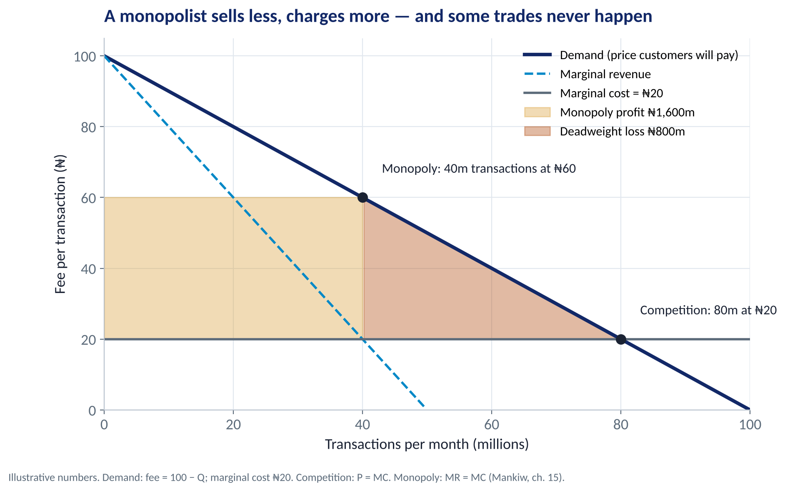{.fig-img fig-alt="S04-F03 (Python)"}

## R
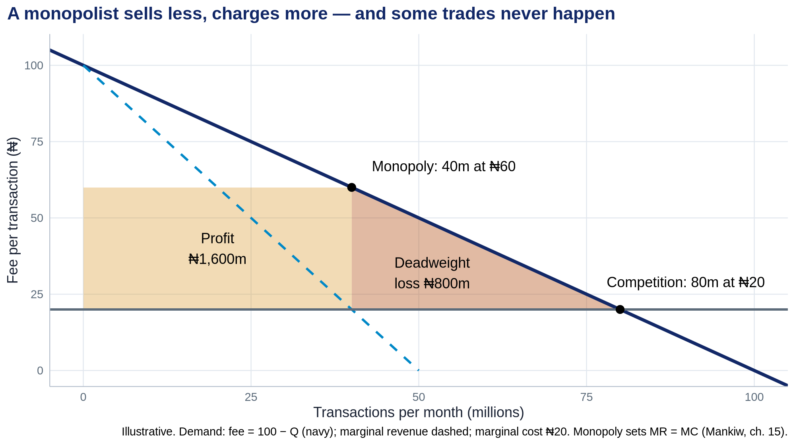{.fig-img fig-alt="S04-F03 (R)"}

:::

- Under competition the fee falls to cost: **₦20**, and **80m** transactions take place.
- A monopolist picks the output where **marginal revenue = marginal cost**: **40m** transactions at **₦60**.
- Gold: **₦1.6bn** of profit, taken from customers.
- Red: **₦0.8bn** of trades that never happen — the **deadweight loss**. That, not the profit, is society's loss.

<span class="fig-id">S04-F03 · replicate with s04_figures.py / .R</span>

::: {.callout-note collapse="true" appearance="minimal" icon=false}
## Sources and data notes

Mankiw ch. 15, 'The Welfare Cost of Monopoly'. The profit is a transfer from consumers to the owner; the deadweight-loss triangle is value that nobody gets. Numbers are illustrative (fee = 100 − Q, marginal cost ₦20); amounts in ₦ million per month.
:::

### Why a Monopolist Stops at 40 Million <span class='tag tag-illus'>illustrative</span>

<span class="slide-kicker">THE MONOPOLIST'S ARITHMETIC</span>

| Transactions (m) | Fee (₦) | Revenue (₦m) | Cost at ₦20 (₦m) | Profit (₦m) |
|---|---|---|---|---|
| 30 | 70 | 2,100 | 600 | 1,500 |
| 40 | 60 | 2,400 | 800 | 1,600 |
| 50 | 50 | 2,500 | 1,000 | 1,500 |
| 80 | 20 | 1,600 | 1,600 | 0 |
| **Best: 40m at ₦60** |  |  |  | **1,600** |

**Step by step**

1. To sell more, the monopolist must cut the fee on **every** transaction, not just the extra ones.
2. So **marginal revenue** falls twice as fast as the fee: MR = 100 − 2Q.
3. Profit peaks where **MR = MC**: 100 − 2Q = 20 → **Q = 40m**, fee **₦60**.
4. Markup rule: (P − MC) ÷ P = 1 ÷ |elasticity|. Here (60 − 20) ÷ 60 = **0.67**, because demand elasticity at that point is **1.5**.

::: {.result-box}
Market power = the ability to price **above marginal cost**. The **less elastic** the demand, the bigger the markup.
:::

### Six Barriers That Keep Rivals Out

<span class="slide-kicker">WHERE MARKET POWER COMES FROM</span>

::: {.grid}
::: {.g-col-12 .g-col-md-4 .obj-card}
**Economies of scale**

Huge fixed costs — towers, kilns, grids — mean only a few firms can cover them.
:::
::: {.g-col-12 .g-col-md-4 .obj-card}
**Licences and regulation**

Spectrum, banking and payment licences limit who may enter.
:::
::: {.g-col-12 .g-col-md-4 .obj-card}
**Control of a key input**

Fibre routes, distribution networks, pipelines, retail shelf space.
:::
::: {.g-col-12 .g-col-md-4 .obj-card}
**Network effects**

The product is worth more when more people use it: WhatsApp, M-Pesa, a POS network.
:::
::: {.g-col-12 .g-col-md-4 .obj-card}
**Switching costs**

Porting a number, retraining staff, moving data and payment history all cost time and money.
:::
::: {.g-col-12 .g-col-md-4 .obj-card}
**Data**

More transactions → better fraud and credit models → more customers → more data.
:::
:::

::: {.callout-tip appearance="simple"}
The first three are old barriers. The last three **power platforms** — and they reinforce each other.
:::

### Why Rivals Are Tempted to Cut Prices — and to Collude <span class='tag tag-illus'>illustrative</span>

<span class="slide-kicker">OLIGOPOLY AS A GAME</span>

| Monthly profit | Firm B keeps prices high | Firm B cuts prices |
|---|---|---|
| Firm A keeps prices high | A ₦50bn · B ₦50bn | A ₦20bn · B ₦70bn |
| Firm A cuts prices | A ₦70bn · B ₦20bn | A ₦30bn · B ₦30bn  ← equilibrium |

::: {.callout-tip appearance="simple"}
Whatever B does, A earns more by cutting (₦70bn > ₦50bn; ₦30bn > ₦20bn) — and the same holds for B. Both end at **₦30bn** when **₦50bn** each was possible: a **prisoners' dilemma**. The pull towards an agreement to keep prices high is why competition law bans **price-fixing**.
:::

::: {.callout-note collapse="true" appearance="minimal" icon=false}
## Sources and data notes

Mankiw ch. 16: the prisoners' dilemma and Nash equilibrium. Illustrative payoffs. In repeated games firms can sustain high prices without talking (tacit collusion), which is why regulators watch price signals in concentrated markets. Nigeria's FCCPA 2018 prohibits agreements among competitors that fix prices or share markets.
:::

### From The Readings

> People of the same trade seldom meet together, even for merriment and diversion, but the conversation ends in a conspiracy against the public, or in some contrivance to raise prices.
>
> — Adam Smith, The Wealth of Nations (1776) — quoted by Mankiw, ch. 16

- **Why cartels form.** Few sellers, similar products and frequent contact make agreement easy — and joint profit is higher.
- **Why they break.** Each member gains by secretly undercutting: the prisoners' dilemma at work.
- **What the law does.** Competition law treats price-fixing and market-sharing as among the most serious offences.

### The HHI: One Number for How Concentrated a Market Is

<span class="slide-kicker">MEASURING CONCENTRATION</span>

Square each firm's market share (in %), then add them up. Ten equal firms give **1,000**; five give **2,000**; a monopoly gives **10,000**.

::: {.formula}
HHI = s₁² + s₂² + … + sₙ²
:::

**Example.** Nigeria's mobile market, Dec 2023: 38.8² + 27.6² + 27.5² + 6.2² ≈ **3,056**.

::: {.callout-tip appearance="minimal"}
**Why a manager cares.** Regulators use it to screen mergers. Under the US 2023 Merger Guidelines, a merger that leaves the HHI above **1,800** and raises it by more than **100** is presumed to harm competition.
:::

### Highly Concentrated — and More So Since 2024

<span class="slide-kicker">NIGERIA'S MOBILE MARKET</span>

::: {.panel-tabset group="lang"}
## Python
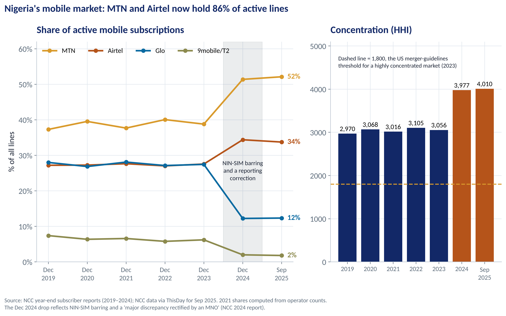{.fig-img fig-alt="S04-F01 (Python)"}

## R
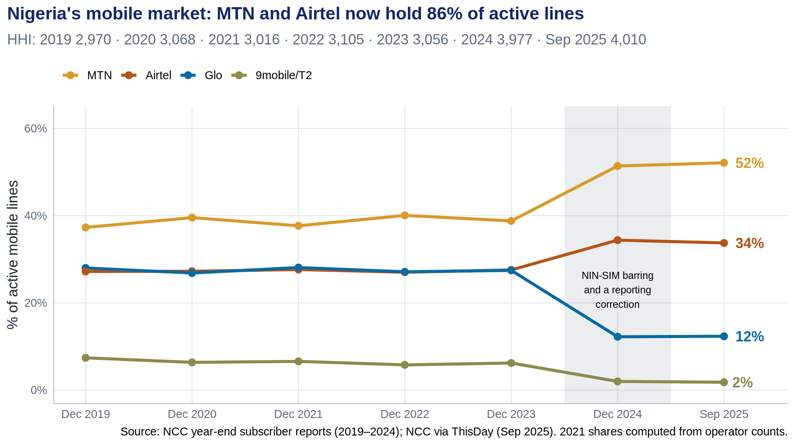{.fig-img fig-alt="S04-F01 (R)"}

:::

- From 2019 to 2023 MTN held **37–40%** of active lines; the HHI stayed around **3,000** — already highly concentrated.
- In 2024 the HHI jumped to **~4,000**, yet MTN **lost** 2.4m lines. Glo's count fell by **41.5m** after NIN-SIM barring and a data correction.
- A share can rise while customers fall: always check the **counts** behind a share — Session 1's lesson.
- Today MTN and Airtel together hold **86%** of active lines.

<span class="fig-id">S04-F01 · replicate with s04_figures.py / .R</span>

### Would a Regulator Let These Telecoms Merge? (Hypothetical)

<span class="slide-kicker">A MERGER SCREEN</span>

| Hypothetical merger | Merged share | HHI after | Change | Presumed harmful? |
|---|---|---|---|---|
| Airtel + Glo | 46.1% | 4,843 | +833 | Yes |
| MTN + T2 | 53.9% | 4,198 | +188 | Yes |
| Glo + T2 | 14.1% | 4,055 | +44 | No |

**Step by step**

1. Start from Sep 2025 shares: MTN **52.1%**, Airtel **33.7%**, Glo **12.3%**, T2 **1.8%**. HHI = **4,010**.
2. A merger of A and B raises the HHI by **2 × sA × sB**. Airtel + Glo: 2 × 33.7 × 12.3 ≈ **833**.
3. Screen: HHI after above 1,800 **and** a rise of more than 100 → presumed harmful.
4. Glo + T2 passes. Two weak rivals combining might even **strengthen** competition against the leaders.

::: {.result-box}
The HHI is a **screen, not a verdict**: efficiencies, entry and the strength of the merged firm also count.
:::

### Check your understanding

**In 2024 MTN's share of Nigerian mobile lines rose from 39% to 51%, yet MTN had 2.4 million fewer lines. What is the best explanation?**

- **A.** MTN won customers from rivals with better service
- **B.** Rivals — Glo above all — lost far more lines, through NIN-SIM barring and a reporting correction
- **C.** The HHI formula exaggerates the share of large firms
- **D.** MTN bought a competitor during 2024

::: {.callout-tip collapse="true" appearance="simple"}
## Show answer
B. A share is a ratio: if the total shrinks faster than your own count, your share rises. Glo's reported lines fell by 41.5m and 9mobile's by 10.7m. Concentration really did rise, but not because MTN won customers.
:::

## Part 2 · Platforms: Why Winners Take Most

::: {.part-question}
**The question this part answers:** What makes a platform market different from a market for cement?
:::

### A Platform Serves Two Groups Who Need Each Other

<span class="slide-kicker">TWO-SIDED MARKETS</span>

A **platform** creates value by connecting two groups — payers and merchants, riders and drivers, borrowers and lenders. Each side values the platform more when the **other side** is bigger.

::: {.formula}
more payers → more merchants → more payers
:::

**Example.** Nigerian payment apps often keep transfers cheap or free for users, and earn from merchant fees, float and lending.

::: {.callout-tip appearance="minimal"}
**Why a manager cares.** A price below cost on one side can be **rational**, not predatory — so judge the platform's prices **on both sides together**.
:::

### Four Forces Behind Platform Power

<span class="slide-kicker">WHY PLATFORMS GROW — AND STICK</span>

::: {.grid}
::: {.g-col-12 .g-col-md-6 .obj-card}
**Direct network effects**

More users make the product better for every user: WhatsApp, Facebook, a phone network.
:::
::: {.g-col-12 .g-col-md-6 .obj-card}
**Cross-side (indirect) network effects**

More payers attract merchants; more merchants attract payers. POS networks and ride-hailing grow this way.
:::
::: {.g-col-12 .g-col-md-6 .obj-card}
**Data network effects**

More transactions train better fraud and credit models: Ant's credit scoring rested on this.
:::
::: {.g-col-12 .g-col-md-6 .obj-card}
**Switching costs vs multi-homing**

Lock-in keeps users; but if users can cheaply carry **two apps**, no platform can lock them in.
:::
:::

::: {.callout-tip appearance="simple"}
**Multi-homing** is the antidote to tipping. Many Nigerians keep several payment apps — that limits any one app's power.
:::

### With Strong Network Effects, the Early Leader Can Win — Even Against a Better Rival <span class='tag tag-illus'>illustrative</span>

<span class="slide-kicker">TIPPING</span>

::: {.panel-tabset group="lang"}
## Python
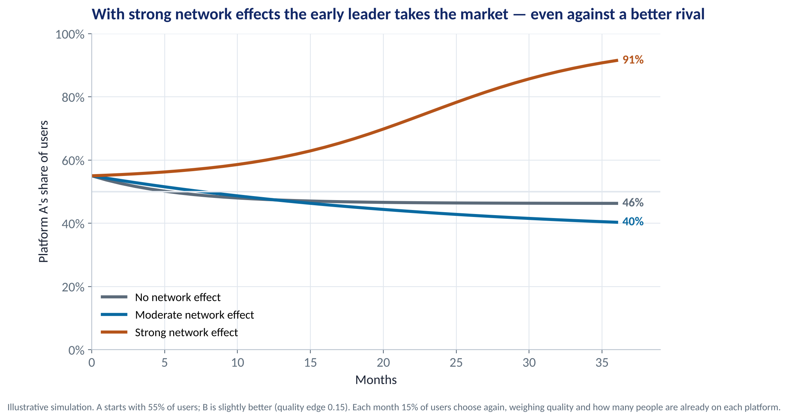{.fig-img fig-alt="S04-F04 (Python)"}

## R
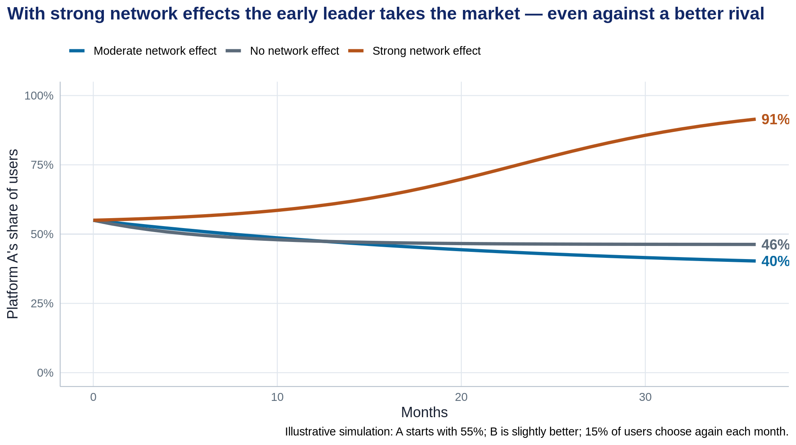{.fig-img fig-alt="S04-F04 (R)"}

:::

- Platform A starts with **55%** of users; platform B is slightly **better**.
- **No network effect**: users drift to the better product; A ends at **46%**.
- **Strong network effect**: A's head start snowballs to **91%**. The market **tips**.
- Lesson: early scale can beat quality — which is why platforms burn cash to grow, and why regulators act **before** a market tips.

<span class="fig-id">S04-F04 · replicate with s04_figures.py / .R</span>

### How a Payments App Became a Financial Empire

<span class="slide-kicker">THE ANT FLYWHEEL</span>

::: {.lead-box}
**From the case.** Payments brought Ant the **users and the data**. The data built **credit, investment and insurance** businesses that earned far more than payments.
:::

- **Payments: the hook.** Alipay had **711 million** monthly users and handled **¥118 trillion** of payments in China in the year to June 2020.
- **Data: the moat.** Each payment adds to a profile: spending, repayment, merchants. Ant used it to score borrowers that banks could not assess.
- **Credit: the profit engine.** **¥1.7 trillion** of consumer loans and **¥0.4 trillion** to small firms (June 2020): **39%** of first-half revenue. About **98%** of loans were funded by banks or sold to investors.
- **The regulator's worry.** Bank-like risks with little of Ant's own capital at stake — and a dominant app steering users to its own products.

*Figures: Ant Group IPO prospectus (Aug 2020), as reported by Reuters, TechNode and ABS-CBN.*

### Why Free Transfers Can Be the Profitable Choice <span class='tag tag-illus'>illustrative</span>

<span class="slide-kicker">TWO-SIDED PRICING, WORKED</span>

| Per month | Charge payers ₦20 a transfer | Free transfers for payers |
|---|---|---|
| Active payers | 1.0m | 2.0m |
| Merchants (they follow the payers) | 40,000 | 70,000 |
| Revenue from payers (10 transfers each) | ₦200m | ₦0 |
| Revenue from merchants (₦10,000 each) | ₦400m | ₦700m |
| Cost of transfers (₦5 each) | −₦50m | −₦100m |
| **Profit** | **₦550m** | **₦600m** |

**Step by step**

1. Payers are **price-sensitive**; merchants care about **how many payers** they can reach.
2. Making transfers free **doubles** payers, and merchants follow: 40,000 → 70,000.
3. Revenue moves to the side that values the other side more — here, the merchants.
4. Losing money on one side can **maximise total profit**. Test 'predatory pricing' claims on the whole platform.

::: {.result-box}
A platform prices **the whole network**, not each side on its own.
:::

### Instant Transfers Grew 13-Fold in Naira — 2.8-Fold in Dollars

<span class="slide-kicker">NIGERIA'S PAYMENT RAILS</span>

::: {.panel-tabset group="lang"}
## Python
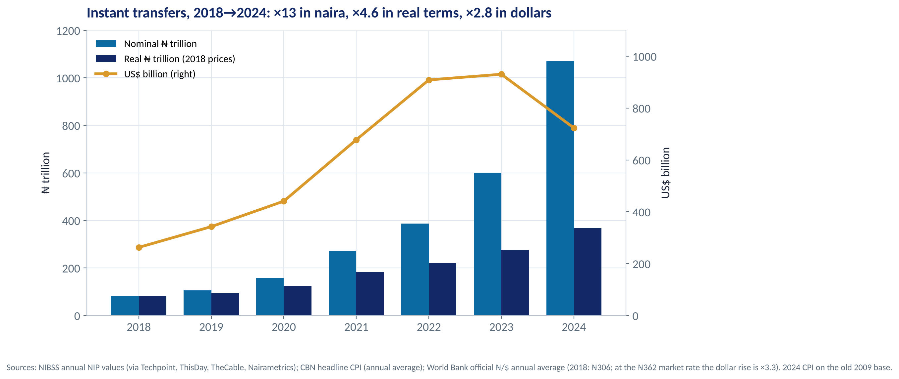{.fig-img fig-alt="S04-F05 (Python)"}

## R
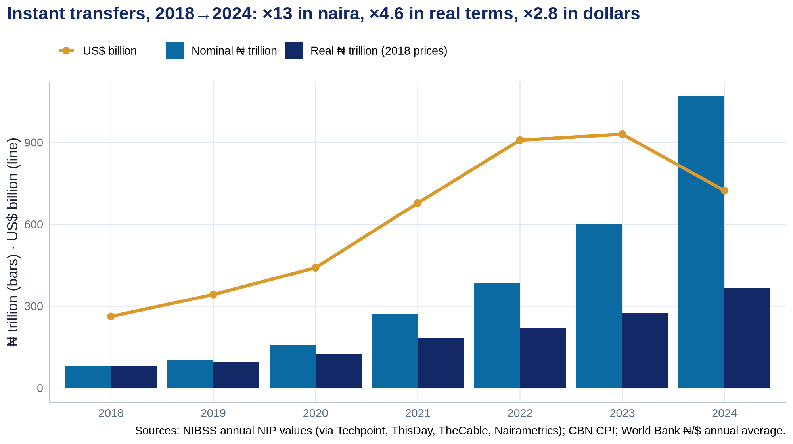{.fig-img fig-alt="S04-F05 (R)"}

:::

- NIBSS instant payments rose from **₦80 trillion** (2018) to **₦1.07 quadrillion** (2024).
- Deflated by inflation: **×4.6** — still a huge real increase.
- In dollars: **×2.8**, and **down** since 2023 as the naira fell.
- NIBSS links every bank and fintech, so customers can pay anyone from any app: **interoperability** limits lock-in.

<span class="fig-id">S04-F05 · replicate with s04_figures.py / .R</span>

::: {.callout-note collapse="true" appearance="minimal" icon=false}
## Sources and data notes

NIP values (₦ trillion), from NIBSS as reported: 2018 80.4 and 2019 105.2 (Techpoint, 23 Jan 2020); 2020 158.21 and 2021 271.95 (ThisDay, 26 Jan 2022); 2022 387.07 and 2023 600.36 (TheCable, Feb 2024); 2024 ≈ 1,070 (Nairametrics, 29 Jan 2025). Real values deflate by the annual-average headline CPI inflation from the CBN (2024 on the old 2009 base). Dollars use the World Bank's official annual-average rate (₦306/\$ in 2018; ₦1,479/\$ in 2024).
:::

### Mobile Money: Kenya Tipped Early; Nigeria Is Catching Up Fast

<span class="slide-kicker">INCLUSION</span>

::: {.panel-tabset group="lang"}
## Python
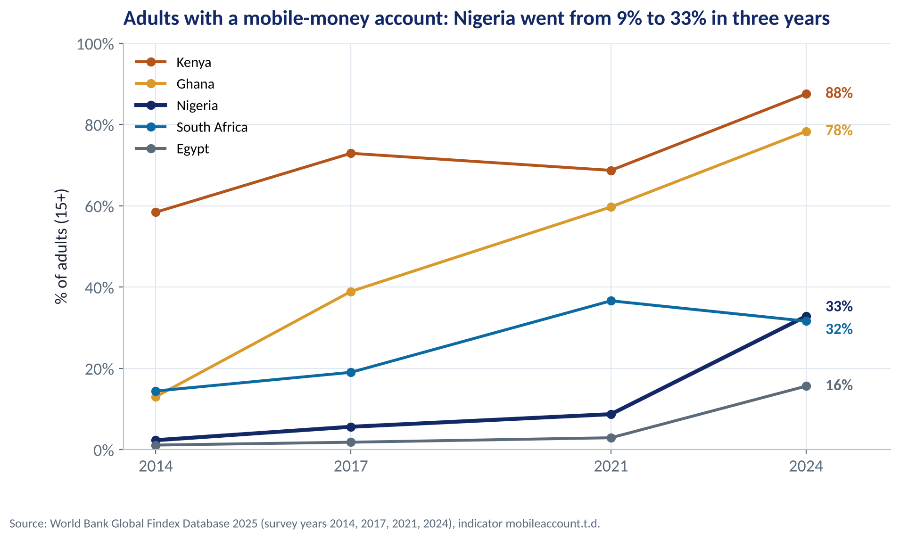{.fig-img fig-alt="S04-F06 (Python)"}

## R
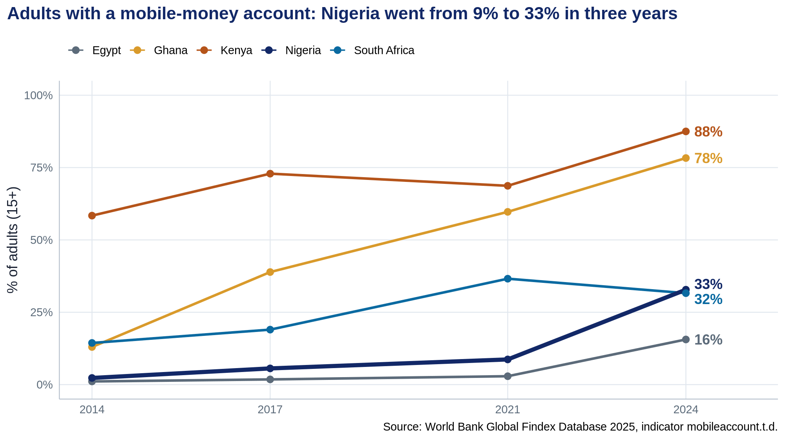{.fig-img fig-alt="S04-F06 (R)"}

:::

- Kenya: **88%** of adults have mobile money, and one platform — M-Pesa — holds about **90%** of accounts.
- Nigeria: from **9%** of adults (2021) to **33%** (2024), with many competing apps and banks.
- Dominance and inclusion can **coexist**; so can competition and inclusion.
- The question is not 'how big?' but '**what does the leader do with its position?**'

<span class="fig-id">S04-F06 · replicate with s04_figures.py / .R</span>

::: {.callout-note collapse="true" appearance="minimal" icon=false}
## Sources and data notes

World Bank Global Findex Database 2025 (survey years 2014, 2017, 2021, 2024), indicator mobileaccount.t.d: Nigeria 2.3, 5.6, 8.7, 32.8; Kenya 58.4, 72.9, 68.7, 87.5. M-Pesa share of mobile-money subscriptions: 89.7% in Sep 2025 (Communications Authority of Kenya, via The Star, 10 Dec 2025); 89.0% for Safaricom at Dec 2025 (CA Sector Statistics Report Q2 FY2025/26).
:::

### Kenya's Dominant Platform vs Nigeria's Crowded Field

<span class="slide-kicker">TWO ROUTES TO INCLUSION</span>

::: {.grid}
::: {.g-col-12 .g-col-md-6 .obj-card}
**Kenya: M-Pesa**

*One platform, about 90% of mobile-money accounts*

- Launched in 2007 by the leading mobile operator, Safaricom
- Network effects and a dense agent network gave near-universal reach
- Transfers to rival wallets only from **2018**, after regulators pushed
- Concern: pricing power and slow openness
:::
::: {.g-col-12 .g-col-md-6 .obj-card}
**Nigeria: banks plus many fintechs**

*Shared rails, many competing apps*

- NIBSS instant payments connect every bank and fintech
- OPay, Moniepoint, PalmPay, Kuda and the banks fight for the same customers
- Mobile-money accounts: **9% → 33%** of adults (2021–2024)
- Concern: fraud and weak KYC — the CBN paused onboarding at five fintechs in April–June 2024
:::
:::

::: {.callout-tip appearance="simple"}
Neither route is free. **Dominance** brought scale but needed regulators to force openness; **competition** brought speed but needed rules on fraud and identity.
:::

### Check your understanding

**A new payments app makes transfers free for users and charges merchants 1%. A rival calls this predatory pricing. What is the best first response?**

- **A.** Agree: any price below cost is predatory
- **B.** Check whether the platform as a whole prices below cost, and whether it could later recoup losses by excluding rivals
- **C.** Disagree: platforms can never price predatorily
- **D.** Ask the regulator to cap merchant fees

::: {.callout-tip collapse="true" appearance="simple"}
## Show answer
B. In two-sided markets a below-cost price on one side is often efficient. Predation needs below-cost pricing for the platform as a whole and a realistic chance to recoup by excluding rivals.
:::

## Part 3 · Competition Policy — and Strategy

::: {.part-question}
**The question this part answers:** When should regulators step in — and how should managers compete with, against or as a platform?
:::

### Four Questions Before Calling a Platform a Problem

<span class="slide-kicker">THE REGULATOR'S CHECKLIST</span>

::: {.lead-box}
**Big is not illegal.** Competition law punishes the **abuse** of market power and mergers that **lessen competition** — not size or success.
:::

- **What is the market?** Who are the real substitutes? 'Mobile wallets' only — or all payments, including bank transfers and cash?
- **Is there dominance?** A large, lasting share; barriers to entry; customers who cannot easily switch.
- **Is there abuse?** Exclusivity, tying, favouring your own products, exploiting users' data, cutting rivals off from something they need.
- **What are the effects?** Higher prices, worse quality, less innovation, fewer choices — weighed against real efficiencies.

*Nigeria: the Federal Competition and Consumer Protection Act 2018, enforced by the FCCPC; sector regulators (NCC, CBN) also act.*

### Six Platform Cases and What They Teach

<span class="slide-kicker">THE CASES</span>

| Case | When | The problem | Outcome | Lesson |
|---|---|---|---|---|
| NCC on MTN (Nigeria) | 2013 | 44% of mobile voice; calls within MTN far cheaper than calls to rivals | Declared dominant; tariff review; cap on the on-net/off-net gap | Price gaps that punish calling rivals strengthen network effects |
| SAMR v Alibaba (China) | 2021 | Merchants forced to 'choose one of two' platforms | ¥18bn fine (~4% of 2019 revenue) | Exclusivity is a classic abuse |
| Regulators v Ant (China) | 2020–23 | Bank-like lending risk on a payments platform | IPO halted; restructured; ¥7.1bn fine (2023) | Same activity, same rules |
| FCCPC v Meta (Nigeria) | 2024–25 | Sharing users' data without consent; Nigerians treated worse than other users | \$220m fine; upheld by the Tribunal (Apr 2025) | Data practices can be competition and consumer issues |
| US v Google | 2024–25 | ~89% of search, protected by default deals worth >\$26bn (2021) | Ruled a monopolist; exclusive defaults banned; some data sharing; no Chrome sale | Defaults matter; remedies are hard |
| EU v Apple and Meta | 2025 | Blocking cheaper offers outside the App Store; 'pay or consent' ads | €500m and €200m fines (Digital Markets Act) | Rules set in advance for 'gatekeepers' |

::: {.callout-note collapse="true" appearance="minimal" icon=false}
## Sources and data notes

Sources: NCC determination (2013) via Technology Times; Al Jazeera (10 Apr 2021) for Alibaba; AP via Click2Houston (7 Jul 2023): People's Bank of China fined Ant ¥7.123bn (\$985m) for breaches of corporate governance, consumer protection, payments and anti-money-laundering rules; FCCPC press release on the Tribunal judgment (25 Apr 2025); NPR (5 Aug 2024; 2 Sep 2025) for Google; NBC News and the European Commission (23 Apr 2025) for the DMA fines. Whether Meta has paid the FCCPC fine was unclear as of September 2025 (Techpoint).
:::

### Platform Markets Are Among the Most Concentrated Anywhere

<span class="slide-kicker">HOW CONCENTRATED?</span>

::: {.panel-tabset group="lang"}
## Python
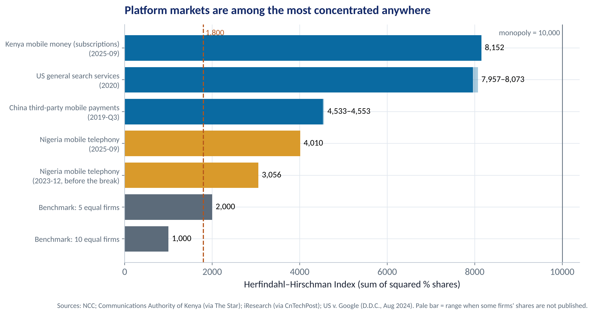{.fig-img fig-alt="S04-F02 (Python)"}

## R
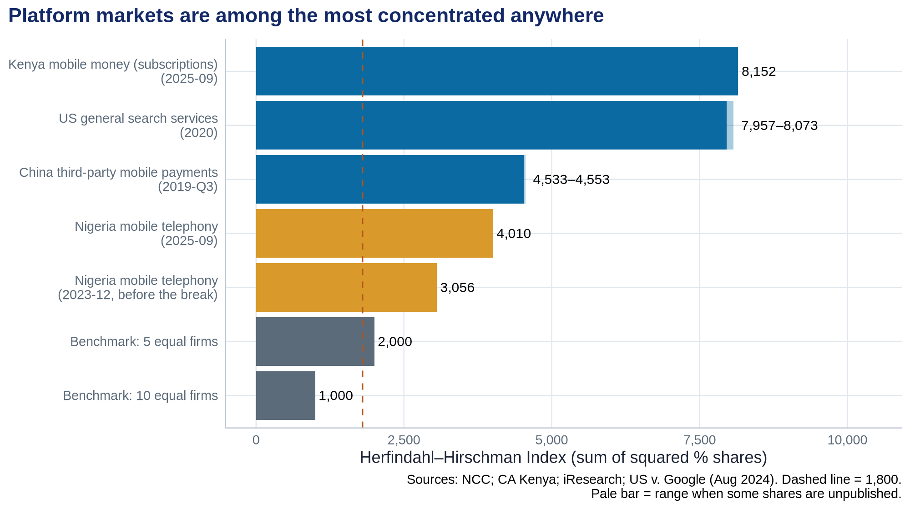{.fig-img fig-alt="S04-F02 (R)"}

:::

- Kenya mobile money: **8,152**. US search: **≈ 8,000**. China mobile payments (2019): **≈ 4,500**. Nigerian mobile: **4,010**.
- All far above the **1,800** line used to screen mergers.
- Because platform markets tip, high HHIs are common. The real test is **conduct and contestability**.
- Even when some shares are unpublished (pale bars), the largest firms pin the HHI down.

<span class="fig-id">S04-F02 · replicate with s04_figures.py / .R</span>

### Is Big Tech's Size Itself the Problem?

<span class="slide-kicker">THE BIG DEBATE</span>

::: {.grid}
::: {.g-col-12 .g-col-md-6 .obj-card}
**Consumer-welfare view**

*Judge by prices, output and quality*

- Many platform services are free or cheaper than before
- Scale lowers costs; network effects benefit users
- Act only on proven harm to consumers
- Risk: missing harm that shows up as less innovation or less privacy
:::
::: {.g-col-12 .g-col-md-6 .obj-card}
**Structural view**

*Lina Khan (2017): look at power and structure*

- 'Free' hides the price: data, attention, lock-in
- Platforms that host rivals have conflicts of interest
- Act early, before markets tip
- Risk: punishing success and blocking efficient scale
:::
:::

::: {.callout-tip appearance="simple"}
Nigeria's FCCPA aims both to protect **consumers** and to keep markets **competitive**. Know both arguments — your regulator may use either.
:::

### Competing With, Against and As a Platform

<span class="slide-kicker">THE MANAGER'S PLAYBOOK</span>

::: {.grid}
::: {.g-col-12 .g-col-md-4 .obj-card}
**If you ARE the platform**

Avoid exclusivity and self-favouring. Keep data use consented and documented. Build interoperability before it is imposed.
:::
::: {.g-col-12 .g-col-md-4 .obj-card}
**If you COMPETE with one**

Be the second app users keep (multi-homing). Win a niche the leader ignores. Push for interoperability and portability.
:::
::: {.g-col-12 .g-col-md-4 .obj-card}
**If you DEPEND on one**

Diversify channels so no app owns your customers. Keep your own customer data. Watch fee and ranking changes.
:::
:::

::: {.callout-tip appearance="simple"}
Ant's lesson: grow fast, but **price in regulation** — in finance, scale brings bank-like rules.
:::

### Check your understanding

**A dominant ride-hailing app offers drivers a 10% bonus if they work only on its app. Which competition concern is most direct?**

- **A.** Predatory pricing
- **B.** Exclusive dealing that makes it harder for rivals to sign up drivers
- **C.** Price discrimination between riders
- **D.** Collusion between apps

::: {.callout-tip collapse="true" appearance="simple"}
## Show answer
B. Like Alibaba's 'choose one of two', exclusivity stops multi-homing and starves rivals of the other side of their network. Whether it is illegal depends on dominance and its effects.
:::

## Lab 4: Is the Market Too Concentrated?

*Time:* 20 minutes · *Data:* [`data/official/ng_mobile_market_shares.csv`](../../data/official/ng_mobile_market_shares.csv), [`data/official/platform_concentration.csv`](../../data/official/platform_concentration.csv), [`data/official/ng_nip_value.csv`](../../data/official/ng_nip_value.csv)

1. Compute **CR2 and the HHI** for Nigeria's mobile market, 2019–2025.
2. Check the **counts** behind 2024's jump: who lost lines?
3. Screen three hypothetical telecom **mergers** against the 1,800 / +100 test.
4. Solve the **monopoly fee**, deadweight loss and markup for a payments app.
5. Measure instant-payment growth in **naira, real terms and dollars**.

::: {.callout-important appearance="simple"}
**Deliverable:** a one-page memo to the FCCPC: is Nigeria's mobile (or mobile-payments) market a competition problem? Which evidence matters most, and what remedy — if any — would you propose?
:::

## The code (R | Python)

Pick your language once; every tab on the site follows your choice. Download a script, or copy it into RStudio and run it line by line.

### Replicate every chart

::: {.panel-tabset group="lang"}
## Python
[<i class="bi bi-download"></i> s04_figures.py](../../sessions/s04/python/s04_figures.py){download=""}

::: {.callout-note collapse="true" appearance="simple" icon=false}
## Show the full script (149 lines)

```{.python filename="sessions/s04/python/s04_figures.py"}
# =============================================================================
# EEGB · Session 4 · Market Structure, Platforms & Competition Policy
# Replication script — regenerates every chart in the Session 4 deck (Python)
# Data (real, with the source on every row):
#   data/official/ng_mobile_market_shares.csv  — NCC year-end operator subscriptions and shares
#   data/official/ng_nip_value.csv             — NIBSS Instant Payment (NIP) value by year
#   data/official/platform_concentration.csv   — market shares in four platform markets
#   data/official/findex_accounts.csv          — World Bank Global Findex (refresh: tools/fetch_official_data.py)
#   data/official/ng_official_monthly.csv, ng_worldbank_annual.csv — CPI and ₦/$ (Session 1 files)
# F03 and F04 are ILLUSTRATIVE models, not data.
# Run from the project root:  python sessions/s04/python/s04_figures.py
# =============================================================================
import sys; sys.path.insert(0, "python")
import numpy as np, pandas as pd
import matplotlib.pyplot as plt
from matplotlib.ticker import FuncFormatter
from eegb_style import *

set_style()
OPS = ["MTN", "Airtel", "Glo", "9mobile"]; COL = {"MTN": GOLD, "Airtel": RUST, "Glo": TEAL, "9mobile": OLIVE}

# ---- NCC shares: use published shares; where only counts are published, compute them --------------
ms = pd.read_csv("data/official/ng_mobile_market_shares.csv")
tot = ms.groupby("period").subscriptions_m.transform("sum")
ms["share"] = ms.share_pct.fillna(100 * ms.subscriptions_m / tot)
sh = ms.pivot(index="period", columns="operator", values="share")[OPS]
hhi = (sh ** 2).sum(axis=1)
print("HHI by period:\n", hhi.round(0))

# --- F01 · Nigeria's mobile market: shares and the HHI --------------------------------------
fig, (ax, ax2) = plt.subplots(1, 2, figsize=(11.5, 6.6), gridspec_kw={"width_ratios": [1.5, 1]})
x = np.arange(len(sh)); lab = [p.replace("-12", "\nDec").replace("2025-09", "2025\nSep") for p in sh.index]
lab = [f"{l.split(chr(10))[1]} {l.split(chr(10))[0]}" if "\n" in l else l for l in lab]
for op in OPS:
    ax.plot(x, sh[op], "-o", color=COL[op], lw=2.6, label=op)
    ax.text(x[-1] + .15, sh[op].iloc[-1], f"{sh[op].iloc[-1]:.0f}%", color=COL[op], va="center", fontsize=12, fontweight="bold")
ax.axvspan(4.5, 5.5, color=SLATE, alpha=.12)
ax.text(5, 23, "NIN-SIM barring\nand a reporting\ncorrection", ha="center", fontsize=10, color=INK)
ax.set_xticks(x, [l.replace(" ", "\n") for l in lab], fontsize=11); ax.set_ylim(0, 62); ax.yaxis.set_major_formatter(FuncFormatter(pct))
ax.set(title="Share of active mobile subscriptions", ylabel="% of all lines"); ax.legend(loc="upper left", ncol=4, fontsize=11)
ax2.bar(x, hhi, color=[NAVY] * 5 + [RUST, RUST])
for xi, v in zip(x, hhi): ax2.text(xi, v + 60, f"{v:,.0f}", ha="center", fontsize=11)
ax2.axhline(1800, color=GOLD, ls="--", lw=1.6); ax2.text(-.4, 4500, "Dashed line = 1,800, the US merger-guidelines\nthreshold for a highly concentrated market (2023)", fontsize=9.5, color=INK)
ax2.set_xticks(x, [l.split(" ")[1] if l.startswith("Dec") else "Sep\n2025" for l in lab], fontsize=10.5); ax2.set_ylim(0, 5100)
ax2.set(title="Concentration (HHI)")
fig.suptitle("Nigeria's mobile market: MTN and Airtel now hold 86% of active lines", x=0.01, ha="left", fontsize=16, fontweight="bold", color=NAVY)
fig.tight_layout()
note(fig, "Source: NCC year-end subscriber reports (2019–2024); NCC data via ThisDay for Sep 2025. 2021 shares computed from operator counts.\n"
          "The Dec 2024 drop reflects NIN-SIM barring and a 'major discrepancy rectified by an MNO' (NCC 2024 report).")
save(fig, "s04", "f01")

# --- F02 · How concentrated are platform markets? (HHI from published shares) ----------------
pc = pd.read_csv("data/official/platform_concentration.csv")
rows = []
for mkt, g in pc.groupby("market", sort=False):
    known = (g.share_pct ** 2).sum(); rest = max(0, 100 - g.share_pct.sum())
    rows.append((f"{mkt}\n({g.period.iloc[0]})", known, known + rest ** 2))   # lower and upper bound
rows += [("Nigeria mobile telephony\n(2023-12, before the break)", hhi["2023-12"], hhi["2023-12"]),
         ("Benchmark: 10 equal firms", 1000, 1000), ("Benchmark: 5 equal firms", 2000, 2000)]
d = pd.DataFrame(rows, columns=["market", "lo", "hi"]).sort_values("lo")
fig, ax = plt.subplots(figsize=(11, 5.8))
c = [SLATE if "Benchmark" in m else (GOLD if "Nigeria" in m else TEAL) for m in d.market]
ax.barh(d.market, d.lo, color=c)
ax.barh(d.market, d.hi - d.lo, left=d.lo, color=c, alpha=.35)
for i, (lo, hi) in enumerate(zip(d.lo, d.hi)):
    ax.text(hi + 80, i, f"{lo:,.0f}" + (f"–{hi:,.0f}" if hi - lo > 5 else ""), va="center", fontsize=11.5)
ax.axvline(1800, color=RUST, ls="--", lw=1.5); ax.text(1850, len(d) - .6, "1,800", color=RUST, fontsize=11)
ax.axvline(10000, color=SLATE, lw=1); ax.text(9950, len(d) - .6, "monopoly = 10,000", ha="right", fontsize=10.5, color=SLATE)
ax.set_xlim(0, 10400); ax.tick_params(axis="y", labelsize=10.5)
ax.set(title="Platform markets are among the most concentrated anywhere", xlabel="Herfindahl–Hirschman Index (sum of squared % shares)")
note(fig, "Sources: NCC; Communications Authority of Kenya (via The Star); iResearch (via CnTechPost); US v. Google (D.D.C., Aug 2024). "
          "Pale bar = range when some firms' shares are not published.")
save(fig, "s04", "f02")

# --- F03 · Monopoly vs competition (ILLUSTRATIVE, Mankiw ch. 15) -------------------------------
a, b, mc = 100, 1, 20                       # demand P = 100 − Q ; constant marginal cost ₦20
Qc, Pc = (a - mc) / b, mc                   # competition: P = MC
Qm = (a - mc) / (2 * b); Pm = a - b * Qm    # monopoly: MR = a − 2bQ = MC
q = np.linspace(0, 100, 200)
fig, ax = plt.subplots(figsize=(10, 5.8))
ax.plot(q, a - b * q, color=NAVY, lw=3, label="Demand (price customers will pay)")
ax.plot(q[q <= 50], a - 2 * b * q[q <= 50], color=TEAL2, lw=2, ls="--", label="Marginal revenue")
ax.axhline(mc, color=SLATE, lw=2, label="Marginal cost = ₦20")
ax.fill_between([0, Qm], mc, Pm, color=GOLD, alpha=.35, label=f"Monopoly profit ₦{(Pm - mc) * Qm:,.0f}m")
ax.fill_between(q[(q >= Qm) & (q <= Qc)], mc, (a - b * q)[(q >= Qm) & (q <= Qc)], color=RUST, alpha=.4,
                label=f"Deadweight loss ₦{0.5 * (Pm - mc) * (Qc - Qm):,.0f}m")
for (qq, pp, t) in [(Qm, Pm, f"Monopoly: {Qm:.0f}m transactions at ₦{Pm:.0f}"), (Qc, Pc, f"Competition: {Qc:.0f}m at ₦{Pc:.0f}")]:
    ax.plot(qq, pp, "o", color=INK, ms=8); ax.annotate(t, (qq, pp), xytext=(qq + 3, pp + 7), fontsize=11.5, color=INK)
ax.set(xlim=(0, 100), ylim=(0, 105), xlabel="Transactions per month (millions)", ylabel="Fee per transaction (₦)",
       title="A monopolist sells less, charges more — and some trades never happen")
ax.legend(loc="upper right", fontsize=11)
note(fig, "Illustrative numbers. Demand: fee = 100 − Q; marginal cost ₦20. Competition: P = MC. Monopoly: MR = MC (Mankiw, ch. 15).")
save(fig, "s04", "f03")

# --- F04 · Network effects and tipping (ILLUSTRATIVE simulation) -------------------------------
def simulate(beta, quality_b=0.15, s0=0.55, T=36, churn=0.15):
    s = [s0]
    for _ in range(T):
        pa = 1 / (1 + np.exp(-(beta * (2 * s[-1] - 1) - quality_b)))   # chance a new or switching user picks A
        s.append((1 - churn) * s[-1] + churn * pa)
    return np.array(s) * 100
fig, ax = plt.subplots(figsize=(10, 5.6))
for beta, c, l in [(0.0, SLATE, "No network effect"), (1.5, TEAL, "Moderate network effect"), (4.0, RUST, "Strong network effect")]:
    path = simulate(beta); ax.plot(path, color=c, lw=3, label=l)
    ax.text(36.4, path[-1], f"{path[-1]:.0f}%", color=c, va="center", fontsize=12, fontweight="bold")
ax.axhline(50, color=GRID, lw=1.5)
ax.set(title="With strong network effects the early leader takes the market — even against a better rival",
       xlabel="Months", ylabel="Platform A's share of users", ylim=(0, 100), xlim=(0, 39))
ax.yaxis.set_major_formatter(FuncFormatter(pct)); ax.legend(loc="lower left", fontsize=11.5)
note(fig, "Illustrative simulation. A starts with 55% of users; B is slightly better (quality edge 0.15). Each month 15% of users choose again, "
          "weighing quality and how many people are already on each platform.")
save(fig, "s04", "f04")
print("F04 end shares:", [round(simulate(bb)[-1], 1) for bb in (0, 1.5, 4)])

# --- F05 · Nigeria's instant payments: nominal, real and in dollars ------------------------------
nip = pd.read_csv("data/official/ng_nip_value.csv").set_index("year")
m = pd.read_csv("data/official/ng_official_monthly.csv", parse_dates=["date"]).set_index("date")
infl = m.cpi_headline_yoy.groupby(m.index.year).mean()
price = (1 + infl.loc[2019:2024] / 100).cumprod(); price.loc[2018] = 1.0; price = price.sort_index()
fx = pd.read_csv("data/official/ng_worldbank_annual.csv").set_index("year").ngn_usd_avg
nip["real_2018_ntn"] = nip.nip_value_ntn / price
nip["usd_bn"] = nip.nip_value_ntn * 1e12 / fx.loc[nip.index] / 1e9
fig, ax = plt.subplots(figsize=(10.5, 5.6))
w = .38; xx = np.arange(len(nip))
ax.bar(xx - w / 2, nip.nip_value_ntn, w, color=TEAL, label="Nominal ₦ trillion")
ax.bar(xx + w / 2, nip.real_2018_ntn, w, color=NAVY, label="Real ₦ trillion (2018 prices)")
ax2 = ax.twinx(); ax2.plot(xx, nip.usd_bn, "-o", color=GOLD, lw=3, label="US$ billion (right)"); ax2.grid(False)
ax2.spines["right"].set_visible(True); ax2.set_ylim(0, 1100); ax2.set_ylabel("US$ billion")
g_nom = nip.nip_value_ntn[2024] / nip.nip_value_ntn[2018]; g_real = nip.real_2018_ntn[2024] / nip.real_2018_ntn[2018]; g_usd = nip.usd_bn[2024] / nip.usd_bn[2018]
ax.set_xticks(xx, nip.index); ax.set_ylabel("₦ trillion"); ax.set_ylim(0, 1200)
h1, l1 = ax.get_legend_handles_labels(); h2, l2 = ax2.get_legend_handles_labels(); ax.legend(h1 + h2, l1 + l2, loc="upper left", fontsize=11)
ax.set_title(f"Instant transfers, 2018→2024: ×{g_nom:.0f} in naira, ×{g_real:.1f} in real terms, ×{g_usd:.1f} in dollars")
note(fig, "Sources: NIBSS annual NIP values (via Techpoint, ThisDay, TheCable, Nairametrics); CBN headline CPI (annual average); "
          "World Bank official ₦/$ annual average. 2024 CPI on the old 2009 base.")
save(fig, "s04", "f05")
print(nip.round(1)); print(f"F05 growth: nominal x{g_nom:.2f}, real x{g_real:.2f}, usd x{g_usd:.2f}")

# --- F06 · Mobile money: Kenya tipped early; Nigeria is catching up ----------------------------------
fxd = pd.read_csv("data/official/findex_accounts.csv").dropna(subset=["mobile_money_pct"])
fig, ax = plt.subplots(figsize=(10.5, 5.6))
for ctry, c in [("Kenya", RUST), ("Ghana", GOLD), ("Nigeria", NAVY), ("South Africa", TEAL), ("Egypt, Arab Rep.", SLATE)]:
    g = fxd[fxd.country == ctry].sort_values("year")
    ax.plot(g.year, g.mobile_money_pct, "-o", color=c, lw=3 if ctry == "Nigeria" else 2.2, label=ctry.replace(", Arab Rep.", ""))
    ax.text(2024.3, g.mobile_money_pct.iloc[-1] + {"Nigeria": 2.2, "South Africa": -2.2}.get(ctry, 0), f"{g.mobile_money_pct.iloc[-1]:.0f}%", color=c, va="center", fontsize=12, fontweight="bold")
ax.set(title="Adults with a mobile-money account: Nigeria went from 9% to 33% in three years",
       ylabel="% of adults (15+)", ylim=(0, 100), xlim=(2013.5, 2025.3))
ax.set_xticks([2014, 2017, 2021, 2024]); ax.yaxis.set_major_formatter(FuncFormatter(pct)); ax.legend(loc="upper left", fontsize=11)
note(fig, "Source: World Bank Global Findex Database 2025 (survey years 2014, 2017, 2021, 2024), indicator mobileaccount.t.d.")
save(fig, "s04", "f06")
```
:::

## R
[<i class="bi bi-download"></i> s04_figures.R](../../sessions/s04/R/s04_figures.R){download=""}

::: {.callout-note collapse="true" appearance="simple" icon=false}
## Show the full script (116 lines)

```{.r filename="sessions/s04/R/s04_figures.R"}
# =============================================================================
# EEGB · Session 4 · Market Structure, Platforms & Competition Policy
# Replication script — regenerates every chart in the Session 4 deck (R)
# Data (real, with the source on every row): data/official/ng_mobile_market_shares.csv (NCC),
#   ng_nip_value.csv (NIBSS), platform_concentration.csv, findex_accounts.csv (World Bank Findex),
#   ng_official_monthly.csv and ng_worldbank_annual.csv (CPI and ₦/$).
# F03 and F04 are ILLUSTRATIVE models, not data.   Run from the project root (open eegb.Rproj).
# =============================================================================
source("R/theme_eegb.R")
suppressPackageStartupMessages({ library(dplyr); library(readr); library(tidyr) })
ops <- c("MTN", "Airtel", "Glo", "9mobile")
opcol <- c(MTN = eegb[["gold"]], Airtel = eegb[["rust"]], Glo = eegb[["teal"]], `9mobile` = eegb[["olive"]])

# ---- NCC shares: published shares, or computed from counts where only counts are published -------
ms <- read_csv("data/official/ng_mobile_market_shares.csv", show_col_types = FALSE) |>
  group_by(period) |> mutate(share = coalesce(share_pct, 100 * subscriptions_m / sum(subscriptions_m))) |> ungroup() |>
  mutate(operator = factor(operator, levels = ops),
         lab = ifelse(period == "2025-09", "Sep 2025", paste("Dec", substr(period, 1, 4))))
lv <- unique(ms$lab); ms$lab <- factor(ms$lab, levels = lv); ms$x <- as.integer(ms$lab)
hhi <- ms |> group_by(lab) |> summarise(hhi = sum(share^2))
print(hhi)

# --- F01 · Nigeria's mobile market: shares (and the HHI in the title) -------------------------------
p1 <- ggplot(ms, aes(x, share, colour = operator, group = operator)) +
  annotate("rect", xmin = 5.5, xmax = 6.5, ymin = -Inf, ymax = Inf, fill = eegb[["slate"]], alpha = .12) +
  annotate("text", x = 6, y = 23, label = "NIN-SIM barring\nand a reporting\ncorrection", size = 3.2) +
  geom_line(linewidth = 1.3) + geom_point(size = 2.6) +
  geom_text(data = filter(ms, period == "2025-09"), aes(label = sprintf("%.0f%%", share)), hjust = -0.4, fontface = "bold", show.legend = FALSE) +
  scale_colour_manual(values = opcol, name = NULL) + scale_y_continuous(labels = \(x) paste0(x, "%"), limits = c(0, 62)) +
  scale_x_continuous(breaks = seq_along(lv), labels = lv, expand = expansion(add = c(0.3, 0.6))) +
  labs(title = "Nigeria's mobile market: MTN and Airtel now hold 86% of active lines",
       subtitle = paste0("HHI: ", paste(sprintf("%s %s", sub("Dec ", "", hhi$lab), format(round(hhi$hhi), big.mark = ",")), collapse = " · ")),
       x = NULL, y = "% of active mobile lines",
       caption = "Source: NCC year-end subscriber reports (2019–2024); NCC via ThisDay (Sep 2025). 2021 shares computed from operator counts.") +
  theme_eegb()
save_fig(p1, "s04", "f01")

# --- F02 · HHI in platform markets ----------------------------------------------------------------
pc <- read_csv("data/official/platform_concentration.csv", show_col_types = FALSE)
h2 <- pc |> group_by(market, period) |> summarise(lo = sum(share_pct^2), rest = pmax(0, 100 - sum(share_pct)), .groups = "drop") |>
  mutate(hi = lo + rest^2, market = paste0(market, "\n(", period, ")")) |>
  bind_rows(tibble(market = c("Nigeria mobile telephony\n(2023-12, before the break)", "Benchmark: 10 equal firms", "Benchmark: 5 equal firms"),
                   lo = c(hhi$hhi[hhi$lab == "Dec 2023"], 1000, 2000), hi = c(hhi$hhi[hhi$lab == "Dec 2023"], 1000, 2000))) |>
  mutate(kind = ifelse(grepl("Benchmark", market), "b", ifelse(grepl("Nigeria", market), "n", "p")),
         market = reorder(market, lo), lab = ifelse(hi - lo > 5, sprintf("%s–%s", format(round(lo), big.mark = ","), format(round(hi), big.mark = ",")), format(round(lo), big.mark = ",")))
p2 <- ggplot(h2, aes(y = market)) + geom_col(aes(x = hi, fill = kind), alpha = .35) + geom_col(aes(x = lo, fill = kind)) +
  geom_text(aes(x = hi, label = lab), hjust = -0.1, size = 3.8) + geom_vline(xintercept = 1800, colour = eegb[["rust"]], linetype = 2) +
  scale_fill_manual(values = c(b = eegb[["slate"]], n = eegb[["gold"]], p = eegb[["teal"]]), guide = "none") +
  scale_x_continuous(limits = c(0, 10400), labels = comma) +
  labs(title = "Platform markets are among the most concentrated anywhere", x = "Herfindahl–Hirschman Index (sum of squared % shares)", y = NULL,
       caption = "Sources: NCC; CA Kenya; iResearch; US v. Google (Aug 2024). Dashed line = 1,800.\nPale bar = range when some shares are unpublished.") +
  theme_eegb()
save_fig(p2, "s04", "f02")

# --- F03 · Monopoly vs competition (ILLUSTRATIVE) ----------------------------------------------------
a <- 100; mc <- 20; Qc <- a - mc; Qm <- (a - mc) / 2; Pm <- a - Qm
p3 <- ggplot() +
  annotate("rect", xmin = 0, xmax = Qm, ymin = mc, ymax = Pm, fill = eegb[["gold"]], alpha = .35) +
  annotate("polygon", x = c(Qm, Qc, Qm), y = c(Pm, mc, mc), fill = eegb[["rust"]], alpha = .4) +
  geom_abline(intercept = a, slope = -1, colour = eegb[["navy"]], linewidth = 1.4) +
  annotate("segment", x = 0, xend = 50, y = 100, yend = 0, colour = eegb[["teal2"]], linetype = 2, linewidth = 1) +
  geom_hline(yintercept = mc, colour = eegb[["slate"]], linewidth = 1) +
  annotate("point", x = c(Qm, Qc), y = c(Pm, mc), size = 3) +
  annotate("text", x = c(Qm + 3, Qc - 2), y = c(Pm + 7, mc + 9), hjust = c(0, 0),
           label = c(sprintf("Monopoly: %.0fm at ₦%.0f", Qm, Pm), sprintf("Competition: %.0fm at ₦%.0f", Qc, mc))) +
  annotate("text", x = 20, y = 40, label = sprintf("Profit\n₦%sm", format((Pm - mc) * Qm, big.mark = ","))) +
  annotate("text", x = 52, y = 32, label = sprintf("Deadweight\nloss ₦%sm", 0.5 * (Pm - mc) * (Qc - Qm))) +
  coord_cartesian(xlim = c(0, 100), ylim = c(0, 105)) +
  labs(title = "A monopolist sells less, charges more — and some trades never happen", x = "Transactions per month (millions)", y = "Fee per transaction (₦)",
       caption = "Illustrative. Demand: fee = 100 − Q (navy); marginal revenue dashed; marginal cost ₦20. Monopoly sets MR = MC (Mankiw, ch. 15).") + theme_eegb()
save_fig(p3, "s04", "f03")

# --- F04 · Network effects and tipping (ILLUSTRATIVE) ------------------------------------------------
simulate <- function(beta, qb = 0.15, s0 = 0.55, T = 36, churn = 0.15) {
  s <- s0; for (t in 1:T) { pa <- 1 / (1 + exp(-(beta * (2 * s[t] - 1) - qb))); s <- c(s, (1 - churn) * s[t] + churn * pa) }; 100 * s }
sims <- bind_rows(lapply(list(c(0, "No network effect"), c(1.5, "Moderate network effect"), c(4, "Strong network effect")),
  \(z) tibble(month = 0:36, share = simulate(as.numeric(z[1])), case = z[2])))
p4 <- ggplot(sims, aes(month, share, colour = case)) + geom_hline(yintercept = 50, colour = eegb[["grid"]]) + geom_line(linewidth = 1.4) +
  geom_text(data = filter(sims, month == 36), aes(label = sprintf("%.0f%%", share)), hjust = -0.2, fontface = "bold", show.legend = FALSE) +
  scale_colour_manual(values = c(`No network effect` = eegb[["slate"]], `Moderate network effect` = eegb[["teal"]], `Strong network effect` = eegb[["rust"]]), name = NULL) +
  scale_y_continuous(labels = \(x) paste0(x, "%"), limits = c(0, 100)) +
  labs(title = "With strong network effects the early leader takes the market — even against a better rival",
       x = "Months", y = "Platform A's share of users",
       caption = "Illustrative simulation: A starts with 55%; B is slightly better; 15% of users choose again each month.") + theme_eegb()
save_fig(p4, "s04", "f04")

# --- F05 · Instant payments: nominal, real, dollars -------------------------------------------------------
nip <- read_csv("data/official/ng_nip_value.csv", show_col_types = FALSE)
infl <- read_csv("data/official/ng_official_monthly.csv", show_col_types = FALSE) |> mutate(year = as.integer(format(date, "%Y"))) |>
  group_by(year) |> summarise(infl = mean(cpi_headline_yoy, na.rm = TRUE))
fx <- read_csv("data/official/ng_worldbank_annual.csv", show_col_types = FALSE) |> select(year, ngn_usd_avg)
nip <- nip |> left_join(infl, by = "year") |> left_join(fx, by = "year") |>
  mutate(price = cumprod(ifelse(year == 2018, 1, 1 + infl / 100)), real = nip_value_ntn / price, usd_bn = nip_value_ntn * 1e3 / ngn_usd_avg)
g <- with(nip, c(nom = nip_value_ntn[7] / nip_value_ntn[1], real = real[7] / real[1], usd = usd_bn[7] / usd_bn[1])); print(round(g, 2))
long <- nip |> select(year, `Nominal ₦ trillion` = nip_value_ntn, `Real ₦ trillion (2018 prices)` = real) |> pivot_longer(-year)
p5 <- ggplot() + geom_col(data = long, aes(factor(year), value, fill = name), position = "dodge") +
  geom_line(data = nip, aes(factor(year), usd_bn, group = 1, colour = "US$ billion"), linewidth = 1.4) +
  geom_point(data = nip, aes(factor(year), usd_bn, colour = "US$ billion"), size = 2.5) +
  scale_fill_manual(values = c(eegb[["teal"]], eegb[["navy"]]), name = NULL) + scale_colour_manual(values = eegb[["gold"]], name = NULL) +
  labs(title = sprintf("Instant transfers, 2018→2024: ×%.0f in naira, ×%.1f in real terms, ×%.1f in dollars", g[1], g[2], g[3]),
       x = NULL, y = "₦ trillion (bars) · US$ billion (line)",
       caption = "Sources: NIBSS annual NIP values (via Techpoint, ThisDay, TheCable, Nairametrics); CBN CPI; World Bank ₦/$ annual average.") + theme_eegb()
save_fig(p5, "s04", "f05")

# --- F06 · Mobile-money accounts (Findex) ---------------------------------------------------------------------
fxd <- read_csv("data/official/findex_accounts.csv", show_col_types = FALSE) |> filter(!is.na(mobile_money_pct), country != "China") |>
  mutate(country = sub(", Arab Rep.", "", country))
p6 <- ggplot(fxd, aes(year, mobile_money_pct, colour = country)) + geom_line(aes(linewidth = country == "Nigeria")) + geom_point(size = 2.5) +
  geom_text(data = filter(fxd, year == 2024), aes(label = sprintf("%.0f%%", mobile_money_pct)), hjust = -0.3, fontface = "bold",
            nudge_y = c(Egypt = 0, Ghana = 0, Kenya = 0, Nigeria = 2, `South Africa` = -2)[filter(fxd, year == 2024)$country], show.legend = FALSE) +
  scale_linewidth_manual(values = c(`TRUE` = 1.8, `FALSE` = 1.1), guide = "none") +
  scale_colour_manual(values = c(Kenya = eegb[["rust"]], Ghana = eegb[["gold"]], Nigeria = eegb[["navy"]], `South Africa` = eegb[["teal"]], Egypt = eegb[["slate"]]), name = NULL) +
  scale_x_continuous(breaks = c(2014, 2017, 2021, 2024), limits = c(2014, 2025)) + scale_y_continuous(labels = \(x) paste0(x, "%"), limits = c(0, 100)) +
  labs(title = "Adults with a mobile-money account: Nigeria went from 9% to 33% in three years", x = NULL, y = "% of adults (15+)",
       caption = "Source: World Bank Global Findex Database 2025, indicator mobileaccount.t.d.") + theme_eegb()
save_fig(p6, "s04", "f06")
```
:::

:::

### Lab

::: {.panel-tabset group="lang"}
## Python
[<i class="bi bi-download"></i> s04_lab.py](../../sessions/s04/python/s04_lab.py){download=""}

::: {.callout-note collapse="true" appearance="simple" icon=false}
## Show the full script (66 lines)

```{.python filename="sessions/s04/python/s04_lab.py"}
# =============================================================================
# EEGB · Session 4 LAB · Is the market too concentrated? (Python)
# Data (real): data/official/ng_mobile_market_shares.csv (NCC), platform_concentration.csv,
#              ng_nip_value.csv (NIBSS). Step 4 is an illustrative pricing model.
# Run from the project root, line by line (Ctrl/Cmd + Enter in RStudio or VS Code)
# =============================================================================
import pandas as pd
pd.set_option("display.width", 160); pd.set_option("display.max_columns", 10)

# ---- STEP 1 · Market shares and concentration, 2019–2025 ---------------------------------------
ms = pd.read_csv("data/official/ng_mobile_market_shares.csv")
print(ms[["period", "operator", "subscriptions_m", "share_pct"]].head(8))
tot = ms.groupby("period").subscriptions_m.transform("sum")
ms["share"] = ms.share_pct.fillna(100 * ms.subscriptions_m / tot)       # 2021: only counts are published
sh = ms.pivot(index="period", columns="operator", values="share")[["MTN", "Airtel", "Glo", "9mobile"]]
conc = pd.DataFrame({"CR2": sh.apply(lambda r: r.nlargest(2).sum(), axis=1),   # top-two share
                     "HHI": (sh ** 2).sum(axis=1)})                            # sum of squared % shares
print(conc.round(0))

# ---- STEP 2 · Did MTN really grow from 39% to 51% in 2024? Look at the counts ----------------------
cnt = ms.pivot(index="period", columns="operator", values="subscriptions_m")[["MTN", "Airtel", "Glo", "9mobile"]]
print((cnt.loc["2024-12"] - cnt.loc["2023-12"]).round(1))   # change in millions of lines, Dec 2023 → Dec 2024

# ---- STEP 3 · Merger screen: what would a merger do to the HHI? ---------------------------------------
def merger_screen(shares, a, b):
    post = shares.copy(); post[a] = shares[a] + shares[b]; post = post.drop(b)
    hhi0, hhi1 = (shares ** 2).sum(), (post ** 2).sum()
    flag = (hhi1 > 1800 and hhi1 - hhi0 > 100) or (post[a] > 30 and hhi1 - hhi0 > 100)
    return pd.Series({"HHI before": hhi0, "HHI after": hhi1, "change": hhi1 - hhi0,
                      "merged share %": post[a], "presumed harmful (US 2023 test)": flag})
latest = sh.loc["2025-09"]
print(pd.DataFrame({f"{a} + {b}": merger_screen(latest, a, b)
                    for a, b in [("Airtel", "Glo"), ("Glo", "9mobile"), ("MTN", "9mobile")]}).T)
# Note: change in HHI = 2 × share_a × share_b  (check it!)

# ---- STEP 4 · Monopoly pricing (illustrative): fee = 100 − Q, marginal cost ₦20 ------------------------
a, b, mc = 100, 1, 20
Qc, Pc = (a - mc) / b, mc                              # competition: price = marginal cost
Qm = (a - mc) / (2 * b); Pm = a - b * Qm               # monopoly: marginal revenue (a − 2bQ) = marginal cost
dwl = 0.5 * (Pm - mc) * (Qc - Qm)
elast = (1 / b) * Pm / Qm                              # |price elasticity| at the monopoly point
print(f"Competition: Q={Qc:.0f}m, fee ₦{Pc:.0f} | Monopoly: Q={Qm:.0f}m, fee ₦{Pm:.0f} | DWL ₦{dwl:,.0f}m")
print(f"Lerner index (P − MC)/P = {(Pm - mc) / Pm:.2f}  vs  1/|elasticity| = {1 / elast:.2f}")

# ---- STEP 5 · Platform markets: how concentrated? ------------------------------------------------------------
pc = pd.read_csv("data/official/platform_concentration.csv")
for mkt, g in pc.groupby("market", sort=False):
    lo = (g.share_pct ** 2).sum(); rest = max(0, 100 - g.share_pct.sum())
    print(f"{mkt:38s} HHI between {lo:,.0f} and {lo + rest ** 2:,.0f}")

# ---- STEP 6 · Growth of instant payments: nominal vs real vs dollars -------------------------------------------
nip = pd.read_csv("data/official/ng_nip_value.csv").set_index("year")
m = pd.read_csv("data/official/ng_official_monthly.csv", parse_dates=["date"]).set_index("date")
infl = m.cpi_headline_yoy.groupby(m.index.year).mean().loc[2019:2024]
price = pd.concat([pd.Series({2018: 1.0}), (1 + infl / 100).cumprod()])
fx = pd.read_csv("data/official/ng_worldbank_annual.csv").set_index("year").ngn_usd_avg
nip["real_2018_prices"] = nip.nip_value_ntn / price
nip["usd_bn"] = nip.nip_value_ntn * 1e3 / fx.loc[nip.index]
print(nip.drop(columns="source").round(1))

# ---- YOUR TURN ------------------------------------------------------------------------------------------------------
# (a) Recompute the HHI for Dec 2023 by hand from the four shares. Is the market 'highly concentrated'?
# (b) In Step 2, MTN LOST lines in 2024 yet its share rose 12 points. Explain in two sentences.
# (c) Which merger in Step 3 would a regulator block? Which might pass? Why might 'Glo + 9mobile' still be good for customers?
# (d) If demand became MORE elastic (fee = 60 − 0.5Q), how would the monopoly fee change? Re-run Step 4.
# (e) Kenya's M-Pesa holds ~90% of mobile-money accounts, yet Kenya has near-universal inclusion. Is that market 'too concentrated'?
```
:::

## R
[<i class="bi bi-download"></i> s04_lab.R](../../sessions/s04/R/s04_lab.R){download=""}

::: {.callout-note collapse="true" appearance="simple" icon=false}
## Show the full script (58 lines)

```{.r filename="sessions/s04/R/s04_lab.R"}
# =============================================================================
# EEGB · Session 4 LAB · Is the market too concentrated? (R)
# Data (real): data/official/ng_mobile_market_shares.csv (NCC), platform_concentration.csv,
#              ng_nip_value.csv (NIBSS). Step 4 is an illustrative pricing model.
# Run from the project root (open eegb.Rproj), line by line with Ctrl/Cmd + Enter
# =============================================================================
suppressPackageStartupMessages({ library(dplyr); library(readr); library(tidyr) })

# ---- STEP 1 · Market shares and concentration, 2019–2025 ---------------------------------------
ms <- read_csv("data/official/ng_mobile_market_shares.csv", show_col_types = FALSE)
ms <- ms |> group_by(period) |>
  mutate(share = coalesce(share_pct, 100 * subscriptions_m / sum(subscriptions_m))) |> ungroup()   # 2021: counts only
conc <- ms |> group_by(period) |>
  summarise(CR2 = sum(sort(share, decreasing = TRUE)[1:2]), HHI = sum(share^2))
print(conc, n = Inf)

# ---- STEP 2 · Did MTN really grow from 39% to 51% in 2024? Look at the counts --------------------------
ms |> filter(period %in% c("2023-12", "2024-12")) |> select(period, operator, subscriptions_m) |>
  pivot_wider(names_from = period, values_from = subscriptions_m) |>
  mutate(change_m = `2024-12` - `2023-12`) |> print()

# ---- STEP 3 · Merger screen ------------------------------------------------------------------------------------
latest <- ms |> filter(period == "2025-09") |> select(operator, share) |> tibble::deframe()
merger_screen <- function(s, a, b) {
  post <- s; post[a] <- s[a] + s[b]; post <- post[names(post) != b]
  h0 <- sum(s^2); h1 <- sum(post^2); d <- h1 - h0
  tibble(merger = paste(a, "+", b), hhi_before = h0, hhi_after = h1, change = d, merged_share = post[[a]],
         presumed_harmful = (h1 > 1800 & d > 100) | (post[[a]] > 30 & d > 100))
}
bind_rows(merger_screen(latest, "Airtel", "Glo"), merger_screen(latest, "Glo", "9mobile"),
          merger_screen(latest, "MTN", "9mobile")) |> print()
# Note: change in HHI = 2 × share_a × share_b (check it!)

# ---- STEP 4 · Monopoly pricing (illustrative): fee = 100 − Q, marginal cost ₦20 -------------------------------------
a <- 100; b <- 1; mc <- 20
Qc <- (a - mc) / b; Qm <- (a - mc) / (2 * b); Pm <- a - b * Qm
dwl <- 0.5 * (Pm - mc) * (Qc - Qm); elast <- (1 / b) * Pm / Qm
cat(sprintf("Competition: Q=%.0fm, fee ₦%.0f | Monopoly: Q=%.0fm, fee ₦%.0f | DWL ₦%.0fm\n", Qc, mc, Qm, Pm, dwl))
cat(sprintf("Lerner index (P − MC)/P = %.2f vs 1/|elasticity| = %.2f\n", (Pm - mc) / Pm, 1 / elast))

# ---- STEP 5 · Platform markets: how concentrated? ------------------------------------------------------------------
read_csv("data/official/platform_concentration.csv", show_col_types = FALSE) |> group_by(market) |>
  summarise(hhi_low = sum(share_pct^2), hhi_high = hhi_low + pmax(0, 100 - sum(share_pct))^2) |> print()

# ---- STEP 6 · Instant payments: nominal vs real vs dollars -------------------------------------------------------------
infl <- read_csv("data/official/ng_official_monthly.csv", show_col_types = FALSE) |>
  mutate(year = as.integer(format(date, "%Y"))) |> group_by(year) |> summarise(infl = mean(cpi_headline_yoy, na.rm = TRUE))
fx <- read_csv("data/official/ng_worldbank_annual.csv", show_col_types = FALSE) |> select(year, ngn_usd_avg)
read_csv("data/official/ng_nip_value.csv", show_col_types = FALSE) |> left_join(infl, by = "year") |> left_join(fx, by = "year") |>
  mutate(price = cumprod(ifelse(year == 2018, 1, 1 + infl / 100)), real_2018_prices = nip_value_ntn / price,
         usd_bn = nip_value_ntn * 1e3 / ngn_usd_avg) |> select(year, nip_value_ntn, real_2018_prices, usd_bn) |> print()

# ---- YOUR TURN ------------------------------------------------------------------------------------------------------------
# (a) Recompute the HHI for Dec 2023 by hand from the four shares. Is the market 'highly concentrated'?
# (b) In Step 2, MTN LOST lines in 2024 yet its share rose 12 points. Explain in two sentences.
# (c) Which merger in Step 3 would a regulator block? Which might pass? Why might 'Glo + 9mobile' still be good for customers?
# (d) If demand became MORE elastic (fee = 60 − 0.5Q), how would the monopoly fee change? Re-run Step 4.
# (e) Kenya's M-Pesa holds ~90% of mobile-money accounts, yet Kenya has near-universal inclusion. Is that market 'too concentrated'?
```
:::

:::

## Key takeaways

1. Market power = pricing **above marginal cost**; it grows when demand is **inelastic** and entry is hard.
2. Measure concentration with **CR and the HHI** — and check the **counts and definitions** behind every share.
3. Platforms are **two-sided**: network effects, switching costs and data make markets **tip**; multi-homing and interoperability push back.
4. Competition law targets **abuse and harmful mergers**, not size: exclusivity, self-favouring, data exploitation.
5. Strategy: compete **with, against or as** a platform — and price in regulation.

::: {.callout-note appearance="simple"}
**Before next session:** Read 'Externalities: Justification for Public Goods?' (210-023-1) and 'A Framework to Think About Pollution' (UVA-GEM-0104). Think: who really paid for Nigeria's petrol subsidy?
:::

## Self-study: going deeper

Read these before the quiz. They are not presented in class.

### When Data Becomes a Barrier to Entry

<span class="slide-kicker">DATA AS MARKET POWER</span>

::: {.lead-box}
**Data network effects.** Data can be copied, but a platform's transaction history is **exclusive**: the firm with the most transactions trains the best fraud and credit models — which attract more transactions.
:::

- **Where the edge is largest.** In thin markets — credit for informal businesses, fraud in new payment channels — where one extra data point is worth most.
- **Open banking.** The CBN's open-banking framework (2021) and guidelines (2023) aim to let customers share their own data with rival providers.
- **Privacy law.** The Nigeria Data Protection Act 2023, enforced by the NDPC, governs consent and data sharing — the basis of part of the Meta case.
- **The remedy menu.** Data portability, interoperability, limits on combining data across services (as in the EU's DMA), consent rules.

*The remedy debate: share the data (with consent), or limit how it is combined.*

### Pricing Rules by Market Structure

<span class="slide-kicker">THE ECONOMICS IN ONE TABLE</span>

| Structure | Pricing rule | Long-run economic profit | Efficiency |
|---|---|---|---|
| Perfect competition | P = MC | Zero | Efficient: no deadweight loss |
| Monopolistic competition | MR = MC, so P > MC | Zero: entry competes it away | Small markup and spare capacity; buyers get variety |
| Oligopoly | Depends on how rivals react (game theory) | Can persist | Between competition and monopoly |
| Monopoly | MR = MC, so P > MC | Can persist | Deadweight loss |
| Platform | Prices on both sides set together; one side may pay below cost | Can persist if the market tips | Network benefits vs lock-in |

### Common Mistakes About Competition

| The trap | The better habit |
|---|---|
| 'They have a 50% share, so they are abusing dominance.' | Dominance is not abuse: look for **exclusionary or exploitative conduct** and its effects. |
| Quoting a market share without its definition. | Say what the market is: lines, revenue or active users? Which products? |
| Reading a jump in share as a change in customers. | Check the **counts** and reporting breaks (Nigeria, 2024). |
| Calling a below-cost price on one side 'predatory'. | Test the **whole platform's** pricing and the chance of recouping losses. |
| Assuming network effects make the leader unbeatable. | **Multi-homing**, interoperability and niche entry can unseat leaders. |
| Ignoring the regulator until the IPO. | Ant's lesson: treat **regulation as part of strategy**. |

## Vocabulary

| Term | Meaning |
|---|---|
| **Market power** | The ability to price above marginal cost without losing all customers. |
| **Deadweight loss** | Value lost because trades that are worth more than they cost do not happen. |
| **Lerner index** | (Price − marginal cost) ÷ price; equals 1 ÷ \|elasticity\| for a monopolist. |
| **HHI** | Sum of squared market shares (%): 0 to 10,000. |
| **Concentration ratio (CRn)** | Combined share of the n largest firms. |
| **Oligopoly** | A market with a few sellers who react to each other. |
| **Two-sided market** | A platform that serves two groups who value each other. |
| **Network effect** | A product becomes more valuable as more people use it. |
| **Switching cost** | The cost of moving from one supplier to another. |
| **Multi-homing** | Using two or more competing platforms at the same time. |
| **Tipping** | A platform market swinging to one dominant winner. |
| **Abuse of dominance** | Conduct by a dominant firm that excludes rivals or exploits customers. |

::: {.callout-note appearance="simple"}
**About the data.** Charts use real data (CBN, NBS, NCC, NIBSS, World Bank, FRED), with the source printed under each chart. Series from official APIs refresh with `tools/fetch_official_data.py`; hand-compiled files in `data/official/` give the source on every row. Items tagged *illustrative* use stylised teaching data or invented numbers built to teach a method.
:::

::: {.session-nav}
[← Session 3: Forecasting & Market Sizing](../../sessions/s03/index.qmd)
[Session 5: Market Failures →](../../sessions/s05/index.qmd){.next}
:::
