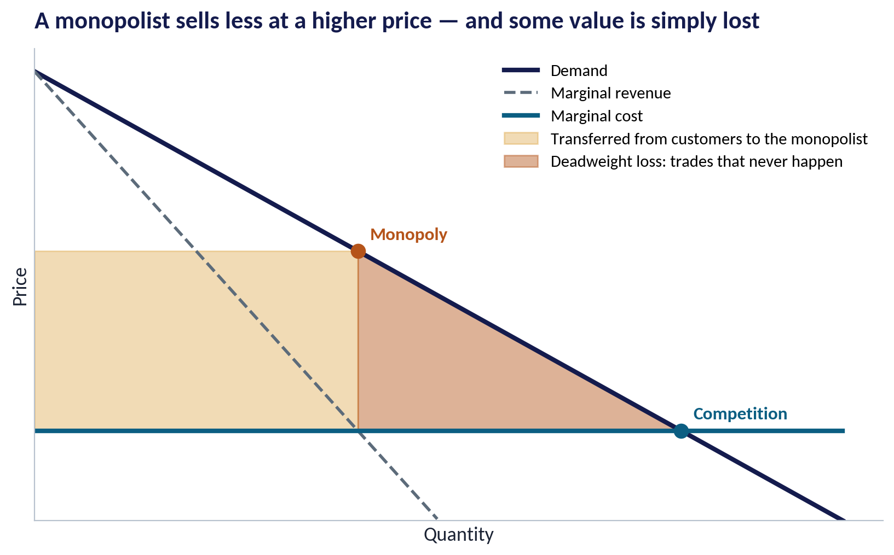
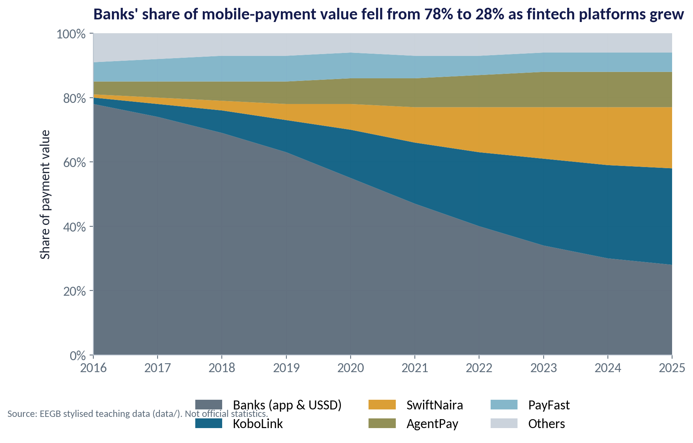
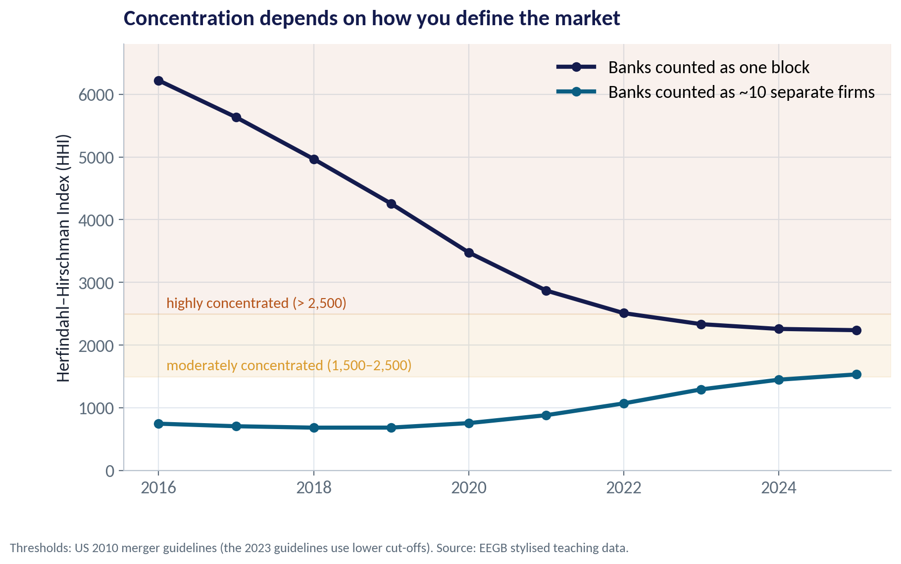
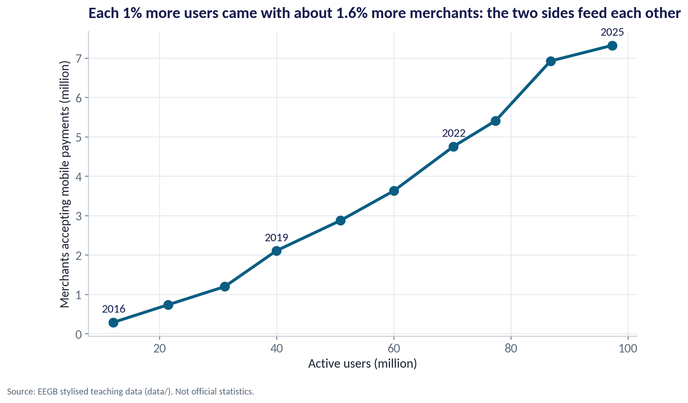
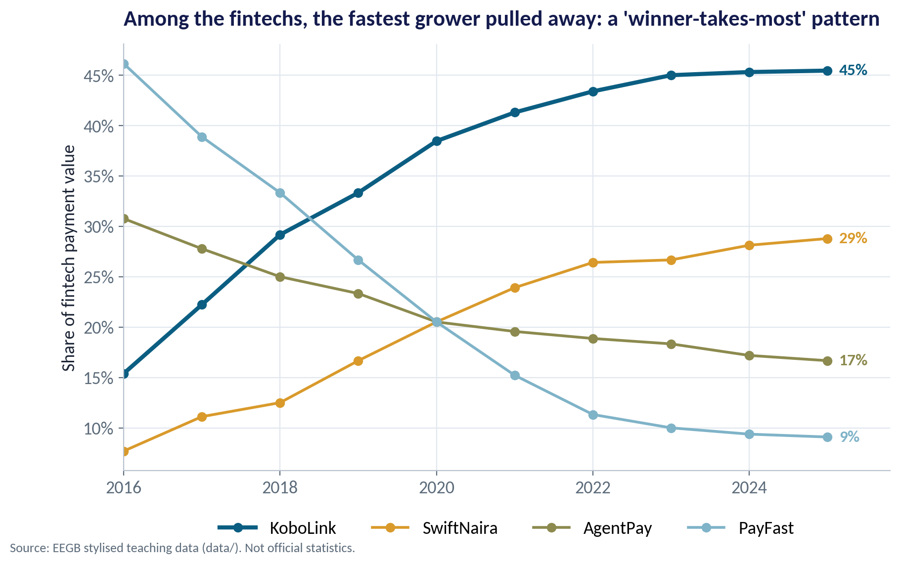
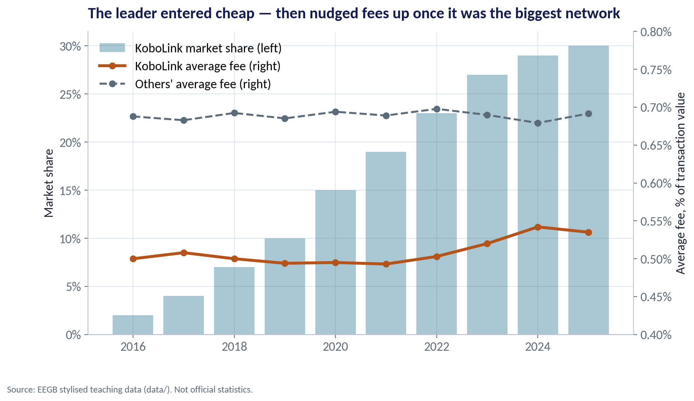

::: {.session-banner}
{.banner-hex width="96"}

**Session 4 of 16** · Facilitator: Kelechi Nnamdi<br>*Case:* Nigeria's mobile-payments market: is a dominant platform good for customers or a competition problem?

:::

## Downloads {.unnumbered}

::: {.download-row}
[<i class="bi bi-file-earmark-slides"></i> Teaching slides (.pptx)](../../sessions/s04/slides/EEGB_S04_Market_Structure_Platforms_Competition_Policy.pptx){.btn .btn-primary download=""}
[<i class="bi bi-file-earmark-pdf"></i> Slides (PDF)](../../sessions/s04/slides/EEGB_S04_Market_Structure_Platforms_Competition_Policy.pdf){.btn .btn-outline-primary download=""}
[<i class="bi bi-github"></i> Session folder on GitHub](https://github.com/adibongo/eegb/tree/main/sessions/s04){.btn .btn-outline-secondary}
:::

## Read first {.unnumbered}

- **Fintech and Finance Transformation: The Rise of Ant Financial Services** — Case, reference no. 917-0029-1

## Learning objectives

::: {.grid}
::: {.g-col-12 .g-col-md-4 .obj-card}
**Classify a Market**

Place an industry on the spectrum from perfect competition to monopoly, and say what that means for prices and profits.
:::
::: {.g-col-12 .g-col-md-4 .obj-card}
**Understand Platforms**

Explain two-sided markets, network effects, switching costs and data as sources of market power.
:::
::: {.g-col-12 .g-col-md-4 .obj-card}
**Think Like a Regulator**

Measure concentration (CR and HHI), and judge when a dominant firm or a merger becomes a competition problem.
:::
:::

## The business case

::: {.callout-note appearance="simple" icon=false}
## Nigeria's Mobile-Payments Market

**Situation.** Between 2016 and 2025, the share of payment value handled by banks' own apps and USSD fell from 78% to 28%. Fintech platforms — agents, POS terminals and apps — took the rest. One platform, 'KoboLink', now handles 30%.

**Question.** Is a dominant payments platform good for customers (scale, convenience, low cost) or a competition problem (lock-in, higher fees, blocked rivals)?

**Data.** payments_market_shares.csv — 10 years × 6 providers: share of payment value, active users, merchants and average fee. *Stylised; providers other than the banks are fictional.*

**A good answer.** A reasoned view for the regulator: how concentrated the market is, whether fees signal market power, and what — if anything — should be done.
:::

## Key ideas in plain English

### The Herfindahl–Hirschman Index (HHI)

The HHI adds up the squared market shares of every firm. Squaring gives big firms more weight. A pure monopoly scores 10,000; many tiny firms score close to 0.

::: {.formula}
HHI = s₁² + s₂² + … + sₙ²   (shares in %)
:::

*Example.* Four firms with 40%, 30%, 20%, 10%: 1,600 + 900 + 400 + 100 = 3,000 — highly concentrated.

::: {.callout-tip appearance="minimal"}
**Why a manager cares.** Competition authorities use the HHI to screen mergers. A merger's effect on the index is roughly 2 × s₁ × s₂ — two firms of 15% and 10% add 300 points.
:::

### A Platform Serves Two Groups at Once

A platform connects two groups who need each other: payers and merchants, riders and drivers, buyers and sellers. Each side values the platform more when the other side is bigger.

::: {.formula}
value to a user ↑ as merchants ↑   and   value to a merchant ↑ as users ↑
:::

*Example.* A trader accepts KoboLink because many customers pay with it; customers download it because many traders accept it.

::: {.callout-tip appearance="minimal"}
**Why a manager cares.** Platforms often subsidise one side (free app for users, free POS for agents) to win the other. Low prices today can be a strategy, not a gift.
:::

### When a Platform Becomes a Bank

Ant Financial (now Ant Group) grew from Alipay, a payments tool, into lending, wealth management and insurance for hundreds of millions of Chinese users — using payments data to score credit.

::: {.formula}
payments → data → credit → more payments
:::

*Example.* In 2020 Chinese regulators halted Ant's planned stock-market listing and required it to restructure under bank-style rules.

::: {.callout-tip appearance="minimal"}
**Why a manager cares.** Nigerian fintechs follow a similar path from payments to lending. The case asks: should a platform that behaves like a bank be regulated like a bank?
:::

## Charts and how to replicate them

Every chart below is regenerated by the session's figure script — `sessions/s04/R/s04_figures.R` or `sessions/s04/python/s04_figures.py`. Run it from the project root.

### What Market Power Costs Society

::: {.panel-tabset group="lang"}
## Python
{.fig-img fig-alt="S04-F06 (Python)"}

:::

- Under competition, price falls to the cost of the last unit, and output is high.
- A monopolist restricts output to push the price up.
- Gold area: value transferred from customers to the monopolist.
- Red area: deadweight loss — purchases worth more than they cost that simply never happen.

<span class="fig-id">S04-F06</span>

### From Banks to Platforms

::: {.panel-tabset group="lang"}
## Python
{.fig-img fig-alt="S04-F01 (Python)"}

:::

- In 2016 banks' apps and USSD handled 78% of mobile-payment value.
- By 2025: banks 28%, KoboLink 30%, SwiftNaira 19%, AgentPay 11%.
- Fintechs won by going where banks were weak: agents in markets, cheap POS, simple apps.
- The market became more competitive between banks and fintechs — and more concentrated among fintechs.

<span class="fig-id">S04-F01</span>

### Concentration Depends on How You Define the Market

::: {.panel-tabset group="lang"}
## Python
{.fig-img fig-alt="S04-F02 (Python)"}

:::

- Treat 'banks' as one block: HHI falls from 6,222 to 2,238 — the market looks ever more competitive.
- Treat them as ~10 separate banks: HHI rises from 746 to 1,532 — concentration is growing.
- Same data, opposite stories. Defining the market is the first and most contested step in any competition case.
- Ask: who do customers actually switch to when one provider raises its price?

<span class="fig-id">S04-F02</span>

### Users and Merchants Grew Together

::: {.panel-tabset group="lang"}
## Python
{.fig-img fig-alt="S04-F03 (Python)"}

:::

- Active users rose from 12 million to 97 million; merchants from 0.3 million to 7.3 million.
- Each 1% more users came with about 1.6% more merchants.
- The two sides reinforce each other: more users attract merchants, who attract more users.
- This feedback loop is why platform markets can grow very fast — and tip towards a leader.

<span class="fig-id">S04-F03</span>

### Winner-Takes-Most Among the Fintechs

::: {.panel-tabset group="lang"}
## Python
{.fig-img fig-alt="S04-F04 (Python)"}

:::

- Within the fintech segment, KoboLink went from 15% to 45% of payment value.
- PayFast, the early leader, fell from 46% to 9%.
- Being first is not enough: the platform that builds the network fastest wins.
- Once a network tips, rivals need a big advantage — or regulation — to catch up.

<span class="fig-id">S04-F04</span>

### Fees After Dominance

::: {.panel-tabset group="lang"}
## Python
{.fig-img fig-alt="S04-F05 (Python)"}

:::

- KoboLink entered cheaper than rivals: about 0.50% of value, against roughly 0.69% for others.
- As its share passed a quarter of the market, its fee rose to about 0.54%.
- Still below rivals — so customers are not obviously harmed yet.
- A regulator would watch the trend, merchant complaints, and whether rivals can still win business.

<span class="fig-id">S04-F05</span>

## Lab: Is the Payments Market Competitive?

*Time:* 20 minutes · *Data:* [`data/payments_market_shares.csv`](../../data/payments_market_shares.csv)

1. Tabulate market shares by provider and year.
2. Compute CR2 and the HHI for each year.
3. Recompute the HHI treating 'Banks' as ten separate banks — compare the two stories.
4. Measure two-sided growth: % more merchants per 1% more users.
5. Check whether the leader's fee rises with its share; test the SwiftNaira–AgentPay merger.

::: {.callout-important appearance="simple"}
**Deliverable:** a 3-sentence note to the competition regulator on the proposed merger.
:::

## The code (R | Python)

Pick your language once; every tab on the site follows your choice. Download a script, or copy it into RStudio and run it line by line.

### Replicate every chart

::: {.panel-tabset group="lang"}
## Python
[<i class="bi bi-download"></i> s04_figures.py](../../sessions/s04/python/s04_figures.py){download=""}

::: {.callout-note collapse="true" appearance="simple" icon=false}
## Show the full script (97 lines)

```{.python filename="sessions/s04/python/s04_figures.py"}
# =============================================================================
# EEGB · Session 4 · Market Structure, Platforms & Competition Policy
# Replication script — regenerates every chart in the Session 4 deck (Python)
# Data: data/payments_market_shares.csv (stylised; fictional providers except the 'Banks' aggregate)
# Run from the project root:  python sessions/s04/python/s04_figures.py
# =============================================================================
import sys; sys.path.insert(0, "python")
import numpy as np, pandas as pd
import matplotlib.pyplot as plt
from matplotlib.ticker import FuncFormatter
from eegb_style import *

set_style()
p = pd.read_csv("data/payments_market_shares.csv")
ORDER = ["Banks (app & USSD)", "KoboLink", "SwiftNaira", "AgentPay", "PayFast", "Others"]
COL = dict(zip(ORDER, [SLATE, TEAL, GOLD, OLIVE, SKY, "#C9D1DA"]))
sh = p.pivot(index="year", columns="provider", values="share_of_value_pct")[ORDER]

# --- F01 · Market shares over time ---------------------------------------------------------------
fig, ax = plt.subplots()
ax.stackplot(sh.index, sh.T.values, colors=[COL[k] for k in ORDER], labels=ORDER, alpha=.95)
ax.set_xlim(2016, 2025); ax.set_ylim(0, 100); ax.yaxis.set_major_formatter(FuncFormatter(pct))
ax.legend(loc="upper center", bbox_to_anchor=(.5, -.1), ncol=3)
ax.set(title="Banks' share of mobile-payment value fell from 78% to 28% as fintech platforms grew", ylabel="Share of payment value")
note(fig); save(fig, "s04", "f01")

# --- F02 · Concentration (HHI) under two market definitions ------------------------------------------
hhi_agg = (sh ** 2).sum(axis=1)
# If the 'Banks' block were really ~10 banks of equal size, each would hold a tenth of that share
hhi_split = (sh.drop(columns="Banks (app & USSD)") ** 2).sum(axis=1) + 10 * (sh["Banks (app & USSD)"] / 10) ** 2
fig, ax = plt.subplots()
ax.plot(hhi_agg.index, hhi_agg, "o-", color=NAVY, lw=3, label="Banks counted as one block")
ax.plot(hhi_split.index, hhi_split, "o-", color=TEAL, lw=3, label="Banks counted as ~10 separate firms")
ax.axhspan(2500, 7000, color=RUST, alpha=.08); ax.axhspan(1500, 2500, color=GOLD, alpha=.10)
ax.text(2016.1, 2600, "highly concentrated (> 2,500)", color=RUST, fontsize=11)
ax.text(2016.1, 1600, "moderately concentrated (1,500–2,500)", color=GOLD, fontsize=11)
ax.set_ylim(0, 6800); ax.legend(loc="upper right")
ax.set(title="Concentration depends on how you define the market", ylabel="Herfindahl–Hirschman Index (HHI)")
note(fig, "Thresholds: US 2010 merger guidelines (the 2023 guidelines use lower cut-offs). Source: EEGB stylised teaching data.")
save(fig, "s04", "f02")
print("HHI agg:", hhi_agg.round(0).to_dict()); print("HHI split:", hhi_split.round(0).to_dict())

# --- F03 · Two-sided growth: users and merchants -------------------------------------------------------
tot = p.groupby("year")[["active_users_m", "merchants_m"]].sum()
slope = np.polyfit(np.log(tot.active_users_m), np.log(tot.merchants_m), 1)[0]
fig, ax = plt.subplots()
ax.plot(tot.active_users_m, tot.merchants_m, "o-", color=TEAL, lw=3, ms=9)
for y, r in tot.iterrows():
    if y in (2016, 2019, 2022, 2025): ax.annotate(str(y), (r.active_users_m, r.merchants_m), xytext=(-12, 10), textcoords="offset points", fontsize=12, color=NAVY)
ax.set(title=f"Each 1% more users came with about {slope:.1f}% more merchants: the two sides feed each other",
       xlabel="Active users (million)", ylabel="Merchants accepting mobile payments (million)")
ax.title.set_fontsize(14)
note(fig); save(fig, "s04", "f03")
print(f"users {tot.active_users_m.iloc[0]:.1f}->{tot.active_users_m.iloc[-1]:.1f}m, merchants {tot.merchants_m.iloc[0]:.2f}->{tot.merchants_m.iloc[-1]:.2f}m, slope {slope:.2f}")

# --- F04 · Winner-takes-most inside the fintech segment -------------------------------------------------------
FIN = ["KoboLink", "SwiftNaira", "AgentPay", "PayFast"]
fin = sh[FIN].div(sh[FIN].sum(axis=1), axis=0) * 100
fig, ax = plt.subplots()
for k in FIN:
    ax.plot(fin.index, fin[k], "o-", color=COL[k], lw=3 if k == "KoboLink" else 2, label=k)
    ax.text(2025.15, fin[k].iloc[-1], f"{fin[k].iloc[-1]:.0f}%", color=COL[k], va="center", fontsize=12, fontweight="bold")
ax.set_xlim(2016, 2025.8); ax.yaxis.set_major_formatter(FuncFormatter(pct)); ax.legend(loc="upper center", bbox_to_anchor=(.5, -.08), ncol=4)
ax.set(title="Among the fintechs, the fastest grower pulled away: a 'winner-takes-most' pattern", ylabel="Share of fintech payment value")
note(fig); save(fig, "s04", "f04")
print("fintech-segment shares 2016:", fin.iloc[0].round(0).to_dict(), "2025:", fin.iloc[-1].round(0).to_dict())

# --- F05 · Market power: the leader's share and its fees ------------------------------------------------------
k = p[p.provider == "KoboLink"].set_index("year")
oth = p[p.provider != "KoboLink"].groupby("year").avg_fee_pct.mean()
fig, ax1 = plt.subplots()
ax1.bar(k.index, k.share_of_value_pct, color=TEAL, alpha=.35, label="KoboLink market share (left)")
ax1.yaxis.set_major_formatter(FuncFormatter(pct)); ax1.set_ylabel("Market share")
ax2 = ax1.twinx()
ax2.plot(k.index, k.avg_fee_pct, "o-", color=RUST, lw=3, label="KoboLink average fee (right)")
ax2.plot(oth.index, oth, "o--", color=SLATE, lw=2, label="Others' average fee (right)")
ax2.set_ylim(0.4, 0.8); ax2.yaxis.set_major_formatter(FuncFormatter(lambda v, q: f"{v:.2f}%")); ax2.grid(False)
ax2.spines["right"].set_visible(True); ax2.set_ylabel("Average fee, % of transaction value")
h1, l1 = ax1.get_legend_handles_labels(); h2, l2 = ax2.get_legend_handles_labels()
ax1.legend(h1 + h2, l1 + l2, loc="upper left")
ax1.set_title("The leader entered cheap — then nudged fees up once it was the biggest network", loc="left")
note(fig); save(fig, "s04", "f05")
print("KoboLink fee:", k.avg_fee_pct.round(3).to_dict())

# --- F06 · The cost of market power: monopoly vs competition --------------------------------------------------
q = np.linspace(0, 10, 300); D = 10 - q; MR = 10 - 2 * q; MC = np.full_like(q, 2.0)
qc, pc = 8, 2; qm, pm = 4, 6
fig, ax = plt.subplots()
ax.plot(q, D, color=NAVY, lw=3, label="Demand"); ax.plot(q[q <= 5], MR[q <= 5], color=SLATE, lw=2, ls="--", label="Marginal revenue")
ax.plot(q, MC, color=TEAL, lw=3, label="Marginal cost")
ax.fill_between([0, qm], pm, pc, color=GOLD, alpha=.35, label="Transferred from customers to the monopolist")
qq = np.linspace(qm, qc, 50); ax.fill_between(qq, 10 - qq, 2, color=RUST, alpha=.45, label="Deadweight loss: trades that never happen")
for x, y, t, c in [(qc, pc, "Competition", TEAL), (qm, pm, "Monopoly", RUST)]:
    ax.scatter(x, y, s=80, color=c, zorder=5); ax.text(x + .15, y + .25, t, color=c, fontsize=12, fontweight="bold")
ax.set_xlim(0, 10.5); ax.set_ylim(0, 10.5); ax.set_xticks([]); ax.set_yticks([]); ax.legend(loc="upper right", fontsize=11)
ax.set(title="A monopolist sells less at a higher price — and some value is simply lost", xlabel="Quantity", ylabel="Price")
save(fig, "s04", "f06")
```
:::

## R
[<i class="bi bi-download"></i> s04_figures.R](../../sessions/s04/R/s04_figures.R){download=""}

::: {.callout-note collapse="true" appearance="simple" icon=false}
## Show the full script (86 lines)

```{.r filename="sessions/s04/R/s04_figures.R"}
# =============================================================================
# EEGB · Session 4 · Market Structure, Platforms & Competition Policy
# Replication script — regenerates every chart in the Session 4 deck (R)
# Data: data/payments_market_shares.csv (stylised; fictional providers except the 'Banks' aggregate)
# =============================================================================
source("R/theme_eegb.R")
suppressPackageStartupMessages({ library(dplyr); library(readr); library(tidyr) })
p <- read_csv("data/payments_market_shares.csv", show_col_types = FALSE)
ORDER <- c("Banks (app & USSD)", "KoboLink", "SwiftNaira", "AgentPay", "PayFast", "Others")
COL <- setNames(c(eegb[["slate"]], eegb[["teal"]], eegb[["gold"]], eegb[["olive"]], eegb[["sky"]], "#C9D1DA"), ORDER)
p <- p |> mutate(provider = factor(provider, levels = ORDER))

# --- F01 · Shares over time --------------------------------------------------------------------
p1 <- ggplot(p, aes(year, share_of_value_pct, fill = provider)) + geom_area(alpha = .95) +
  scale_fill_manual(values = COL, name = NULL) + scale_y_continuous(labels = pct) +
  labs(title = "Banks' share of mobile-payment value fell from 78% to 28% as fintech platforms grew",
       x = NULL, y = "Share of payment value", caption = eegb_caption) + theme_eegb() + theme(legend.position = "bottom")
save_fig(p1, "s04", "f01")

# --- F02 · HHI under two market definitions -------------------------------------------------------
h <- p |> group_by(year) |>
  summarise(`Banks counted as one block` = sum(share_of_value_pct^2),
            `Banks counted as ~10 separate firms` = sum(share_of_value_pct[provider != "Banks (app & USSD)"]^2) +
              10 * (share_of_value_pct[provider == "Banks (app & USSD)"] / 10)^2) |>
  pivot_longer(-year)
p2 <- ggplot(h, aes(year, value, colour = name)) +
  annotate("rect", xmin = -Inf, xmax = Inf, ymin = 2500, ymax = 7000, fill = eegb[["rust"]], alpha = .08) +
  annotate("rect", xmin = -Inf, xmax = Inf, ymin = 1500, ymax = 2500, fill = eegb[["gold"]], alpha = .10) +
  annotate("text", x = 2016.1, y = 2650, label = "highly concentrated (> 2,500)", hjust = 0, colour = eegb[["rust"]]) +
  annotate("text", x = 2016.1, y = 1650, label = "moderately concentrated (1,500–2,500)", hjust = 0, colour = eegb[["gold"]]) +
  geom_line(linewidth = 1.3) + geom_point(size = 2.5) +
  scale_colour_manual(values = c(eegb[["navy"]], eegb[["teal"]]), name = NULL) +
  labs(title = "Concentration depends on how you define the market", x = NULL, y = "Herfindahl–Hirschman Index (HHI)",
       caption = "Thresholds: US 2010 merger guidelines (the 2023 guidelines use lower cut-offs). Source: EEGB stylised teaching data.") + theme_eegb()
save_fig(p2, "s04", "f02")

# --- F03 · Users and merchants ------------------------------------------------------------------------
tot <- p |> group_by(year) |> summarise(users = sum(active_users_m), merchants = sum(merchants_m))
sl <- coef(lm(log(merchants) ~ log(users), data = tot))[2]
p3 <- ggplot(tot, aes(users, merchants)) + geom_path(colour = eegb[["teal"]], linewidth = 1.3) + geom_point(colour = eegb[["teal"]], size = 3) +
  geom_text(data = filter(tot, year %in% c(2016, 2019, 2022, 2025)), aes(label = year), vjust = -1, colour = eegb[["navy"]]) +
  labs(title = sprintf("Each 1%% more users came with about %.1f%% more merchants: the two sides feed each other", sl),
       x = "Active users (million)", y = "Merchants accepting mobile payments (million)", caption = eegb_caption) + theme_eegb(12)
save_fig(p3, "s04", "f03")

# --- F04 · Shares inside the fintech segment ------------------------------------------------------------
FIN <- c("KoboLink", "SwiftNaira", "AgentPay", "PayFast")
fin <- p |> filter(provider %in% FIN) |> group_by(year) |> mutate(s = 100 * share_of_value_pct / sum(share_of_value_pct)) |> ungroup()
p4 <- ggplot(fin, aes(year, s, colour = provider)) + geom_line(linewidth = 1.2) + geom_point(size = 2.3) +
  geom_text(data = filter(fin, year == 2025), aes(label = sprintf("%.0f%%", s)), hjust = -0.3, fontface = "bold", show.legend = FALSE) +
  scale_colour_manual(values = COL[FIN], name = NULL) + scale_y_continuous(labels = pct) + xlim(2016, 2025.8) +
  labs(title = "Among the fintechs, the fastest grower pulled away: a 'winner-takes-most' pattern",
       x = NULL, y = "Share of fintech payment value", caption = eegb_caption) + theme_eegb() + theme(legend.position = "bottom")
save_fig(p4, "s04", "f04")

# --- F05 · The leader's share and its fees --------------------------------------------------------------
k <- filter(p, provider == "KoboLink")
oth <- p |> filter(provider != "KoboLink") |> group_by(year) |> summarise(fee = mean(avg_fee_pct))
sc <- 0.8 / 30    # map fees (0–0.8%) onto the share axis (0–30%) for a two-axis chart
p5 <- ggplot() + geom_col(data = k, aes(year, share_of_value_pct), fill = eegb[["teal"]], alpha = .35) +
  geom_line(data = k, aes(year, avg_fee_pct / sc, colour = "KoboLink average fee"), linewidth = 1.3) +
  geom_point(data = k, aes(year, avg_fee_pct / sc, colour = "KoboLink average fee"), size = 2.5) +
  geom_line(data = oth, aes(year, fee / sc, colour = "Others' average fee"), linetype = "dashed", linewidth = 1) +
  scale_colour_manual(values = c(`KoboLink average fee` = eegb[["rust"]], `Others' average fee` = eegb[["slate"]]), name = NULL) +
  scale_y_continuous(name = "KoboLink market share (bars, %)", sec.axis = sec_axis(~ . * sc, name = "Average fee, % of value")) +
  labs(title = "The leader entered cheap — then nudged fees up once it was the biggest network", x = NULL, caption = eegb_caption) + theme_eegb()
save_fig(p5, "s04", "f05")

# --- F06 · Monopoly vs competition ----------------------------------------------------------------------
q <- seq(0, 10, length.out = 300)
cur <- bind_rows(tibble(q, p = 10 - q, curve = "Demand"), tibble(q = q[q <= 5], p = 10 - 2 * q[q <= 5], curve = "Marginal revenue"),
                 tibble(q, p = 2, curve = "Marginal cost"))
dwl <- tibble(q = seq(4, 8, length.out = 50)) |> mutate(top = 10 - q)
p6 <- ggplot() +
  annotate("rect", xmin = 0, xmax = 4, ymin = 2, ymax = 6, fill = eegb[["gold"]], alpha = .35) +
  geom_ribbon(data = dwl, aes(q, ymin = 2, ymax = top), fill = eegb[["rust"]], alpha = .45) +
  geom_line(data = cur, aes(q, p, colour = curve), linewidth = 1.2) +
  annotate("point", x = c(8, 4), y = c(2, 6), size = 3.5, colour = c(eegb[["teal"]], eegb[["rust"]])) +
  annotate("text", x = c(8.2, 4.2), y = c(2.4, 6.4), label = c("Competition", "Monopoly"), hjust = 0, fontface = "bold",
           colour = c(eegb[["teal"]], eegb[["rust"]])) +
  scale_colour_manual(values = c(Demand = eegb[["navy"]], `Marginal revenue` = eegb[["slate"]], `Marginal cost` = eegb[["teal"]]), name = NULL) +
  coord_cartesian(xlim = c(0, 10.5), ylim = c(0, 10.5)) +
  labs(title = "A monopolist sells less at a higher price — and some value is simply lost",
       subtitle = "Gold: transferred from customers to the monopolist · Red: deadweight loss", x = "Quantity", y = "Price") +
  theme_eegb() + theme(axis.text = element_blank())
save_fig(p6, "s04", "f06")
```
:::

:::

### Lab

::: {.panel-tabset group="lang"}
## Python
[<i class="bi bi-download"></i> s04_lab.py](../../sessions/s04/python/s04_lab.py){download=""}

::: {.callout-note collapse="true" appearance="simple" icon=false}
## Show the full script (43 lines)

```{.python filename="sessions/s04/python/s04_lab.py"}
# =============================================================================
# EEGB · Session 4 LAB · Is the mobile-payments market competitive? (Python)
# Data: data/payments_market_shares.csv — stylised; providers are fictional except the 'Banks' aggregate
# Run from the project root, line by line (Ctrl/Cmd + Enter)
# =============================================================================
import numpy as np, pandas as pd

p = pd.read_csv("data/payments_market_shares.csv")

# ---- STEP 1 · Shares over time ---------------------------------------------------------------
sh = p.pivot(index="year", columns="provider", values="share_of_value_pct")
print(sh.round(1))

# ---- STEP 2 · Concentration: CR2 and the HHI ------------------------------------------------------
# CR2 = combined share of the two largest. HHI = sum of squared shares (0–10,000).
cr2 = sh.apply(lambda r: r.nlargest(2).sum(), axis=1)
hhi = (sh ** 2).sum(axis=1)
print(pd.DataFrame({"CR2": cr2, "HHI": hhi.round(0)}))

# ---- STEP 3 · Market definition matters ----------------------------------------------------------
# 'Banks (app & USSD)' is really many banks. Suppose it is 10 banks of equal size:
hhi_split = (sh.drop(columns="Banks (app & USSD)") ** 2).sum(axis=1) + 10 * (sh["Banks (app & USSD)"] / 10) ** 2
print(pd.DataFrame({"banks as one": hhi.round(0), "banks as ten": hhi_split.round(0)}))

# ---- STEP 4 · Two-sided network growth ------------------------------------------------------------
tot = p.groupby("year")[["active_users_m", "merchants_m"]].sum()
slope = np.polyfit(np.log(tot.active_users_m), np.log(tot.merchants_m), 1)[0]
print(tot.round(2)); print(f"1% more users goes with {slope:.2f}% more merchants")

# ---- STEP 5 · Market power: does the leader's fee rise with its share? -------------------------------
k = p[p.provider == "KoboLink"][["year", "share_of_value_pct", "avg_fee_pct"]]
print(k)
print("correlation share-fee:", round(k.share_of_value_pct.corr(k.avg_fee_pct), 2))

# ---- STEP 6 · A simple merger test: what if SwiftNaira and AgentPay merged in 2025? -------------------
s25 = sh.loc[2025]
delta = 2 * s25["SwiftNaira"] * s25["AgentPay"]          # change in HHI from a merger = 2 × s1 × s2
print(f"Merger raises HHI by {delta:.0f} points (banks-as-ten HHI goes from {hhi_split[2025]:.0f} to {hhi_split[2025] + delta:.0f})")

# ---- YOUR TURN ------------------------------------------------------------------------------------------
# (a) Is this market 'concentrated'? Give the answer under BOTH market definitions, and say which you prefer.
# (b) KoboLink's fee rose after it became the largest network. Is that proof of abuse? What else could explain it?
# (c) Write a 3-sentence note to the competition regulator (FCCPC) on the merger in Step 6.
```
:::

## R
[<i class="bi bi-download"></i> s04_lab.R](../../sessions/s04/R/s04_lab.R){download=""}

::: {.callout-note collapse="true" appearance="simple" icon=false}
## Show the full script (40 lines)

```{.r filename="sessions/s04/R/s04_lab.R"}
# =============================================================================
# EEGB · Session 4 LAB · Is the mobile-payments market competitive? (R)
# Data: data/payments_market_shares.csv — stylised; providers are fictional except the 'Banks' aggregate
# Open eegb.Rproj first, then run line by line (Ctrl/Cmd + Enter)
# =============================================================================
library(dplyr); library(readr); library(tidyr)
p <- read_csv("data/payments_market_shares.csv", show_col_types = FALSE)

# ---- STEP 1 · Shares over time ---------------------------------------------------------------
sh <- p |> select(year, provider, share_of_value_pct) |> pivot_wider(names_from = provider, values_from = share_of_value_pct)
sh

# ---- STEP 2 · Concentration: CR2 and the HHI ------------------------------------------------------
conc <- p |> group_by(year) |>
  summarise(CR2 = sum(sort(share_of_value_pct, decreasing = TRUE)[1:2]), HHI = sum(share_of_value_pct^2))
conc

# ---- STEP 3 · Market definition matters: split 'Banks' into 10 equal banks ---------------------------
split <- p |> group_by(year) |>
  summarise(HHI_banks_as_ten = sum(share_of_value_pct[provider != "Banks (app & USSD)"]^2) +
              10 * (share_of_value_pct[provider == "Banks (app & USSD)"] / 10)^2)
left_join(conc, split, by = "year")

# ---- STEP 4 · Two-sided network growth ------------------------------------------------------------
tot <- p |> group_by(year) |> summarise(users = sum(active_users_m), merchants = sum(merchants_m))
coef(lm(log(merchants) ~ log(users), data = tot))[2]     # % more merchants per 1% more users

# ---- STEP 5 · Does the leader's fee rise with its share? -------------------------------------------
k <- filter(p, provider == "KoboLink"); k |> select(year, share_of_value_pct, avg_fee_pct)
cor(k$share_of_value_pct, k$avg_fee_pct)

# ---- STEP 6 · Merger test: SwiftNaira + AgentPay in 2025 -------------------------------------------
s25 <- filter(p, year == 2025)
delta <- 2 * s25$share_of_value_pct[s25$provider == "SwiftNaira"] * s25$share_of_value_pct[s25$provider == "AgentPay"]
delta    # rise in HHI from the merger

# ---- YOUR TURN ------------------------------------------------------------------------------------------
# (a) Is this market 'concentrated'? Answer under BOTH market definitions, and say which you prefer.
# (b) KoboLink's fee rose after it became the largest network. Is that proof of abuse? What else could explain it?
# (c) Write a 3-sentence note to the competition regulator (FCCPC) on the merger in Step 6.
```
:::

:::

## Check your understanding

**Q1.** A market has five firms with shares 30%, 25%, 20%, 15% and 10%. What is the HHI?

- **A.** 100
- **B.** 2,250
- **C.** 1,000
- **D.** 10,000

::: {.callout-tip collapse="true" appearance="simple"}
## Show answer
**B.** B. 900 + 625 + 400 + 225 + 100 = 2,250. A sums the shares; C is a guess; D would need a single firm with 100%. 2,250 sits in the 'moderately concentrated' band of the US 2010 guidelines.
:::

**Q2.** SwiftNaira (19%) and AgentPay (11%) want to merge. Using HHI ≈ 1,532 before the deal, what does the merger do?

- **A.** Raises the HHI by about 30 points — no concern
- **B.** Raises the HHI by about 418 points, taking it to about 1,950 — the deal deserves close review
- **C.** Lowers the HHI because the merged firm can compete with KoboLink
- **D.** Has no effect: HHI only changes when firms enter or exit

::: {.callout-tip collapse="true" appearance="simple"}
## Show answer
**B.** B. ΔHHI = 2 × 19 × 11 = 418, moving the market into the moderately concentrated band. The merged firm *might* challenge KoboLink (C's argument) — that is a defence the parties would make, but the index itself goes up.
:::

## Vocabulary

| Term | Meaning |
|---|---|
| **Market power** | Ability to raise price above cost without losing most customers. |
| **Oligopoly** | A market dominated by a few large, interdependent sellers. |
| **Deadweight loss** | Value lost because worthwhile trades do not happen. |
| **Concentration ratio (CR)** | Combined share of the largest firms, e.g. CR2. |
| **HHI** | Sum of squared market shares; 0 to 10,000. |
| **Two-sided market** | A platform serving two groups who value each other. |
| **Network effect** | A product becomes more valuable as more people use it. |
| **Switching cost** | The cost or hassle of moving to a rival. |
| **Tipping** | When a network market swings decisively to one leader. |
| **Interoperability** | Rules that let rival networks connect and exchange. |

## Key takeaways

1. Market structure runs from perfect competition to monopoly; most markets sit in between.
2. Market power raises prices, cuts output and creates deadweight loss.
3. Measure concentration with CR and HHI — but define the market first.
4. Platforms grow through network effects, switching costs and data — and can tip.
5. Regulators judge conduct, not size; interoperability keeps markets open.

::: {.callout-note appearance="simple"}
**Before next session:** Read 'Externalities: Justification for Public Goods?' (210-023-1) and the UVA note on pollution taxes and cap-and-trade. Think about one cost your industry imposes on others that it does not pay for.
:::

::: {.session-nav}
[← Session 3: Forecasting & Market Sizing](../../sessions/s03/index.qmd)
[Session 5: Market Failures →](../../sessions/s05/index.qmd){.next}
:::
