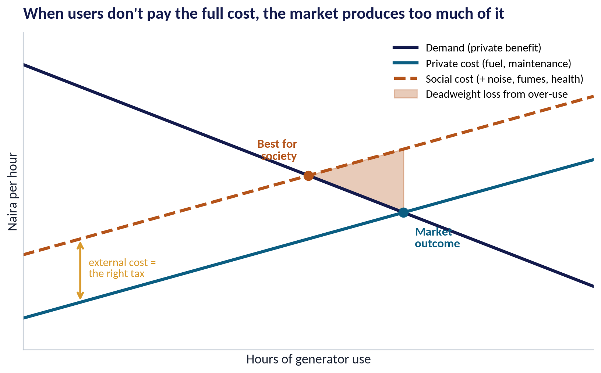
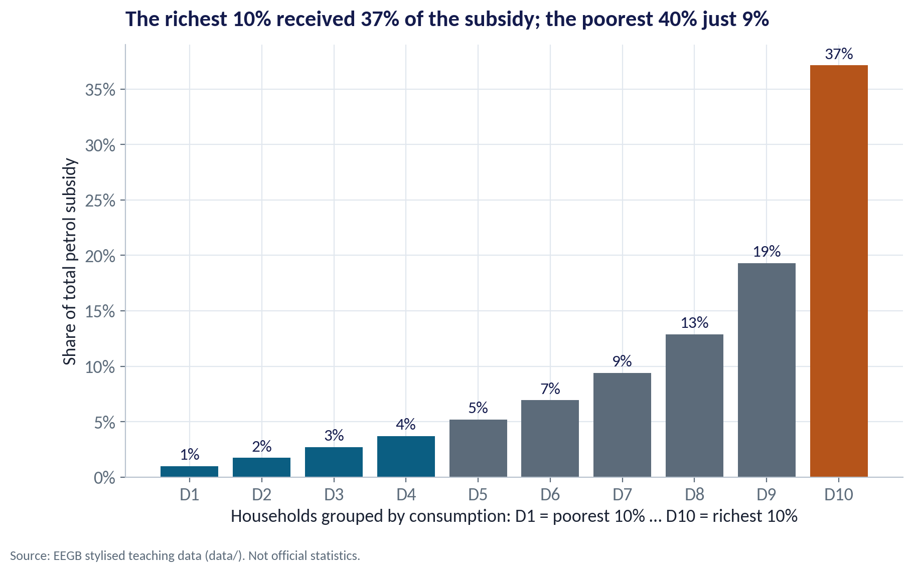
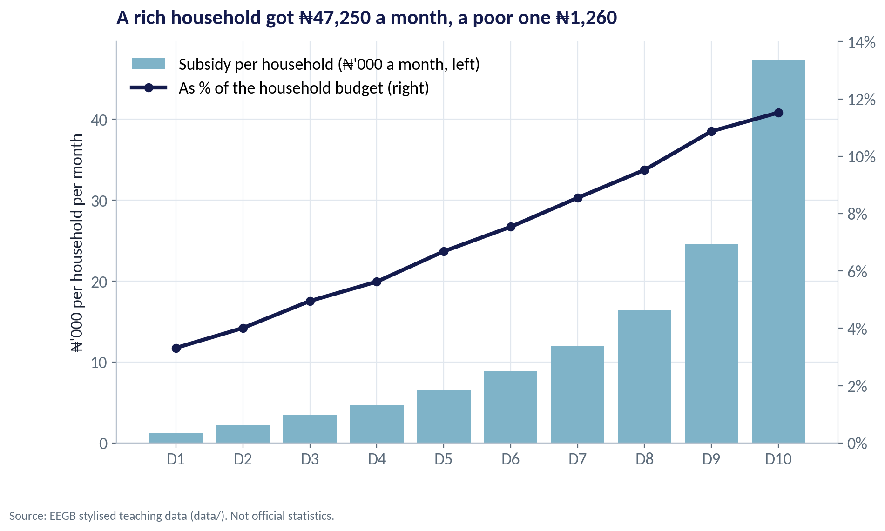
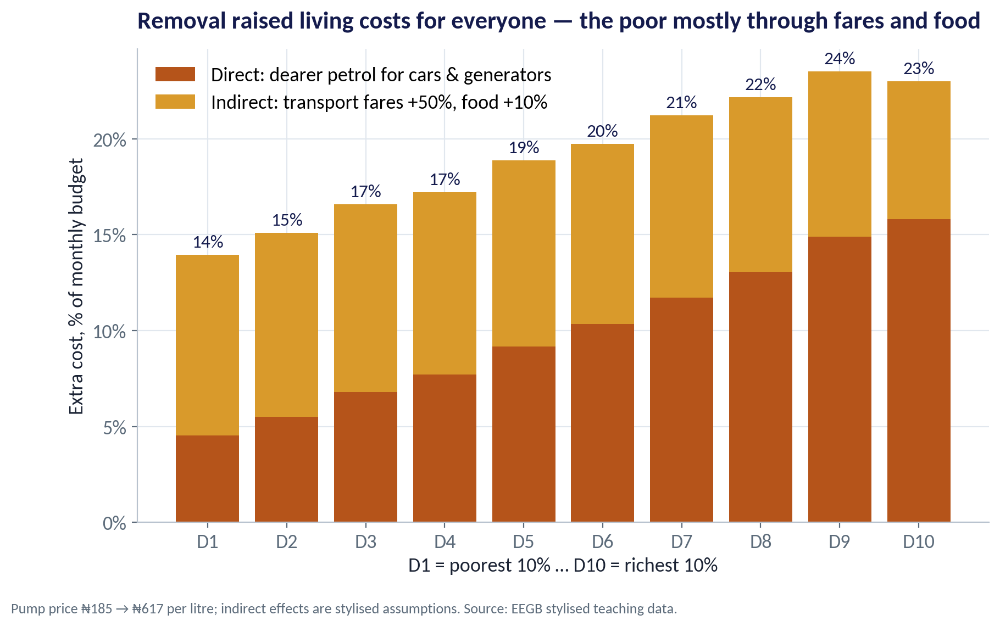
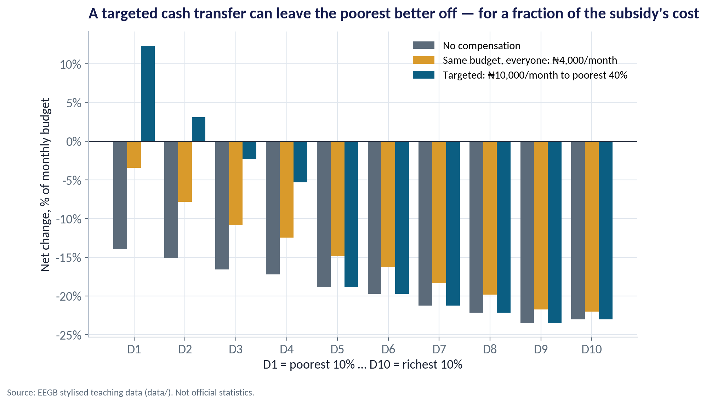
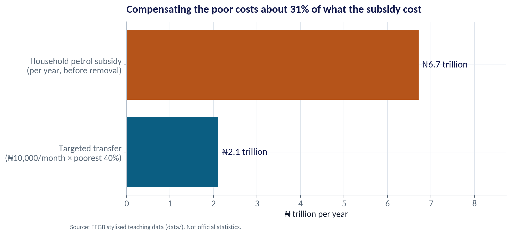

::: {.session-banner}
{.banner-hex width="96"}

**Session 5 of 16** · Facilitator: Kelechi Nnamdi<br>*Case:* Petrol subsidy removal: who gained from the subsidy, who loses from its removal, and what should replace it?

:::

## Downloads {.unnumbered}

::: {.download-row}
[<i class="bi bi-file-earmark-slides"></i> Teaching slides (.pptx)](../../sessions/s05/slides/EEGB_S05_Market_Failures_Government_Intervention.pptx){.btn .btn-primary download=""}
[<i class="bi bi-file-earmark-pdf"></i> Slides (PDF)](../../sessions/s05/slides/EEGB_S05_Market_Failures_Government_Intervention.pdf){.btn .btn-outline-primary download=""}
[<i class="bi bi-github"></i> Session folder on GitHub](https://github.com/adibongo/eegb/tree/main/sessions/s05){.btn .btn-outline-secondary}
:::

## Read first {.unnumbered}

- **Externalities: Justification for Public Goods?** — Reference no. 210-023-1
- **A Framework to Think About Pollution: Externalities, Pollution Taxes, and Cap and Trade** — Technical note, UVA-GEM-0104

## Learning objectives

::: {.grid}
::: {.g-col-12 .g-col-md-4 .obj-card}
**Diagnose a Market Failure**

Recognise externalities, public goods, asymmetric information and market power in your own industry.
:::
::: {.g-col-12 .g-col-md-4 .obj-card}
**Choose the Right Fix**

Compare Pigouvian taxes, cap-and-trade, regulation, nudges and market design — and when each works.
:::
::: {.g-col-12 .g-col-md-4 .obj-card}
**Analyse a Subsidy**

Work out who really gains from a subsidy, who loses when it goes, and what compensation should look like.
:::
:::

## The business case

::: {.callout-note appearance="simple" icon=false}
## Petrol Subsidy Removal

**Situation.** For decades Nigeria held the pump price of petrol below its cost, paying the difference from public funds. In mid-2023 the subsidy was removed and the pump price rose from about ₦185 to ₦617 per litre.

**Question.** Who gained from the subsidy, who loses from its removal, and what should replace it?

**Data.** fuel_subsidy_incidence.csv — household spending, petrol use, food and transport shares, vehicle and generator ownership, by consumption decile. *Stylised teaching data.*

**A good answer.** A policy recommendation: how the savings should be used, and how to protect poor households at a sensible fiscal cost.
:::

## Key ideas in plain English

### The Lemons Problem

When buyers cannot tell good from bad, they pay an average price. Owners of good products then refuse to sell, the average quality falls, and the market can unravel.

::: {.formula}
hidden quality → average price → good sellers leave
:::

*Example.* Lenders cannot tell safe from risky small businesses, so they charge everyone high rates — which drives away the safest borrowers first. Credit bureaus and collateral registries exist to fix this.

::: {.callout-tip appearance="minimal"}
**Why a manager cares.** Your business can profit from solving information problems: warranties, ratings, certification, track records, and data-based credit scoring all build trust.
:::

### Pigouvian Taxes vs Cap-and-Trade

A tax fixes the price of pollution and lets the quantity adjust. Cap-and-trade fixes the quantity and lets the price adjust. Both make polluting costly, so firms that can cut cheaply do the most cutting.

::: {.formula}
tax: price fixed, quantity varies  ·  cap: quantity fixed, price varies
:::

*Example.* A gas-flaring penalty per thousand cubic feet is a tax-style tool; a carbon market with a national emissions cap is the permit approach. Session 13 returns to carbon pricing.

::: {.callout-tip appearance="minimal"}
**Why a manager cares.** For your business: either tool turns pollution into a cost line. Firms that cut emissions early gain a cost advantage — or permits to sell.
:::

### Interventions Can Fail Too

Governments face their own problems: poor information, lobbying by those who benefit, leakage and corruption, and policies that are easy to start but hard to stop.

::: {.formula}
market failure ≠ automatic case for intervention
:::

*Example.* The petrol subsidy was meant to share oil wealth, but it favoured car and generator owners, encouraged smuggling across borders, and became one of the largest items in the federal budget.

::: {.callout-tip appearance="minimal"}
**Why a manager cares.** The right question is not 'market or government?' but 'which imperfect arrangement does least harm here?'
:::

### Who Really Benefits From a Subsidy?

A per-litre subsidy goes to whoever buys the most litres. Rich households use far more petrol — for cars and generators — so they receive far more in naira, even if the subsidy is a bigger share of a poor family's budget.

::: {.formula}
benefit = litres used × subsidy per litre
:::

*Example.* Before removal (stylised): ₦315 of subsidy per litre. A household in the richest 10% using 150 litres a month got ₦47,250; one in the poorest 10% using 4 litres got ₦1,260.

::: {.callout-tip appearance="minimal"}
**Why a manager cares.** Universal price subsidies are an expensive way to help the poor. Most of the money goes to people who do not need it.
:::

## Charts and how to replicate them

Every chart below is regenerated by the session's figure script — `sessions/s05/R/s05_figures.R` or `sessions/s05/python/s05_figures.py`. Run it from the project root.

### The Generator Next Door

::: {.panel-tabset group="lang"}
## Python
{.fig-img fig-alt="S05-F01 (Python)"}

:::

- The generator owner pays for fuel and maintenance — the private cost.
- Neighbours pay too, in noise, fumes and health — the external cost.
- The market uses generators up to where private cost meets benefit: too much.
- A tax equal to the external cost moves use to what is best for society — the idea behind a Pigouvian tax.

<span class="fig-id">S05-F01</span>

### Most of the Money Went to the Better-Off

::: {.panel-tabset group="lang"}
## Python
{.fig-img fig-alt="S05-F02 (Python)"}

:::

- The richest 10% of households received about 37% of the household petrol subsidy.
- The poorest 40% received only about 9%.
- In naira, the richest households got about 38 times as much as the poorest.
- This pattern — subsidies captured by the better-off — is found in fuel subsidies across many countries.

<span class="fig-id">S05-F02</span>

### Naira Received vs Share of Budget

::: {.panel-tabset group="lang"}
## Python
{.fig-img fig-alt="S05-F03 (Python)"}

:::

- Bars: the subsidy in naira rose steeply with income.
- Line: as a % of the budget, it also rose — from about 3% for the poorest to 12% for the richest.
- Poor households mostly use petrol indirectly: through bus fares and the cost of moving food.
- That indirect channel is why removal still hurt the poor badly.

<span class="fig-id">S05-F03</span>

### The Cost of Removal

::: {.panel-tabset group="lang"}
## Python
{.fig-img fig-alt="S05-F04 (Python)"}

:::

- Direct cost: petrol rose from ₦185 to ₦617 a litre.
- Indirect cost (our assumptions): bus fares +50%, food +10%.
- Extra cost: about 14% of the budget for the poorest decile, 23% for the richest.
- For the poor, most of the hit is indirect — and they have the least room to cut back.

<span class="fig-id">S05-F04</span>

### Targeted vs Universal Support

::: {.panel-tabset group="lang"}
## Python
{.fig-img fig-alt="S05-F05 (Python)"}

:::

- A ₦10,000 a month transfer to the poorest 40% leaves the poorest two deciles better off than before removal.
- The same budget spread over everyone gives just ₦4,000 each — too little to protect the poor.
- Better-off households still bear the full cost — but they also gained most from the subsidy.
- Targeting needs a reliable social register, digital IDs and payment channels.

<span class="fig-id">S05-F05</span>

### What the Savings Can Buy

::: {.panel-tabset group="lang"}
## Python
{.fig-img fig-alt="S05-F06 (Python)"}

:::

- The household petrol subsidy cost about ₦6.7 trillion a year (stylised).
- The targeted transfer costs about ₦2.1 trillion — roughly 31% of that.
- The rest can fund transport (e.g. CNG buses), health and education — or cut borrowing.
- Credibility matters: people accept reform more readily when they can see where the savings go.

<span class="fig-id">S05-F06</span>

## Lab: Subsidy Incidence and Compensation

*Time:* 20 minutes · *Data:* [`data/fuel_subsidy_incidence.csv`](../../data/fuel_subsidy_incidence.csv)

1. Compute the subsidy each decile received, in naira and as a % of budget.
2. Find the shares of the richest 10% and the poorest 40%.
3. Estimate the direct and indirect cost of removal; change the fare and food assumptions.
4. Cost a targeted cash transfer and compare it with the old subsidy bill.
5. Find the transfer that leaves deciles 3 and 4 no worse off.

::: {.callout-important appearance="simple"}
**Deliverable:** a two-sentence recommendation on how the savings should be used.
:::

## The code (R | Python)

Pick your language once; every tab on the site follows your choice. Download a script, or copy it into RStudio and run it line by line.

### Replicate every chart

::: {.panel-tabset group="lang"}
## Python
[<i class="bi bi-download"></i> s05_figures.py](../../sessions/s05/python/s05_figures.py){download=""}

::: {.callout-note collapse="true" appearance="simple" icon=false}
## Show the full script (111 lines)

```{.python filename="sessions/s05/python/s05_figures.py"}
# =============================================================================
# EEGB · Session 5 · Market Failures & Government Intervention
# Replication script — regenerates every chart in the Session 5 deck (Python)
# Data: data/fuel_subsidy_incidence.csv (stylised household budgets by consumption decile)
# Run from the project root:  python sessions/s05/python/s05_figures.py
# =============================================================================
import sys; sys.path.insert(0, "python")
import numpy as np, pandas as pd
import matplotlib.pyplot as plt
from matplotlib.ticker import FuncFormatter
from eegb_style import *

set_style()
h = pd.read_csv("data/fuel_subsidy_incidence.csv")
D = [f"D{k}" for k in h.decile]               # D1 = poorest 10% of households ... D10 = richest 10%

# Assumptions used throughout (stylised, stated on the slides)
FARE_RISE, FOOD_RISE = 0.50, 0.10              # transport fares +50%, food prices +10% after removal (indirect effects)
TRANSFER, TARGET_DECILES = 10_000, 4           # ₦10,000 a month to the poorest 40% of households

h["subsidy"] = h.petrol_litres_month * h.subsidy_per_litre_pre                 # ₦ per household per month
h["subsidy_share"] = 100 * h.subsidy / h.subsidy.sum()
h["subsidy_pct_budget"] = 100 * h.subsidy / h.monthly_spend_naira
h["direct_pct"] = 100 * h.petrol_litres_month * (h.pump_price_post - h.pump_price_pre) / h.monthly_spend_naira
h["indirect_pct"] = 100 * (h.transport_share * FARE_RISE + h.food_share * FOOD_RISE)
h["total_pct"] = h.direct_pct + h.indirect_pct
annual_subsidy = (h.subsidy * h.households_m * 1e6 * 12).sum() / 1e12            # ₦ trillion
transfer_cost = TARGET_DECILES * h.households_m.iloc[0] * 1e6 * TRANSFER * 12 / 1e12
universal = transfer_cost * 1e12 / (h.households_m.sum() * 1e6 * 12)               # same budget, everyone
h["net_none"] = -h.total_pct
h["net_targeted"] = -h.total_pct + np.where(h.decile <= TARGET_DECILES, 100 * TRANSFER / h.monthly_spend_naira, 0)
h["net_universal"] = -h.total_pct + 100 * universal / h.monthly_spend_naira
print(h[["decile", "subsidy", "subsidy_share", "subsidy_pct_budget", "direct_pct", "indirect_pct", "total_pct",
         "net_targeted", "net_universal"]].round(1).to_string())
print(f"annual household petrol subsidy ₦{annual_subsidy:.1f}tn; targeted transfer cost ₦{transfer_cost:.2f}tn "
      f"({100*transfer_cost/annual_subsidy:.0f}% of subsidy); universal equivalent ₦{universal:,.0f}/month")
print(f"top decile share {h.subsidy_share.iloc[-1]:.1f}%, bottom 40% share {h.subsidy_share.iloc[:4].sum():.1f}%, "
      f"ratio top/bottom ₦ {h.subsidy.iloc[-1]/h.subsidy.iloc[0]:.0f}x")

# --- F01 · A negative externality: the generator next door ---------------------------------------------
q = np.linspace(0, 10, 200)
fig, ax = plt.subplots()
ax.plot(q, 9 - 0.7 * q, color=NAVY, lw=3, label="Demand (private benefit)")
ax.plot(q, 1 + 0.5 * q, color=TEAL, lw=3, label="Private cost (fuel, maintenance)")
ax.plot(q, 3 + 0.5 * q, color=RUST, lw=3, ls="--", label="Social cost (+ noise, fumes, health)")
qm, qs = 8 / 1.2, 6 / 1.2
ax.fill_between(np.linspace(qs, qm, 50), 9 - 0.7 * np.linspace(qs, qm, 50), 3 + 0.5 * np.linspace(qs, qm, 50), color=RUST, alpha=.3,
                label="Deadweight loss from over-use")
for x, t, c, dx, dy, ha in [(qm, "Market\noutcome", TEAL, .2, -1.1, "left"), (qs, "Best for\nsociety", RUST, -.2, .5, "right")]:
    y = 9 - 0.7 * x; ax.scatter(x, y, s=80, color=c, zorder=5); ax.text(x + dx, y + dy, t, color=c, fontsize=12, fontweight="bold", ha=ha)
ax.annotate("", xy=(1.0, 3.5), xytext=(1.0, 1.5), arrowprops=dict(arrowstyle="<->", color=GOLD, lw=2))
ax.text(1.15, 2.3, "external cost =\nthe right tax", color=GOLD, fontsize=11)
ax.set_xlim(0, 10); ax.set_ylim(0, 10); ax.set_xticks([]); ax.set_yticks([]); ax.legend(loc="upper right", fontsize=11)
ax.set(title="When users don't pay the full cost, the market produces too much of it",
       xlabel="Hours of generator use", ylabel="Naira per hour")
save(fig, "s05", "f01")

# --- F02 · Who received the petrol subsidy? -----------------------------------------------------------------
fig, ax = plt.subplots()
cols = [TEAL] * 4 + [SLATE] * 5 + [RUST]
ax.bar(D, h.subsidy_share, color=cols)
for i, v in enumerate(h.subsidy_share): ax.text(i, v + .6, f"{v:.0f}%", ha="center", fontsize=12, color=NAVY)
ax.yaxis.set_major_formatter(FuncFormatter(pct))
ax.set(title=f"The richest 10% received {h.subsidy_share.iloc[-1]:.0f}% of the subsidy; the poorest 40% just {h.subsidy_share.iloc[:4].sum():.0f}%",
       xlabel="Households grouped by consumption: D1 = poorest 10% … D10 = richest 10%", ylabel="Share of total petrol subsidy")
note(fig); save(fig, "s05", "f02")

# --- F03 · Subsidy in naira vs as a share of the budget ------------------------------------------------------
fig, ax1 = plt.subplots()
ax1.bar(D, h.subsidy / 1000, color=SKY, label="Subsidy per household (₦'000 a month, left)")
ax1.set_ylabel("₦'000 per household per month")
ax2 = ax1.twinx()
ax2.plot(D, h.subsidy_pct_budget, "o-", color=NAVY, lw=3, label="As % of the household budget (right)")
ax2.yaxis.set_major_formatter(FuncFormatter(pct)); ax2.set_ylim(0, 14); ax2.grid(False); ax2.spines["right"].set_visible(True)
h1, l1 = ax1.get_legend_handles_labels(); h2, l2 = ax2.get_legend_handles_labels(); ax1.legend(h1 + h2, l1 + l2, loc="upper left")
ax1.set_title(f"A rich household got ₦{h.subsidy.iloc[-1]:,.0f} a month, a poor one ₦{h.subsidy.iloc[0]:,.0f}", loc="left")
note(fig); save(fig, "s05", "f03")

# --- F04 · The cost of removal, direct and indirect -------------------------------------------------------------
fig, ax = plt.subplots()
ax.bar(D, h.direct_pct, color=RUST, label="Direct: dearer petrol for cars & generators")
ax.bar(D, h.indirect_pct, bottom=h.direct_pct, color=GOLD, label="Indirect: transport fares +50%, food +10%")
for i, v in enumerate(h.total_pct): ax.text(i, v + .4, f"{v:.0f}%", ha="center", fontsize=12, color=NAVY)
ax.yaxis.set_major_formatter(FuncFormatter(pct)); ax.legend(loc="upper left")
ax.set(title="Removal raised living costs for everyone — the poor mostly through fares and food",
       xlabel="D1 = poorest 10% … D10 = richest 10%", ylabel="Extra cost, % of monthly budget")
note(fig, "Pump price ₦185 → ₦617 per litre; indirect effects are stylised assumptions. Source: EEGB stylised teaching data.")
save(fig, "s05", "f04")

# --- F05 · Compensation: targeted vs universal ---------------------------------------------------------------------
fig, ax = plt.subplots()
w = .27; x = np.arange(10)
ax.bar(x - w, h.net_none, w, color=SLATE, label="No compensation")
ax.bar(x, h.net_universal, w, color=GOLD, label=f"Same budget, everyone: ₦{universal:,.0f}/month")
ax.bar(x + w, h.net_targeted, w, color=TEAL, label=f"Targeted: ₦{TRANSFER:,}/month to poorest 40%")
ax.axhline(0, color=INK, lw=1); ax.set_xticks(x, D)
ax.yaxis.set_major_formatter(FuncFormatter(pct)); ax.legend(loc="upper right", fontsize=11)
ax.set(title="A targeted cash transfer can leave the poorest better off — for a fraction of the subsidy's cost",
       xlabel="D1 = poorest 10% … D10 = richest 10%", ylabel="Net change, % of monthly budget")
ax.title.set_fontsize(14)
note(fig); save(fig, "s05", "f05")

# --- F06 · The fiscal arithmetic ----------------------------------------------------------------------------------------
fig, ax = plt.subplots(figsize=(10, 4.6))
items = {"Household petrol subsidy\n(per year, before removal)": annual_subsidy,
         f"Targeted transfer\n(₦{TRANSFER:,}/month × poorest 40%)": transfer_cost}
ax.barh(list(items)[::-1], list(items.values())[::-1], color=[TEAL, RUST])
for i, v in enumerate(list(items.values())[::-1]): ax.text(v + .08, i, f"₦{v:.1f} trillion", va="center", fontsize=14, color=NAVY)
ax.set_xlim(0, annual_subsidy * 1.3)
ax.set(title=f"Compensating the poor costs about {100*transfer_cost/annual_subsidy:.0f}% of what the subsidy cost", xlabel="₦ trillion per year")
note(fig); save(fig, "s05", "f06")
```
:::

## R
[<i class="bi bi-download"></i> s05_figures.R](../../sessions/s05/R/s05_figures.R){download=""}

::: {.callout-note collapse="true" appearance="simple" icon=false}
## Show the full script (89 lines)

```{.r filename="sessions/s05/R/s05_figures.R"}
# =============================================================================
# EEGB · Session 5 · Market Failures & Government Intervention
# Replication script — regenerates every chart in the Session 5 deck (R)
# Data: data/fuel_subsidy_incidence.csv (stylised household budgets by consumption decile)
# =============================================================================
source("R/theme_eegb.R")
suppressPackageStartupMessages({ library(dplyr); library(readr); library(tidyr) })
h <- read_csv("data/fuel_subsidy_incidence.csv", show_col_types = FALSE)
FARE_RISE <- 0.50; FOOD_RISE <- 0.10; TRANSFER <- 10000; TARGET <- 4     # stylised assumptions
h <- h |> mutate(D = factor(paste0("D", decile), levels = paste0("D", 1:10)),
                 subsidy = petrol_litres_month * subsidy_per_litre_pre,
                 subsidy_share = 100 * subsidy / sum(subsidy),
                 subsidy_pct_budget = 100 * subsidy / monthly_spend_naira,
                 direct_pct = 100 * petrol_litres_month * (pump_price_post - pump_price_pre) / monthly_spend_naira,
                 indirect_pct = 100 * (transport_share * FARE_RISE + food_share * FOOD_RISE),
                 total_pct = direct_pct + indirect_pct)
annual <- sum(h$subsidy * h$households_m * 1e6 * 12) / 1e12
tcost <- TARGET * h$households_m[1] * 1e6 * TRANSFER * 12 / 1e12
universal <- tcost * 1e12 / (sum(h$households_m) * 1e6 * 12)
xlab <- "D1 = poorest 10% … D10 = richest 10%"

# --- F01 · Negative externality ---------------------------------------------------------------------
q <- seq(0, 10, length.out = 200)
cur <- bind_rows(tibble(q, p = 9 - .7 * q, curve = "Demand (private benefit)"),
                 tibble(q, p = 1 + .5 * q, curve = "Private cost (fuel, maintenance)"),
                 tibble(q, p = 3 + .5 * q, curve = "Social cost (+ noise, fumes, health)"))
qm <- 8 / 1.2; qs <- 6 / 1.2; dw <- tibble(q = seq(qs, qm, length.out = 50)) |> mutate(top = 9 - .7 * q, bot = 3 + .5 * q)
p1 <- ggplot() + geom_ribbon(data = dw, aes(q, ymin = pmin(top, bot), ymax = pmax(top, bot)), fill = eegb[["rust"]], alpha = .3) +
  geom_line(data = cur, aes(q, p, colour = curve, linetype = curve), linewidth = 1.2) +
  annotate("point", x = c(qm, qs), y = 9 - .7 * c(qm, qs), size = 3.5, colour = c(eegb[["teal"]], eegb[["rust"]])) +
  annotate("text", x = c(qm + .2, qs - .2), y = 9 - .7 * c(qm, qs) + c(-1, .5), label = c("Market outcome", "Best for society"),
           hjust = c(0, 1), fontface = "bold", colour = c(eegb[["teal"]], eegb[["rust"]])) +
  scale_colour_manual(values = c(eegb[["navy"]], eegb[["teal"]], eegb[["rust"]]), name = NULL) +
  scale_linetype_manual(values = c("solid", "solid", "dashed"), name = NULL) + coord_cartesian(xlim = c(0, 10), ylim = c(0, 10)) +
  labs(title = "When users don't pay the full cost, the market produces too much of it",
       subtitle = "Shaded: deadweight loss from over-use. The gap between the cost lines is the right (Pigouvian) tax.",
       x = "Hours of generator use", y = "Naira per hour") + theme_eegb() + theme(axis.text = element_blank(), legend.direction = "vertical")
save_fig(p1, "s05", "f01")

# --- F02 · Who received the subsidy? -----------------------------------------------------------------
p2 <- ggplot(h, aes(D, subsidy_share, fill = decile)) + geom_col(show.legend = FALSE) +
  geom_text(aes(label = sprintf("%.0f%%", subsidy_share)), vjust = -0.4) +
  scale_fill_gradient(low = eegb[["teal"]], high = eegb[["rust"]]) + scale_y_continuous(labels = pct) +
  labs(title = sprintf("The richest 10%% received %.0f%% of the subsidy; the poorest 40%% just %.0f%%", h$subsidy_share[10], sum(h$subsidy_share[1:4])),
       x = xlab, y = "Share of total petrol subsidy", caption = eegb_caption) + theme_eegb()
save_fig(p2, "s05", "f02")

# --- F03 · Naira vs % of budget ----------------------------------------------------------------------
sc <- 50 / 14
p3 <- ggplot(h, aes(D)) + geom_col(aes(y = subsidy / 1000), fill = eegb[["sky"]]) +
  geom_line(aes(y = subsidy_pct_budget * sc, group = 1), colour = eegb[["navy"]], linewidth = 1.3) +
  geom_point(aes(y = subsidy_pct_budget * sc), colour = eegb[["navy"]], size = 2.5) +
  scale_y_continuous(name = "₦'000 per household per month (bars)", sec.axis = sec_axis(~ . / sc, name = "% of household budget (line)")) +
  labs(title = sprintf("A rich household got ₦%s a month, a poor one ₦%s", format(h$subsidy[10], big.mark = ","), format(h$subsidy[1], big.mark = ",")),
       x = xlab, caption = eegb_caption) + theme_eegb()
save_fig(p3, "s05", "f03")

# --- F04 · Cost of removal ----------------------------------------------------------------------------
rm <- h |> select(D, `Direct: dearer petrol for cars & generators` = direct_pct, `Indirect: transport fares +50%, food +10%` = indirect_pct) |>
  pivot_longer(-D)
p4 <- ggplot(rm, aes(D, value, fill = name)) + geom_col() +
  geom_text(data = h, aes(D, total_pct, label = sprintf("%.0f%%", total_pct)), inherit.aes = FALSE, vjust = -0.4) +
  scale_fill_manual(values = c(eegb[["rust"]], eegb[["gold"]]), name = NULL) + scale_y_continuous(labels = pct) +
  labs(title = "Removal raised living costs for everyone — the poor mostly through fares and food",
       x = xlab, y = "Extra cost, % of monthly budget",
       caption = "Pump price ₦185 → ₦617 per litre; indirect effects are stylised assumptions. Source: EEGB stylised teaching data.") + theme_eegb()
save_fig(p4, "s05", "f04")

# --- F05 · Compensation options --------------------------------------------------------------------------
net <- h |> transmute(D, `No compensation` = -total_pct,
                      `Same budget, everyone` = -total_pct + 100 * universal / monthly_spend_naira,
                      `Targeted: ₦10,000/month to poorest 40%` = -total_pct + ifelse(decile <= TARGET, 100 * TRANSFER / monthly_spend_naira, 0)) |>
  pivot_longer(-D) |> mutate(name = factor(name, levels = c("No compensation", "Same budget, everyone", "Targeted: ₦10,000/month to poorest 40%")))
p5 <- ggplot(net, aes(D, value, fill = name)) + geom_col(position = "dodge") + geom_hline(yintercept = 0) +
  scale_fill_manual(values = unname(eegb[c("slate", "gold", "teal")]), name = NULL) + scale_y_continuous(labels = pct) +
  labs(title = "A targeted cash transfer can leave the poorest better off — for a fraction of the subsidy's cost",
       x = xlab, y = "Net change, % of monthly budget", caption = eegb_caption) + theme_eegb(12)
save_fig(p5, "s05", "f05")

# --- F06 · Fiscal arithmetic ------------------------------------------------------------------------------
fa <- tibble(item = factor(c("Household petrol subsidy (per year, before removal)", "Targeted transfer (₦10,000/month × poorest 40%)"),
                           levels = c("Targeted transfer (₦10,000/month × poorest 40%)", "Household petrol subsidy (per year, before removal)")),
             v = c(annual, tcost))
p6 <- ggplot(fa, aes(v, item, fill = item)) + geom_col(show.legend = FALSE, width = .6) +
  geom_text(aes(label = sprintf("₦%.1f trillion", v)), hjust = -0.1) + scale_fill_manual(values = unname(eegb[c("rust", "teal")])) +
  scale_x_continuous(expand = expansion(mult = c(0, .3))) +
  labs(title = sprintf("Compensating the poor costs about %.0f%% of what the subsidy cost", 100 * tcost / annual),
       x = "₦ trillion per year", y = NULL, caption = eegb_caption) + theme_eegb()
save_fig(p6, "s05", "f06", height = 4.6)
```
:::

:::

### Lab

::: {.panel-tabset group="lang"}
## Python
[<i class="bi bi-download"></i> s05_lab.py](../../sessions/s05/python/s05_lab.py){download=""}

::: {.callout-note collapse="true" appearance="simple" icon=false}
## Show the full script (39 lines)

```{.python filename="sessions/s05/python/s05_lab.py"}
# =============================================================================
# EEGB · Session 5 LAB · Who gained from the petrol subsidy, and who pays for its removal? (Python)
# Data: data/fuel_subsidy_incidence.csv — stylised household budgets by consumption decile
# Run from the project root, line by line (Ctrl/Cmd + Enter)
# =============================================================================
import pandas as pd

h = pd.read_csv("data/fuel_subsidy_incidence.csv")
print(h)                      # D1 = poorest 10% of households ... D10 = richest 10%

# ---- STEP 1 · The subsidy each household received ------------------------------------------
h["subsidy"] = h.petrol_litres_month * h.subsidy_per_litre_pre          # ₦ per household per month
h["share_of_subsidy"] = 100 * h.subsidy / h.subsidy.sum()
h["subsidy_pct_budget"] = 100 * h.subsidy / h.monthly_spend_naira
print(h[["decile", "subsidy", "share_of_subsidy", "subsidy_pct_budget"]].round(1))

# ---- STEP 2 · Who got most of it? -------------------------------------------------------------------
print(f"Richest 10% got {h.share_of_subsidy.iloc[-1]:.0f}% ; poorest 40% got {h.share_of_subsidy.iloc[:4].sum():.0f}%")

# ---- STEP 3 · The cost of removal: direct + indirect ------------------------------------------------
fare_rise, food_rise = 0.50, 0.10                                         # your assumptions — change them!
h["direct_pct"] = 100 * h.petrol_litres_month * (h.pump_price_post - h.pump_price_pre) / h.monthly_spend_naira
h["indirect_pct"] = 100 * (h.transport_share * fare_rise + h.food_share * food_rise)
h["total_pct"] = h.direct_pct + h.indirect_pct
print(h[["decile", "direct_pct", "indirect_pct", "total_pct"]].round(1))

# ---- STEP 4 · The fiscal saving and a targeted cash transfer ---------------------------------------------
annual = (h.subsidy * h.households_m * 1e6 * 12).sum() / 1e12
transfer = 10_000
cost = 4 * h.households_m.iloc[0] * 1e6 * transfer * 12 / 1e12
print(f"Subsidy cost ₦{annual:.1f}tn a year; transfer to poorest 40% costs ₦{cost:.2f}tn")
h["net_with_transfer"] = -h.total_pct + (h.decile <= 4) * 100 * transfer / h.monthly_spend_naira
print(h[["decile", "net_with_transfer"]].round(1))

# ---- YOUR TURN ------------------------------------------------------------------------------------------------
# (a) Change fare_rise and food_rise. How sensitive is the burden on D1–D4 to these assumptions?
# (b) What transfer (₦ per month) leaves D3 and D4 no worse off? What does it cost?
# (c) Name two practical problems with targeting cash to the poorest 40% in Nigeria, and one way to solve each.
# (d) In two sentences: should the savings go to transfers, transport (e.g. CNG buses), or reducing the deficit?
```
:::

## R
[<i class="bi bi-download"></i> s05_lab.R](../../sessions/s05/R/s05_lab.R){download=""}

::: {.callout-note collapse="true" appearance="simple" icon=false}
## Show the full script (37 lines)

```{.r filename="sessions/s05/R/s05_lab.R"}
# =============================================================================
# EEGB · Session 5 LAB · Who gained from the petrol subsidy, and who pays for its removal? (R)
# Data: data/fuel_subsidy_incidence.csv — stylised household budgets by consumption decile
# Open eegb.Rproj first, then run line by line (Ctrl/Cmd + Enter)
# =============================================================================
library(dplyr); library(readr)
h <- read_csv("data/fuel_subsidy_incidence.csv", show_col_types = FALSE)
h                                  # decile 1 = poorest 10% of households ... 10 = richest 10%

# ---- STEP 1 · The subsidy each household received ------------------------------------------
h <- h |> mutate(subsidy = petrol_litres_month * subsidy_per_litre_pre,
                 share_of_subsidy = 100 * subsidy / sum(subsidy),
                 subsidy_pct_budget = 100 * subsidy / monthly_spend_naira)
select(h, decile, subsidy, share_of_subsidy, subsidy_pct_budget)

# ---- STEP 2 · Who got most of it? -------------------------------------------------------------------
c(richest_10 = h$share_of_subsidy[10], poorest_40 = sum(h$share_of_subsidy[1:4]))

# ---- STEP 3 · The cost of removal: direct + indirect ------------------------------------------------
fare_rise <- 0.50; food_rise <- 0.10                       # your assumptions — change them!
h <- h |> mutate(direct_pct = 100 * petrol_litres_month * (pump_price_post - pump_price_pre) / monthly_spend_naira,
                 indirect_pct = 100 * (transport_share * fare_rise + food_share * food_rise),
                 total_pct = direct_pct + indirect_pct)
select(h, decile, direct_pct, indirect_pct, total_pct)

# ---- STEP 4 · The fiscal saving and a targeted cash transfer ---------------------------------------------
annual <- sum(h$subsidy * h$households_m * 1e6 * 12) / 1e12; annual      # ₦ trillion a year
transfer <- 10000
cost <- 4 * h$households_m[1] * 1e6 * transfer * 12 / 1e12; cost
h |> mutate(net_with_transfer = -total_pct + (decile <= 4) * 100 * transfer / monthly_spend_naira) |>
  select(decile, net_with_transfer)

# ---- YOUR TURN ------------------------------------------------------------------------------------------------
# (a) Change fare_rise and food_rise. How sensitive is the burden on deciles 1–4?
# (b) What transfer leaves deciles 3 and 4 no worse off? What does it cost?
# (c) Name two practical problems with targeting cash in Nigeria, and one way to solve each.
# (d) Should the savings go to transfers, transport (e.g. CNG buses), or reducing the deficit?
```
:::

:::

## Check your understanding

**Q1.** A Lagos estate's residents all run diesel generators, and everyone complains about the noise and fumes. Which policy best fits the economics of externalities?

- **A.** Ban generators outright
- **B.** Charge a fee per generator-hour that reflects the harm, and use the money to co-fund a shared, cleaner power supply
- **C.** Do nothing — residents chose to live there
- **D.** Subsidise diesel so generators are cheaper to run

::: {.callout-tip collapse="true" appearance="simple"}
## Show answer
**B.** B prices the externality (a Pigouvian charge) and funds an alternative. A is costly when there is no grid power; C ignores a real cost imposed on others; D makes the over-use worse.
:::

**Q2.** Our data show the richest 10% got 37% of the subsidy but face the largest % cost from removal (23% of budget vs 14% for the poorest). What follows?

- **A.** Removal was regressive because the rich lost more
- **B.** The rich lose more in % terms, but they gained most from the subsidy and can absorb it; protecting the poorest — who have little margin — is the priority for compensation
- **C.** Compensation should go mainly to the richest decile
- **D.** The subsidy should be restored

::: {.callout-tip collapse="true" appearance="simple"}
## Show answer
**B.** B. The burden as a % of budget is only part of the story: the poorest are closest to subsistence, and they received least from the subsidy. A misuses 'regressive'; C and D ignore who benefited and the fiscal cost.
:::

## Vocabulary

| Term | Meaning |
|---|---|
| **Market failure** | When a free market produces the wrong amount of something. |
| **Externality** | A cost or benefit that falls on people outside the transaction. |
| **Public good** | Non-excludable and non-rival, so markets under-supply it. |
| **Free riding** | Enjoying a benefit without paying towards it. |
| **Asymmetric information** | One side of a deal knows more than the other. |
| **Pigouvian tax** | A tax equal to the external cost of an activity. |
| **Cap-and-trade** | A fixed total of pollution permits that firms can trade. |
| **Nudge** | A change in defaults or framing that steers choices. |
| **Incidence** | Who actually bears a tax or receives a subsidy. |
| **Government failure** | When intervention makes outcomes worse. |

## Key takeaways

1. Markets fail through externalities, public goods, information gaps and market power.
2. Fix them by pricing the harm (taxes, permits), rules, nudges or market design.
3. Governments fail too: compare imperfect alternatives.
4. A per-litre subsidy goes to whoever uses the most — usually the better-off.
5. Protect the poor with targeted transfers, and show where the savings go.

::: {.callout-note appearance="simple"}
**Before next session:** Read the chapters on aggregate demand and aggregate supply in Blanchard, Macroeconomics. Bring one price your company raised in 2024 and say whether the cause was demand (customers buying more) or supply (your costs rising).
:::

::: {.session-nav}
[← Session 4: Market Structure & Platforms](../../sessions/s04/index.qmd)
[Session 6: AD–AS & Inflation →](../../sessions/s06/index.qmd){.next}
:::
