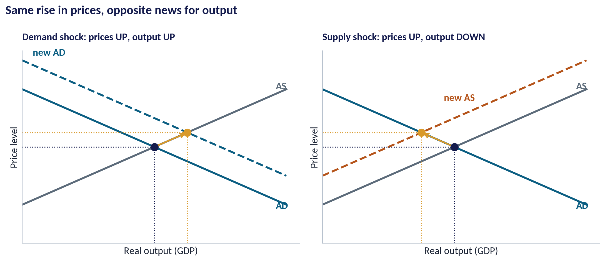
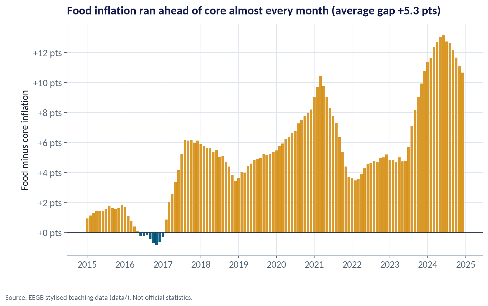
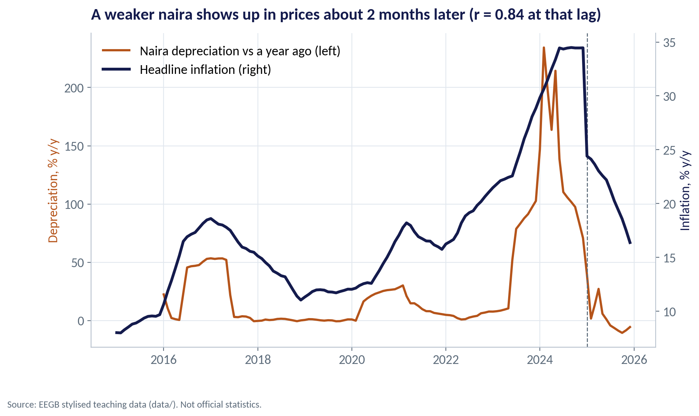
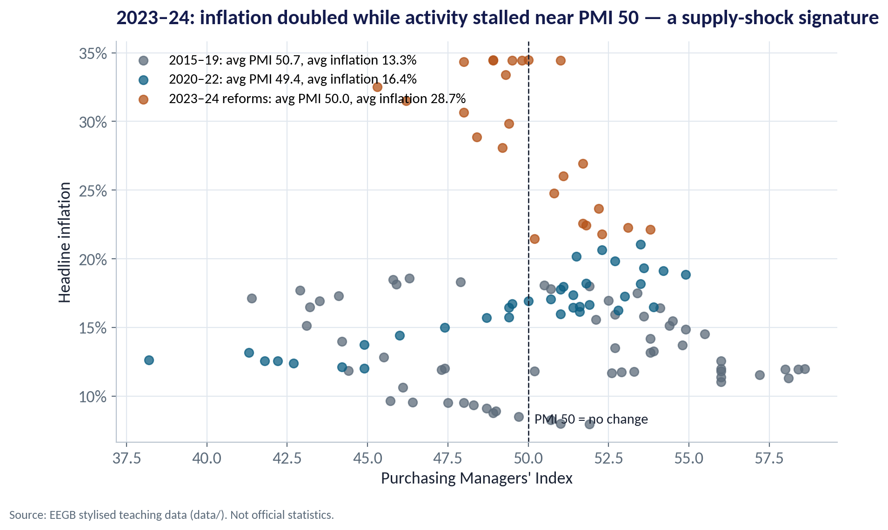
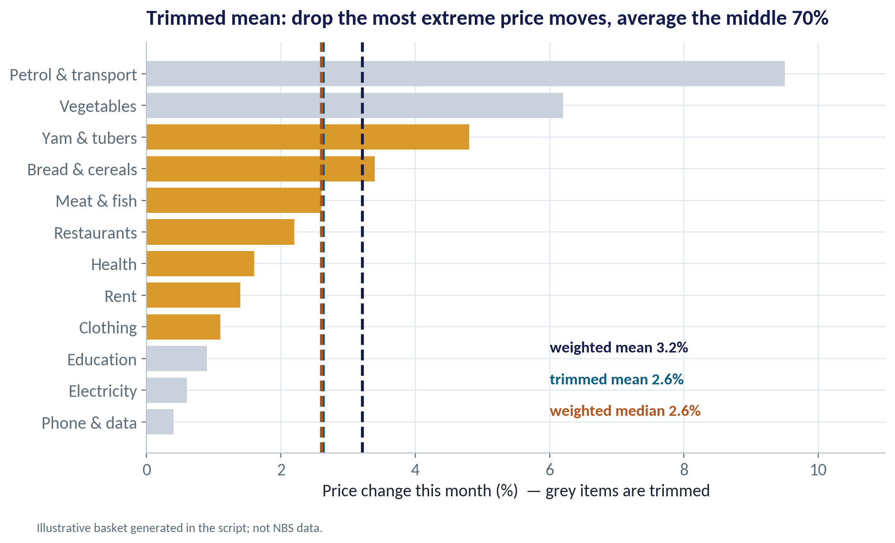
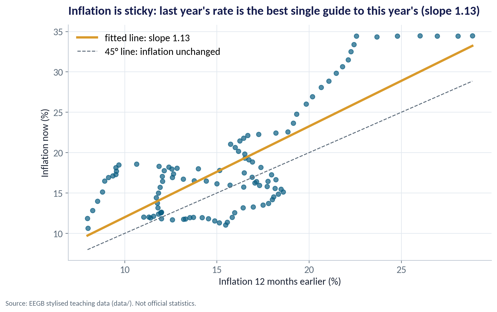
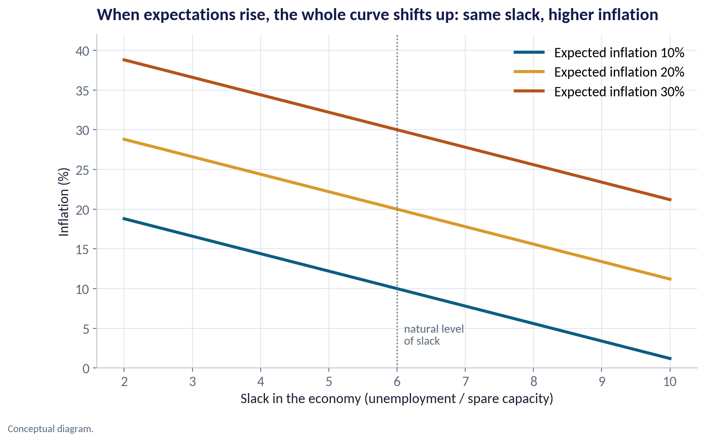

::: {.session-banner}
{.banner-hex width="96"}

**Session 6 of 16** · Facilitator: Bongo Adi<br>*Case:* Nigeria's inflation surge after the 2023 reforms: a demand problem, a supply problem, or both?

:::

## Downloads {.unnumbered}

::: {.download-row}
[<i class="bi bi-file-earmark-slides"></i> Teaching slides (.pptx)](../../sessions/s06/slides/EEGB_S06_AD_AS_in_a_Shock_Prone_World.pptx){.btn .btn-primary download=""}
[<i class="bi bi-file-earmark-pdf"></i> Slides (PDF)](../../sessions/s06/slides/EEGB_S06_AD_AS_in_a_Shock_Prone_World.pdf){.btn .btn-outline-primary download=""}
[<i class="bi bi-github"></i> Session folder on GitHub](https://github.com/adibongo/eegb/tree/main/sessions/s06){.btn .btn-outline-secondary}
:::

## Read first {.unnumbered}

- **Olivier Blanchard — Macroeconomics** — Textbook (latest edition)

## Learning objectives

::: {.grid}
::: {.g-col-12 .g-col-md-4 .obj-card}
**Use the AD–AS Model**

Tell a demand shock from a supply shock, and predict what each does to prices and output.
:::
::: {.g-col-12 .g-col-md-4 .obj-card}
**Read Inflation Measures**

Explain headline, food, core and trimmed-mean inflation, and why each answers a different question.
:::
::: {.g-col-12 .g-col-md-4 .obj-card}
**Respect Expectations**

Explain why inflation is sticky, and why central banks care so much about what people expect.
:::
:::

## The business case

::: {.callout-note appearance="simple" icon=false}
## Demand Problem, Supply Problem — or Both?

**Situation.** After the May–June 2023 reforms, Nigerian inflation climbed from about 22% to the mid-30s by 2024. The CBN raised its policy rate sharply. Firms faced rising costs and weakening customers at the same time.

**Question.** Was the surge mainly a demand shock (too much spending) or a supply shock (costs pushed up)? The answer decides whether higher interest rates are the right medicine.

**Data.** ng_macro_monthly.csv — headline, food and core inflation, exchange rates, policy rate and PMI, 2015–2025. *Stylised teaching data.* We use 2015–2024 for like-for-like comparisons because the CPI was rebased in 2025.

**A good answer.** A short diagnosis with evidence (food vs core, exchange-rate pass-through, activity), and what it implies for policy and for your pricing.
:::

## Key ideas in plain English

### The Same Medicine Does Not Cure Both

Higher interest rates work on demand: they make borrowing dearer and cool spending. Against a supply shock they cannot bring fuel or dollars back — they mainly reduce output further, while stopping the shock from spreading into wages and expectations.

::: {.formula}
demand shock: P↑ Y↑   ·   supply shock: P↑ Y↓
:::

*Example.* Mid-2023 to end-2024, average inflation was 30.5% against 19.6% in the eighteen months before, while the PMI slipped from 52.7 to 49.4. Prices up, activity down: the supply-shock signature.

::: {.callout-tip appearance="minimal"}
**Why a manager cares.** If you misdiagnose a supply shock as demand, you expect rate rises to fix prices quickly. They won't — so plan for costs that stay high and customers who spend less.
:::

### Rebasing Changes the Ruler

A price index compares today's basket with a base year. When statisticians rebase, they update the base year and the basket weights. Year-on-year rates before and after are not directly comparable.

::: {.formula}
inflation = (CPIₜ ÷ CPIₜ₋₁₂ − 1) × 100
:::

*Example.* Nigeria's CPI was rebased in January 2025. In this dataset headline inflation drops from about 34% in December 2024 to about 24% in January 2025 — much of that is the new ruler, not a sudden collapse in price pressure.

::: {.callout-tip appearance="minimal"}
**Why a manager cares.** Before you change prices, wage offers or contract indexation clauses, check which index and which base year the number uses.
:::

## Charts and how to replicate them

Every chart below is regenerated by the session's figure script — `sessions/s06/R/s06_figures.R` or `sessions/s06/python/s06_figures.py`. Run it from the project root.

### Demand Shock vs Supply Shock

::: {.panel-tabset group="lang"}
## Python
{.fig-img fig-alt="S06-F01 (Python)"}

:::

- Demand shock: spending jumps → prices and output rise together. Overheating.
- Supply shock: costs jump → prices rise but output falls. Stagflation.
- Both raise inflation, so inflation alone cannot tell you which happened.
- Look at output and activity too: are firms selling more, or less?

<span class="fig-id">S06-F01</span>

### Food Running Ahead of Core

::: {.panel-tabset group="lang"}
## Python
{.fig-img fig-alt="S06-F02 (Python)"}

:::

- Food inflation exceeded core inflation almost every month.
- The gap averaged +5.3 points over 2015–2024 and widened to about +12 points in 2024.
- Food prices react to fuel, transport, insecurity and the exchange rate — mostly supply forces.
- A wide food–core gap is a warning that interest rates alone will not fix the problem.

<span class="fig-id">S06-F02</span>

### Exchange-Rate Pass-Through

::: {.panel-tabset group="lang"}
## Python
{.fig-img fig-alt="S06-F03 (Python)"}

:::

- When the naira weakens, imported goods and inputs cost more in naira.
- In this data the link is strongest about 2 months later (correlation 0.84).
- The naira's fall after mid-2023 was the single largest cost shock for many firms.
- Pass-through is a supply shock to importers — but a weaker naira also helps exporters.

<span class="fig-id">S06-F03</span>

### Prices Up, Activity Stalled

::: {.panel-tabset group="lang"}
## Python
{.fig-img fig-alt="S06-F04 (Python)"}

:::

- Each dot is one month: PMI (activity) against inflation.
- In 2015–19 inflation averaged 13.3% with the PMI around 50.7.
- In 2023–24 inflation averaged 28.7% while the PMI averaged only 50.0.
- Inflation more than doubled without a boom in activity — consistent with a supply shock.

<span class="fig-id">S06-F04</span>

### Taking Out the Extremes

::: {.panel-tabset group="lang"}
## Python
{.fig-img fig-alt="S06-F05 (Python)"}

:::

- This illustrative month: petrol and vegetables jumped; data and electricity barely moved.
- The weighted mean (headline) is 3.2% — pulled up by two big movers.
- Drop the top and bottom 15% of the basket by weight: the trimmed mean is 2.6%.
- When the two diverge, a few items are driving headline inflation — often a supply story.

<span class="fig-id">S06-F05</span>

### Inflation Is Sticky

::: {.panel-tabset group="lang"}
## Python
{.fig-img fig-alt="S06-F06 (Python)"}

:::

- Each dot compares inflation now with inflation 12 months earlier.
- The fitted line: inflation now ≈ 0.74 + 1.13 × last year's rate.
- A slope near or above 1 means high inflation tends to stay high — or rise further.
- Why? Contracts, rents, wages and prices are set looking backward and forward.

<span class="fig-id">S06-F06</span>

### Expectations Shift the Curve

::: {.panel-tabset group="lang"}
## Python
{.fig-img fig-alt="S06-F07 (Python)"}

:::

- The Phillips curve links inflation to slack: less spare capacity, more pressure on prices.
- But each curve is drawn for a given level of expected inflation.
- If people come to expect 30%, the curve shifts up: the same slack now comes with 30%-type inflation.
- So central banks fight hard to keep expectations anchored — even at the cost of growth.

<span class="fig-id">S06-F07</span>

## Lab: Diagnose the 2023–24 Inflation Surge

*Time:* 20 minutes · *Data:* [`data/ng_macro_monthly.csv`](../../data/ng_macro_monthly.csv)

1. Compare headline, food, core and PMI before and after mid-2023.
2. Compute the food minus core gap by year.
3. Correlate inflation with naira depreciation at different lags — where is the link strongest?
4. Fit inflation now against inflation a year ago to measure persistence.
5. Check the real policy rate: were rates above or below inflation?

::: {.callout-important appearance="simple"}
**Deliverable:** a three-sentence diagnosis — demand, supply or both — citing at least two numbers, and one implication for your pricing.
:::

## The code (R | Python)

Pick your language once; every tab on the site follows your choice. Download a script, or copy it into RStudio and run it line by line.

### Replicate every chart

::: {.panel-tabset group="lang"}
## Python
[<i class="bi bi-download"></i> s06_figures.py](../../sessions/s06/python/s06_figures.py){download=""}

::: {.callout-note collapse="true" appearance="simple" icon=false}
## Show the full script (144 lines)

```{.python filename="sessions/s06/python/s06_figures.py"}
# =============================================================================
# EEGB · Session 6 · AD–AS in a Shock-Prone World
# Replication script — regenerates every chart in the Session 6 deck (Python)
# Data: data/ng_macro_monthly.csv (stylised Nigerian macro series, 2015–2025)
# Run from the project root:  python sessions/s06/python/s06_figures.py
# =============================================================================
import sys; sys.path.insert(0, "python")
import numpy as np, pandas as pd
import matplotlib.pyplot as plt
from matplotlib.ticker import FuncFormatter
from eegb_style import *

set_style()
m = pd.read_csv("data/ng_macro_monthly.csv", parse_dates=["date"])
old = m[m.date < "2025-01-01"].copy()          # keep one CPI base for like-for-like comparisons

# --- F01 · Demand shock vs supply shock in the AD–AS diagram ------------------------------
q = np.linspace(0, 10, 100)
fig, axes = plt.subplots(1, 2, figsize=(11, 4.8))
for ax, kind in zip(axes, ["demand", "supply"]):
    as0, ad0 = 2 + 0.6 * q, 8 - 0.6 * q
    ax.plot(q, as0, color=SLATE, lw=2.5); ax.plot(q, ad0, color=TEAL, lw=2.5)
    ax.text(9.6, as0[-1], "AS", color=SLATE, fontsize=13, fontweight="bold")
    ax.text(9.6, ad0[-1] - .2, "AD", color=TEAL, fontsize=13, fontweight="bold")
    if kind == "demand":
        ad1 = 9.5 - 0.6 * q
        ax.plot(q, ad1, color=TEAL, lw=2.5, ls="--"); ax.text(0.4, 9.75, "new AD", color=TEAL, fontsize=13, fontweight="bold")
        e0, e1 = (5, 5), (6.25, 5.75)
        ax.set_title("Demand shock: prices UP, output UP", fontsize=13)
    else:
        as1 = 3.5 + 0.6 * q
        ax.plot(q, as1, color=RUST, lw=2.5, ls="--"); ax.text(4.6, 7.4, "new AS", color=RUST, fontsize=13, fontweight="bold")
        e0, e1 = (5, 5), (3.75, 5.75)
        ax.set_title("Supply shock: prices UP, output DOWN", fontsize=13)
    for (x, y), c in [(e0, NAVY), (e1, GOLD)]:
        ax.scatter(x, y, s=90, color=c, zorder=4)
        ax.plot([x, x], [0, y], color=c, ls=":", lw=1.2); ax.plot([0, x], [y, y], color=c, ls=":", lw=1.2)
    ax.annotate("", xy=e1, xytext=e0, arrowprops=dict(arrowstyle="->", color=GOLD, lw=2))
    ax.set_xlim(0, 10.5); ax.set_ylim(0, 10); ax.set_xticks([]); ax.set_yticks([]); ax.grid(False)
    ax.set_xlabel("Real output (GDP)"); ax.set_ylabel("Price level")
fig.suptitle("Same rise in prices, opposite news for output", x=0.01, ha="left", fontsize=16, fontweight="bold", color=NAVY)
fig.tight_layout(); save(fig, "s06", "f01")

# --- F02 · The food–core gap: a supply-shock signature ------------------------------------
gap = old.food_inflation - old.core_inflation
fig, ax = plt.subplots()
ax.bar(old.date, gap, width=25, color=np.where(gap > 0, GOLD, TEAL))
ax.axhline(0, color=INK, lw=1)
ax.yaxis.set_major_formatter(FuncFormatter(lambda v, p: f"{v:+.0f} pts"))
ax.set(title=f"Food inflation ran ahead of core almost every month (average gap {gap.mean():+.1f} pts)",
       ylabel="Food minus core inflation")
note(fig); save(fig, "s06", "f02")

# --- F03 · Exchange-rate pass-through: naira depreciation vs inflation ---------------------
d = m.set_index("date")
dep = 100 * (d.official_fx_ngn_usd / d.official_fx_ngn_usd.shift(12) - 1)
best = None
for lag in range(0, 13):
    x, y = dep.shift(lag), d.headline_inflation
    ok = x.notna() & y.notna() & (d.index < "2025-01-01")
    r = np.corrcoef(x[ok], y[ok])[0, 1]
    if best is None or r > best[1]: best = (lag, r)
lag, r = best
fig, ax = plt.subplots()
ax2 = ax.twinx()
ax.plot(dep.index, dep, color=RUST, lw=2.2, label="Naira depreciation vs a year ago (left)")
ax2.plot(d.index, d.headline_inflation, color=NAVY, lw=2.8, label="Headline inflation (right)")
ax.set_ylabel("Depreciation, % y/y", color=RUST); ax2.set_ylabel("Inflation, % y/y", color=NAVY)
ax2.grid(False); ax2.spines["right"].set_visible(True)
ax.axvline(pd.Timestamp("2025-01-01"), color=SLATE, ls="--", lw=1)
h1, l1 = ax.get_legend_handles_labels(); h2, l2 = ax2.get_legend_handles_labels()
ax.legend(h1 + h2, l1 + l2, loc="upper left")
ax.set(title=f"A weaker naira shows up in prices about {lag} months later (r = {r:.2f} at that lag)")
note(fig); save(fig, "s06", "f03")

# --- F04 · Stagflation: inflation up while activity falls ------------------------------------
periods = [("2015-01-01", "2019-12-01", "2015–19", SLATE), ("2020-01-01", "2022-12-01", "2020–22", TEAL),
           ("2023-01-01", "2024-12-01", "2023–24 reforms", RUST)]
fig, ax = plt.subplots()
for a, b, lab, c in periods:
    s = old[(old.date >= a) & (old.date <= b)]
    ax.scatter(s.pmi, s.headline_inflation, color=c, alpha=.75, s=45, label=f"{lab}: avg PMI {s.pmi.mean():.1f}, avg inflation {s.headline_inflation.mean():.1f}%")
ax.axvline(50, color=INK, ls="--", lw=1)
ax.text(50.2, 8, "PMI 50 = no change", fontsize=11, color=INK)
ax.yaxis.set_major_formatter(FuncFormatter(pct)); ax.legend(loc="upper left", fontsize=11)
ax.set(title="2023–24: inflation doubled while activity stalled near PMI 50 — a supply-shock signature",
       xlabel="Purchasing Managers' Index", ylabel="Headline inflation")
note(fig); save(fig, "s06", "f04")

# --- F05 · How inflation is measured: mean, median and trimmed mean ---------------------------
# Illustrative one-month basket (seeded): 12 items, weights and monthly price changes
rng = np.random.default_rng(6)
items = ["Bread & cereals", "Yam & tubers", "Meat & fish", "Vegetables", "Rent", "Electricity",
         "Petrol & transport", "Clothing", "Health", "Education", "Phone & data", "Restaurants"]
w = np.array([18, 9, 10, 8, 12, 5, 9, 7, 5, 6, 5, 6], float); w /= w.sum()
chg = np.array([3.4, 4.8, 2.6, 6.2, 1.4, 0.6, 9.5, 1.1, 1.6, 0.9, 0.4, 2.2])
order = np.argsort(chg); cw = np.cumsum(w[order])
keep = (cw - w[order] >= 0.15) & (cw <= 0.85 + 1e-9)
trim = np.sum(chg[order][keep] * w[order][keep]) / w[order][keep].sum()
mean = np.sum(w * chg); med = chg[order][np.searchsorted(cw, 0.5)]
fig, ax = plt.subplots()
cols = [GOLD if k else "#C9D2DC" for k in keep]
ax.barh(np.array(items)[order], chg[order], color=cols)
for v, lab, c in [(mean, f"weighted mean {mean:.1f}%", NAVY), (trim, f"trimmed mean {trim:.1f}%", TEAL), (med, f"weighted median {med:.1f}%", RUST)]:
    ax.axvline(v, color=c, lw=2.2, ls="--"); ax.text(6.0, 2.2 - [mean, trim, med].index(v) * 1.0, lab, color=c, fontsize=12, fontweight="bold")
ax.set_xlim(0, 11)
ax.set(title="Trimmed mean: drop the most extreme price moves, average the middle 70%",
       xlabel="Price change this month (%)  — grey items are trimmed")
note(fig, "Illustrative basket generated in the script; not NBS data."); save(fig, "s06", "f05")

# --- F06 · Persistence: this year's inflation vs last year's ---------------------------------
s = old.copy(); s["lag12"] = s.headline_inflation.shift(12); s = s.dropna(subset=["lag12"])
X = np.column_stack([np.ones(len(s)), s.lag12]); b = np.linalg.lstsq(X, s.headline_inflation, rcond=None)[0]
fig, ax = plt.subplots()
ax.scatter(s.lag12, s.headline_inflation, color=TEAL, alpha=.7)
xx = np.linspace(s.lag12.min(), s.lag12.max(), 50)
ax.plot(xx, b[0] + b[1] * xx, color=GOLD, lw=3, label=f"fitted line: slope {b[1]:.2f}")
ax.plot(xx, xx, color=SLATE, ls="--", lw=1.2, label="45° line: inflation unchanged")
ax.legend(loc="upper left")
ax.set(title=f"Inflation is sticky: last year's rate is the best single guide to this year's (slope {b[1]:.2f})",
       xlabel="Inflation 12 months earlier (%)", ylabel="Inflation now (%)")
note(fig); save(fig, "s06", "f06")

# --- F07 · The expectations-augmented Phillips curve -----------------------------------------
u = np.linspace(2, 10, 100)
fig, ax = plt.subplots()
for pe, c, lab in [(10, TEAL, "Expected inflation 10%"), (20, GOLD, "Expected inflation 20%"), (30, RUST, "Expected inflation 30%")]:
    ax.plot(u, pe + 2.2 * (6 - u), color=c, lw=2.8, label=lab)
ax.axvline(6, color=SLATE, ls=":", lw=1.2); ax.text(6.1, 3, "natural level\nof slack", color=SLATE, fontsize=11)
ax.legend(loc="upper right")
ax.set(title="When expectations rise, the whole curve shifts up: same slack, higher inflation",
       xlabel="Slack in the economy (unemployment / spare capacity)", ylabel="Inflation (%)")
ax.set_ylim(0, 42)
note(fig, "Conceptual diagram."); save(fig, "s06", "f07")

if __name__ == "__main__":
    pk = old.loc[old.headline_inflation.idxmax()]
    print(f"peak inflation {pk.headline_inflation:.1f} in {pk.date:%b %Y}; food-core gap mean {gap.mean():.2f}")
    print(f"pass-through best lag {lag}, r={r:.2f}; persistence slope {b[1]:.2f}, intercept {b[0]:.2f}")
    print(f"basket mean {mean:.2f} trimmed {trim:.2f} median {med:.2f}")
    for a, bb, lab, c in periods:
        s2 = old[(old.date >= a) & (old.date <= bb)]
        print(lab, round(s2.pmi.mean(), 1), round(s2.headline_inflation.mean(), 1))
    print("dep at 2024-06:", round(dep.loc["2024-06-01"], 1), "max dep:", round(dep.max(), 1), dep.idxmax())
```
:::

## R
[<i class="bi bi-download"></i> s06_figures.R](../../sessions/s06/R/s06_figures.R){download=""}

::: {.callout-note collapse="true" appearance="simple" icon=false}
## Show the full script (101 lines)

```{.r filename="sessions/s06/R/s06_figures.R"}
# =============================================================================
# EEGB · Session 6 · AD–AS in a Shock-Prone World
# Replication script — regenerates every chart in the Session 6 deck (R)
# Data: data/ng_macro_monthly.csv (stylised Nigerian macro series, 2015–2025)
# =============================================================================
source("R/theme_eegb.R")
suppressPackageStartupMessages({ library(dplyr); library(readr); library(tidyr) })
m <- read_csv("data/ng_macro_monthly.csv", show_col_types = FALSE) |> mutate(date = as.Date(date))
old <- m |> filter(date < as.Date("2025-01-01"))      # one CPI base only

# --- F01 · Demand shock vs supply shock -------------------------------------------------
q <- seq(0, 10, length.out = 100)
curves <- bind_rows(
  tibble(panel = "Demand shock: prices UP, output UP", q = q, AS = 2 + .6 * q, AD = 8 - .6 * q, new = 9.5 - .6 * q, newlab = "new AD"),
  tibble(panel = "Supply shock: prices UP, output DOWN", q = q, AS = 2 + .6 * q, AD = 8 - .6 * q, new = 3.5 + .6 * q, newlab = "new AS"))
pts <- tibble(panel = rep(unique(curves$panel), each = 2), q = c(5, 6.25, 5, 3.75), p = c(5, 5.75, 5, 5.75),
              when = rep(c("before", "after"), 2))
p1 <- ggplot(curves, aes(q)) +
  geom_line(aes(y = AS), colour = eegb[["slate"]], linewidth = 1.1) +
  geom_line(aes(y = AD), colour = eegb[["teal"]], linewidth = 1.1) +
  geom_line(aes(y = new), colour = eegb[["rust"]], linewidth = 1.1, linetype = "dashed") +
  geom_point(data = pts, aes(q, p, colour = when), size = 3.5) +
  scale_colour_manual(values = c(before = eegb[["navy"]], after = eegb[["gold"]]), name = NULL) +
  facet_wrap(~panel) + coord_cartesian(ylim = c(0, 10)) +
  labs(title = "Same rise in prices, opposite news for output", subtitle = "Solid: AS (grey) and AD (teal). Dashed: the curve after the shock.",
       x = "Real output (GDP)", y = "Price level") +
  theme_eegb() + theme(axis.text = element_blank(), panel.grid = element_blank())
save_fig(p1, "s06", "f01", width = 11, height = 4.8)

# --- F02 · Food minus core inflation ----------------------------------------------------
old <- old |> mutate(gap = food_inflation - core_inflation)
p2 <- ggplot(old, aes(date, gap, fill = gap > 0)) + geom_col(show.legend = FALSE) + geom_hline(yintercept = 0) +
  scale_fill_manual(values = c(`TRUE` = eegb[["gold"]], `FALSE` = eegb[["teal"]])) +
  labs(title = sprintf("Food inflation ran ahead of core almost every month (average gap %+.1f pts)", mean(old$gap)),
       x = NULL, y = "Food minus core inflation (points)", caption = eegb_caption) + theme_eegb()
save_fig(p2, "s06", "f02")

# --- F03 · Exchange-rate pass-through ---------------------------------------------------
m <- m |> mutate(dep = 100 * (official_fx_ngn_usd / lag(official_fx_ngn_usd, 12) - 1))
lags <- 0:12
rs <- sapply(lags, function(k) { x <- lag(m$dep, k); ok <- !is.na(x) & m$date < as.Date("2025-01-01")
                                  cor(x[ok], m$headline_inflation[ok]) })
best <- lags[which.max(rs)]
scale_k <- 0.15   # put depreciation (up to ~230%) on the inflation axis
p3 <- ggplot(m, aes(date)) +
  geom_line(aes(y = dep * scale_k, colour = "Naira depreciation vs a year ago (right axis)"), linewidth = 1) +
  geom_line(aes(y = headline_inflation, colour = "Headline inflation (left axis)"), linewidth = 1.3) +
  geom_vline(xintercept = as.Date("2025-01-01"), linetype = "dashed", colour = eegb[["slate"]]) +
  scale_y_continuous(name = "Inflation, % y/y", sec.axis = sec_axis(~ . / scale_k, name = "Depreciation, % y/y")) +
  scale_colour_manual(values = c(eegb[["navy"]], eegb[["rust"]]), name = NULL) +
  labs(title = sprintf("A weaker naira shows up in prices about %d months later (r = %.2f at that lag)", best, max(rs)),
       x = NULL, caption = eegb_caption) + theme_eegb()
save_fig(p3, "s06", "f03")

# --- F04 · Stagflation scatter ------------------------------------------------------------
old <- old |> mutate(period = case_when(date < as.Date("2020-01-01") ~ "2015–19",
                                        date < as.Date("2023-01-01") ~ "2020–22", TRUE ~ "2023–24 reforms"))
p4 <- ggplot(old, aes(pmi, headline_inflation, colour = period)) + geom_point(size = 2.5, alpha = .75) +
  geom_vline(xintercept = 50, linetype = "dashed") +
  scale_colour_manual(values = c(`2015–19` = eegb[["slate"]], `2020–22` = eegb[["teal"]], `2023–24 reforms` = eegb[["rust"]]), name = NULL) +
  scale_y_continuous(labels = pct) +
  labs(title = "2023–24: inflation doubled while activity stalled near PMI 50 — a supply-shock signature",
       x = "Purchasing Managers' Index", y = "Headline inflation", caption = eegb_caption) + theme_eegb()
save_fig(p4, "s06", "f04")

# --- F05 · Mean, median and trimmed mean (illustrative basket) ---------------------------------
basket <- tibble(item = c("Bread & cereals", "Yam & tubers", "Meat & fish", "Vegetables", "Rent", "Electricity",
                          "Petrol & transport", "Clothing", "Health", "Education", "Phone & data", "Restaurants"),
                 w = c(18, 9, 10, 8, 12, 5, 9, 7, 5, 6, 5, 6), chg = c(3.4, 4.8, 2.6, 6.2, 1.4, .6, 9.5, 1.1, 1.6, .9, .4, 2.2)) |>
  mutate(w = w / sum(w)) |> arrange(chg) |> mutate(cw = cumsum(w), keep = (cw - w >= .15) & (cw <= .85 + 1e-9))
wmean <- sum(basket$w * basket$chg)
tmean <- with(filter(basket, keep), sum(w * chg) / sum(w))
wmed <- basket$chg[which(basket$cw >= .5)[1]]
p5 <- ggplot(basket, aes(chg, reorder(item, chg), fill = keep)) + geom_col(show.legend = FALSE) +
  geom_vline(xintercept = c(wmean, tmean, wmed), colour = c(eegb[["navy"]], eegb[["teal"]], eegb[["rust"]]), linetype = "dashed", linewidth = 1) +
  annotate("text", x = 6, y = c(3, 2, 1), hjust = 0, fontface = "bold", colour = c(eegb[["navy"]], eegb[["teal"]], eegb[["rust"]]),
           label = c(sprintf("weighted mean %.1f%%", wmean), sprintf("trimmed mean %.1f%%", tmean), sprintf("weighted median %.1f%%", wmed))) +
  scale_fill_manual(values = c(`TRUE` = eegb[["gold"]], `FALSE` = "#C9D2DC")) +
  labs(title = "Trimmed mean: drop the most extreme price moves, average the middle 70%",
       x = "Price change this month (%) — grey items are trimmed", y = NULL,
       caption = "Illustrative basket; not NBS data.") + theme_eegb()
save_fig(p5, "s06", "f05")

# --- F06 · Persistence ----------------------------------------------------------------------
s <- old |> mutate(lag12 = lag(headline_inflation, 12)) |> filter(!is.na(lag12))
fit <- lm(headline_inflation ~ lag12, data = s)
p6 <- ggplot(s, aes(lag12, headline_inflation)) + geom_point(colour = eegb[["teal"]], alpha = .7, size = 2.3) +
  geom_abline(intercept = 0, slope = 1, linetype = "dashed", colour = eegb[["slate"]]) +
  geom_smooth(method = "lm", se = FALSE, colour = eegb[["gold"]], linewidth = 1.4, formula = y ~ x) +
  labs(title = sprintf("Inflation is sticky: last year's rate is the best single guide to this year's (slope %.2f)", coef(fit)[2]),
       x = "Inflation 12 months earlier (%)", y = "Inflation now (%)", caption = eegb_caption) + theme_eegb()
save_fig(p6, "s06", "f06")

# --- F07 · Expectations-augmented Phillips curve ----------------------------------------------
u <- seq(2, 10, length.out = 100)
pc <- expand_grid(u = u, pe = c(10, 20, 30)) |> mutate(infl = pe + 2.2 * (6 - u), lab = paste0("Expected inflation ", pe, "%"))
p7 <- ggplot(pc, aes(u, infl, colour = lab)) + geom_line(linewidth = 1.3) + geom_vline(xintercept = 6, linetype = "dotted") +
  scale_colour_manual(values = c(eegb[["teal"]], eegb[["gold"]], eegb[["rust"]]), name = NULL) + coord_cartesian(ylim = c(0, 42)) +
  labs(title = "When expectations rise, the whole curve shifts up: same slack, higher inflation",
       x = "Slack in the economy (unemployment / spare capacity)", y = "Inflation (%)", caption = "Conceptual diagram.") + theme_eegb()
save_fig(p7, "s06", "f07")
```
:::

:::

### Lab

::: {.panel-tabset group="lang"}
## Python
[<i class="bi bi-download"></i> s06_lab.py](../../sessions/s06/python/s06_lab.py){download=""}

::: {.callout-note collapse="true" appearance="simple" icon=false}
## Show the full script (44 lines)

```{.python filename="sessions/s06/python/s06_lab.py"}
# =============================================================================
# EEGB · Session 6 LAB · Demand shock or supply shock? Diagnosing Nigeria's inflation (Python)
# Data: data/ng_macro_monthly.csv — stylised Nigerian macro series, Jan 2015 – Dec 2025
# Run from the project root, line by line (Ctrl/Cmd + Enter in RStudio or VS Code)
# =============================================================================
import numpy as np, pandas as pd

m = pd.read_csv("data/ng_macro_monthly.csv", parse_dates=["date"])
old = m[m.date < "2025-01-01"].copy()     # one CPI base only: the 2025 rebasing breaks the series

# ---- STEP 1 · Describe the inflation episode -----------------------------------------
before = old[(old.date >= "2022-01-01") & (old.date <= "2023-05-01")]
after = old[(old.date >= "2023-06-01") & (old.date <= "2024-12-01")]
for name, s in [("Jan 2022 – May 2023", before), ("Jun 2023 – Dec 2024", after)]:
    print(f"{name}: headline {s.headline_inflation.mean():.1f}%, food {s.food_inflation.mean():.1f}%, "
          f"core {s.core_inflation.mean():.1f}%, PMI {s.pmi.mean():.1f}")

# ---- STEP 2 · Food minus core: is the pressure coming from food and energy? -------------
old["food_core_gap"] = old.food_inflation - old.core_inflation
print(old.groupby(old.date.dt.year).food_core_gap.mean().round(1))

# ---- STEP 3 · Exchange-rate pass-through ----------------------------------------------
old["depreciation_yoy"] = 100 * (old.official_fx_ngn_usd / old.official_fx_ngn_usd.shift(12) - 1)
for lag in [0, 2, 4, 6, 9, 12]:
    r = old.depreciation_yoy.shift(lag).corr(old.headline_inflation)
    print(f"correlation of inflation with depreciation {lag:>2} months earlier: {r:.2f}")

# ---- STEP 4 · Persistence: how much of last year's inflation carries over? -----------------
old["lag12"] = old.headline_inflation.shift(12)
s = old.dropna(subset=["lag12"])
X = np.column_stack([np.ones(len(s)), s.lag12])
intercept, slope = np.linalg.lstsq(X, s.headline_inflation, rcond=None)[0]
print(f"inflation now = {intercept:.2f} + {slope:.2f} x inflation a year ago")

# ---- STEP 5 · A real interest rate check ----------------------------------------------------
old["real_rate"] = old.mpr - old.headline_inflation
print(old[["date", "mpr", "headline_inflation", "real_rate"]].tail(6))

# ---- YOUR TURN ---------------------------------------------------------------------------------
# (a) Using Steps 1–3, write three sentences: was the 2023–24 surge mainly a demand shock, a supply shock, or both?
#     Cite at least two numbers.
# (b) If it was mostly a supply shock, what does raising the policy rate achieve — and what does it cost?
# (c) Your company sets prices once a quarter. Using the slope in Step 4, what inflation would you plan for
#     next year if this year's is 30%? Why might that be too high or too low?
```
:::

## R
[<i class="bi bi-download"></i> s06_lab.R](../../sessions/s06/R/s06_lab.R){download=""}

::: {.callout-note collapse="true" appearance="simple" icon=false}
## Show the full script (38 lines)

```{.r filename="sessions/s06/R/s06_lab.R"}
# =============================================================================
# EEGB · Session 6 LAB · Demand shock or supply shock? Diagnosing Nigeria's inflation (R)
# Data: data/ng_macro_monthly.csv — stylised Nigerian macro series, Jan 2015 – Dec 2025
# Open eegb.Rproj first, then run line by line (Ctrl/Cmd + Enter)
# =============================================================================
library(dplyr); library(readr)
m <- read_csv("data/ng_macro_monthly.csv", show_col_types = FALSE) |> mutate(date = as.Date(date))
old <- m |> filter(date < as.Date("2025-01-01"))   # one CPI base only: the 2025 rebasing breaks the series

# ---- STEP 1 · Describe the inflation episode -----------------------------------------
old |> mutate(episode = case_when(date >= as.Date("2022-01-01") & date <= as.Date("2023-05-01") ~ "Jan 2022 – May 2023",
                                  date >= as.Date("2023-06-01") ~ "Jun 2023 – Dec 2024")) |>
  filter(!is.na(episode)) |> group_by(episode) |>
  summarise(headline = mean(headline_inflation), food = mean(food_inflation), core = mean(core_inflation), pmi = mean(pmi))

# ---- STEP 2 · Food minus core -------------------------------------------------------------
old <- old |> mutate(food_core_gap = food_inflation - core_inflation)
old |> group_by(year = format(date, "%Y")) |> summarise(gap = round(mean(food_core_gap), 1))

# ---- STEP 3 · Exchange-rate pass-through ----------------------------------------------
old <- old |> mutate(depreciation_yoy = 100 * (official_fx_ngn_usd / lag(official_fx_ngn_usd, 12) - 1))
for (k in c(0, 2, 4, 6, 9, 12)) {
  r <- cor(lag(old$depreciation_yoy, k), old$headline_inflation, use = "complete.obs")
  cat(sprintf("correlation of inflation with depreciation %2d months earlier: %.2f\n", k, r))
}

# ---- STEP 4 · Persistence ------------------------------------------------------------------
old <- old |> mutate(lag12 = lag(headline_inflation, 12))
fit <- lm(headline_inflation ~ lag12, data = old)
coef(fit)          # inflation now = intercept + slope x inflation a year ago

# ---- STEP 5 · A real interest rate check ----------------------------------------------------
old |> mutate(real_rate = mpr - headline_inflation) |> select(date, mpr, headline_inflation, real_rate) |> tail(6)

# ---- YOUR TURN ---------------------------------------------------------------------------------
# (a) Was the 2023–24 surge mainly a demand shock, a supply shock, or both? Cite at least two numbers.
# (b) If it was mostly a supply shock, what does raising the policy rate achieve — and what does it cost?
# (c) Using the slope in Step 4, what inflation would you plan for next year if this year's is 30%?
```
:::

:::

## Check your understanding

**Q1.** A sudden rise in diesel and imported-input costs pushes Nigerian prices up while factories cut output. In AD–AS terms this is:

- **A.** A rightward shift of aggregate demand
- **B.** An upward (leftward) shift of aggregate supply
- **C.** A movement along aggregate demand caused by higher incomes
- **D.** A fall in aggregate demand caused by lower prices

::: {.callout-tip collapse="true" appearance="simple"}
## Show answer
**B.** B. Higher production costs shift AS up and to the left: prices rise and output falls. A would raise output, not cut it. C and D describe demand, which is not where this shock started.
:::

**Q2.** Headline inflation is 30%, core is 22% and the trimmed mean is 23%. What is the best reading?

- **A.** Underlying inflation is about 30%, so plan for 30% every year
- **B.** A few items (likely food and energy) are pushing headline above the underlying trend of about 22–23%
- **C.** Core inflation is wrong because it leaves out food
- **D.** Inflation is under control because core is lower

::: {.callout-tip collapse="true" appearance="simple"}
## Show answer
**B.** B. When core and trimmed mean agree and sit well below headline, a small group of volatile items is driving headline. Those items still hurt households (so C is a fair complaint, but not the best reading), and 22% is far from 'under control' (D).
:::

## Vocabulary

| Term | Meaning |
|---|---|
| **Aggregate demand** | Total spending on an economy's goods and services. |
| **Aggregate supply** | Total output firms will produce at each price level. |
| **Demand shock** | A change in spending that moves prices and output the same way. |
| **Supply shock** | A change in costs that moves prices and output in opposite ways. |
| **Stagflation** | High inflation combined with weak or falling output. |
| **Core inflation** | Inflation excluding volatile items such as farm produce and energy. |
| **Trimmed mean** | Average price change after dropping the most extreme movers. |
| **Pass-through** | How much of an exchange-rate change shows up in local prices. |
| **Phillips curve** | The link between economic slack and inflation. |
| **Anchored expectations** | People's belief that inflation will return to target. |

## Key takeaways

1. AD–AS: demand shocks move prices and output together; supply shocks move them apart.
2. Diagnose before you prescribe: rates cure demand inflation far better than supply inflation.
3. Use headline for the cost of living; core and trimmed mean for the underlying trend.
4. Watch for rebasing — a new ruler is not a new reality.
5. Inflation is sticky because of expectations; credibility is worth fighting for.

::: {.callout-note appearance="simple"}
**Before next session:** Read the Mankiw chapters on measuring national income (GDP). Find your company's revenue for the last three years and ask: how much of the growth was real?
:::

::: {.session-nav}
[← Session 5: Market Failures](../../sessions/s05/index.qmd)
[Session 7: National Accounts →](../../sessions/s07/index.qmd){.next}
:::
