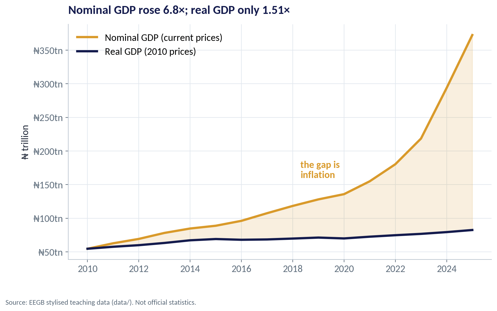
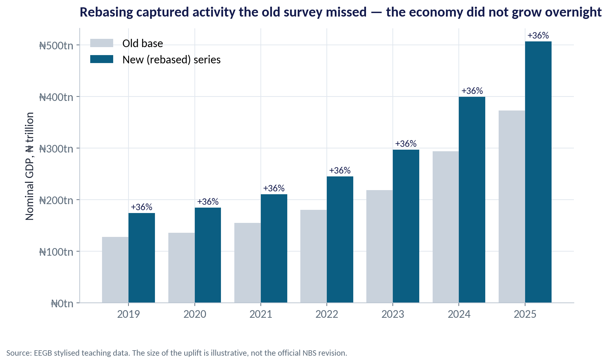
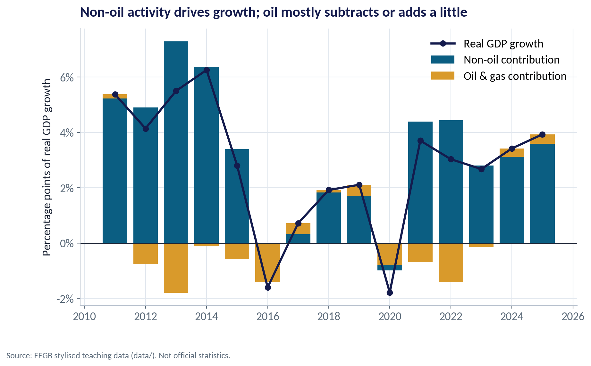
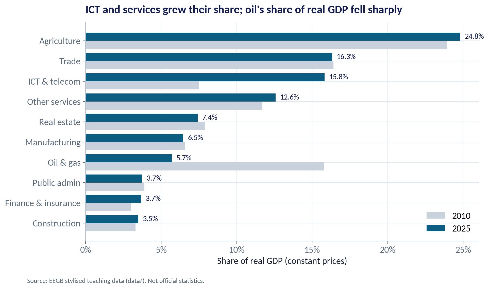
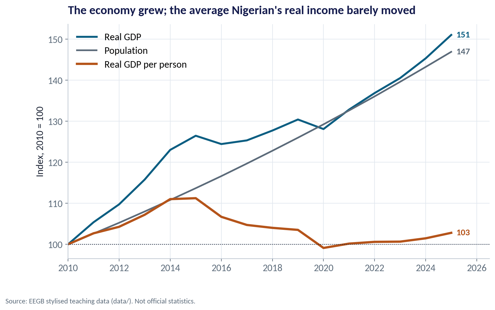
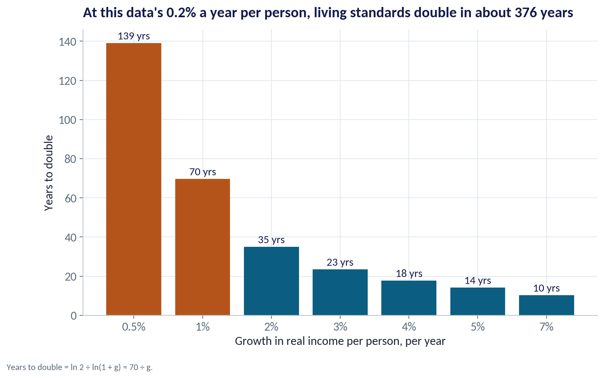
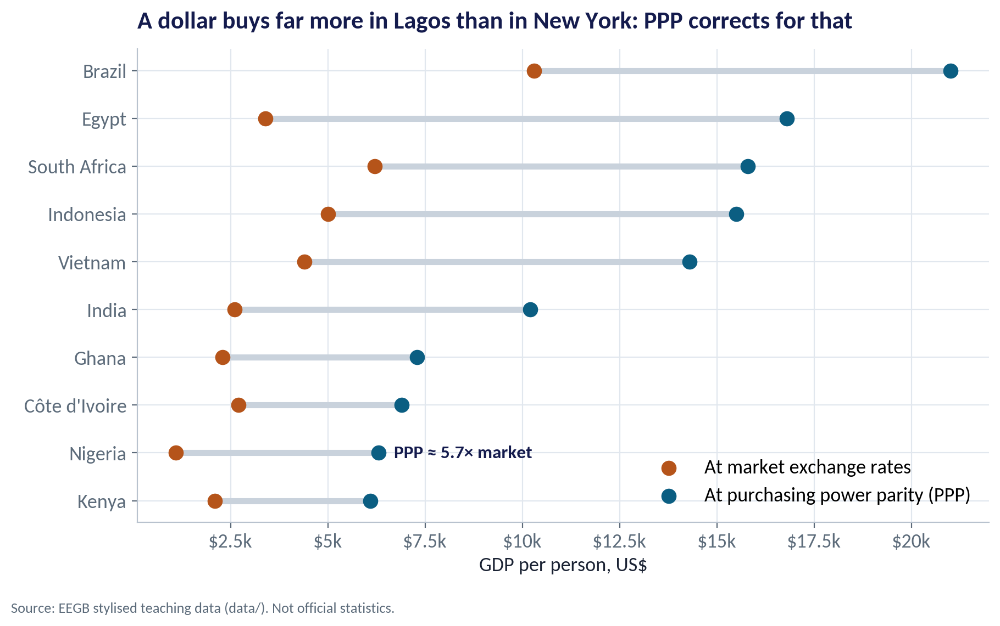
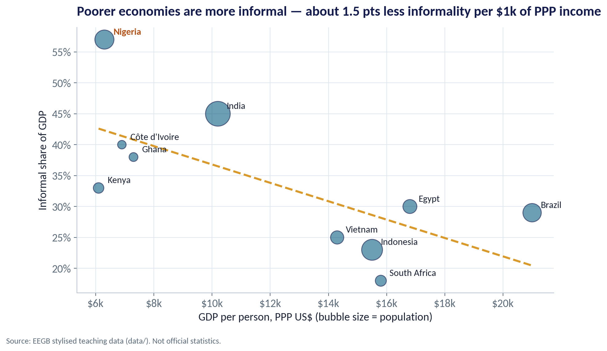

::: {.session-banner}
{.banner-hex width="96"}

**Session 7 of 16** · Facilitator: Bongo Adi<br>*Case:* Why did Nigeria's GDP 'jump' after rebasing — and is the oil or non-oil economy driving growth?

:::

## Downloads {.unnumbered}

::: {.download-row}
[<i class="bi bi-file-earmark-slides"></i> Teaching slides (.pptx)](../../sessions/s07/slides/EEGB_S07_National_Accounts_Productivity_Welfare.pptx){.btn .btn-primary download=""}
[<i class="bi bi-file-earmark-pdf"></i> Slides (PDF)](../../sessions/s07/slides/EEGB_S07_National_Accounts_Productivity_Welfare.pdf){.btn .btn-outline-primary download=""}
[<i class="bi bi-github"></i> Session folder on GitHub](https://github.com/adibongo/eegb/tree/main/sessions/s07){.btn .btn-outline-secondary}
:::

## Read first {.unnumbered}

- **N. Gregory Mankiw — Macroeconomics / Principles of Economics** — Textbook

## Learning objectives

::: {.grid}
::: {.g-col-12 .g-col-md-4 .obj-card}
**Read the National Accounts**

Explain GDP, GDI and GNI, nominal versus real, and what a rebasing does — and does not — change.
:::
::: {.g-col-12 .g-col-md-4 .obj-card}
**Find the Growth Drivers**

Separate oil from non-oil growth and spot which sectors are gaining share.
:::
::: {.g-col-12 .g-col-md-4 .obj-card}
**Judge Living Standards**

Use per-person, PPP and 'beyond GDP' measures to size a market honestly.
:::
:::

## The business case

::: {.callout-note appearance="simple" icon=false}
## Is Nigeria Getting Richer?

**Situation.** A consumer-goods company plans its five-year strategy. The CEO's slide says 'Nigeria's economy has grown 50% since 2010'. The CFO is less sure the average customer is better off.

**Question.** How much has the economy really grown, which sectors are driving it, and has income per person risen enough to grow our market?

**Data.** ng_gdp_sectors.csv — real GDP by ten sectors (₦ tn, 2010 prices), nominal GDP on old and new bases, population, 2010–2025; peer_income.csv — ten countries. *Stylised teaching data.*

**A good answer.** A one-paragraph view for the board on real growth, growth per person, and the sectors that matter for our demand.
:::

## Key ideas in plain English

### Taking Prices Out of GDP

Nominal GDP values output at today's prices; real GDP values it at a fixed base year's prices, so it moves only when quantities move. The ratio of the two is the GDP deflator — the broadest price index we have.

::: {.formula}
deflator = nominal GDP ÷ real GDP × 100
:::

*Example.* In this data nominal GDP rose 6.8× from 2010 to 2025, real GDP only 1.51×. Most of the 'growth' in naira was inflation; the deflator rose about 30% in 2024 alone.

::: {.callout-tip appearance="minimal"}
**Why a manager cares.** A market that grows 25% in naira while prices rise 30% is shrinking in volume. Always ask for real growth before celebrating.
:::

## Charts and how to replicate them

Every chart below is regenerated by the session's figure script — `sessions/s07/R/s07_figures.R` or `sessions/s07/python/s07_figures.py`. Run it from the project root.

### Nominal vs Real GDP

::: {.panel-tabset group="lang"}
## Python
{.fig-img fig-alt="S07-F04 (Python)"}

:::

- The gold line is GDP in current naira; the navy line removes inflation.
- From 2010 to 2025 nominal GDP rose 6.8×; real GDP rose 1.51×.
- The widening gap after 2022 reflects the inflation surge you saw in Session 6.
- Plan capacity on real growth; plan cash and prices on nominal.

<span class="fig-id">S07-F04</span>

### Same Economy, Bigger Measured GDP

::: {.panel-tabset group="lang"}
## Python
{.fig-img fig-alt="S07-F05 (Python)"}

:::

- Rebasing updates the base year, the sector weights and the coverage of new activities.
- Here the rebased series is about 36% higher in every year — an illustrative uplift.
- Growth rates change much less than levels.
- Ratios to GDP (debt, tax, credit) all fall at once — read them with care.

<span class="fig-id">S07-F05</span>

### Who Contributes to Growth?

::: {.panel-tabset group="lang"}
## Python
{.fig-img fig-alt="S07-F01 (Python)"}

:::

- Bars split each year's growth into non-oil (teal) and oil & gas (gold).
- Non-oil activity provided almost all the growth; oil subtracted in most years from 2012 to 2023.
- In 2022 oil output fell about 19% in this data while non-oil grew 4.8%.
- Oil is small in GDP but huge for dollars and government revenue — that is why it still moves the naira.

<span class="fig-id">S07-F01</span>

### The Changing Shape of the Economy

::: {.panel-tabset group="lang"}
## Python
{.fig-img fig-alt="S07-F02 (Python)"}

:::

- ICT & telecom roughly doubled its share, from 7.5% to 15.8% of real GDP.
- Oil & gas fell from 15.8% to 5.7%.
- Agriculture and trade remain the largest sectors, at about a quarter and a sixth of output.
- Manufacturing stayed near 6.5% — little sign of industrialisation.

<span class="fig-id">S07-F02</span>

### Bigger Economy, Same Average Income

::: {.panel-tabset group="lang"}
## Python
{.fig-img fig-alt="S07-F03 (Python)"}

:::

- Real GDP rose to 151 (2010 = 100); population rose to 147.
- Real GDP per person ended at only 103 — almost no gain in fifteen years.
- Population grows about 2.6% a year; GDP must beat that just to stand still.
- For consumer businesses: more customers, but not richer ones. Volume and value strategies differ.

<span class="fig-id">S07-F03</span>

### How Long to Double Living Standards?

::: {.panel-tabset group="lang"}
## Python
{.fig-img fig-alt="S07-F08 (Python)"}

:::

- Years to double ≈ 70 ÷ growth rate.
- At 3% per person, income doubles in about 23 years; at 7%, about 10.
- At this data's 0.2% per person, it takes about 376 years.
- Small differences in growth, compounded, decide whether a generation gets richer.

<span class="fig-id">S07-F08</span>

### Market Rates vs PPP

::: {.panel-tabset group="lang"}
## Python
{.fig-img fig-alt="S07-F06 (Python)"}

:::

- At market exchange rates, GDP per person here is about $1,100; at PPP about $6,300.
- PPP adjusts for the fact that haircuts, food and rent cost less in Lagos than in London.
- Nigeria's PPP-to-market ratio (5.7×) is the highest in this group — partly because the naira fell so far.
- Use PPP to compare living standards; use market rates to price imports or report in dollars.

<span class="fig-id">S07-F06</span>

### The Economy the Statistics Struggle to See

::: {.panel-tabset group="lang"}
## Python
{.fig-img fig-alt="S07-F07 (Python)"}

:::

- Informal firms are unregistered and often unseen by surveys and tax.
- In this data Nigeria's informal share is about 57% of GDP — the highest of the group.
- Across countries, richer economies are less informal: about 1.5 points less per $1k of PPP income.
- For managers: much of your market is cash-based, informal and hard to size — triangulate with your own sales data.

<span class="fig-id">S07-F07</span>

## Lab: Is Nigeria Getting Richer?

*Time:* 20 minutes · *Data:* [`data/ng_gdp_sectors.csv`](../../data/ng_gdp_sectors.csv), [`data/peer_income.csv`](../../data/peer_income.csv)

1. Compute real GDP growth year by year.
2. Split growth into oil and non-oil.
3. Rank sectors by average annual growth, 2010–2025.
4. Compute real GDP per person and the years it would take to double.
5. Compare market-rate and PPP income across peers.

::: {.callout-important appearance="simple"}
**Deliverable:** a short paragraph for the board: real growth, growth per person, and the two sectors that matter most for your demand.
:::

## The code (R | Python)

Pick your language once; every tab on the site follows your choice. Download a script, or copy it into RStudio and run it line by line.

### Replicate every chart

::: {.panel-tabset group="lang"}
## Python
[<i class="bi bi-download"></i> s07_figures.py](../../sessions/s07/python/s07_figures.py){download=""}

::: {.callout-note collapse="true" appearance="simple" icon=false}
## Show the full script (149 lines)

```{.python filename="sessions/s07/python/s07_figures.py"}
# =============================================================================
# EEGB · Session 7 · National Accounts, Productivity & Welfare
# Replication script — regenerates every chart in the Session 7 deck (Python)
# Data: data/ng_gdp_sectors.csv (stylised real GDP by sector, ₦ tn, 2010–2025)
#       data/peer_income.csv   (stylised cross-country snapshot)
# Run from the project root:  python sessions/s07/python/s07_figures.py
# =============================================================================
import sys; sys.path.insert(0, "python")
import numpy as np, pandas as pd
import matplotlib.pyplot as plt
from matplotlib.ticker import FuncFormatter
from eegb_style import *

set_style()
g = pd.read_csv("data/ng_gdp_sectors.csv")
peers = pd.read_csv("data/peer_income.csv")
sectors = ["agriculture", "oil_and_gas", "manufacturing", "construction", "trade", "ict_telecom",
           "finance_insurance", "real_estate", "public_admin", "other_services"]
nice = {s: s.replace("_and_", " & ").replace("_", " ").replace("ict telecom", "ICT & telecom").capitalize() for s in sectors}
nice["ict_telecom"] = "ICT & telecom"; nice["oil_and_gas"] = "Oil & gas"; nice["finance_insurance"] = "Finance & insurance"

# --- F01 · Real growth and who contributed: oil vs non-oil ------------------------------
g["growth"] = 100 * g.real_gdp_total.pct_change()
g["non_oil"] = g.real_gdp_total - g.oil_and_gas
g["contrib_oil"] = 100 * g.oil_and_gas.diff() / g.real_gdp_total.shift(1)
g["contrib_non_oil"] = 100 * g.non_oil.diff() / g.real_gdp_total.shift(1)
d = g.dropna(subset=["growth"])
fig, ax = plt.subplots()
ax.bar(d.year, d.contrib_non_oil, color=TEAL, label="Non-oil contribution")
ax.bar(d.year, d.contrib_oil, bottom=np.where(d.contrib_oil < 0, 0, d.contrib_non_oil), color=GOLD, label="Oil & gas contribution")
ax.plot(d.year, d.growth, color=NAVY, marker="o", lw=2.4, label="Real GDP growth")
ax.axhline(0, color=INK, lw=1)
ax.yaxis.set_major_formatter(FuncFormatter(lambda v, p: f"{v:.0f}%")); ax.legend(loc="upper right")
ax.set(title="Non-oil activity drives growth; oil mostly subtracts or adds a little",
       ylabel="Percentage points of real GDP growth")
note(fig); save(fig, "s07", "f01")

# --- F02 · How the economy's structure changed: shares 2010 vs 2025 ------------------------
sh = pd.DataFrame({y: 100 * g.loc[g.year == y, sectors].iloc[0] / g.loc[g.year == y, "real_gdp_total"].iloc[0] for y in (2010, 2025)})
sh = sh.sort_values(2025)
fig, ax = plt.subplots()
yy = np.arange(len(sh))
ax.barh(yy - .2, sh[2010], height=.4, color="#C9D2DC", label="2010")
ax.barh(yy + .2, sh[2025], height=.4, color=TEAL, label="2025")
for i, (a, b) in enumerate(zip(sh[2010], sh[2025])):
    ax.text(b + .3, i + .2, f"{b:.1f}%", va="center", fontsize=11, color=NAVY)
ax.set_yticks(yy, [nice[s] for s in sh.index]); ax.legend(loc="lower right")
ax.xaxis.set_major_formatter(FuncFormatter(lambda v, p: f"{v:.0f}%"))
ax.set(title="ICT and services grew their share; oil's share of real GDP fell sharply",
       xlabel="Share of real GDP (constant prices)")
note(fig); save(fig, "s07", "f02")

# --- F03 · Total GDP vs GDP per person ----------------------------------------------------
g["gdp_pc"] = g.real_gdp_total * 1e12 / (g.population_m * 1e6)     # ₦ per person, constant prices
idx = pd.DataFrame({"year": g.year, "Real GDP": 100 * g.real_gdp_total / g.real_gdp_total.iloc[0],
                    "Population": 100 * g.population_m / g.population_m.iloc[0],
                    "Real GDP per person": 100 * g.gdp_pc / g.gdp_pc.iloc[0]})
fig, ax = plt.subplots()
for col, c, lw in [("Real GDP", TEAL, 2.6), ("Population", SLATE, 2.2), ("Real GDP per person", RUST, 3)]:
    ax.plot(idx.year, idx[col], color=c, lw=lw, label=col)
    ax.text(2025.2, idx[col].iloc[-1], f"{idx[col].iloc[-1]:.0f}", color=c, fontsize=12, va="center", fontweight="bold")
ax.axhline(100, color=INK, lw=1, ls=":")
ax.legend(loc="upper left"); ax.set_xlim(2010, 2026.5)
ax.set(title="The economy grew; the average Nigerian's real income barely moved",
       ylabel="Index, 2010 = 100")
note(fig); save(fig, "s07", "f03")

# --- F04 · Nominal vs real GDP and the GDP deflator -------------------------------------------
g["deflator"] = 100 * g.nominal_gdp_old_base / g.real_gdp_total
fig, ax = plt.subplots()
ax.plot(g.year, g.nominal_gdp_old_base, color=GOLD, lw=3, label="Nominal GDP (current prices)")
ax.plot(g.year, g.real_gdp_total, color=NAVY, lw=3, label="Real GDP (2010 prices)")
ax.fill_between(g.year, g.real_gdp_total, g.nominal_gdp_old_base, color=GOLD, alpha=.15)
ax.text(2018.3, 160, "the gap is\ninflation", color=GOLD, fontsize=13, fontweight="bold")
ax.yaxis.set_major_formatter(FuncFormatter(lambda v, p: f"₦{v:.0f}tn")); ax.legend(loc="upper left")
ax.set(title=f"Nominal GDP rose {g.nominal_gdp_old_base.iloc[-1] / g.nominal_gdp_old_base.iloc[0]:.1f}×; real GDP only {g.real_gdp_total.iloc[-1] / g.real_gdp_total.iloc[0]:.2f}×",
       ylabel="₦ trillion")
note(fig); save(fig, "s07", "f04")

# --- F05 · Rebasing: same economy, a bigger measured GDP ---------------------------------------
r = g[g.year >= 2019]
fig, ax = plt.subplots()
x = np.arange(len(r))
ax.bar(x - .2, r.nominal_gdp_old_base, width=.4, color="#C9D2DC", label="Old base")
ax.bar(x + .2, r.nominal_gdp_new_base, width=.4, color=TEAL, label="New (rebased) series")
uplift = 100 * (r.nominal_gdp_new_base / r.nominal_gdp_old_base - 1)
for i, u in enumerate(uplift):
    ax.text(i + .2, r.nominal_gdp_new_base.iloc[i] + 6, f"+{u:.0f}%", ha="center", fontsize=11, color=NAVY)
ax.set_xticks(x, r.year); ax.legend(loc="upper left")
ax.yaxis.set_major_formatter(FuncFormatter(lambda v, p: f"₦{v:.0f}tn"))
ax.set(title="Rebasing captured activity the old survey missed — the economy did not grow overnight",
       ylabel="Nominal GDP, ₦ trillion")
note(fig, "Source: EEGB stylised teaching data. The size of the uplift is illustrative, not the official NBS revision."); save(fig, "s07", "f05")

# --- F06 · Market exchange rates vs purchasing power parity -----------------------------------
p = peers.sort_values("gdp_per_capita_ppp")
fig, ax = plt.subplots()
yy = np.arange(len(p))
ax.hlines(yy, p.gdp_per_capita_usd, p.gdp_per_capita_ppp, color="#C9D2DC", lw=4)
ax.scatter(p.gdp_per_capita_usd, yy, color=RUST, s=80, zorder=3, label="At market exchange rates")
ax.scatter(p.gdp_per_capita_ppp, yy, color=TEAL, s=80, zorder=3, label="At purchasing power parity (PPP)")
ax.set_yticks(yy, p.country)
for i, c in enumerate(p.country):
    if c == "Nigeria":
        ratio = p.gdp_per_capita_ppp.iloc[i] / p.gdp_per_capita_usd.iloc[i]
        ax.text(p.gdp_per_capita_ppp.iloc[i] + 400, i, f"PPP ≈ {ratio:.1f}× market", va="center", color=NAVY, fontsize=12, fontweight="bold")
ax.xaxis.set_major_formatter(FuncFormatter(lambda v, p_: f"${v/1000:g}k")); ax.legend(loc="lower right")
ax.set(title="A dollar buys far more in Lagos than in New York: PPP corrects for that",
       xlabel="GDP per person, US$")
note(fig); save(fig, "s07", "f06")

# --- F07 · Informality and income ------------------------------------------------------------
fig, ax = plt.subplots()
ax.scatter(peers.gdp_per_capita_ppp, 100 * peers.informal_share_gdp, s=peers.population_m.clip(upper=400) * 2 + 40,
           color=TEAL, alpha=.6, edgecolor=NAVY)
for _, rw in peers.iterrows():
    ax.text(rw.gdp_per_capita_ppp + 300, 100 * rw.informal_share_gdp + .8, rw.country, fontsize=11,
            color=RUST if rw.country == "Nigeria" else INK, fontweight="bold" if rw.country == "Nigeria" else "normal")
X = np.column_stack([np.ones(len(peers)), peers.gdp_per_capita_ppp / 1000])
b = np.linalg.lstsq(X, 100 * peers.informal_share_gdp, rcond=None)[0]
xx = np.linspace(peers.gdp_per_capita_ppp.min(), peers.gdp_per_capita_ppp.max(), 50)
ax.plot(xx, b[0] + b[1] * xx / 1000, color=GOLD, lw=2.4, ls="--")
ax.xaxis.set_major_formatter(FuncFormatter(lambda v, p_: f"${v/1000:g}k")); ax.yaxis.set_major_formatter(FuncFormatter(lambda v, p_: f"{v:.0f}%"))
ax.set(title=f"Poorer economies are more informal — about {abs(b[1]):.1f} pts less informality per $1k of PPP income",
       xlabel="GDP per person, PPP US$ (bubble size = population)", ylabel="Informal share of GDP")
note(fig); save(fig, "s07", "f07")

# --- F08 · The rule of 70: how long to double living standards? --------------------------------
rates = np.array([0.5, 1, 2, 3, 4, 5, 7])
fig, ax = plt.subplots()
yrs = np.log(2) / np.log(1 + rates / 100)
bars = ax.bar([f"{r:g}%" for r in rates], yrs, color=[RUST if r < 1.5 else TEAL for r in rates])
for bb, v in zip(bars, yrs):
    ax.text(bb.get_x() + bb.get_width() / 2, v + 2, f"{v:.0f} yrs", ha="center", fontsize=12, color=NAVY)
pc_growth = 100 * ((g.gdp_pc.iloc[-1] / g.gdp_pc.iloc[0]) ** (1 / (len(g) - 1)) - 1)
ax.set(title=f"At this data's {pc_growth:.1f}% a year per person, living standards double in about {np.log(2)/np.log(1+pc_growth/100):.0f} years",
       xlabel="Growth in real income per person, per year", ylabel="Years to double")
note(fig, "Years to double = ln 2 ÷ ln(1 + g) ≈ 70 ÷ g."); save(fig, "s07", "f08")

if __name__ == "__main__":
    print(d[["year", "growth", "contrib_oil", "contrib_non_oil"]].round(2).to_string())
    print(sh.round(1))
    print(idx.tail(1).round(1))
    print("pc growth %/yr", round(pc_growth, 2), "pc 2010", round(g.gdp_pc.iloc[0]), "pc 2025", round(g.gdp_pc.iloc[-1]))
    print("nominal x", round(g.nominal_gdp_old_base.iloc[-1] / g.nominal_gdp_old_base.iloc[0], 2), "real x", round(g.real_gdp_total.iloc[-1] / g.real_gdp_total.iloc[0], 2))
    print("deflator", g[["year", "deflator"]].round(0).tail(4).to_string())
    print("uplift", uplift.round(1).tolist())
    print("informality slope", b.round(2))
    print("avg growth 2016-2025", round(d[d.year >= 2016].growth.mean(), 2), "pop growth", round(100 * ((g.population_m.iloc[-1] / g.population_m.iloc[0]) ** (1 / 15) - 1), 2))
```
:::

## R
[<i class="bi bi-download"></i> s07_figures.R](../../sessions/s07/R/s07_figures.R){download=""}

::: {.callout-note collapse="true" appearance="simple" icon=false}
## Show the full script (109 lines)

```{.r filename="sessions/s07/R/s07_figures.R"}
# =============================================================================
# EEGB · Session 7 · National Accounts, Productivity & Welfare
# Replication script — regenerates every chart in the Session 7 deck (R)
# Data: data/ng_gdp_sectors.csv and data/peer_income.csv (stylised)
# =============================================================================
source("R/theme_eegb.R")
suppressPackageStartupMessages({ library(dplyr); library(readr); library(tidyr) })
g <- read_csv("data/ng_gdp_sectors.csv", show_col_types = FALSE)
peers <- read_csv("data/peer_income.csv", show_col_types = FALSE)
sectors <- c("agriculture", "oil_and_gas", "manufacturing", "construction", "trade", "ict_telecom",
             "finance_insurance", "real_estate", "public_admin", "other_services")
nice <- c(agriculture = "Agriculture", oil_and_gas = "Oil & gas", manufacturing = "Manufacturing", construction = "Construction",
          trade = "Trade", ict_telecom = "ICT & telecom", finance_insurance = "Finance & insurance", real_estate = "Real estate",
          public_admin = "Public admin", other_services = "Other services")
kfmt <- function(v) paste0("$", v / 1000, "k")

# --- F01 · Growth contributions: oil vs non-oil ---------------------------------------------
g <- g |> mutate(growth = 100 * (real_gdp_total / lag(real_gdp_total) - 1), non_oil = real_gdp_total - oil_and_gas,
                 `Oil & gas contribution` = 100 * (oil_and_gas - lag(oil_and_gas)) / lag(real_gdp_total),
                 `Non-oil contribution` = 100 * (non_oil - lag(non_oil)) / lag(real_gdp_total))
contrib <- g |> filter(!is.na(growth)) |> select(year, `Oil & gas contribution`, `Non-oil contribution`) |>
  pivot_longer(-year, names_to = "part", values_to = "pts")
p1 <- ggplot(contrib, aes(year, pts, fill = part)) + geom_col() +
  geom_line(data = filter(g, !is.na(growth)), aes(year, growth), inherit.aes = FALSE, colour = eegb[["navy"]], linewidth = 1.1) +
  geom_point(data = filter(g, !is.na(growth)), aes(year, growth), inherit.aes = FALSE, colour = eegb[["navy"]], size = 2.5) +
  geom_hline(yintercept = 0) +
  scale_fill_manual(values = c(`Oil & gas contribution` = eegb[["gold"]], `Non-oil contribution` = eegb[["teal"]]), name = NULL) +
  labs(title = "Non-oil activity drives growth; oil mostly subtracts or adds a little",
       subtitle = "Bars: contributions in percentage points. Line: real GDP growth.",
       x = NULL, y = "Percentage points of real GDP growth", caption = eegb_caption) + theme_eegb()
save_fig(p1, "s07", "f01")

# --- F02 · Sector shares 2010 vs 2025 ---------------------------------------------------------
sh <- g |> filter(year %in% c(2010, 2025)) |> select(year, real_gdp_total, all_of(sectors)) |>
  pivot_longer(all_of(sectors), names_to = "sector", values_to = "v") |> mutate(share = 100 * v / real_gdp_total,
  sector = nice[sector], year = factor(year))
ord <- sh |> filter(year == "2025") |> arrange(share) |> pull(sector)
p2 <- ggplot(sh, aes(share, factor(sector, levels = ord), fill = year)) + geom_col(position = position_dodge(width = .8), width = .75) +
  scale_fill_manual(values = c(`2010` = "#C9D2DC", `2025` = eegb[["teal"]]), name = NULL) +
  scale_x_continuous(labels = function(v) paste0(v, "%")) +
  labs(title = "ICT and services grew their share; oil's share of real GDP fell sharply",
       x = "Share of real GDP (constant prices)", y = NULL, caption = eegb_caption) + theme_eegb()
save_fig(p2, "s07", "f02")

# --- F03 · GDP, population and GDP per person (index) ------------------------------------------
idx <- g |> transmute(year, `Real GDP` = 100 * real_gdp_total / first(real_gdp_total),
                      Population = 100 * population_m / first(population_m),
                      `Real GDP per person` = 100 * (real_gdp_total / population_m) / first(real_gdp_total / population_m)) |>
  pivot_longer(-year, names_to = "series", values_to = "index")
p3 <- ggplot(idx, aes(year, index, colour = series)) + geom_line(linewidth = 1.3) + geom_hline(yintercept = 100, linetype = "dotted") +
  scale_colour_manual(values = c(`Real GDP` = eegb[["teal"]], Population = eegb[["slate"]], `Real GDP per person` = eegb[["rust"]]), name = NULL) +
  labs(title = "The economy grew; the average Nigerian's real income barely moved", x = NULL, y = "Index, 2010 = 100",
       caption = eegb_caption) + theme_eegb()
save_fig(p3, "s07", "f03")

# --- F04 · Nominal vs real GDP ---------------------------------------------------------------
p4 <- ggplot(g, aes(year)) +
  geom_ribbon(aes(ymin = real_gdp_total, ymax = nominal_gdp_old_base), fill = eegb[["gold"]], alpha = .15) +
  geom_line(aes(y = nominal_gdp_old_base, colour = "Nominal GDP (current prices)"), linewidth = 1.4) +
  geom_line(aes(y = real_gdp_total, colour = "Real GDP (2010 prices)"), linewidth = 1.4) +
  scale_colour_manual(values = c(eegb[["gold"]], eegb[["navy"]]), name = NULL) +
  scale_y_continuous(labels = function(v) paste0("₦", v, "tn")) +
  labs(title = sprintf("Nominal GDP rose %.1f×; real GDP only %.2f×", last(g$nominal_gdp_old_base) / first(g$nominal_gdp_old_base),
                       last(g$real_gdp_total) / first(g$real_gdp_total)), x = NULL, y = "₦ trillion", caption = eegb_caption) + theme_eegb()
save_fig(p4, "s07", "f04")

# --- F05 · Rebasing ---------------------------------------------------------------------------
rb <- g |> filter(year >= 2019) |> select(year, `Old base` = nominal_gdp_old_base, `New (rebased) series` = nominal_gdp_new_base) |>
  pivot_longer(-year, names_to = "series", values_to = "v")
p5 <- ggplot(rb, aes(factor(year), v, fill = series)) + geom_col(position = "dodge") +
  scale_fill_manual(values = c(`Old base` = "#C9D2DC", `New (rebased) series` = eegb[["teal"]]), name = NULL) +
  scale_y_continuous(labels = function(v) paste0("₦", v, "tn")) +
  labs(title = "Rebasing captured activity the old survey missed — the economy did not grow overnight",
       x = NULL, y = "Nominal GDP, ₦ trillion",
       caption = "Stylised teaching data. The size of the uplift is illustrative, not the official NBS revision.") + theme_eegb()
save_fig(p5, "s07", "f05")

# --- F06 · Market exchange rates vs PPP -------------------------------------------------------
p6 <- ggplot(peers, aes(y = reorder(country, gdp_per_capita_ppp))) +
  geom_segment(aes(x = gdp_per_capita_usd, xend = gdp_per_capita_ppp, yend = reorder(country, gdp_per_capita_ppp)), colour = "#C9D2DC", linewidth = 2) +
  geom_point(aes(x = gdp_per_capita_usd, colour = "At market exchange rates"), size = 3.5) +
  geom_point(aes(x = gdp_per_capita_ppp, colour = "At purchasing power parity (PPP)"), size = 3.5) +
  scale_colour_manual(values = c(eegb[["rust"]], eegb[["teal"]]), name = NULL) + scale_x_continuous(labels = kfmt) +
  labs(title = "A dollar buys far more in Lagos than in New York: PPP corrects for that",
       x = "GDP per person, US$", y = NULL, caption = eegb_caption) + theme_eegb()
save_fig(p6, "s07", "f06")

# --- F07 · Informality vs income --------------------------------------------------------------
fit <- lm(I(100 * informal_share_gdp) ~ I(gdp_per_capita_ppp / 1000), data = peers)
p7 <- ggplot(peers, aes(gdp_per_capita_ppp, 100 * informal_share_gdp)) +
  geom_smooth(method = "lm", se = FALSE, linetype = "dashed", colour = eegb[["gold"]], formula = y ~ x) +
  geom_point(aes(size = pmin(population_m, 400)), colour = eegb[["navy"]], fill = eegb[["teal"]], shape = 21, alpha = .7, show.legend = FALSE) +
  geom_text(aes(label = country), nudge_x = 300, nudge_y = 1, hjust = 0, size = 3.6) +
  scale_x_continuous(labels = kfmt) + scale_y_continuous(labels = function(v) paste0(v, "%")) +
  labs(title = sprintf("Poorer economies are more informal — about %.1f pts less informality per $1k of PPP income", abs(coef(fit)[2])),
       x = "GDP per person, PPP US$ (bubble size = population)", y = "Informal share of GDP", caption = eegb_caption) + theme_eegb()
save_fig(p7, "s07", "f07")

# --- F08 · Rule of 70 ---------------------------------------------------------------------------
pc <- g$real_gdp_total / g$population_m
pc_growth <- 100 * ((last(pc) / first(pc))^(1 / (nrow(g) - 1)) - 1)
r70 <- tibble(rate = c(0.5, 1, 2, 3, 4, 5, 7)) |> mutate(years = log(2) / log(1 + rate / 100), lab = paste0(rate, "%"))
p8 <- ggplot(r70, aes(factor(lab, levels = lab), years, fill = rate < 1.5)) + geom_col(show.legend = FALSE) +
  geom_text(aes(label = paste0(round(years), " yrs")), vjust = -.4) +
  scale_fill_manual(values = c(`TRUE` = eegb[["rust"]], `FALSE` = eegb[["teal"]])) +
  labs(title = sprintf("At this data's %.1f%% a year per person, living standards double in about %.0f years",
                       pc_growth, log(2) / log(1 + pc_growth / 100)),
       x = "Growth in real income per person, per year", y = "Years to double", caption = "Years to double = ln 2 ÷ ln(1 + g) ≈ 70 ÷ g.") + theme_eegb()
save_fig(p8, "s07", "f08")
```
:::

:::

### Lab

::: {.panel-tabset group="lang"}
## Python
[<i class="bi bi-download"></i> s07_lab.py](../../sessions/s07/python/s07_lab.py){download=""}

::: {.callout-note collapse="true" appearance="simple" icon=false}
## Show the full script (47 lines)

```{.python filename="sessions/s07/python/s07_lab.py"}
# =============================================================================
# EEGB · Session 7 LAB · Is Nigeria getting richer? Reading the national accounts (Python)
# Data: data/ng_gdp_sectors.csv — stylised real GDP by sector (₦ tn, 2010 prices), 2010–2025
#       data/peer_income.csv   — stylised cross-country snapshot
# Run from the project root, line by line
# =============================================================================
import numpy as np, pandas as pd

g = pd.read_csv("data/ng_gdp_sectors.csv")
peers = pd.read_csv("data/peer_income.csv")

# ---- STEP 1 · Real growth, year by year -------------------------------------------
g["real_growth_pct"] = 100 * g.real_gdp_total.pct_change()
print(g[["year", "real_gdp_total", "real_growth_pct"]].round(2))

# ---- STEP 2 · Oil vs non-oil ----------------------------------------------------------
g["non_oil"] = g.real_gdp_total - g.oil_and_gas
g["oil_growth_pct"] = 100 * g.oil_and_gas.pct_change()
g["non_oil_growth_pct"] = 100 * g.non_oil.pct_change()
print(g[["year", "oil_growth_pct", "non_oil_growth_pct"]].round(1).tail(6))

# ---- STEP 3 · Which sectors grew fastest? (average annual growth 2010–2025) -----------------
sectors = ["agriculture", "oil_and_gas", "manufacturing", "construction", "trade", "ict_telecom",
           "finance_insurance", "real_estate", "public_admin", "other_services"]
years = g.year.iloc[-1] - g.year.iloc[0]
cagr = 100 * ((g[sectors].iloc[-1] / g[sectors].iloc[0]) ** (1 / years) - 1)
print(cagr.sort_values(ascending=False).round(1))

# ---- STEP 4 · Per person: is the average Nigerian better off? ----------------------------------
g["gdp_per_person_naira"] = g.real_gdp_total * 1e12 / (g.population_m * 1e6)
pc_growth = 100 * ((g.gdp_per_person_naira.iloc[-1] / g.gdp_per_person_naira.iloc[0]) ** (1 / years) - 1)
print(f"real GDP per person grew {pc_growth:.2f}% a year; years to double at that rate: {np.log(2)/np.log(1+pc_growth/100):.0f}")

# ---- STEP 5 · Nominal vs real, and the GDP deflator ---------------------------------------------
g["deflator"] = 100 * g.nominal_gdp_old_base / g.real_gdp_total
g["deflator_inflation_pct"] = 100 * g.deflator.pct_change()
print(g[["year", "nominal_gdp_old_base", "real_gdp_total", "deflator", "deflator_inflation_pct"]].round(1).tail(5))

# ---- STEP 6 · Market rates vs PPP across peers ------------------------------------------------------
peers["ppp_ratio"] = peers.gdp_per_capita_ppp / peers.gdp_per_capita_usd
print(peers.sort_values("ppp_ratio", ascending=False)[["country", "gdp_per_capita_usd", "gdp_per_capita_ppp", "ppp_ratio"]])

# ---- YOUR TURN ---------------------------------------------------------------------------------------
# (a) Your board says "Nigeria's GDP grew 50% since 2010, so our market grew 50%". Using Steps 1 and 4, reply in two sentences.
# (b) Which two sectors would you bet on for a B2B business, and why? Use Step 3.
# (c) A foreign investor compares Nigeria and Ghana at market exchange rates. Why might PPP give a different picture
#     of the size of the consumer market — and which measure should they use to price a product?
```
:::

## R
[<i class="bi bi-download"></i> s07_lab.R](../../sessions/s07/R/s07_lab.R){download=""}

::: {.callout-note collapse="true" appearance="simple" icon=false}
## Show the full script (46 lines)

```{.r filename="sessions/s07/R/s07_lab.R"}
# =============================================================================
# EEGB · Session 7 LAB · Is Nigeria getting richer? Reading the national accounts (R)
# Data: data/ng_gdp_sectors.csv — stylised real GDP by sector (₦ tn, 2010 prices), 2010–2025
#       data/peer_income.csv   — stylised cross-country snapshot
# Open eegb.Rproj first, then run line by line
# =============================================================================
library(dplyr); library(readr)
g <- read_csv("data/ng_gdp_sectors.csv", show_col_types = FALSE)
peers <- read_csv("data/peer_income.csv", show_col_types = FALSE)

# ---- STEP 1 · Real growth, year by year -------------------------------------------
g <- g |> mutate(real_growth_pct = 100 * (real_gdp_total / lag(real_gdp_total) - 1))
select(g, year, real_gdp_total, real_growth_pct)

# ---- STEP 2 · Oil vs non-oil ----------------------------------------------------------
g <- g |> mutate(non_oil = real_gdp_total - oil_and_gas,
                 oil_growth_pct = 100 * (oil_and_gas / lag(oil_and_gas) - 1),
                 non_oil_growth_pct = 100 * (non_oil / lag(non_oil) - 1))
tail(select(g, year, oil_growth_pct, non_oil_growth_pct), 6)

# ---- STEP 3 · Which sectors grew fastest? ---------------------------------------------------
sectors <- c("agriculture", "oil_and_gas", "manufacturing", "construction", "trade", "ict_telecom",
             "finance_insurance", "real_estate", "public_admin", "other_services")
n_years <- last(g$year) - first(g$year)
cagr <- sapply(sectors, function(s) 100 * ((last(g[[s]]) / first(g[[s]]))^(1 / n_years) - 1))
sort(round(cagr, 1), decreasing = TRUE)

# ---- STEP 4 · Per person ----------------------------------------------------------------------
g <- g |> mutate(gdp_per_person_naira = real_gdp_total * 1e12 / (population_m * 1e6))
pc_growth <- 100 * ((last(g$gdp_per_person_naira) / first(g$gdp_per_person_naira))^(1 / n_years) - 1)
cat(sprintf("real GDP per person grew %.2f%% a year; years to double: %.0f\n", pc_growth, log(2) / log(1 + pc_growth / 100)))

# ---- STEP 5 · Nominal vs real, and the GDP deflator ---------------------------------------------
g <- g |> mutate(deflator = 100 * nominal_gdp_old_base / real_gdp_total,
                 deflator_inflation_pct = 100 * (deflator / lag(deflator) - 1))
tail(select(g, year, nominal_gdp_old_base, real_gdp_total, deflator, deflator_inflation_pct), 5)

# ---- STEP 6 · Market rates vs PPP ----------------------------------------------------------------
peers |> mutate(ppp_ratio = gdp_per_capita_ppp / gdp_per_capita_usd) |> arrange(desc(ppp_ratio)) |>
  select(country, gdp_per_capita_usd, gdp_per_capita_ppp, ppp_ratio)

# ---- YOUR TURN ---------------------------------------------------------------------------------------
# (a) "Nigeria's GDP grew 50% since 2010, so our market grew 50%." Reply in two sentences using Steps 1 and 4.
# (b) Which two sectors would you bet on for a B2B business, and why? Use Step 3.
# (c) Why might PPP give a different picture of a consumer market than market exchange rates —
#     and which measure should you use to price a product?
```
:::

:::

## Check your understanding

**Q1.** After a rebasing, Nigeria's measured GDP rises 36% while the debt stock is unchanged. Which statement is right?

- **A.** The government can now borrow 36% more safely
- **B.** Debt-to-GDP falls, but the government's ability to pay — its revenue — has not changed
- **C.** Living standards rose 36%
- **D.** Real growth last year was 36%

::: {.callout-tip collapse="true" appearance="simple"}
## Show answer
**B.** B. The denominator grew, so the ratio falls, but debt is paid from revenue, not from GDP. Nothing about incomes (C) or last year's growth rate (D) changed; borrowing capacity (A) depends on revenue and interest costs.
:::

**Q2.** Real GDP grows 3.4% and population grows 2.6%. Roughly how fast is real income per person growing, and how long until it doubles?

- **A.** 3.4% a year; about 20 years
- **B.** About 0.8% a year; about 90 years
- **C.** 6.0% a year; about 12 years
- **D.** It cannot be calculated without PPP data

::: {.callout-tip collapse="true" appearance="simple"}
## Show answer
**B.** B. Per-person growth ≈ 3.4% − 2.6% = 0.8%. Using the rule of 70: 70 ÷ 0.8 ≈ 88 years. A ignores population; C adds instead of subtracts; D is wrong — PPP is not needed for a growth rate.
:::

## Vocabulary

| Term | Meaning |
|---|---|
| **GDP** | Value of all final goods and services produced in a country in a period. |
| **Value added** | Output minus the inputs bought from other firms. |
| **GNI** | GDP plus net income received from abroad. |
| **Real GDP** | GDP at constant prices: shows changes in volume. |
| **GDP deflator** | Nominal ÷ real GDP × 100: the broadest price index. |
| **Rebasing** | Updating the base year, weights and coverage of the accounts. |
| **PPP** | Exchange rate that equalises what money can buy across countries. |
| **Informal economy** | Activity that is unregistered and largely unmeasured. |
| **Productivity** | Output per worker or per hour; the root of living standards. |
| **Rule of 70** | Years to double ≈ 70 ÷ the annual growth rate. |

## Key takeaways

1. GDP can be measured by output, spending or income; Nigeria's GNI is below its GDP.
2. Always separate nominal from real; the deflator tells you how much was inflation.
3. Rebasing changes levels and ratios, not what the economy did.
4. Non-oil sectors drive growth, but oil still drives dollars and revenue.
5. What matters for customers is income per person — and here it has barely moved.

::: {.callout-note appearance="simple"}
**Before next session:** Read the HBS Note on Money and Monetary Policy (9-797-076) and the CBN brief on liquidity management. Note how your company's borrowing rate changed between 2023 and 2025.
:::

::: {.session-nav}
[← Session 6: AD–AS & Inflation](../../sessions/s06/index.qmd)
[Session 8: Monetary Policy →](../../sessions/s08/index.qmd){.next}
:::
