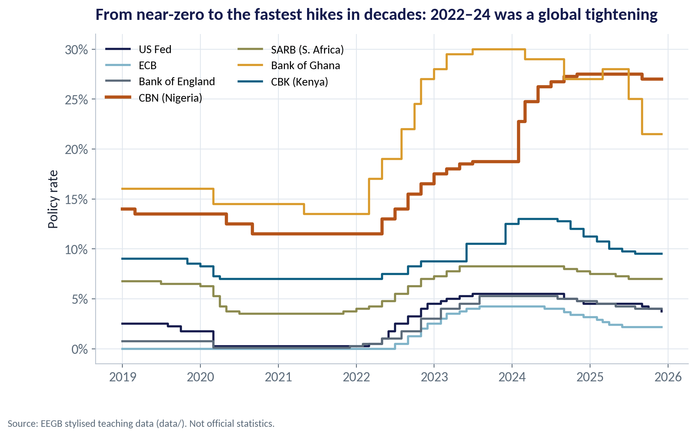
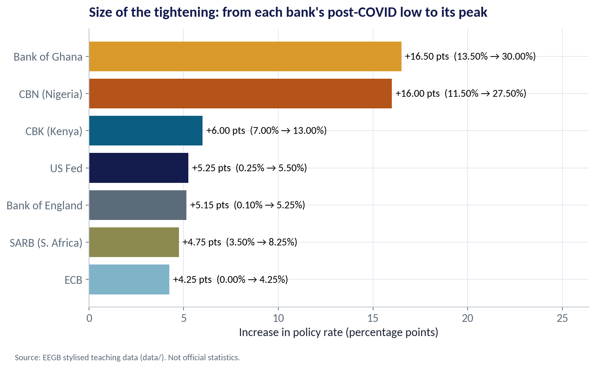
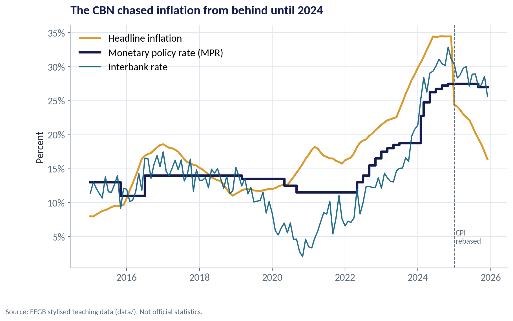
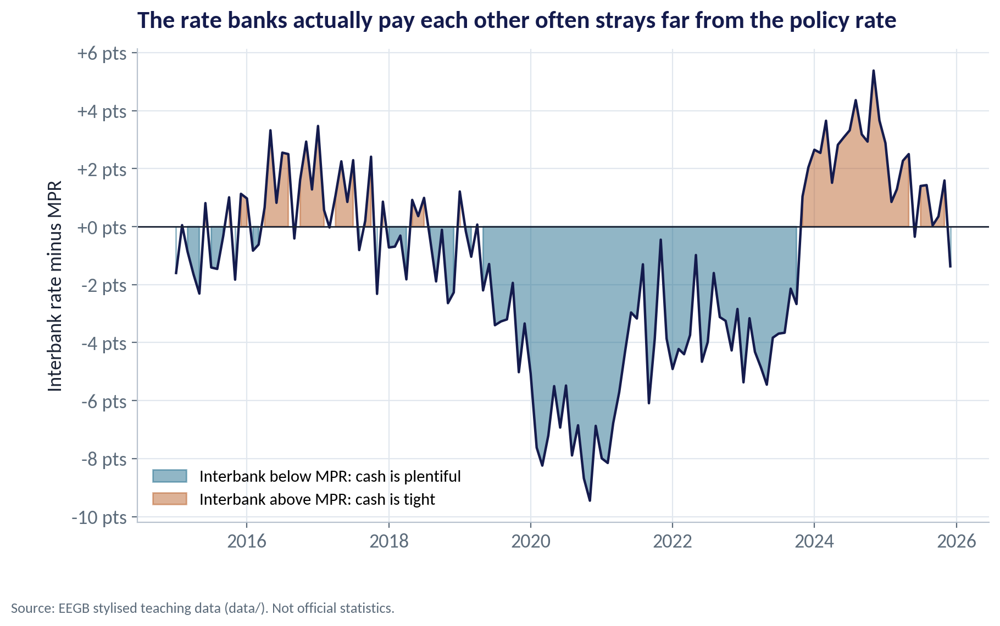
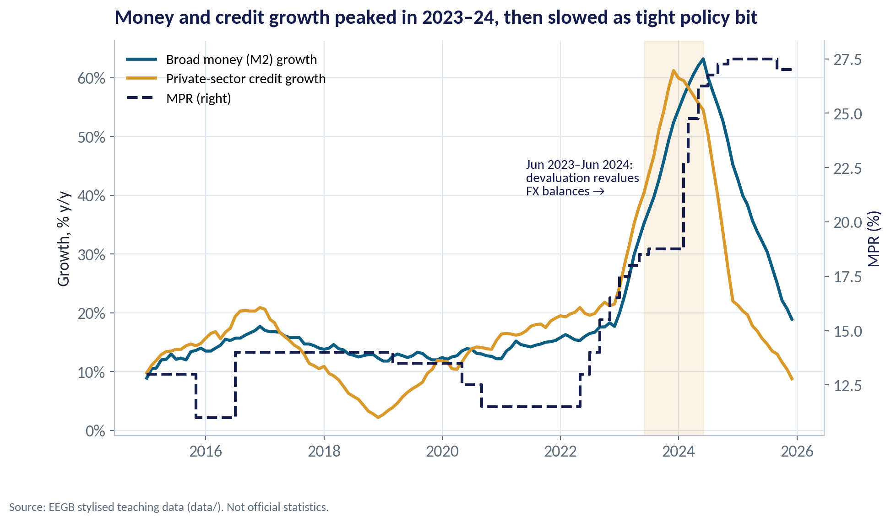
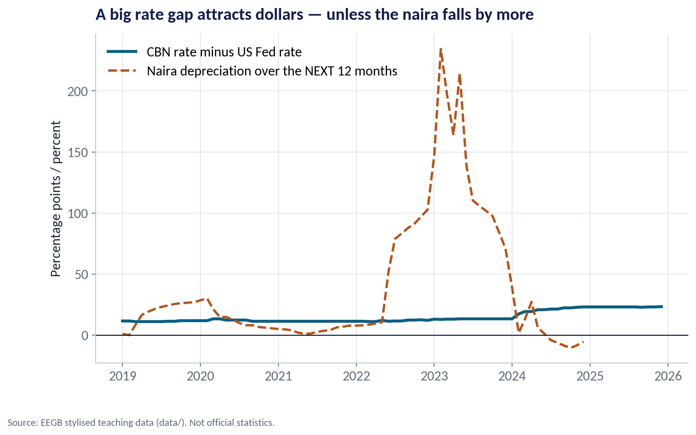
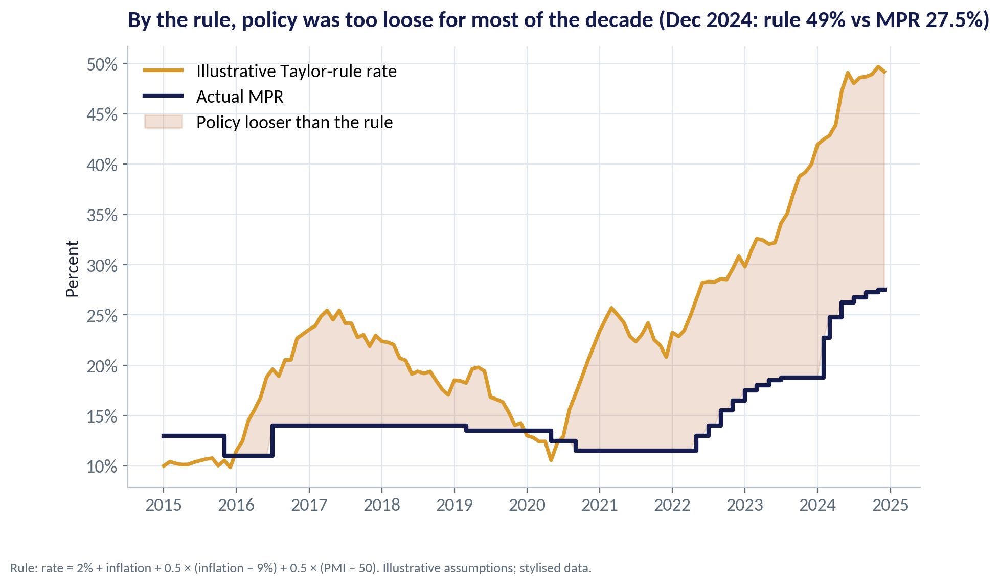

::: {.session-banner}
{.banner-hex width="96"}

**Session 8 of 16** · Facilitator: Elvis Ozegbe<br>*Case:* The CBN raised its policy rate from 18.75% to 27.5% in 2024. How fast, and through which channels, does that reach your firm?

:::

## Downloads {.unnumbered}

::: {.download-row}
[<i class="bi bi-file-earmark-slides"></i> Teaching slides (.pptx)](../../sessions/s08/slides/EEGB_S08_Monetary_Policy_from_QE_to_QT.pptx){.btn .btn-primary download=""}
[<i class="bi bi-file-earmark-pdf"></i> Slides (PDF)](../../sessions/s08/slides/EEGB_S08_Monetary_Policy_from_QE_to_QT.pdf){.btn .btn-outline-primary download=""}
[<i class="bi bi-github"></i> Session folder on GitHub](https://github.com/adibongo/eegb/tree/main/sessions/s08){.btn .btn-outline-secondary}
:::

## Read first {.unnumbered}

- **Note on Money and Monetary Policy** — HBS 9-797-076
- **Liquidity Management in Nigeria** — CBN Brief
- **Monetary Integration in West Africa** — CBN Brief

## Learning objectives

::: {.grid}
::: {.g-col-12 .g-col-md-4 .obj-card}
**Explain the Toolkit**

Describe what a central bank targets and how it uses the policy rate, reserves, open-market operations and its balance sheet (QE and QT).
:::
::: {.g-col-12 .g-col-md-4 .obj-card}
**Trace Transmission**

Follow a rate decision through banks, markets, the exchange rate and expectations to prices and output — and explain the lags.
:::
::: {.g-col-12 .g-col-md-4 .obj-card}
**Judge the Stance**

Use real rates, liquidity conditions and a simple rule to judge whether policy is tight or loose.
:::
:::

## The business case

::: {.callout-note appearance="simple" icon=false}
## How Fast Does the CBN Reach Your Firm?

**Situation.** In 2024 the CBN raised its policy rate sharply to fight inflation of over 30%, tightened bank reserves and mopped up liquidity. Inflation stayed high for months. Firms asked whether the medicine was working.

**Question.** Through which channels does a rate rise reach a Nigerian firm, how long does it take, and was policy actually tight?

**Data.** ng_macro_monthly.csv — policy rate, interbank rate, inflation, money, credit, exchange rate and PMI, 2015–2025; global_policy_rates.csv — seven central banks, 2019–2025. *Stylised teaching data.*

**A good answer.** A short note for your CFO: what the 2024–25 rate path means for funding costs, customer demand and the naira over the next 12–18 months.
:::

## Key ideas in plain English

### When the Rate Hits Zero: The Balance Sheet

Quantitative easing (QE): the central bank creates money to buy government bonds and other assets, pushing long-term rates down. Quantitative tightening (QT) is the reverse: it lets those bonds mature or sells them, draining money and pushing long rates up.

::: {.formula}
QE: CB buys bonds → reserves ↑, long yields ↓   ·   QT: reverse
:::

*Example.* The US Fed's balance sheet grew to almost $9 trillion by 2022, then began shrinking under QT from mid-2022. Global dollar liquidity tightened just as Nigeria needed dollars most.

::: {.callout-tip appearance="minimal"}
**Why a manager cares.** QE and QT in Washington change the cost and availability of dollars for Nigerian firms, banks and the government — through Eurobond yields and portfolio flows.
:::

### The Taylor Rule

John Taylor proposed that a central bank should set its rate at a neutral level plus inflation, then add more when inflation is above target or the economy is running hot. It is a yardstick, not a law.

::: {.formula}
rate = r* + π + 0.5(π − target) + 0.5 × output gap
:::

*Example.* With inflation at 34.5%, a 9% target, a 2% neutral real rate and a flat PMI, the rule gives about 49% in December 2024 — far above the actual 27.5%.

::: {.callout-tip appearance="minimal"}
**Why a manager cares.** The rule shows policy was loose by textbook standards. But against a supply shock, following it mechanically would crush output; the CBN chose to tighten hard but not that hard.
:::

## Charts and how to replicate them

Every chart below is regenerated by the session's figure script — `sessions/s08/R/s08_figures.R` or `sessions/s08/python/s08_figures.py`. Run it from the project root.

### A Worldwide Tightening Cycle

::: {.panel-tabset group="lang"}
## Python
{.fig-img fig-alt="S08-F01 (Python)"}

:::

- Most central banks cut to near zero in 2020 and kept rates there through 2021.
- In 2022–23 the US Fed, ECB and Bank of England raised rates at the fastest pace in decades.
- Higher US rates pulled dollars out of frontier markets like Nigeria and Ghana.
- From 2024–25 the rich-country banks began to cut; Nigeria stayed high.

<span class="fig-id">S08-F01</span>

### Size of the Hiking Cycles

::: {.panel-tabset group="lang"}
## Python
{.fig-img fig-alt="S08-F02 (Python)"}

:::

- From their post-COVID lows to their peaks: Ghana +16.5, Nigeria +16.0, Kenya +6.0 points.
- The US Fed raised by 5.25 points, from 0.25% to 5.5%.
- African banks hiked more because inflation and currency pressure were far higher.
- Bigger hikes also had to compensate investors for currency risk.

<span class="fig-id">S08-F02</span>

### Rates, Inflation and the Interbank Market

::: {.panel-tabset group="lang"}
## Python
{.fig-img fig-alt="S08-F03 (Python)"}

:::

- For most of 2020–2023 the MPR stayed below inflation — a negative real rate.
- The 2024 hikes closed much of the gap; in 2025 the real rate turned clearly positive (helped by the CPI rebasing).
- The interbank rate (teal) is what banks actually pay each other — it does not always follow the MPR.
- Judge policy by the real rate and the interbank rate, not the headline MPR alone.

<span class="fig-id">S08-F03</span>

### When the Policy Rate Does Not Bind

::: {.panel-tabset group="lang"}
## Python
{.fig-img fig-alt="S08-F04 (Python)"}

:::

- When banks are flush with naira, interbank rates fall far below the MPR — down to −9.5 points in late 2020.
- Then a 'high' MPR does little: money is cheap anyway.
- In 2024 the CBN drained liquidity and interbank rates rose above the MPR (up to about +5.4 points).
- That is when tightening really started to bite.

<span class="fig-id">S08-F04</span>

### Did Tight Policy Slow Money and Credit?

::: {.panel-tabset group="lang"}
## Python
{.fig-img fig-alt="S08-F05 (Python)"}

:::

- Credit growth peaked at about 61% (Dec 2023) and broad money at about 63% (Jun 2024).
- Much of that was revaluation: dollar loans and deposits were worth more naira after devaluation.
- As revaluation faded and policy tightened, growth fell to about 9% (credit) and 19% (M2) by end-2025.
- Lesson: in a devaluation, naira money and credit numbers overstate real expansion.

<span class="fig-id">S08-F05</span>

### The Rate Gap and the Naira

::: {.panel-tabset group="lang"}
## Python
{.fig-img fig-alt="S08-F07 (Python)"}

:::

- The teal line is the gap between the CBN rate and the US Fed rate — what a dollar investor earns for holding naira.
- The dashed line is how much the naira then fell over the next 12 months.
- In 2022–23 the naira fell far more than the gap — investors lost money, so they stayed away.
- Once the gap exceeded expected depreciation in 2024–25, portfolio inflows returned.

<span class="fig-id">S08-F07</span>

### Was Policy Tight Enough?

::: {.panel-tabset group="lang"}
## Python
{.fig-img fig-alt="S08-F06 (Python)"}

:::

- The gold line is the illustrative rule; navy is the actual MPR.
- The MPR sat below the rule in about 85% of months, 2015–2024.
- The gap was widest in 2023–24, at the height of the inflation surge.
- Use the rule to ask 'how tight?', not to forecast the next MPC decision.

<span class="fig-id">S08-F06</span>

## Lab: How Fast Does the Rate Reach Your Firm?

*Time:* 15 minutes · *Data:* [`data/ng_macro_monthly.csv`](../../data/ng_macro_monthly.csv), [`data/global_policy_rates.csv`](../../data/global_policy_rates.csv)

1. List every CBN policy-rate decision and its size.
2. Compute the real policy rate by year.
3. Compare the interbank rate with the MPR to judge liquidity.
4. Correlate rate changes with credit growth at different lags — and ask why correlation misleads here.
5. Compute an illustrative Taylor-rule rate and compare it with the MPR.

::: {.callout-important appearance="simple"}
**Deliverable:** a short note for your CFO on funding costs, customer demand and the naira over the next 12–18 months.
:::

## The code (R | Python)

Pick your language once; every tab on the site follows your choice. Download a script, or copy it into RStudio and run it line by line.

### Replicate every chart

::: {.panel-tabset group="lang"}
## Python
[<i class="bi bi-download"></i> s08_figures.py](../../sessions/s08/python/s08_figures.py){download=""}

::: {.callout-note collapse="true" appearance="simple" icon=false}
## Show the full script (115 lines)

```{.python filename="sessions/s08/python/s08_figures.py"}
# =============================================================================
# EEGB · Session 8 · Monetary Policy from QE to QT
# Replication script — regenerates every chart in the Session 8 deck (Python)
# Data: data/ng_macro_monthly.csv and data/global_policy_rates.csv (stylised)
# Run from the project root:  python sessions/s08/python/s08_figures.py
# =============================================================================
import sys; sys.path.insert(0, "python")
import numpy as np, pandas as pd
import matplotlib.pyplot as plt
from matplotlib.ticker import FuncFormatter
from eegb_style import *

set_style()
m = pd.read_csv("data/ng_macro_monthly.csv", parse_dates=["date"])
pr = pd.read_csv("data/global_policy_rates.csv", parse_dates=["date"])
names = {"us_fed": "US Fed", "euro_area_ecb": "ECB", "uk_boe": "Bank of England", "nigeria_cbn": "CBN (Nigeria)",
         "south_africa_sarb": "SARB (S. Africa)", "ghana_bog": "Bank of Ghana", "kenya_cbk": "CBK (Kenya)"}
cols = {"us_fed": NAVY, "euro_area_ecb": SKY, "uk_boe": SLATE, "nigeria_cbn": RUST, "south_africa_sarb": OLIVE,
        "ghana_bog": GOLD, "kenya_cbk": TEAL}

# --- F01 · A global tightening cycle ---------------------------------------------------
fig, ax = plt.subplots()
for c in names:
    ax.step(pr.date, pr[c], where="post", color=cols[c], lw=3 if c == "nigeria_cbn" else 2, label=names[c])
ax.yaxis.set_major_formatter(FuncFormatter(pct)); ax.legend(ncol=2, loc="upper left", fontsize=11)
ax.set(title="From near-zero to the fastest hikes in decades: 2022–24 was a global tightening",
       ylabel="Policy rate")
note(fig); save(fig, "s08", "f01")

# --- F02 · How much each central bank tightened ----------------------------------------
low = pr[(pr.date >= "2020-01-01") & (pr.date <= "2022-06-01")][list(names)].min()
high = pr[pr.date >= "2022-01-01"][list(names)].max()
hike = (high - low).sort_values()
fig, ax = plt.subplots()
bars = ax.barh([names[c] for c in hike.index], hike.values, color=[cols[c] for c in hike.index])
for b, (c, v) in zip(bars, hike.items()):
    ax.text(v + .2, b.get_y() + b.get_height() / 2, f"+{v:.2f} pts  ({low[c]:.2f}% → {high[c]:.2f}%)", va="center", fontsize=11.5)
ax.set_xlim(0, hike.max() * 1.6)
ax.set(title="Size of the tightening: from each bank's post-COVID low to its peak",
       xlabel="Increase in policy rate (percentage points)")
note(fig); save(fig, "s08", "f02")

# --- F03 · Policy rate, interbank rate and inflation in Nigeria --------------------------
fig, ax = plt.subplots()
ax.plot(m.date, m.headline_inflation, color=GOLD, lw=2.4, label="Headline inflation")
ax.step(m.date, m.mpr, where="post", color=NAVY, lw=3, label="Monetary policy rate (MPR)")
ax.plot(m.date, m.interbank_rate, color=TEAL, lw=1.6, alpha=.9, label="Interbank rate")
ax.axvline(pd.Timestamp("2025-01-01"), color=SLATE, ls="--", lw=1); ax.text(pd.Timestamp("2025-01-15"), 4, "CPI\nrebased", color=SLATE, fontsize=10)
ax.yaxis.set_major_formatter(FuncFormatter(pct)); ax.legend(loc="upper left")
ax.set(title="The CBN chased inflation from behind until 2024", ylabel="Percent")
note(fig); save(fig, "s08", "f03")

# --- F04 · Liquidity: interbank minus MPR ------------------------------------------------
spread = m.interbank_rate - m.mpr
fig, ax = plt.subplots()
ax.fill_between(m.date, spread, 0, where=spread < 0, color=TEAL, alpha=.45, label="Interbank below MPR: cash is plentiful")
ax.fill_between(m.date, spread, 0, where=spread >= 0, color=RUST, alpha=.45, label="Interbank above MPR: cash is tight")
ax.plot(m.date, spread, color=NAVY, lw=1.6); ax.axhline(0, color=INK, lw=1)
ax.yaxis.set_major_formatter(FuncFormatter(lambda v, p: f"{v:+.0f} pts")); ax.legend(loc="lower left", fontsize=11)
ax.set(title="The rate banks actually pay each other often strays far from the policy rate",
       ylabel="Interbank rate minus MPR")
note(fig); save(fig, "s08", "f04")

# --- F05 · Transmission: money and credit after the policy moves --------------------------
fig, ax = plt.subplots()
ax.plot(m.date, m.m2_growth_yoy, color=TEAL, lw=2.4, label="Broad money (M2) growth")
ax.plot(m.date, m.private_credit_growth_yoy, color=GOLD, lw=2.4, label="Private-sector credit growth")
ax2 = ax.twinx(); ax2.step(m.date, m.mpr, where="post", color=NAVY, lw=2.2, ls="--", label="MPR (right)")
ax2.grid(False); ax2.spines["right"].set_visible(True); ax2.set_ylabel("MPR (%)", color=NAVY)
ax.yaxis.set_major_formatter(FuncFormatter(pct)); ax.set_ylabel("Growth, % y/y")
h1, l1 = ax.get_legend_handles_labels(); h2, l2 = ax2.get_legend_handles_labels()
ax.legend(h1 + h2, l1 + l2, loc="upper left", fontsize=11)
ax.axvspan(pd.Timestamp("2023-06-01"), pd.Timestamp("2024-06-01"), color=GOLD, alpha=.12)
ax.text(pd.Timestamp("2021-06-01"), 40, "Jun 2023–Jun 2024:\ndevaluation revalues\nFX balances →", fontsize=10.5, color=NAVY)
ax.set(title="Money and credit growth peaked in 2023–24, then slowed as tight policy bit")
note(fig); save(fig, "s08", "f05")

# --- F06 · An illustrative Taylor rule for Nigeria ----------------------------------------
target, neutral_real = 9.0, 2.0          # assumptions: top of a 6–9% target band; neutral real rate 2%
old = m[m.date < "2025-01-01"].copy()
gap = old.pmi - 50                        # crude activity gap: PMI above 50 = economy running hot
old["taylor"] = neutral_real + old.headline_inflation + 0.5 * (old.headline_inflation - target) + 0.5 * gap
fig, ax = plt.subplots()
ax.plot(old.date, old.taylor, color=GOLD, lw=2.6, label="Illustrative Taylor-rule rate")
ax.step(old.date, old.mpr, where="post", color=NAVY, lw=3, label="Actual MPR")
ax.fill_between(old.date, old.mpr, old.taylor, where=old.taylor > old.mpr, color=RUST, alpha=.18, label="Policy looser than the rule")
ax.yaxis.set_major_formatter(FuncFormatter(pct)); ax.legend(loc="upper left")
last = old.iloc[-1]
ax.set(title=f"By the rule, policy was too loose for most of the decade (Dec 2024: rule {last.taylor:.0f}% vs MPR {last.mpr:.1f}%)",
       ylabel="Percent")
note(fig, "Rule: rate = 2% + inflation + 0.5 × (inflation − 9%) + 0.5 × (PMI − 50). Illustrative assumptions; stylised data.")
save(fig, "s08", "f06")

# --- F07 · Interest differential vs the US: the carry for foreign investors -------------------
j = pr[["date", "us_fed"]].merge(m[["date", "mpr", "official_fx_ngn_usd"]], on="date")
j["diff"] = j.mpr - j.us_fed
j["dep_12m_ahead"] = 100 * (j.official_fx_ngn_usd.shift(-12) / j.official_fx_ngn_usd - 1)
fig, ax = plt.subplots()
ax.plot(j.date, j["diff"], color=TEAL, lw=2.8, label="CBN rate minus US Fed rate")
ax.plot(j.date, j.dep_12m_ahead, color=RUST, lw=2.2, ls="--", label="Naira depreciation over the NEXT 12 months")
ax.axhline(0, color=INK, lw=1)
ax.yaxis.set_major_formatter(FuncFormatter(lambda v, p: f"{v:.0f}"))
ax.legend(loc="upper left")
ax.set(title="A big rate gap attracts dollars — unless the naira falls by more",
       ylabel="Percentage points / percent")
note(fig); save(fig, "s08", "f07")

if __name__ == "__main__":
    print(hike.round(2)); print(low.round(2)); print(high.round(2))
    print("spread min/max", spread.min().round(2), m.date[spread.idxmin()].date(), spread.max().round(2), m.date[spread.idxmax()].date())
    print("M2 peak", m.m2_growth_yoy.max(), m.date[m.m2_growth_yoy.idxmax()].date(), "credit peak", m.private_credit_growth_yoy.max(), m.date[m.private_credit_growth_yoy.idxmax()].date())
    print("M2 last", m.m2_growth_yoy.iloc[-1], "credit last", m.private_credit_growth_yoy.iloc[-1])
    print("taylor share above mpr", round((old.taylor > old.mpr).mean(), 2), "Dec24 taylor", round(last.taylor, 1))
    print(j[["date", "diff", "dep_12m_ahead"]].iloc[[0, 24, 41, 48, 54, 60, 66, 72]].round(1).to_string())
    print("mpr 2023-06", m.loc[m.date == "2023-06-01", "mpr"].values, "infl 2024-06", m.loc[m.date == "2024-06-01", "headline_inflation"].values)
```
:::

## R
[<i class="bi bi-download"></i> s08_figures.R](../../sessions/s08/R/s08_figures.R){download=""}

::: {.callout-note collapse="true" appearance="simple" icon=false}
## Show the full script (95 lines)

```{.r filename="sessions/s08/R/s08_figures.R"}
# =============================================================================
# EEGB · Session 8 · Monetary Policy from QE to QT
# Replication script — regenerates every chart in the Session 8 deck (R)
# Data: data/ng_macro_monthly.csv and data/global_policy_rates.csv (stylised)
# =============================================================================
source("R/theme_eegb.R")
suppressPackageStartupMessages({ library(dplyr); library(readr); library(tidyr) })
m  <- read_csv("data/ng_macro_monthly.csv", show_col_types = FALSE) |> mutate(date = as.Date(date))
pr <- read_csv("data/global_policy_rates.csv", show_col_types = FALSE) |> mutate(date = as.Date(date))
names_cb <- c(us_fed = "US Fed", euro_area_ecb = "ECB", uk_boe = "Bank of England", nigeria_cbn = "CBN (Nigeria)",
              south_africa_sarb = "SARB (S. Africa)", ghana_bog = "Bank of Ghana", kenya_cbk = "CBK (Kenya)")
cols_cb <- c(`US Fed` = eegb[["navy"]], ECB = eegb[["sky"]], `Bank of England` = eegb[["slate"]], `CBN (Nigeria)` = eegb[["rust"]],
             `SARB (S. Africa)` = eegb[["olive"]], `Bank of Ghana` = eegb[["gold"]], `CBK (Kenya)` = eegb[["teal"]])
long <- pr |> pivot_longer(-date, names_to = "bank", values_to = "rate") |> mutate(bank = names_cb[bank])

# --- F01 · Global tightening ---------------------------------------------------------
p1 <- ggplot(long, aes(date, rate, colour = bank)) + geom_step(linewidth = 1) +
  scale_colour_manual(values = cols_cb, name = NULL) + scale_y_continuous(labels = pct) +
  labs(title = "From near-zero to the fastest hikes in decades: 2022–24 was a global tightening",
       x = NULL, y = "Policy rate", caption = eegb_caption) + theme_eegb()
save_fig(p1, "s08", "f01")

# --- F02 · Size of each tightening -----------------------------------------------------
lo <- long |> filter(date >= as.Date("2020-01-01"), date <= as.Date("2022-06-01")) |> group_by(bank) |> summarise(low = min(rate))
hi <- long |> filter(date >= as.Date("2022-01-01")) |> group_by(bank) |> summarise(high = max(rate))
hk <- inner_join(lo, hi, by = "bank") |> mutate(hike = high - low)
p2 <- ggplot(hk, aes(hike, reorder(bank, hike), fill = bank)) + geom_col(show.legend = FALSE) +
  geom_text(aes(label = sprintf("+%.2f pts  (%.2f%% → %.2f%%)", hike, low, high)), hjust = -0.05, size = 3.8) +
  scale_fill_manual(values = cols_cb) + scale_x_continuous(limits = c(0, max(hk$hike) * 1.6)) +
  labs(title = "Size of the tightening: from each bank's post-COVID low to its peak",
       x = "Increase in policy rate (percentage points)", y = NULL, caption = eegb_caption) + theme_eegb()
save_fig(p2, "s08", "f02")

# --- F03 · MPR, interbank and inflation ---------------------------------------------------
p3 <- ggplot(m, aes(date)) +
  geom_line(aes(y = headline_inflation, colour = "Headline inflation"), linewidth = 1.1) +
  geom_step(aes(y = mpr, colour = "Monetary policy rate (MPR)"), linewidth = 1.3) +
  geom_line(aes(y = interbank_rate, colour = "Interbank rate"), linewidth = .8) +
  geom_vline(xintercept = as.Date("2025-01-01"), linetype = "dashed", colour = eegb[["slate"]]) +
  scale_colour_manual(values = c(`Headline inflation` = eegb[["gold"]], `Monetary policy rate (MPR)` = eegb[["navy"]],
                                 `Interbank rate` = eegb[["teal"]]), name = NULL) +
  scale_y_continuous(labels = pct) +
  labs(title = "The CBN chased inflation from behind until 2024", x = NULL, y = "Percent", caption = eegb_caption) + theme_eegb()
save_fig(p3, "s08", "f03")

# --- F04 · Interbank minus MPR --------------------------------------------------------------
m <- m |> mutate(spread = interbank_rate - mpr)
p4 <- ggplot(m, aes(date, spread)) + geom_col(aes(fill = spread >= 0), show.legend = FALSE, width = 25) +
  geom_hline(yintercept = 0) +
  scale_fill_manual(values = c(`TRUE` = eegb[["rust"]], `FALSE` = eegb[["teal"]])) +
  labs(title = "The rate banks actually pay each other often strays far from the policy rate",
       subtitle = "Teal: interbank below MPR (cash plentiful). Rust: above MPR (cash tight).",
       x = NULL, y = "Interbank rate minus MPR (points)", caption = eegb_caption) + theme_eegb()
save_fig(p4, "s08", "f04")

# --- F05 · Money and credit growth ------------------------------------------------------------
mc <- m |> select(date, `Broad money (M2) growth` = m2_growth_yoy, `Private-sector credit growth` = private_credit_growth_yoy) |>
  pivot_longer(-date, names_to = "series", values_to = "g")
p5 <- ggplot(mc, aes(date, g, colour = series)) +
  annotate("rect", xmin = as.Date("2023-06-01"), xmax = as.Date("2024-06-01"), ymin = -Inf, ymax = Inf, fill = eegb[["gold"]], alpha = .12) +
  geom_line(linewidth = 1.2) +
  scale_colour_manual(values = c(eegb[["teal"]], eegb[["gold"]]), name = NULL) + scale_y_continuous(labels = pct) +
  labs(title = "Money and credit growth peaked in 2023–24, then slowed as tight policy bit",
       subtitle = "Shaded: Jun 2023–Jun 2024, when devaluation revalued FX balances",
       x = NULL, y = "Growth, % y/y", caption = eegb_caption) + theme_eegb()
save_fig(p5, "s08", "f05")

# --- F06 · Illustrative Taylor rule ---------------------------------------------------------------
target <- 9; neutral_real <- 2
old <- m |> filter(date < as.Date("2025-01-01")) |>
  mutate(taylor = neutral_real + headline_inflation + 0.5 * (headline_inflation - target) + 0.5 * (pmi - 50))
p6 <- ggplot(old, aes(date)) +
  geom_ribbon(aes(ymin = pmin(mpr, taylor), ymax = taylor), fill = eegb[["rust"]], alpha = .18) +
  geom_line(aes(y = taylor, colour = "Illustrative Taylor-rule rate"), linewidth = 1.2) +
  geom_step(aes(y = mpr, colour = "Actual MPR"), linewidth = 1.3) +
  scale_colour_manual(values = c(`Illustrative Taylor-rule rate` = eegb[["gold"]], `Actual MPR` = eegb[["navy"]]), name = NULL) +
  scale_y_continuous(labels = pct) +
  labs(title = sprintf("By the rule, policy was too loose for most of the decade (Dec 2024: rule %.0f%% vs MPR %.1f%%)",
                       last(old$taylor), last(old$mpr)),
       x = NULL, y = "Percent",
       caption = "Rule: rate = 2% + inflation + 0.5 × (inflation − 9%) + 0.5 × (PMI − 50). Illustrative; stylised data.") + theme_eegb()
save_fig(p6, "s08", "f06")

# --- F07 · Rate differential vs the US and later depreciation ---------------------------------------
j <- pr |> select(date, us_fed) |> inner_join(select(m, date, mpr, official_fx_ngn_usd), by = "date") |>
  mutate(`CBN rate minus US Fed rate` = mpr - us_fed,
         `Naira depreciation over the NEXT 12 months` = 100 * (lead(official_fx_ngn_usd, 12) / official_fx_ngn_usd - 1)) |>
  select(date, `CBN rate minus US Fed rate`, `Naira depreciation over the NEXT 12 months`) |>
  pivot_longer(-date, names_to = "series", values_to = "v")
p7 <- ggplot(j, aes(date, v, colour = series, linetype = series)) + geom_line(linewidth = 1.2, na.rm = TRUE) + geom_hline(yintercept = 0) +
  scale_colour_manual(values = c(eegb[["teal"]], eegb[["rust"]]), name = NULL) +
  scale_linetype_manual(values = c("solid", "dashed"), name = NULL) +
  labs(title = "A big rate gap attracts dollars — unless the naira falls by more",
       x = NULL, y = "Percentage points / percent", caption = eegb_caption) + theme_eegb()
save_fig(p7, "s08", "f07")
```
:::

:::

### Lab

::: {.panel-tabset group="lang"}
## Python
[<i class="bi bi-download"></i> s08_lab.py](../../sessions/s08/python/s08_lab.py){download=""}

::: {.callout-note collapse="true" appearance="simple" icon=false}
## Show the full script (45 lines)

```{.python filename="sessions/s08/python/s08_lab.py"}
# =============================================================================
# EEGB · Session 8 LAB · How fast does the policy rate reach your firm? (Python)
# Data: data/ng_macro_monthly.csv and data/global_policy_rates.csv (stylised)
# Run from the project root, line by line
# =============================================================================
import numpy as np, pandas as pd

m = pd.read_csv("data/ng_macro_monthly.csv", parse_dates=["date"])
pr = pd.read_csv("data/global_policy_rates.csv", parse_dates=["date"])

# ---- STEP 1 · List every CBN policy-rate decision ------------------------------------
moves = m.loc[m.mpr.diff() != 0, ["date", "mpr"]].copy()
moves["change_pts"] = moves.mpr.diff()
print(moves.tail(12))

# ---- STEP 2 · Real policy rate: is policy tight or loose? ---------------------------------
m["real_mpr"] = m.mpr - m.headline_inflation
print(m.groupby(m.date.dt.year).real_mpr.mean().round(1))

# ---- STEP 3 · Liquidity: is the interbank rate following the MPR? ----------------------------
m["interbank_gap"] = m.interbank_rate - m.mpr
print(m.groupby(m.date.dt.year).interbank_gap.mean().round(1))

# ---- STEP 4 · Transmission lags: when does credit growth respond? -------------------------------
m["mpr_change_12m"] = m.mpr - m.mpr.shift(12)
for lag in [0, 3, 6, 9, 12, 18]:
    r = m.mpr_change_12m.corr(m.private_credit_growth_yoy.shift(-lag))
    print(f"MPR change vs credit growth {lag:>2} months later: r = {r:.2f}")

# ---- STEP 5 · Compare with peers ---------------------------------------------------------------
latest = pr.iloc[-1].drop("date")
print("latest policy rates:\n", latest.sort_values(ascending=False))

# ---- STEP 6 · An illustrative Taylor rule ---------------------------------------------------------
target, neutral_real = 9.0, 2.0
old = m[m.date < "2025-01-01"].copy()
old["taylor"] = neutral_real + old.headline_inflation + 0.5 * (old.headline_inflation - target) + 0.5 * (old.pmi - 50)
print(old[["date", "mpr", "headline_inflation", "taylor"]].tail(6).round(1))

# ---- YOUR TURN ---------------------------------------------------------------------------------------
# (a) Your firm has a ₦5bn overdraft priced at MPR + 6 points. How much did annual interest rise between
#     June 2023 and December 2024? (Hint: use Step 1.)
# (b) Step 4 gives correlations at different lags. Why can correlation alone not prove the lag? What else moved?
# (c) The Taylor rule in Step 6 says rates "should" have been far higher. Give two reasons a central bank facing
#     a SUPPLY shock might choose not to follow it.
```
:::

## R
[<i class="bi bi-download"></i> s08_lab.R](../../sessions/s08/R/s08_lab.R){download=""}

::: {.callout-note collapse="true" appearance="simple" icon=false}
## Show the full script (40 lines)

```{.r filename="sessions/s08/R/s08_lab.R"}
# =============================================================================
# EEGB · Session 8 LAB · How fast does the policy rate reach your firm? (R)
# Data: data/ng_macro_monthly.csv and data/global_policy_rates.csv (stylised)
# Open eegb.Rproj first, then run line by line
# =============================================================================
library(dplyr); library(readr)
m  <- read_csv("data/ng_macro_monthly.csv", show_col_types = FALSE) |> mutate(date = as.Date(date))
pr <- read_csv("data/global_policy_rates.csv", show_col_types = FALSE)

# ---- STEP 1 · List every CBN policy-rate decision ------------------------------------
moves <- m |> mutate(change_pts = mpr - lag(mpr)) |> filter(is.na(change_pts) | change_pts != 0) |> select(date, mpr, change_pts)
tail(moves, 12)

# ---- STEP 2 · Real policy rate --------------------------------------------------------------
m <- m |> mutate(real_mpr = mpr - headline_inflation, year = format(date, "%Y"))
m |> group_by(year) |> summarise(real_mpr = round(mean(real_mpr), 1))

# ---- STEP 3 · Liquidity: interbank minus MPR ----------------------------------------------------
m |> mutate(interbank_gap = interbank_rate - mpr) |> group_by(year) |> summarise(gap = round(mean(interbank_gap), 1))

# ---- STEP 4 · Transmission lags ----------------------------------------------------------------
m <- m |> mutate(mpr_change_12m = mpr - lag(mpr, 12))
for (k in c(0, 3, 6, 9, 12, 18)) {
  r <- cor(m$mpr_change_12m, lead(m$private_credit_growth_yoy, k), use = "complete.obs")
  cat(sprintf("MPR change vs credit growth %2d months later: r = %.2f\n", k, r))
}

# ---- STEP 5 · Compare with peers ------------------------------------------------------------------
sort(unlist(pr[nrow(pr), -1]), decreasing = TRUE)

# ---- STEP 6 · An illustrative Taylor rule ----------------------------------------------------------
target <- 9; neutral_real <- 2
m |> filter(date < as.Date("2025-01-01")) |>
  mutate(taylor = neutral_real + headline_inflation + 0.5 * (headline_inflation - target) + 0.5 * (pmi - 50)) |>
  select(date, mpr, headline_inflation, taylor) |> tail(6)

# ---- YOUR TURN ---------------------------------------------------------------------------------------
# (a) A ₦5bn overdraft priced at MPR + 6 points: how much did annual interest rise between June 2023 and December 2024?
# (b) Why can correlation alone (Step 4) not prove the transmission lag? What else moved at the same time?
# (c) Give two reasons a central bank facing a SUPPLY shock might choose not to follow the Taylor rule.
```
:::

:::

## Check your understanding

**Q1.** The CBN raises the cash reserve requirement while leaving the MPR unchanged. What is the most likely immediate effect?

- **A.** Banks have more money to lend, so loan rates fall
- **B.** Banks have less naira to lend or place in the interbank market, so liquidity tightens and short-term rates rise
- **C.** The naira weakens because the CBN is printing money
- **D.** Nothing — only the MPR matters

::: {.callout-tip collapse="true" appearance="simple"}
## Show answer
**B.** B. A higher CRR locks more deposits at the CBN, so banks have less to lend — a tightening even with an unchanged MPR. A is the opposite; C confuses tightening with easing; D ignores the other tools.
:::

**Q2.** Inflation is 30%, the MPR is 27.5% and the interbank rate is 31%. Which statement best describes the stance?

- **A.** Very loose: the MPR is below inflation
- **B.** Roughly neutral to tight in practice: the rate banks actually pay is above inflation, though the MPR itself is slightly below
- **C.** Very tight: the MPR is above 25%
- **D.** Impossible to judge without the Taylor rule

::: {.callout-tip collapse="true" appearance="simple"}
## Show answer
**B.** B. The interbank rate — the marginal cost of money — is above inflation, so conditions are tighter than the MPR alone suggests. A and C each look at one number only; D overstates the role of the rule.
:::

## Vocabulary

| Term | Meaning |
|---|---|
| **Monetary policy rate** | The CBN's benchmark rate signalling the price of money. |
| **Interbank rate** | The rate banks charge each other for overnight naira. |
| **Cash reserve requirement** | Share of deposits banks must hold at the CBN. |
| **Open-market operations** | Central-bank sales or purchases of securities to manage liquidity. |
| **Quantitative easing** | Central-bank asset purchases with newly created money. |
| **Quantitative tightening** | Shrinking the central bank's balance sheet. |
| **Transmission** | The chain from a policy decision to prices and output. |
| **Real policy rate** | Policy rate minus inflation. |
| **Taylor rule** | A formula for where the policy rate 'should' be. |
| **Fiscal dominance** | When government finance needs override inflation control. |

## Key takeaways

1. Central banks control the price of money; they use rates, reserves, OMO and their balance sheet.
2. QE and QT abroad change the cost of dollars for Nigeria.
3. Policy works through banks, markets, the naira and expectations — with long lags.
4. Judge the stance by real and interbank rates, not the headline MPR alone.
5. Fiscal dominance undermines credibility and raises everyone's borrowing costs.

::: {.callout-note appearance="simple"}
**Before next session:** Read 'Net Fiscal Operations' and the CBN brief on the Fiscal Responsibility Law. Find what share of federal revenue went on interest in the latest budget.
:::

::: {.session-nav}
[← Session 7: National Accounts](../../sessions/s07/index.qmd)
[Session 9: Fiscal Policy & Debt →](../../sessions/s09/index.qmd){.next}
:::
