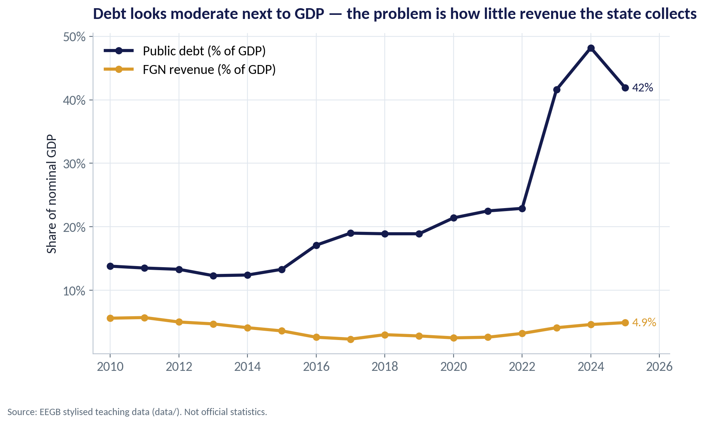
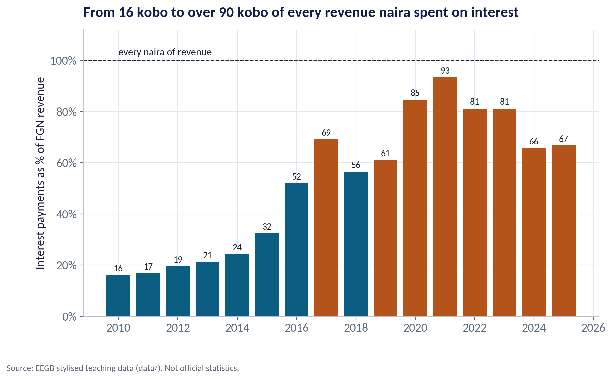
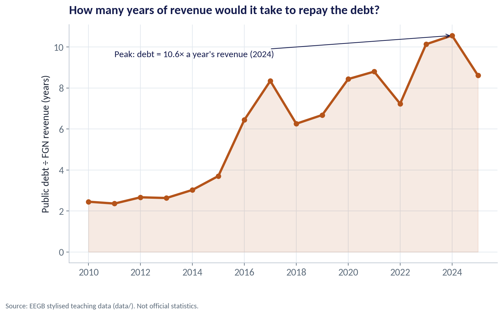
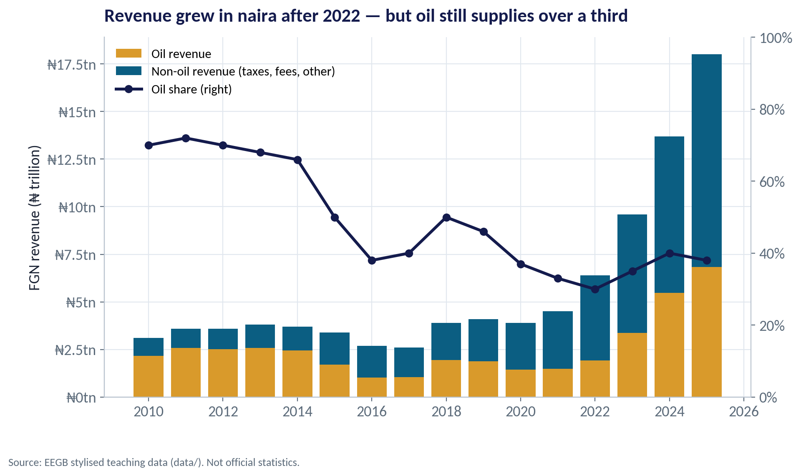
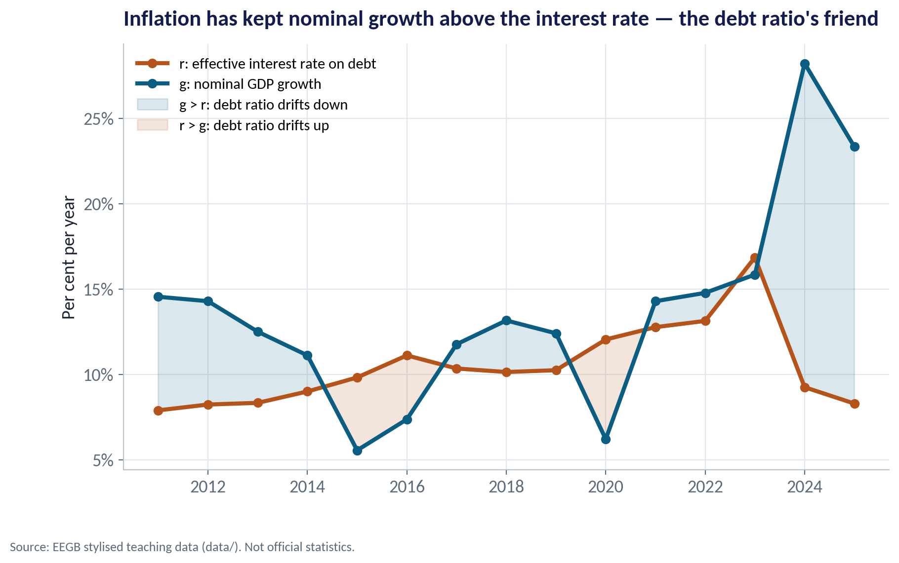
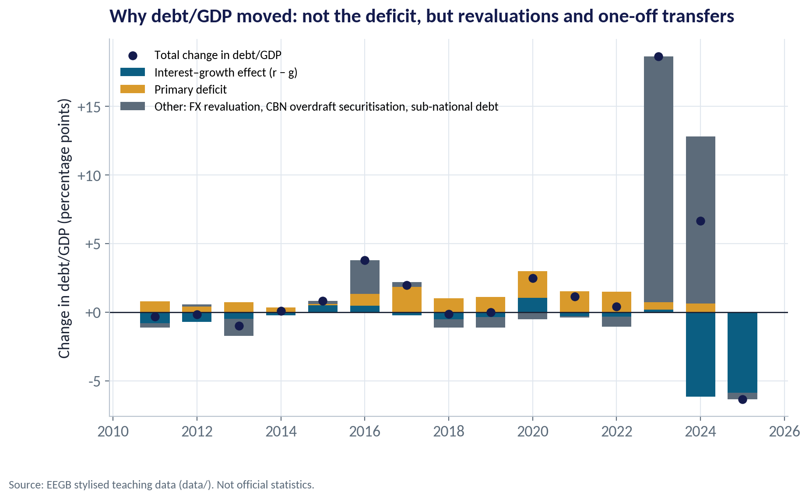
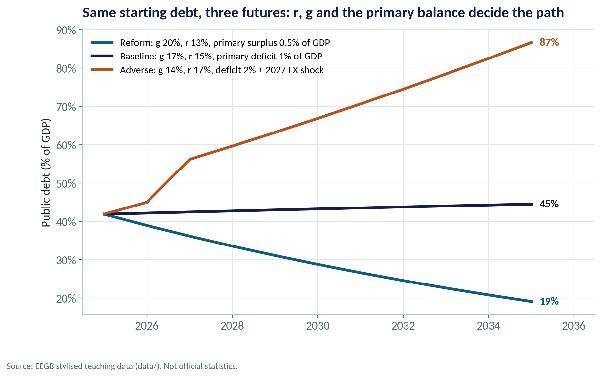

::: {.session-banner}
{.banner-hex width="96"}

**Session 9 of 16** · Facilitator: Elvis Ozegbe<br>*Case:* Nigeria spends a very large share of federal revenue on interest. Is the debt the problem — or the revenue?

:::

## Downloads {.unnumbered}

::: {.download-row}
[<i class="bi bi-file-earmark-slides"></i> Teaching slides (.pptx)](../../sessions/s09/slides/EEGB_S09_Fiscal_Policy_Debt_Sovereign_Risk.pptx){.btn .btn-primary download=""}
[<i class="bi bi-file-earmark-pdf"></i> Slides (PDF)](../../sessions/s09/slides/EEGB_S09_Fiscal_Policy_Debt_Sovereign_Risk.pdf){.btn .btn-outline-primary download=""}
[<i class="bi bi-github"></i> Session folder on GitHub](https://github.com/adibongo/eegb/tree/main/sessions/s09){.btn .btn-outline-secondary}
:::

## Read first {.unnumbered}

- **Net Fiscal Operations** — Course note
- **The Fiscal Responsibility Law** — CBN Brief

## Learning objectives

::: {.grid}
::: {.g-col-12 .g-col-md-4 .obj-card}
**Read a Budget Like an Analyst**

Separate revenue, primary spending and interest, and judge the burden against revenue as well as GDP.
:::
::: {.g-col-12 .g-col-md-4 .obj-card}
**Use the Debt-Dynamics Equation**

Explain why debt/GDP rises or falls using r, g and the primary balance — and spot the 'other' items.
:::
::: {.g-col-12 .g-col-md-4 .obj-card}
**Turn Fiscal Risk Into Business Risk**

Link subsidy reform, tax reform, borrowing and sovereign risk to rates, the naira and demand in your market.
:::
:::

## The business case

::: {.callout-note appearance="simple" icon=false}
## Is the Debt the Problem — or the Revenue?

**Situation.** Federal debt rose sharply after 2022 as the CBN overdraft was converted into bonds and the naira fell. Interest payments now take most of federal revenue, and banks hold large amounts of FGN bonds.

**Question.** Is Nigeria's fiscal problem too much debt, or too little revenue — and what does each answer imply for interest rates, the naira and your company's plans?

**Data.** fgn_fiscal_annual.csv — 2010–2025: nominal GDP, FGN revenue (and oil share), spending, interest, total public debt. *Stylised teaching data.*

**A good answer.** A short diagnosis using three ratios (debt/GDP, debt/revenue, interest/revenue), a debt-dynamics decomposition and a ten-year projection under three scenarios.
:::

## Key ideas in plain English

### What Moves the Debt Ratio?

The debt ratio rises when the interest rate (r) on debt is higher than the economy's nominal growth (g), and when the government runs a primary deficit. Anything else — a devaluation, a bailout, an old overdraft turned into bonds — shows up as 'other'.

::: {.formula}
Δd = (r − g) ÷ (1 + g) × d  −  pb  +  other
:::

*Example.* In 2025 in our data: r = 8.3%, g = 23.3%. With g far above r, the interest–growth term cut the debt ratio by about 6 points on its own.

::: {.callout-tip appearance="minimal"}
**Why a manager cares.** High inflation raises g and quietly erodes the debt ratio — but it also raises future interest rates. The relief lasts only while r stays below g.
:::

### Does Government Spending Grow the Economy?

A fiscal multiplier tells you how much GDP changes when government spending changes by ₦1. It is larger when the economy has idle capacity and smaller when spending leaks into imports or pushes up interest rates.

::: {.formula}
multiplier = ΔGDP ÷ ΔG
:::

*Example.* If ₦1 trillion of road spending raises GDP by ₦0.6 trillion, the multiplier is 0.6. Open, import-dependent economies with high interest rates tend to have multipliers below 1.

::: {.callout-tip appearance="minimal"}
**Why a manager cares.** When government cuts spending, your demand falls by more in sectors that sell to the state (construction, contractors) and less in export or consumer-staples sectors. Know where your revenue sits.
:::

## Charts and how to replicate them

Every chart below is regenerated by the session's figure script — `sessions/s09/R/s09_figures.R` or `sessions/s09/python/s09_figures.py`. Run it from the project root.

### Moderate Debt, Very Low Revenue

::: {.panel-tabset group="lang"}
## Python
{.fig-img fig-alt="S09-F01 (Python)"}

:::

- Public debt rose from 14% of GDP in 2010 to 42% in 2025 in our stylised data.
- FGN revenue stayed around 3–5% of GDP — among the lowest ratios in the world for a large economy.
- A debt ratio that is comfortable for a country collecting 20–30% of GDP is heavy for one collecting 5%.
- So judge the debt against what the state can collect, not only against the size of the economy.

<span class="fig-id">S09-F01</span>

### How Much Revenue Goes on Interest?

::: {.panel-tabset group="lang"}
## Python
{.fig-img fig-alt="S09-F02 (Python)"}

:::

- In 2010 interest took about 16 kobo of every naira of federal revenue.
- By 2021 it took 93 kobo, leaving almost nothing for salaries, roads or schools without more borrowing.
- Higher oil receipts and reforms lowered the ratio to about 67% in 2025 — still very high.
- Published reports showed a similar pattern; our numbers are stylised.

<span class="fig-id">S09-F02</span>

### Years of Revenue Needed to Repay the Debt

::: {.panel-tabset group="lang"}
## Python
{.fig-img fig-alt="S09-F03 (Python)"}

:::

- Debt ÷ revenue: how many years of all federal revenue would repay the stock of debt.
- It rose from about 2.5 years in 2010 to a peak of 10.6 years in 2024.
- By 2025 it eased to 8.6 years as naira revenue rose faster than debt.
- This is the number that explains why investors demand high yields on FGN debt.

<span class="fig-id">S09-F03</span>

### Revenue: Bigger in Naira, Still Oil-Heavy

::: {.panel-tabset group="lang"}
## Python
{.fig-img fig-alt="S09-F07 (Python)"}

:::

- Oil supplied about 70% of federal revenue in the early 2010s; under 40% in recent years.
- Naira revenue jumped after 2022 — partly because a weaker naira raises the naira value of oil sales.
- Oil prices and output still swing the budget, so fiscal risk is also commodity risk.
- The 2025 tax reform laws aim to raise non-oil revenue; firms should expect tighter tax administration.

<span class="fig-id">S09-F07</span>

### Inflation Has Been the Debt Ratio's Friend

::: {.panel-tabset group="lang"}
## Python
{.fig-img fig-alt="S09-F04 (Python)"}

:::

- g (nominal growth) includes inflation; r is the average interest rate the state pays.
- In most years in our data g exceeded r, so the interest–growth term pulled the ratio down.
- When inflation falls, g falls quickly; r falls only as old debt is refinanced.
- Lesson: disinflation without fiscal reform can make the debt arithmetic worse.

<span class="fig-id">S09-F04</span>

### Why Did Debt/GDP Jump in 2023–24?

::: {.panel-tabset group="lang"}
## Python
{.fig-img fig-alt="S09-F05 (Python)"}

:::

- 2023: debt/GDP rose 18.7 points — almost all of it (17.9) in 'other'.
- That reflects the CBN overdraft ('Ways and Means') converted into bonds and the naira revaluation of dollar debt.
- 2024: 'other' added 12.2 points while fast nominal growth subtracted 6.1.
- Deficits matter, but the big jumps came from off-budget items and the exchange rate.

<span class="fig-id">S09-F05</span>

### A Ten-Year Projection

::: {.panel-tabset group="lang"}
## Python
{.fig-img fig-alt="S09-F06 (Python)"}

:::

- Reform (g 20%, r 13%, surplus 0.5%): debt falls to about 19% of GDP by 2035.
- Baseline (g 17%, r 15%, deficit 1%): roughly flat at 45%.
- Adverse (g 14%, r 17%, deficit 2%, an FX shock in 2027): debt more than doubles to 87%.
- The difference comes from assumptions a CFO can watch: inflation, yields, the deficit and the naira.

<span class="fig-id">S09-F06</span>

## Lab: Is the Debt the Problem — or the Revenue?

*Time:* 15 minutes · *Data:* [`data/fgn_fiscal_annual.csv`](../../data/fgn_fiscal_annual.csv)

1. Compute debt/GDP, debt/revenue and interest/revenue for every year.
2. Compute r (interest ÷ last year's debt) and g (nominal GDP growth). In which years was g > r?
3. Decompose each year's change in debt/GDP into r − g, primary balance and 'other'.
4. Project debt/GDP to 2035 under a baseline and a reform scenario.
5. Find the debt-stabilising primary balance for three combinations of r and g.

::: {.callout-important appearance="simple"}
**Deliverable:** a 150-word note to your board: is the problem debt or revenue, and what should we watch?
:::

## The code (R | Python)

Pick your language once; every tab on the site follows your choice. Download a script, or copy it into RStudio and run it line by line.

### Replicate every chart

::: {.panel-tabset group="lang"}
## Python
[<i class="bi bi-download"></i> s09_figures.py](../../sessions/s09/python/s09_figures.py){download=""}

::: {.callout-note collapse="true" appearance="simple" icon=false}
## Show the full script (128 lines)

```{.python filename="sessions/s09/python/s09_figures.py"}
# =============================================================================
# EEGB · Session 9 · Fiscal Policy, Debt & Sovereign Risk
# Replication script — regenerates every chart in the Session 9 deck (Python)
# Data: data/fgn_fiscal_annual.csv (stylised Federal Government finances, 2010–2025, ₦ trillion)
# Run from the project root:  python sessions/s09/python/s09_figures.py
# =============================================================================
import sys; sys.path.insert(0, "python")
import numpy as np, pandas as pd
import matplotlib.pyplot as plt
from matplotlib.ticker import FuncFormatter
from eegb_style import *

set_style()
f = pd.read_csv("data/fgn_fiscal_annual.csv")
f["d"] = f.total_public_debt_ntn / f.nominal_gdp_ntn                 # debt-to-GDP ratio (a share)
f["g"] = f.nominal_gdp_ntn.pct_change()                               # nominal GDP growth
f["r"] = f.interest_payments_ntn / f.total_public_debt_ntn.shift(1)   # effective interest rate on last year's debt
f["pb_gdp"] = f.primary_balance_ntn / f.nominal_gdp_ntn               # primary balance as a share of GDP

# --- F01 · Debt is modest against GDP; revenue is tiny -----------------------------
fig, ax = plt.subplots()
ax.plot(f.year, f.debt_to_gdp_pct, color=NAVY, lw=3, marker="o", label="Public debt (% of GDP)")
ax.plot(f.year, f.revenue_to_gdp_pct, color=GOLD, lw=3, marker="o", label="FGN revenue (% of GDP)")
ax.text(2025.2, f.debt_to_gdp_pct.iloc[-1], f"{f.debt_to_gdp_pct.iloc[-1]:.0f}%", color=NAVY, va="center", fontsize=12)
ax.text(2025.2, f.revenue_to_gdp_pct.iloc[-1], f"{f.revenue_to_gdp_pct.iloc[-1]:.1f}%", color=GOLD, va="center", fontsize=12)
ax.yaxis.set_major_formatter(FuncFormatter(pct)); ax.legend(loc="upper left"); ax.set_xlim(2009.5, 2026.3)
ax.set(title="Debt looks moderate next to GDP — the problem is how little revenue the state collects",
       ylabel="Share of nominal GDP")
note(fig); save(fig, "s09", "f01")

# --- F02 · Interest bill as a share of revenue ----------------------------------------------
fig, ax = plt.subplots()
cols = [RUST if v >= 60 else TEAL for v in f.interest_to_revenue_pct]
ax.bar(f.year, f.interest_to_revenue_pct, color=cols)
for x, v in zip(f.year, f.interest_to_revenue_pct):
    ax.text(x, v + 1.5, f"{v:.0f}", ha="center", fontsize=10, color=INK)
ax.axhline(100, color=INK, lw=1, ls="--"); ax.text(2010, 102, "every naira of revenue", fontsize=11, color=INK)
ax.yaxis.set_major_formatter(FuncFormatter(pct)); ax.set_ylim(0, 112)
ax.set(title="From 16 kobo to over 90 kobo of every revenue naira spent on interest",
       ylabel="Interest payments as % of FGN revenue")
note(fig); save(fig, "s09", "f02")

# --- F03 · Debt measured against revenue, not GDP ---------------------------------------------
f["debt_to_rev"] = f.total_public_debt_ntn / f.fgn_revenue_ntn
fig, ax = plt.subplots()
ax.plot(f.year, f.debt_to_rev, color=RUST, lw=3, marker="o")
ax.fill_between(f.year, f.debt_to_rev, color=RUST, alpha=.12)
i = f.debt_to_rev.idxmax()
ax.annotate(f"Peak: debt = {f.debt_to_rev[i]:.1f}× a year's revenue ({f.year[i]})", xy=(f.year[i], f.debt_to_rev[i]),
            xytext=(2011, f.debt_to_rev[i] * 0.9), arrowprops=dict(arrowstyle="->", color=NAVY), fontsize=12, color=NAVY)
ax.set(title="How many years of revenue would it take to repay the debt?", ylabel="Public debt ÷ FGN revenue (years)")
note(fig); save(fig, "s09", "f03")

# --- F04 · r versus g -------------------------------------------------------------------------
fig, ax = plt.subplots()
ax.plot(f.year, 100 * f.r, color=RUST, lw=3, marker="o", label="r: effective interest rate on debt")
ax.plot(f.year, 100 * f.g, color=TEAL, lw=3, marker="o", label="g: nominal GDP growth")
ax.fill_between(f.year, 100 * f.r, 100 * f.g, where=(f.g > f.r), color=TEAL, alpha=.15, interpolate=True, label="g > r: debt ratio drifts down")
ax.fill_between(f.year, 100 * f.r, 100 * f.g, where=(f.r > f.g), color=RUST, alpha=.15, interpolate=True, label="r > g: debt ratio drifts up")
ax.yaxis.set_major_formatter(FuncFormatter(pct)); ax.legend(loc="upper left", fontsize=11)
ax.set(title="Inflation has kept nominal growth above the interest rate — the debt ratio's friend",
       ylabel="Per cent per year")
note(fig); save(fig, "s09", "f04")

# --- F05 · Debt dynamics decomposition --------------------------------------------------------
dd = f.dropna(subset=["r"]).copy()
dd["d_prev"] = f.d.shift(1)
dd["delta"] = dd.d - dd.d_prev
dd["interest_growth"] = (dd.r - dd.g) / (1 + dd.g) * dd.d_prev
dd["primary"] = -dd.pb_gdp
dd["residual"] = dd.delta - dd.interest_growth - dd.primary
fig, ax = plt.subplots()
x = dd.year.values
pos_bottom = np.zeros(len(dd)); neg_bottom = np.zeros(len(dd))
for col, lab, c in [("interest_growth", "Interest–growth effect (r − g)", TEAL), ("primary", "Primary deficit", GOLD),
                    ("residual", "Other: FX revaluation, CBN overdraft securitisation, sub-national debt", SLATE)]:
    v = 100 * dd[col].values
    b = np.where(v >= 0, pos_bottom, neg_bottom)
    ax.bar(x, v, bottom=b, color=c, label=lab, width=.7)
    pos_bottom += np.where(v >= 0, v, 0); neg_bottom += np.where(v < 0, v, 0)
ax.scatter(x, 100 * dd.delta, color=NAVY, zorder=4, s=40, label="Total change in debt/GDP")
ax.axhline(0, color=INK, lw=1)
ax.yaxis.set_major_formatter(FuncFormatter(lambda v, p: f"{v:+.0f}"))
ax.legend(loc="upper left", fontsize=10)
ax.set(title="Why debt/GDP moved: not the deficit, but revaluations and one-off transfers",
       ylabel="Change in debt/GDP (percentage points)")
note(fig); save(fig, "s09", "f05")

# --- F06 · Three scenarios for the next decade ------------------------------------------------
def simulate(d0, r, g, pb, years=10, shock=None):
    path = [d0]
    for t in range(1, years + 1):
        d = (1 + r) / (1 + g) * path[-1] - pb
        if shock and t == shock[0]: d += shock[1]
        path.append(d)
    return np.array(path)
d0 = f.d.iloc[-1]
yrs = np.arange(2025, 2036)
scen = {"Reform: g 20%, r 13%, primary surplus 0.5% of GDP": (simulate(d0, .13, .20, .005), TEAL),
        "Baseline: g 17%, r 15%, primary deficit 1% of GDP": (simulate(d0, .15, .17, -.01), NAVY),
        "Adverse: g 14%, r 17%, deficit 2% + 2027 FX shock": (simulate(d0, .17, .14, -.02, shock=(2, .08)), RUST)}
fig, ax = plt.subplots()
for lab, (p, c) in scen.items():
    ax.plot(yrs, 100 * p, color=c, lw=3, label=lab)
    ax.text(2035.2, 100 * p[-1], f"{100 * p[-1]:.0f}%", color=c, va="center", fontsize=12, fontweight="bold")
ax.yaxis.set_major_formatter(FuncFormatter(pct)); ax.legend(loc="upper left", fontsize=11); ax.set_xlim(2024.5, 2036.5)
ax.set(title="Same starting debt, three futures: r, g and the primary balance decide the path",
       ylabel="Public debt (% of GDP)")
note(fig); save(fig, "s09", "f06")

# --- F07 · The oil share of revenue ------------------------------------------------------------
fig, ax = plt.subplots()
oil = f.fgn_revenue_ntn * f.oil_share_of_revenue; non = f.fgn_revenue_ntn - oil
ax.bar(f.year, oil, color=GOLD, label="Oil revenue")
ax.bar(f.year, non, bottom=oil, color=TEAL, label="Non-oil revenue (taxes, fees, other)")
ax2 = ax.twinx(); ax2.plot(f.year, 100 * f.oil_share_of_revenue, color=NAVY, lw=2.5, marker="o", label="Oil share (right)")
ax2.set_ylim(0, 100); ax2.yaxis.set_major_formatter(FuncFormatter(pct)); ax2.grid(False); ax2.spines["right"].set_visible(True)
ax.yaxis.set_major_formatter(FuncFormatter(lambda v, p: f"₦{v:g}tn"))
h1, l1 = ax.get_legend_handles_labels(); h2, l2 = ax2.get_legend_handles_labels()
ax.legend(h1 + h2, l1 + l2, loc="upper left", fontsize=11)
ax.set(title="Revenue grew in naira after 2022 — but oil still supplies over a third", ylabel="FGN revenue (₦ trillion)")
note(fig); save(fig, "s09", "f07")

# --- key numbers used on the slides -------------------------------------------------------------
print(f.loc[f.year.isin([2010, 2021, 2022, 2025]), ["year", "debt_to_gdp_pct", "revenue_to_gdp_pct", "interest_to_revenue_pct", "debt_to_rev"]].round(2))
print("r and g 2025:", round(100 * f.r.iloc[-1], 1), round(100 * f.g.iloc[-1], 1))
print(dd[["year", "delta", "interest_growth", "primary", "residual"]].assign(**{c: lambda x, c=c: (100 * x[c]).round(1) for c in ["delta", "interest_growth", "primary", "residual"]}).to_string())
for lab, (p, c) in scen.items(): print(lab, round(100 * p[-1], 1))
```
:::

## R
[<i class="bi bi-download"></i> s09_figures.R](../../sessions/s09/R/s09_figures.R){download=""}

::: {.callout-note collapse="true" appearance="simple" icon=false}
## Show the full script (103 lines)

```{.r filename="sessions/s09/R/s09_figures.R"}
# =============================================================================
# EEGB · Session 9 · Fiscal Policy, Debt & Sovereign Risk
# Replication script — regenerates every chart in the Session 9 deck (R)
# Data: data/fgn_fiscal_annual.csv (stylised Federal Government finances, 2010–2025, ₦ trillion)
# =============================================================================
source("R/theme_eegb.R")
suppressPackageStartupMessages({ library(dplyr); library(readr); library(tidyr) })
f <- read_csv("data/fgn_fiscal_annual.csv", show_col_types = FALSE) |>
  mutate(d = total_public_debt_ntn / nominal_gdp_ntn,
         g = nominal_gdp_ntn / lag(nominal_gdp_ntn) - 1,
         r = interest_payments_ntn / lag(total_public_debt_ntn),
         pb_gdp = primary_balance_ntn / nominal_gdp_ntn,
         debt_to_rev = total_public_debt_ntn / fgn_revenue_ntn)

# --- F01 · Debt vs revenue as shares of GDP ------------------------------------------
f1 <- f |> select(year, `Public debt (% of GDP)` = debt_to_gdp_pct, `FGN revenue (% of GDP)` = revenue_to_gdp_pct) |>
  pivot_longer(-year, names_to = "series", values_to = "value")
p1 <- ggplot(f1, aes(year, value, colour = series)) + geom_line(linewidth = 1.3) + geom_point(size = 2) +
  scale_colour_manual(values = c(`Public debt (% of GDP)` = eegb[["navy"]], `FGN revenue (% of GDP)` = eegb[["gold"]]), name = NULL) +
  scale_y_continuous(labels = pct) +
  labs(title = "Debt looks moderate next to GDP — the problem is how little revenue the state collects",
       x = NULL, y = "Share of nominal GDP", caption = eegb_caption) + theme_eegb()
save_fig(p1, "s09", "f01")

# --- F02 · Interest as a share of revenue ----------------------------------------------
p2 <- ggplot(f, aes(year, interest_to_revenue_pct, fill = interest_to_revenue_pct >= 60)) + geom_col() +
  geom_text(aes(label = round(interest_to_revenue_pct)), vjust = -0.4, size = 3.4) +
  geom_hline(yintercept = 100, linetype = "dashed") +
  scale_fill_manual(values = c(`TRUE` = eegb[["rust"]], `FALSE` = eegb[["teal"]]), guide = "none") +
  scale_y_continuous(labels = pct, limits = c(0, 112)) +
  labs(title = "From 16 kobo to over 90 kobo of every revenue naira spent on interest",
       x = NULL, y = "Interest payments as % of FGN revenue", caption = eegb_caption) + theme_eegb()
save_fig(p2, "s09", "f02")

# --- F03 · Debt measured against revenue ----------------------------------------------------
p3 <- ggplot(f, aes(year, debt_to_rev)) + geom_area(fill = eegb[["rust"]], alpha = .12) +
  geom_line(colour = eegb[["rust"]], linewidth = 1.3) + geom_point(colour = eegb[["rust"]], size = 2) +
  labs(title = "How many years of revenue would it take to repay the debt?",
       x = NULL, y = "Public debt ÷ FGN revenue (years)", caption = eegb_caption) + theme_eegb()
save_fig(p3, "s09", "f03")

# --- F04 · r versus g -------------------------------------------------------------------------
f4 <- f |> filter(!is.na(r)) |> select(year, `r: effective interest rate on debt` = r, `g: nominal GDP growth` = g) |>
  pivot_longer(-year, names_to = "series", values_to = "value")
p4 <- ggplot(f4, aes(year, 100 * value, colour = series)) + geom_line(linewidth = 1.3) + geom_point(size = 2) +
  scale_colour_manual(values = c(`r: effective interest rate on debt` = eegb[["rust"]], `g: nominal GDP growth` = eegb[["teal"]]), name = NULL) + scale_y_continuous(labels = pct) +
  labs(title = "Inflation has kept nominal growth above the interest rate — the debt ratio's friend",
       x = NULL, y = "Per cent per year", caption = eegb_caption) + theme_eegb()
save_fig(p4, "s09", "f04")

# --- F05 · Debt dynamics decomposition --------------------------------------------------------
dd <- f |> mutate(d_prev = lag(d), delta = d - d_prev,
                  `Interest–growth effect (r − g)` = (r - g) / (1 + g) * d_prev,
                  `Primary deficit` = -pb_gdp) |>
  mutate(`Other: FX revaluation, CBN overdraft securitisation, sub-national debt` =
           delta - `Interest–growth effect (r − g)` - `Primary deficit`) |>
  filter(!is.na(r))
dl <- dd |> select(year, `Interest–growth effect (r − g)`, `Primary deficit`,
                     `Other: FX revaluation, CBN overdraft securitisation, sub-national debt`) |>
  pivot_longer(-year, names_to = "component", values_to = "value")
p5 <- ggplot(dl, aes(year, 100 * value, fill = component)) + geom_col(width = .7) +
  geom_point(data = dd, aes(year, 100 * delta), inherit.aes = FALSE, colour = eegb[["navy"]], size = 2.5) +
  geom_hline(yintercept = 0) +
  scale_fill_manual(values = c(`Interest–growth effect (r − g)` = eegb[["teal"]], `Primary deficit` = eegb[["gold"]],
    `Other: FX revaluation, CBN overdraft securitisation, sub-national debt` = eegb[["slate"]]), name = NULL) +
  labs(title = "Why debt/GDP moved: not the deficit, but revaluations and one-off transfers",
       x = NULL, y = "Change in debt/GDP (percentage points)", caption = eegb_caption) +
  theme_eegb() + theme(legend.direction = "vertical")
save_fig(p5, "s09", "f05")

# --- F06 · Three scenarios ---------------------------------------------------------------------
simulate <- function(d0, r, g, pb, years = 10, shock_year = NA, shock = 0) {
  d <- numeric(years + 1); d[1] <- d0
  for (t in 1:years) {
    d[t + 1] <- (1 + r) / (1 + g) * d[t] - pb
    if (!is.na(shock_year) && t == shock_year) d[t + 1] <- d[t + 1] + shock
  }
  d
}
d0 <- tail(f$d, 1)
sc <- bind_rows(
  tibble(year = 2025:2035, d = simulate(d0, .13, .20, .005), scenario = "Reform: g 20%, r 13%, primary surplus 0.5% of GDP"),
  tibble(year = 2025:2035, d = simulate(d0, .15, .17, -.01), scenario = "Baseline: g 17%, r 15%, primary deficit 1% of GDP"),
  tibble(year = 2025:2035, d = simulate(d0, .17, .14, -.02, 2, .08), scenario = "Adverse: g 14%, r 17%, deficit 2% + 2027 FX shock"))
p6 <- ggplot(sc, aes(year, 100 * d, colour = scenario)) + geom_line(linewidth = 1.4) +
  geom_text(data = filter(sc, year == 2035), aes(label = paste0(round(100 * d), "%")), hjust = -0.2, show.legend = FALSE) +
  scale_colour_manual(values = unname(eegb[c("rust", "navy", "teal")]), name = NULL) +
  scale_y_continuous(labels = pct) + xlim(2025, 2036.5) +
  labs(title = "Same starting debt, three futures: r, g and the primary balance decide the path",
       x = NULL, y = "Public debt (% of GDP)", caption = eegb_caption) + theme_eegb() + theme(legend.direction = "vertical")
save_fig(p6, "s09", "f06")

# --- F07 · Oil and non-oil revenue -------------------------------------------------------------
f7 <- f |> mutate(`Oil revenue` = fgn_revenue_ntn * oil_share_of_revenue,
                  `Non-oil revenue (taxes, fees, other)` = fgn_revenue_ntn - `Oil revenue`) |>
  select(year, `Oil revenue`, `Non-oil revenue (taxes, fees, other)`) |>
  pivot_longer(-year, names_to = "source", values_to = "ntn")
p7 <- ggplot(f7, aes(year, ntn, fill = source)) + geom_col() +
  scale_fill_manual(values = c(`Oil revenue` = eegb[["gold"]], `Non-oil revenue (taxes, fees, other)` = eegb[["teal"]]), name = NULL) +
  scale_y_continuous(labels = function(v) paste0("₦", v, "tn")) +
  labs(title = "Revenue grew in naira after 2022 — but oil still supplies over a third",
       x = NULL, y = "FGN revenue (₦ trillion)", caption = eegb_caption) + theme_eegb()
save_fig(p7, "s09", "f07")
```
:::

:::

### Lab

::: {.panel-tabset group="lang"}
## Python
[<i class="bi bi-download"></i> s09_lab.py](../../sessions/s09/python/s09_lab.py){download=""}

::: {.callout-note collapse="true" appearance="simple" icon=false}
## Show the full script (55 lines)

```{.python filename="sessions/s09/python/s09_lab.py"}
# =============================================================================
# EEGB · Session 9 LAB · Is the debt the problem — or the revenue? (Python)
# Data: data/fgn_fiscal_annual.csv — stylised Federal Government finances, 2010–2025 (₦ trillion)
# Run from the project root, line by line (Ctrl/Cmd + Enter in RStudio or VS Code)
# =============================================================================
import pandas as pd

f = pd.read_csv("data/fgn_fiscal_annual.csv")

# ---- STEP 1 · Look before you calculate ------------------------------------------
print(f.columns.tolist())
print(f[["year", "nominal_gdp_ntn", "fgn_revenue_ntn", "interest_payments_ntn", "total_public_debt_ntn"]].tail(5))

# ---- STEP 2 · Three ways to measure the debt burden ----------------------------------
f["debt_to_gdp"] = f.total_public_debt_ntn / f.nominal_gdp_ntn            # the headline ratio
f["debt_to_revenue"] = f.total_public_debt_ntn / f.fgn_revenue_ntn        # years of revenue to repay
f["interest_to_revenue"] = f.interest_payments_ntn / f.fgn_revenue_ntn    # how much revenue goes on interest
print(f[["year", "debt_to_gdp", "debt_to_revenue", "interest_to_revenue"]].round(2).tail(8))

# ---- STEP 3 · r and g ---------------------------------------------------------------------
f["g"] = f.nominal_gdp_ntn.pct_change()                                   # nominal GDP growth
f["r"] = f.interest_payments_ntn / f.total_public_debt_ntn.shift(1)       # effective interest rate
print(f[["year", "r", "g"]].round(3).tail(8))
print("Years in which g > r:", f.loc[f.g > f.r, "year"].tolist())

# ---- STEP 4 · The debt-dynamics equation ------------------------------------------------------
# change in d = (r − g) / (1 + g) × d(last year)  −  primary balance / GDP  +  other ("stock-flow") items
f["d_prev"] = f.debt_to_gdp.shift(1)
f["interest_growth"] = (f.r - f.g) / (1 + f.g) * f.d_prev
f["primary"] = -f.primary_balance_ntn / f.nominal_gdp_ntn
f["other"] = (f.debt_to_gdp - f.d_prev) - f.interest_growth - f.primary
print((100 * f.set_index("year")[["interest_growth", "primary", "other"]]).round(1).tail(6))

# ---- STEP 5 · Project the next ten years -------------------------------------------------------
def project(d0, r, g, pb, years=10):
    d = d0
    for _ in range(years):
        d = (1 + r) / (1 + g) * d - pb
    return d

d0 = f.debt_to_gdp.iloc[-1]
print("Baseline (r 15%, g 17%, pb −1%):", round(100 * project(d0, .15, .17, -.01), 1), "% of GDP in 2035")
print("Reform   (r 13%, g 20%, pb +0.5%):", round(100 * project(d0, .13, .20, .005), 1), "% of GDP in 2035")

# ---- STEP 6 · What primary balance keeps debt/GDP stable? ----------------------------------------
# Set change in d = 0:  pb* = (r − g) / (1 + g) × d
for r, g in [(.15, .17), (.17, .14), (.20, .12)]:
    print(f"r = {r:.0%}, g = {g:.0%} → debt-stabilising primary balance = {100 * (r - g) / (1 + g) * d0:+.1f}% of GDP")

# ---- YOUR TURN ------------------------------------------------------------------------------------
# (a) In which year was 'other' biggest? Name two things (outside the budget) that can push debt up.
# (b) Inflation falls to 10% and nominal growth drops to 13%, but r stays at 15%. What primary balance
#     now stabilises debt? Is that realistic for Nigeria?
# (c) Revenue is about 5% of GDP. If it rose to 10% with spending unchanged, what happens to the
#     interest-to-revenue ratio? Write a two-sentence note to a bank CEO on what that means for FGN bonds.
```
:::

## R
[<i class="bi bi-download"></i> s09_lab.R](../../sessions/s09/R/s09_lab.R){download=""}

::: {.callout-note collapse="true" appearance="simple" icon=false}
## Show the full script (54 lines)

```{.r filename="sessions/s09/R/s09_lab.R"}
# =============================================================================
# EEGB · Session 9 LAB · Is the debt the problem — or the revenue? (R)
# Data: data/fgn_fiscal_annual.csv — stylised Federal Government finances, 2010–2025 (₦ trillion)
# Open eegb.Rproj first, then run line by line (Ctrl/Cmd + Enter)
# =============================================================================
library(dplyr); library(readr)
f <- read_csv("data/fgn_fiscal_annual.csv", show_col_types = FALSE)

# ---- STEP 1 · Look before you calculate ------------------------------------------
names(f)
tail(select(f, year, nominal_gdp_ntn, fgn_revenue_ntn, interest_payments_ntn, total_public_debt_ntn), 5)

# ---- STEP 2 · Three ways to measure the debt burden ----------------------------------
f <- f |> mutate(debt_to_gdp = total_public_debt_ntn / nominal_gdp_ntn,          # the headline ratio
                 debt_to_revenue = total_public_debt_ntn / fgn_revenue_ntn,      # years of revenue to repay
                 interest_to_revenue = interest_payments_ntn / fgn_revenue_ntn)  # share of revenue on interest
tail(select(f, year, debt_to_gdp, debt_to_revenue, interest_to_revenue), 8)

# ---- STEP 3 · r and g ---------------------------------------------------------------------
f <- f |> mutate(g = nominal_gdp_ntn / lag(nominal_gdp_ntn) - 1,                 # nominal GDP growth
                 r = interest_payments_ntn / lag(total_public_debt_ntn))         # effective interest rate
tail(select(f, year, r, g), 8)
f$year[which(f$g > f$r)]                                                         # years in which g > r

# ---- STEP 4 · The debt-dynamics equation ------------------------------------------------------
# change in d = (r − g) / (1 + g) × d(last year)  −  primary balance / GDP  +  other ("stock-flow") items
f <- f |> mutate(d_prev = lag(debt_to_gdp),
                 interest_growth = (r - g) / (1 + g) * d_prev,
                 primary = -primary_balance_ntn / nominal_gdp_ntn,
                 other = (debt_to_gdp - d_prev) - interest_growth - primary)
f |> select(year, interest_growth, primary, other) |> mutate(across(-year, ~ round(100 * .x, 1))) |> tail(6)

# ---- STEP 5 · Project the next ten years -------------------------------------------------------
project <- function(d0, r, g, pb, years = 10) {
  d <- d0
  for (i in 1:years) d <- (1 + r) / (1 + g) * d - pb
  d
}
d0 <- tail(f$debt_to_gdp, 1)
round(100 * project(d0, .15, .17, -.01), 1)    # baseline, % of GDP in 2035
round(100 * project(d0, .13, .20, .005), 1)    # reform

# ---- STEP 6 · What primary balance keeps debt/GDP stable? ----------------------------------------
# Set change in d = 0:  pb* = (r − g) / (1 + g) × d
stab <- tibble(r = c(.15, .17, .20), g = c(.17, .14, .12)) |>
  mutate(pb_star_pct_gdp = round(100 * (r - g) / (1 + g) * d0, 1))
stab

# ---- YOUR TURN ------------------------------------------------------------------------------------
# (a) In which year was 'other' biggest? Name two things (outside the budget) that can push debt up.
# (b) Inflation falls to 10% and nominal growth drops to 13%, but r stays at 15%. What primary balance
#     now stabilises debt? Is that realistic for Nigeria?
# (c) Revenue is about 5% of GDP. If it rose to 10% with spending unchanged, what happens to the
#     interest-to-revenue ratio? Write a two-sentence note to a bank CEO on what that means for FGN bonds.
```
:::

:::

## Check your understanding

**Q1.** Country A has debt of 40% of GDP and revenue of 5% of GDP. Country B has debt of 80% of GDP and revenue of 35% of GDP. Which is more stretched, and why?

- **A.** Country B — its debt ratio is twice as high
- **B.** Country A — its debt equals 8 years of revenue versus about 2.3 years in B
- **C.** They are equally stretched
- **D.** Neither — debt ratios below 100% are always safe

::: {.callout-tip collapse="true" appearance="simple"}
## Show answer
**B.** B. Debt is repaid from revenue. A's debt is 40 ÷ 5 = 8 years of revenue; B's is 80 ÷ 35 ≈ 2.3 years. Debt/GDP alone (A) misleads; there is no universally safe threshold (D).
:::

**Q2.** Inflation falls sharply, so nominal GDP growth drops from 23% to 13%, while the average interest rate on government debt stays at 15%. Holding the primary balance constant, what happens to the debt ratio?

- **A.** It falls, because lower inflation is good news
- **B.** It starts rising, because r is now above g
- **C.** Nothing — inflation does not affect debt
- **D.** It falls, because interest rates will fall immediately

::: {.callout-tip collapse="true" appearance="simple"}
## Show answer
**B.** B. With r (15%) above g (13%), the interest–growth term turns positive and the ratio drifts up unless the primary balance improves. Rates on existing debt adjust only slowly as bonds are refinanced (D).
:::

## Vocabulary

| Term | Meaning |
|---|---|
| **Primary balance** | Revenue minus all spending except interest. |
| **Fiscal deficit** | Total spending (including interest) minus revenue. |
| **Debt-to-GDP** | Public debt as a share of the economy's annual output. |
| **Interest-to-revenue** | Share of government revenue spent on interest. |
| **r − g** | Interest rate on debt minus nominal growth; drives the debt ratio. |
| **Stock-flow adjustment** | Changes in debt not explained by the deficit (FX, bailouts, conversions). |
| **Fiscal multiplier** | Change in GDP per naira of extra government spending. |
| **Fiscal dominance** | Monetary policy constrained by the need to finance the government. |
| **Ways and Means** | Central-bank overdraft to the government. |
| **Sovereign spread** | Extra yield investors demand on a country's debt over a safe benchmark. |

## Key takeaways

1. Judge debt against revenue and interest, not only GDP.
2. Debt dynamics: r − g and the primary balance drive the ratio; 'other' items cause the jumps.
3. Inflation and devaluation cut both ways: they raise naira revenue and naira-valued dollar debt.
4. Fiscal stress reaches firms through banks, yields, the naira and demand.
5. Watch the few numbers that decide the path: yields, inflation, the deficit and the exchange rate.

::: {.callout-note appearance="simple"}
**Before next session:** Read the Silicon Valley Bank case (F-0997-E). Ask your treasury team how much of your bank's or company's investments are in long-dated FGN bonds, and at what yield they were bought.
:::

::: {.session-nav}
[← Session 8: Monetary Policy](../../sessions/s08/index.qmd)
[Session 10: Financial Stability →](../../sessions/s10/index.qmd){.next}
:::
