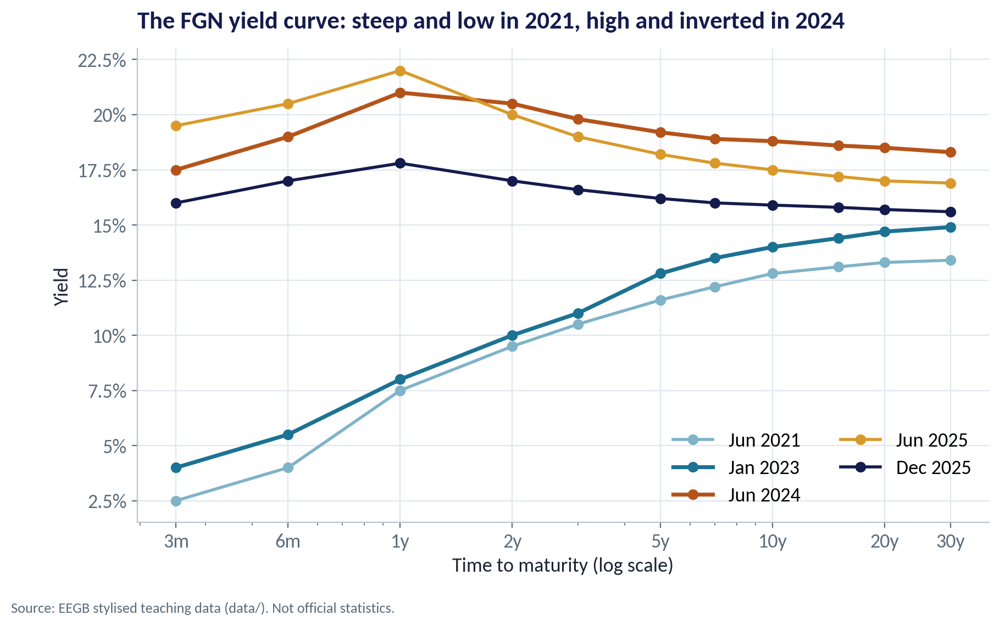
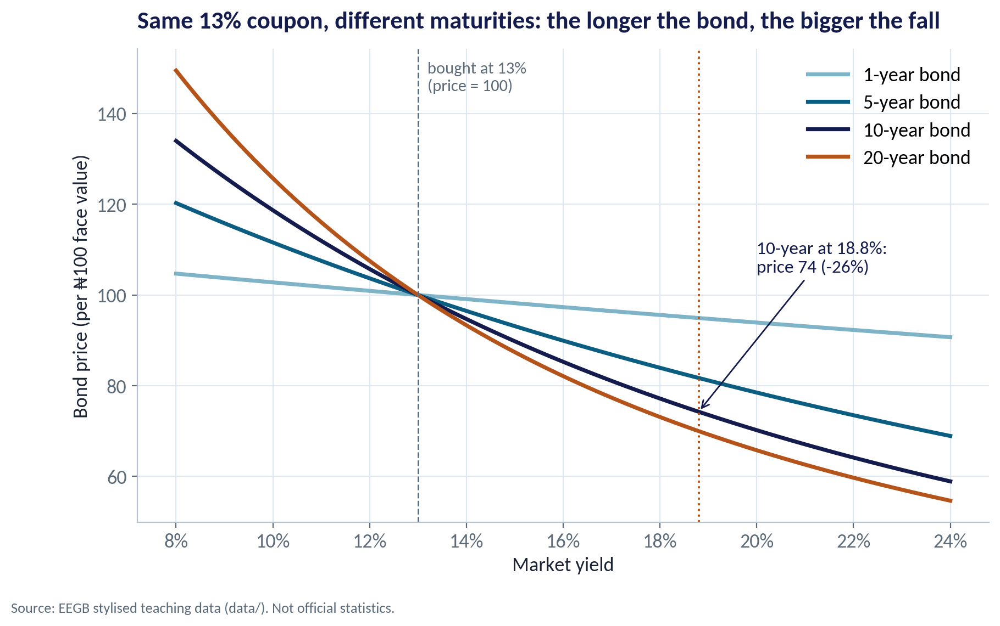
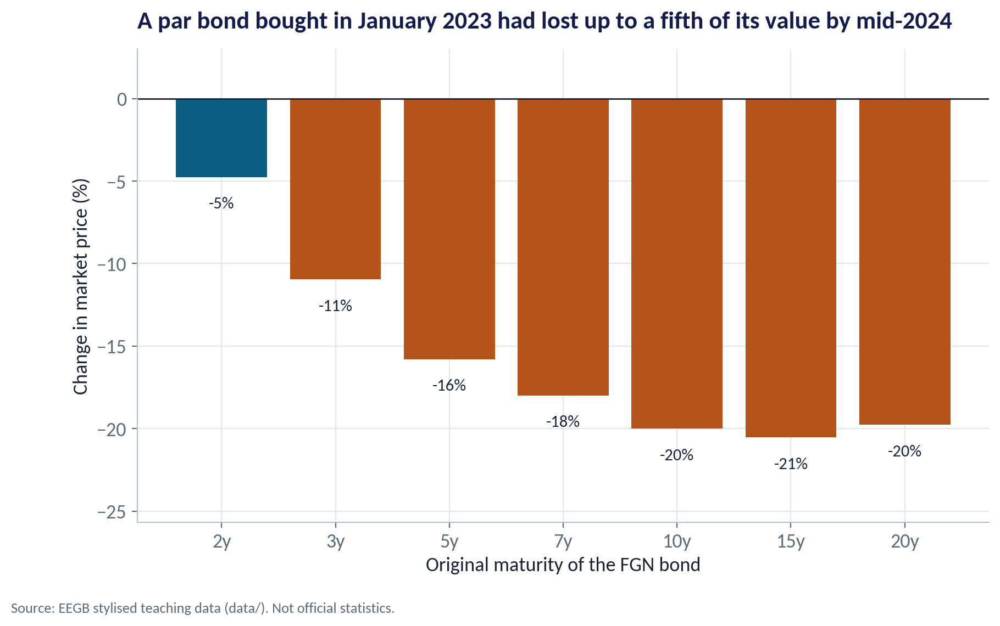
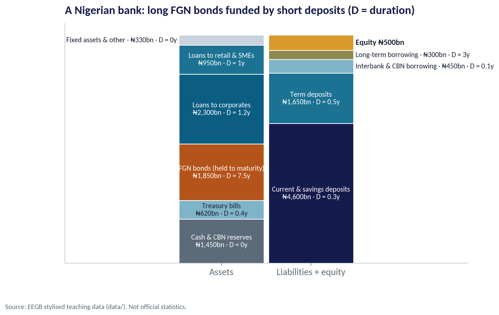
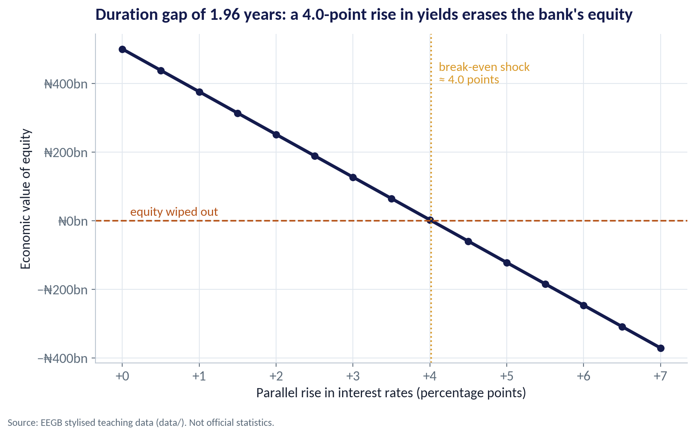
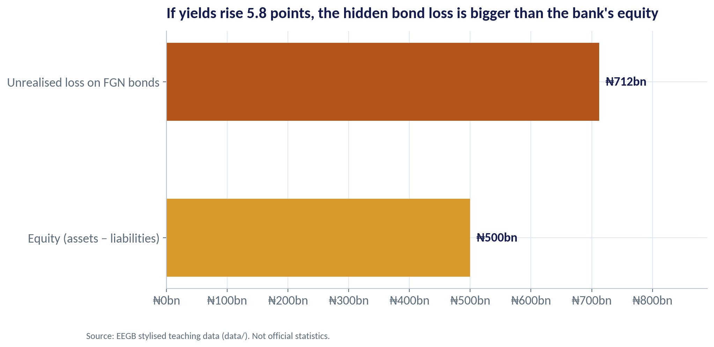
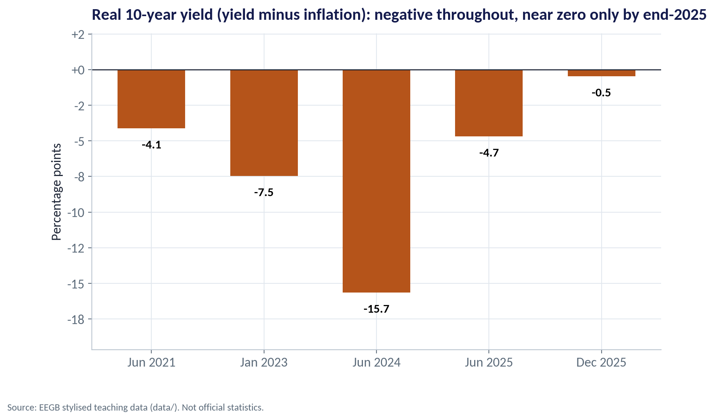

::: {.session-banner}
{.banner-hex width="96"}

**Session 10 of 16** · Facilitator: Elvis Ozegbe<br>*Case:* Silicon Valley Bank failed holding 'safe' bonds. Could a Nigerian bank holding long-dated FGN bonds face the same trap?

:::

## Downloads {.unnumbered}

::: {.download-row}
[<i class="bi bi-file-earmark-slides"></i> Teaching slides (.pptx)](../../sessions/s10/slides/EEGB_S10_Financial_Stability_Corporate_Finance_Conditions.pptx){.btn .btn-primary download=""}
[<i class="bi bi-file-earmark-pdf"></i> Slides (PDF)](../../sessions/s10/slides/EEGB_S10_Financial_Stability_Corporate_Finance_Conditions.pdf){.btn .btn-outline-primary download=""}
[<i class="bi bi-github"></i> Session folder on GitHub](https://github.com/adibongo/eegb/tree/main/sessions/s10){.btn .btn-outline-secondary}
:::

## Read first {.unnumbered}

- **Risk Management at Silicon Valley Bank** — Case, reference no. F-0997-E

## Learning objectives

::: {.grid}
::: {.g-col-12 .g-col-md-4 .obj-card}
**Read the Yield Curve**

Explain what the level and slope of the FGN yield curve say about inflation, policy and the cost of long-term money.
:::
::: {.g-col-12 .g-col-md-4 .obj-card}
**Spot Interest-Rate Risk**

Use duration to estimate how much a bond or a bank loses when rates rise.
:::
::: {.g-col-12 .g-col-md-4 .obj-card}
**Link Stability to Your Firm**

Explain how bank fragility and macroprudential rules change credit availability, spreads and investment.
:::
:::

## The business case

::: {.callout-note appearance="simple" icon=false}
## Could a Nigerian Bank Fall Into the SVB Trap?

**Situation.** A mid-sized Nigerian bank holds ₦1,850bn of FGN bonds bought around 13%, funded mostly by current and savings deposits. Yields jumped in 2024 as the CBN tightened.

**Question.** How much economic value has the bank lost, how big a rate shock could wipe out its equity, and what should the board do?

**Data.** bank_balance_sheet.csv — a fictional bank's assets and liabilities with durations and rates. ng_yield_curves.csv — five stylised FGN yield curves (2021–2025). *Stylised teaching data.*

**A good answer.** A stress test in naira: equity left after +1 to +5 point shocks, and one or two concrete actions (shorten the bond book, hedge, raise capital, lengthen funding).
:::

## Key ideas in plain English

### What a Yield Curve Shows

The yield curve plots the interest rate the government pays to borrow for 3 months, 1 year, 10 years and longer. Its level tells you how expensive money is; its slope tells you what markets expect next.

::: {.formula}
long yield ≈ average expected short rate + term premium
:::

*Example.* In 2021 the curve was low and steep (2.5% for 3 months, 12.8% for 10 years). By mid-2024 it was high and inverted (17.5% for 3 months, 21% for 1 year, 18.8% for 10 years).

::: {.callout-tip appearance="minimal"}
**Why a manager cares.** An inverted curve says markets expect rates to fall later — often because tight policy will slow the economy. It also tells you when to borrow long and when to wait.
:::

### When Yields Rise, Bond Prices Fall

A bond pays fixed coupons. If new bonds pay more, nobody will pay full price for your old, lower-coupon bond — so its price falls until its yield matches the market.

::: {.formula}
% price change ≈ − modified duration × change in yield
:::

*Example.* A 10-year FGN bond with a 13% coupon is worth 100 at a 13% yield, 89.8 at 15%, 77.2 at 18% and 70.2 at 20%.

::: {.callout-tip appearance="minimal"}
**Why a manager cares.** Duration — roughly the average time until you get your money back — measures sensitivity. The longer the bond, the bigger the fall when rates rise.
:::

### The Duration Gap

The duration gap compares how long the bank's assets are with how long its liabilities are. A positive gap means asset values fall more than liability values when rates rise — so equity shrinks.

::: {.formula}
gap = D(assets) − (liabilities ÷ assets) × D(liabilities)
:::

*Example.* Asset duration 2.38 years, liability duration 0.45 years → gap 1.96 years. A +1 point rise in rates cuts economic equity by about ₦124bn.

::: {.callout-tip appearance="minimal"}
**Why a manager cares.** The gap turns a rate forecast into a naira number the board understands: how much of our capital a rate shock would destroy.
:::

## Charts and how to replicate them

Every chart below is regenerated by the session's figure script — `sessions/s10/R/s10_figures.R` or `sessions/s10/python/s10_figures.py`. Run it from the project root.

### From Steep and Low to High and Inverted

::: {.panel-tabset group="lang"}
## Python
{.fig-img fig-alt="S10-F01 (Python)"}

:::

- 2021: cheap short-term money, long rates well above short — a normal, steep curve.
- Mid-2024: the CBN's tightening pushed short rates above long rates — an inverted curve.
- End-2025: lower and flatter as inflation eased and rate-cut expectations built.
- For a CFO the level is the cost of funds; the slope hints at whether to lock in long or stay short.

<span class="fig-id">S10-F01</span>

### Long Bonds Fall Most

::: {.panel-tabset group="lang"}
## Python
{.fig-img fig-alt="S10-F02 (Python)"}

:::

- All four bonds pay a 13% coupon and are priced at 100 when the yield is 13%.
- At an 18.8% yield the 1-year bond barely moves; the 10-year bond falls to about 74.
- The 20-year bond falls further still.
- Rule of thumb: more duration = more interest-rate risk.

<span class="fig-id">S10-F02</span>

### What Happened to Bonds Bought in January 2023

::: {.panel-tabset group="lang"}
## Python
{.fig-img fig-alt="S10-F03 (Python)"}

:::

- Take bonds bought at par in January 2023 and value them in June 2024.
- Short bonds lost about 5%; 10- and 15-year bonds lost about 20%.
- No default, no missed coupon — the loss comes purely from higher market yields.
- If you must sell before maturity, that loss becomes real.

<span class="fig-id">S10-F03</span>

### Long Bonds Funded by Short Deposits

::: {.panel-tabset group="lang"}
## Python
{.fig-img fig-alt="S10-F04 (Python)"}

:::

- Assets ₦7,500bn; liabilities ₦7,000bn; equity only ₦500bn — leverage of 15×.
- The FGN bond book (₦1,850bn) has a duration of 7.5 years.
- Most funding is current and savings deposits with a duration of a few months.
- Banks earn money by this mismatch — and take risk because of it.

<span class="fig-id">S10-F04</span>

### How Big a Rate Shock Can the Bank Survive?

::: {.panel-tabset group="lang"}
## Python
{.fig-img fig-alt="S10-F05 (Python)"}

:::

- Each point of higher rates removes roughly ₦124bn of economic equity.
- +2 points leaves about ₦251bn; +3 points about ₦127bn.
- A rise of about 4 points wipes out equity entirely.
- Nigerian 10-year yields rose by almost 5 points between early 2023 and mid-2024.

<span class="fig-id">S10-F05</span>

### The Hidden Loss Can Exceed Equity

::: {.panel-tabset group="lang"}
## Python
{.fig-img fig-alt="S10-F06 (Python)"}

:::

- Using the 2024 yield curve, the bond book's unrealised loss is about ₦712bn.
- That is larger than the bank's ₦500bn equity.
- Accounting rules for 'held-to-maturity' bonds can keep this loss off the income statement.
- It becomes real only if the bank must sell — for example, in a deposit run.

<span class="fig-id">S10-F06</span>

### Were Lenders Paid for Inflation?

::: {.panel-tabset group="lang"}
## Python
{.fig-img fig-alt="S10-F07 (Python)"}

:::

- Real 10-year yield = nominal yield − inflation.
- It was deeply negative in 2024 (about −16 points).
- By end-2025 it was close to zero (about −0.5).
- Negative real yields push savers to dollars and real assets; positive ones bring them back to naira bonds.

<span class="fig-id">S10-F07</span>

## Lab: Could Our Bank Be the Next SVB?

*Time:* 20 minutes · *Data:* [`data/bank_balance_sheet.csv`](../../data/bank_balance_sheet.csv), [`data/ng_yield_curves.csv`](../../data/ng_yield_curves.csv)

1. Tabulate the five yield curves: which are normal and which inverted?
2. Price a 10-year, 13% bond at yields of 13%, 15%, 18% and 20%.
3. Compute the bank's equity and leverage.
4. Compute asset duration, liability duration and the duration gap.
5. Stress-test equity for +1, +2, +3 and +5 point rate shocks.

::: {.callout-important appearance="simple"}
**Deliverable:** two sentences for the board on the bank's interest-rate risk and one action you would take.
:::

## The code (R | Python)

Pick your language once; every tab on the site follows your choice. Download a script, or copy it into RStudio and run it line by line.

### Replicate every chart

::: {.panel-tabset group="lang"}
## Python
[<i class="bi bi-download"></i> s10_figures.py](../../sessions/s10/python/s10_figures.py){download=""}

::: {.callout-note collapse="true" appearance="simple" icon=false}
## Show the full script (157 lines)

```{.python filename="sessions/s10/python/s10_figures.py"}
# =============================================================================
# EEGB · Session 10 · Financial Stability & Corporate Finance Conditions
# Replication script — regenerates every chart in the Session 10 deck (Python)
# Data: data/ng_yield_curves.csv (stylised FGN yield curves), data/bank_balance_sheet.csv (a fictional
#       Nigerian bank, ₦ bn), data/ng_macro_monthly.csv (inflation for real yields)
# Run from the project root:  python sessions/s10/python/s10_figures.py
# =============================================================================
import sys; sys.path.insert(0, "python")
import numpy as np, pandas as pd
import matplotlib.pyplot as plt
from matplotlib.ticker import FuncFormatter
from eegb_style import *

set_style()
yc = pd.read_csv("data/ng_yield_curves.csv", parse_dates=["date"])
bs = pd.read_csv("data/bank_balance_sheet.csv")
m = pd.read_csv("data/ng_macro_monthly.csv", parse_dates=["date"])


def bond_price(coupon, yld, years, freq=2, face=100):
    """Price of a plain fixed-coupon bond (coupon and yield as decimals)."""
    n = int(round(years * freq)); c = coupon / freq * face; y = yld / freq
    t = np.arange(1, n + 1)
    return np.sum(c / (1 + y) ** t) + face / (1 + y) ** n


def mac_duration(coupon, yld, years, freq=2):
    n = int(round(years * freq)); c = coupon / freq * 100; y = yld / freq
    t = np.arange(1, n + 1); cf = np.full(n, c); cf[-1] += 100
    pv = cf / (1 + y) ** t
    return np.sum(t / freq * pv) / pv.sum()


# --- F01 · Five yield curves --------------------------------------------------------------
fig, ax = plt.subplots()
cols = {"2021-06-30": SKY, "2023-01-31": TEAL2, "2024-06-28": RUST, "2025-06-30": GOLD, "2025-12-31": NAVY}
for d, g in yc.groupby("date"):
    k = d.strftime("%Y-%m-%d")
    ax.plot(g.tenor_years, g.yield_pct, marker="o", lw=2.6 if k in ("2024-06-28", "2023-01-31") else 2,
            color=cols[k], label=d.strftime("%b %Y"))
ax.set_xscale("log"); ax.set_xticks([0.25, 0.5, 1, 2, 5, 10, 20, 30], ["3m", "6m", "1y", "2y", "5y", "10y", "20y", "30y"])
ax.yaxis.set_major_formatter(FuncFormatter(pct)); ax.legend(title=None, loc="lower right", ncol=2)
ax.set(title="The FGN yield curve: steep and low in 2021, high and inverted in 2024",
       xlabel="Time to maturity (log scale)", ylabel="Yield")
note(fig); save(fig, "s10", "f01")

# --- F02 · Bond prices fall when yields rise — long bonds fall most -----------------------------
ys = np.linspace(0.08, 0.24, 80)
fig, ax = plt.subplots()
for yrs, c in [(1, SKY), (5, TEAL), (10, NAVY), (20, RUST)]:
    ax.plot(100 * ys, [bond_price(0.13, y, yrs) for y in ys], color=c, lw=2.6, label=f"{yrs}-year bond")
ax.axvline(13, color=SLATE, ls="--", lw=1); ax.text(13.2, 145, "bought at 13%\n(price = 100)", color=SLATE, fontsize=11)
ax.axvline(18.8, color=RUST, ls=":", lw=1.4)
p10 = bond_price(0.13, 0.188, 10)
ax.annotate(f"10-year at 18.8%:\nprice {p10:.0f} ({p10 - 100:+.0f}%)", xy=(18.8, p10), xytext=(20, 105),
            arrowprops=dict(arrowstyle="->", color=NAVY), fontsize=12, color=NAVY)
ax.legend(loc="upper right"); ax.xaxis.set_major_formatter(FuncFormatter(pct))
ax.set(title="Same 13% coupon, different maturities: the longer the bond, the bigger the fall",
       xlabel="Market yield", ylabel="Bond price (per ₦100 face value)")
note(fig); save(fig, "s10", "f02")

# --- F03 · Mark-to-market loss: bonds bought in Jan 2023, valued in Jun 2024 --------------------
c23 = yc[yc.date == "2023-01-31"].set_index("tenor_years").yield_pct
c24 = yc[yc.date == "2024-06-28"].set_index("tenor_years").yield_pct
ten = [2, 3, 5, 7, 10, 15, 20]
loss = []
for t in ten:
    rem = max(t - 1.4, 0.25)                      # ~17 months later the bond is shorter
    loss.append(bond_price(c23[t] / 100, c24.reindex([t]).interpolate().iloc[0] / 100, rem) - 100)
fig, ax = plt.subplots()
ax.bar([f"{t}y" for t in ten], loss, color=[TEAL if l > -5 else RUST for l in loss])
for i, l in enumerate(loss): ax.text(i, l - 1.2, f"{l:.0f}%", ha="center", va="top", fontsize=11, color=INK)
ax.axhline(0, color=INK, lw=1); ax.set_ylim(min(loss) * 1.25, 3)
ax.set(title="A par bond bought in January 2023 had lost up to a fifth of its value by mid-2024",
       xlabel="Original maturity of the FGN bond", ylabel="Change in market price (%)")
note(fig); save(fig, "s10", "f03")

# --- F04 · The bank's balance sheet ----------------------------------------------------------
A = bs[bs.side == "asset"]; L = bs[bs.side == "liability"]
TA, TL = A.amount_ngn_bn.sum(), L.amount_ngn_bn.sum(); E = TA - TL   # equity = assets − liabilities (keeps the sheet balanced)
fig, ax = plt.subplots(figsize=(10, 6))
palA = [SLATE, SKY, RUST, TEAL, TEAL2, "#C9D3DD"]; palL = [NAVY, TEAL2, SKY, OLIVE]
b = 0
for (_, r), c in zip(A.iterrows(), palA):
    ax.bar(0, r.amount_ngn_bn, bottom=b, color=c, width=.95, edgecolor="white")
    small = r.amount_ngn_bn < 600
    ax.text(-0.5 if small else 0, b + r.amount_ngn_bn / 2, f"{r['item']}{' · ' if small else chr(10)}₦{r.amount_ngn_bn:,.0f}bn · D = {r.duration_years:g}y",
            ha="right" if small else "center", va="center", fontsize=10, color=INK if small or c in ("#C9D3DD", SKY) else "white")
    b += r.amount_ngn_bn
b = 0
for (_, r), c in zip(L.iterrows(), palL):
    ax.bar(1, r.amount_ngn_bn, bottom=b, color=c, width=.95, edgecolor="white")
    small = r.amount_ngn_bn < 600
    ax.text(1.5 if small else 1, b + r.amount_ngn_bn / 2, f"{r['item']}{' · ' if small else chr(10)}₦{r.amount_ngn_bn:,.0f}bn · D = {r.duration_years:g}y",
            ha="left" if small else "center", va="center", fontsize=10, color=INK if small else "white")
    b += r.amount_ngn_bn
ax.bar(1, E, bottom=b, color=GOLD, width=.95, edgecolor="white")
ax.text(1.5, b + E / 2, f"Equity ₦{E:,.0f}bn", ha="left", va="center", fontsize=11, fontweight="bold", color=INK)
ax.set_xticks([0, 1], ["Assets", "Liabilities + equity"]); ax.set_yticks([]); ax.grid(False); ax.set_xlim(-1.75, 2.75)
ax.set(title="A Nigerian bank: long FGN bonds funded by short deposits (D = duration)")
note(fig); save(fig, "s10", "f04")

# --- F05 · Duration gap: what a rise in yields does to equity ---------------------------------
DA = (A.amount_ngn_bn * A.duration_years).sum() / TA
DL = (L.amount_ngn_bn * L.duration_years).sum() / TL
gap = DA - TL / TA * DL            # duration gap
y0 = 0.18
shocks = np.arange(0, 7.01, 0.5)
dE = -gap * TA * (shocks / 100) / (1 + y0)
fig, ax = plt.subplots()
ax.plot(shocks, E + dE, color=NAVY, lw=3, marker="o")
ax.axhline(0, color=RUST, lw=1.5, ls="--"); ax.text(0.1, 15, "equity wiped out", color=RUST, fontsize=12)
be = E * (1 + y0) / (gap * TA) * 100
ax.axvline(be, color=GOLD, ls=":", lw=1.5); ax.text(be + 0.1, E * 0.8, f"break-even shock\n≈ {be:.1f} points", color=GOLD, fontsize=12)
ax.yaxis.set_major_formatter(FuncFormatter(lambda v, p: f"{'−' if v < 0 else ''}₦{abs(v):,.0f}bn")); ax.xaxis.set_major_formatter(FuncFormatter(lambda v, p: f"+{v:g}"))
ax.set(title=f"Duration gap of {gap:.2f} years: a {be:.1f}-point rise in yields erases the bank's equity",
       xlabel="Parallel rise in interest rates (percentage points)", ylabel="Economic value of equity")
note(fig); save(fig, "s10", "f05")

# --- F06 · The SVB trap: unrealised loss on held-to-maturity bonds vs equity -------------------------
bonds = A[A["item"].str.contains("FGN bonds")].iloc[0]
mod_d = bonds.duration_years / (1 + bonds.rate_pct / 100)
dy = c24[10] - bonds.rate_pct
htm_loss = mod_d * dy / 100 * bonds.amount_ngn_bn
fig, ax = plt.subplots(figsize=(10, 4.8))
ax.barh(["Equity (assets − liabilities)", "Unrealised loss on FGN bonds"], [E, htm_loss], color=[GOLD, RUST], height=.5)
for i, v in enumerate([E, htm_loss]): ax.text(v + 10, i, f"₦{v:,.0f}bn", va="center", fontsize=13, fontweight="bold", color=NAVY)
ax.set_xlim(0, max(E, htm_loss) * 1.25); ax.xaxis.set_major_formatter(FuncFormatter(lambda v, p: f"₦{v:,.0f}bn"))
ax.set(title=f"If yields rise {dy:.1f} points, the hidden bond loss is bigger than the bank's equity")
note(fig); save(fig, "s10", "f06")

# --- F07 · Real 10-year yield ---------------------------------------------------------------------
rows = []
for d, g in yc.groupby("date"):
    infl = m.loc[m.date <= d, "headline_inflation"].iloc[-1]
    y10 = g.set_index("tenor_years").yield_pct[10]
    rows.append((d, y10, infl, y10 - infl))
ry = pd.DataFrame(rows, columns=["date", "y10", "infl", "real"])
fig, ax = plt.subplots()
lab = ry.date.dt.strftime("%b %Y")
ax.bar(lab, ry.real, color=[RUST if v < 0 else TEAL for v in ry.real], width=.6)
for i, r in ry.iterrows(): ax.text(i, r.real + (0.8 if r.real >= 0 else -0.8), f"{r.real:+.1f}", ha="center",
                                   va="bottom" if r.real >= 0 else "top", fontsize=12, fontweight="bold")
ax.axhline(0, color=INK, lw=1); ax.yaxis.set_major_formatter(FuncFormatter(lambda v, p: f"{v:+.0f}"))
ax.set_ylim(ry.real.min() - 4, ry.real.max() + 3)
ax.set(title="Real 10-year yield (yield minus inflation): negative throughout, near zero only by end-2025",
       ylabel="Percentage points")
note(fig); save(fig, "s10", "f07")

# --- key numbers -----------------------------------------------------------------------------------
print(f"TA={TA}, TL={TL}, E={E}, leverage(A/E)={TA / E:.1f}")
print(f"DA={DA:.2f}, DL={DL:.2f}, gap={gap:.2f}, break-even shock={be:.2f} pts")
print(f"10y bond 13% coupon at 18.8%: price {p10:.1f}; mac duration at 13%: {mac_duration(0.13, 0.13, 10):.2f}")
print("loss by tenor:", dict(zip(ten, np.round(loss, 1))))
print(f"HTM: modD={mod_d:.2f}, dy={dy:.1f}, loss={htm_loss:.0f}")
print(ry.round(1).to_string())
for s in (2, 5): print(f"shock +{s}: dE={-gap * TA * s / 100 / (1 + y0):.0f}")
```
:::

## R
[<i class="bi bi-download"></i> s10_figures.R](../../sessions/s10/R/s10_figures.R){download=""}

::: {.callout-note collapse="true" appearance="simple" icon=false}
## Show the full script (98 lines)

```{.r filename="sessions/s10/R/s10_figures.R"}
# =============================================================================
# EEGB · Session 10 · Financial Stability & Corporate Finance Conditions
# Replication script — regenerates every chart in the Session 10 deck (R)
# Data: data/ng_yield_curves.csv, data/bank_balance_sheet.csv, data/ng_macro_monthly.csv
# =============================================================================
source("R/theme_eegb.R")
suppressPackageStartupMessages({ library(dplyr); library(readr); library(tidyr) })
yc <- read_csv("data/ng_yield_curves.csv", show_col_types = FALSE) |> mutate(date = as.Date(date))
bs <- read_csv("data/bank_balance_sheet.csv", show_col_types = FALSE)
m  <- read_csv("data/ng_macro_monthly.csv", show_col_types = FALSE) |> mutate(date = as.Date(date))

bond_price <- function(coupon, yld, years, freq = 2, face = 100) {
  n <- round(years * freq); c <- coupon / freq * face; y <- yld / freq; t <- seq_len(n)
  sum(c / (1 + y)^t) + face / (1 + y)^n
}

# --- F01 · Five yield curves -------------------------------------------------------------
p1 <- ggplot(yc, aes(tenor_years, yield_pct, colour = format(date, "%b %Y"))) +
  geom_line(linewidth = 1.1) + geom_point(size = 2) +
  scale_x_log10(breaks = c(.25, .5, 1, 2, 5, 10, 20, 30), labels = c("3m", "6m", "1y", "2y", "5y", "10y", "20y", "30y")) +
  scale_colour_manual(values = unname(eegb[c("sky", "teal2", "rust", "gold", "navy")]), name = NULL) +
  scale_y_continuous(labels = pct) +
  labs(title = "The FGN yield curve: steep and low in 2021, high and inverted in 2024",
       x = "Time to maturity (log scale)", y = "Yield", caption = eegb_caption) + theme_eegb()
save_fig(p1, "s10", "f01")

# --- F02 · Price–yield seesaw by maturity ------------------------------------------------
grid <- expand_grid(y = seq(.08, .24, length.out = 80), yrs = c(1, 5, 10, 20)) |>
  rowwise() |> mutate(price = bond_price(.13, y, yrs)) |> ungroup()
p2 <- ggplot(grid, aes(100 * y, price, colour = paste0(yrs, "-year bond"))) + geom_line(linewidth = 1.2) +
  geom_vline(xintercept = 13, linetype = "dashed", colour = eegb[["slate"]]) +
  geom_vline(xintercept = 18.8, linetype = "dotted", colour = eegb[["rust"]]) +
  scale_colour_manual(values = unname(eegb[c("sky", "teal", "navy", "rust")]), name = NULL) +
  scale_x_continuous(labels = pct) +
  labs(title = "Same 13% coupon, different maturities: the longer the bond, the bigger the fall",
       x = "Market yield", y = "Bond price (per ₦100 face value)", caption = eegb_caption) + theme_eegb()
save_fig(p2, "s10", "f02")

# --- F03 · Mark-to-market loss, Jan 2023 → Jun 2024 ----------------------------------------
c23 <- filter(yc, date == as.Date("2023-01-31")); c24 <- filter(yc, date == as.Date("2024-06-28"))
ten <- c(2, 3, 5, 7, 10, 15, 20)
loss <- sapply(ten, function(t) bond_price(c23$yield_pct[c23$tenor_years == t] / 100,
                                           c24$yield_pct[c24$tenor_years == t] / 100, max(t - 1.4, .25)) - 100)
d3 <- tibble(tenor = factor(paste0(ten, "y"), levels = paste0(ten, "y")), loss = loss)
p3 <- ggplot(d3, aes(tenor, loss, fill = loss > -5)) + geom_col(show.legend = FALSE) +
  geom_text(aes(label = sprintf("%.0f%%", loss)), vjust = 1.5) +
  scale_fill_manual(values = c(`TRUE` = eegb[["teal"]], `FALSE` = eegb[["rust"]])) +
  labs(title = "A par bond bought in January 2023 had lost up to a fifth of its value by mid-2024",
       x = "Original maturity of the FGN bond", y = "Change in market price (%)", caption = eegb_caption) + theme_eegb()
save_fig(p3, "s10", "f03")

# --- F04 · The bank's balance sheet ----------------------------------------------------------
A <- filter(bs, side == "asset"); L <- filter(bs, side == "liability")
TA <- sum(A$amount_ngn_bn); TL <- sum(L$amount_ngn_bn); E <- TA - TL
d4 <- bind_rows(mutate(A, col = "Assets"), mutate(L, col = "Liabilities + equity"),
                tibble(col = "Liabilities + equity", item = "Equity", amount_ngn_bn = E, duration_years = 0))
p4 <- ggplot(d4, aes(col, amount_ngn_bn, fill = item)) + geom_col(colour = "white", width = .9) +
  geom_text(aes(label = paste0(item, " ₦", format(amount_ngn_bn, big.mark = ","), "bn")),
            position = position_stack(vjust = .5), size = 3, colour = "white") +
  scale_fill_manual(values = rep(unname(eegb_palette), 2), guide = "none") +
  labs(title = "A Nigerian bank: long FGN bonds funded by short deposits", x = NULL, y = "₦ bn", caption = eegb_caption) + theme_eegb()
save_fig(p4, "s10", "f04", height = 6)

# --- F05 · Duration gap stress test ------------------------------------------------------------
DA <- sum(A$amount_ngn_bn * A$duration_years) / TA
DL <- sum(L$amount_ngn_bn * L$duration_years) / TL
gap <- DA - TL / TA * DL; y0 <- .18
d5 <- tibble(shock = seq(0, 7, .5), equity = E - gap * TA * (shock / 100) / (1 + y0))
be <- E * (1 + y0) / (gap * TA) * 100
p5 <- ggplot(d5, aes(shock, equity)) + geom_line(colour = eegb[["navy"]], linewidth = 1.3) + geom_point(colour = eegb[["navy"]]) +
  geom_hline(yintercept = 0, linetype = "dashed", colour = eegb[["rust"]]) +
  geom_vline(xintercept = be, linetype = "dotted", colour = eegb[["gold"]]) +
  labs(title = sprintf("Duration gap of %.2f years: a %.1f-point rise in yields erases the bank's equity", gap, be),
       x = "Parallel rise in interest rates (percentage points)", y = "Economic value of equity (₦ bn)", caption = eegb_caption) + theme_eegb()
save_fig(p5, "s10", "f05")

# --- F06 · Unrealised loss on the bond book vs equity --------------------------------------------
bonds <- filter(A, grepl("FGN bonds", item))
dy <- c24$yield_pct[c24$tenor_years == 10] - bonds$rate_pct
htm <- bonds$duration_years / (1 + bonds$rate_pct / 100) * dy / 100 * bonds$amount_ngn_bn
d6 <- tibble(what = c("Equity (assets − liabilities)", "Unrealised loss on FGN bonds"), v = c(E, htm))
p6 <- ggplot(d6, aes(v, what, fill = what)) + geom_col(width = .5, show.legend = FALSE) +
  geom_text(aes(label = paste0("₦", round(v), "bn")), hjust = -.1) +
  scale_fill_manual(values = unname(eegb[c("gold", "rust")])) + xlim(0, max(d6$v) * 1.25) +
  labs(title = sprintf("If yields rise %.1f points, the hidden bond loss is bigger than the bank's equity", dy),
       x = NULL, y = NULL, caption = eegb_caption) + theme_eegb()
save_fig(p6, "s10", "f06", height = 4.8)

# --- F07 · Real 10-year yield -----------------------------------------------------------------------
ry <- yc |> filter(tenor_years == 10) |> rowwise() |>
  mutate(infl = tail(m$headline_inflation[m$date <= date], 1), real = yield_pct - infl) |> ungroup()
p7 <- ggplot(ry, aes(format(date, "%b %Y"), real, fill = real < 0)) + geom_col(width = .6, show.legend = FALSE) +
  geom_text(aes(label = sprintf("%+.1f", real)), vjust = ifelse(ry$real < 0, 1.4, -.4)) +
  scale_x_discrete(limits = format(ry$date, "%b %Y")) +
  scale_fill_manual(values = c(`TRUE` = eegb[["rust"]], `FALSE` = eegb[["teal"]])) + geom_hline(yintercept = 0) +
  labs(title = "Real 10-year yield (yield minus inflation): negative throughout, near zero only by end-2025",
       x = NULL, y = "Percentage points", caption = eegb_caption) + theme_eegb()
save_fig(p7, "s10", "f07")
```
:::

:::

### Lab

::: {.panel-tabset group="lang"}
## Python
[<i class="bi bi-download"></i> s10_lab.py](../../sessions/s10/python/s10_lab.py){download=""}

::: {.callout-note collapse="true" appearance="simple" icon=false}
## Show the full script (45 lines)

```{.python filename="sessions/s10/python/s10_lab.py"}
# =============================================================================
# EEGB · Session 10 LAB · Could our bank become the next SVB? (Python)
# Data: data/bank_balance_sheet.csv (fictional Nigerian bank, ₦ bn)
#       data/ng_yield_curves.csv (stylised FGN yield curves)
# Run from the project root, line by line.
# =============================================================================
import numpy as np, pandas as pd

bs = pd.read_csv("data/bank_balance_sheet.csv")
yc = pd.read_csv("data/ng_yield_curves.csv")

# ---- STEP 1 · Read the yield curves ---------------------------------------------------
print(yc.pivot(index="tenor_years", columns="date", values="yield_pct"))
# Which dates are upward-sloping (normal) and which are inverted (short rates above long)?

# ---- STEP 2 · Price a bond and see what a rate rise does ----------------------------------
def bond_price(coupon, yld, years, freq=2, face=100):
    n = int(round(years * freq)); c = coupon / freq * face; y = yld / freq
    t = np.arange(1, n + 1)
    return np.sum(c / (1 + y) ** t) + face / (1 + y) ** n

for y in (0.13, 0.15, 0.18, 0.20):
    print(f"10-year 13% bond at a {y:.0%} yield: price {bond_price(0.13, y, 10):.1f}")

# ---- STEP 3 · Equity and leverage -------------------------------------------------------------
A = bs[bs.side == "asset"]; L = bs[bs.side == "liability"]
TA, TL = A.amount_ngn_bn.sum(), L.amount_ngn_bn.sum(); E = TA - TL
print(f"Assets ₦{TA:,.0f}bn, liabilities ₦{TL:,.0f}bn, equity ₦{E:,.0f}bn, leverage {TA / E:.1f}x")

# ---- STEP 4 · The duration gap ------------------------------------------------------------------
DA = (A.amount_ngn_bn * A.duration_years).sum() / TA      # average life of assets (years)
DL = (L.amount_ngn_bn * L.duration_years).sum() / TL      # average life of liabilities
gap = DA - TL / TA * DL
print(f"Asset duration {DA:.2f}y, liability duration {DL:.2f}y, duration gap {gap:.2f}y")

# ---- STEP 5 · Stress test: what happens to equity if rates jump? -----------------------------------
for shock in (1, 2, 3, 5):
    dE = -gap * TA * (shock / 100) / 1.18
    print(f"+{shock} points: equity changes by ₦{dE:,.0f}bn → ₦{E + dE:,.0f}bn left")

# ---- YOUR TURN -----------------------------------------------------------------------------------------
# (a) The treasurer proposes cutting the FGN bond book from ₦1,850bn to ₦1,000bn and moving the rest to T-bills.
#     Edit the data frame and recompute the duration gap. How big a rate shock can the bank now survive?
# (b) Why do 'held to maturity' accounting rules hide this risk until depositors start to leave?
# (c) Write two sentences for the board: what is our interest-rate risk, and what one action would you take?
```
:::

## R
[<i class="bi bi-download"></i> s10_lab.R](../../sessions/s10/R/s10_lab.R){download=""}

::: {.callout-note collapse="true" appearance="simple" icon=false}
## Show the full script (38 lines)

```{.r filename="sessions/s10/R/s10_lab.R"}
# =============================================================================
# EEGB · Session 10 LAB · Could our bank become the next SVB? (R)
# Data: data/bank_balance_sheet.csv (fictional Nigerian bank, ₦ bn), data/ng_yield_curves.csv
# =============================================================================
library(dplyr); library(readr); library(tidyr)
bs <- read_csv("data/bank_balance_sheet.csv", show_col_types = FALSE)
yc <- read_csv("data/ng_yield_curves.csv", show_col_types = FALSE)

# ---- STEP 1 · Read the yield curves ---------------------------------------------------
yc |> pivot_wider(names_from = date, values_from = yield_pct)
# Which dates are upward-sloping (normal) and which are inverted?

# ---- STEP 2 · Price a bond and see what a rate rise does ----------------------------------
bond_price <- function(coupon, yld, years, freq = 2, face = 100) {
  n <- round(years * freq); c <- coupon / freq * face; y <- yld / freq; t <- seq_len(n)
  sum(c / (1 + y)^t) + face / (1 + y)^n
}
for (y in c(.13, .15, .18, .20)) cat(sprintf("10-year 13%% bond at a %.0f%% yield: price %.1f\n", 100 * y, bond_price(.13, y, 10)))

# ---- STEP 3 · Equity and leverage -------------------------------------------------------------
A <- filter(bs, side == "asset"); L <- filter(bs, side == "liability")
TA <- sum(A$amount_ngn_bn); TL <- sum(L$amount_ngn_bn); E <- TA - TL
cat(sprintf("Assets %.0f, liabilities %.0f, equity %.0f (₦ bn); leverage %.1fx\n", TA, TL, E, TA / E))

# ---- STEP 4 · The duration gap ------------------------------------------------------------------
DA <- sum(A$amount_ngn_bn * A$duration_years) / TA
DL <- sum(L$amount_ngn_bn * L$duration_years) / TL
gap <- DA - TL / TA * DL
cat(sprintf("Asset duration %.2fy, liability duration %.2fy, gap %.2fy\n", DA, DL, gap))

# ---- STEP 5 · Stress test ---------------------------------------------------------------------------
tibble(shock = c(1, 2, 3, 5)) |> mutate(change_in_equity = -gap * TA * (shock / 100) / 1.18,
                                        equity_left = E + change_in_equity)

# ---- YOUR TURN -----------------------------------------------------------------------------------------
# (a) Cut the FGN bond book from ₦1,850bn to ₦1,000bn and move the rest to T-bills. Recompute the gap.
# (b) Why do 'held to maturity' rules hide this risk until depositors start to leave?
# (c) Two sentences for the board: our interest-rate risk, and one action you would take.
```
:::

:::

## Check your understanding

**Q1.** Your pension fund holds a 20-year FGN bond. The CBN signals more rate hikes. What is the most likely effect on the bond's market value?

- **A.** It rises, because higher rates mean higher coupons on the bond you already hold
- **B.** It falls, and by more than a 2-year bond would
- **C.** It is unchanged until the bond matures
- **D.** It falls by the same percentage as a 2-year bond

::: {.callout-tip collapse="true" appearance="simple"}
## Show answer
**B.** B. The coupon on an existing bond is fixed, so higher market yields push its price down, and the long duration of a 20-year bond magnifies the fall. C confuses accounting value (if held to maturity) with market value.
:::

**Q2.** The case bank's duration gap is 1.96 years and its equity is ₦500bn. A colleague says: 'A 2-point rise in yields is nothing for us.' What is the best reply?

- **A.** Correct — the bonds will pay back at maturity, so there is no loss
- **B.** A 2-point rise would cut economic equity by about ₦250bn, half our capital
- **C.** A 2-point rise would wipe out all our equity
- **D.** We cannot say without the bank's profit figures

::: {.callout-tip collapse="true" appearance="simple"}
## Show answer
**B.** B. Change in equity ≈ −1.96 × ₦7,500bn × 0.02 ÷ 1.18 ≈ −₦249bn, about half the ₦500bn. A ignores economic value and liquidity risk. C overstates — that needs about 4 points.
:::

## Vocabulary

| Term | Meaning |
|---|---|
| **Yield** | The annual return on a bond if bought at today's price and held to maturity. |
| **Yield curve** | Yields on government debt plotted against maturity. |
| **Inverted curve** | Short-term yields above long-term yields. |
| **Term premium** | Extra yield investors demand for lending long. |
| **Duration** | Weighted average time to a bond's cash flows; its rate sensitivity. |
| **Duration gap** | Asset duration minus leverage-adjusted liability duration. |
| **Mark-to-market** | Valuing an asset at today's market price. |
| **Held to maturity** | Accounting label that keeps bond losses off the income statement. |
| **Credit spread** | Extra interest a borrower pays above the government yield. |
| **Macroprudential** | Rules that protect the financial system as a whole. |

## Key takeaways

1. The yield curve's level is the price of money; its slope is the market's view of what comes next.
2. When yields rise, bond prices fall — long bonds most. Government bonds carry interest-rate risk.
3. Banks are fragile because they borrow short and lend long with thin equity.
4. The duration gap turns a rate shock into a naira loss of capital.
5. Financial conditions reach your firm through the price and quantity of credit.

::: {.callout-note appearance="simple"}
**Before next session:** Read the Thailand: An Imbalance of Payments case. Note the exchange-rate regime, the size of short-term foreign borrowing, and what happened to reserves in 1997.
:::

::: {.session-nav}
[← Session 9: Fiscal Policy & Debt](../../sessions/s09/index.qmd)
[Session 11: Exchange Rates & Capital Flows →](../../sessions/s11/index.qmd){.next}
:::
