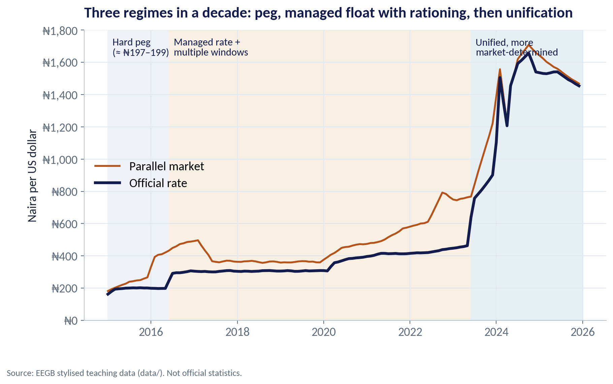
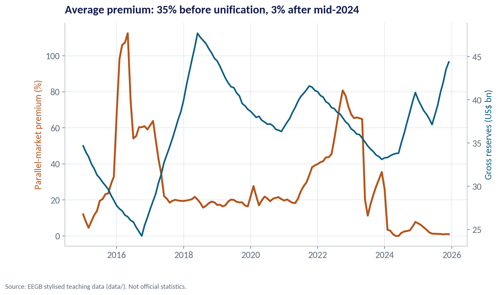
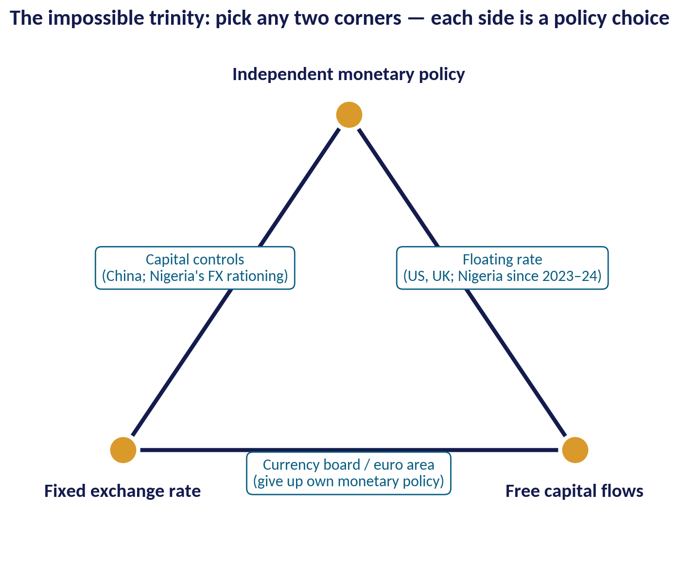
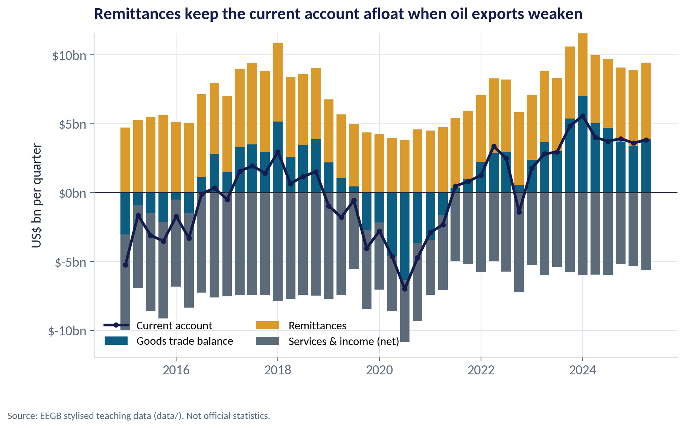
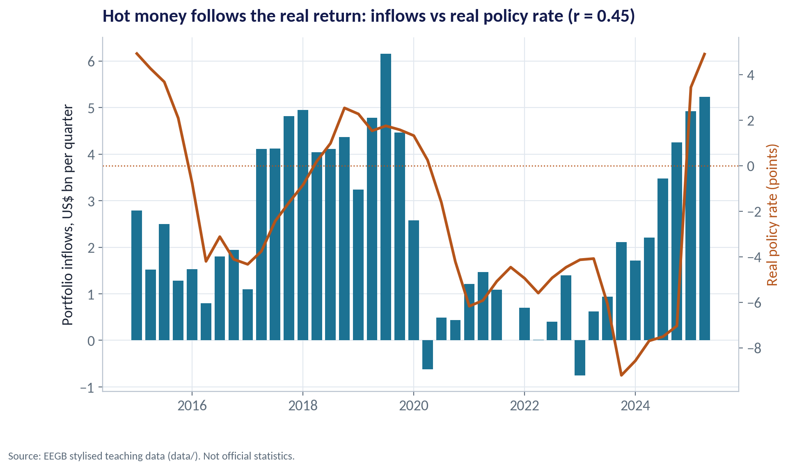
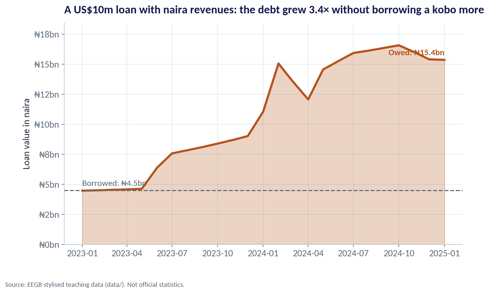
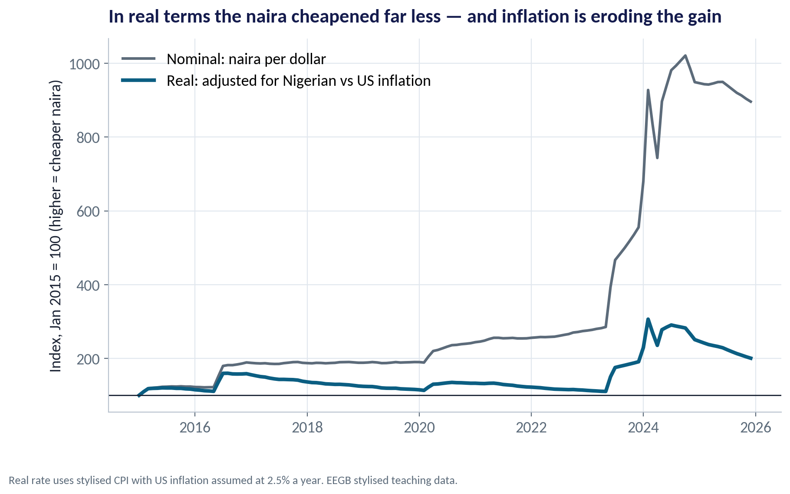

::: {.session-banner}
{.banner-hex width="96"}

**Session 11 of 16** · Facilitator: Elvis Ozegbe<br>*Case:* From ₦460 to ₦1,500 per dollar: what the naira's unification teaches about pegs, reserves and the impossible trinity.

:::

## Downloads {.unnumbered}

::: {.download-row}
[<i class="bi bi-file-earmark-slides"></i> Teaching slides (.pptx)](../../sessions/s11/slides/EEGB_S11_Exchange_Rates_Capital_Flows_the_Impossible_Trinity.pptx){.btn .btn-primary download=""}
[<i class="bi bi-file-earmark-pdf"></i> Slides (PDF)](../../sessions/s11/slides/EEGB_S11_Exchange_Rates_Capital_Flows_the_Impossible_Trinity.pdf){.btn .btn-outline-primary download=""}
[<i class="bi bi-github"></i> Session folder on GitHub](https://github.com/adibongo/eegb/tree/main/sessions/s11){.btn .btn-outline-secondary}
:::

## Read first {.unnumbered}

- **Thailand: An Imbalance of Payments** — Case, reference no. 209-021-1
- **Krugman, Obstfeld & Melitz — International Economics: Theory & Policy** — Textbook

## Learning objectives

::: {.grid}
::: {.g-col-12 .g-col-md-4 .obj-card}
**Explain FX Regimes**

Compare pegs, managed floats and free floats, and explain the impossible trinity in plain language.
:::
::: {.g-col-12 .g-col-md-4 .obj-card}
**Read the Balance of Payments**

Trace where Nigeria's dollars come from and go to, and spot the warning signs of a sudden stop.
:::
::: {.g-col-12 .g-col-md-4 .obj-card}
**Manage Currency Risk**

Identify currency mismatch in a business and explain how a weaker naira hits costs, debt and competitiveness.
:::
:::

## The business case

::: {.callout-note appearance="simple" icon=false}
## From ₦460 to ₦1,500: Lessons from the Naira's Unification

**Situation.** Until mid-2023 Nigeria kept an official rate near ₦460/$ while the parallel market traded far weaker. In June 2023 the CBN unified its FX windows; by 2024 the naira traded around ₦1,500/$.

**Question.** Why did the old system break, who gained and lost from unification, and what should a Nigerian firm do differently now?

**Data.** ng_macro_monthly.csv — official and parallel rates, reserves, policy rate, inflation. ng_bop_quarterly.csv — trade, remittances, services, FDI and portfolio flows, 2015–2025. *Stylised teaching data.*

**A good answer.** A clear account of the regime choice using the impossible trinity, plus a currency-risk checklist for a firm.
:::

## Key ideas in plain English

### What Sets the Exchange Rate?

An exchange rate is a price: naira per dollar. It is set by who wants dollars (importers, students abroad, investors leaving, people saving in dollars) and who supplies them (oil exporters, remittances, foreign investors coming in, the CBN).

::: {.formula}
dollar demand > dollar supply → naira weakens (or reserves fall)
:::

*Example.* When oil earnings fell in 2015–16 and again in 2020, dollar supply dropped. The CBN either let the naira fall or spent reserves and rationed dollars.

::: {.callout-tip appearance="minimal"}
**Why a manager cares.** Every forecast of the naira is really a forecast of dollar inflows and outflows. Learn to read those flows and you will rarely be surprised.
:::

### The Impossible Trinity

A country would like three things: a stable exchange rate, free movement of capital, and its own interest-rate policy. It can only have two at a time.

::: {.formula}
fixed rate + free capital + own monetary policy = impossible
:::

*Example.* If the CBN fixes the naira and lets capital move freely, it must set interest rates to defend the peg — it loses control of domestic policy. Nigeria before 2023 kept the peg and its own rates by rationing dollars — a form of capital control.

::: {.callout-tip appearance="minimal"}
**Why a manager cares.** When a government promises all three, one promise will break. For a business, the question is which one, and when.
:::

### Borrow Cheap, Lend Dear — Until the Currency Moves

In a carry trade, investors borrow in a low-interest currency (dollars) and buy high-yield naira bills. They earn the interest gap — as long as the naira does not fall by more than that gap.

::: {.formula}
carry return ≈ naira yield − dollar yield − naira depreciation
:::

*Example.* A 20% naira bill against a 5% dollar cost earns about 15% — but a 40% devaluation turns that into a large loss.

::: {.callout-tip appearance="minimal"}
**Why a manager cares.** When carry investors all head for the exit at once, the naira falls fast and reserves drain. Watch their positioning, not just the interest rate.
:::

## Charts and how to replicate them

Every chart below is regenerated by the session's figure script — `sessions/s11/R/s11_figures.R` or `sessions/s11/python/s11_figures.py`. Run it from the project root.

### A Decade of Naira Policy

::: {.panel-tabset group="lang"}
## Python
{.fig-img fig-alt="S11-F01 (Python)"}

:::

- 2015–mid-2016: a near-fixed rate around ₦197–199 per dollar.
- 2016–2023: a managed rate with several official windows, and a wide parallel market.
- From June 2023: windows unified; the rate became much more market-determined.
- Each switch came after the old regime ran short of dollars.

<span class="fig-id">S11-F01</span>

### The Premium Measures Rationing

::: {.panel-tabset group="lang"}
## Python
{.fig-img fig-alt="S11-F02 (Python)"}

:::

- The parallel premium averaged about 35% before unification and peaked above 100% in 2016.
- Since mid-2024 it has averaged under 3%.
- A high premium tells you official dollars are being rationed.
- Falling reserves alongside a rising premium is the classic warning of a coming devaluation.

<span class="fig-id">S11-F02</span>

### Pick Any Two Corners

::: {.panel-tabset group="lang"}
## Python
{.fig-img fig-alt="S11-F05 (Python)"}

:::

- Currency board / monetary union: fixed rate and open capital, but no independent rates (e.g. the euro area, the CFA franc zone).
- Capital controls: fixed or managed rate with own policy — at the cost of rationing and parallel markets.
- Floating rate: open capital and own policy — the exchange rate does the adjusting.
- Nigeria moved from the controls side towards the floating side in 2023–24.

<span class="fig-id">S11-F05</span>

### Remittances Keep the Account Afloat

::: {.panel-tabset group="lang"}
## Python
{.fig-img fig-alt="S11-F03 (Python)"}

:::

- Remittances (gold) average about US$5.1bn a quarter — a stable dollar source.
- Services and income (grey) are a steady drain.
- The current account turns negative when oil weakens: about −US$4.6bn in 2020Q2.
- Higher oil and a weaker naira restored surpluses in 2023–24.

<span class="fig-id">S11-F03</span>

### Portfolio Flows Chase the Real Return

::: {.panel-tabset group="lang"}
## Python
{.fig-img fig-alt="S11-F04 (Python)"}

:::

- Foreign portfolio investors come when the real return — interest minus inflation, adjusted for expected depreciation — is attractive.
- In our data the correlation between inflows and the real policy rate is 0.45.
- These flows can reverse within weeks: a sudden stop.
- A central bank that relies on hot money to fund the peg is building a trap.

<span class="fig-id">S11-F04</span>

### The Dollar Loan That Tripled

::: {.panel-tabset group="lang"}
## Python
{.fig-img fig-alt="S11-F06 (Python)"}

:::

- A firm borrows US$10m in January 2023 to fund naira-earning operations: ₦4.5bn.
- By January 2025 the same debt is worth ₦15.4bn.
- Nothing changed in the business — only the exchange rate.
- Mismatch, not the dollar itself, is the danger: borrow in the currency you earn.

<span class="fig-id">S11-F06</span>

### Did the Naira Really Get Cheaper?

::: {.panel-tabset group="lang"}
## Python
{.fig-img fig-alt="S11-F07 (Python)"}

:::

- The real rate adjusts the nominal rate for inflation at home and abroad.
- From 2016 to 2023 the real index drifted from about 159 to 110: high inflation made the naira overvalued at a fixed rate.
- Unification produced a sharp real depreciation (peak about 306 in Feb 2024).
- Since then inflation has eroded part of the gain (about 201 by end-2025).

<span class="fig-id">S11-F07</span>

## Lab: Reading the Naira

*Time:* 20 minutes · *Data:* [`data/ng_macro_monthly.csv`](../../data/ng_macro_monthly.csv), [`data/ng_bop_quarterly.csv`](../../data/ng_bop_quarterly.csv)

1. Compute the parallel premium by year and compare it with reserves.
2. Rebuild the current account from its parts, by year.
3. Correlate portfolio inflows with the real policy rate.
4. Track a US$10m loan in naira from 2023 to 2025.
5. Place Nigeria's pre- and post-2023 regimes on the impossible trinity.

::: {.callout-important appearance="simple"}
**Deliverable:** a one-paragraph note to your CFO: three signals that the naira is under pressure, and where to find them.
:::

## The code (R | Python)

Pick your language once; every tab on the site follows your choice. Download a script, or copy it into RStudio and run it line by line.

### Replicate every chart

::: {.panel-tabset group="lang"}
## Python
[<i class="bi bi-download"></i> s11_figures.py](../../sessions/s11/python/s11_figures.py){download=""}

::: {.callout-note collapse="true" appearance="simple" icon=false}
## Show the full script (129 lines)

```{.python filename="sessions/s11/python/s11_figures.py"}
# =============================================================================
# EEGB · Session 11 · Exchange Rates, Capital Flows & the Impossible Trinity
# Replication script — regenerates every chart in the Session 11 deck (Python)
# Data: data/ng_macro_monthly.csv, data/ng_bop_quarterly.csv (stylised teaching data)
# Run from the project root:  python sessions/s11/python/s11_figures.py
# =============================================================================
import sys; sys.path.insert(0, "python")
import numpy as np, pandas as pd
import matplotlib.pyplot as plt
from matplotlib.ticker import FuncFormatter
from eegb_style import *

set_style()
m = pd.read_csv("data/ng_macro_monthly.csv", parse_dates=["date"])
b = pd.read_csv("data/ng_bop_quarterly.csv")
b["date"] = pd.PeriodIndex(b.quarter, freq="Q").to_timestamp()
ngn = FuncFormatter(lambda v, p: f"₦{v:,.0f}")

# --- F01 · Three regimes for the naira -----------------------------------------------------------
fig, ax = plt.subplots()
ax.plot(m.date, m.parallel_fx_ngn_usd, color=RUST, lw=2, label="Parallel market")
ax.plot(m.date, m.official_fx_ngn_usd, color=NAVY, lw=3, label="Official rate")
regimes = [("2015-01-01", "2016-06-01", "Hard peg\n(≈ ₦197–199)", "#EEF2F6"),
           ("2016-06-01", "2023-06-01", "Managed rate +\nmultiple windows", "#F6EFE2"),
           ("2023-06-01", "2025-12-31", "Unified, more\nmarket-determined", "#E6F0F4")]
for a, z, lab, c in regimes:
    ax.axvspan(pd.Timestamp(a), pd.Timestamp(z), color=c, zorder=0)
    ax.text(pd.Timestamp(a) + pd.Timedelta(days=40), 1750, lab, fontsize=11, color=NAVY, va="top")
ax.yaxis.set_major_formatter(ngn); ax.set_ylim(0, 1800); ax.legend(loc="center left")
ax.set(title="Three regimes in a decade: peg, managed float with rationing, then unification",
       ylabel="Naira per US dollar")
note(fig); save(fig, "s11", "f01")

# --- F02 · Rationing shows up as a premium: premium vs reserves ------------------------------------
m["premium"] = 100 * (m.parallel_fx_ngn_usd / m.official_fx_ngn_usd - 1)
fig, ax = plt.subplots()
ax.plot(m.date, m.premium, color=RUST, lw=2.6, label="Parallel premium (%)")
ax.set_ylabel("Parallel-market premium (%)", color=RUST)
ax2 = ax.twinx(); ax2.plot(m.date, m.fx_reserves_usd_bn, color=TEAL, lw=2.2, label="Reserves (US$ bn)")
ax2.set_ylabel("Gross reserves (US$ bn)", color=TEAL); ax2.grid(False); ax2.spines["right"].set_visible(True)
pre = m[m.date < "2023-06-01"].premium.mean(); post = m[m.date >= "2024-06-01"].premium.mean()
ax.set(title=f"Average premium: {pre:.0f}% before unification, {post:.0f}% after mid-2024")
note(fig); save(fig, "s11", "f02")

# --- F03 · The balance of payments, quarter by quarter ----------------------------------------------
fig, ax = plt.subplots()
x = b.date
pos = np.zeros(len(b)); neg = np.zeros(len(b))
for col, c, lab in [("trade_balance", TEAL, "Goods trade balance"), ("remittances", GOLD, "Remittances"),
                    ("services_income_net", SLATE, "Services & income (net)")]:
    v = b[col].values
    ax.bar(x, np.where(v > 0, v, 0), bottom=pos, width=70, color=c, label=lab)
    ax.bar(x, np.where(v < 0, v, 0), bottom=neg, width=70, color=c)
    pos += np.where(v > 0, v, 0); neg += np.where(v < 0, v, 0)
ax.plot(x, b.current_account, color=NAVY, lw=2.6, marker="o", ms=4, label="Current account")
ax.axhline(0, color=INK, lw=1); ax.legend(loc="lower left", ncol=2, fontsize=11)
ax.yaxis.set_major_formatter(FuncFormatter(usd_bn := (lambda v, p: f"${v:.0f}bn")))
ax.set(title="Remittances keep the current account afloat when oil exports weaken",
       ylabel="US$ bn per quarter")
note(fig); save(fig, "s11", "f03")

# --- F04 · Hot money: portfolio inflows and the carry ---------------------------------------------
mq = m.set_index("date").resample("QS").mean(numeric_only=True)
mq["real_rate"] = mq.mpr - mq.headline_inflation
bq = b.set_index("date").join(mq[["real_rate"]])
fig, ax = plt.subplots()
ax.bar(bq.index, bq.portfolio_inflows, width=70, color=TEAL2, label="Portfolio inflows (US$ bn)")
ax.set_ylabel("Portfolio inflows, US$ bn per quarter")
ax2 = ax.twinx(); ax2.plot(bq.index, bq.real_rate, color=RUST, lw=2.4, label="Real policy rate (pts)")
ax2.axhline(0, color=RUST, ls=":", lw=1); ax2.set_ylabel("Real policy rate (points)", color=RUST)
ax2.grid(False); ax2.spines["right"].set_visible(True)
r = np.corrcoef(bq.portfolio_inflows, bq.real_rate)[0, 1]
ax.set(title=f"Hot money follows the real return: inflows vs real policy rate (r = {r:.2f})")
note(fig); save(fig, "s11", "f04")

# --- F05 · The impossible trinity (conceptual) -----------------------------------------------------
fig, ax = plt.subplots(figsize=(9, 7))
P = {"Fixed exchange rate": (0, 0), "Free capital flows": (10, 0), "Independent monetary policy": (5, 8.66)}
tri = np.array(list(P.values()) + [P["Fixed exchange rate"]])
ax.plot(tri[:, 0], tri[:, 1], color=NAVY, lw=3)
for k, (px, py) in P.items():
    ax.scatter(px, py, s=500, color=GOLD, zorder=3, edgecolor="white", lw=3)
    ax.text(px, py + (0.9 if py > 0 else -1.2), k, ha="center", fontsize=14, fontweight="bold", color=NAVY)
sides = [((5, -0.6), "Currency board / euro area\n(give up own monetary policy)"),
         ((1.6, 4.7), "Capital controls\n(China; Nigeria's FX rationing)"),
         ((8.4, 4.7), "Floating rate\n(US, UK; Nigeria since 2023–24)")]
for (sx, sy), lab in sides:
    ax.text(sx, sy, lab, ha="center", va="center", fontsize=11.5, color=TEAL,
            bbox=dict(boxstyle="round,pad=0.4", fc="white", ec=TEAL))
ax.set_xlim(-2.5, 12.5); ax.set_ylim(-3, 10.5); ax.axis("off")
ax.set_title("The impossible trinity: pick any two corners — each side is a policy choice", loc="left")
save(fig, "s11", "f05")

# --- F06 · Currency mismatch: a US$10m loan in naira ------------------------------------------------
loan_usd = 10e6
d0, d1 = pd.Timestamp("2023-01-01"), pd.Timestamp("2025-01-01")
fx0 = m.loc[m.date == d0, "official_fx_ngn_usd"].iloc[0]; fx1 = m.loc[m.date == d1, "official_fx_ngn_usd"].iloc[0]
path_ngn = m[(m.date >= d0) & (m.date <= d1)].assign(debt=lambda d: loan_usd * d.official_fx_ngn_usd / 1e9)
fig, ax = plt.subplots()
ax.fill_between(path_ngn.date, path_ngn.debt, color=RUST, alpha=.25)
ax.plot(path_ngn.date, path_ngn.debt, color=RUST, lw=3)
ax.axhline(loan_usd * fx0 / 1e9, color=SLATE, ls="--"); ax.text(d0, loan_usd * fx0 / 1e9 + .4, f"Borrowed: ₦{loan_usd * fx0 / 1e9:.1f}bn", color=SLATE, fontsize=12)
ax.text(d1, loan_usd * fx1 / 1e9 + .4, f"Owed: ₦{loan_usd * fx1 / 1e9:.1f}bn", color=RUST, fontsize=12, ha="right", fontweight="bold")
ax.yaxis.set_major_formatter(FuncFormatter(lambda v, p: f"₦{v:.0f}bn")); ax.set_ylim(0, loan_usd * fx1 / 1e9 * 1.2)
ax.set(title=f"A US$10m loan with naira revenues: the debt grew {fx1 / fx0:.1f}× without borrowing a kobo more",
       ylabel="Loan value in naira")
note(fig); save(fig, "s11", "f06")

# --- F07 · Real exchange rate: did the naira really get cheaper? --------------------------------------
# Build price levels from year-on-year inflation (monthly approximation); US inflation assumed 2.5% a year.
mp = (1 + m.headline_inflation / 100) ** (1 / 12)
p_ng = mp.cumprod(); p_us = (1.025 ** (1 / 12)) ** np.arange(1, len(m) + 1)
rer = m.official_fx_ngn_usd * p_us / p_ng
rer = 100 * rer / rer.iloc[0]; nom = 100 * m.official_fx_ngn_usd / m.official_fx_ngn_usd.iloc[0]
fig, ax = plt.subplots()
ax.plot(m.date, nom, color=SLATE, lw=2.2, label="Nominal: naira per dollar")
ax.plot(m.date, rer, color=TEAL, lw=3, label="Real: adjusted for Nigerian vs US inflation")
ax.axhline(100, color=INK, lw=1)
ax.legend(loc="upper left"); ax.set_ylabel("Index, Jan 2015 = 100 (higher = cheaper naira)")
ax.set(title="In real terms the naira cheapened far less — and inflation is eroding the gain")
note(fig, "Real rate uses stylised CPI with US inflation assumed at 2.5% a year. EEGB stylised teaching data.")
save(fig, "s11", "f07")

# --- key numbers ----------------------------------------------------------------------------------------
print(f"premium before unification {pre:.1f}%, after mid-2024 {post:.1f}%, max {m.premium.max():.0f}%")
print(f"CA avg 2015-19 {b[b.date < '2020'].current_account.mean():.2f}, 2020Q2 {b.loc[b.quarter=='2020Q2','current_account'].iloc[0]:.2f}, remit avg {b.remittances.mean():.2f}")
print(f"corr inflows vs real rate {r:.2f}; fx0 {fx0:.0f} fx1 {fx1:.0f} debt0 {loan_usd*fx0/1e9:.2f} debt1 {loan_usd*fx1/1e9:.2f}")
print(f"nominal index end {nom.iloc[-1]:.0f}, real index end {rer.iloc[-1]:.0f}, real peak {rer.max():.0f} at {m.date[rer.idxmax()]:%b %Y}")
print(f"reserves min {m.fx_reserves_usd_bn.min():.1f} max {m.fx_reserves_usd_bn.max():.1f}")
```
:::

## R
[<i class="bi bi-download"></i> s11_figures.R](../../sessions/s11/R/s11_figures.R){download=""}

::: {.callout-note collapse="true" appearance="simple" icon=false}
## Show the full script (90 lines)

```{.r filename="sessions/s11/R/s11_figures.R"}
# =============================================================================
# EEGB · Session 11 · Exchange Rates, Capital Flows & the Impossible Trinity
# Replication script — regenerates every chart in the Session 11 deck (R)
# Data: data/ng_macro_monthly.csv, data/ng_bop_quarterly.csv (stylised teaching data)
# =============================================================================
source("R/theme_eegb.R")
suppressPackageStartupMessages({ library(dplyr); library(readr); library(tidyr) })
m <- read_csv("data/ng_macro_monthly.csv", show_col_types = FALSE) |> mutate(date = as.Date(date))
b <- read_csv("data/ng_bop_quarterly.csv", show_col_types = FALSE) |>
  mutate(date = as.Date(paste0(substr(quarter, 1, 4), "-", (as.integer(substr(quarter, 6, 6)) - 1) * 3 + 1, "-01")))
ngn_lab <- function(v) paste0("₦", format(v, big.mark = ","))

# --- F01 · Three regimes ------------------------------------------------------------------
reg <- tibble(start = as.Date(c("2015-01-01", "2016-06-01", "2023-06-01")), end = as.Date(c("2016-06-01", "2023-06-01", "2025-12-31")),
              label = c("Hard peg", "Managed rate + multiple windows", "Unified, more market-determined"))
p1 <- ggplot(m) + geom_rect(data = reg, aes(xmin = start, xmax = end, ymin = -Inf, ymax = Inf, fill = label), alpha = .25) +
  geom_line(aes(date, parallel_fx_ngn_usd), colour = eegb[["rust"]], linewidth = .9) +
  geom_line(aes(date, official_fx_ngn_usd), colour = eegb[["navy"]], linewidth = 1.3) +
  scale_fill_manual(values = unname(eegb[c("slate", "gold", "sky")]), name = NULL) +
  scale_y_continuous(labels = ngn_lab) +
  labs(title = "Three regimes in a decade: peg, managed float with rationing, then unification",
       subtitle = "Navy = official rate, rust = parallel market", x = NULL, y = "Naira per US dollar", caption = eegb_caption) + theme_eegb()
save_fig(p1, "s11", "f01")

# --- F02 · Premium vs reserves ----------------------------------------------------------------
m <- m |> mutate(premium = 100 * (parallel_fx_ngn_usd / official_fx_ngn_usd - 1))
k <- max(m$premium) / max(m$fx_reserves_usd_bn)
p2 <- ggplot(m, aes(date)) + geom_line(aes(y = premium, colour = "Parallel premium (%)"), linewidth = 1.2) +
  geom_line(aes(y = fx_reserves_usd_bn * k, colour = "Reserves (US$ bn, right axis)"), linewidth = 1) +
  scale_y_continuous(sec.axis = sec_axis(~ . / k, name = "Gross reserves (US$ bn)")) +
  scale_colour_manual(values = unname(eegb[c("rust", "teal")]), name = NULL) +
  labs(title = sprintf("Average premium: %.0f%% before unification, %.0f%% after mid-2024",
                       mean(m$premium[m$date < as.Date("2023-06-01")]), mean(m$premium[m$date >= as.Date("2024-06-01")])),
       x = NULL, y = "Parallel-market premium (%)", caption = eegb_caption) + theme_eegb()
save_fig(p2, "s11", "f02")

# --- F03 · Balance of payments ------------------------------------------------------------------
d3 <- b |> select(date, `Goods trade balance` = trade_balance, Remittances = remittances,
                  `Services & income (net)` = services_income_net) |> pivot_longer(-date)
p3 <- ggplot() + geom_col(data = d3, aes(date, value, fill = name), width = 70) +
  geom_line(data = b, aes(date, current_account), colour = eegb[["navy"]], linewidth = 1.2) +
  geom_point(data = b, aes(date, current_account), colour = eegb[["navy"]], size = 1.5) +
  scale_fill_manual(values = unname(eegb[c("teal", "gold", "slate")]), name = NULL) + geom_hline(yintercept = 0) +
  labs(title = "Remittances keep the current account afloat when oil exports weaken",
       subtitle = "Line = current account", x = NULL, y = "US$ bn per quarter", caption = eegb_caption) + theme_eegb()
save_fig(p3, "s11", "f03")

# --- F04 · Hot money vs the real policy rate -----------------------------------------------------
mq <- m |> mutate(date = as.Date(paste0(format(date, "%Y-"), sprintf("%02d", (as.integer(format(date, "%m")) - 1) %/% 3 * 3 + 1), "-01"))) |>
  group_by(date) |> summarise(real_rate = mean(mpr - headline_inflation))
bq <- inner_join(b, mq, by = "date")
r <- cor(bq$portfolio_inflows, bq$real_rate)
p4 <- ggplot(bq, aes(real_rate, portfolio_inflows)) + geom_point(colour = eegb[["teal2"]], size = 3) +
  geom_smooth(method = "lm", se = FALSE, colour = eegb[["rust"]], formula = y ~ x) +
  labs(title = sprintf("Hot money follows the real return: inflows vs real policy rate (r = %.2f)", r),
       x = "Real policy rate (points)", y = "Portfolio inflows, US$ bn per quarter", caption = eegb_caption) + theme_eegb()
save_fig(p4, "s11", "f04")

# --- F05 · The impossible trinity (conceptual) -------------------------------------------------------
tri <- tibble(x = c(0, 10, 5), y = c(0, 0, 8.66), lab = c("Fixed exchange rate", "Free capital flows", "Independent monetary policy"))
sides <- tibble(x = c(5, 1.6, 8.4), y = c(-.8, 4.7, 4.7),
                lab = c("Currency board / euro area", "Capital controls (China; Nigeria's FX rationing)", "Floating rate (US, UK; Nigeria since 2023–24)"))
p5 <- ggplot() + geom_polygon(data = tri, aes(x, y), fill = NA, colour = eegb[["navy"]], linewidth = 1.3) +
  geom_point(data = tri, aes(x, y), colour = eegb[["gold"]], size = 9) +
  geom_text(data = tri, aes(x, y + ifelse(y > 0, .9, -1.2), label = lab), fontface = "bold", colour = eegb[["navy"]]) +
  geom_label(data = sides, aes(x, y, label = lab), colour = eegb[["teal"]], size = 3.5) +
  coord_equal(xlim = c(-2.5, 12.5), ylim = c(-3, 10.5)) +
  labs(title = "The impossible trinity: pick any two corners — each side is a policy choice") + theme_void(base_size = 13) +
  theme(plot.title = element_text(face = "bold", colour = eegb[["navy"]]))
save_fig(p5, "s11", "f05", width = 9, height = 7)

# --- F06 · Currency mismatch: a US$10m loan ------------------------------------------------------------
d6 <- m |> filter(date >= as.Date("2023-01-01"), date <= as.Date("2025-01-01")) |> mutate(debt = 10e6 * official_fx_ngn_usd / 1e9)
p6 <- ggplot(d6, aes(date, debt)) + geom_area(fill = eegb[["rust"]], alpha = .25) + geom_line(colour = eegb[["rust"]], linewidth = 1.3) +
  geom_hline(yintercept = d6$debt[1], linetype = "dashed", colour = eegb[["slate"]]) +
  labs(title = sprintf("A US$10m loan with naira revenues: the debt grew %.1f× without borrowing a kobo more", tail(d6$debt, 1) / d6$debt[1]),
       x = NULL, y = "Loan value in naira (₦ bn)", caption = eegb_caption) + theme_eegb()
save_fig(p6, "s11", "f06")

# --- F07 · Real exchange rate ---------------------------------------------------------------------------
m <- m |> mutate(p_ng = cumprod((1 + headline_inflation / 100)^(1 / 12)), p_us = (1.025^(1 / 12))^row_number(),
                 rer = official_fx_ngn_usd * p_us / p_ng, rer = 100 * rer / first(rer),
                 nom = 100 * official_fx_ngn_usd / first(official_fx_ngn_usd))
d7 <- m |> select(date, `Nominal: naira per dollar` = nom, `Real: adjusted for inflation` = rer) |> pivot_longer(-date)
p7 <- ggplot(d7, aes(date, value, colour = name)) + geom_line(linewidth = 1.2) + geom_hline(yintercept = 100) +
  scale_colour_manual(values = unname(eegb[c("slate", "teal")]), name = NULL) +
  labs(title = "In real terms the naira cheapened far less — and inflation is eroding the gain",
       x = NULL, y = "Index, Jan 2015 = 100 (higher = cheaper naira)",
       caption = "Real rate uses stylised CPI with US inflation assumed at 2.5% a year. EEGB stylised teaching data.") + theme_eegb()
save_fig(p7, "s11", "f07")
```
:::

:::

### Lab

::: {.panel-tabset group="lang"}
## Python
[<i class="bi bi-download"></i> s11_lab.py](../../sessions/s11/python/s11_lab.py){download=""}

::: {.callout-note collapse="true" appearance="simple" icon=false}
## Show the full script (38 lines)

```{.python filename="sessions/s11/python/s11_lab.py"}
# =============================================================================
# EEGB · Session 11 LAB · Reading the naira: premium, BoP and currency mismatch (Python)
# Data: data/ng_macro_monthly.csv, data/ng_bop_quarterly.csv (stylised teaching data)
# Run from the project root, line by line.
# =============================================================================
import pandas as pd

m = pd.read_csv("data/ng_macro_monthly.csv", parse_dates=["date"])
b = pd.read_csv("data/ng_bop_quarterly.csv")

# ---- STEP 1 · The parallel-market premium ------------------------------------------------
m["premium"] = 100 * (m.parallel_fx_ngn_usd / m.official_fx_ngn_usd - 1)
m["year"] = m.date.dt.year
print(m.groupby("year")[["official_fx_ngn_usd", "parallel_fx_ngn_usd", "premium", "fx_reserves_usd_bn"]].mean().round(1))
# When was the premium highest? What happened to reserves in those years?

# ---- STEP 2 · Build the current account ------------------------------------------------------
print(b[["quarter", "trade_balance", "remittances", "services_income_net", "current_account"]].tail(8))
b["year"] = b.quarter.str[:4].astype(int)
print(b.groupby("year")[["trade_balance", "remittances", "current_account", "portfolio_inflows", "fdi_inflows"]].sum().round(1))

# ---- STEP 3 · Hot money and the real interest rate -----------------------------------------------
m["real_rate"] = m.mpr - m.headline_inflation
q = m.set_index("date").resample("QS").real_rate.mean().reset_index()
b["date"] = pd.PeriodIndex(b.quarter, freq="Q").to_timestamp()
bq = b.merge(q, on="date")
print("correlation, portfolio inflows vs real rate:", round(bq.portfolio_inflows.corr(bq.real_rate), 2))

# ---- STEP 4 · Currency mismatch: a US$10m loan, naira revenues ----------------------------------
fx = m.set_index("date").official_fx_ngn_usd
for d in ["2023-01-01", "2023-07-01", "2024-01-01", "2024-07-01", "2025-01-01"]:
    print(d, f"debt in naira: ₦{10e6 * fx[d] / 1e9:.1f}bn")

# ---- YOUR TURN -------------------------------------------------------------------------------------
# (a) Name the three corners of the impossible trinity. Which corner did Nigeria give up before 2023, and which after?
# (b) A firm borrowed US$10m in January 2023 at 8% instead of ₦4.5bn at 18%. Was the dollar loan cheaper in the end?
#     (Hint: compare the naira cost of interest + principal two years later.)
# (c) Write one paragraph for your CFO: three signals that the naira is under pressure, and where to find them.
```
:::

## R
[<i class="bi bi-download"></i> s11_lab.R](../../sessions/s11/R/s11_lab.R){download=""}

::: {.callout-note collapse="true" appearance="simple" icon=false}
## Show the full script (31 lines)

```{.r filename="sessions/s11/R/s11_lab.R"}
# =============================================================================
# EEGB · Session 11 LAB · Reading the naira: premium, BoP and currency mismatch (R)
# Data: data/ng_macro_monthly.csv, data/ng_bop_quarterly.csv (stylised teaching data)
# =============================================================================
library(dplyr); library(readr)
m <- read_csv("data/ng_macro_monthly.csv", show_col_types = FALSE)
b <- read_csv("data/ng_bop_quarterly.csv", show_col_types = FALSE)

# ---- STEP 1 · The parallel-market premium by year --------------------------------------------
m <- m |> mutate(premium = 100 * (parallel_fx_ngn_usd / official_fx_ngn_usd - 1), year = as.integer(substr(date, 1, 4)))
m |> group_by(year) |> summarise(official = mean(official_fx_ngn_usd), parallel = mean(parallel_fx_ngn_usd),
                                 premium = mean(premium), reserves = mean(fx_reserves_usd_bn))

# ---- STEP 2 · The current account by year ------------------------------------------------------
b |> mutate(year = as.integer(substr(quarter, 1, 4))) |> group_by(year) |>
  summarise(across(c(trade_balance, remittances, current_account, portfolio_inflows, fdi_inflows), sum))

# ---- STEP 3 · Hot money and the real interest rate ------------------------------------------------
q <- m |> mutate(quarter = paste0(year, "Q", (as.integer(substr(date, 6, 7)) - 1) %/% 3 + 1)) |>
  group_by(quarter) |> summarise(real_rate = mean(mpr - headline_inflation))
bq <- inner_join(b, q, by = "quarter")
cor(bq$portfolio_inflows, bq$real_rate)

# ---- STEP 4 · Currency mismatch: a US$10m loan ------------------------------------------------------
m |> filter(date %in% c("2023-01-01", "2023-07-01", "2024-01-01", "2024-07-01", "2025-01-01")) |>
  transmute(date, debt_ngn_bn = 10e6 * official_fx_ngn_usd / 1e9)

# ---- YOUR TURN -------------------------------------------------------------------------------------
# (a) Which corner of the impossible trinity did Nigeria give up before 2023, and which after?
# (b) US$10m at 8% vs ₦4.5bn at 18% in January 2023: which was cheaper two years later, in naira?
# (c) One paragraph for your CFO: three signals that the naira is under pressure, and where to find them.
```
:::

:::

## Check your understanding

**Q1.** A country fixes its currency, allows investors to move money freely, and wants to cut interest rates to boost growth. What is most likely to happen?

- **A.** Growth rises and the peg holds
- **B.** Investors move money out to earn higher returns abroad, reserves fall, and the peg comes under pressure
- **C.** Inflation falls automatically
- **D.** Nothing changes because the rate is fixed

::: {.callout-tip collapse="true" appearance="simple"}
## Show answer
**B.** B. With open capital, lower domestic rates push money out. To hold the peg the central bank must sell reserves — which cannot last. This is exactly the impossible trinity at work.
:::

**Q2.** Your company borrowed US$10m in January 2023 at 8% a year instead of ₦4.5bn at 18%. Using the stylised rates, what is the main lesson two years later?

- **A.** The dollar loan was cheaper because 8% < 18%
- **B.** The naira value of the dollar debt rose from about ₦4.5bn to ₦15.4bn, wiping out the interest saving many times over
- **C.** The two loans cost the same
- **D.** Exchange rates don't matter for debt

::: {.callout-tip collapse="true" appearance="simple"}
## Show answer
**B.** B. The interest gap saved about 10 points a year, but the naira fell by roughly 70% against the dollar, more than tripling the naira value of the principal. Always include expected depreciation.
:::

## Vocabulary

| Term | Meaning |
|---|---|
| **Exchange-rate regime** | The rules for how a currency's value is set: fixed, managed or floating. |
| **Peg** | A currency held at a fixed rate against another. |
| **Parallel premium** | How much weaker the parallel rate is than the official rate. |
| **Impossible trinity** | A fixed rate, free capital and own monetary policy cannot coexist. |
| **Current account** | Trade, services, income and transfers with the rest of the world. |
| **Remittances** | Money sent home by citizens working abroad. |
| **Hot money** | Short-term portfolio flows that move quickly in and out. |
| **Sudden stop** | An abrupt halt or reversal of capital inflows. |
| **Carry trade** | Borrowing in a low-rate currency to invest in a high-rate one. |
| **Currency mismatch** | Debts in one currency, revenues in another. |

## Key takeaways

1. The exchange rate is a price set by dollar inflows and outflows.
2. The impossible trinity: a country must give up one of a fixed rate, free capital or its own policy.
3. A wide parallel premium means rationing; it usually ends in devaluation.
4. Hot money can leave fast; remittances are Nigeria's steadiest dollar source.
5. For firms, the killer is currency mismatch — borrow in the currency you earn.

::: {.callout-note appearance="simple"}
**Before next session:** Read Sáenz & Revilla, 'Creating More Resilient Supply Chains' (MIT Sloan Management Review). List your company's three most important imported inputs and where they come from.
:::

::: {.session-nav}
[← Session 10: Financial Stability](../../sessions/s10/index.qmd)
[Session 12: Trade & Industrial Policy →](../../sessions/s12/index.qmd){.next}
:::
