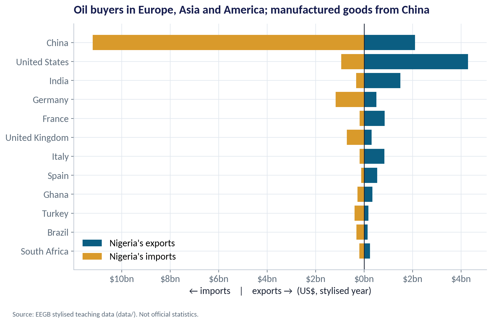
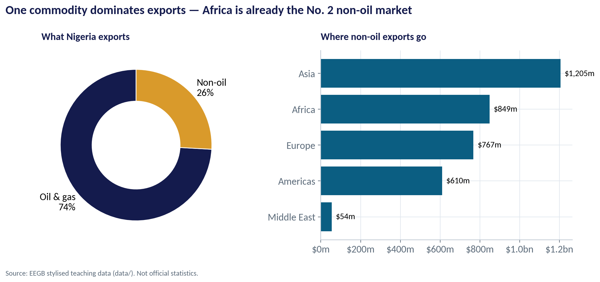
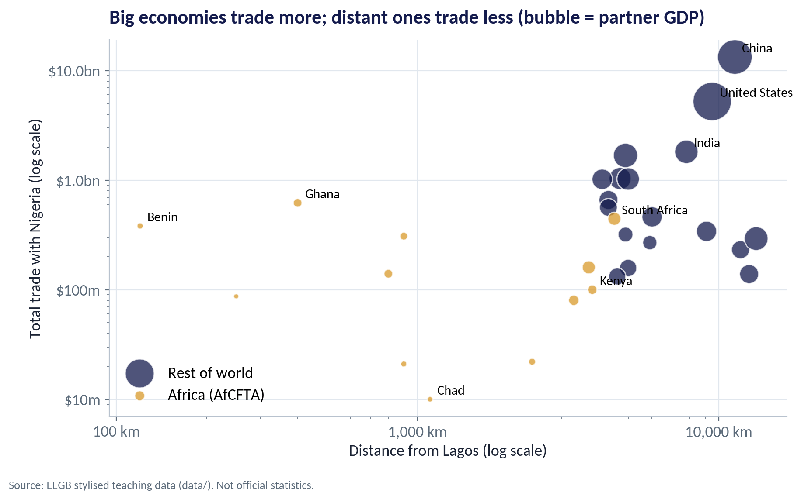
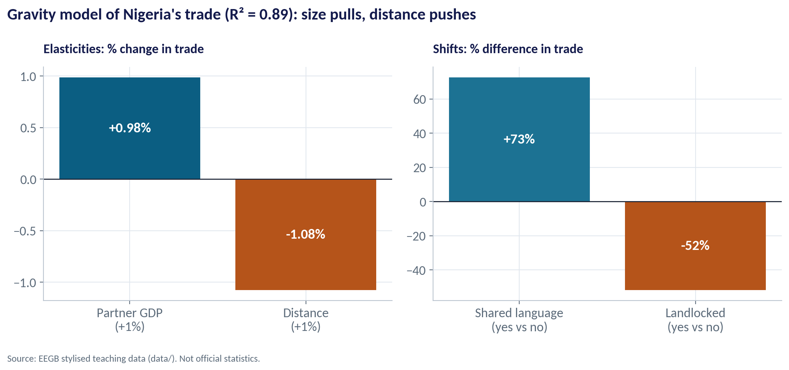
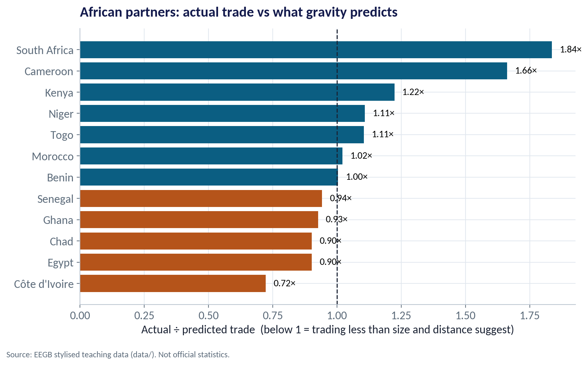
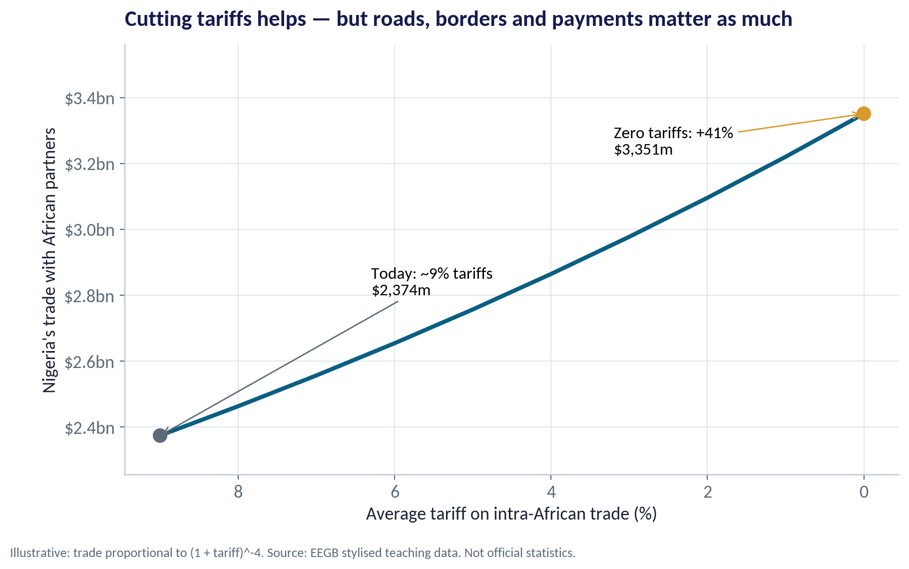
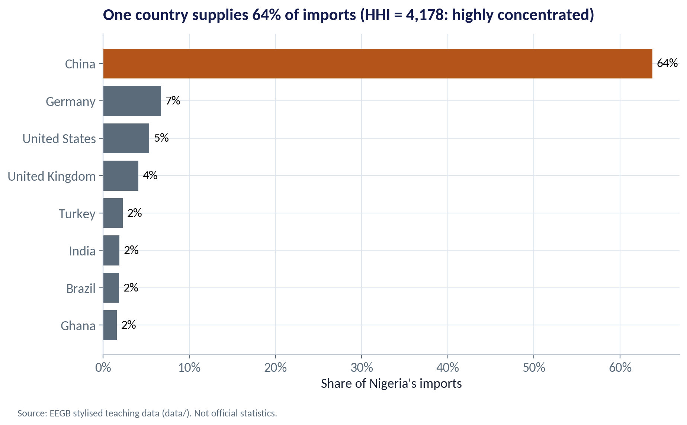

::: {.session-banner}
{.banner-hex width="96"}

**Session 12 of 16** · Facilitator: Bongo Adi & Kelechi Nnamdi<br>*Case:* A Nigerian manufacturer weighing AfCFTA: which African markets to export to first, and how to make its supply chain shock-proof?

:::

## Downloads {.unnumbered}

::: {.download-row}
[<i class="bi bi-file-earmark-slides"></i> Teaching slides (.pptx)](../../sessions/s12/slides/EEGB_S12_Trade_Supply_Chains_Industrial_Policy.pptx){.btn .btn-primary download=""}
[<i class="bi bi-file-earmark-pdf"></i> Slides (PDF)](../../sessions/s12/slides/EEGB_S12_Trade_Supply_Chains_Industrial_Policy.pdf){.btn .btn-outline-primary download=""}
[<i class="bi bi-github"></i> Session folder on GitHub](https://github.com/adibongo/eegb/tree/main/sessions/s12){.btn .btn-outline-secondary}
:::

## Read first {.unnumbered}

- **María Jesús Sáenz & Elena Revilla — Creating More Resilient Supply Chains** — MIT Sloan Management Review

## Learning objectives

::: {.grid}
::: {.g-col-12 .g-col-md-4 .obj-card}
**Explain Why Trade Pays**

Use comparative advantage to show why both sides gain — and who inside each country loses.
:::
::: {.g-col-12 .g-col-md-4 .obj-card}
**Size Export Markets**

Use the gravity model to estimate expected trade and spot under-served African markets for AfCFTA.
:::
::: {.g-col-12 .g-col-md-4 .obj-card}
**Build Resilient Supply Chains**

Measure supplier concentration and choose between diversifying, stockpiling and localising.
:::
:::

## The business case

::: {.callout-note appearance="simple" icon=false}
## AfCFTA and a Nigerian Manufacturer

**Situation.** A Lagos packaged-food manufacturer sells only in Nigeria. AfCFTA lowers tariffs on most goods traded between member states, and the board wants an export plan. Most of its packaging and machinery are imported.

**Question.** Which African markets should it enter first — and how should it make its supply chain shock-proof before it grows?

**Data.** ng_trade_partners.csv — Nigeria's exports and imports with 30 partners, plus partner GDP, distance, language, AfCFTA membership and tariffs. *Stylised teaching data.*

**A good answer.** A ranked shortlist of three export markets with reasons, and two actions to reduce supply-chain concentration.
:::

## Key ideas in plain English

### Everyone Gains From Doing What They Do Relatively Best

A country gains from trade by producing what it gives up least to make — its comparative advantage — and buying the rest. Even a country that is better at everything gains by specialising.

::: {.formula}
opportunity cost of X = output of Y given up ÷ extra output of X
:::

*Example.* If a Nigerian worker can make 10 bags of cement or 2 phones a day, and a Chinese worker 12 bags or 6 phones, Nigeria gives up 0.2 phones per bag; China gives up 0.5. Nigeria has the comparative advantage in cement, China in phones — even though China is better at both.

::: {.callout-tip appearance="minimal"}
**Why a manager cares.** Comparative advantage is not fixed. Nigeria moved from importing most of its cement to producing almost all of it once investment, gas and scale came together. Your firm's export opportunity lies where your cost relative to rivals is lowest.
:::

### Trade Behaves Like Gravity

Countries trade more with partners that are big and close, and less with those that are small and far — just as gravity pulls more strongly between heavy, nearby objects. Shared language, borders and history add to the pull; being landlocked subtracts.

::: {.formula}
log(trade) = a + b₁·log(GDP) + b₂·log(distance) + extras
:::

*Example.* In our data b₁ = 0.98 and b₂ = −1.08: a partner 10% bigger trades about 10% more with Nigeria; one 10% further away trades about 11% less.

::: {.callout-tip appearance="minimal"}
**Why a manager cares.** Gravity is the most reliable model in international economics. It tells you what trade should be with each market — so you can spot where trade is missing and where the opportunity is real.
:::

### The Herfindahl–Hirschman Index

Square each supplier's percentage share and add them up. One supplier = 10,000. Many small suppliers = close to zero. The higher the number, the more your supply depends on a few sources.

::: {.formula}
HHI = s₁² + s₂² + … + sₙ²   (shares in %)
:::

*Example.* 64% from China, 7% from Germany, 5% from the US and many small sources → HHI ≈ 4,178. Splitting China's share across two countries of 32% each would roughly halve that contribution.

::: {.callout-tip appearance="minimal"}
**Why a manager cares.** Run this on your own purchase ledger by country and by supplier. An HHI above 2,500 on a critical input is a board-level risk.
:::

## Charts and how to replicate them

Every chart below is regenerated by the session's figure script — `sessions/s12/R/s12_figures.R` or `sessions/s12/python/s12_figures.py`. Run it from the project root.

### Who Nigeria Trades With

::: {.panel-tabset group="lang"}
## Python
{.fig-img fig-alt="S12-F01 (Python)"}

:::

- Exports go mainly to oil buyers: the United States, India and European refiners.
- Imports come overwhelmingly from China: machinery, phones, textiles, inputs.
- Total trade in this stylised year is about $31bn; trade with African partners is only 7.6% of it.
- That low African share is the gap AfCFTA is meant to close.

<span class="fig-id">S12-F01</span>

### Export Concentration: Oil Still Dominates

::: {.panel-tabset group="lang"}
## Python
{.fig-img fig-alt="S12-F05 (Python)"}

:::

- Oil and gas make up about 74% of exports in these data.
- When oil prices or output fall, export earnings — and dollars for importers — fall with them.
- Non-oil exports are about $3.5bn; Africa already takes $849m of them, second only to Asia.
- Manufactured and processed goods are more likely to sell in Africa than in Europe.

<span class="fig-id">S12-F05</span>

### Size Pulls, Distance Pushes

::: {.panel-tabset group="lang"}
## Python
{.fig-img fig-alt="S12-F02 (Python)"}

:::

- Each bubble is a partner; bigger bubble = bigger economy.
- Distant giants (China, the US) still trade heavily with Nigeria because of their size.
- Neighbours like Benin and Ghana trade a lot for their size — they are very close.
- Small, landlocked and distant partners such as Chad trade very little.

<span class="fig-id">S12-F02</span>

### What Drives Nigeria's Trade?

::: {.panel-tabset group="lang"}
## Python
{.fig-img fig-alt="S12-F03 (Python)"}

:::

- GDP elasticity ≈ 0.98; distance elasticity ≈ −1.08.
- A shared language goes with about 73% more trade.
- Landlocked partners trade about 52% less — every border and truck adds cost.
- Four variables explain 89% of the variation (R² = 0.89).

<span class="fig-id">S12-F03</span>

### Where Is Trade Below What Gravity Predicts?

::: {.panel-tabset group="lang"}
## Python
{.fig-img fig-alt="S12-F04 (Python)"}

:::

- A ratio below 1 means Nigeria trades less than size and distance suggest.
- Côte d'Ivoire (0.72×), Egypt and Ghana sit below the line — potential room to grow.
- South Africa (1.84×) and Cameroon (1.66×) already trade more than predicted.
- Missing trade is a clue, not a verdict: check non-tariff barriers, payments and competition first.

<span class="fig-id">S12-F04</span>

### What Removing Tariffs Could Do

::: {.panel-tabset group="lang"}
## Python
{.fig-img fig-alt="S12-F07 (Python)"}

:::

- Trade with African partners: about $2.4bn today in these data.
- If average tariffs fell from 9% to zero and trade responds with an elasticity of 4, trade rises about 41% to $3.4bn.
- The elasticity is uncertain — estimates often range from 3 to 6 — so treat this as a range, not a forecast.
- Poor roads, slow borders, checkpoints and payment frictions can cost more than the tariff itself.

<span class="fig-id">S12-F07</span>

### One Supplier Country, One Point of Failure

::: {.panel-tabset group="lang"}
## Python
{.fig-img fig-alt="S12-F06 (Python)"}

:::

- China supplies about 64% of Nigeria's imports in these data.
- The Herfindahl–Hirschman Index (sum of squared shares) is 4,178 — above 2,500 is commonly treated as highly concentrated.
- The top three sources supply 76% of imports.
- A port closure, export ban or freight spike in one place can stop Nigerian factories.

<span class="fig-id">S12-F06</span>

## Lab: Where Should We Export First?

*Time:* 20 minutes · *Data:* [`data/ng_trade_partners.csv`](../../data/ng_trade_partners.csv)

1. Rank partners by total trade and compute Africa's share.
2. Fit the gravity model: log trade on log GDP, log distance, language and landlocked.
3. Compare actual vs predicted trade for each African partner.
4. Run the AfCFTA tariff scenario with elasticities of 3, 4 and 6.
5. Compute the HHI of import sources and propose two de-risking actions.

::: {.callout-important appearance="simple"}
**Deliverable:** a ranked shortlist of three export markets and two supply-chain actions, one line of reasoning each.
:::

## The code (R | Python)

Pick your language once; every tab on the site follows your choice. Download a script, or copy it into RStudio and run it line by line.

### Replicate every chart

::: {.panel-tabset group="lang"}
## Python
[<i class="bi bi-download"></i> s12_figures.py](../../sessions/s12/python/s12_figures.py){download=""}

::: {.callout-note collapse="true" appearance="simple" icon=false}
## Show the full script (127 lines)

```{.python filename="sessions/s12/python/s12_figures.py"}
# =============================================================================
# EEGB · Session 12 · Trade, Supply Chains & Industrial Policy
# Replication script — regenerates every chart in the Session 12 deck (Python)
# Data: data/ng_trade_partners.csv (stylised Nigerian trade with 30 partners, US$ m)
# Run from the project root:  python sessions/s12/python/s12_figures.py
# =============================================================================
import sys; sys.path.insert(0, "python")
import numpy as np, pandas as pd
import matplotlib.pyplot as plt
from matplotlib.ticker import FuncFormatter
from eegb_style import *

set_style()
t = pd.read_csv("data/ng_trade_partners.csv")
usd_m = FuncFormatter(lambda v, p: f"${v/1000:.1f}bn" if abs(v) >= 1000 else f"${v:,.0f}m")

# --- F01 · Who Nigeria trades with ---------------------------------------------------
top = t.nlargest(12, "total_trade_usd_m").iloc[::-1]
fig, ax = plt.subplots(figsize=(10, 6))
ax.barh(top.partner, top.exports_usd_m, color=TEAL, label="Nigeria's exports")
ax.barh(top.partner, -top.imports_usd_m, color=GOLD, label="Nigeria's imports")
ax.axvline(0, color=INK, lw=1)
ax.xaxis.set_major_formatter(FuncFormatter(lambda v, p: f"${abs(v)/1000:.0f}bn"))
ax.legend(loc="lower left")
ax.set(title="Oil buyers in Europe, Asia and America; manufactured goods from China",
       xlabel="← imports    |    exports →  (US$, stylised year)")
note(fig); save(fig, "s12", "f01")

# --- F02 · Gravity in one picture ----------------------------------------------------
fig, ax = plt.subplots()
af = t.region == "Africa"
for mask, col, lab in [(~af, NAVY, "Rest of world"), (af, GOLD, "Africa (AfCFTA)")]:
    ax.scatter(t.distance_km[mask], t.total_trade_usd_m[mask], s=np.sqrt(t.partner_gdp_usd_bn[mask]) * 6,
               color=col, alpha=.75, label=lab, edgecolor="white")
for _, r in t[t.partner.isin(["China", "United States", "India", "Ghana", "Benin", "South Africa", "Kenya", "Chad"])].iterrows():
    ax.annotate(r.partner, (r.distance_km, r.total_trade_usd_m), xytext=(6, 4), textcoords="offset points", fontsize=11)
ax.set_xscale("log"); ax.set_yscale("log")
ax.yaxis.set_major_formatter(usd_m); ax.xaxis.set_major_formatter(FuncFormatter(lambda v, p: f"{v:,.0f} km"))
ax.legend(loc="lower left")
ax.set(title="Big economies trade more; distant ones trade less (bubble = partner GDP)",
       xlabel="Distance from Lagos (log scale)", ylabel="Total trade with Nigeria (log scale)")
note(fig); save(fig, "s12", "f02")

# --- F03 · The gravity regression ------------------------------------------------------
X = np.column_stack([np.ones(len(t)), np.log(t.partner_gdp_usd_bn), np.log(t.distance_km), t.common_language, t.landlocked])
y = np.log(t.total_trade_usd_m)
b, *_ = np.linalg.lstsq(X, y, rcond=None)
pred = X @ b; r2 = 1 - ((y - pred) ** 2).sum() / ((y - y.mean()) ** 2).sum()
names = ["Partner GDP\n(+1%)", "Distance\n(+1%)", "Shared language\n(yes vs no)", "Landlocked\n(yes vs no)"]
effects = [b[1], b[2], (np.exp(b[3]) - 1) * 100, (np.exp(b[4]) - 1) * 100]
fig, axes = plt.subplots(1, 2, figsize=(11, 4.8), gridspec_kw={"width_ratios": [1, 1]})
axes[0].bar(names[:2], effects[:2], color=[TEAL, RUST])
for i, v in enumerate(effects[:2]): axes[0].text(i, v / 2, f"{v:+.2f}%", ha="center", va="center", color="white", fontsize=14, fontweight="bold")
axes[0].axhline(0, color=INK, lw=1); axes[0].set_title("Elasticities: % change in trade", fontsize=13)
axes[1].bar(names[2:], effects[2:], color=[TEAL2, RUST])
for i, v in enumerate(effects[2:]): axes[1].text(i, v / 2, f"{v:+.0f}%", ha="center", va="center", color="white", fontsize=14, fontweight="bold")
axes[1].axhline(0, color=INK, lw=1); axes[1].set_title("Shifts: % difference in trade", fontsize=13)
fig.suptitle(f"Gravity model of Nigeria's trade (R² = {r2:.2f}): size pulls, distance pushes", x=0.01, ha="left",
             fontsize=16, fontweight="bold", color=NAVY)
fig.tight_layout(); note(fig); save(fig, "s12", "f03")

# --- F04 · Actual vs predicted: where is trade 'missing'? -----------------------------------
t["predicted"] = np.exp(pred)
t["ratio"] = t.total_trade_usd_m / t.predicted
a = t[af].sort_values("ratio")
fig, ax = plt.subplots()
cols = [RUST if r < 1 else TEAL for r in a.ratio]
ax.barh(a.partner, a.ratio, color=cols)
ax.axvline(1, color=INK, lw=1.2, ls="--")
for i, (p, r) in enumerate(zip(a.partner, a.ratio)): ax.text(r + 0.03, i, f"{r:.2f}×", va="center", fontsize=11)
ax.set(title="African partners: actual trade vs what gravity predicts",
       xlabel="Actual ÷ predicted trade  (below 1 = trading less than size and distance suggest)")
note(fig); save(fig, "s12", "f04")

# --- F05 · How concentrated are exports? -------------------------------------------------
oil = (t.exports_usd_m * t.oil_share_of_exports).sum(); non = (t.exports_usd_m * (1 - t.oil_share_of_exports)).sum()
reg = t.assign(nonoil=t.exports_usd_m * (1 - t.oil_share_of_exports)).groupby("region").nonoil.sum().sort_values()
fig, axes = plt.subplots(1, 2, figsize=(11, 4.8))
axes[0].pie([oil, non], labels=[f"Oil & gas\n{oil/(oil+non):.0%}", f"Non-oil\n{non/(oil+non):.0%}"], colors=[NAVY, GOLD],
            startangle=90, wedgeprops=dict(width=.42, edgecolor="white"), textprops=dict(fontsize=13))
axes[0].set_title("What Nigeria exports", fontsize=13)
axes[1].barh(reg.index, reg.values, color=TEAL)
for i, v in enumerate(reg.values): axes[1].text(v + 20, i, f"${v:,.0f}m", va="center", fontsize=11)
axes[1].set_title("Where non-oil exports go", fontsize=13); axes[1].xaxis.set_major_formatter(usd_m)
fig.suptitle("One commodity dominates exports — Africa is already the No. 2 non-oil market", x=0.01, ha="left",
             fontsize=16, fontweight="bold", color=NAVY)
fig.tight_layout(); note(fig); save(fig, "s12", "f05")

# --- F06 · Supply-chain concentration on the import side ------------------------------------
imp = t.set_index("partner").imports_usd_m.sort_values(ascending=False)
share = imp / imp.sum() * 100
hhi = (share ** 2).sum()
top8 = share.head(8).iloc[::-1]
fig, ax = plt.subplots()
ax.barh(top8.index, top8.values, color=[RUST if p == "China" else SLATE for p in top8.index])
for i, v in enumerate(top8.values): ax.text(v + .5, i, f"{v:.0f}%", va="center", fontsize=12)
ax.xaxis.set_major_formatter(FuncFormatter(pct))
ax.set(title=f"One country supplies {share.iloc[0]:.0f}% of imports (HHI = {hhi:,.0f}: highly concentrated)",
       xlabel="Share of Nigeria's imports")
note(fig); save(fig, "s12", "f06")

# --- F07 · AfCFTA: what a tariff cut could do -------------------------------------------------
sigma = 4.0                       # trade elasticity: a common estimate in the literature is about 3–6
tariffs = np.linspace(0, 9, 10)
uplift = ((1 + 0.09) / (1 + tariffs / 100)) ** sigma - 1
af_trade = t[af].total_trade_usd_m.sum()
fig, ax = plt.subplots()
ax.plot(tariffs, af_trade * (1 + uplift), color=TEAL, lw=3)
ax.scatter([9, 0], [af_trade, af_trade * (1 + uplift[0])], color=[SLATE, GOLD], s=90, zorder=3)
ax.annotate(f"Today: ~9% tariffs\n${af_trade:,.0f}m", (9, af_trade), xytext=(6.3, af_trade * 1.18), fontsize=12,
            arrowprops=dict(arrowstyle="->", color=SLATE))
ax.annotate(f"Zero tariffs: +{uplift[0]:.0%}\n${af_trade*(1+uplift[0]):,.0f}m", (0, af_trade * (1 + uplift[0])),
            xytext=(3.2, af_trade * 1.36), fontsize=12, arrowprops=dict(arrowstyle="->", color=GOLD))
ax.set_ylim(af_trade * 0.95, af_trade * 1.5)
ax.invert_xaxis(); ax.yaxis.set_major_formatter(usd_m)
ax.set(title="Cutting tariffs helps — but roads, borders and payments matter as much",
       xlabel="Average tariff on intra-African trade (%)", ylabel="Nigeria's trade with African partners")
note(fig, "Illustrative: trade proportional to (1 + tariff)^-4. Source: EEGB stylised teaching data. Not official statistics.")
save(fig, "s12", "f07")

# --- key numbers for the slides -----------------------------------------------------------------
print(f"coef: const {b[0]:.2f} gdp {b[1]:.2f} dist {b[2]:.2f} lang {b[3]:.2f} ({effects[2]:+.0f}%) land {b[4]:.2f} ({effects[3]:+.0f}%) R2 {r2:.2f}")
print(f"oil share of exports {oil/(oil+non):.1%}; non-oil exports ${non:,.0f}m; africa non-oil ${reg['Africa']:,.0f}m")
print(f"import HHI {hhi:,.0f}; China share {share['China']:.1f}%; top3 share {share.head(3).sum():.1f}%")
print(f"africa total trade ${af_trade:,.0f}m = {af_trade/t.total_trade_usd_m.sum():.1%} of total; uplift at zero tariff {uplift[0]:.1%}")
print(a[["partner", "total_trade_usd_m", "predicted", "ratio"]].round(2).to_string(index=False))
print(f"total trade ${t.total_trade_usd_m.sum():,.0f}m exports ${t.exports_usd_m.sum():,.0f}m imports ${t.imports_usd_m.sum():,.0f}m")
```
:::

## R
[<i class="bi bi-download"></i> s12_figures.R](../../sessions/s12/R/s12_figures.R){download=""}

::: {.callout-note collapse="true" appearance="simple" icon=false}
## Show the full script (91 lines)

```{.r filename="sessions/s12/R/s12_figures.R"}
# =============================================================================
# EEGB · Session 12 · Trade, Supply Chains & Industrial Policy
# Replication script — regenerates every chart in the Session 12 deck (R)
# Data: data/ng_trade_partners.csv (stylised Nigerian trade with 30 partners, US$ m)
# =============================================================================
source("R/theme_eegb.R")
suppressPackageStartupMessages({ library(dplyr); library(readr); library(tidyr) })
t <- read_csv("data/ng_trade_partners.csv", show_col_types = FALSE)
usd_m <- function(v) ifelse(abs(v) >= 1000, paste0("$", round(v / 1000, 1), "bn"), paste0("$", round(v), "m"))

# --- F01 · Who Nigeria trades with -----------------------------------------------------
top <- t |> slice_max(total_trade_usd_m, n = 12) |> mutate(partner = reorder(partner, total_trade_usd_m))
top_long <- bind_rows(top |> transmute(partner, flow = "Nigeria's exports", value = exports_usd_m),
                      top |> transmute(partner, flow = "Nigeria's imports", value = -imports_usd_m))
p1 <- ggplot(top_long, aes(value, partner, fill = flow)) + geom_col() + geom_vline(xintercept = 0) +
  scale_fill_manual(values = c(`Nigeria's exports` = eegb[["teal"]], `Nigeria's imports` = eegb[["gold"]]), name = NULL) +
  scale_x_continuous(labels = function(v) paste0("$", abs(v) / 1000, "bn")) +
  labs(title = "Oil buyers in Europe, Asia and America; manufactured goods from China",
       x = "<- imports    |    exports ->  (US$, stylised year)", y = NULL, caption = eegb_caption) + theme_eegb()
save_fig(p1, "s12", "f01", height = 6)

# --- F02 · Gravity in one picture --------------------------------------------------------
t <- t |> mutate(group = ifelse(region == "Africa", "Africa (AfCFTA)", "Rest of world"))
lab <- t |> filter(partner %in% c("China", "United States", "India", "Ghana", "Benin", "South Africa", "Kenya", "Chad"))
p2 <- ggplot(t, aes(distance_km, total_trade_usd_m, colour = group, size = partner_gdp_usd_bn)) +
  geom_point(alpha = .75) + geom_text(data = lab, aes(label = partner), size = 3.5, hjust = -0.15, colour = eegb[["ink"]]) +
  scale_x_log10(labels = function(v) paste0(format(v, big.mark = ","), " km")) + scale_y_log10(labels = usd_m) +
  scale_colour_manual(values = c(`Africa (AfCFTA)` = eegb[["gold"]], `Rest of world` = eegb[["navy"]]), name = NULL) +
  scale_size_area(max_size = 14, guide = "none") +
  labs(title = "Big economies trade more; distant ones trade less (bubble = partner GDP)",
       x = "Distance from Lagos (log scale)", y = "Total trade with Nigeria (log scale)", caption = eegb_caption) + theme_eegb()
save_fig(p2, "s12", "f02")

# --- F03 · The gravity regression -----------------------------------------------------------
grav <- lm(log(total_trade_usd_m) ~ log(partner_gdp_usd_bn) + log(distance_km) + common_language + landlocked, data = t)
cf <- coef(grav)
eff <- tibble(term = c("Partner GDP (+1%)", "Distance (+1%)", "Shared language (yes vs no)", "Landlocked (yes vs no)"),
              panel = c("Elasticities: % change in trade", "Elasticities: % change in trade",
                        "Shifts: % difference in trade", "Shifts: % difference in trade"),
              value = c(cf[2], cf[3], 100 * (exp(cf[4]) - 1), 100 * (exp(cf[5]) - 1)))
p3 <- ggplot(eff, aes(term, value, fill = value > 0)) + geom_col(show.legend = FALSE) + geom_hline(yintercept = 0) +
  geom_text(aes(y = value / 2, label = ifelse(abs(value) < 5, sprintf("%+.2f%%", value), sprintf("%+.0f%%", value))),
            colour = "white", fontface = "bold") +
  facet_wrap(~panel, scales = "free") +
  scale_fill_manual(values = c(`TRUE` = eegb[["teal"]], `FALSE` = eegb[["rust"]])) +
  labs(title = sprintf("Gravity model of Nigeria's trade (R² = %.2f): size pulls, distance pushes", summary(grav)$r.squared),
       x = NULL, y = NULL, caption = eegb_caption) + theme_eegb()
save_fig(p3, "s12", "f03")

# --- F04 · Actual vs predicted for African partners ----------------------------------------------
t <- t |> mutate(predicted = exp(fitted(grav)), ratio = total_trade_usd_m / predicted)
a <- t |> filter(region == "Africa") |> mutate(partner = reorder(partner, ratio))
p4 <- ggplot(a, aes(ratio, partner, fill = ratio < 1)) + geom_col(show.legend = FALSE) +
  geom_vline(xintercept = 1, linetype = "dashed") + geom_text(aes(label = sprintf("%.2f×", ratio)), hjust = -0.15, size = 3.6) +
  scale_fill_manual(values = c(`TRUE` = eegb[["rust"]], `FALSE` = eegb[["teal"]])) +
  labs(title = "African partners: actual trade vs what gravity predicts",
       x = "Actual ÷ predicted trade (below 1 = trading less than size and distance suggest)", y = NULL,
       caption = eegb_caption) + theme_eegb()
save_fig(p4, "s12", "f04")

# --- F05 · Non-oil exports by region ------------------------------------------------------------
reg <- t |> mutate(nonoil = exports_usd_m * (1 - oil_share_of_exports)) |> group_by(region) |>
  summarise(nonoil = sum(nonoil)) |> mutate(region = reorder(region, nonoil))
oil_share <- with(t, sum(exports_usd_m * oil_share_of_exports) / sum(exports_usd_m))
p5 <- ggplot(reg, aes(nonoil, region)) + geom_col(fill = eegb[["teal"]]) +
  geom_text(aes(label = paste0("$", round(nonoil), "m")), hjust = -0.1) + scale_x_continuous(labels = usd_m) +
  labs(title = sprintf("Oil & gas is %.0f%% of exports — Africa is already the No. 2 non-oil market", 100 * oil_share),
       x = "Non-oil exports", y = NULL, caption = eegb_caption) + theme_eegb()
save_fig(p5, "s12", "f05")

# --- F06 · Import concentration ------------------------------------------------------------------
imp <- t |> mutate(share = 100 * imports_usd_m / sum(imports_usd_m)) |> arrange(desc(share))
hhi <- sum(imp$share^2)
p6 <- ggplot(head(imp, 8) |> mutate(partner = reorder(partner, share)), aes(share, partner, fill = partner == "China")) +
  geom_col(show.legend = FALSE) + geom_text(aes(label = paste0(round(share), "%")), hjust = -0.2) +
  scale_fill_manual(values = c(`TRUE` = eegb[["rust"]], `FALSE` = eegb[["slate"]])) + scale_x_continuous(labels = pct) +
  labs(title = sprintf("One country supplies %.0f%% of imports (HHI = %s: highly concentrated)", imp$share[1],
                       format(round(hhi), big.mark = ",")), x = "Share of Nigeria's imports", y = NULL,
       caption = eegb_caption) + theme_eegb()
save_fig(p6, "s12", "f06")

# --- F07 · AfCFTA tariff scenario -------------------------------------------------------------------
af_trade <- sum(t$total_trade_usd_m[t$region == "Africa"])
sc <- tibble(tariff = seq(0, 9, by = 0.5), trade = af_trade * (1.09 / (1 + tariff / 100))^4)
p7 <- ggplot(sc, aes(tariff, trade)) + geom_line(colour = eegb[["teal"]], linewidth = 1.5) +
  geom_point(data = sc |> filter(tariff %in% c(0, 9)), colour = eegb[["gold"]], size = 4) +
  scale_x_reverse() + scale_y_continuous(labels = usd_m) +
  labs(title = "Cutting tariffs helps — but roads, borders and payments matter as much",
       x = "Average tariff on intra-African trade (%)", y = "Nigeria's trade with African partners",
       caption = "Illustrative: trade proportional to (1 + tariff)^-4. EEGB stylised teaching data.") + theme_eegb()
save_fig(p7, "s12", "f07")
```
:::

:::

### Lab

::: {.panel-tabset group="lang"}
## Python
[<i class="bi bi-download"></i> s12_lab.py](../../sessions/s12/python/s12_lab.py){download=""}

::: {.callout-note collapse="true" appearance="simple" icon=false}
## Show the full script (55 lines)

```{.python filename="sessions/s12/python/s12_lab.py"}
# =============================================================================
# EEGB · Session 12 LAB · Where should we export first under AfCFTA? (Python)
# Data: data/ng_trade_partners.csv — stylised Nigerian trade with 30 partners (US$ m)
# Run from the project root, line by line (Ctrl/Cmd + Enter in RStudio or VS Code)
# =============================================================================
import numpy as np, pandas as pd

t = pd.read_csv("data/ng_trade_partners.csv")

# ---- STEP 1 · Look before you calculate ------------------------------------------
print(t.shape)
print(t[["partner", "region", "partner_gdp_usd_bn", "distance_km", "exports_usd_m", "imports_usd_m"]].head(10))

# ---- STEP 2 · Who matters most? --------------------------------------------------------
print(t.sort_values("total_trade_usd_m", ascending=False)[["partner", "total_trade_usd_m"]].head(10))
print("Africa's share of Nigeria's trade:",
      round(t.loc[t.region == "Africa", "total_trade_usd_m"].sum() / t.total_trade_usd_m.sum() * 100, 1), "%")

# ---- STEP 3 · Fit the gravity model: log(trade) = a + b1 log(GDP) + b2 log(distance) + ... -----
X = np.column_stack([np.ones(len(t)), np.log(t.partner_gdp_usd_bn), np.log(t.distance_km),
                     t.common_language, t.landlocked])
y = np.log(t.total_trade_usd_m)
b, *_ = np.linalg.lstsq(X, y, rcond=None)
names = ["constant", "log GDP", "log distance", "common language", "landlocked"]
print(pd.Series(b, index=names).round(2))
#   Read: b(log GDP) ~ 1 means 1% bigger partner -> ~1% more trade.
#         b(log distance) ~ -1 means 1% further away -> ~1% less trade.

# ---- STEP 4 · How well does it fit? ----------------------------------------------------------
pred = X @ b
r2 = 1 - ((y - pred) ** 2).sum() / ((y - y.mean()) ** 2).sum()
print("R-squared:", round(r2, 2))

# ---- STEP 5 · Where is trade 'missing'? Actual vs predicted ------------------------------------
t["predicted_usd_m"] = np.exp(pred).round(0)
t["actual_vs_predicted"] = (t.total_trade_usd_m / t.predicted_usd_m).round(2)
print(t.loc[t.region == "Africa", ["partner", "total_trade_usd_m", "predicted_usd_m", "actual_vs_predicted"]]
        .sort_values("actual_vs_predicted"))

# ---- STEP 6 · A simple AfCFTA tariff scenario ----------------------------------------------------
sigma = 4                          # assumed trade elasticity (estimates are often 3–6)
uplift = (1.09 / 1.00) ** sigma - 1  # from 9% average tariff to zero
print(f"Trade with African partners could rise by about {uplift:.0%} if tariffs fell from 9% to 0")

# ---- STEP 7 · Supply-chain concentration on the import side ----------------------------------------
share = t.set_index("partner").imports_usd_m / t.imports_usd_m.sum() * 100
print(share.sort_values(ascending=False).head(5).round(1))
print("HHI of import sources:", round((share ** 2).sum()))   # above 2,500 = highly concentrated

# ---- YOUR TURN ---------------------------------------------------------------------------------
# (a) Rank African partners on market size (GDP), distance and the 'missing trade' ratio. Pick your top three
#     export markets for a Nigerian packaged-food firm, and justify each in one line.
# (b) Re-run STEP 6 with sigma = 3 and sigma = 6. How sensitive is the AfCFTA gain to this assumption?
# (c) Why might tariffs NOT be the binding constraint? List three non-tariff barriers you know from experience.
# (d) If 64% of your imported inputs come from one country, what two actions would reduce the risk?
```
:::

## R
[<i class="bi bi-download"></i> s12_lab.R](../../sessions/s12/R/s12_lab.R){download=""}

::: {.callout-note collapse="true" appearance="simple" icon=false}
## Show the full script (48 lines)

```{.r filename="sessions/s12/R/s12_lab.R"}
# =============================================================================
# EEGB · Session 12 LAB · Where should we export first under AfCFTA? (R)
# Data: data/ng_trade_partners.csv — stylised Nigerian trade with 30 partners (US$ m)
# Open eegb.Rproj first, then run line by line (Ctrl/Cmd + Enter)
# =============================================================================
library(dplyr); library(readr)
t <- read_csv("data/ng_trade_partners.csv", show_col_types = FALSE)

# ---- STEP 1 · Look before you calculate ------------------------------------------
dim(t)
head(select(t, partner, region, partner_gdp_usd_bn, distance_km, exports_usd_m, imports_usd_m), 10)

# ---- STEP 2 · Who matters most? --------------------------------------------------------
t |> arrange(desc(total_trade_usd_m)) |> select(partner, total_trade_usd_m) |> head(10)
t |> summarise(africa_share_pct = 100 * sum(total_trade_usd_m[region == "Africa"]) / sum(total_trade_usd_m))

# ---- STEP 3 · Fit the gravity model -------------------------------------------------------
grav <- lm(log(total_trade_usd_m) ~ log(partner_gdp_usd_bn) + log(distance_km) + common_language + landlocked, data = t)
summary(grav)
#   Read: the log(GDP) coefficient ~ 1 means a 1% bigger partner -> ~1% more trade;
#         the log(distance) coefficient ~ -1 means 1% further away -> ~1% less trade.
(exp(coef(grav)[c("common_language", "landlocked")]) - 1) * 100   # % shifts for the yes/no variables

# ---- STEP 4 · How well does it fit? -------------------------------------------------------
summary(grav)$r.squared

# ---- STEP 5 · Where is trade 'missing'? -----------------------------------------------------
t <- t |> mutate(predicted_usd_m = round(exp(fitted(grav))),
                 actual_vs_predicted = round(total_trade_usd_m / predicted_usd_m, 2))
t |> filter(region == "Africa") |> select(partner, total_trade_usd_m, predicted_usd_m, actual_vs_predicted) |>
  arrange(actual_vs_predicted)

# ---- STEP 6 · A simple AfCFTA tariff scenario -----------------------------------------------
sigma <- 4                                  # assumed trade elasticity (estimates are often 3–6)
uplift <- (1.09 / 1.00)^sigma - 1           # from a 9% average tariff to zero
sprintf("Trade with African partners could rise by about %.0f%%", 100 * uplift)

# ---- STEP 7 · Supply-chain concentration on the import side -------------------------------------
imp <- t |> mutate(share = 100 * imports_usd_m / sum(imports_usd_m)) |> arrange(desc(share))
head(select(imp, partner, share), 5)
sum(imp$share^2)                            # HHI: above 2,500 = highly concentrated

# ---- YOUR TURN ---------------------------------------------------------------------------------
# (a) Pick your top three African export markets for a Nigerian packaged-food firm, using GDP, distance and
#     the 'missing trade' ratio. Justify each in one line.
# (b) Re-run STEP 6 with sigma = 3 and sigma = 6. How sensitive is the AfCFTA gain to this assumption?
# (c) List three non-tariff barriers that could matter more than tariffs.
# (d) If 64% of your imported inputs come from one country, what two actions would reduce the risk?
```
:::

:::

## Check your understanding

**Q1.** The gravity model says Nigeria trades only 0.72 times the predicted amount with Côte d'Ivoire. What is the best interpretation for an exporter?

- **A.** Ivorians do not like Nigerian products
- **B.** There may be unexploited potential — investigate the barriers (language, logistics, payments, rules) before investing
- **C.** The model is wrong and should be ignored
- **D.** Côte d'Ivoire is too far away to matter

::: {.callout-tip collapse="true" appearance="simple"}
## Show answer
**B.** B. 'Missing trade' signals possible potential relative to size and distance. The reason could be language (French), currency (CFA franc), logistics or rules — each is fixable at a cost. A and D are not supported; C throws away a useful benchmark.
:::

**Q2.** Your firm imports 70% of a critical packaging input from one country. Interest rates are 27%. Which response is most sensible first?

- **A.** Triple inventory immediately
- **B.** Qualify a second supplier in another country and map who your current supplier depends on
- **C.** Stop importing and wait for local supply to appear
- **D.** Do nothing — diversification is too expensive

::: {.callout-tip collapse="true" appearance="simple"}
## Show answer
**B.** B. Qualifying a second source and mapping the deeper tiers reduce concentration without the large cash cost of tripling stock at 27% interest (A). C risks stopping production; D ignores a board-level risk.
:::

## Vocabulary

| Term | Meaning |
|---|---|
| **Comparative advantage** | Producing what you give up least to make, relative to others. |
| **Opportunity cost** | What you give up to produce or buy something. |
| **Gravity model** | Trade rises with partner size and falls with distance. |
| **Elasticity** | % change in one thing for a 1% change in another. |
| **AfCFTA** | The African Continental Free Trade Area. |
| **Rules of origin** | Rules on how much of a good must be made locally to qualify. |
| **Non-tariff barrier** | Any cost of trading other than a tariff: delays, permits, quotas. |
| **HHI** | Sum of squared shares; measures concentration. |
| **Friend-shoring** | Moving supply chains to politically aligned countries. |
| **Industrial policy** | Government support to build particular industries. |

## Key takeaways

1. Countries — and firms — gain by specialising in their comparative advantage.
2. Trade follows gravity: big and close partners matter most; use it to spot missing trade.
3. AfCFTA cuts tariffs, but logistics, rules of origin, payments and FX decide whether you can compete.
4. Measure supplier concentration; diversify, stock, localise and map deeper tiers.
5. Industrial policy works best with discipline, competition and an exit date.

::: {.callout-note appearance="simple"}
**Before next session:** Read Stern, The Economics of Climate Change (summary chapters) and skim the KPMG / IFRS Foundation guide on ISSB and TCFD. List your company's three largest sources of emissions.
:::

::: {.session-nav}
[← Session 11: Exchange Rates & Capital Flows](../../sessions/s11/index.qmd)
[Session 13: Climate & Energy Transition →](../../sessions/s13/index.qmd){.next}
:::
