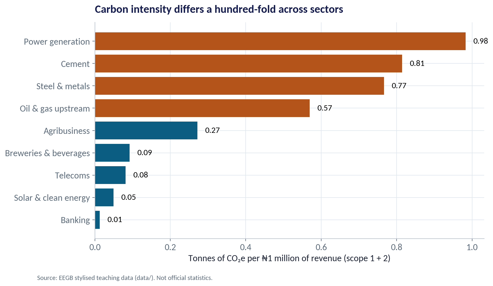
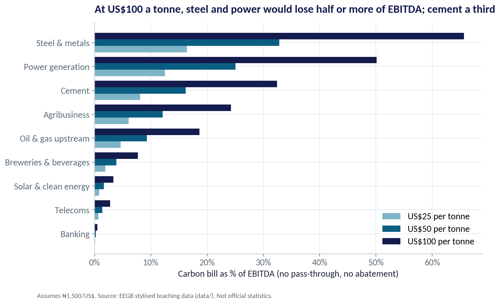
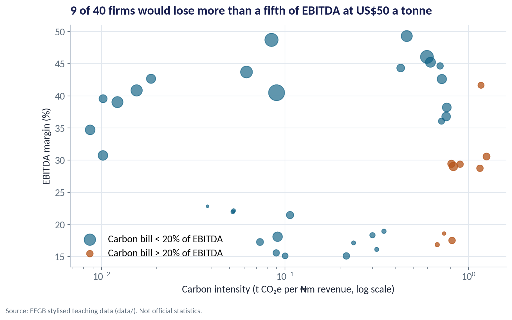
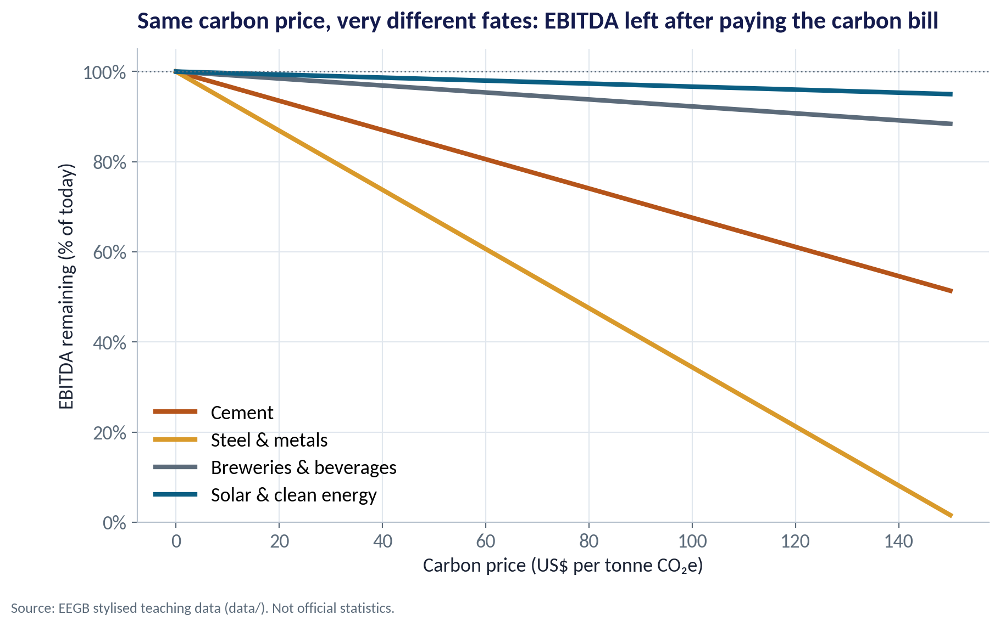
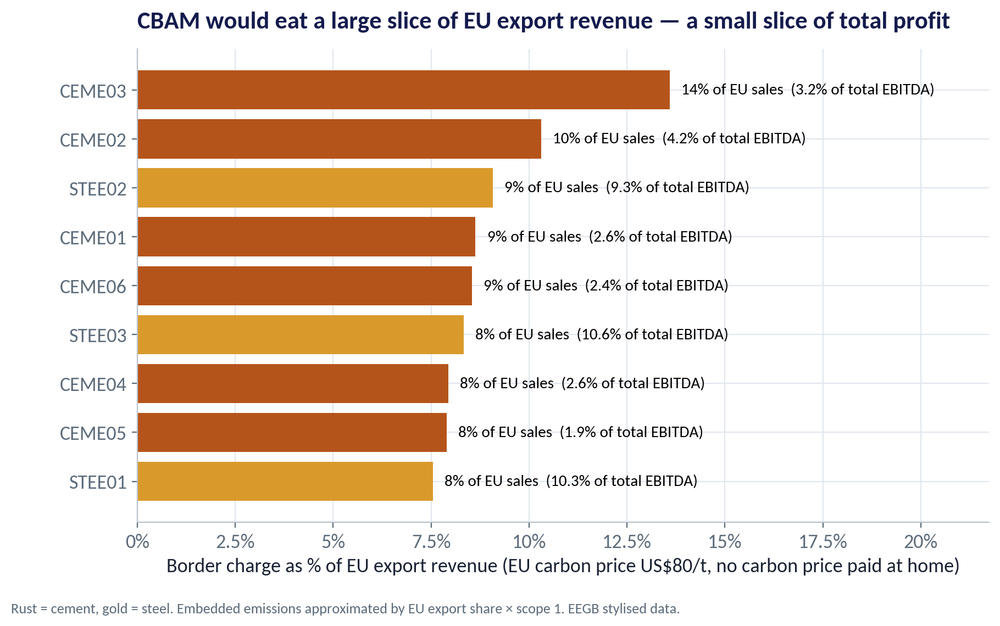
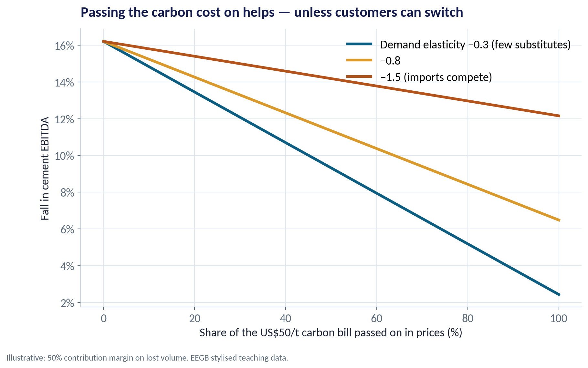
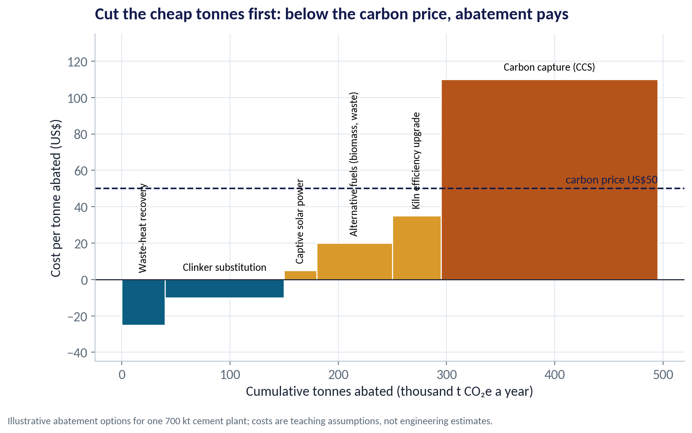
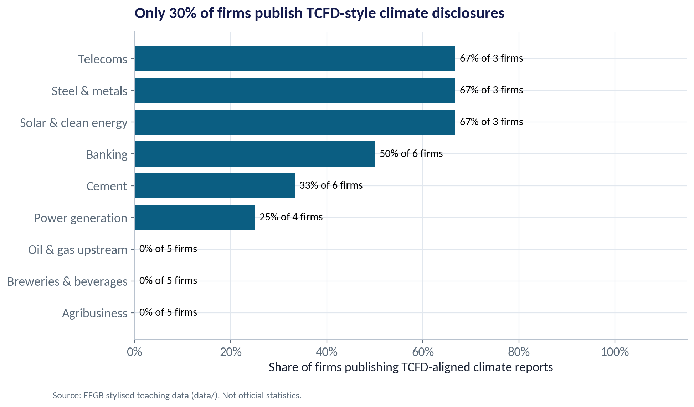

::: {.session-banner}
{.banner-hex width="96"}

**Session 13 of 16** · Facilitator: Bongo Adi & Kelechi Nnamdi<br>*Case:* A Nigerian cement and a Nigerian solar business face the same carbon price. Whose value moves, and by how much?

:::

## Downloads {.unnumbered}

::: {.download-row}
[<i class="bi bi-file-earmark-slides"></i> Teaching slides (.pptx)](../../sessions/s13/slides/EEGB_S13_Climate_Energy_Transition_Economics.pptx){.btn .btn-primary download=""}
[<i class="bi bi-file-earmark-pdf"></i> Slides (PDF)](../../sessions/s13/slides/EEGB_S13_Climate_Energy_Transition_Economics.pdf){.btn .btn-outline-primary download=""}
[<i class="bi bi-github"></i> Session folder on GitHub](https://github.com/adibongo/eegb/tree/main/sessions/s13){.btn .btn-outline-secondary}
:::

## Read first {.unnumbered}

- **Nicholas Stern — The Economics of Climate Change** — Book
- **KPMG / IFRS Foundation guides on ISSB and TCFD** — Insight article

## Learning objectives

::: {.grid}
::: {.g-col-12 .g-col-md-4 .obj-card}
**Explain Carbon Pricing**

Explain why emissions are an externality, and how carbon taxes, trading schemes and border adjustments put a price on them.
:::
::: {.g-col-12 .g-col-md-4 .obj-card}
**Size the Exposure**

Turn emissions and a carbon price into a naira cost, and compare it with EBITDA by sector and by firm.
:::
::: {.g-col-12 .g-col-md-4 .obj-card}
**Plan the Response**

Use pass-through, abatement and disclosure to build a credible transition plan for a Nigerian business.
:::
:::

## The business case

::: {.callout-note appearance="simple" icon=false}
## Cement vs Solar Under a Carbon Price

**Situation.** A board is comparing two holdings: a cement producer with coal- and gas-fired kilns and a solar installer. Both are profitable today.

**Question.** If a carbon price of US$25, US$50 or US$100 a tonne applied, how much EBITDA would each lose — and what can management do about it?

**Data.** firm_carbon_exposure.csv — 40 fictional Nigerian listed firms in 9 sectors: revenue, EBITDA, scope 1 and 2 emissions, EU export share, TCFD disclosure. *Stylised teaching data.* We assume ₦1,500 per US$.

**A good answer.** A carbon stress test by sector and firm, plus a response plan: pass-through, abatement and disclosure.
:::

## Key ideas in plain English

### Emissions Are an Externality

When a kiln or generator emits CO₂, the damage — floods, heat, crop losses — falls on other people, mostly in the future. The emitter does not pay, so the market produces too much pollution.

::: {.formula}
social cost = private cost + damage to others
:::

*Example.* Nigeria's 2022 floods displaced over a million people. No cement plant, power station or car owner paid for its share of the emissions that make such events more likely.

::: {.callout-tip appearance="minimal"}
**Why a manager cares.** When governments correct an externality, costs that were hidden on someone else's books move on to yours. Planning for that is risk management, not politics.
:::

### The EU's Carbon Border Adjustment Mechanism

CBAM makes EU importers pay for the carbon embedded in certain goods — cement, iron and steel, aluminium, fertilisers, electricity and hydrogen — at roughly the EU carbon price, minus any carbon price already paid where the goods were made.

::: {.formula}
CBAM charge ≈ embedded tonnes × (EU price − carbon price paid at home)
:::

*Example.* For the stylised cement and steel exporters, an EU price of US$80/t costs about 8–14% of EU export revenue — but only 2–11% of total EBITDA, because most sales are domestic.

::: {.callout-tip appearance="minimal"}
**Why a manager cares.** Reporting started in October 2023; payment obligations begin for imports from 2026. Exporters that measure and cut their emissions keep their EU customers.
:::

## Charts and how to replicate them

Every chart below is regenerated by the session's figure script — `sessions/s13/R/s13_figures.R` or `sessions/s13/python/s13_figures.py`. Run it from the project root.

### Carbon Intensity Differs Enormously by Sector

::: {.panel-tabset group="lang"}
## Python
{.fig-img fig-alt="S13-F01 (Python)"}

:::

- Power generation (0.98) and cement (0.81) emit most per ₦1 million of revenue.
- Steel (0.77) and upstream oil & gas (0.57) follow.
- Banking (0.01) and telecoms (0.08) emit very little directly — but they lend to and serve the heavy emitters.
- Intensity, not total emissions, tells you how a carbon price hits margins.

<span class="fig-id">S13-F01</span>

### The Carbon Bill as a Share of EBITDA

::: {.panel-tabset group="lang"}
## Python
{.fig-img fig-alt="S13-F02 (Python)"}

:::

- At US$50/t: steel loses about 33% of EBITDA, power 25%, cement 16%.
- At US$100/t: steel 66%, power 50%, cement 32%.
- Banking, telecoms and solar lose under 3% even at US$100.
- These are worst cases: no pass-through and no abatement.

<span class="fig-id">S13-F02</span>

### Who Is Really Exposed?

::: {.panel-tabset group="lang"}
## Python
{.fig-img fig-alt="S13-F03 (Python)"}

:::

- High intensity and a thin margin is the danger zone.
- 9 of 40 firms would lose more than a fifth of EBITDA at US$50/t.
- Firms within one sector differ — the best cement plant is far cleaner than the worst.
- Investors will reward the clean firms within dirty sectors.

<span class="fig-id">S13-F03</span>

### Cement vs Solar as the Carbon Price Rises

::: {.panel-tabset group="lang"}
## Python
{.fig-img fig-alt="S13-F04 (Python)"}

:::

- Cement EBITDA falls steadily as the price rises — about 16% lower at US$50.
- Solar is almost unaffected — and may gain if it sells power to emitters.
- The same policy moves value from high-carbon to low-carbon businesses.
- This is what investors mean by transition risk.

<span class="fig-id">S13-F04</span>

### Big Slice of EU Sales, Small Slice of Profit

::: {.panel-tabset group="lang"}
## Python
{.fig-img fig-alt="S13-F05 (Python)"}

:::

- Cement and steel are the Nigerian sectors most directly covered.
- The charge equals 8–14% of EU export revenue for these firms.
- Because EU sales are a small share of total sales, the hit to group EBITDA is smaller.
- But the EU price is the benchmark other markets may follow.

<span class="fig-id">S13-F05</span>

### Can Cement Pass the Cost On?

::: {.panel-tabset group="lang"}
## Python
{.fig-img fig-alt="S13-F07 (Python)"}

:::

- Passing the bill on in prices protects margin — if customers stay.
- With few substitutes (elasticity −0.3), full pass-through leaves EBITDA only about 2% lower.
- If imports compete (elasticity −1.5), lost volume still costs about 12% of EBITDA.
- Session 2's elasticity is the key to any carbon strategy.

<span class="fig-id">S13-F07</span>

### Cut the Cheap Tonnes First

::: {.panel-tabset group="lang"}
## Python
{.fig-img fig-alt="S13-F08 (Python)"}

:::

- A marginal abatement cost curve ranks options by cost per tonne saved.
- Waste-heat recovery and clinker substitution save money even with no carbon price.
- Below a US$50 price, about 295 of 495 thousand tonnes can be cut profitably.
- Carbon capture is the expensive last resort.

<span class="fig-id">S13-F08</span>

### Only a Minority Report Today

::: {.panel-tabset group="lang"}
## Python
{.fig-img fig-alt="S13-F06 (Python)"}

:::

- About 30% of the stylised firms publish TCFD-style reports.
- Disclosure is highest in telecoms, solar and steel (2 of 3 firms each).
- None of the upstream oil & gas firms disclose — exactly where investors most need data.
- Early movers gain credibility with lenders and DFIs.

<span class="fig-id">S13-F06</span>

## Lab: Carbon Stress Test for Your Sector

*Time:* 20 minutes · *Data:* [`data/firm_carbon_exposure.csv`](../../data/firm_carbon_exposure.csv)

1. Compute each firm's total emissions (scope 1 + 2) and intensity per ₦1 million of revenue.
2. Compute the carbon bill at US$25, 50 and 100 a tonne (₦1,500/US$).
3. Express it as a % of EBITDA by sector and rank the sectors.
4. List the ten most exposed firms and check whether they disclose.
5. Rerun with a different exchange rate and with a 30% abatement.

::: {.callout-important appearance="simple"}
**Deliverable:** three sentences for a cement board: our exposure, what customers will bear, and our first two actions.
:::

## The code (R | Python)

Pick your language once; every tab on the site follows your choice. Download a script, or copy it into RStudio and run it line by line.

### Replicate every chart

::: {.panel-tabset group="lang"}
## Python
[<i class="bi bi-download"></i> s13_figures.py](../../sessions/s13/python/s13_figures.py){download=""}

::: {.callout-note collapse="true" appearance="simple" icon=false}
## Show the full script (144 lines)

```{.python filename="sessions/s13/python/s13_figures.py"}
# =============================================================================
# EEGB · Session 13 · Climate & Energy-Transition Economics
# Replication script — regenerates every chart in the Session 13 deck (Python)
# Data: data/firm_carbon_exposure.csv (40 fictional Nigerian listed companies, stylised)
# Run from the project root:  python sessions/s13/python/s13_figures.py
# =============================================================================
import sys; sys.path.insert(0, "python")
import numpy as np, pandas as pd
import matplotlib.pyplot as plt
from matplotlib.ticker import FuncFormatter
from eegb_style import *

set_style()
f = pd.read_csv("data/firm_carbon_exposure.csv")
FX = 1500                                   # assumed ₦ per US$ for converting carbon prices
f["emissions_t"] = (f.scope1_kt_co2e + f.scope2_kt_co2e) * 1000

def carbon_cost_bn(emissions_t, usd_per_t):
    """Carbon bill in ₦ bn = tonnes × US$/tonne × ₦/US$ ÷ 1e9"""
    return emissions_t * usd_per_t * FX / 1e9

sec = f.groupby("sector").agg(revenue=("revenue_ngn_bn", "sum"), ebitda=("ebitda_ngn_bn", "sum"),
                              emissions_t=("emissions_t", "sum"), tcfd=("publishes_tcfd", "mean"), n=("firm_id", "count"))
sec["intensity"] = sec.emissions_t / (sec.revenue * 1000)          # tonnes CO2e per ₦ million of revenue
for p in (25, 50, 100):
    sec[f"cost_{p}_pct"] = 100 * carbon_cost_bn(sec.emissions_t, p) / sec.ebitda

# --- F01 · Emissions intensity by sector ------------------------------------------------------
s1 = sec.sort_values("intensity")
fig, ax = plt.subplots()
ax.barh(s1.index, s1.intensity, color=[RUST if v > 0.5 else TEAL for v in s1.intensity])
for i, v in enumerate(s1.intensity): ax.text(v + .02, i, f"{v:.2f}", va="center", fontsize=12)
ax.set(title="Carbon intensity differs a hundred-fold across sectors",
       xlabel="Tonnes of CO₂e per ₦1 million of revenue (scope 1 + 2)")
note(fig); save(fig, "s13", "f01")

# --- F02 · Carbon bill as a share of EBITDA at three prices --------------------------------------
s2 = sec.sort_values("cost_50_pct")
fig, ax = plt.subplots(figsize=(10, 6))
y = np.arange(len(s2)); h = .27
for k, (p, c) in enumerate([(25, SKY), (50, TEAL), (100, NAVY)]):
    ax.barh(y + (k - 1) * h, s2[f"cost_{p}_pct"], height=h, color=c, label=f"US${p} per tonne")
ax.set_yticks(y, s2.index); ax.xaxis.set_major_formatter(FuncFormatter(pct)); ax.legend(loc="lower right")
ax.set(title="At US$100 a tonne, steel and power would lose half or more of EBITDA; cement a third",
       xlabel="Carbon bill as % of EBITDA (no pass-through, no abatement)")
note(fig, f"Assumes ₦{FX:,}/US$. Source: EEGB stylised teaching data (data/). Not official statistics."); save(fig, "s13", "f02")

# --- F03 · Firm by firm: who is exposed? ---------------------------------------------------------
f["intensity"] = f.emissions_t / (f.revenue_ngn_bn * 1000)
f["margin"] = 100 * f.ebitda_ngn_bn / f.revenue_ngn_bn
f["cost50_pct"] = 100 * carbon_cost_bn(f.emissions_t, 50) / f.ebitda_ngn_bn
hot = f.cost50_pct > 20
fig, ax = plt.subplots()
ax.scatter(f.intensity[~hot], f.margin[~hot], s=f.revenue_ngn_bn[~hot] / 8, color=TEAL, alpha=.65, label="Carbon bill < 20% of EBITDA")
ax.scatter(f.intensity[hot], f.margin[hot], s=f.revenue_ngn_bn[hot] / 8, color=RUST, alpha=.75, label="Carbon bill > 20% of EBITDA")
ax.set_xscale("log")
ax.legend(loc="lower left")
ax.set(title=f"{hot.sum()} of 40 firms would lose more than a fifth of EBITDA at US$50 a tonne",
       xlabel="Carbon intensity (t CO₂e per ₦m revenue, log scale)", ylabel="EBITDA margin (%)")
note(fig); save(fig, "s13", "f03")

# --- F04 · The case: cement vs solar as the carbon price rises -------------------------------------
prices = np.arange(0, 151, 5)
fig, ax = plt.subplots()
for s, c in [("Cement", RUST), ("Steel & metals", GOLD), ("Breweries & beverages", SLATE), ("Solar & clean energy", TEAL)]:
    r = sec.loc[s]
    ax.plot(prices, 100 * (1 - carbon_cost_bn(r.emissions_t, prices) / r.ebitda), color=c, lw=3, label=s)
ax.axhline(100, color=SLATE, lw=1, ls=":")
ax.yaxis.set_major_formatter(FuncFormatter(pct)); ax.set_ylim(0, 105); ax.legend(loc="lower left")
ax.set(title="Same carbon price, very different fates: EBITDA left after paying the carbon bill",
       xlabel="Carbon price (US$ per tonne CO₂e)", ylabel="EBITDA remaining (% of today)")
note(fig); save(fig, "s13", "f04")

# --- F05 · CBAM: the EU's border carbon charge on cement and steel exports ----------------------------
EU_PRICE = 80                          # assumed EU carbon price, US$ per tonne
cb = f[f.sector.isin(["Cement", "Steel & metals"])].copy()
cb["cbam_bn"] = carbon_cost_bn(cb.scope1_kt_co2e * 1000 * cb.eu_export_share, EU_PRICE)
cb["cbam_pct_ebitda"] = 100 * cb.cbam_bn / cb.ebitda_ngn_bn
cb["cbam_pct_eu_sales"] = 100 * cb.cbam_bn / (cb.revenue_ngn_bn * cb.eu_export_share)
cb = cb.sort_values("cbam_pct_eu_sales")
fig, ax = plt.subplots()
ax.barh(cb.firm_id, cb.cbam_pct_eu_sales, color=[GOLD if s == "Steel & metals" else RUST for s in cb.sector])
for i, (v, e) in enumerate(zip(cb.cbam_pct_eu_sales, cb.cbam_pct_ebitda)):
    ax.text(v + .3, i, f"{v:.0f}% of EU sales  ({e:.1f}% of total EBITDA)", va="center", fontsize=10.5)
ax.set_xlim(0, cb.cbam_pct_eu_sales.max() * 1.6)
ax.xaxis.set_major_formatter(FuncFormatter(pct))
ax.set(title="CBAM would eat a large slice of EU export revenue — a small slice of total profit",
       xlabel=f"Border charge as % of EU export revenue (EU carbon price US${EU_PRICE}/t, no carbon price paid at home)")
note(fig, "Rust = cement, gold = steel. Embedded emissions approximated by EU export share × scope 1. EEGB stylised data.")
save(fig, "s13", "f05")

# --- F06 · Who discloses? ---------------------------------------------------------------------------
s6 = sec.sort_values("tcfd")
fig, ax = plt.subplots()
ax.barh(s6.index, 100 * s6.tcfd, color=TEAL)
for i, (v, n) in enumerate(zip(s6.tcfd, s6.n)): ax.text(100 * v + 1, i, f"{v:.0%} of {n} firms", va="center", fontsize=11)
ax.set_xlim(0, 115); ax.xaxis.set_major_formatter(FuncFormatter(pct))
ax.set(title=f"Only {f.publishes_tcfd.mean():.0%} of firms publish TCFD-style climate disclosures",
       xlabel="Share of firms publishing TCFD-aligned climate reports")
note(fig); save(fig, "s13", "f06")

# --- F07 · Can cement pass the cost on? ---------------------------------------------------------------
cem = sec.loc["Cement"]; cost = carbon_cost_bn(cem.emissions_t, 50)
pt = np.linspace(0, 1, 21)
fig, ax = plt.subplots()
for eps, c, lab in [(0.3, TEAL, "Demand elasticity −0.3 (few substitutes)"), (0.8, GOLD, "−0.8"), (1.5, RUST, "−1.5 (imports compete)")]:
    price_rise = pt * cost / cem.revenue                   # % price increase needed to pass through
    lost_volume = eps * price_rise                         # % volume lost
    hit = (1 - pt) * cost + lost_volume * 0.5 * cem.revenue  # 50% contribution margin on lost volume
    ax.plot(100 * pt, 100 * hit / cem.ebitda, color=c, lw=3, label=lab)
ax.yaxis.set_major_formatter(FuncFormatter(pct)); ax.legend(loc="upper right")
ax.set(title="Passing the carbon cost on helps — unless customers can switch",
       xlabel="Share of the US$50/t carbon bill passed on in prices (%)", ylabel="Fall in cement EBITDA")
note(fig, "Illustrative: 50% contribution margin on lost volume. EEGB stylised teaching data.")
save(fig, "s13", "f07")

# --- F08 · A marginal abatement cost curve for a cement plant (illustrative) -----------------------------
opts = pd.DataFrame({"option": ["Waste-heat recovery", "Clinker substitution", "Captive solar power", "Alternative fuels (biomass, waste)",
                                "Kiln efficiency upgrade", "Carbon capture (CCS)"],
                     "cost_usd_t": [-25, -10, 5, 20, 35, 110], "abatement_kt": [40, 110, 30, 70, 45, 200]})
x0 = 0
fig, ax = plt.subplots()
for _, r in opts.iterrows():
    ax.bar(x0, r.cost_usd_t, width=r.abatement_kt, align="edge", color=TEAL if r.cost_usd_t < 0 else (GOLD if r.cost_usd_t < 50 else RUST),
           edgecolor="white")
    ax.text(x0 + r.abatement_kt / 2, max(r.cost_usd_t, 0) + 4, r.option, ha="center", va="bottom", fontsize=10,
            rotation=0 if r.abatement_kt > 90 else 90)
    x0 += r.abatement_kt
ax.axhline(50, color=NAVY, ls="--", lw=1.5); ax.text(x0, 53, "carbon price US$50", ha="right", color=NAVY, fontsize=11)
ax.axhline(0, color=INK, lw=1)
ax.set_ylim(-45, 135)
ax.set(title="Cut the cheap tonnes first: below the carbon price, abatement pays",
       xlabel="Cumulative tonnes abated (thousand t CO₂e a year)", ylabel="Cost per tonne abated (US$)")
note(fig, "Illustrative abatement options for one 700 kt cement plant; costs are teaching assumptions, not engineering estimates.")
save(fig, "s13", "f08")

# --- key numbers for the slides --------------------------------------------------------------------------
pd.set_option("display.width", 160)
print(sec[["n", "intensity", "cost_25_pct", "cost_50_pct", "cost_100_pct", "tcfd"]].round(2).sort_values("intensity"))
print("firms >20% EBITDA at $50:", hot.sum(), "| overall TCFD share:", round(f.publishes_tcfd.mean(), 3))
print(cb[["firm_id", "sector", "eu_export_share", "cbam_bn", "cbam_pct_ebitda", "cbam_pct_eu_sales"]].round(2).to_string(index=False))
print("cement carbon bill at $50 (N bn):", round(cost, 1), "| as % revenue:", round(100 * cost / cem.revenue, 2), "| % EBITDA:", round(100 * cost / cem.ebitda, 1))
abate_below_50 = opts.loc[opts.cost_usd_t < 50, "abatement_kt"].sum()
print("MACC: abatement below $50:", abate_below_50, "of", opts.abatement_kt.sum())
```
:::

## R
[<i class="bi bi-download"></i> s13_figures.R](../../sessions/s13/R/s13_figures.R){download=""}

::: {.callout-note collapse="true" appearance="simple" icon=false}
## Show the full script (96 lines)

```{.r filename="sessions/s13/R/s13_figures.R"}
# =============================================================================
# EEGB · Session 13 · Climate & Energy-Transition Economics
# Replication script — regenerates every chart in the Session 13 deck (R)
# Data: data/firm_carbon_exposure.csv (40 fictional Nigerian listed companies, stylised)
# =============================================================================
source("R/theme_eegb.R")
suppressPackageStartupMessages({ library(dplyr); library(readr); library(tidyr) })
f <- read_csv("data/firm_carbon_exposure.csv", show_col_types = FALSE)
FX <- 1500                                   # assumed ₦ per US$
f <- f |> mutate(emissions_t = (scope1_kt_co2e + scope2_kt_co2e) * 1000)
bill <- function(t, usd) t * usd * FX / 1e9  # ₦ bn

sec <- f |> group_by(sector) |>
  summarise(revenue = sum(revenue_ngn_bn), ebitda = sum(ebitda_ngn_bn), emissions_t = sum(emissions_t),
            tcfd = mean(publishes_tcfd), .groups = "drop") |>
  mutate(intensity = emissions_t / (revenue * 1000),
         c25 = 100 * bill(emissions_t, 25) / ebitda, c50 = 100 * bill(emissions_t, 50) / ebitda,
         c100 = 100 * bill(emissions_t, 100) / ebitda)

# --- F01 · Intensity by sector -----------------------------------------------------------
p1 <- ggplot(sec, aes(intensity, reorder(sector, intensity))) + geom_col(fill = eegb[["teal"]]) +
  geom_text(aes(label = sprintf("%.2f", intensity)), hjust = -.1) +
  labs(title = "Carbon intensity differs a hundred-fold across sectors", y = NULL,
       x = "Tonnes of CO₂e per ₦1 million of revenue (scope 1 + 2)", caption = eegb_caption) + theme_eegb()
save_fig(p1, "s13", "f01")

# --- F02 · Carbon bill as % of EBITDA at three prices --------------------------------------
d2 <- sec |> select(sector, `US$25` = c25, `US$50` = c50, `US$100` = c100) |>
  pivot_longer(-sector, names_to = "price", values_to = "pct") |>
  mutate(price = factor(price, levels = c("US$25", "US$50", "US$100")))
p2 <- ggplot(d2, aes(pct, reorder(sector, pct), fill = price)) + geom_col(position = "dodge") +
  scale_fill_manual(values = unname(eegb[c("sky", "gold", "rust")]), name = "Carbon price per tonne") +
  labs(title = "At US$100 a tonne, steel and power would lose half or more of EBITDA; cement a third",
       x = "Carbon bill as % of EBITDA (no pass-through, no abatement)", y = NULL, caption = eegb_caption) + theme_eegb()
save_fig(p2, "s13", "f02")

# --- F03 · Firm by firm ------------------------------------------------------------------------
f <- f |> mutate(intensity = emissions_t / (revenue_ngn_bn * 1000), margin = 100 * ebitda_ngn_bn / revenue_ngn_bn,
                 cost50 = 100 * bill(emissions_t, 50) / ebitda_ngn_bn, hot = cost50 > 20)
p3 <- ggplot(f, aes(intensity, margin, colour = hot)) + geom_point(size = 3, alpha = .85) + scale_x_log10() +
  scale_colour_manual(values = c(`TRUE` = eegb[["rust"]], `FALSE` = eegb[["teal"]]),
                      labels = c(`TRUE` = "Loses >20% of EBITDA at US$50", `FALSE` = "Loses ≤20%"), name = NULL) +
  labs(title = sprintf("%d of 40 firms would lose more than a fifth of EBITDA at US$50 a tonne", sum(f$hot)),
       x = "Carbon intensity (t CO₂e per ₦m revenue, log scale)", y = "EBITDA margin (%)", caption = eegb_caption) + theme_eegb()
save_fig(p3, "s13", "f03")

# --- F04 · Cement vs solar as the price rises --------------------------------------------------
d4 <- expand_grid(price = seq(0, 150, 5), sector = c("Cement", "Solar & clean energy", "Power generation", "Banking")) |>
  left_join(sec, by = "sector") |> mutate(left = 100 - 100 * bill(emissions_t, price) / ebitda)
p4 <- ggplot(d4, aes(price, left, colour = sector)) + geom_line(linewidth = 1.3) +
  scale_colour_manual(values = unname(eegb[c("slate", "rust", "gold", "teal")]), name = NULL) +
  labs(title = "Same carbon price, very different fates: EBITDA left after paying the carbon bill",
       x = "Carbon price (US$ per tonne CO₂e)", y = "EBITDA remaining (% of today)", caption = eegb_caption) + theme_eegb()
save_fig(p4, "s13", "f04")

# --- F05 · CBAM on EU exports of cement and steel --------------------------------------------------
EU_PRICE <- 80
cb <- f |> filter(sector %in% c("Cement", "Steel & metals")) |>
  mutate(cbam_bn = bill(scope1_kt_co2e * 1000 * eu_export_share, EU_PRICE),
         pct_eu_sales = 100 * cbam_bn / (revenue_ngn_bn * eu_export_share))
p5 <- ggplot(cb, aes(pct_eu_sales, reorder(firm_id, pct_eu_sales), fill = sector)) + geom_col() +
  scale_fill_manual(values = unname(eegb[c("rust", "gold")]), name = NULL) +
  labs(title = "CBAM would eat a large slice of EU export revenue — a small slice of total profit",
       x = "Border charge as % of EU export revenue (EU price US$80/t)", y = NULL, caption = eegb_caption) + theme_eegb()
save_fig(p5, "s13", "f05")

# --- F06 · Who discloses? -------------------------------------------------------------------------------
p6 <- ggplot(sec, aes(tcfd, reorder(sector, tcfd))) + geom_col(fill = eegb[["teal2"]]) +
  scale_x_continuous(labels = scales::percent, limits = c(0, 1)) +
  labs(title = sprintf("Only %.0f%% of firms publish TCFD-style climate disclosures", 100 * mean(f$publishes_tcfd)),
       x = "Share of firms publishing TCFD-aligned climate reports", y = NULL, caption = eegb_caption) + theme_eegb()
save_fig(p6, "s13", "f06")

# --- F07 · Can cement pass the cost on? -------------------------------------------------------------
cem <- filter(sec, sector == "Cement"); cost <- bill(cem$emissions_t, 50)
d7 <- expand_grid(pt = seq(0, 1, .05), eps = c(.3, .8, 1.5)) |>
  mutate(hit = (1 - pt) * cost + eps * pt * cost / cem$revenue * .5 * cem$revenue, pct = 100 * hit / cem$ebitda)
p7 <- ggplot(d7, aes(100 * pt, pct, colour = factor(eps))) + geom_line(linewidth = 1.3) +
  scale_colour_manual(values = unname(eegb[c("teal", "gold", "rust")]), name = "Demand elasticity (−)") +
  labs(title = "Passing the carbon cost on helps — unless customers can switch",
       x = "Share of the US$50/t carbon bill passed on in prices (%)", y = "Fall in cement EBITDA (%)", caption = eegb_caption) + theme_eegb()
save_fig(p7, "s13", "f07")

# --- F08 · Marginal abatement cost curve (illustrative) -------------------------------------------------
opts <- tibble(option = c("Waste-heat recovery", "Clinker substitution", "Captive solar power", "Alternative fuels",
                          "Kiln efficiency upgrade", "Carbon capture (CCS)"),
               cost = c(-25, -10, 5, 20, 35, 110), kt = c(40, 110, 30, 70, 45, 200)) |>
  mutate(xmax = cumsum(kt), xmin = xmax - kt)
p8 <- ggplot(opts) + geom_rect(aes(xmin = xmin, xmax = xmax, ymin = 0, ymax = cost, fill = cost < 50), colour = "white") +
  geom_text(aes(x = (xmin + xmax) / 2, y = pmax(cost, 0) + 6, label = option), size = 3, angle = 90, hjust = 0) +
  geom_hline(yintercept = 50, linetype = "dashed", colour = eegb[["navy"]]) +
  scale_fill_manual(values = c(`TRUE` = eegb[["teal"]], `FALSE` = eegb[["rust"]]), guide = "none") +
  labs(title = "Cut the cheap tonnes first: below the carbon price, abatement pays",
       x = "Cumulative tonnes abated (thousand t CO₂e a year)", y = "Cost per tonne abated (US$)",
       caption = "Illustrative options for one cement plant; costs are teaching assumptions.") + theme_eegb()
save_fig(p8, "s13", "f08")
```
:::

:::

### Lab

::: {.panel-tabset group="lang"}
## Python
[<i class="bi bi-download"></i> s13_lab.py](../../sessions/s13/python/s13_lab.py){download=""}

::: {.callout-note collapse="true" appearance="simple" icon=false}
## Show the full script (37 lines)

```{.python filename="sessions/s13/python/s13_lab.py"}
# =============================================================================
# EEGB · Session 13 LAB · What would a carbon price do to our sector? (Python)
# Data: data/firm_carbon_exposure.csv — 40 fictional Nigerian listed companies (stylised)
# Run from the project root, line by line.
# =============================================================================
import pandas as pd

f = pd.read_csv("data/firm_carbon_exposure.csv")
FX = 1500                                  # assumed ₦ per US$ — change it and see what happens

# ---- STEP 1 · Look at the data --------------------------------------------------------
print(f.head()); print(f.sector.value_counts())
# scope 1 = direct emissions (kilns, generators, flaring); scope 2 = purchased electricity

# ---- STEP 2 · Total emissions and intensity ------------------------------------------------
f["emissions_t"] = (f.scope1_kt_co2e + f.scope2_kt_co2e) * 1000
f["intensity"] = f.emissions_t / (f.revenue_ngn_bn * 1000)        # tonnes per ₦1 million of revenue
print(f.groupby("sector").intensity.mean().sort_values().round(2))

# ---- STEP 3 · The carbon bill at three prices ------------------------------------------------
for p in (25, 50, 100):
    f[f"bill_{p}"] = f.emissions_t * p * FX / 1e9                   # ₦ bn
    f[f"pct_ebitda_{p}"] = 100 * f[f"bill_{p}"] / f.ebitda_ngn_bn
sec = f.groupby("sector")[["bill_50", "ebitda_ngn_bn"]].sum()
sec["pct_ebitda_50"] = 100 * sec.bill_50 / sec.ebitda_ngn_bn
print(sec.sort_values("pct_ebitda_50", ascending=False).round(1))

# ---- STEP 4 · Which firms are most exposed? ------------------------------------------------------
print(f.sort_values("pct_ebitda_50", ascending=False)[["firm_id", "sector", "pct_ebitda_50", "publishes_tcfd"]].head(10).round(1))

# ---- STEP 5 · Who discloses? --------------------------------------------------------------------
print(f.groupby("sector").publishes_tcfd.mean().round(2))

# ---- YOUR TURN -------------------------------------------------------------------------------------
# (a) Repeat Step 3 with FX = 1,000 and FX = 2,000. Why does the naira exchange rate change a carbon bill set in dollars?
# (b) A cement firm can cut 30% of its emissions at US$20/t. Recompute its bill at US$50/t. Is the investment worth it?
# (c) Write three sentences for a cement board: our exposure, what customers will bear, and our first two actions.
```
:::

## R
[<i class="bi bi-download"></i> s13_lab.R](../../sessions/s13/R/s13_lab.R){download=""}

::: {.callout-note collapse="true" appearance="simple" icon=false}
## Show the full script (32 lines)

```{.r filename="sessions/s13/R/s13_lab.R"}
# =============================================================================
# EEGB · Session 13 LAB · What would a carbon price do to our sector? (R)
# Data: data/firm_carbon_exposure.csv — 40 fictional Nigerian listed companies (stylised)
# =============================================================================
library(dplyr); library(readr)
f <- read_csv("data/firm_carbon_exposure.csv", show_col_types = FALSE)
FX <- 1500                                   # assumed ₦ per US$ — change it and see

# ---- STEP 1 · Look at the data --------------------------------------------------------
head(f); count(f, sector)

# ---- STEP 2 · Total emissions and intensity ------------------------------------------------
f <- f |> mutate(emissions_t = (scope1_kt_co2e + scope2_kt_co2e) * 1000,
                 intensity = emissions_t / (revenue_ngn_bn * 1000))
f |> group_by(sector) |> summarise(intensity = mean(intensity)) |> arrange(intensity)

# ---- STEP 3 · The carbon bill at three prices ------------------------------------------------
f <- f |> mutate(bill_25 = emissions_t * 25 * FX / 1e9, bill_50 = emissions_t * 50 * FX / 1e9,
                 bill_100 = emissions_t * 100 * FX / 1e9, pct_ebitda_50 = 100 * bill_50 / ebitda_ngn_bn)
f |> group_by(sector) |> summarise(bill_50 = sum(bill_50), ebitda = sum(ebitda_ngn_bn)) |>
  mutate(pct_ebitda_50 = 100 * bill_50 / ebitda) |> arrange(desc(pct_ebitda_50))

# ---- STEP 4 · Most exposed firms ---------------------------------------------------------------
f |> arrange(desc(pct_ebitda_50)) |> select(firm_id, sector, pct_ebitda_50, publishes_tcfd) |> head(10)

# ---- STEP 5 · Who discloses? --------------------------------------------------------------------
f |> group_by(sector) |> summarise(share_tcfd = mean(publishes_tcfd))

# ---- YOUR TURN -------------------------------------------------------------------------------------
# (a) Repeat Step 3 with FX = 1000 and FX = 2000. Why does the naira change a carbon bill set in dollars?
# (b) A cement firm cuts 30% of its emissions at US$20/t. Recompute its bill at US$50/t. Worth it?
# (c) Three sentences for a cement board: our exposure, what customers will bear, our first two actions.
```
:::

:::

## Check your understanding

**Q1.** At US$50 a tonne, the stylised cement sector's carbon bill is about ₦252bn, or 16% of its EBITDA. A director says: 'That is only 6% of revenue — not a big deal.' What is the best reply?

- **A.** Agreed — what matters is revenue
- **B.** The relevant comparison is profit: losing a sixth of EBITDA, before any pass-through, is material for valuation and debt covenants
- **C.** The bill is zero because Nigeria has no carbon price
- **D.** Carbon costs are always passed on fully to customers

::: {.callout-tip collapse="true" appearance="simple"}
## Show answer
**B.** B. A cost of 6% of revenue is 16% of EBITDA, and more of net profit. C ignores the scenario purpose and CBAM on exports. D depends on competition and demand elasticity — see the next part.
:::

**Q2.** A cement firm can cut 110 thousand tonnes of CO₂ by substituting clinker, at a cost of –US$10 a tonne (it saves money). Why might it not have done so already?

- **A.** Because the option saves money, it must already have been done
- **B.** Upfront capital, management attention, technical risk or customer acceptance can block profitable cuts — a carbon price or disclosure pressure tips the balance
- **C.** Abatement only makes sense when the carbon price is above US$100
- **D.** Clinker substitution increases emissions

::: {.callout-tip collapse="true" appearance="simple"}
## Show answer
**B.** B. Negative-cost options often stay undone because of financing constraints, habit or perceived risk. A carbon price raises their payoff further; disclosure makes inaction visible. C misreads the curve.
:::

## Vocabulary

| Term | Meaning |
|---|---|
| **Externality** | A cost or benefit that falls on people outside the transaction. |
| **Carbon price** | A charge per tonne of CO₂ emitted, via a tax or permits. |
| **ETS** | Emissions trading system: a cap on emissions with tradable permits. |
| **CBAM** | The EU's charge on embedded carbon in certain imports. |
| **Scope 1 / 2** | Direct emissions / emissions from purchased electricity. |
| **Carbon intensity** | Emissions per unit of output or revenue. |
| **Transition risk** | Losses from policy, technology and market shifts to low carbon. |
| **Physical risk** | Losses from floods, heat, drought and storms. |
| **Stranded asset** | An asset that loses value early because of the transition. |
| **MACC** | Marginal abatement cost curve: emission cuts ranked by cost per tonne. |

## Key takeaways

1. Emissions are an externality; a carbon price makes the emitter pay.
2. Exposure depends on intensity and margins, not on total emissions alone.
3. CBAM brings EU carbon prices to Nigerian cement and steel exports.
4. Pass-through depends on elasticity; abatement should start with the cheapest tonnes.
5. Disclosure under TCFD/ISSB is becoming the price of access to capital.

::: {.callout-note appearance="simple"}
**Before next session:** Read India: Liberalise in the Face of Crisis? Note the warning signs before 1991 and how policymakers responded. Bring one indicator you would watch to judge a country's risk.
:::

::: {.session-nav}
[← Session 12: Trade & Industrial Policy](../../sessions/s12/index.qmd)
[Session 14: Country Risk & Scenarios →](../../sessions/s14/index.qmd){.next}
:::
