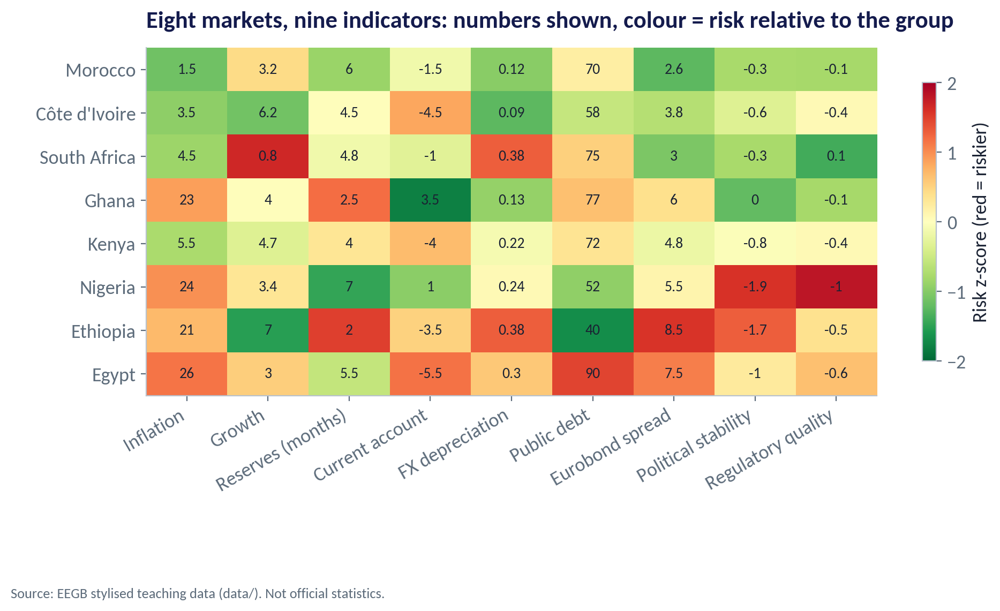
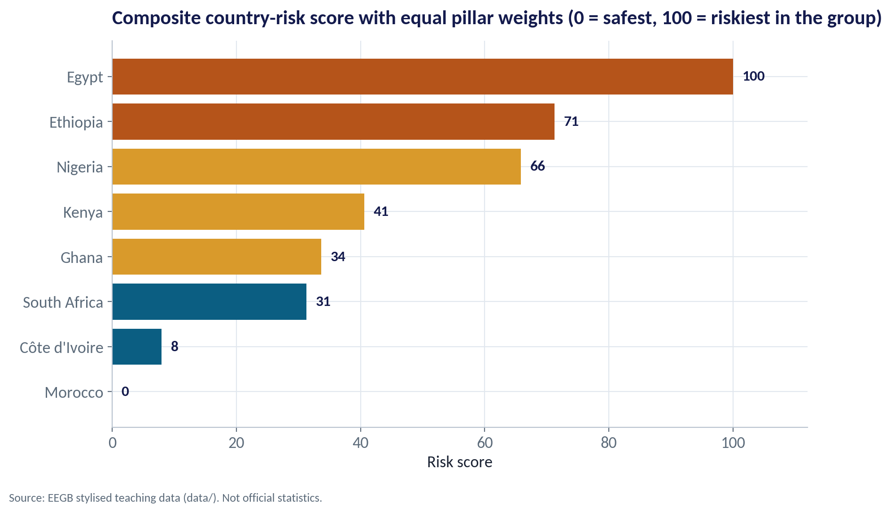
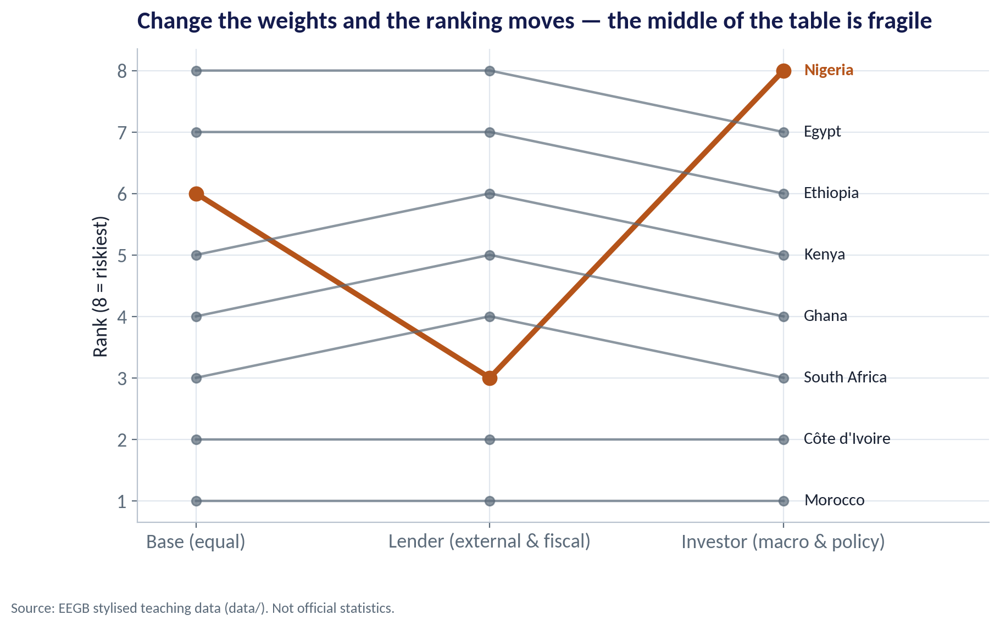
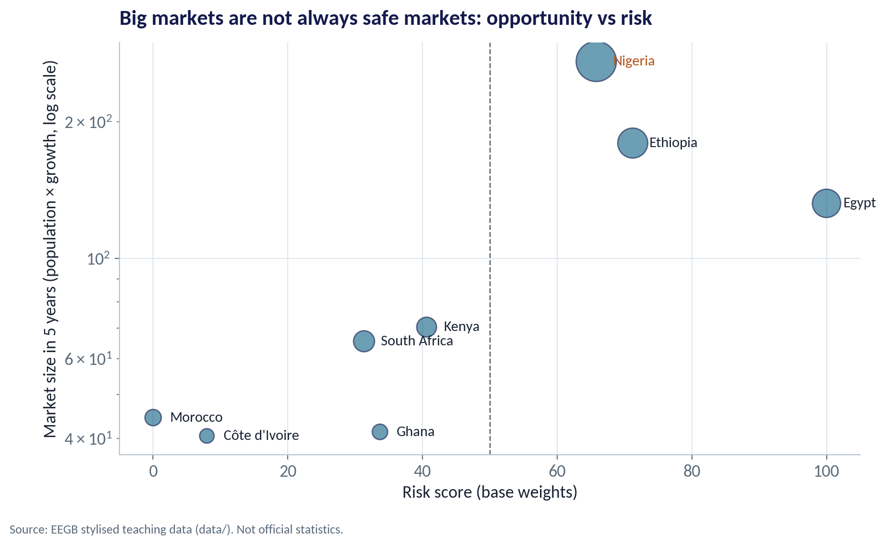
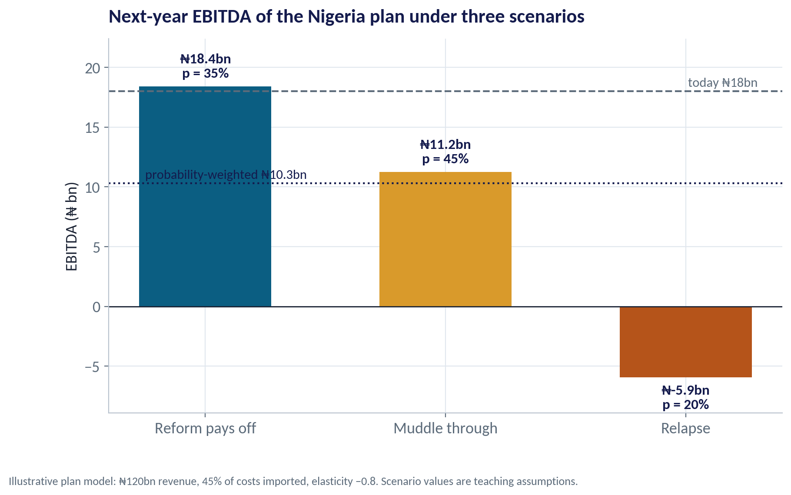
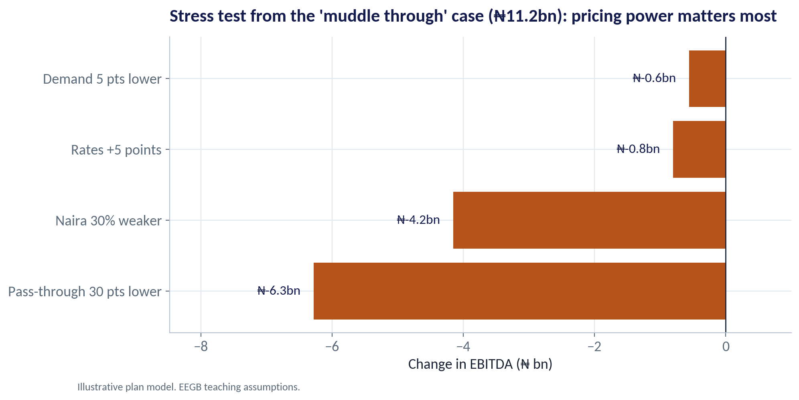
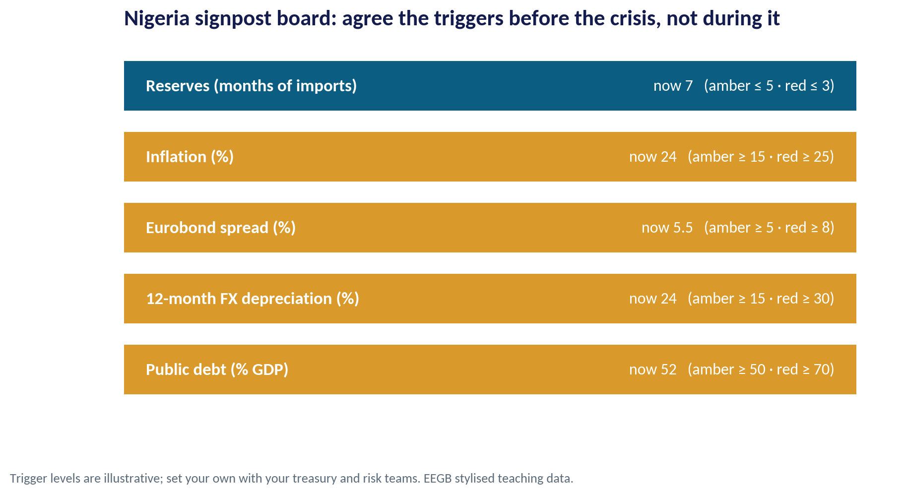

::: {.session-banner}
{.banner-hex width="96"}

**Session 14 of 16** · Facilitator: Sumendra Dash<br>*Case:* Ranking eight African markets for a regional expansion, then stress-testing the Nigeria plan under three scenarios.

:::

## Downloads {.unnumbered}

::: {.download-row}
[<i class="bi bi-file-earmark-slides"></i> Teaching slides (.pptx)](../../sessions/s14/slides/EEGB_S14_Country_Risk_Scenario_Planning.pptx){.btn .btn-primary download=""}
[<i class="bi bi-file-earmark-pdf"></i> Slides (PDF)](../../sessions/s14/slides/EEGB_S14_Country_Risk_Scenario_Planning.pdf){.btn .btn-outline-primary download=""}
[<i class="bi bi-github"></i> Session folder on GitHub](https://github.com/adibongo/eegb/tree/main/sessions/s14){.btn .btn-outline-secondary}
:::

## Read first {.unnumbered}

- **India: Liberalise in the Face of Crisis?** — Case, reference no. P86

## Learning objectives

::: {.grid}
::: {.g-col-12 .g-col-md-4 .obj-card}
**Score Country Risk**

Build a transparent country-risk score from political, policy, external, fiscal and banking indicators.
:::
::: {.g-col-12 .g-col-md-4 .obj-card}
**Plan with Scenarios**

Replace a single forecast with a few plausible scenarios, probabilities and signposts.
:::
::: {.g-col-12 .g-col-md-4 .obj-card}
**Stress-Test a Plan**

Find the shocks that hurt a business plan most, and decide what to do about them in advance.
:::
:::

## The business case

::: {.callout-note appearance="simple" icon=false}
## Eight Markets, One Expansion Budget

**Situation.** A Lagos-based consumer-goods group will expand into one more African market and must also defend its Nigerian business, which earns ₦18bn EBITDA on ₦120bn revenue with 45% of costs imported.

**Question.** How do the eight candidate markets rank on risk, does the ranking survive different weightings, and how badly could the Nigeria plan be hit next year?

**Data.** country_risk_panel.csv — eight African markets × ten indicators: growth, inflation, debt, reserves, current account, governance, FX depreciation, Eurobond spreads. *Stylised teaching data.* Plan model assumptions are stated on each chart.

**A good answer.** A ranked shortlist with the weighting stated openly, a three-scenario plan for Nigeria, and a signpost board that tells management when to switch plans.
:::

## Key ideas in plain English

### Turning Different Indicators into One Score

Inflation is in %, reserves in months and governance on a −2.5 to +2.5 scale. To combine them, express each as a z-score: how far a country is from the group average, in standard deviations. Flip the sign where high is good, so higher always means riskier.

::: {.formula}
z = (value − group average) ÷ standard deviation
:::

*Example.* Nigeria's political-stability score (−1.9) is well below the group average, giving a high risk z-score. Its reserves (7 months) are above average, giving a low one.

::: {.callout-tip appearance="minimal"}
**Why a manager cares.** Writing the method down makes your judgement auditable. Colleagues can argue about the weights instead of arguing about gut feel.
:::

### Signposts and Triggers

A signpost is an indicator that tells you which scenario is unfolding. A trigger is the level at which you act — agreed in advance, so the decision is not made in panic.

::: {.formula}
signpost crosses trigger → pre-agreed action
:::

*Example.* If 12-month naira depreciation passes 30% (red), switch to the relapse playbook: raise prices faster, cut dollar inventory, delay capex.

::: {.callout-tip appearance="minimal"}
**Why a manager cares.** Most firms see the warning signs and still react late. Pre-agreed triggers turn foresight into action.
:::

## Charts and how to replicate them

Every chart below is regenerated by the session's figure script — `sessions/s14/R/s14_figures.R` or `sessions/s14/python/s14_figures.py`. Run it from the project root.

### Eight Markets at a Glance

::: {.panel-tabset group="lang"}
## Python
{.fig-img fig-alt="S14-F01 (Python)"}

:::

- Rows are markets, columns indicators; the number is the raw value, the colour its relative risk.
- Morocco and Côte d'Ivoire are green across most columns.
- Nigeria is red on governance and inflation, but green on reserves and debt.
- Egypt and Ethiopia are red on debt, spreads and FX.

<span class="fig-id">S14-F01</span>

### Equal Weights: Who Is Riskiest?

::: {.panel-tabset group="lang"}
## Python
{.fig-img fig-alt="S14-F02 (Python)"}

:::

- Averaging the four pillars equally and rescaling to 0–100.
- Morocco (0) and Côte d'Ivoire (8) are the safest in this group.
- Nigeria scores 66, behind Ethiopia (71) and Egypt (100).
- A score is relative to this group, not an absolute probability of default.

<span class="fig-id">S14-F02</span>

### Change the Weights, Change the Answer

::: {.panel-tabset group="lang"}
## Python
{.fig-img fig-alt="S14-F03 (Python)"}

:::

- A lender cares most about external and fiscal risk: Nigeria rises to 3rd safest thanks to reserves and moderate debt.
- An investor cares most about macro and policy: Nigeria becomes the riskiest of the eight.
- The ends of the table are stable; the middle is fragile.
- Always report the weights — and test whether your decision changes if they change.

<span class="fig-id">S14-F03</span>

### Big Markets Are Not Always Safe Markets

::: {.panel-tabset group="lang"}
## Python
{.fig-img fig-alt="S14-F04 (Python)"}

:::

- Vertical axis: market size in five years (population grown at the real growth rate).
- Nigeria, Ethiopia and Egypt are the big prizes — and among the riskiest.
- Morocco and Côte d'Ivoire are safer but smaller.
- Strategy is choosing where on this map your firm can earn a premium for the risk it takes.

<span class="fig-id">S14-F04</span>

### The Plan's EBITDA Under Three Worlds

::: {.panel-tabset group="lang"}
## Python
{.fig-img fig-alt="S14-F05 (Python)"}

:::

- Today's EBITDA: ₦18bn.
- Reform: ₦18.4bn. Muddle through: ₦11.2bn. Relapse: a loss of ₦5.9bn.
- Probability-weighted EBITDA: ₦10.3bn — well below today.
- The relapse case decides how much debt and fixed cost the plan can carry.

<span class="fig-id">S14-F05</span>

### Which Shock Hurts Most?

::: {.panel-tabset group="lang"}
## Python
{.fig-img fig-alt="S14-F06 (Python)"}

:::

- Starting from 'muddle through' (₦11.2bn), apply one shock at a time.
- Losing 30 points of pricing power costs about ₦6.3bn — the biggest hit.
- A further 30% naira fall costs about ₦4.2bn.
- Rates and demand matter less for this firm — so focus hedging and pricing strategy there.

<span class="fig-id">S14-F06</span>

### Nigeria Today: Green, Amber or Red?

::: {.panel-tabset group="lang"}
## Python
{.fig-img fig-alt="S14-F07 (Python)"}

:::

- Reserves at 7 months of imports: green.
- Inflation (24%), Eurobond spread (5.5%), FX depreciation (24%) and debt (52% of GDP): amber.
- No indicator is red — consistent with 'muddle through'.
- Review monthly with the dashboard from Session 1.

<span class="fig-id">S14-F07</span>

## Lab: Rank Eight Markets, Stress-Test Nigeria

*Time:* 20 minutes · *Data:* [`data/country_risk_panel.csv`](../../data/country_risk_panel.csv)

1. Convert the nine indicators into risk z-scores (flip the sign where high is good).
2. Average them into four pillars.
3. Rank the markets under equal, lender and investor weights.
4. Compute the plan's probability-weighted EBITDA across three scenarios.
5. Choose three signposts and the trigger levels that would change your plan.

::: {.callout-important appearance="simple"}
**Deliverable:** a ranked shortlist with your weights stated, and a one-paragraph scenario note for the Nigeria plan.
:::

## The code (R | Python)

Pick your language once; every tab on the site follows your choice. Download a script, or copy it into RStudio and run it line by line.

### Replicate every chart

::: {.panel-tabset group="lang"}
## Python
[<i class="bi bi-download"></i> s14_figures.py](../../sessions/s14/python/s14_figures.py){download=""}

::: {.callout-note collapse="true" appearance="simple" icon=false}
## Show the full script (171 lines)

```{.python filename="sessions/s14/python/s14_figures.py"}
# =============================================================================
# EEGB · Session 14 · Country Risk & Scenario Planning
# Replication script — regenerates every chart in the Session 14 deck (Python)
# Data: data/country_risk_panel.csv (stylised indicators for eight African markets)
# Run from the project root:  python sessions/s14/python/s14_figures.py
# =============================================================================
import sys; sys.path.insert(0, "python")
import numpy as np, pandas as pd
import matplotlib.pyplot as plt
from matplotlib.ticker import FuncFormatter
from eegb_style import *

set_style()
cr = pd.read_csv("data/country_risk_panel.csv").set_index("country")

# ---- The scoring model ------------------------------------------------------------------------
# Each indicator is turned into a z-score where HIGHER = RISKIER, then weighted into four pillars.
RISKIER_IF_HIGH = {"inflation_pct": 1, "public_debt_gdp_pct": 1, "reserves_months_imports": -1, "current_account_gdp_pct": -1,
                   "political_stability_wgi": -1, "regulatory_quality_wgi": -1, "fx_depreciation_12m": 1,
                   "eurobond_spread_pct": 1, "real_growth_pct": -1}
PILLARS = {"Macro": ["inflation_pct", "real_growth_pct"], "External": ["reserves_months_imports", "current_account_gdp_pct", "fx_depreciation_12m"],
           "Fiscal & market": ["public_debt_gdp_pct", "eurobond_spread_pct"], "Political & policy": ["political_stability_wgi", "regulatory_quality_wgi"]}
LABELS = {"inflation_pct": "Inflation", "real_growth_pct": "Growth", "reserves_months_imports": "Reserves (months)",
          "current_account_gdp_pct": "Current account", "fx_depreciation_12m": "FX depreciation", "public_debt_gdp_pct": "Public debt",
          "eurobond_spread_pct": "Eurobond spread", "political_stability_wgi": "Political stability", "regulatory_quality_wgi": "Regulatory quality"}
z = pd.DataFrame({k: s * (cr[k] - cr[k].mean()) / cr[k].std() for k, s in RISKIER_IF_HIGH.items()})
pill = pd.DataFrame({p: z[cols].mean(axis=1) for p, cols in PILLARS.items()})


def score(w):
    """Weighted pillar score, rescaled to 0–100 (100 = riskiest in the group)."""
    s = sum(pill[p] * wt for p, wt in w.items()) / sum(w.values())
    return 100 * (s - s.min()) / (s.max() - s.min())


W = {"Base (equal)": {"Macro": 1, "External": 1, "Fiscal & market": 1, "Political & policy": 1},
     "Lender (external & fiscal)": {"Macro": .5, "External": 2, "Fiscal & market": 2, "Political & policy": .5},
     "Investor (macro & policy)": {"Macro": 2, "External": .5, "Fiscal & market": .5, "Political & policy": 2}}
scores = pd.DataFrame({k: score(w) for k, w in W.items()})
base = scores["Base (equal)"].sort_values()

# --- F01 · Heatmap of risk z-scores -------------------------------------------------------------------
order = base.index
cols = [c for p in PILLARS.values() for c in p]
fig, ax = plt.subplots(figsize=(11, 5.6))
im = ax.imshow(z.loc[order, cols].values, cmap="RdYlGn_r", vmin=-2, vmax=2, aspect="auto")
ax.set_xticks(range(len(cols)), [LABELS[c] for c in cols], rotation=30, ha="right")
ax.set_yticks(range(len(order)), order); ax.grid(False)
for i, c_ in enumerate(order):
    for j, k in enumerate(cols):
        ax.text(j, i, f"{cr.loc[c_, k]:g}", ha="center", va="center", fontsize=10, color=INK)
cb = fig.colorbar(im, ax=ax, shrink=.8); cb.set_label("Risk z-score (red = riskier)")
ax.set_title("Eight markets, nine indicators: numbers shown, colour = risk relative to the group", loc="left"); fig.subplots_adjust(bottom=0.3)
note(fig); save(fig, "s14", "f01")

# --- F02 · Composite score, base weights -----------------------------------------------------------
fig, ax = plt.subplots()
ax.barh(base.index, base.values, color=[RUST if v > 66 else GOLD if v > 33 else TEAL for v in base.values])
for i, v in enumerate(base.values): ax.text(v + 1.5, i, f"{v:.0f}", va="center", fontsize=12, fontweight="bold", color=NAVY)
ax.set_xlim(0, 112)
ax.set(title="Composite country-risk score with equal pillar weights (0 = safest, 100 = riskiest in the group)",
       xlabel="Risk score")
ax.title.set_fontsize(14)
note(fig); save(fig, "s14", "f02")

# --- F03 · Sensitivity to weights: does the ranking hold? ---------------------------------------------
ranks = scores.rank()
fig, ax = plt.subplots()
xs = range(len(W))
for c_ in ranks.index:
    hl = c_ == "Nigeria"
    ax.plot(xs, ranks.loc[c_], marker="o", lw=3.5 if hl else 1.6, ms=9 if hl else 6, color=RUST if hl else SLATE, alpha=1 if hl else .7)
    ax.text(len(W) - 1 + .07, ranks.loc[c_].iloc[-1], c_, va="center", fontsize=11, color=RUST if hl else INK,
            fontweight="bold" if hl else "normal")
ax.set_xticks(list(xs), list(W.keys())); ax.set_xlim(-.2, len(W) - .3)
ax.set_yticks(range(1, 9)); ax.set_ylabel("Rank (8 = riskiest)")
ax.set(title="Change the weights and the ranking moves — the middle of the table is fragile")
note(fig); save(fig, "s14", "f03")

# --- F04 · Risk vs opportunity map --------------------------------------------------------------------
opp = cr.population_m * (1 + cr.real_growth_pct / 100) ** 5
fig, ax = plt.subplots()
ax.scatter(base.reindex(cr.index), opp, s=cr.population_m * 4, color=TEAL, alpha=.6, edgecolor=NAVY)
for c_ in cr.index:
    ax.text(base[c_] + 2.5, opp[c_], c_, fontsize=11, va="center", color=RUST if c_ == "Nigeria" else INK)
ax.set_yscale("log"); ax.axvline(50, color=SLATE, ls="--", lw=1)
ax.set(title="Big markets are not always safe markets: opportunity vs risk",
       xlabel="Risk score (base weights)", ylabel="Market size in 5 years (population × growth, log scale)")
note(fig); save(fig, "s14", "f04")

# ---- A simple Nigeria plan model -------------------------------------------------------------------
# A consumer-goods subsidiary: ₦120bn revenue, 45% of costs imported in US$, 15% EBITDA margin today.
REV, COST_SHARE_IMP, MARGIN = 120.0, 0.45, 0.15
def plan_ebitda(fx_change, demand_growth, price_pass, rate_rise):
    """Next-year EBITDA (₦ bn) given FX move (+ = naira weaker), real demand growth, share of cost passed on, rate rise (pts)."""
    cost = REV * (1 - MARGIN)
    imp = cost * COST_SHARE_IMP * (1 + fx_change); dom = cost * (1 - COST_SHARE_IMP) * 1.15
    new_cost = imp + dom
    price = 1 + price_pass * (new_cost / cost - 1)
    vol = (1 + demand_growth) * price ** -0.8                        # demand elasticity −0.8
    rev = REV * price * vol
    finance = 4.0 * (1 + rate_rise / 25)                              # ₦4bn interest bill scales with rates
    return rev - new_cost * vol - (finance - 4.0)

SCEN = pd.DataFrame({"Reform pays off": [0.35, 0.05, 0.10, 0.80, -3], "Muddle through": [0.45, 0.25, 0.01, 0.60, 0],
                     "Relapse": [0.20, 0.80, -0.04, 0.40, 6]}, index=["prob", "fx_change", "demand_growth", "price_pass", "rate_rise"]).T
SCEN["ebitda"] = [plan_ebitda(r.fx_change, r.demand_growth, r.price_pass, r.rate_rise) for _, r in SCEN.iterrows()]
ev = (SCEN.prob * SCEN.ebitda).sum()
today = REV * MARGIN

# --- F05 · Scenario tree outcomes --------------------------------------------------------------------
fig, ax = plt.subplots()
cols5 = [TEAL, GOLD, RUST]
ax.bar(SCEN.index, SCEN.ebitda, color=cols5, width=.55)
for i, (k, r) in enumerate(SCEN.iterrows()):
    ax.text(i, r.ebitda + (.6 if r.ebitda >= 0 else -.6), f"₦{r.ebitda:.1f}bn\np = {r.prob:.0%}", ha="center",
            va="bottom" if r.ebitda >= 0 else "top", fontsize=12, color=NAVY, fontweight="bold")
ax.axhline(today, color=SLATE, ls="--"); ax.text(2.3, today + .4, f"today ₦{today:.0f}bn", color=SLATE, ha="right", fontsize=11)
ax.axhline(ev, color=NAVY, ls=":"); ax.text(-.25, ev + .4, f"probability-weighted ₦{ev:.1f}bn", color=NAVY, fontsize=11)
ax.axhline(0, color=INK, lw=1)
ax.set_ylim(min(0, SCEN.ebitda.min()) - 3, max(SCEN.ebitda.max(), today) + 4)
ax.set(title="Next-year EBITDA of the Nigeria plan under three scenarios", ylabel="EBITDA (₦ bn)")
note(fig, "Illustrative plan model: ₦120bn revenue, 45% of costs imported, elasticity −0.8. Scenario values are teaching assumptions.")
save(fig, "s14", "f05")

# --- F06 · Stress test: one shock at a time (tornado) ---------------------------------------------------
basecase = plan_ebitda(*SCEN.loc["Muddle through", ["fx_change", "demand_growth", "price_pass", "rate_rise"]])
mb = SCEN.loc["Muddle through"]
shocks = {"Naira 30% weaker": dict(fx_change=mb.fx_change + .30), "Demand 5 pts lower": dict(demand_growth=mb.demand_growth - .05),
          "Pass-through 30 pts lower": dict(price_pass=mb.price_pass - .30), "Rates +5 points": dict(rate_rise=mb.rate_rise + 5)}
imp = {}
for k, ch in shocks.items():
    args = dict(fx_change=mb.fx_change, demand_growth=mb.demand_growth, price_pass=mb.price_pass, rate_rise=mb.rate_rise); args.update(ch)
    imp[k] = plan_ebitda(**args) - basecase
imp = pd.Series(imp).sort_values()
fig, ax = plt.subplots(figsize=(10, 4.8))
ax.barh(imp.index, imp.values, color=RUST)
for i, v in enumerate(imp.values): ax.text(v - .2, i, f"₦{v:.1f}bn", ha="right", va="center", fontsize=12, color=NAVY)
ax.axvline(0, color=INK, lw=1); ax.set_xlim(imp.min() * 1.35, 1)
ax.set(title=f"Stress test from the 'muddle through' case (₦{basecase:.1f}bn): pricing power matters most",
       xlabel="Change in EBITDA (₦ bn)")
note(fig, "Illustrative plan model. EEGB teaching assumptions.")
save(fig, "s14", "f06")

# --- F07 · Signposts: Nigeria's indicators vs trigger levels -------------------------------------------
sig = pd.DataFrame({"indicator": ["Reserves (months of imports)", "Inflation (%)", "Eurobond spread (%)", "12-month FX depreciation (%)", "Public debt (% GDP)"],
                    "value": [cr.loc["Nigeria", "reserves_months_imports"], cr.loc["Nigeria", "inflation_pct"], cr.loc["Nigeria", "eurobond_spread_pct"],
                              100 * cr.loc["Nigeria", "fx_depreciation_12m"], cr.loc["Nigeria", "public_debt_gdp_pct"]],
                    "amber": [5, 15, 5, 15, 50], "red": [3, 25, 8, 30, 70], "higher_is_worse": [False, True, True, True, True]})
def status(r):
    if r.higher_is_worse: return "red" if r.value >= r.red else "amber" if r.value >= r.amber else "green"
    return "red" if r.value <= r.red else "amber" if r.value <= r.amber else "green"
sig["status"] = sig.apply(status, axis=1)
colmap = {"green": TEAL, "amber": GOLD, "red": RUST}
fig, ax = plt.subplots(figsize=(10, 4.8))
for i, r in sig.iterrows():
    ax.barh(i, 1, color=colmap[r.status], height=.7)
    ax.text(0.03, i, f"{r.indicator}", va="center", fontsize=12.5, color="white", fontweight="bold")
    trig = f"amber {'≤' if not r.higher_is_worse else '≥'} {r.amber:g} · red {'≤' if not r.higher_is_worse else '≥'} {r.red:g}"
    ax.text(0.97, i, f"now {r.value:g}   ({trig})", va="center", ha="right", fontsize=11.5, color="white")
ax.set_yticks([]); ax.set_xticks([]); ax.grid(False); ax.invert_yaxis()
for s in ax.spines.values(): s.set_visible(False)
ax.set(title="Nigeria signpost board: agree the triggers before the crisis, not during it")
note(fig, "Trigger levels are illustrative; set your own with your treasury and risk teams. EEGB stylised teaching data.")
save(fig, "s14", "f07")

# --- key numbers -------------------------------------------------------------------------------------------
print(scores.round(0).sort_values("Base (equal)"))
print(ranks.loc["Nigeria"])
print(SCEN.round(2)); print(f"today {today:.1f}, EV {ev:.2f}, base {basecase:.2f}")
print(imp.round(2)); print(sig[["indicator", "value", "status"]])
```
:::

## R
[<i class="bi bi-download"></i> s14_figures.R](../../sessions/s14/R/s14_figures.R){download=""}

::: {.callout-note collapse="true" appearance="simple" icon=false}
## Show the full script (109 lines)

```{.r filename="sessions/s14/R/s14_figures.R"}
# =============================================================================
# EEGB · Session 14 · Country Risk & Scenario Planning
# Replication script — regenerates every chart in the Session 14 deck (R)
# Data: data/country_risk_panel.csv (stylised indicators for eight African markets)
# =============================================================================
source("R/theme_eegb.R")
suppressPackageStartupMessages({ library(dplyr); library(readr); library(tidyr) })
cr <- read_csv("data/country_risk_panel.csv", show_col_types = FALSE)

sign <- c(inflation_pct = 1, real_growth_pct = -1, reserves_months_imports = -1, current_account_gdp_pct = -1,
          fx_depreciation_12m = 1, public_debt_gdp_pct = 1, eurobond_spread_pct = 1,
          political_stability_wgi = -1, regulatory_quality_wgi = -1)
pillars <- list(Macro = c("inflation_pct", "real_growth_pct"),
                External = c("reserves_months_imports", "current_account_gdp_pct", "fx_depreciation_12m"),
                `Fiscal & market` = c("public_debt_gdp_pct", "eurobond_spread_pct"),
                `Political & policy` = c("political_stability_wgi", "regulatory_quality_wgi"))
z <- as.data.frame(sapply(names(sign), function(k) sign[[k]] * as.numeric(scale(cr[[k]]))))
rownames(z) <- cr$country
pill <- sapply(pillars, function(cols) rowMeans(z[, cols]))
score <- function(w) { s <- as.numeric(pill %*% w) / sum(w); 100 * (s - min(s)) / (max(s) - min(s)) }
W <- list(`Base (equal)` = c(1, 1, 1, 1), `Lender (external & fiscal)` = c(.5, 2, 2, .5), `Investor (macro & policy)` = c(2, .5, .5, 2))
scores <- as.data.frame(lapply(W, score), check.names = FALSE); scores$country <- cr$country

# --- F01 · Heatmap -----------------------------------------------------------------------
lev <- scores$country[order(scores$`Base (equal)`)]
d1 <- z |> mutate(country = rownames(z)) |> pivot_longer(-country, names_to = "indicator", values_to = "z") |>
  left_join(cr |> pivot_longer(-country, names_to = "indicator", values_to = "raw"), by = c("country", "indicator")) |>
  mutate(country = factor(country, levels = lev), indicator = factor(indicator, levels = unlist(pillars)))
p1 <- ggplot(d1, aes(indicator, country, fill = z)) + geom_tile(colour = "white") + geom_text(aes(label = raw), size = 3.2) +
  scale_fill_gradient2(low = "#1A9850", mid = "#FFFFBF", high = "#D73027", limits = c(-2, 2), oob = scales::squish, name = "Risk z") +
  labs(title = "Eight markets, nine indicators: numbers shown, colour = risk relative to the group",
       x = NULL, y = NULL, caption = eegb_caption) + theme_eegb() + theme(axis.text.x = element_text(angle = 30, hjust = 1))
save_fig(p1, "s14", "f01")

# --- F02 · Composite score -----------------------------------------------------------------
p2 <- ggplot(scores, aes(`Base (equal)`, reorder(country, `Base (equal)`),
                         fill = cut(`Base (equal)`, c(-1, 33, 66, 101), labels = c("low", "mid", "high")))) +
  geom_col(show.legend = FALSE) + geom_text(aes(label = round(`Base (equal)`)), hjust = -.2, fontface = "bold") +
  scale_fill_manual(values = unname(eegb[c("teal", "gold", "rust")])) + xlim(0, 112) +
  labs(title = "Composite country-risk score with equal pillar weights (0 = safest, 100 = riskiest)",
       x = "Risk score", y = NULL, caption = eegb_caption) + theme_eegb()
save_fig(p2, "s14", "f02")

# --- F03 · Rank sensitivity -------------------------------------------------------------------
d3 <- scores |> pivot_longer(-country, names_to = "weights", values_to = "s") |> group_by(weights) |>
  mutate(rank = rank(s), weights = factor(weights, levels = names(W)), ng = country == "Nigeria")
p3 <- ggplot(d3, aes(weights, rank, group = country, colour = ng)) + geom_line(aes(linewidth = ng)) + geom_point(size = 3) +
  geom_text(data = filter(d3, weights == names(W)[3]), aes(label = country), hjust = -.15) +
  scale_colour_manual(values = c(`TRUE` = eegb[["rust"]], `FALSE` = eegb[["slate"]]), guide = "none") +
  scale_linewidth_manual(values = c(`TRUE` = 1.8, `FALSE` = .7), guide = "none") +
  labs(title = "Change the weights and the ranking moves — the middle of the table is fragile",
       x = NULL, y = "Rank (8 = riskiest)", caption = eegb_caption) + theme_eegb()
save_fig(p3, "s14", "f03")

# --- F04 · Opportunity vs risk ------------------------------------------------------------------
d4 <- cr |> mutate(opp = population_m * (1 + real_growth_pct / 100)^5) |> left_join(scores, by = "country")
p4 <- ggplot(d4, aes(`Base (equal)`, opp, size = population_m)) + geom_point(colour = eegb[["teal"]], alpha = .6) +
  geom_text(aes(label = country), size = 3.5, hjust = -.25) + scale_y_log10() + scale_size(range = c(3, 15), guide = "none") +
  geom_vline(xintercept = 50, linetype = "dashed", colour = eegb[["slate"]]) +
  labs(title = "Big markets are not always safe markets: opportunity vs risk",
       x = "Risk score (base weights)", y = "Market size in 5 years (log scale)", caption = eegb_caption) + theme_eegb()
save_fig(p4, "s14", "f04")

# --- Plan model ----------------------------------------------------------------------------------
REV <- 120; IMP <- .45; MARGIN <- .15
plan_ebitda <- function(fx_change, demand_growth, price_pass, rate_rise) {
  cost <- REV * (1 - MARGIN); new_cost <- cost * IMP * (1 + fx_change) + cost * (1 - IMP) * 1.15
  price <- 1 + price_pass * (new_cost / cost - 1); vol <- (1 + demand_growth) * price^-0.8
  REV * price * vol - new_cost * vol - (4 * (1 + rate_rise / 25) - 4)
}
scen <- tibble(scenario = c("Reform pays off", "Muddle through", "Relapse"), prob = c(.35, .45, .20),
               fx = c(.05, .25, .80), dem = c(.10, .01, -.04), pass = c(.8, .6, .4), rate = c(-3, 0, 6)) |>
  rowwise() |> mutate(ebitda = plan_ebitda(fx, dem, pass, rate)) |> ungroup()
ev <- sum(scen$prob * scen$ebitda)

# --- F05 · Scenario outcomes ----------------------------------------------------------------------
p5 <- ggplot(scen, aes(factor(scenario, levels = scenario), ebitda, fill = scenario)) + geom_col(width = .55, show.legend = FALSE) +
  geom_text(aes(label = sprintf("₦%.1fbn\np = %.0f%%", ebitda, 100 * prob)), vjust = ifelse(scen$ebitda >= 0, -.3, 1.3)) +
  geom_hline(yintercept = c(18, ev), linetype = c("dashed", "dotted"), colour = eegb[["navy"]]) +
  scale_fill_manual(values = c(`Reform pays off` = eegb[["teal"]], `Muddle through` = eegb[["gold"]], Relapse = eegb[["rust"]])) +
  labs(title = "Next-year EBITDA of the Nigeria plan under three scenarios",
       subtitle = sprintf("Dashed: today ₦18bn · dotted: probability-weighted ₦%.1fbn", ev),
       x = NULL, y = "EBITDA (₦ bn)", caption = "Illustrative plan model; scenario values are teaching assumptions.") + theme_eegb()
save_fig(p5, "s14", "f05")

# --- F06 · Tornado ---------------------------------------------------------------------------------
b0 <- plan_ebitda(.25, .01, .6, 0)
d6 <- tibble(shock = c("Naira 30% weaker", "Demand 5 pts lower", "Pass-through 30 pts lower", "Rates +5 points"),
             change = c(plan_ebitda(.55, .01, .6, 0), plan_ebitda(.25, -.04, .6, 0), plan_ebitda(.25, .01, .3, 0), plan_ebitda(.25, .01, .6, 5)) - b0)
p6 <- ggplot(d6, aes(change, reorder(shock, -change))) + geom_col(fill = eegb[["rust"]]) +
  geom_text(aes(label = sprintf("₦%.1fbn", change)), hjust = 1.1) + geom_vline(xintercept = 0) +
  labs(title = sprintf("Stress test from the 'muddle through' case (₦%.1fbn): pricing power matters most", b0),
       x = "Change in EBITDA (₦ bn)", y = NULL, caption = "Illustrative plan model. EEGB teaching assumptions.") + theme_eegb()
save_fig(p6, "s14", "f06", height = 4.8)

# --- F07 · Signpost board ----------------------------------------------------------------------------
ng <- filter(cr, country == "Nigeria")
sig <- tibble(indicator = c("Reserves (months of imports)", "Inflation (%)", "Eurobond spread (%)", "12-month FX depreciation (%)", "Public debt (% GDP)"),
              value = c(ng$reserves_months_imports, ng$inflation_pct, ng$eurobond_spread_pct, 100 * ng$fx_depreciation_12m, ng$public_debt_gdp_pct),
              amber = c(5, 15, 5, 15, 50), red = c(3, 25, 8, 30, 70), worse_high = c(FALSE, TRUE, TRUE, TRUE, TRUE)) |>
  mutate(status = ifelse(worse_high, ifelse(value >= red, "red", ifelse(value >= amber, "amber", "green")),
                         ifelse(value <= red, "red", ifelse(value <= amber, "amber", "green"))))
p7 <- ggplot(sig, aes(1, factor(indicator, levels = rev(indicator)), fill = status)) + geom_tile(width = 1, height = .8) +
  geom_text(aes(label = paste0(indicator, ":  now ", value)), colour = "white", fontface = "bold") +
  scale_fill_manual(values = c(green = eegb[["teal"]], amber = eegb[["gold"]], red = eegb[["rust"]]), name = NULL) +
  labs(title = "Nigeria signpost board: agree the triggers before the crisis, not during it", x = NULL, y = NULL,
       caption = "Trigger levels are illustrative. EEGB stylised teaching data.") + theme_void(base_size = 13) +
  theme(plot.title = element_text(face = "bold", colour = eegb[["navy"]]))
save_fig(p7, "s14", "f07", height = 4.8)
```
:::

:::

### Lab

::: {.panel-tabset group="lang"}
## Python
[<i class="bi bi-download"></i> s14_lab.py](../../sessions/s14/python/s14_lab.py){download=""}

::: {.callout-note collapse="true" appearance="simple" icon=false}
## Show the full script (44 lines)

```{.python filename="sessions/s14/python/s14_lab.py"}
# =============================================================================
# EEGB · Session 14 LAB · Rank eight markets, then stress-test the Nigeria plan (Python)
# Data: data/country_risk_panel.csv (stylised indicators for eight African markets)
# Run from the project root, line by line.
# =============================================================================
import pandas as pd

cr = pd.read_csv("data/country_risk_panel.csv").set_index("country")
print(cr)

# ---- STEP 1 · Put every indicator on the same scale (z-scores) -----------------------------
# A z-score says how many standard deviations a country is above or below the group average.
# We flip the sign where a HIGH value is GOOD (growth, reserves, current account, governance) so that high = risky.
sign = {"inflation_pct": 1, "public_debt_gdp_pct": 1, "fx_depreciation_12m": 1, "eurobond_spread_pct": 1,
        "real_growth_pct": -1, "reserves_months_imports": -1, "current_account_gdp_pct": -1,
        "political_stability_wgi": -1, "regulatory_quality_wgi": -1}
z = pd.DataFrame({k: s * (cr[k] - cr[k].mean()) / cr[k].std() for k, s in sign.items()})
print(z.round(2))

# ---- STEP 2 · Group indicators into four pillars ---------------------------------------------
pillars = {"macro": ["inflation_pct", "real_growth_pct"],
           "external": ["reserves_months_imports", "current_account_gdp_pct", "fx_depreciation_12m"],
           "fiscal_market": ["public_debt_gdp_pct", "eurobond_spread_pct"],
           "political": ["political_stability_wgi", "regulatory_quality_wgi"]}
pill = pd.DataFrame({p: z[c].mean(axis=1) for p, c in pillars.items()})

# ---- STEP 3 · Weight the pillars and rank ------------------------------------------------------
def rank_with(w):
    s = sum(pill[p] * wt for p, wt in w.items()) / sum(w.values())
    return s.rank().astype(int)          # 8 = riskiest
print(pd.DataFrame({"equal": rank_with({"macro": 1, "external": 1, "fiscal_market": 1, "political": 1}),
                    "lender": rank_with({"macro": .5, "external": 2, "fiscal_market": 2, "political": .5}),
                    "investor": rank_with({"macro": 2, "external": .5, "fiscal_market": .5, "political": 2})}))

# ---- STEP 4 · Scenarios for the Nigeria plan ------------------------------------------------------
# Next-year EBITDA (₦ bn) under three scenarios — from the session's plan model (see s14_figures.py)
scen = pd.DataFrame({"prob": [0.35, 0.45, 0.20], "ebitda": [18.39, 11.23, -5.93]},
                    index=["Reform pays off", "Muddle through", "Relapse"])
print(scen); print("probability-weighted EBITDA: ₦", round((scen.prob * scen.ebitda).sum(), 2), "bn  (today: ₦18bn)")

# ---- YOUR TURN -------------------------------------------------------------------------------------
# (a) Choose your own pillar weights for YOUR company (an importer? an exporter? a bank?). Where does Nigeria rank?
# (b) Change the 'Relapse' probability to 0.35 (and 'Muddle through' to 0.30). What happens to expected EBITDA?
# (c) Name three signposts you would watch monthly, with the trigger level that would make you switch scenario.
```
:::

## R
[<i class="bi bi-download"></i> s14_lab.R](../../sessions/s14/R/s14_lab.R){download=""}

::: {.callout-note collapse="true" appearance="simple" icon=false}
## Show the full script (35 lines)

```{.r filename="sessions/s14/R/s14_lab.R"}
# =============================================================================
# EEGB · Session 14 LAB · Rank eight markets, then stress-test the Nigeria plan (R)
# Data: data/country_risk_panel.csv (stylised indicators for eight African markets)
# =============================================================================
library(dplyr); library(readr)
cr <- read_csv("data/country_risk_panel.csv", show_col_types = FALSE)
cr

# ---- STEP 1 · z-scores, with high = risky -------------------------------------------------
sign <- c(inflation_pct = 1, public_debt_gdp_pct = 1, fx_depreciation_12m = 1, eurobond_spread_pct = 1,
          real_growth_pct = -1, reserves_months_imports = -1, current_account_gdp_pct = -1,
          political_stability_wgi = -1, regulatory_quality_wgi = -1)
z <- sapply(names(sign), function(k) sign[[k]] * as.numeric(scale(cr[[k]])))
rownames(z) <- cr$country
round(z, 2)

# ---- STEP 2 · Four pillars ------------------------------------------------------------------
pill <- cbind(macro = rowMeans(z[, c("inflation_pct", "real_growth_pct")]),
              external = rowMeans(z[, c("reserves_months_imports", "current_account_gdp_pct", "fx_depreciation_12m")]),
              fiscal_market = rowMeans(z[, c("public_debt_gdp_pct", "eurobond_spread_pct")]),
              political = rowMeans(z[, c("political_stability_wgi", "regulatory_quality_wgi")]))

# ---- STEP 3 · Weight and rank (8 = riskiest) ----------------------------------------------------
rank_with <- function(w) rank(as.numeric(pill %*% w))
data.frame(country = cr$country, equal = rank_with(c(1, 1, 1, 1)),
           lender = rank_with(c(.5, 2, 2, .5)), investor = rank_with(c(2, .5, .5, 2)))

# ---- STEP 4 · Scenarios for the Nigeria plan (EBITDA, ₦ bn) ------------------------------------
scen <- data.frame(scenario = c("Reform pays off", "Muddle through", "Relapse"), prob = c(.35, .45, .20), ebitda = c(18.39, 11.23, -5.93))
scen; sum(scen$prob * scen$ebitda)     # probability-weighted EBITDA vs ₦18bn today

# ---- YOUR TURN -------------------------------------------------------------------------------------
# (a) Choose weights for YOUR company. Where does Nigeria rank?
# (b) Set Relapse = 0.35 and Muddle through = 0.30. What happens to expected EBITDA?
# (c) Three signposts you would watch monthly, with trigger levels.
```
:::

:::

## Check your understanding

**Q1.** A colleague's spreadsheet ranks Nigeria 3rd safest of eight markets; yours ranks it 8th. Both use the same data. What is the most likely explanation?

- **A.** One of you made an arithmetic error
- **B.** You used different weights: hers stresses reserves and debt, yours stresses inflation and governance
- **C.** Nigeria's data are unreliable
- **D.** Country risk cannot be measured

::: {.callout-tip collapse="true" appearance="simple"}
## Show answer
**B.** B. With these data, a lender-style weighting puts Nigeria 3rd and an investor-style weighting puts it 8th. The disagreement is about priorities — which is a useful conversation once it is made explicit.
:::

**Q2.** The stress test shows that losing pricing power hurts the Nigeria plan more than a further 30% naira fall. Which action follows most directly?

- **A.** Buy more dollar forwards
- **B.** Invest in brand strength, product mix and pricing processes so price increases stick
- **C.** Exit Nigeria
- **D.** Ignore the result because the naira is the bigger headline risk

::: {.callout-tip collapse="true" appearance="simple"}
## Show answer
**B.** B. The tornado shows where the plan is most fragile. Protecting pricing power (brand, mix, route to market) addresses the largest exposure; hedging (Session 15) addresses the second.
:::

## Vocabulary

| Term | Meaning |
|---|---|
| **Country risk** | The chance that conditions in a country hurt an investment or business. |
| **Transfer risk** | The risk of not being able to convert or move money out. |
| **z-score** | Distance from the group average, in standard deviations. |
| **Pillar** | A group of related indicators combined into one sub-score. |
| **Weighting** | How much each pillar counts in the final score. |
| **Scenario** | A coherent, plausible story about the future. |
| **Scenario tree** | Scenarios with probabilities and outcomes laid out together. |
| **Signpost** | An indicator showing which scenario is unfolding. |
| **Trigger** | A pre-agreed level at which management acts. |
| **Stress test** | Measuring the impact of a severe but plausible shock. |

## Key takeaways

1. Country risk has several families: macro, external, fiscal, political and banking.
2. Put indicators on one scale (z-scores) and make the weights explicit.
3. Rankings can flip with the weights — test before you decide.
4. Plan with three scenarios and a probability-weighted outcome, not one forecast.
5. Agree signposts and triggers in advance so action is fast.

::: {.callout-note appearance="simple"}
**Before next session:** Read Acharya, Almeida, Amihud & Liu, 'Corporate Resiliency and the Choice Between Financial and Operational Hedging' (NBER). Note one example of an operational hedge in your own company.
:::

::: {.session-nav}
[← Session 13: Climate & Energy Transition](../../sessions/s13/index.qmd)
[Session 15: Hedging & Resilience →](../../sessions/s15/index.qmd){.next}
:::
