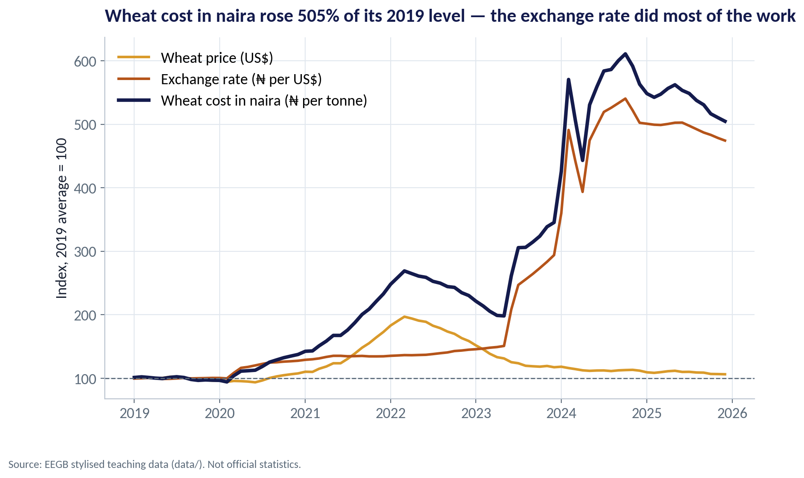
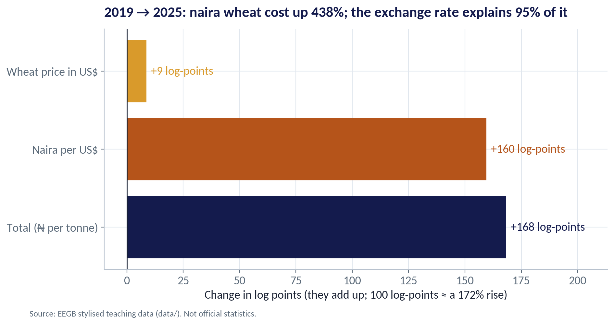
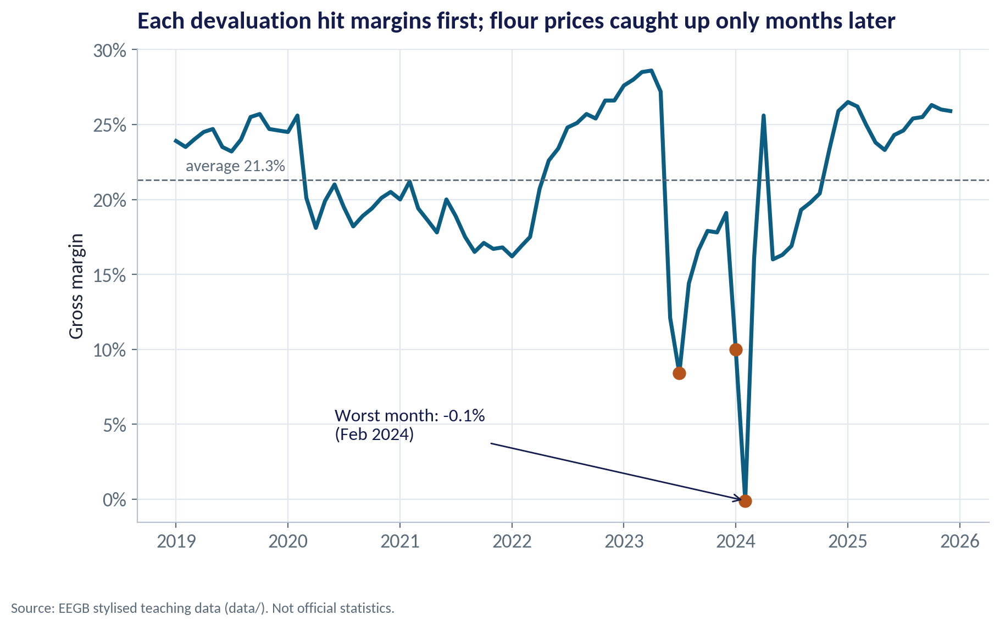
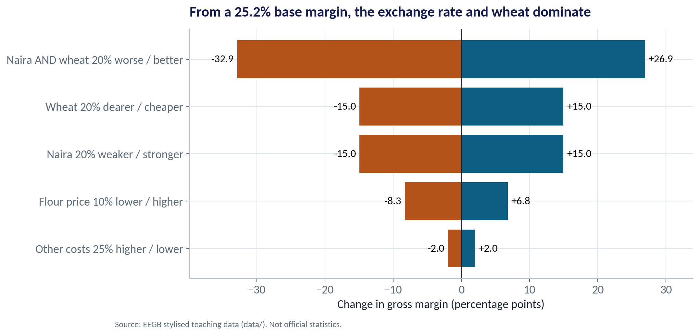
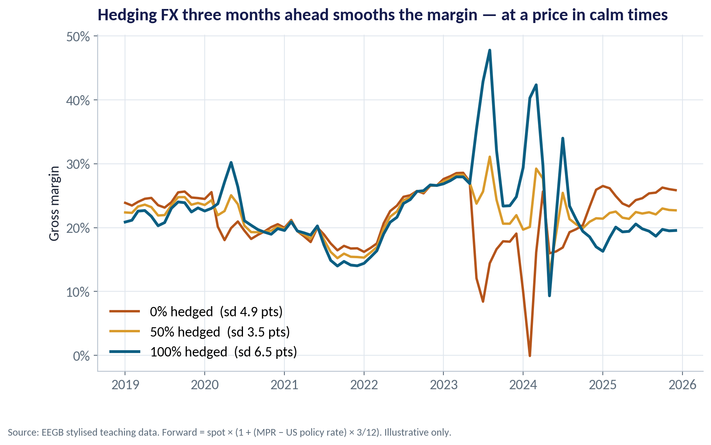
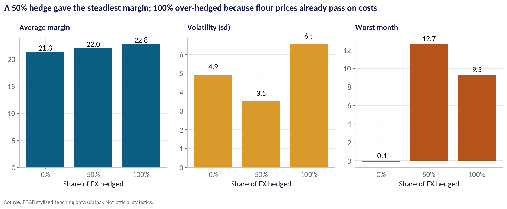
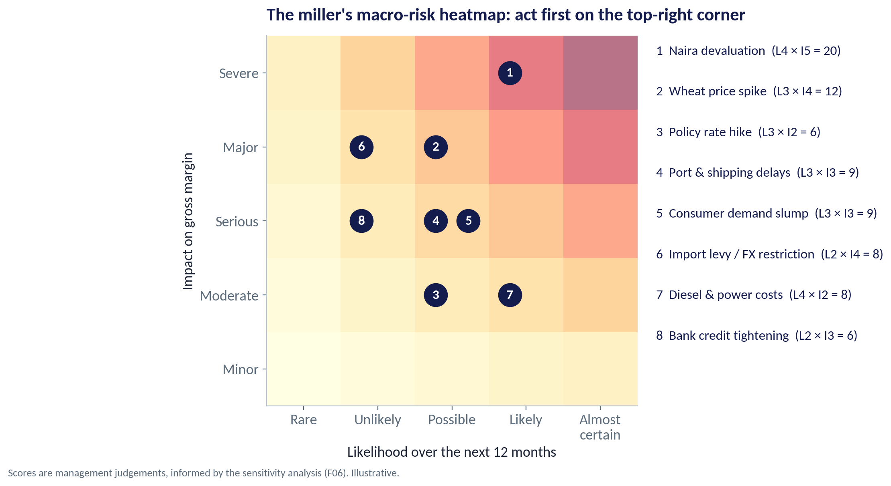
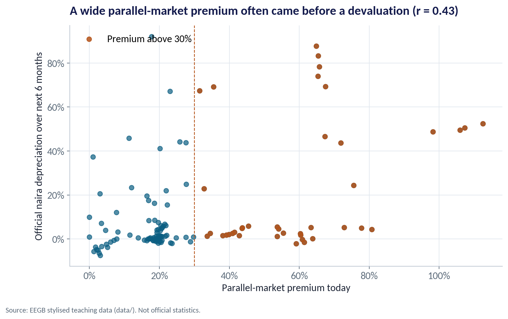

::: {.session-banner}
{.banner-hex width="96"}

**Session 15 of 16** · Facilitator: Sumendra Dash<br>*Case:* A flour miller imports wheat in dollars and sells bread in naira. Build its macro-risk heatmap and hedging plan.

:::

## Downloads {.unnumbered}

::: {.download-row}
[<i class="bi bi-file-earmark-slides"></i> Teaching slides (.pptx)](../../sessions/s15/slides/EEGB_S15_Corporate_Macro_Strategy_Hedging_Resilience.pptx){.btn .btn-primary download=""}
[<i class="bi bi-file-earmark-pdf"></i> Slides (PDF)](../../sessions/s15/slides/EEGB_S15_Corporate_Macro_Strategy_Hedging_Resilience.pdf){.btn .btn-outline-primary download=""}
[<i class="bi bi-github"></i> Session folder on GitHub](https://github.com/adibongo/eegb/tree/main/sessions/s15){.btn .btn-outline-secondary}
:::

## Read first {.unnumbered}

- **Acharya, Almeida, Amihud & Liu — Corporate Resiliency and the Choice Between Financial and Operational Hedging** — NBER Working Paper

## Learning objectives

::: {.grid}
::: {.g-col-12 .g-col-md-4 .obj-card}
**Measure Macro Exposure**

Trace how the exchange rate, commodity prices and interest rates flow into revenue, costs and margin.
:::
::: {.g-col-12 .g-col-md-4 .obj-card}
**Choose the Right Hedge**

Compare natural, operational and financial hedges, and pick a sensible hedge ratio — not automatically 100%.
:::
::: {.g-col-12 .g-col-md-4 .obj-card}
**Build Resilience**

Use a risk heatmap, real options and leading indicators to prepare before the shock arrives.
:::
:::

## The business case

::: {.callout-note appearance="simple" icon=false}
## The Flour Miller's Hedging Plan

**Situation.** A Lagos flour miller imports all its wheat, paid in US dollars about three months after ordering. It sells flour to bakers and noodle makers in naira, and can raise prices only gradually.

**Question.** Which macro risks matter most, how much of its dollar cost should it hedge, and what else should it do to protect its margin?

**Data.** miller_exposure_monthly.csv — 84 months (2019–2025): wheat price, exchange rate, volumes, costs, flour price, revenue and margin. Plus ng_macro_monthly.csv for rates and FX. *Stylised teaching data.*

**A good answer.** A one-page hedging plan: a risk heatmap, a recommended hedge ratio with its cost, the operational hedges, and five leading indicators to watch.
:::

## Key ideas in plain English

### How Much Came From Each Source?

A naira cost of an imported input is dollar price × exchange rate. In logs, the two parts simply add up, so you can split any rise into a 'commodity' part and a 'currency' part.

::: {.formula}
Δln(₦ cost) = Δln(US$ price) + Δln(₦ per US$)
:::

*Example.* 2019 → 2025 averages: wheat +9 log-points, naira +160 log-points. Total rise 438%, of which the exchange rate explains 95%.

::: {.callout-tip appearance="minimal"}
**Why a manager cares.** It tells you which hedge matters. Buying wheat futures in Chicago would have done little; managing the naira exposure was everything.
:::

### What a Naira Forward Should Cost

A forward fixes today the rate at which you will buy dollars later. Banks price it so nobody can earn a free profit: the naira forward is weaker than spot by roughly the interest-rate gap between naira and dollars.

::: {.formula}
Forward ≈ Spot × (1 + (i₦ − i$) × months ÷ 12)
:::

*Example.* December 2025: spot ₦1,454, MPR 27%, US rate about 3.75% → 3-month forward ≈ ₦1,539, a premium of 5.8% a quarter.

::: {.callout-tip appearance="minimal"}
**Why a manager cares.** Hedging is not free: at a 27% naira rate, rolling three-month cover costs over 20% a year in calm times. It pays off only when the naira falls by more than the premium.
:::

### Flexibility Is a Hedge Too

A real option is the right, but not the obligation, to change course later — like having a second supplier ready, or a plant that can switch inputs. It costs something today and pays off when the world turns against you.

::: {.formula}
Value of flexibility = value with the option − value without it
:::

*Example.* Testing a cassava-wheat blend costs ₦ today. If the naira falls 20%, switching 10% of wheat to local cassava cuts the dollar bill exactly when it hurts most.

::: {.callout-tip appearance="minimal"}
**Why a manager cares.** Options to delay, expand, switch or exit are often cheaper and longer-lasting than financial contracts, which may not exist for long tenors in naira.
:::

## Charts and how to replicate them

Every chart below is regenerated by the session's figure script — `sessions/s15/R/s15_figures.R` or `sessions/s15/python/s15_figures.py`. Run it from the project root.

### Wheat in Dollars, Dollars in Naira

::: {.panel-tabset group="lang"}
## Python
{.fig-img fig-alt="S15-F01 (Python)"}

:::

- By December 2025 the naira cost of a tonne of wheat was about five times its 2019 level (index 505).
- The dollar price of wheat ended only 6% above 2019, after a spike in 2022.
- The exchange rate index reached 474: the naira did most of the damage.
- Lesson: the miller's real exposure is to the naira, not to wheat.

<span class="fig-id">S15-F01</span>

### The Exchange Rate Did the Damage

::: {.panel-tabset group="lang"}
## Python
{.fig-img fig-alt="S15-F02 (Python)"}

:::

- Wheat price in US$: +9 log-points.
- Naira per US$: +160 log-points.
- Together: naira wheat cost up 438% between the 2019 and 2025 averages.
- The currency explains 95% of the increase.

<span class="fig-id">S15-F02</span>

### Costs Move First, Prices Follow

::: {.panel-tabset group="lang"}
## Python
{.fig-img fig-alt="S15-F03 (Python)"}

:::

- Average gross margin 2019–2025: 21.3%.
- Each devaluation hit the margin before flour prices could follow.
- Worst months: −0.1% in February 2024, 8.4% in July 2023 and 10.0% in January 2024.
- Margins recovered as prices caught up — a natural hedge, but a slow one.

<span class="fig-id">S15-F03</span>

### A Sensitivity 'Tornado'

::: {.panel-tabset group="lang"}
## Python
{.fig-img fig-alt="S15-F06 (Python)"}

:::

- Starting point: 2025 average margin of 25.2%.
- A 20% weaker naira, or 20% dearer wheat, each cuts the margin by 15 points.
- Both together: −32.9 points — the miller would make a loss.
- Other costs matter far less (±2 points). Spend management time where the tornado is widest.

<span class="fig-id">S15-F06</span>

### Hedging 0%, 50% or 100% of Next Quarter's Dollars

::: {.panel-tabset group="lang"}
## Python
{.fig-img fig-alt="S15-F04 (Python)"}

:::

- Each month the miller can lock in the rate for wheat it will pay for in three months.
- Unhedged, the margin fell to −0.1% in the 2024 devaluation.
- Fully hedged, the margin jumped in the same months — prices rose while costs were locked.
- In calm years hedging cost margin: average 21.8% unhedged vs 20.4% fully hedged.

<span class="fig-id">S15-F04</span>

### Why 100% Is Not the Safest Hedge

::: {.panel-tabset group="lang"}
## Python
{.fig-img fig-alt="S15-F05 (Python)"}

:::

- 50% hedged had the lowest volatility: 3.5 points vs 4.9 unhedged and 6.5 fully hedged.
- Its worst month was 12.7%, against −0.1% unhedged.
- 100% over-hedged: flour prices already follow the naira, so a full hedge creates a new mismatch.
- The right hedge ratio covers the exposure that your prices cannot pass on.

<span class="fig-id">S15-F05</span>

### The Macro-Risk Heatmap

::: {.panel-tabset group="lang"}
## Python
{.fig-img fig-alt="S15-F07 (Python)"}

:::

- Score each risk for likelihood and impact (1–5); the product ranks them.
- Naira devaluation (4 × 5 = 20) and wheat spikes (3 × 4 = 12) lead.
- Impact scores come from the sensitivity tornado, not gut feel.
- Review the map every quarter — scores change as signposts move.

<span class="fig-id">S15-F07</span>

### Signals That Warn Before the Shock

::: {.panel-tabset group="lang"}
## Python
{.fig-img fig-alt="S15-F08 (Python)"}

:::

- When the parallel premium was above 30%, the naira fell on average 23.4% over the next six months.
- When it was below 30%, the average was 7.0%.
- The correlation is moderate (r = 0.43): a warning light, not a forecast.
- Raise the hedge ratio, or stock up, when several warning lights turn on together.

<span class="fig-id">S15-F08</span>

## Lab: A Hedging Plan for the Miller

*Time:* 15 minutes · *Data:* [`data/miller_exposure_monthly.csv`](../../data/miller_exposure_monthly.csv), [`data/ng_macro_monthly.csv`](../../data/ng_macro_monthly.csv), [`data/global_policy_rates.csv`](../../data/global_policy_rates.csv)

1. Map the exposure: which costs are in dollars, and how did the margin behave?
2. Decompose the rise in naira wheat cost into wheat and exchange-rate parts.
3. Build a 3-month forward price from the interest-rate gap.
4. Simulate hedge ratios of 0, 25, 50, 75 and 100% and compare average, volatility and worst month.
5. Run the sensitivity test and score your own company's top five risks.

::: {.callout-important appearance="simple"}
**Deliverable:** a one-page hedging plan: heatmap, hedge ratio with its cost, two operational hedges, five indicators.
:::

## The code (R | Python)

Pick your language once; every tab on the site follows your choice. Download a script, or copy it into RStudio and run it line by line.

### Replicate every chart

::: {.panel-tabset group="lang"}
## Python
[<i class="bi bi-download"></i> s15_figures.py](../../sessions/s15/python/s15_figures.py){download=""}

::: {.callout-note collapse="true" appearance="simple" icon=false}
## Show the full script (175 lines)

```{.python filename="sessions/s15/python/s15_figures.py"}
# =============================================================================
# EEGB · Session 15 · Corporate Macro Strategy: Hedging & Resilience
# Replication script — regenerates every chart in the Session 15 deck (Python)
# Data: data/miller_exposure_monthly.csv (a stylised flour miller, 2019–2025)
#       data/ng_macro_monthly.csv, data/global_policy_rates.csv (for forward prices and leading indicators)
# Run from the project root:  python sessions/s15/python/s15_figures.py
# =============================================================================
import sys; sys.path.insert(0, "python")
import numpy as np, pandas as pd
import matplotlib.pyplot as plt
from matplotlib.ticker import FuncFormatter
from eegb_style import *

set_style()
mi = pd.read_csv("data/miller_exposure_monthly.csv", parse_dates=["month"])
mac = pd.read_csv("data/ng_macro_monthly.csv", parse_dates=["date"])
pr = pd.read_csv("data/global_policy_rates.csv", parse_dates=["date"])
OTHER = 1.12          # other costs (energy, packaging, labour) as a multiple of the imported wheat cost

# --- F01 · Two sources of risk: wheat in dollars, dollars in naira ----------------------------
base = mi.iloc[:12].mean(numeric_only=True)
idx = pd.DataFrame({"month": mi.month,
                    "Wheat price (US$)": 100 * mi.wheat_usd_per_tonne / base.wheat_usd_per_tonne,
                    "Exchange rate (₦ per US$)": 100 * mi.fx_ngn_usd / base.fx_ngn_usd,
                    "Wheat cost in naira (₦ per tonne)": 100 * (mi.wheat_usd_per_tonne * mi.fx_ngn_usd)
                    / (base.wheat_usd_per_tonne * base.fx_ngn_usd)})
fig, ax = plt.subplots()
for col, c, lw in [("Wheat price (US$)", GOLD, 2.2), ("Exchange rate (₦ per US$)", RUST, 2.2),
                   ("Wheat cost in naira (₦ per tonne)", NAVY, 3)]:
    ax.plot(idx.month, idx[col], color=c, lw=lw, label=col)
ax.axhline(100, color=SLATE, lw=1, ls="--")
ax.legend(loc="upper left")
ax.set(title=f"Wheat cost in naira rose {idx.iloc[-1, 3]:.0f}% of its 2019 level — the exchange rate did most of the work",
       ylabel="Index, 2019 average = 100")
ax.title.set_fontsize(14)
note(fig); save(fig, "s15", "f01")

# --- F02 · Decompose the rise: how much from wheat, how much from the naira? -------------------
y19, y25 = mi[mi.month.dt.year == 2019].mean(numeric_only=True), mi[mi.month.dt.year == 2025].mean(numeric_only=True)
lw = np.log(y25.wheat_usd_per_tonne / y19.wheat_usd_per_tonne)
lf = np.log(y25.fx_ngn_usd / y19.fx_ngn_usd)
tot = np.exp(lw + lf) - 1
share_fx = lf / (lw + lf)
fig, ax = plt.subplots(figsize=(10, 4.8))
parts = [("Wheat price in US$", lw, GOLD), ("Naira per US$", lf, RUST), ("Total (₦ per tonne)", lw + lf, NAVY)]
for i, (lab, v, c) in enumerate(parts):
    ax.barh(i, v * 100, color=c)
    ax.text(v * 100 + 2, i, f"{v * 100:+.0f} log-points", va="center", fontsize=13, color=c)
ax.set_yticks(range(3), [p[0] for p in parts]); ax.invert_yaxis(); ax.set_xlim(min(0, lw * 100) - 10, (lw + lf) * 100 + 45)
ax.axvline(0, color=INK, lw=1)
ax.set(title=f"2019 → 2025: naira wheat cost up {tot:.0%}; the exchange rate explains {share_fx:.0%} of it",
       xlabel="Change in log points (they add up; 100 log-points ≈ a 172% rise)")
note(fig); save(fig, "s15", "f02")

# --- F03 · Margin squeeze: prices catch up with costs, but with a lag -------------------------
fig, ax = plt.subplots()
ax.plot(mi.month, mi.gross_margin_pct, color=TEAL, lw=2.6)
ax.axhline(mi.gross_margin_pct.mean(), color=SLATE, ls="--", lw=1)
ax.text(mi.month.iloc[1], mi.gross_margin_pct.mean() + 0.6, f"average {mi.gross_margin_pct.mean():.1f}%", color=SLATE, fontsize=11)
worst = mi.nsmallest(3, "gross_margin_pct")
for _, r in worst.iterrows():
    ax.scatter(r.month, r.gross_margin_pct, color=RUST, s=60, zorder=3)
w = worst.iloc[0]
ax.annotate(f"Worst month: {w.gross_margin_pct:.1f}%\n({w.month:%b %Y})", xy=(w.month, w.gross_margin_pct),
            xytext=(pd.Timestamp("2020-06-01"), 4), arrowprops=dict(arrowstyle="->", color=NAVY), fontsize=12, color=NAVY)
ax.yaxis.set_major_formatter(FuncFormatter(pct))
ax.set(title="Each devaluation hit margins first; flour prices caught up only months later", ylabel="Gross margin")
note(fig); save(fig, "s15", "f03")

# --- F04/F05 · Simulate an FX forward hedge at 0%, 50% and 100% ---------------------------------
# Each month the miller orders wheat that it pays for 3 months later. It can lock in the naira
# price today with a 3-month forward. Forward rate = spot x (1 + (naira rate − US rate) x 3/12).
m2 = mac.set_index("date")[["official_fx_ngn_usd", "mpr"]].join(pr.set_index("date")[["us_fed"]], how="left")
m2["us_fed"] = m2.us_fed.fillna(2.5)
sim = mi.set_index("month").copy()
sim["spot_3m_ago"] = m2.official_fx_ngn_usd.shift(3).reindex(sim.index)
sim["fwd_3m_ago"] = (m2.official_fx_ngn_usd * (1 + (m2.mpr - m2.us_fed) / 100 * 3 / 12)).shift(3).reindex(sim.index)
sim = sim.dropna()
res = {}
for h in (0, 0.5, 1.0):
    rate = h * sim.fwd_3m_ago + (1 - h) * sim.fx_ngn_usd
    cost = sim.imported_cost_usd_m * rate / 1e3 * OTHER
    res[h] = 100 * (sim.revenue_ngn_bn - cost) / sim.revenue_ngn_bn
fig, ax = plt.subplots()
for h, c, lw_ in [(0, RUST, 2.2), (0.5, GOLD, 2.2), (1.0, TEAL, 2.6)]:
    ax.plot(res[h].index, res[h], color=c, lw=lw_, label=f"{int(h * 100)}% hedged  (sd {res[h].std():.1f} pts)")
ax.yaxis.set_major_formatter(FuncFormatter(pct)); ax.legend(loc="lower left")
ax.set(title="Hedging FX three months ahead smooths the margin — at a price in calm times", ylabel="Gross margin")
note(fig, "Source: EEGB stylised teaching data. Forward = spot × (1 + (MPR − US policy rate) × 3/12). Illustrative only.")
save(fig, "s15", "f04")

summary = pd.DataFrame({"mean": [res[h].mean() for h in res], "sd": [res[h].std() for h in res],
                        "worst": [res[h].min() for h in res]}, index=["0%", "50%", "100%"])
calm = sim.index.year.isin([2019, 2021, 2022])
summary["mean_calm_years"] = [res[h][calm].mean() for h in res]
fig, axes = plt.subplots(1, 3, figsize=(12, 4.6))
for ax, col, t, c in zip(axes, ["mean", "sd", "worst"], ["Average margin", "Volatility (sd)", "Worst month"], [TEAL, GOLD, RUST]):
    ax.bar(summary.index, summary[col], color=c)
    for i, v in enumerate(summary[col]): ax.text(i, max(v, 0) + 0.3, f"{v:.1f}", ha="center", fontsize=13)
    ax.set_title(t, fontsize=13); ax.set_xlabel("Share of FX hedged"); ax.axhline(0, color=INK, lw=.8)
fig.suptitle("A 50% hedge gave the steadiest margin; 100% over-hedged because flour prices already pass on costs", x=0.01, ha="left",
             fontsize=15, fontweight="bold", color=NAVY)
fig.tight_layout(); note(fig); save(fig, "s15", "f05")

# --- F06 · Sensitivity (tornado): what moves the margin most? ----------------------------------
b = mi[mi.month.dt.year == 2025].mean(numeric_only=True)
def margin(fx=1, wheat=1, price=1, vol=1, other=1):
    rev = b.flour_price_ngn_per_kg * price * b.flour_volume_kt * vol * 1e6 / 1e9
    cost = b.wheat_usd_per_tonne * wheat * 1.32 * b.flour_volume_kt * vol * 1000 / 1e6 * b.fx_ngn_usd * fx / 1e3
    return 100 * (rev - cost * (1 + (OTHER - 1) * other)) / rev
m0 = margin()
shocks = [("Naira 20% weaker / stronger", dict(fx=1.2), dict(fx=0.8)),
          ("Wheat 20% dearer / cheaper", dict(wheat=1.2), dict(wheat=0.8)),
          ("Flour price 10% lower / higher", dict(price=0.9), dict(price=1.1)),
          ("Other costs 25% higher / lower", dict(other=1.25), dict(other=0.75)),
          ("Naira AND wheat 20% worse / better", dict(fx=1.2, wheat=1.2), dict(fx=0.8, wheat=0.8))]
tor = pd.DataFrame([(lab, margin(**bad) - m0, margin(**good) - m0) for lab, bad, good in shocks],
                   columns=["shock", "bad", "good"])
tor["range"] = tor.good - tor.bad; tor = tor.sort_values("range")
fig, ax = plt.subplots(figsize=(10, 5))
ax.barh(tor.shock, tor.bad, color=RUST); ax.barh(tor.shock, tor.good, color=TEAL)
for i, (bd, gd) in enumerate(zip(tor.bad, tor.good)):
    ax.text(bd - 0.5, i, f"{bd:+.1f}", ha="right", va="center", fontsize=12)
    ax.text(gd + 0.5, i, f"{gd:+.1f}", ha="left", va="center", fontsize=12)
ax.axvline(0, color=INK, lw=1); ax.set_xlim(tor.bad.min() - 7, tor.good.max() + 7)
ax.set(title=f"From a {m0:.1f}% base margin, the exchange rate and wheat dominate", xlabel="Change in gross margin (percentage points)")
note(fig); save(fig, "s15", "f06")

# --- F07 · The macro-risk heatmap ---------------------------------------------------------------
risks = pd.DataFrame([
    ["Naira devaluation", 4, 5], ["Wheat price spike", 3, 4], ["Policy rate hike", 3, 2],
    ["Port & shipping delays", 3, 3], ["Consumer demand slump", 3, 3], ["Import levy / FX restriction", 2, 4],
    ["Diesel & power costs", 4, 2], ["Bank credit tightening", 2, 3]], columns=["risk", "likelihood", "impact"])
fig, ax = plt.subplots(figsize=(11, 6))
L, I = np.meshgrid(np.arange(1, 6), np.arange(1, 6))
ax.imshow(L * I, origin="lower", extent=(0.5, 5.5, 0.5, 5.5), cmap="YlOrRd", alpha=.55)
offs = {}
for n, r in enumerate(risks.itertuples(), 1):
    k = (r.likelihood, r.impact); o = offs.get(k, 0); offs[k] = o + 1
    x = r.likelihood - 0.22 + 0.44 * o
    ax.scatter(x, r.impact, color=NAVY, s=420, zorder=3)
    ax.text(x, r.impact, str(n), color="white", ha="center", va="center", fontsize=12, fontweight="bold", zorder=4)
    ax.text(5.75, 5.3 - 0.55 * (n - 1), f"{n}  {r.risk}  (L{r.likelihood} × I{r.impact} = {r.likelihood * r.impact})",
            fontsize=12, color=NAVY, va="center", transform=ax.transData, clip_on=False)
ax.set_xlim(0.5, 5.5); ax.set_ylim(0.5, 5.5)
ax.set_xticks(range(1, 6), ["Rare", "Unlikely", "Possible", "Likely", "Almost\ncertain"])
ax.set_yticks(range(1, 6), ["Minor", "Moderate", "Serious", "Major", "Severe"]); ax.grid(False)
ax.set(title="The miller's macro-risk heatmap: act first on the top-right corner",
       xlabel="Likelihood over the next 12 months", ylabel="Impact on gross margin")
note(fig, "Scores are management judgements, informed by the sensitivity analysis (F06). Illustrative.")
save(fig, "s15", "f07")

# --- F08 · Leading indicators: does the FX premium warn of devaluation? ----------------------------
mm = mac.set_index("date")
prem = 100 * (mm.parallel_fx_ngn_usd / mm.official_fx_ngn_usd - 1)
fwd_dep = 100 * (mm.official_fx_ngn_usd.shift(-6) / mm.official_fx_ngn_usd - 1)
ok = fwd_dep.notna()
r = np.corrcoef(prem[ok], fwd_dep[ok])[0, 1]
fig, ax = plt.subplots()
ax.scatter(prem[ok], fwd_dep[ok], color=TEAL, alpha=.7)
big = (prem > 30) & ok
ax.scatter(prem[big], fwd_dep[big], color=RUST, alpha=.85, label="Premium above 30%")
ax.axvline(30, color=RUST, ls="--", lw=1); ax.legend(loc="upper left")
ax.xaxis.set_major_formatter(FuncFormatter(pct)); ax.yaxis.set_major_formatter(FuncFormatter(pct))
ax.set(title=f"A wide parallel-market premium often came before a devaluation (r = {r:.2f})",
       xlabel="Parallel-market premium today", ylabel="Official naira depreciation over next 6 months")
note(fig); save(fig, "s15", "f08")

# --- key numbers for the slides ----------------------------------------------------------------
print("F01 last index naira cost:", round(idx.iloc[-1, 3], 0), "| fx idx", round(idx.iloc[-1, 2], 0), "| wheat idx", round(idx.iloc[-1, 1], 0))
print("F02 total rise", round(tot * 100), "% | fx share", round(share_fx * 100), "% | wheat logpts", round(lw * 100), "fx logpts", round(lf * 100))
print("F03 mean margin", round(mi.gross_margin_pct.mean(), 1), "| worst", worst[["month", "gross_margin_pct"]].values.tolist())
print("F05 summary\n", summary.round(1))
print("F06 base margin", round(m0, 1)); print(tor.round(1))
print("F08 r =", round(r, 2), "| mean 6m dep when prem>30:", round(fwd_dep[big].mean(), 1), "| when <=30:", round(fwd_dep[ok & ~big].mean(), 1))
```
:::

## R
[<i class="bi bi-download"></i> s15_figures.R](../../sessions/s15/R/s15_figures.R){download=""}

::: {.callout-note collapse="true" appearance="simple" icon=false}
## Show the full script (126 lines)

```{.r filename="sessions/s15/R/s15_figures.R"}
# =============================================================================
# EEGB · Session 15 · Corporate Macro Strategy: Hedging & Resilience
# Replication script — regenerates every chart in the Session 15 deck (R)
# Data: data/miller_exposure_monthly.csv, data/ng_macro_monthly.csv, data/global_policy_rates.csv
# =============================================================================
source("R/theme_eegb.R")
suppressPackageStartupMessages({ library(dplyr); library(readr); library(tidyr) })
mi  <- read_csv("data/miller_exposure_monthly.csv", show_col_types = FALSE) |> mutate(month = as.Date(month))
mac <- read_csv("data/ng_macro_monthly.csv", show_col_types = FALSE) |> mutate(date = as.Date(date))
pr  <- read_csv("data/global_policy_rates.csv", show_col_types = FALSE) |> mutate(date = as.Date(date))
OTHER <- 1.12   # other costs as a multiple of the imported wheat bill

# --- F01 · Two sources of risk ------------------------------------------------------------
b19 <- mi |> filter(format(month, "%Y") == "2019") |> summarise(w = mean(wheat_usd_per_tonne), f = mean(fx_ngn_usd))
idx <- mi |> transmute(month,
  `Wheat price (US$)` = 100 * wheat_usd_per_tonne / b19$w,
  `Exchange rate (₦ per US$)` = 100 * fx_ngn_usd / b19$f,
  `Wheat cost in naira (₦ per tonne)` = 100 * wheat_usd_per_tonne * fx_ngn_usd / (b19$w * b19$f)) |>
  pivot_longer(-month, names_to = "series", values_to = "index")
p1 <- ggplot(idx, aes(month, index, colour = series)) + geom_line(linewidth = 1.1) +
  geom_hline(yintercept = 100, linetype = "dashed", colour = eegb[["slate"]]) +
  scale_colour_manual(values = c(`Wheat price (US$)` = eegb[["gold"]], `Exchange rate (₦ per US$)` = eegb[["rust"]],
                                 `Wheat cost in naira (₦ per tonne)` = eegb[["navy"]]), name = NULL) +
  labs(title = "Wheat cost in naira rose about five-fold — the exchange rate did most of the work",
       x = NULL, y = "Index, 2019 average = 100", caption = eegb_caption) + theme_eegb()
save_fig(p1, "s15", "f01")

# --- F02 · Decompose the rise --------------------------------------------------------------
yr <- mi |> mutate(y = format(month, "%Y")) |> filter(y %in% c("2019", "2025")) |>
  group_by(y) |> summarise(w = mean(wheat_usd_per_tonne), f = mean(fx_ngn_usd))
lw <- log(yr$w[2] / yr$w[1]); lf <- log(yr$f[2] / yr$f[1])
dec <- tibble(part = factor(c("Wheat price in US$", "Naira per US$", "Total (₦ per tonne)"),
                            levels = rev(c("Wheat price in US$", "Naira per US$", "Total (₦ per tonne)"))),
              v = 100 * c(lw, lf, lw + lf))
p2 <- ggplot(dec, aes(v, part, fill = part)) + geom_col(show.legend = FALSE) +
  geom_text(aes(label = sprintf("%+.0f log-points", v)), hjust = -0.1) +
  scale_fill_manual(values = c(`Wheat price in US$` = eegb[["gold"]], `Naira per US$` = eegb[["rust"]],
                               `Total (₦ per tonne)` = eegb[["navy"]])) + xlim(0, 100 * (lw + lf) + 50) +
  labs(title = sprintf("2019 → 2025: the exchange rate explains %.0f%% of the rise in naira wheat cost", 100 * lf / (lw + lf)),
       x = "Change in log points (they add up)", y = NULL, caption = eegb_caption) + theme_eegb()
save_fig(p2, "s15", "f02", height = 4.8)

# --- F03 · Margin squeeze ------------------------------------------------------------------
p3 <- ggplot(mi, aes(month, gross_margin_pct)) + geom_line(colour = eegb[["teal"]], linewidth = 1.2) +
  geom_hline(yintercept = mean(mi$gross_margin_pct), linetype = "dashed", colour = eegb[["slate"]]) +
  geom_point(data = slice_min(mi, gross_margin_pct, n = 3), colour = eegb[["rust"]], size = 3) +
  scale_y_continuous(labels = pct) +
  labs(title = "Each devaluation hit margins first; flour prices caught up only months later",
       x = NULL, y = "Gross margin", caption = eegb_caption) + theme_eegb()
save_fig(p3, "s15", "f03")

# --- F04/F05 · Hedge simulation -------------------------------------------------------------
m2 <- mac |> select(date, official_fx_ngn_usd, mpr) |> left_join(select(pr, date, us_fed), by = "date") |>
  mutate(us_fed = coalesce(us_fed, 2.5),
         fwd = official_fx_ngn_usd * (1 + (mpr - us_fed) / 100 * 3 / 12),
         fwd_locked = lag(fwd, 3))
sim <- mi |> left_join(select(m2, date, fwd_locked), by = c("month" = "date")) |> filter(!is.na(fwd_locked))
hedged <- bind_rows(lapply(c(0, 0.5, 1), function(h) {
  sim |> mutate(hedge = paste0(100 * h, "% hedged"),
                rate = h * fwd_locked + (1 - h) * fx_ngn_usd,
                margin = 100 * (revenue_ngn_bn - imported_cost_usd_m * rate / 1e3 * OTHER) / revenue_ngn_bn)
}))
p4 <- ggplot(hedged, aes(month, margin, colour = hedge)) + geom_line(linewidth = 1) +
  scale_colour_manual(values = c(`0% hedged` = eegb[["rust"]], `50% hedged` = eegb[["gold"]], `100% hedged` = eegb[["teal"]]), name = NULL) +
  scale_y_continuous(labels = pct) +
  labs(title = "Hedging FX three months ahead smooths the margin — at a price in calm times",
       x = NULL, y = "Gross margin", caption = "Forward = spot × (1 + (MPR − US policy rate) × 3/12). Illustrative.") + theme_eegb()
save_fig(p4, "s15", "f04")
summ <- hedged |> group_by(hedge) |> summarise(`Average margin` = mean(margin), `Volatility (sd)` = sd(margin),
                                               `Worst month` = min(margin)) |>
  pivot_longer(-hedge, names_to = "measure", values_to = "value") |>
  mutate(hedge = factor(hedge, levels = c("0% hedged", "50% hedged", "100% hedged")))
p5 <- ggplot(summ, aes(hedge, value, fill = measure)) + geom_col(show.legend = FALSE) +
  geom_text(aes(label = sprintf("%.1f", value)), vjust = -0.3) + facet_wrap(~measure, scales = "free_y") +
  scale_fill_manual(values = unname(eegb[c("teal", "rust", "gold")])) +
  labs(title = "A 50% hedge gave the steadiest margin; 100% over-hedged",
       x = "Share of FX hedged", y = NULL, caption = eegb_caption) + theme_eegb()
save_fig(p5, "s15", "f05", width = 12, height = 4.6)

# --- F06 · Tornado -------------------------------------------------------------------------------
b <- mi |> filter(format(month, "%Y") == "2025") |> summarise(across(where(is.numeric), mean))
marg <- function(fx = 1, wheat = 1, price = 1, other = 1) {
  rev  <- b$flour_price_ngn_per_kg * price * b$flour_volume_kt * 1e6 / 1e9
  cost <- b$wheat_usd_per_tonne * wheat * 1.32 * b$flour_volume_kt * 1000 / 1e6 * b$fx_ngn_usd * fx / 1e3
  100 * (rev - cost * (1 + (OTHER - 1) * other)) / rev
}
m0 <- marg()
tor <- tibble(shock = c("Naira 20% weaker / stronger", "Wheat 20% dearer / cheaper", "Flour price 10% lower / higher",
                        "Other costs 25% higher / lower", "Naira AND wheat 20% worse / better"),
              bad  = c(marg(fx = 1.2), marg(wheat = 1.2), marg(price = 0.9), marg(other = 1.25), marg(fx = 1.2, wheat = 1.2)) - m0,
              good = c(marg(fx = 0.8), marg(wheat = 0.8), marg(price = 1.1), marg(other = 0.75), marg(fx = 0.8, wheat = 0.8)) - m0) |>
  mutate(shock = reorder(shock, good - bad))
p6 <- ggplot(tor) + geom_col(aes(bad, shock), fill = eegb[["rust"]]) + geom_col(aes(good, shock), fill = eegb[["teal"]]) +
  geom_vline(xintercept = 0) +
  labs(title = sprintf("From a %.1f%% base margin, the exchange rate and wheat dominate", m0),
       x = "Change in gross margin (percentage points)", y = NULL, caption = eegb_caption) + theme_eegb()
save_fig(p6, "s15", "f06")

# --- F07 · Risk heatmap ---------------------------------------------------------------------------
risks <- tibble(risk = c("Naira devaluation", "Wheat price spike", "Policy rate hike", "Port & shipping delays",
                         "Consumer demand slump", "Import levy / FX restriction", "Diesel & power costs", "Bank credit tightening"),
                likelihood = c(4, 3, 3, 3, 3, 2, 4, 2), impact = c(5, 4, 2, 3, 3, 4, 2, 3)) |>
  mutate(n = row_number()) |> group_by(likelihood, impact) |> mutate(x = likelihood - 0.22 + 0.44 * (row_number() - 1)) |> ungroup()
grid <- expand.grid(likelihood = 1:5, impact = 1:5) |> mutate(score = likelihood * impact)
p7 <- ggplot() + geom_tile(data = grid, aes(likelihood, impact, fill = score), alpha = .6) +
  scale_fill_gradient(low = "#FFF7D6", high = "#C0392B", guide = "none") +
  geom_point(data = risks, aes(x, impact), colour = eegb[["navy"]], size = 9) +
  geom_text(data = risks, aes(x, impact, label = n), colour = "white", fontface = "bold") +
  scale_x_continuous(breaks = 1:5, labels = c("Rare", "Unlikely", "Possible", "Likely", "Almost certain")) +
  scale_y_continuous(breaks = 1:5, labels = c("Minor", "Moderate", "Serious", "Major", "Severe")) +
  labs(title = "The miller's macro-risk heatmap: act first on the top-right corner",
       subtitle = paste(paste0(risks$n, " ", risks$risk), collapse = " · "),
       x = "Likelihood over the next 12 months", y = "Impact on gross margin",
       caption = "Scores are management judgements. Illustrative.") + theme_eegb()
save_fig(p7, "s15", "f07", height = 6)

# --- F08 · Leading indicator ------------------------------------------------------------------------
li <- mac |> mutate(premium = 100 * (parallel_fx_ngn_usd / official_fx_ngn_usd - 1),
                    dep_next6 = 100 * (lead(official_fx_ngn_usd, 6) / official_fx_ngn_usd - 1)) |> filter(!is.na(dep_next6))
p8 <- ggplot(li, aes(premium, dep_next6, colour = premium > 30)) + geom_point(alpha = .75, size = 2.5) +
  geom_vline(xintercept = 30, linetype = "dashed", colour = eegb[["rust"]]) +
  scale_colour_manual(values = c(`TRUE` = eegb[["rust"]], `FALSE` = eegb[["teal"]]), labels = c("Premium ≤ 30%", "Premium > 30%"), name = NULL) +
  scale_x_continuous(labels = pct) + scale_y_continuous(labels = pct) +
  labs(title = sprintf("A wide parallel-market premium often came before a devaluation (r = %.2f)", cor(li$premium, li$dep_next6)),
       x = "Parallel-market premium today", y = "Official naira depreciation over next 6 months", caption = eegb_caption) + theme_eegb()
save_fig(p8, "s15", "f08")
```
:::

:::

### Lab

::: {.panel-tabset group="lang"}
## Python
[<i class="bi bi-download"></i> s15_lab.py](../../sessions/s15/python/s15_lab.py){download=""}

::: {.callout-note collapse="true" appearance="simple" icon=false}
## Show the full script (56 lines)

```{.python filename="sessions/s15/python/s15_lab.py"}
# =============================================================================
# EEGB · Session 15 LAB · A hedging plan for a flour miller (Python)
# Data: data/miller_exposure_monthly.csv — stylised miller, Jan 2019 – Dec 2025
#       data/ng_macro_monthly.csv and data/global_policy_rates.csv — for forward prices
# Run from the project root, line by line
# =============================================================================
import numpy as np, pandas as pd

mi = pd.read_csv("data/miller_exposure_monthly.csv", parse_dates=["month"])
mac = pd.read_csv("data/ng_macro_monthly.csv", parse_dates=["date"])
pr = pd.read_csv("data/global_policy_rates.csv", parse_dates=["date"])
OTHER = 1.12   # other costs (energy, packaging, labour) as a multiple of the wheat bill

# ---- STEP 1 · Map the exposure -------------------------------------------------------
# Costs: wheat priced in US$, paid in naira. Revenue: flour sold in naira.
print(mi.head(3)); print(mi.tail(3))
print(mi[["wheat_usd_per_tonne", "fx_ngn_usd", "gross_margin_pct"]].describe().round(1))

# ---- STEP 2 · Which risk mattered more: wheat or the naira? -----------------------------
y19 = mi[mi.month.dt.year == 2019].mean(numeric_only=True)
y25 = mi[mi.month.dt.year == 2025].mean(numeric_only=True)
log_wheat = np.log(y25.wheat_usd_per_tonne / y19.wheat_usd_per_tonne)
log_fx = np.log(y25.fx_ngn_usd / y19.fx_ngn_usd)
print(f"Wheat (US$): {log_wheat*100:+.0f} log-points | Naira: {log_fx*100:+.0f} log-points | FX share = {log_fx/(log_wheat+log_fx):.0%}")

# ---- STEP 3 · Build a 3-month forward price ---------------------------------------------
# Covered interest parity: forward = spot x (1 + (naira rate - US rate) x 3/12)
m = mac.set_index("date")[["official_fx_ngn_usd", "mpr"]].join(pr.set_index("date")[["us_fed"]])
m["us_fed"] = m.us_fed.fillna(2.5)
m["fwd_3m"] = m.official_fx_ngn_usd * (1 + (m.mpr - m.us_fed) / 100 * 3 / 12)
m["fwd_premium_pct"] = 100 * (m.fwd_3m / m.official_fx_ngn_usd - 1)
print(m.tail(3).round(1))

# ---- STEP 4 · Simulate hedge ratios ------------------------------------------------------
sim = mi.set_index("month").join(m.fwd_3m.shift(3).rename("fwd_locked"), how="left").dropna()
for h in (0, 0.25, 0.5, 0.75, 1.0):
    rate = h * sim.fwd_locked + (1 - h) * sim.fx_ngn_usd
    margin = 100 * (sim.revenue_ngn_bn - sim.imported_cost_usd_m * rate / 1e3 * OTHER) / sim.revenue_ngn_bn
    print(f"hedge {h:>4.0%}: mean {margin.mean():5.1f}%  sd {margin.std():4.1f}  worst {margin.min():5.1f}%")

# ---- STEP 5 · Sensitivity: what does a 20% shock do to the margin? -----------------------------
b = y25
def margin(fx=1, wheat=1, price=1):
    rev = b.flour_price_ngn_per_kg * price * b.flour_volume_kt * 1e6 / 1e9
    cost = b.wheat_usd_per_tonne * wheat * 1.32 * b.flour_volume_kt * 1000 / 1e6 * b.fx_ngn_usd * fx / 1e3 * OTHER
    return 100 * (rev - cost) / rev
print("base", round(margin(), 1), "| naira -20%:", round(margin(fx=1.2), 1), "| wheat +20%:", round(margin(wheat=1.2), 1),
      "| both:", round(margin(fx=1.2, wheat=1.2), 1), "| price +10% too:", round(margin(fx=1.2, wheat=1.2, price=1.1), 1))

# ---- YOUR TURN ------------------------------------------------------------------------------------
# (a) Which hedge ratio would you recommend, and why is 100% NOT the safest here? (Hint: flour prices
#     already follow the naira with a lag — a "natural hedge".)
# (b) The forward premium is about (MPR − US rate) / 4 per quarter. At a 27% MPR, what does a year of
#     rolling 3-month hedges cost? When would you accept that cost?
# (c) Score your own company's top 5 macro risks for likelihood (1–5) and impact (1–5). Which are hedgeable
#     with contracts, which with operations (pricing, sourcing, stock), and which only with capital?
```
:::

## R
[<i class="bi bi-download"></i> s15_lab.R](../../sessions/s15/R/s15_lab.R){download=""}

::: {.callout-note collapse="true" appearance="simple" icon=false}
## Show the full script (55 lines)

```{.r filename="sessions/s15/R/s15_lab.R"}
# =============================================================================
# EEGB · Session 15 LAB · A hedging plan for a flour miller (R)
# Data: data/miller_exposure_monthly.csv — stylised miller, Jan 2019 – Dec 2025
#       data/ng_macro_monthly.csv and data/global_policy_rates.csv — for forward prices
# Open eegb.Rproj first, then run line by line (Ctrl/Cmd + Enter)
# =============================================================================
library(dplyr); library(readr)
mi  <- read_csv("data/miller_exposure_monthly.csv", show_col_types = FALSE) |> mutate(month = as.Date(month))
mac <- read_csv("data/ng_macro_monthly.csv", show_col_types = FALSE) |> mutate(date = as.Date(date))
pr  <- read_csv("data/global_policy_rates.csv", show_col_types = FALSE) |> mutate(date = as.Date(date))
OTHER <- 1.12   # other costs (energy, packaging, labour) as a multiple of the wheat bill

# ---- STEP 1 · Map the exposure -------------------------------------------------------
head(mi, 3); tail(mi, 3)
summary(select(mi, wheat_usd_per_tonne, fx_ngn_usd, gross_margin_pct))

# ---- STEP 2 · Which risk mattered more: wheat or the naira? -----------------------------
yr <- mi |> mutate(y = format(month, "%Y")) |> filter(y %in% c("2019", "2025")) |>
  group_by(y) |> summarise(w = mean(wheat_usd_per_tonne), f = mean(fx_ngn_usd))
lw <- log(yr$w[2] / yr$w[1]); lf <- log(yr$f[2] / yr$f[1])
cat(sprintf("Wheat: %+.0f log-points | Naira: %+.0f log-points | FX share = %.0f%%\n", 100 * lw, 100 * lf, 100 * lf / (lw + lf)))

# ---- STEP 3 · Build a 3-month forward price ---------------------------------------------
# Covered interest parity: forward = spot x (1 + (naira rate - US rate) x 3/12)
m <- mac |> select(date, official_fx_ngn_usd, mpr) |> left_join(select(pr, date, us_fed), by = "date") |>
  mutate(us_fed = coalesce(us_fed, 2.5),
         fwd_3m = official_fx_ngn_usd * (1 + (mpr - us_fed) / 100 * 3 / 12),
         fwd_premium_pct = 100 * (fwd_3m / official_fx_ngn_usd - 1),
         fwd_locked = lag(fwd_3m, 3))
tail(m, 3)

# ---- STEP 4 · Simulate hedge ratios ------------------------------------------------------
sim <- mi |> left_join(select(m, date, fwd_locked), by = c("month" = "date")) |> filter(!is.na(fwd_locked))
for (h in c(0, 0.25, 0.5, 0.75, 1)) {
  rate <- h * sim$fwd_locked + (1 - h) * sim$fx_ngn_usd
  margin <- 100 * (sim$revenue_ngn_bn - sim$imported_cost_usd_m * rate / 1e3 * OTHER) / sim$revenue_ngn_bn
  cat(sprintf("hedge %3.0f%%: mean %5.1f%%  sd %4.1f  worst %5.1f%%\n", 100 * h, mean(margin), sd(margin), min(margin)))
}

# ---- STEP 5 · Sensitivity: what does a 20% shock do to the margin? -----------------------------
b <- mi |> filter(format(month, "%Y") == "2025") |> summarise(across(where(is.numeric), mean))
marg <- function(fx = 1, wheat = 1, price = 1) {
  rev  <- b$flour_price_ngn_per_kg * price * b$flour_volume_kt * 1e6 / 1e9
  cost <- b$wheat_usd_per_tonne * wheat * 1.32 * b$flour_volume_kt * 1000 / 1e6 * b$fx_ngn_usd * fx / 1e3 * OTHER
  100 * (rev - cost) / rev
}
c(base = marg(), naira_minus20 = marg(fx = 1.2), wheat_plus20 = marg(wheat = 1.2),
  both = marg(fx = 1.2, wheat = 1.2), both_with_price_up10 = marg(fx = 1.2, wheat = 1.2, price = 1.1))

# ---- YOUR TURN ------------------------------------------------------------------------------------
# (a) Which hedge ratio would you recommend, and why is 100% NOT the safest here?
# (b) The forward premium is about (MPR − US rate) / 4 per quarter. What does a year of rolling 3-month
#     hedges cost at a 27% MPR? When would you accept that cost?
# (c) Score your own company's top 5 macro risks (likelihood 1–5, impact 1–5). Which are hedgeable with
#     contracts, which with operations (pricing, sourcing, stock), and which only with capital?
```
:::

:::

## Check your understanding

**Q1.** The miller's naira wheat cost rose 438% between 2019 and 2025. Wheat in dollars rose about 9%. Which hedge would have helped most?

- **A.** Buying wheat futures to fix the dollar price
- **B.** Fixing the naira cost of dollars in advance (FX forwards) and passing costs on faster
- **C.** Borrowing more in dollars at low rates
- **D.** Holding larger stocks of flour

::: {.callout-tip collapse="true" appearance="simple"}
## Show answer
**B.** B. The currency explained 95% of the rise, so FX hedging and faster price pass-through matter most. A addresses the small part. C adds currency risk. D protects supply but not cost.
:::

**Q2.** The miller's prices follow the naira with a lag of a few months. The board asks to hedge 100% of FX for the next year. What is the best response?

- **A.** Agree — full hedging removes all risk
- **B.** Hedge only the part of the exposure that prices cannot pass on, over the lag period — roughly half for a few months — and review quarterly
- **C.** Refuse all hedging — the naira forward premium is too high
- **D.** Hedge 100% but for five years to save on fees

::: {.callout-tip collapse="true" appearance="simple"}
## Show answer
**B.** B. Because prices already pass on costs with a lag, a full hedge over-hedges and adds a new mismatch, as the simulation showed. C ignores real devaluation risk; D locks in a long, costly and probably unavailable contract.
:::

## Vocabulary

| Term | Meaning |
|---|---|
| **Transaction exposure** | A known foreign-currency payment or receipt on a future date. |
| **Translation exposure** | Revaluation of foreign-currency assets and debts on the balance sheet. |
| **Economic exposure** | Long-run effect of macro changes on competitiveness and demand. |
| **Natural hedge** | An offsetting exposure inside the business, e.g. dollar revenue against dollar costs. |
| **Forward contract** | An agreement today on the rate for a future currency exchange. |
| **Forward premium** | How much weaker the forward rate is than spot; set by the rate gap. |
| **Hedge ratio** | Share of an exposure covered by a hedge. |
| **Real option** | The right to change course later: delay, expand, switch or exit. |
| **Sensitivity analysis** | How much an outcome moves when one input changes. |
| **Leading indicator** | A signal that tends to move before the outcome you care about. |

## Key takeaways

1. Measure exposure first: decompose costs into commodity and currency parts.
2. For Nigerian importers, the exchange rate usually dominates.
3. Hedge the exposure your prices cannot pass on — 100% can over-hedge.
4. Forward cover costs roughly the interest-rate gap; know when it is worth paying.
5. Build operational resilience and watch leading indicators with pre-agreed triggers.

::: {.callout-note appearance="simple"}
**Before next session:** Prepare for the capstone: choose your industry, draft the one-page macro memo to your board using the template on the course site, and bring three charts as evidence.
:::

::: {.session-nav}
[← Session 14: Country Risk & Scenarios](../../sessions/s14/index.qmd)
[Session 16: Capstone & Review →](../../sessions/s16/index.qmd){.next}
:::
