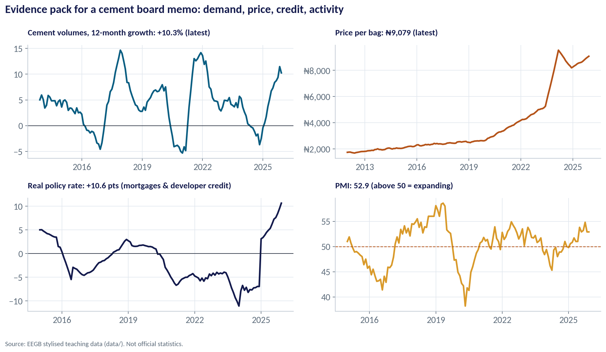
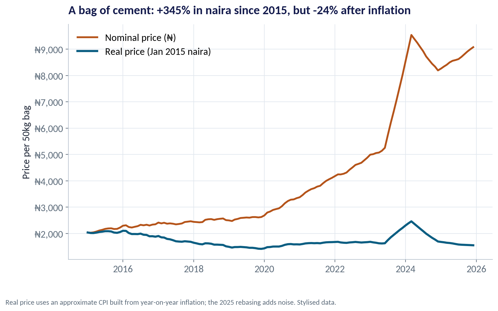
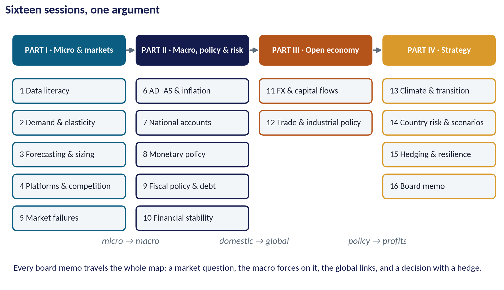
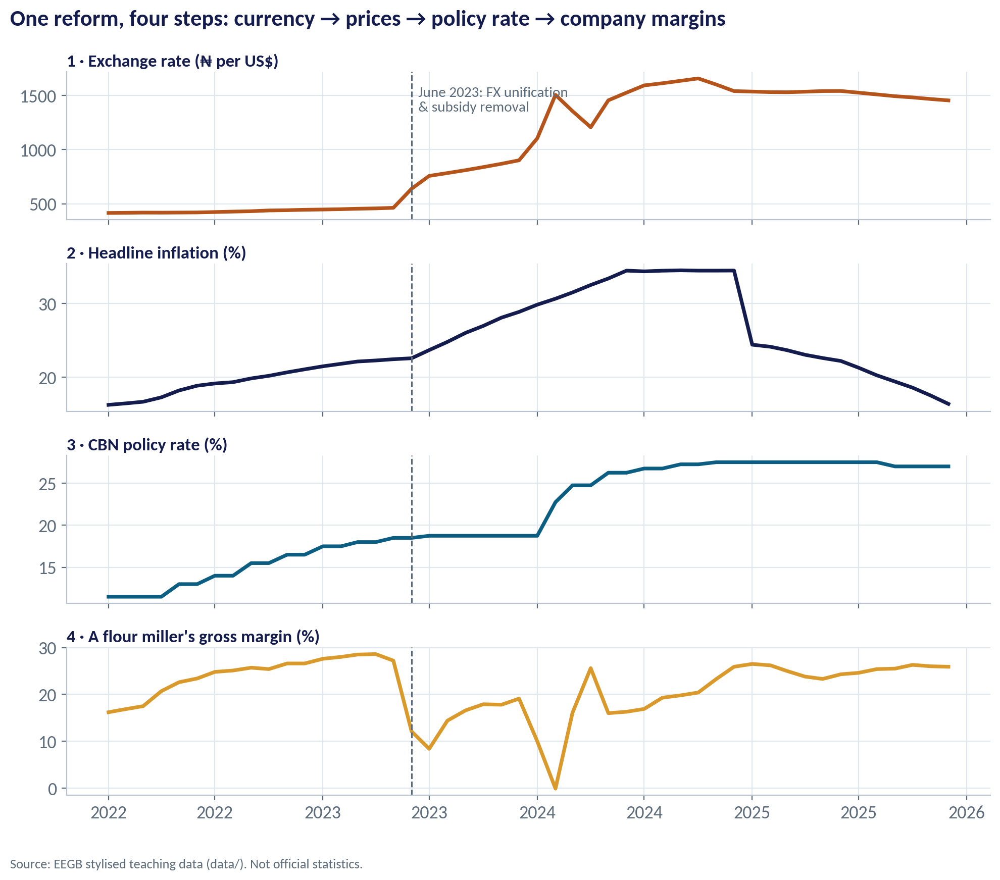
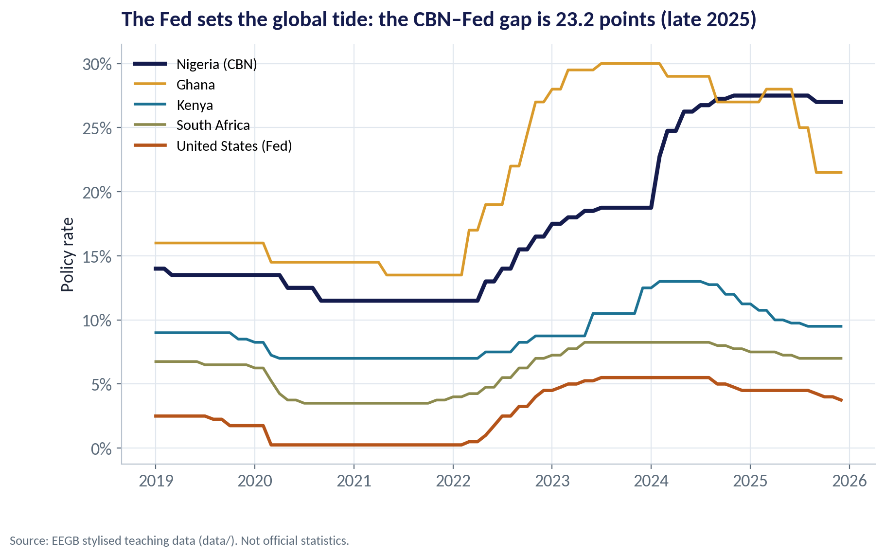
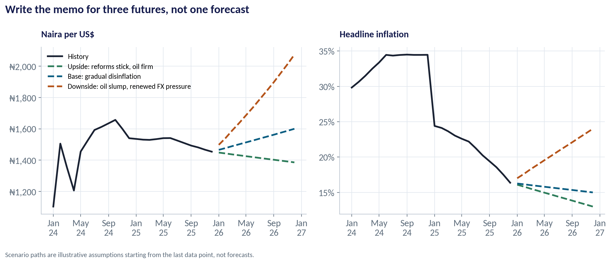

::: {.session-banner}
{.banner-hex width="96"}

**Session 16 of 16** · Facilitator: Bongo Adi, Kelechi Nnamdi & Elvis Ozegbe

:::

## Downloads {.unnumbered}

::: {.download-row}
[<i class="bi bi-file-earmark-slides"></i> Teaching slides (.pptx)](../../sessions/s16/slides/EEGB_S16_Capstone_Integrative_Review.pptx){.btn .btn-primary download=""}
[<i class="bi bi-file-earmark-pdf"></i> Slides (PDF)](../../sessions/s16/slides/EEGB_S16_Capstone_Integrative_Review.pdf){.btn .btn-outline-primary download=""}
[<i class="bi bi-github"></i> Session folder on GitHub](https://github.com/adibongo/eegb/tree/main/sessions/s16){.btn .btn-outline-secondary}
:::

## Coverage {.unnumbered}

All sessions — micro to macro, domestic to global, policy to profits

## Learning objectives

::: {.grid}
::: {.g-col-12 .g-col-md-4 .obj-card}
**Write a Board Memo**

Turn macro evidence into a one-page recommendation a board can act on.
:::
::: {.g-col-12 .g-col-md-4 .obj-card}
**Connect the Course**

Trace how a single policy or global shock flows through markets, prices, rates and the exchange rate to your P&L.
:::
::: {.g-col-12 .g-col-md-4 .obj-card}
**Prepare for the Exam**

Know the format, practise the core reasoning, and avoid the common traps.
:::
:::

## The business case

::: {.callout-note appearance="simple" icon=false}
## Your Capstone: A Macro Memo to the Board

**Situation.** Each team chooses an industry (cement, flour milling, banking, consumer goods, telecoms, power…) and acts as its strategy team.

**Question.** Given the economy today and the plausible paths for the next 12 months, what should the board do — on pricing, investment, financing and risk?

**Data.** Any course dataset plus official sources (CBN, NBS, IMF, World Bank, FRED). The capstone starter script builds a four-panel evidence pack. *Course data are stylised.*

**A good answer.** A one-page memo and an 8-minute presentation: recommendation, evidence, scenarios with probabilities, signposts and triggers, and owned actions.
:::

## Charts and how to replicate them

Every chart below is regenerated by the session's figure script — `sessions/s16/R/s16_figures.R` or `sessions/s16/python/s16_figures.py`. Run it from the project root.

### Worked Example: The Cement Industry

::: {.panel-tabset group="lang"}
## Python
{.fig-img fig-alt="S16-F04 (Python)"}

:::

- Volumes: +10.3% over the last 12 months.
- Price per bag: about ₦9,079.
- Real policy rate: +10.6 points — expensive mortgages and developer credit.
- PMI 52.9: activity expanding. Evidence for a cautious 'grow, but protect margin' memo.

<span class="fig-id">S16-F04</span>

### Don't Be Fooled by Naira Prices

::: {.panel-tabset group="lang"}
## Python
{.fig-img fig-alt="S16-F05 (Python)"}

:::

- The price of a bag of cement rose +345% in naira since 2015.
- Adjusted for inflation, it fell about 24%.
- A memo that celebrates naira price growth without deflating it misleads the board.
- Session 1's first lesson is still the most important one.

<span class="fig-id">S16-F05</span>

### Sixteen Sessions, One Logic

::: {.panel-tabset group="lang"}
## Python
{.fig-img fig-alt="S16-F02 (Python)"}

:::

- Part I: how markets set prices and quantities, and where they fail.
- Part II: how the whole economy moves — inflation, output, money, budgets, banks.
- Part III: how Nigeria connects to the world — currency, capital and trade.
- Part IV: how a firm turns all of it into strategy — climate, country risk, hedging, the board memo.

<span class="fig-id">S16-F02</span>

### One Shock, Four Panels

::: {.panel-tabset group="lang"}
## Python
{.fig-img fig-alt="S16-F01 (Python)"}

:::

- June 2023: FX unification and petrol subsidy removal.
- The naira moved from about ₦463 to a peak near ₦1,657 per dollar.
- Inflation peaked near 34.5%; the CBN raised its rate from 11.5% (early 2022) to 27.5%.
- A flour miller's gross margin fell to about zero at the worst point — policy reaches the P&L within months.

<span class="fig-id">S16-F01</span>

### The Global Tide and Nigeria's Rate

::: {.panel-tabset group="lang"}
## Python
{.fig-img fig-alt="S16-F06 (Python)"}

:::

- The US Fed's rate moves capital worldwide; emerging markets must pay a premium to keep it.
- In late 2025 the CBN's rate was about 23 points above the Fed's.
- Part of that gap is Nigerian inflation; part is the risk premium investors demand.
- When the Fed cuts, pressure on the naira usually eases — one signpost for your memo.

<span class="fig-id">S16-F06</span>

### Three Scenarios for 2026

::: {.panel-tabset group="lang"}
## Python
{.fig-img fig-alt="S16-F03 (Python)"}

:::

- Upside (reforms stick, oil firm): naira about ₦1,386, inflation about 13% by end-2026.
- Base (gradual disinflation): about ₦1,600 and 15%.
- Downside (oil slump, renewed FX pressure): about ₦2,073 and 24%.
- These are teaching scenarios, not forecasts — build your own for the memo.

<span class="fig-id">S16-F03</span>

## Capstone Starter: Your Evidence Pack

*Time:* Before your presentation · *Data:* [`data/ng_macro_monthly.csv`](../../data/ng_macro_monthly.csv)

1. Set INDUSTRY and choose the four macro drivers that matter most to it.
2. Run the script: it prints an evidence table (latest, a year ago, change).
3. It saves a four-panel chart for your memo.
4. Add one industry dataset or official series.
5. Fill in the six-paragraph memo template it prints — then rewrite in your own words.

::: {.callout-important appearance="simple"}
**Deliverable:** a one-page memo and an 8-minute presentation to the board.
:::

## The code (R | Python)

Pick your language once; every tab on the site follows your choice. Download a script, or copy it into RStudio and run it line by line.

### Replicate every chart

::: {.panel-tabset group="lang"}
## Python
[<i class="bi bi-download"></i> s16_figures.py](../../sessions/s16/python/s16_figures.py){download=""}

::: {.callout-note collapse="true" appearance="simple" icon=false}
## Show the full script (144 lines)

```{.python filename="sessions/s16/python/s16_figures.py"}
# =============================================================================
# EEGB · Session 16 · Capstone & Integrative Review
# Replication script — regenerates every chart in the Session 16 deck (Python)
# Data: data/ng_macro_monthly.csv, data/miller_exposure_monthly.csv, data/cement_demand_monthly.csv,
#       data/global_policy_rates.csv (all stylised teaching data)
# Run from the project root:  python sessions/s16/python/s16_figures.py
# =============================================================================
import sys; sys.path.insert(0, "python")
import numpy as np, pandas as pd
import matplotlib.pyplot as plt
import matplotlib.dates as mdates
from matplotlib.patches import FancyBboxPatch
from matplotlib.ticker import FuncFormatter
from eegb_style import *

set_style()
m = pd.read_csv("data/ng_macro_monthly.csv", parse_dates=["date"])
mi = pd.read_csv("data/miller_exposure_monthly.csv", parse_dates=["month"])
ce = pd.read_csv("data/cement_demand_monthly.csv", parse_dates=["month"])
pr = pd.read_csv("data/global_policy_rates.csv", parse_dates=["date"])
REFORM = pd.Timestamp("2023-06-01")

# --- F01 · Policy to profits: one shock, four panels --------------------------------------------
w = m[m.date >= "2022-01-01"]
wm = mi[mi.month >= "2022-01-01"]
fig, axes = plt.subplots(4, 1, figsize=(10, 8.4), sharex=True)
rows = [(w.date, w.official_fx_ngn_usd, RUST, "1 · Exchange rate (₦ per US$)"),
        (w.date, w.headline_inflation, NAVY, "2 · Headline inflation (%)"),
        (w.date, w.mpr, TEAL, "3 · CBN policy rate (%)"),
        (wm.month, wm.gross_margin_pct, GOLD, "4 · A flour miller's gross margin (%)")]
for ax, (x, y, c, t) in zip(axes, rows):
    ax.plot(x, y, color=c, lw=2.6); ax.axvline(REFORM, color=SLATE, ls="--", lw=1.1)
    ax.set_title(t, fontsize=12.5, loc="left", pad=4)
axes[0].text(REFORM, axes[0].get_ylim()[1] * 0.92, "  June 2023: FX unification\n  & subsidy removal", fontsize=10.5, color=SLATE, va="top")
axes[-1].xaxis.set_major_formatter(mdates.DateFormatter("%Y"))
fig.suptitle("One reform, four steps: currency → prices → policy rate → company margins", x=0.01, ha="left",
             fontsize=16, fontweight="bold", color=NAVY)
fig.tight_layout(); note(fig); save(fig, "s16", "f01")

# --- F02 · The course on one page: an integrative map --------------------------------------------
fig, ax = plt.subplots(figsize=(12, 6.4)); ax.set_xlim(0, 12); ax.set_ylim(0, 6.4); ax.axis("off")
cols = [("PART I · Micro & markets", TEAL, ["1 Data literacy", "2 Demand & elasticity", "3 Forecasting & sizing",
                                            "4 Platforms & competition", "5 Market failures"]),
        ("PART II · Macro, policy & risk", NAVY, ["6 AD–AS & inflation", "7 National accounts", "8 Monetary policy",
                                                  "9 Fiscal policy & debt", "10 Financial stability"]),
        ("PART III · Open economy", RUST, ["11 FX & capital flows", "12 Trade & industrial policy"]),
        ("PART IV · Strategy", GOLD, ["13 Climate & transition", "14 Country risk & scenarios", "15 Hedging & resilience",
                                      "16 Board memo"])]
for i, (head, c, items) in enumerate(cols):
    x = 0.2 + i * 3.0
    ax.add_patch(FancyBboxPatch((x, 5.4), 2.7, 0.7, boxstyle="round,pad=0.02,rounding_size=0.12", color=c))
    ax.text(x + 1.35, 5.75, head, ha="center", va="center", color="white", fontsize=11.5, fontweight="bold")
    for j, it in enumerate(items):
        y = 4.75 - j * 0.78
        ax.add_patch(FancyBboxPatch((x, y - 0.28), 2.7, 0.56, boxstyle="round,pad=0.02,rounding_size=0.1",
                                    facecolor=LIGHT, edgecolor=c, lw=1.6))
        ax.text(x + 0.15, y, it, va="center", fontsize=11.5, color=INK)
    if i < 3:
        ax.annotate("", xy=(x + 3.0, 5.75), xytext=(x + 2.72, 5.75), arrowprops=dict(arrowstyle="-|>", color=SLATE, lw=2))
for k, (lab, y) in enumerate([("micro → macro", 0.55), ("domestic → global", 0.55), ("policy → profits", 0.55)]):
    ax.text(1.55 + k * 3.0 + 1.5, 1.0, lab, ha="center", fontsize=12.5, color=SLATE, style="italic")
ax.text(0.2, 0.35, "Every board memo travels the whole map: a market question, the macro forces on it, the global links, and a decision with a hedge.",
        fontsize=12, color=NAVY)
ax.set_title("Sixteen sessions, one argument", loc="left")
save(fig, "s16", "f02")

# --- F03 · Three scenarios for 2026 ----------------------------------------------------------------
last = m.iloc[-1]
months = pd.date_range("2026-01-01", "2026-12-01", freq="MS")
scen = {"Upside: reforms stick, oil firm": (-0.004, 13.0, GREEN := "#2E7D5B"),
        "Base: gradual disinflation": (0.008, 15.0, TEAL),
        "Downside: oil slump, renewed FX pressure": (0.030, 24.0, RUST)}
fig, axes = plt.subplots(1, 2, figsize=(12, 4.8))
hist = m[m.date >= "2024-01-01"]
axes[0].plot(hist.date, hist.official_fx_ngn_usd, color=INK, lw=2.4, label="History")
axes[1].plot(hist.date, hist.headline_inflation, color=INK, lw=2.4, label="History")
scen_end = {}
for name, (g, infl_end, c) in scen.items():
    fx = last.official_fx_ngn_usd * (1 + g) ** np.arange(1, 13)
    inf = np.linspace(last.headline_inflation, infl_end, 13)[1:]
    axes[0].plot(months, fx, color=c, lw=2.4, ls="--", label=name)
    axes[1].plot(months, inf, color=c, lw=2.4, ls="--")
    scen_end[name] = (fx[-1], inf[-1])
axes[0].yaxis.set_major_formatter(FuncFormatter(lambda v, p: f"₦{v:,.0f}"))
axes[1].yaxis.set_major_formatter(FuncFormatter(pct))
axes[0].set_title("Naira per US$", fontsize=13); axes[1].set_title("Headline inflation", fontsize=13)
axes[0].legend(loc="upper left", fontsize=10)
for ax in axes: ax.xaxis.set_major_formatter(mdates.DateFormatter("%b\n%y"))
fig.suptitle("Write the memo for three futures, not one forecast", x=0.01, ha="left", fontsize=16, fontweight="bold", color=NAVY)
fig.tight_layout(); note(fig, "Scenario paths are illustrative assumptions starting from the last data point, not forecasts."); save(fig, "s16", "f03")

# --- F04 · A memo evidence pack: the cement industry ------------------------------------------------
c2 = ce.set_index("month")
yoy = 100 * (c2.cement_mt.rolling(12).sum() / c2.cement_mt.rolling(12).sum().shift(12) - 1)
mm = m.set_index("date")
fig, axes = plt.subplots(2, 2, figsize=(12, 6.6))
a = axes[0, 0]; a.plot(yoy.index, yoy, color=TEAL, lw=2.3); a.axhline(0, color=INK, lw=.8)
a.set_title(f"Cement volumes, 12-month growth: {yoy.iloc[-1]:+.1f}% (latest)", fontsize=12, loc="left")
a = axes[0, 1]; a.plot(c2.index, c2.price_per_bag_naira, color=RUST, lw=2.3)
a.set_title(f"Price per bag: ₦{c2.price_per_bag_naira.iloc[-1]:,.0f} (latest)", fontsize=12, loc="left")
a.yaxis.set_major_formatter(FuncFormatter(lambda v, p: f"₦{v:,.0f}"))
a = axes[1, 0]; real = mm.mpr - mm.headline_inflation
a.plot(real.index, real, color=NAVY, lw=2.3); a.axhline(0, color=INK, lw=.8)
a.set_title(f"Real policy rate: {real.iloc[-1]:+.1f} pts (mortgages & developer credit)", fontsize=12, loc="left")
a = axes[1, 1]; a.plot(mm.index, mm.pmi, color=GOLD, lw=2.3); a.axhline(50, color=RUST, ls="--", lw=1)
a.set_title(f"PMI: {mm.pmi.iloc[-1]:.1f} (above 50 = expanding)", fontsize=12, loc="left")
for a in axes.flat: a.xaxis.set_major_locator(mdates.YearLocator(3)); a.xaxis.set_major_formatter(mdates.DateFormatter("%Y"))
fig.suptitle("Evidence pack for a cement board memo: demand, price, credit, activity", x=0.01, ha="left",
             fontsize=16, fontweight="bold", color=NAVY)
fig.tight_layout(); note(fig); save(fig, "s16", "f04")

# --- F05 · Nominal vs real: the price of a bag of cement -------------------------------------------
# Approximate monthly CPI index from year-on-year inflation: monthly factor = (1 + yoy)^(1/12)
cpi = (1 + mm.headline_inflation / 100) ** (1 / 12)
cpi = 100 * cpi.cumprod() / cpi.iloc[0]
bag = c2.price_per_bag_naira.reindex(cpi.index)
real_bag = bag / cpi * 100
nom_ch, real_ch = bag.iloc[-1] / bag.iloc[0] - 1, real_bag.iloc[-1] / real_bag.iloc[0] - 1
fig, ax = plt.subplots()
ax.plot(bag.index, bag, color=RUST, lw=2.4, label="Nominal price (₦)")
ax.plot(real_bag.index, real_bag, color=TEAL, lw=2.8, label="Real price (Jan 2015 naira)")
ax.yaxis.set_major_formatter(FuncFormatter(lambda v, p: f"₦{v:,.0f}")); ax.legend(loc="upper left")
ax.set(title=f"A bag of cement: {nom_ch:+.0%} in naira since 2015, but {real_ch:+.0%} after inflation",
       ylabel="Price per 50kg bag")
note(fig, "Real price uses an approximate CPI built from year-on-year inflation; the 2025 rebasing adds noise. Stylised data.")
save(fig, "s16", "f05")

# --- F06 · Domestic meets global: policy rates compared ----------------------------------------------
fig, ax = plt.subplots()
for col, lab, c, lw_ in [("nigeria_cbn", "Nigeria (CBN)", NAVY, 3), ("ghana_bog", "Ghana", GOLD, 2),
                         ("kenya_cbk", "Kenya", TEAL2, 2), ("south_africa_sarb", "South Africa", OLIVE, 2),
                         ("us_fed", "United States (Fed)", RUST, 2.4)]:
    ax.plot(pr.date, pr[col], color=c, lw=lw_, label=lab)
gap = pr.nigeria_cbn.iloc[-1] - pr.us_fed.iloc[-1]
ax.yaxis.set_major_formatter(FuncFormatter(pct)); ax.legend(loc="upper left", fontsize=11)
ax.set(title=f"The Fed sets the global tide: the CBN–Fed gap is {gap:.1f} points (late 2025)", ylabel="Policy rate")
note(fig); save(fig, "s16", "f06")

print("F01 fx", m[m.date == "2023-05-01"].official_fx_ngn_usd.values, "->", w.official_fx_ngn_usd.max(),
      "| infl peak", w.headline_inflation.max(), "| mpr", w.mpr.min(), "->", w.mpr.max(), "| margin min", wm.gross_margin_pct.min())
print("F03 start fx", last.official_fx_ngn_usd, "infl", last.headline_inflation); print({k: (round(v[0]), round(v[1], 1)) for k, v in scen_end.items()})
print("F04 cement yoy", round(yoy.iloc[-1], 1), "| price", c2.price_per_bag_naira.iloc[-1], "| real rate", round(real.iloc[-1], 1), "| pmi", mm.pmi.iloc[-1])
print("F05 nominal", round(nom_ch * 100), "% real", round(real_ch * 100), "% | bag 2015", bag.iloc[0], "2025", bag.iloc[-1])
print("F06 gap", gap, pr.iloc[-1].to_dict())
```
:::

## R
[<i class="bi bi-download"></i> s16_figures.R](../../sessions/s16/R/s16_figures.R){download=""}

::: {.callout-note collapse="true" appearance="simple" icon=false}
## Show the full script (85 lines)

```{.r filename="sessions/s16/R/s16_figures.R"}
# =============================================================================
# EEGB · Session 16 · Capstone & Integrative Review
# Replication script — regenerates every chart in the Session 16 deck (R)
# Data: data/ng_macro_monthly.csv, data/miller_exposure_monthly.csv, data/cement_demand_monthly.csv,
#       data/global_policy_rates.csv (all stylised teaching data)
# =============================================================================
source("R/theme_eegb.R")
suppressPackageStartupMessages({ library(dplyr); library(readr); library(tidyr) })
m  <- read_csv("data/ng_macro_monthly.csv", show_col_types = FALSE) |> mutate(date = as.Date(date))
mi <- read_csv("data/miller_exposure_monthly.csv", show_col_types = FALSE) |> mutate(month = as.Date(month))
ce <- read_csv("data/cement_demand_monthly.csv", show_col_types = FALSE) |> mutate(month = as.Date(month))
pr <- read_csv("data/global_policy_rates.csv", show_col_types = FALSE) |> mutate(date = as.Date(date))
reform <- as.Date("2023-06-01")

# --- F01 · Policy to profits: one shock, four panels --------------------------------------
d1 <- bind_rows(
  m |> filter(date >= as.Date("2022-01-01")) |> transmute(date, panel = "1 · Exchange rate (₦ per US$)", value = official_fx_ngn_usd),
  m |> filter(date >= as.Date("2022-01-01")) |> transmute(date, panel = "2 · Headline inflation (%)", value = headline_inflation),
  m |> filter(date >= as.Date("2022-01-01")) |> transmute(date, panel = "3 · CBN policy rate (%)", value = mpr),
  mi |> filter(month >= as.Date("2022-01-01")) |> transmute(date = month, panel = "4 · A flour miller's gross margin (%)", value = gross_margin_pct))
p1 <- ggplot(d1, aes(date, value, colour = panel)) + geom_line(linewidth = 1.1, show.legend = FALSE) +
  geom_vline(xintercept = reform, linetype = "dashed", colour = eegb[["slate"]]) +
  facet_wrap(~panel, ncol = 1, scales = "free_y") + scale_colour_manual(values = unname(eegb[c("rust", "navy", "teal", "gold")])) +
  labs(title = "Policy to profits: one reform, four panels (dashed line = June 2023)", x = NULL, y = NULL, caption = eegb_caption) + theme_eegb()
save_fig(p1, "s16", "f01", height = 8)

# --- F02 · The course on one page ---------------------------------------------------------
map <- tibble(part = rep(c("PART I · Micro & markets", "PART II · Macro, policy & risk", "PART III · Open economy", "PART IV · Strategy"), c(5, 5, 2, 4)),
              session = c("1 Data literacy", "2 Demand & elasticity", "3 Forecasting & sizing", "4 Platforms & competition", "5 Market failures",
                          "6 AD–AS & inflation", "7 National accounts", "8 Monetary policy", "9 Fiscal policy & debt", "10 Financial stability",
                          "11 FX & capital flows", "12 Trade & industrial policy",
                          "13 Climate & transition", "14 Country risk & scenarios", "15 Hedging & resilience", "16 Board memo")) |>
  group_by(part) |> mutate(row = row_number()) |> ungroup() |> mutate(part = factor(part, levels = unique(part)))
p2 <- ggplot(map, aes(part, -row)) + geom_tile(aes(fill = part), width = .92, height = .8, alpha = .2, colour = "white") +
  geom_text(aes(label = session), size = 3.6) +
  scale_fill_manual(values = unname(eegb[c("teal", "navy", "rust", "gold")]), guide = "none") +
  labs(title = "The course on one page: micro → macro → global → strategy", x = NULL, y = NULL) +
  theme_eegb() + theme(axis.text.y = element_blank(), panel.grid = element_blank())
save_fig(p2, "s16", "f02", width = 12, height = 6)

# --- F03 · Three scenarios for 2026 -------------------------------------------------------------
last <- tail(m, 1); months <- seq(as.Date("2026-01-01"), by = "month", length.out = 12)
scen <- tibble(scenario = c("Upside: reforms stick, oil firm", "Base: gradual disinflation", "Downside: oil slump, renewed FX pressure"),
               g = c(-.004, .008, .03), infl_end = c(13, 15, 24))
d3 <- scen |> rowwise() |> reframe(scenario, date = months, fx = last$official_fx_ngn_usd * (1 + g)^(1:12),
                                   inflation = seq(last$headline_inflation, infl_end, length.out = 13)[-1])
p3 <- ggplot() + geom_line(data = filter(m, date >= as.Date("2024-01-01")), aes(date, official_fx_ngn_usd), colour = eegb[["ink"]], linewidth = 1.1) +
  geom_line(data = d3, aes(date, fx, colour = scenario), linetype = "dashed", linewidth = 1.1) +
  scale_colour_manual(values = c("#2E7D5B", eegb[["teal"]], eegb[["rust"]]), name = NULL) +
  labs(title = "Three teaching scenarios for the naira in 2026", x = NULL, y = "Naira per US$", caption = eegb_caption) + theme_eegb() +
  theme(legend.direction = "vertical")
save_fig(p3, "s16", "f03")

# --- F04 · Cement evidence pack -------------------------------------------------------------------
ce <- ce |> mutate(r12 = as.numeric(stats::filter(cement_mt, rep(1, 12), sides = 1)), yoy = 100 * (r12 / lag(r12, 12) - 1))
d4 <- bind_rows(ce |> transmute(date = month, panel = "Cement volumes, 12-month growth (%)", value = yoy),
                ce |> transmute(date = month, panel = "Price per bag (₦)", value = price_per_bag_naira),
                m |> transmute(date, panel = "Real policy rate (pts)", value = mpr - headline_inflation),
                m |> transmute(date, panel = "PMI (50 = no change)", value = pmi))
p4 <- ggplot(filter(d4, !is.na(value)), aes(date, value)) + geom_line(colour = eegb[["teal"]], linewidth = 1) +
  facet_wrap(~panel, scales = "free_y") +
  labs(title = "A memo evidence pack: the cement industry", x = NULL, y = NULL, caption = eegb_caption) + theme_eegb()
save_fig(p4, "s16", "f04", width = 12, height = 6.5)

# --- F05 · Nominal vs real price of a bag of cement ---------------------------------------------------
cpi <- m |> transmute(month = date, cpi = cumprod((1 + headline_inflation / 100)^(1 / 12)))
d5 <- inner_join(ce, cpi, by = "month") |> mutate(nominal = 100 * price_per_bag_naira / first(price_per_bag_naira),
                                                  real = 100 * (price_per_bag_naira / cpi) / first(price_per_bag_naira / cpi))
p5 <- ggplot(pivot_longer(select(d5, month, nominal, real), -month), aes(month, value, colour = name)) + geom_line(linewidth = 1.2) +
  scale_colour_manual(values = unname(eegb[c("rust", "teal")]), labels = c("Nominal (naira)", "Real (after inflation)"), name = NULL) +
  geom_hline(yintercept = 100) +
  labs(title = sprintf("A bag of cement: %+.0f%% in naira since 2015, but %+.0f%% after inflation",
                       tail(d5$nominal, 1) - 100, tail(d5$real, 1) - 100),
       x = NULL, y = "Index, Jan 2015 = 100", caption = eegb_caption) + theme_eegb()
save_fig(p5, "s16", "f05")

# --- F06 · Policy rates compared ----------------------------------------------------------------------
d6 <- pr |> select(date, `US Fed` = us_fed, `Nigeria CBN` = nigeria_cbn, `South Africa` = south_africa_sarb, Kenya = kenya_cbk, Ghana = ghana_bog) |>
  pivot_longer(-date)
gap <- tail(pr$nigeria_cbn, 1) - tail(pr$us_fed, 1)
p6 <- ggplot(d6, aes(date, value, colour = name)) + geom_step(linewidth = 1.1) +
  scale_colour_manual(values = c(Ghana = eegb[["gold"]], Kenya = eegb[["olive"]], `Nigeria CBN` = eegb[["navy"]], `South Africa` = eegb[["teal"]], `US Fed` = eegb[["rust"]]), name = NULL) +
  labs(title = sprintf("The Fed sets the global tide: the CBN–Fed gap is %.1f points (late 2025)", gap),
       x = NULL, y = "Policy rate (%)", caption = eegb_caption) + theme_eegb()
save_fig(p6, "s16", "f06")
```
:::

:::

### Capstone starter

::: {.panel-tabset group="lang"}
## Python
[<i class="bi bi-download"></i> s16_capstone_starter.py](../../sessions/s16/python/s16_capstone_starter.py){download=""}

::: {.callout-note collapse="true" appearance="simple" icon=false}
## Show the full script (56 lines)

```{.python filename="sessions/s16/python/s16_capstone_starter.py"}
# =============================================================================
# EEGB · Session 16 · CAPSTONE STARTER — build the evidence pack for your board memo (Python)
# Data: data/ng_macro_monthly.csv and any industry file from the course (all stylised teaching data)
# Run from the project root. Change the settings in STEP 1, then run the whole file.
# Output: sessions/s16/figures/python/capstone_evidence_pack.png + a printed evidence table
# =============================================================================
import sys; sys.path.insert(0, "python")
import pandas as pd
import matplotlib.pyplot as plt
from eegb_style import *

set_style()

# ---- STEP 1 · Choose your industry and its macro drivers ----------------------------------------
INDUSTRY = "Cement"                      # e.g. "Flour milling", "Banking", "Consumer goods", "Telecoms"
DRIVERS = {                              # column in ng_macro_monthly.csv : why it matters to the industry
    "official_fx_ngn_usd": "imported energy, spare parts and kiln inputs",
    "headline_inflation": "construction costs and household purchasing power",
    "mpr": "mortgage and developer credit",
    "pmi": "early signal of construction activity",
}

# ---- STEP 2 · Load the data and compute the evidence ----------------------------------------------
m = pd.read_csv("data/ng_macro_monthly.csv", parse_dates=["date"])
latest, year_ago = m.iloc[-1], m.iloc[-13]
ev = pd.DataFrame({"driver": list(DRIVERS), "why it matters": list(DRIVERS.values()),
                   "latest": [latest[c] for c in DRIVERS], "a year ago": [year_ago[c] for c in DRIVERS]})
ev["change"] = ev["latest"] - ev["a year ago"]
pd.set_option("display.width", 160)
print(f"\nEVIDENCE TABLE — {INDUSTRY}\n", ev.round(2).to_string(index=False))

# ---- STEP 3 · One page of charts (last five years) --------------------------------------------------
w = m[m.date >= m.date.max() - pd.DateOffset(years=5)]
fig, axes = plt.subplots(2, 2, figsize=(12, 6.5), sharex=True)
for ax, (col, why), c in zip(axes.flat, DRIVERS.items(), [RUST, NAVY, TEAL, GOLD]):
    ax.plot(w.date, w[col], color=c, lw=2.3)
    ax.set_title(f"{col}: {latest[col]:,.1f}\n({why})", fontsize=11.5, loc="left")
fig.suptitle(f"Macro evidence pack — {INDUSTRY}", x=0.01, ha="left", fontsize=16, fontweight="bold", color=NAVY)
fig.tight_layout(); note(fig)
save(fig, "s16", "capstone_evidence_pack")

# ---- STEP 4 · Draft your memo (fill in, then rewrite in your own words) -------------------------------
print(f"""
MEMO TO THE BOARD — {INDUSTRY}
1. Recommendation (one sentence): ...
2. What has changed in the economy (three numbers from the evidence table): ...
3. What it means for us (prices, volumes, costs, financing): ...
4. Scenarios for the next 12 months (upside / base / downside, with probabilities): ...
5. Signposts and triggers we will watch: ...
6. Actions and owners (pricing, hedging, capex, financing): ...
""")

# ---- YOUR TURN -------------------------------------------------------------------------------------------
# (a) Replace INDUSTRY and DRIVERS with your own industry and the four macro drivers that matter most to it.
# (b) Add one industry dataset from data/ (e.g. cement_demand_monthly.csv or miller_exposure_monthly.csv) to the pack.
# (c) Write the memo in no more than one page. Lead with the recommendation.
```
:::

## R
[<i class="bi bi-download"></i> s16_capstone_starter.R](../../sessions/s16/R/s16_capstone_starter.R){download=""}

::: {.callout-note collapse="true" appearance="simple" icon=false}
## Show the full script (41 lines)

```{.r filename="sessions/s16/R/s16_capstone_starter.R"}
# =============================================================================
# EEGB · Session 16 · CAPSTONE STARTER — build the evidence pack for your board memo (R)
# Data: data/ng_macro_monthly.csv and any industry file from the course (all stylised teaching data)
# Change the settings in STEP 1, then run the whole file (Ctrl/Cmd + Shift + Enter).
# =============================================================================
source("R/theme_eegb.R")
suppressPackageStartupMessages({ library(dplyr); library(readr); library(tidyr) })

# ---- STEP 1 · Choose your industry and its macro drivers ----------------------------------------
INDUSTRY <- "Cement"
DRIVERS <- c(official_fx_ngn_usd = "imported energy, spare parts and kiln inputs",
             headline_inflation  = "construction costs and household purchasing power",
             mpr                 = "mortgage and developer credit",
             pmi                 = "early signal of construction activity")

# ---- STEP 2 · Evidence table -----------------------------------------------------------------------
m <- read_csv("data/ng_macro_monthly.csv", show_col_types = FALSE) |> mutate(date = as.Date(date))
n <- nrow(m)
ev <- tibble(driver = names(DRIVERS), why = unname(DRIVERS),
             latest = unlist(m[n, names(DRIVERS)]), a_year_ago = unlist(m[n - 12, names(DRIVERS)])) |>
  mutate(change = latest - a_year_ago)
print(ev)

# ---- STEP 3 · One page of charts (last five years) ----------------------------------------------------
w <- m |> filter(date >= max(date) - 365 * 5) |> select(date, all_of(names(DRIVERS))) |> pivot_longer(-date)
p <- ggplot(w, aes(date, value)) + geom_line(colour = eegb[["teal"]], linewidth = 1) +
  facet_wrap(~name, scales = "free_y") +
  labs(title = paste("Macro evidence pack —", INDUSTRY), x = NULL, y = NULL, caption = eegb_caption) + theme_eegb()
save_fig(p, "s16", "capstone_evidence_pack", width = 12, height = 6.5)

# ---- STEP 4 · Memo template -------------------------------------------------------------------------
cat("\nMEMO TO THE BOARD —", INDUSTRY, "\n",
    "1. Recommendation (one sentence): ...\n",
    "2. What has changed in the economy (three numbers): ...\n",
    "3. What it means for us (prices, volumes, costs, financing): ...\n",
    "4. Scenarios for the next 12 months (with probabilities): ...\n",
    "5. Signposts and triggers: ...\n",
    "6. Actions and owners: ...\n")

# ---- YOUR TURN -------------------------------------------------------------------------------------------
# (a) Replace INDUSTRY and DRIVERS with your own. (b) Add one industry dataset. (c) Write the memo in one page.
```
:::

:::

## Check your understanding

**Q1.** Practice: the Fed cuts rates by 1 point while Nigerian inflation is stable. Which chain is most likely for a Lagos importer?

- **A.** Higher naira borrowing costs immediately
- **B.** Capital flows toward emerging markets, easing pressure on the naira and the cost of imported inputs
- **C.** No effect, because the Fed only affects the US
- **D.** Higher Nigerian inflation

::: {.callout-tip collapse="true" appearance="simple"}
## Show answer
**B.** B. Lower US rates make naira assets relatively more attractive (carry), supporting the naira. The importer's dollar costs in naira fall or stabilise. The effect is not guaranteed — oil and domestic policy matter too.
:::

**Q2.** Practice: a board member says 'our dollar loan at 7% is cheaper than a naira loan at 22%'. What do you check first?

- **A.** Nothing — 7% is lower
- **B.** The expected depreciation of the naira and whether our revenues are in naira (currency mismatch)
- **C.** The Fed's balance sheet
- **D.** The CPI rebasing

::: {.callout-tip collapse="true" appearance="simple"}
## Show answer
**B.** B. The true cost of the dollar loan is roughly 7% plus expected naira depreciation. With naira revenues, a large devaluation can make it far dearer (Session 11).
:::

## Vocabulary

| Term | Meaning |
|---|---|
| **Real vs nominal** | Adjusted vs not adjusted for inflation (S1). |
| **Elasticity** | % change in quantity for a 1% change in price or income (S2). |
| **Externality** | A cost or benefit falling on others (S5, S13). |
| **Supply shock** | A cost shock that raises prices and cuts output (S6). |
| **Transmission** | How policy reaches firms and households (S8). |
| **r − g** | Interest rate minus growth: drives the debt ratio (S9). |
| **Duration gap** | How a rate rise hits a balance sheet (S10). |
| **Impossible trinity** | Fixed rate, free capital, own policy: pick two (S11). |
| **Scenario & signpost** | Plausible futures and the indicators that reveal them (S14). |
| **Natural hedge** | Matching costs and revenues in the same currency (S15). |

## Key takeaways

1. Think in incentives, margins and opportunity cost — and always separate real from nominal.
2. Prices, inflation, rates and the naira are linked: one shock travels through all of them.
3. Nigeria is an open economy: oil, the Fed and capital flows shape what the CBN can do.
4. Plan with scenarios, signposts and hedges, not a single forecast.
5. Tell the board what to do, why, and what would change your mind.

::: {.callout-note appearance="simple"}
**Before next session:** Submit your one-page memo before your presentation slot. Revise the practice questions and the five transmission chains for the closed-book final exam.
:::

::: {.session-nav}
[← Session 15: Hedging & Resilience](../../sessions/s15/index.qmd)
:::
